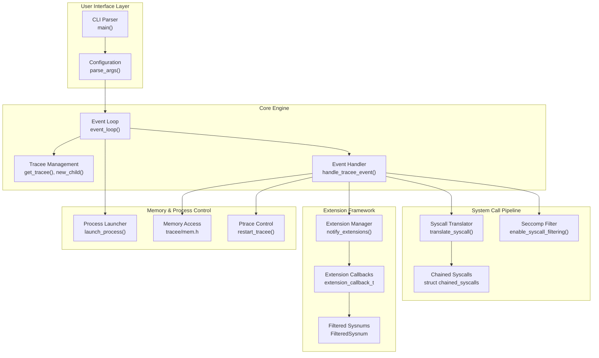
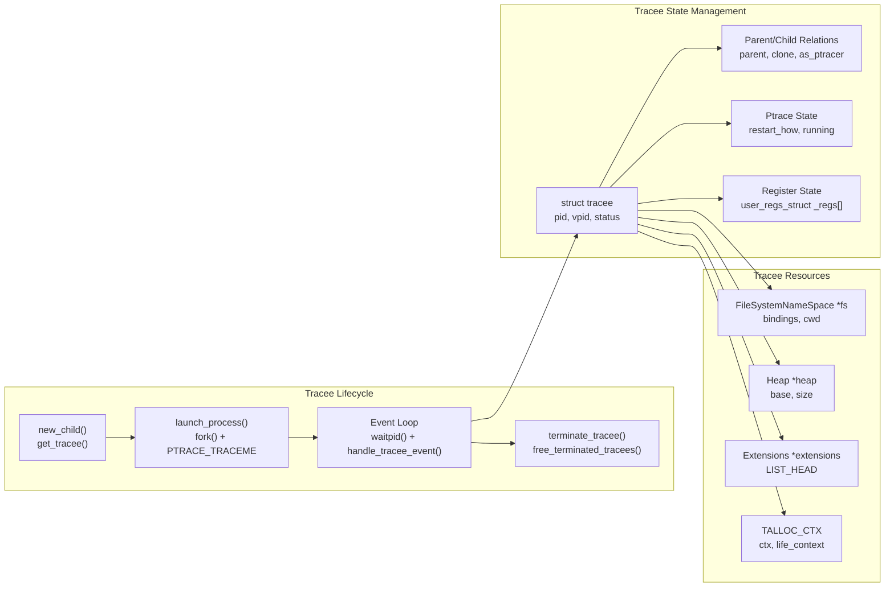
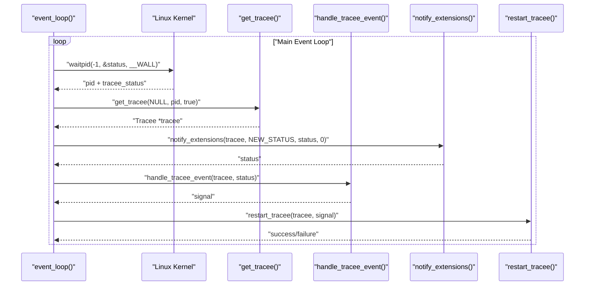
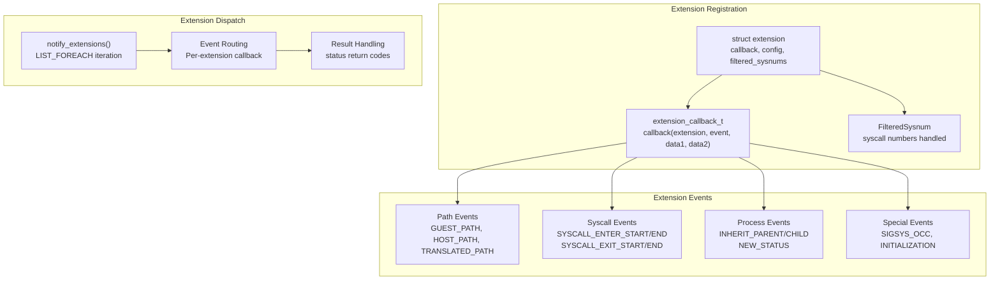
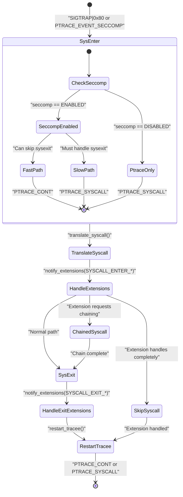

<!-- source: DeepWiki mcp.deepwiki.com · repo termux/proot · page 2 Architecture · fetched 2026-10-26 -->

# Architecture

Relevant source files

The following files were used as context for generating this wiki page:

- [src/extension/extension.h](src/extension/extension.h)
- [src/tracee/event.c](src/tracee/event.c)
- [src/tracee/tracee.h](src/tracee/tracee.h)

This document explains PRoot's overall system architecture, including the tracer-tracee model, event-driven processing, and modular extension system. It covers the fundamental design patterns and core components that enable PRoot to provide user-space process virtualization.

For details on specific core systems like process management and syscall interception, see [Core Systems](#3). For information about individual extensions, see [Extension System](#4).

## Overview

PRoot implements a user-space process virtualization system using a tracer-tracee architecture where PRoot acts as the tracer and monitored processes are tracees. The system intercepts system calls using ptrace and optional seccomp filters, translates them as needed, and manages a hierarchy of traced processes through an event-driven main loop.

### Core Architecture Components

Sources: [src/tracee/event.c:260-363](), [src/tracee/tracee.h:74-296](), [src/extension/extension.h:154-174]()

## Tracer-Tracee Model

PRoot operates on a fundamental tracer-tracee relationship where PRoot serves as the tracer for all monitored processes (tracees). Each tracee is represented by the `Tracee` struct, which maintains comprehensive process state.

### Tracee Structure and Lifecycle

The `Tracee` struct contains several categories of resources:
- **Private resources**: `pid`, `vpid`, `running`, `terminated`
- **Inherited resources**: `verbose`, `seccomp` state
- **Shared resources**: `fs` (file system namespace), `heap` (virtual heap)
- **Process relations**: `parent`, `clone`, ptrace emulation support

Sources: [src/tracee/tracee.h:74-296](), [src/tracee/event.c:59-115]()

## Event-Driven Processing

The core of PRoot's operation is the `event_loop()` function, which continuously monitors all tracees and dispatches events to appropriate handlers.

### Event Loop Flow

The event loop handles several types of events:
- **Process termination**: `WIFEXITED`, `WIFSIGNALED`
- **Signal stops**: `WIFSTOPPED` with various signals
- **Syscall traps**: `SIGTRAP | 0x80`, `PTRACE_EVENT_SECCOMP`
- **Process events**: `PTRACE_EVENT_FORK`, `PTRACE_EVENT_EXEC`, etc.

Sources: [src/tracee/event.c:260-363](), [src/tracee/event.c:370-689]()

## Extension Architecture

PRoot uses a modular extension system where extensions register callbacks for specific events and syscalls. Extensions can intercept and modify syscall processing at multiple stages.

### Extension System Structure

Extensions can return specific status codes to control PRoot's behavior:
- **< 0**: Report errno to tracee
- **== 0**: Continue normal processing  
- **> 0**: Skip PRoot's default handling

Key extension events include:
- `SYSCALL_ENTER_START`/`SYSCALL_ENTER_END`: Before/after syscall entry processing
- `SYSCALL_EXIT_START`/`SYSCALL_EXIT_END`: Before/after syscall exit processing
- `GUEST_PATH`/`HOST_PATH`/`TRANSLATED_PATH`: Path translation stages
- `SIGSYS_OCC`: Seccomp SIGSYS signal handling

Sources: [src/extension/extension.h:32-150](), [src/extension/extension.h:184-199]()

## System Call Interception

PRoot intercepts system calls using a combination of ptrace and seccomp filtering. The interception process varies depending on whether seccomp acceleration is enabled.

### Syscall Processing States

The syscall interception process involves:
1. **Entry detection**: Via `SIGTRAP | 0x80` or `PTRACE_EVENT_SECCOMP`
2. **Translation**: `translate_syscall()` modifies arguments if needed
3. **Extension notification**: Extensions can intercept and modify behavior
4. **Exit handling**: Process syscall results and notify extensions
5. **Restart**: Continue tracee with `PTRACE_CONT` or `PTRACE_SYSCALL`

Sources: [src/tracee/event.c:465-608](), [src/tracee/event.c:543-607]()

## Key Data Structures

The architecture relies on several key data structures that maintain system state:

| Structure | Purpose | Key Fields | Source File |
|-----------|---------|------------|-------------|
| `Tracee` | Process state | `pid`, `status`, `_regs[]`, `extensions` | [src/tracee/tracee.h:74-296]() |
| `Extension` | Extension definition | `callback`, `config`, `filtered_sysnums` | [src/extension/extension.h:158-172]() |
| `FileSystemNameSpace` | Path bindings | `bindings.{pending,guest,host}`, `cwd` | [src/tracee/tracee.h:50-65]() |
| `Heap` | Virtual heap | `base`, `size`, `disabled` | [src/tracee/tracee.h:67-72]() |

The `Tracee` struct uses a sophisticated resource management system with different sharing semantics:
- **Private resources**: Unique to each tracee
- **Inherited resources**: Copied from parent during fork/clone
- **Shared resources**: Shared between related tracees (CLONE_FS, CLONE_VM)
- **Read-only resources**: Immutable configuration data

Sources: [src/tracee/tracee.h:74-296](), [src/extension/extension.h:158-172]()

---

