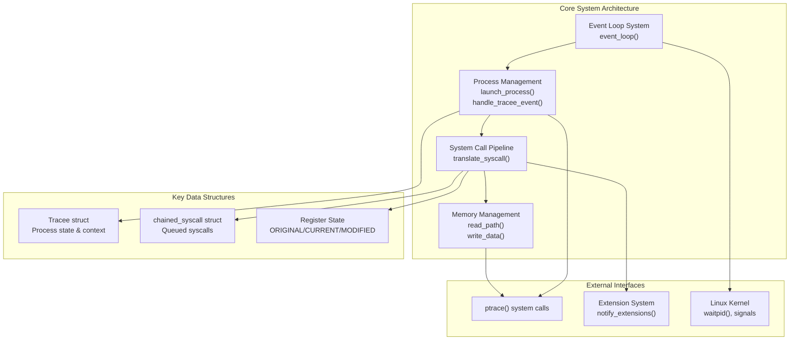
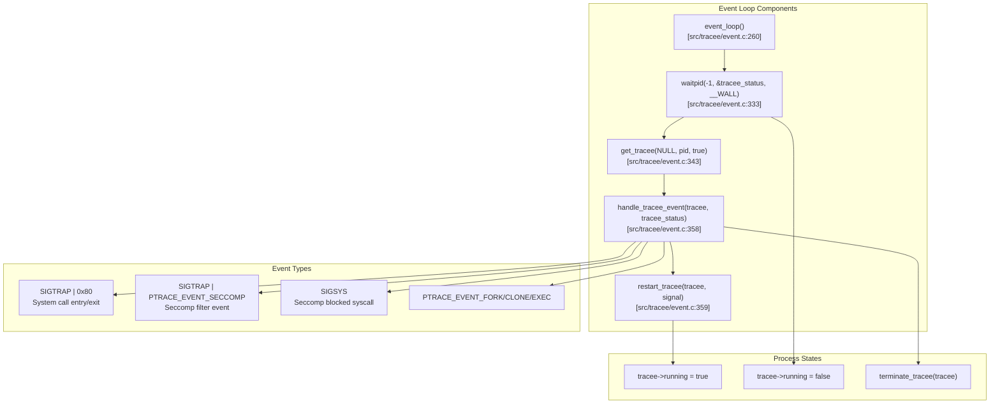
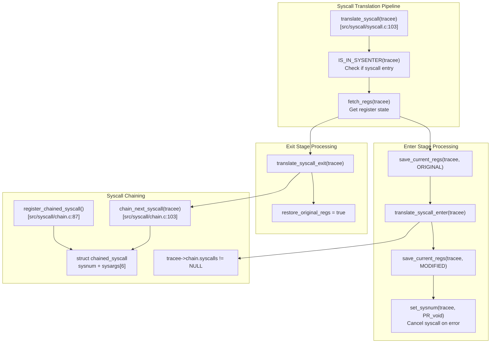
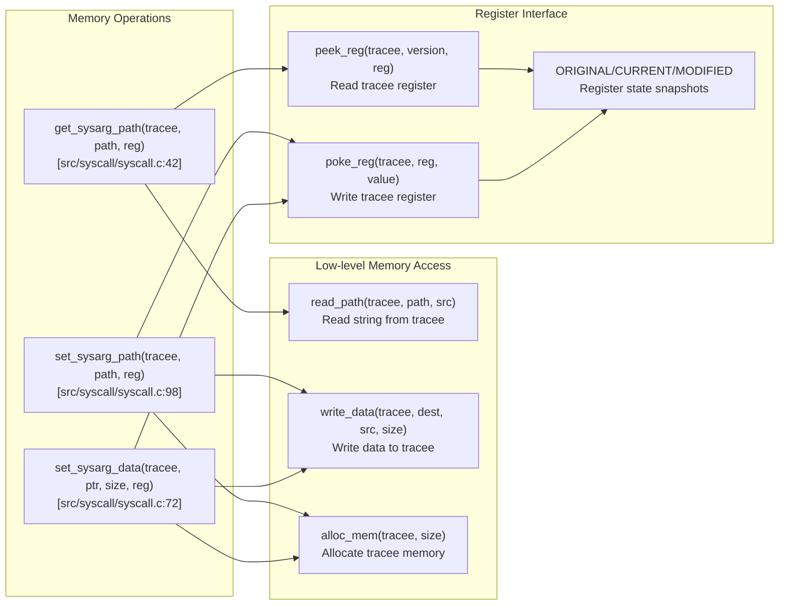

<!-- source: DeepWiki mcp.deepwiki.com · repo termux/proot · page 3 Core Systems · fetched 2026-10-26 -->

# Core Systems

Relevant source files

The following files were used as context for generating this wiki page:

- [src/syscall/chain.c](src/syscall/chain.c)
- [src/syscall/syscall.c](src/syscall/syscall.c)
- [src/syscall/syscall.h](src/syscall/syscall.h)
- [src/tracee/event.c](src/tracee/event.c)

This document provides an overview of the fundamental systems that make PRoot work: the event loop and process management, system call interception and translation, and memory management. These core systems work together to provide PRoot's user-space implementation of chroot, mount, and binfmt_misc functionality.

For detailed information about process lifecycle management, see [Process Management](#3.1). For comprehensive system call handling details, see [System Call Interception](#3.2). For memory access patterns and ptrace operations, see [Memory Management](#3.3). For the modular extension architecture, see [Extension System](#4).

## Architecture Overview

PRoot's core architecture centers around a tracer-tracee model where PRoot acts as the tracer monitoring and controlling one or more traced processes (tracees). The system operates through three primary interconnected systems:

**Sources:** [src/tracee/event.c:260-363](), [src/syscall/syscall.c:103-274]()

## Event Loop System

The event loop system forms the heart of PRoot's operation, managing the lifecycle of traced processes and dispatching events. The system uses ptrace and waitpid to monitor tracee state changes and coordinates responses across all core systems.

**Sources:** [src/tracee/event.c:323-362](), [src/tracee/event.c:370-689](), [src/tracee/event.c:706-726]()

The event loop manages signal handling, tracee termination cleanup, and coordinates with the extension system through `notify_extensions()` calls. It handles both normal ptrace stops and seccomp-accelerated events when available.

## System Call Processing Pipeline

The system call processing pipeline handles the interception, translation, and execution control of system calls made by traced processes. This pipeline supports both immediate translation and chained syscall execution for complex operations.

**Sources:** [src/syscall/syscall.c:103-274](), [src/syscall/chain.c:35-195]()

The pipeline maintains three register snapshots (ORIGINAL, CURRENT, MODIFIED) to support complex syscall transformations and rollback capabilities. The chaining mechanism allows single logical operations to be implemented as sequences of kernel syscalls.

## Memory Management Integration

Memory management provides the foundation for syscall argument translation by enabling PRoot to read from and write to tracee memory space. This system bridges the gap between PRoot's address space and the tracee's address space.

**Sources:** [src/syscall/syscall.c:42-101](), [src/tracee/reg.h](), [src/tracee/mem.h]()

## Inter-System Communication

The core systems communicate through well-defined interfaces and shared data structures. The `Tracee` structure serves as the central context object that maintains state across all systems.

| System | Primary Interface | Key Data Structures | Communication Pattern |
|--------|------------------|-------------------|---------------------|
| Event Loop | `handle_tracee_event()` | `tracee->status`, `tracee->restart_how` | Event-driven dispatch |
| Syscall Pipeline | `translate_syscall()` | `tracee->chain`, register snapshots | Synchronous processing |
| Memory Management | `get_sysarg_*()`, `set_sysarg_*()` | Memory allocation tracking | On-demand access |
| Extension System | `notify_extensions()` | Extension-specific data | Observer pattern |

The systems coordinate through the tracee's execution state, with the event loop orchestrating the overall flow while syscall processing and memory management handle the detailed transformations required for transparent process virtualization.

**Sources:** [src/tracee/event.c:370-689](), [src/syscall/syscall.c:103-274](), [src/extension/extension.h]()

---

