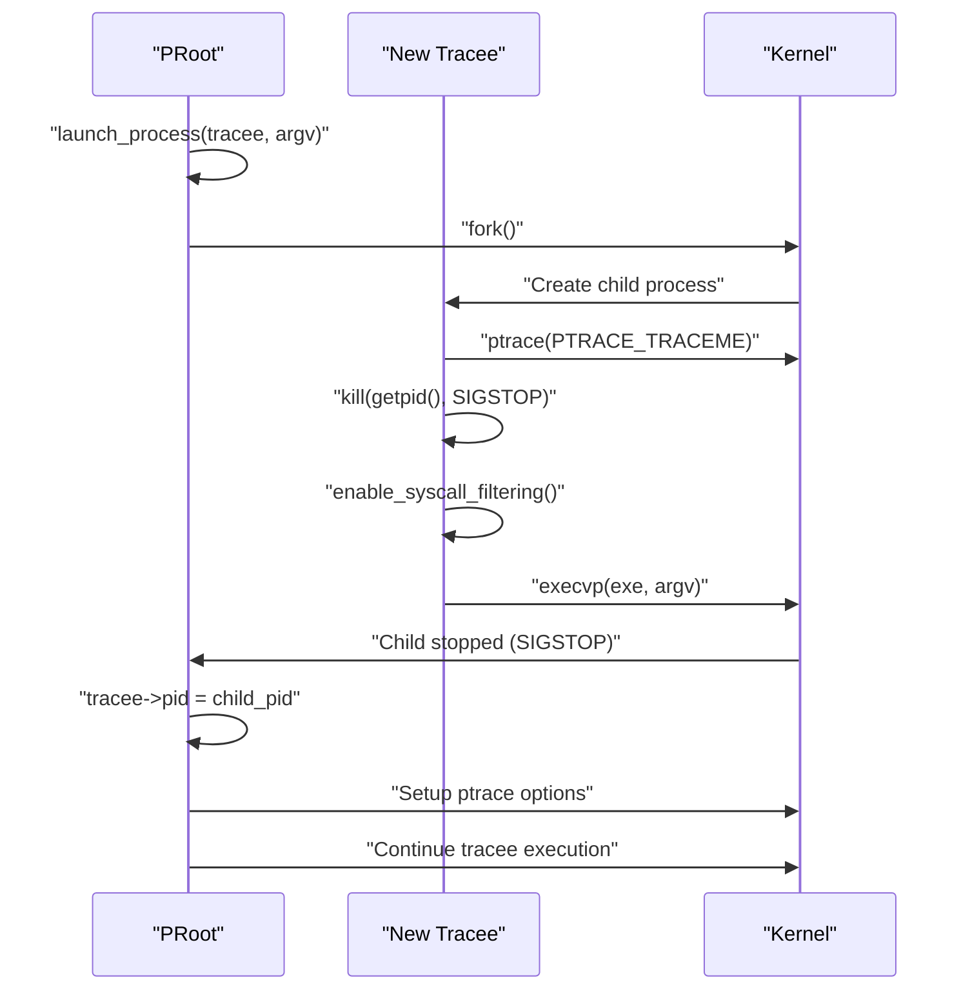
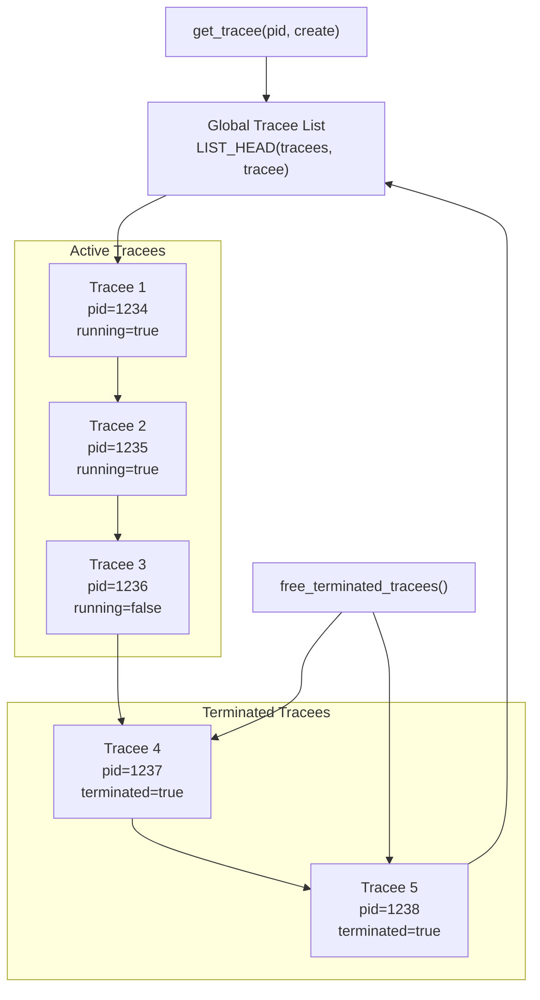
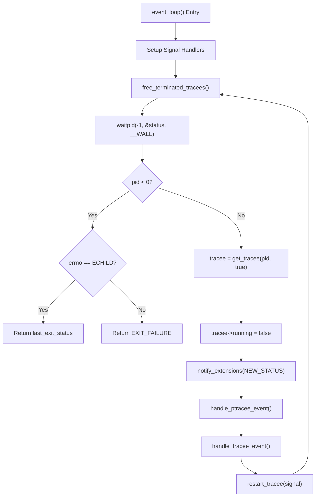
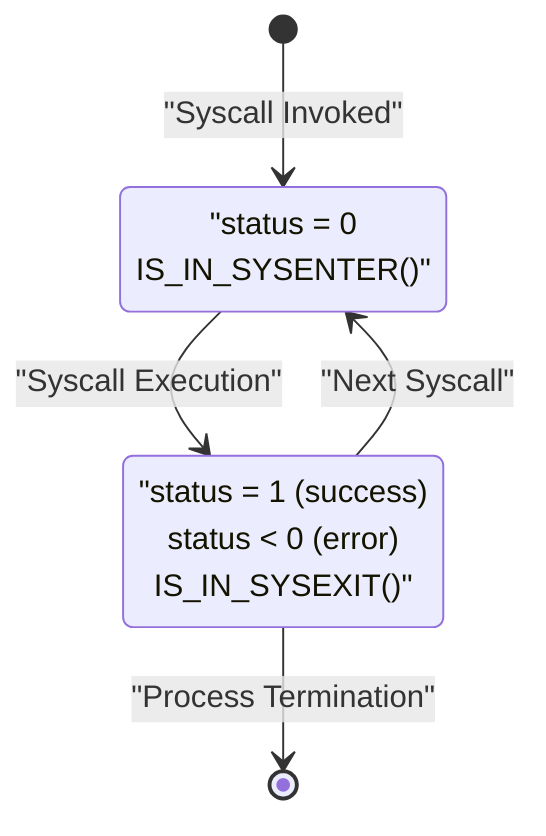
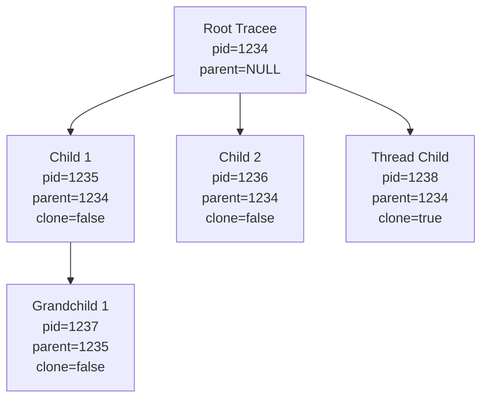
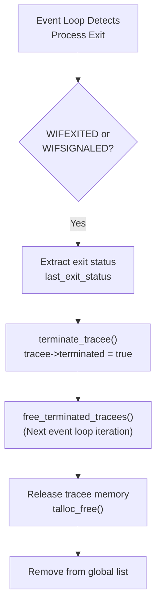

<!-- source: DeepWiki mcp.deepwiki.com · repo termux/proot · page 3.1 Process Management · fetched 2026-10-26 -->

# Process Management

Relevant source files

The following files were used as context for generating this wiki page:

- [src/tracee/event.c](src/tracee/event.c)
- [src/tracee/tracee.h](src/tracee/tracee.h)

This document covers PRoot's process management system, which handles the lifecycle of all traced processes (tracees) in the system. Process management encompasses tracee creation, state tracking, event handling, and termination. For information about how processes are initially launched and executed, see [Process Execution](#5). For details about the syscall interception mechanisms, see [System Call Interception](#3.2).

## Overview

PRoot's process management is built around a tracer-tracee model where PRoot acts as the tracer and all user processes are tracees. The system maintains a registry of all active tracees and orchestrates their execution through a central event loop that handles ptrace events, syscall interceptions, and process state transitions.

The core data structure is the `Tracee` struct, which encapsulates all process-specific state including process identifiers, execution status, parent-child relationships, and ptrace configuration.

## Tracee Data Structure

The `Tracee` struct serves as the central repository for all process-related information. It contains multiple categories of data:

| Category | Key Fields | Purpose |
|----------|------------|---------|
| Process Identity | `pid`, `vpid` | Real and virtual process identifiers |
| Execution State | `running`, `terminated`, `status` | Current execution status and syscall position |
| Hierarchy | `parent`, `clone` | Parent-child relationships and process tree |
| Ptrace Control | `restart_how`, `_regs`, `seccomp` | Ptrace restart method and register state |
| Resource Management | `ctx`, `life_context` | Memory management contexts |

**Tracee Structure Diagram**

```mermaid
graph TB
    Tracee["Tracee Struct"]
    
    subgraph "Process Identity"
        PID["pid: Real Process ID"]
        VPID["vpid: Virtual Process ID"]
        Running["running: Execution State"]
    end
    
    subgraph "Hierarchy Management"
        Parent["parent: Parent Tracee*"]
        Clone["clone: Is Clone Flag"]
        Children["Child Tracees"]
    end
    
    subgraph "Ptrace State"
        RestartHow["restart_how: Ptrace Method"]
        Regs["_regs: Register Versions"]
        Status["status: Syscall Position"]
    end
    
    subgraph "Extension Support"
        Extensions["extensions: Extension List"]
        Chain["chain: Chained Syscalls"]
        LoadInfo["load_info: Execve Data"]
    end
    
    Tracee --> PID
    Tracee --> VPID  
    Tracee --> Running
    Tracee --> Parent
    Tracee --> Clone
    Tracee --> Children
    Tracee --> RestartHow
    Tracee --> Regs
    Tracee --> Status
    Tracee --> Extensions
    Tracee --> Chain
    Tracee --> LoadInfo
```

Sources: [src/tracee/tracee.h:74-296]()

## Tracee Lifecycle Management

### Process Creation

New tracees are created through two primary mechanisms:

1. **Initial Process Launch**: The `launch_process()` function creates the first tracee by forking and setting up ptrace relationships
2. **Child Process Creation**: The `new_child()` function handles fork/clone events to create child tracees

**Process Launch Sequence**

Sources: [src/tracee/event.c:59-115]()

### Tracee Registry

The system maintains a global registry of all active tracees using a linked list structure. Key management functions include:

- `get_tracee()`: Retrieves or creates tracee by PID
- `get_tracees_list_head()`: Returns the head of the tracee list
- `free_terminated_tracees()`: Cleans up terminated tracees

**Tracee Registry Architecture**

Sources: [src/tracee/tracee.h:302-314]()

## Event Loop Architecture

The central `event_loop()` function orchestrates all process management activities. It continuously waits for events from any tracee and dispatches appropriate handlers.

### Event Loop Flow

**Main Event Loop**

Sources: [src/tracee/event.c:260-363]()

### Event Types and Handling

The `handle_tracee_event()` function processes different types of ptrace events:

| Event Type | Signal | Handler Action |
|------------|--------|----------------|
| Process Exit | `WIFEXITED` | Set `last_exit_status`, call `terminate_tracee()` |
| Signal Death | `WIFSIGNALED` | Log termination, call `terminate_tracee()` |
| Syscall Entry/Exit | `SIGTRAP\|0x80` | Call `translate_syscall()` |
| Seccomp Event | `SIGTRAP\|PTRACE_EVENT_SECCOMP` | Handle seccomp filtering |
| Fork/Clone | `PTRACE_EVENT_FORK/CLONE` | Call `new_child()` |
| Other Signals | Various | Forward or suppress based on context |

Sources: [src/tracee/event.c:370-689]()

## Process State Management

### Syscall State Tracking

Each tracee maintains its position within syscall execution using the `status` field:

- `status == 0`: Syscall entry (sysenter)  
- `status == 1`: Syscall exit without error
- `status < 0`: Syscall exit with error (`-errno`)

The macros `IS_IN_SYSENTER()` and `IS_IN_SYSEXIT()` provide convenient state checking.

**Syscall State Machine**

Sources: [src/tracee/tracee.h:139-148]()

### Restart Control

The `restart_how` field controls how each tracee is restarted after processing an event:

- `PTRACE_CONT`: Continue execution without stopping
- `PTRACE_SYSCALL`: Stop at next syscall entry/exit
- `PTRACE_SINGLESTEP`: Execute one instruction

The `restart_tracee()` function applies the restart method and updates tracee state.

Sources: [src/tracee/event.c:706-726]()

## Parent-Child Relationships

### Process Hierarchy

PRoot maintains a hierarchical tree of tracees reflecting the process relationships:

- Each tracee has a `parent` pointer to its creating process
- The `clone` flag indicates whether the process shares resources with its parent
- Child processes are created via `new_child()` during fork/clone events

**Process Tree Example**

Sources: [src/tracee/tracee.h:100-104](), [src/tracee/event.c:610-619]()

### Resource Sharing

Child tracees inherit or share resources based on clone flags:

- **Private Resources**: Always copied (`pid`, `vpid`, `status`)
- **Inherited Resources**: Copied but can diverge (`verbose`, `seccomp`)
- **Shared Resources**: Depend on `CLONE_FS`/`CLONE_VM` (`fs`, `heap`)
- **Temporarily Shared**: Until execve() (`exe`, `host_exe`)

Sources: [src/tracee/tracee.h:229-284]()

## Process Termination

### Termination Process

Process termination follows a structured sequence:

1. **Detection**: Event loop detects `WIFEXITED` or `WIFSIGNALED`
2. **Cleanup**: `terminate_tracee()` marks tracee as terminated
3. **Deferred Cleanup**: `free_terminated_tracees()` releases resources
4. **Emergency Cleanup**: `kill_all_tracees()` for abnormal termination

**Termination Flow**

Sources: [src/tracee/event.c:406-418](), [src/tracee/tracee.h:308-311]()

### Emergency Termination

The `kill_all_tracees()` function provides emergency cleanup when PRoot receives fatal signals. It's registered as both an `atexit()` handler and a signal handler for abnormal termination signals (`SIGQUIT`, `SIGILL`, `SIGABRT`, `SIGFPE`, `SIGSEGV`).

Sources: [src/tracee/event.c:118-130](), [src/tracee/event.c:266-267](), [src/tracee/event.c:281-321]()

---

