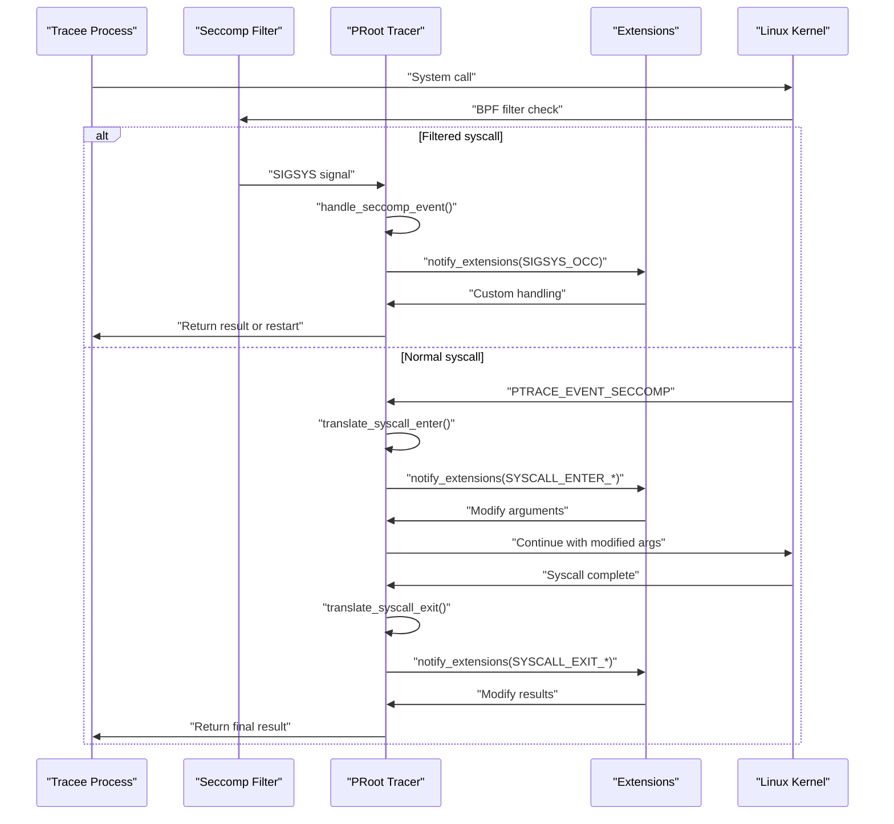
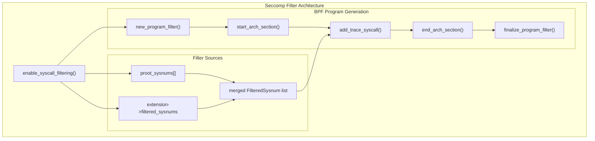
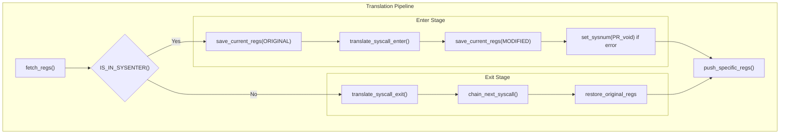
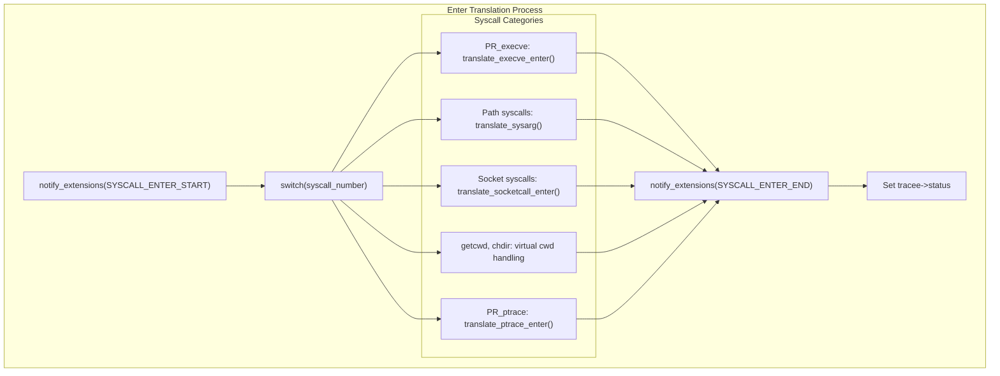
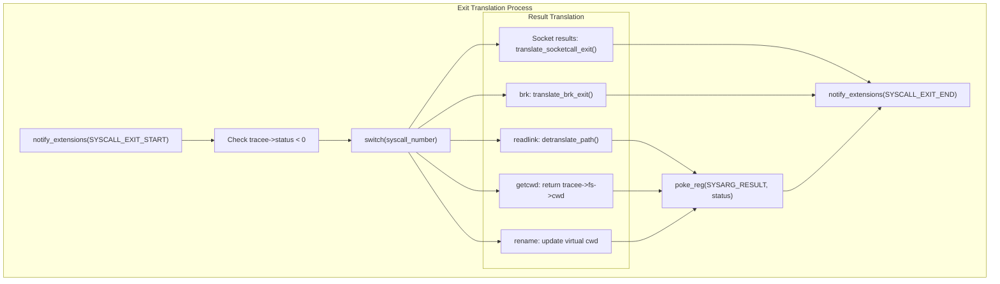
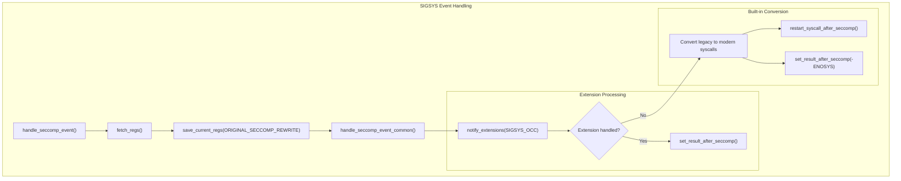
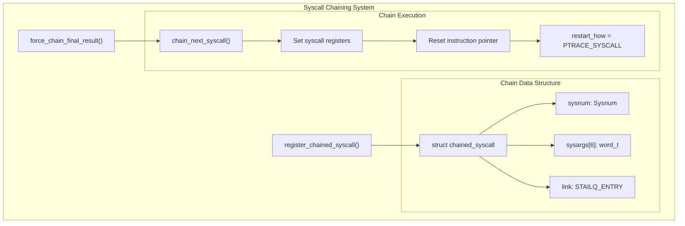
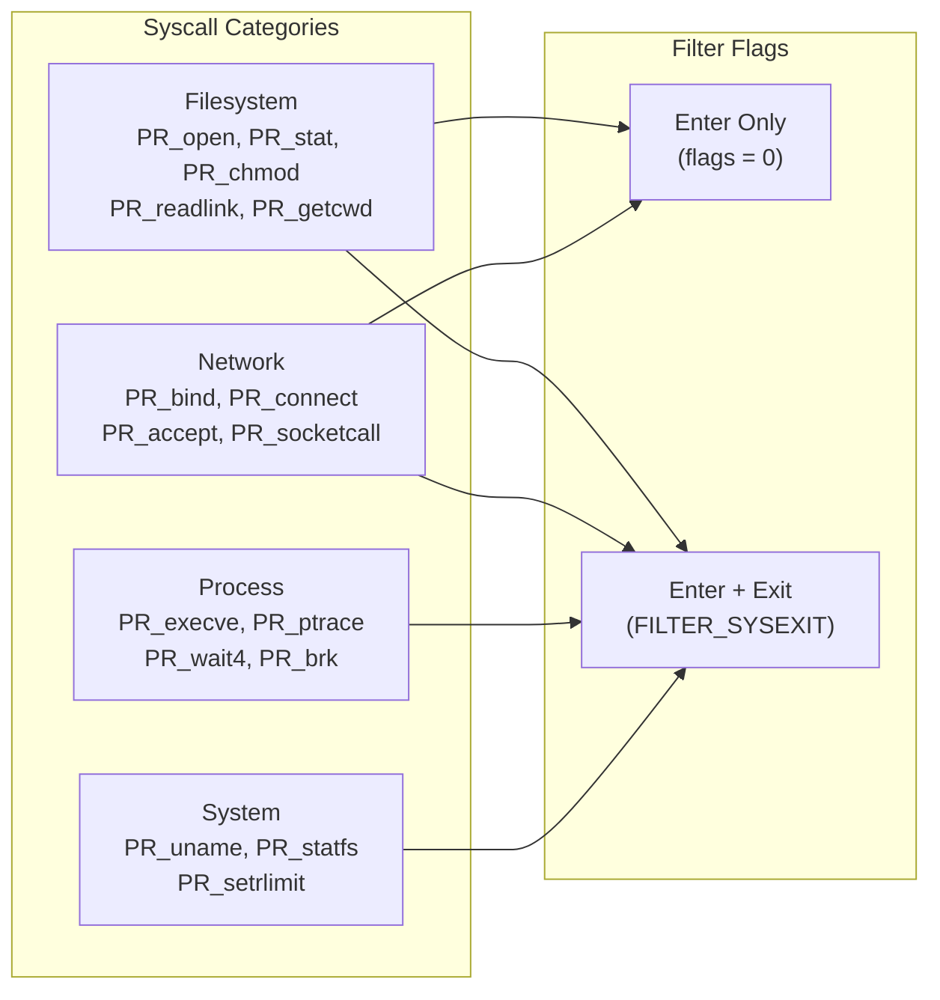
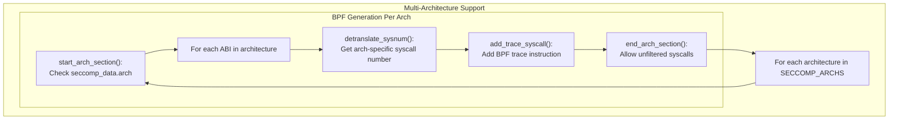
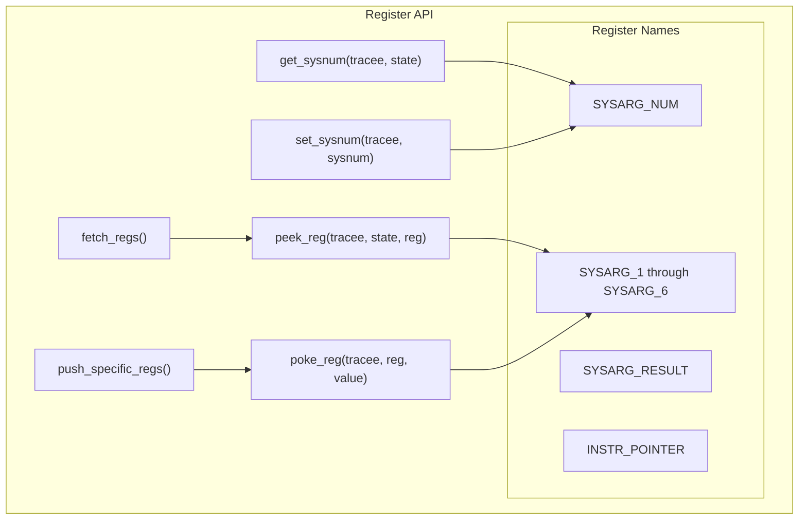

<!-- source: DeepWiki mcp.deepwiki.com · repo termux/proot · page 3.2 System Call Interception · fetched 2026-10-26 -->

# System Call Interception

<details>
<summary>Relevant source files</summary>

The following files were used as context for generating this wiki page:

- [src/ptrace/ptrace.c](src/ptrace/ptrace.c)
- [src/syscall/chain.c](src/syscall/chain.c)
- [src/syscall/enter.c](src/syscall/enter.c)
- [src/syscall/exit.c](src/syscall/exit.c)
- [src/syscall/rlimit.c](src/syscall/rlimit.c)
- [src/syscall/seccomp.c](src/syscall/seccomp.c)
- [src/syscall/syscall.c](src/syscall/syscall.c)
- [src/syscall/syscall.h](src/syscall/syscall.h)
- [src/tracee/seccomp.c](src/tracee/seccomp.c)
- [src/tracee/seccomp.h](src/tracee/seccomp.h)

</details>


This document covers how PRoot intercepts and translates system calls to implement its virtualization features. For information about process lifecycle management, see [Process Management](#3.1). For details about specific extension handling during syscall interception, see [Extension System](#4).

## Purpose and Architecture

The system call interception system is the core mechanism that enables PRoot to:
- Translate file paths between guest and host namespaces
- Emulate system calls without kernel modules
- Support cross-architecture execution
- Provide transparent virtualization to traced processes

PRoot uses a two-stage interception approach combining seccomp BPF filters with ptrace to efficiently filter and translate only the syscalls that require modification.

## High-Level Flow



Sources: [src/syscall/syscall.c:103-274](), [src/tracee/seccomp.c:70-102]()

## Core Components

### Seccomp Filter Setup

The seccomp filtering system is established by `enable_syscall_filtering` which builds BPF programs that check architecture and syscall numbers before allowing or redirecting syscalls to PRoot.



Sources: [src/syscall/seccomp.c:479-512](), [src/syscall/seccomp.c:253-328](), [src/syscall/seccomp.c:431-471]()

### Main Translation Pipeline

The `translate_syscall` function orchestrates the complete interception process, handling both enter and exit stages while managing register states and syscall chaining.



Sources: [src/syscall/syscall.c:103-274]()

## Enter Stage Translation

The `translate_syscall_enter` function handles argument translation for filesystem, network, and process management syscalls.

### Enter Stage Flow



### Path Translation Patterns

| Syscall Type | Translation Function | Link Type |
|---|---|---|
| `PR_open`, `PR_stat`, `PR_chmod` | `translate_sysarg(SYSARG_1, REGULAR)` | Follow symlinks |
| `PR_lstat`, `PR_readlink`, `PR_unlink` | `translate_sysarg(SYSARG_1, SYMLINK)` | Don't follow symlinks |
| `PR_openat`, `PR_fstatat64` | `translate_path2(dirfd, path, reg, type)` | Directory-relative |

Sources: [src/syscall/enter.c:96-653](), [src/syscall/enter.c:57-88]()

## Exit Stage Translation

The `translate_syscall_exit` function handles result translation and path detranslation for syscalls that return filesystem paths.



Sources: [src/syscall/exit.c:55-564]()

## Seccomp Event Handling

When the seccomp filter blocks a syscall, it generates a `SIGSYS` signal processed by `handle_seccomp_event`.

### SIGSYS Processing Flow



### Legacy Syscall Conversion

The seccomp handler automatically converts deprecated syscalls to their modern equivalents:

| Legacy Syscall | Converted To | Conversion Logic |
|---|---|---|
| `PR_open` | `PR_openat` | Add `AT_FDCWD` as first argument |
| `PR_stat`/`PR_lstat` | `PR_newfstatat` | Add dirfd and flags arguments |
| `PR_symlink` | `PR_symlinkat` | Add `AT_FDCWD` for target directory |
| `PR_accept` | `PR_accept4` | Add flags argument (0) |
| `PR_pipe` | `PR_pipe2` | Add flags argument (0) |

Sources: [src/tracee/seccomp.c:70-102](), [src/tracee/seccomp.c:118-568]()

## Syscall Chaining

Complex operations may require multiple syscalls to be executed sequentially. The chaining system queues syscalls for deferred execution.



### Chain Operations

- **register_chained_syscall()**: Add syscall to end of chain
- **chain_next_syscall()**: Execute next syscall in chain  
- **force_chain_final_result()**: Override final result
- **restart_original_syscall()**: Re-execute original syscall

Sources: [src/syscall/chain.c:35-196]()

## Filter Configuration

### Core Filtered Syscalls

PRoot defines base syscalls requiring interception in the `proot_sysnums` array:



### Extension Integration

Extensions contribute their own filtered syscalls through the `FilteredSysnum` structure:

```c
typedef struct {
    Sysnum value;      // Syscall number
    int flags;         // FILTER_SYSEXIT or 0
} FilteredSysnum;
```

The `merge_filtered_sysnums` function combines:
1. Core PRoot syscalls (`proot_sysnums`)
2. Extension syscalls (`extension->filtered_sysnums`)
3. Handles flag merging for overlapping syscalls

Sources: [src/syscall/seccomp.c:331-424](), [src/syscall/seccomp.c:431-471]()

## Architecture Support

The seccomp system handles multiple architectures through the `SECCOMP_ARCHS` definition:



The BPF filter structure:
1. Load `seccomp_data.arch` into accumulator
2. Compare with expected architecture
3. If match: load `seccomp_data.nr` (syscall number)
4. Compare against filtered syscalls for this architecture
5. Either trace (send to PRoot) or allow (continue normally)

Sources: [src/syscall/seccomp.c:159-204](), [src/syscall/seccomp.c:267-305]()

## Register Management

System call interception relies on precise register state management through multiple register snapshots:

### Register States

| State | Purpose | When Saved |
|---|---|---|
| `ORIGINAL` | Initial syscall registers | `save_current_regs()` in enter stage |
| `CURRENT` | Working registers | Updated during translation |
| `MODIFIED` | Final translated registers | `save_current_regs()` after enter translation |
| `ORIGINAL_SECCOMP_REWRITE` | Seccomp event backup | `save_current_regs()` in `handle_seccomp_event` |

### Key Register Operations



Sources: [src/tracee/reg.h](), [src/syscall/syscall.c:110-274]()

## Error Handling

### Syscall Number Modification

Some kernels prevent syscall number changes after ptrace interception. PRoot handles this via syscall chaining:

1. `push_specific_regs()` fails when changing syscall number
2. Call `restart_current_syscall_as_chained()` to queue the modified syscall  
3. Set invalid arguments to make original syscall fail
4. Process the real operation in the chained syscall

### ENOSYS Recovery

When syscalls return `ENOSYS`, PRoot can retry via seccomp:

- `fix_and_restart_enosys_syscall()` restores original registers
- Calls `handle_seccomp_event_common()` for reprocessing
- Used for syscalls like `PR_utime` that may not be available

Sources: [src/syscall/syscall.c:228-268](), [src/tracee/seccomp.c:105-116](), [src/syscall/chain.c:182-195]()

---

