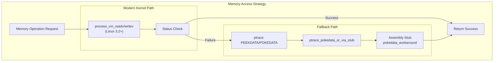
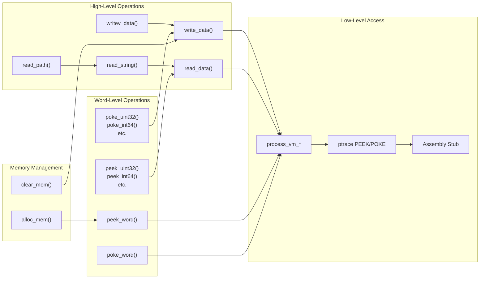
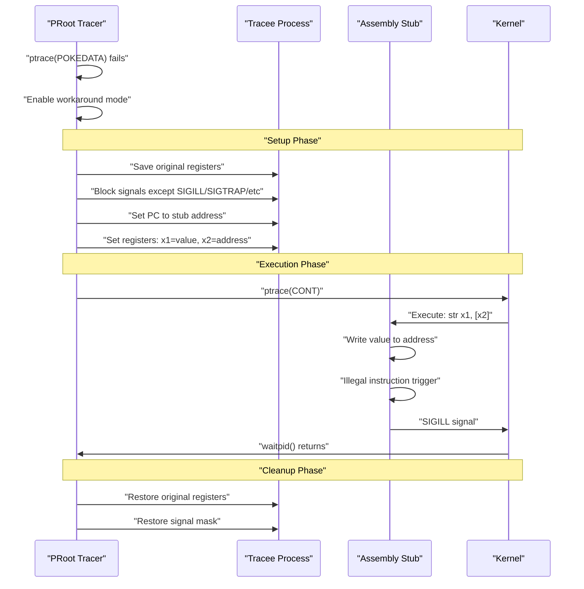
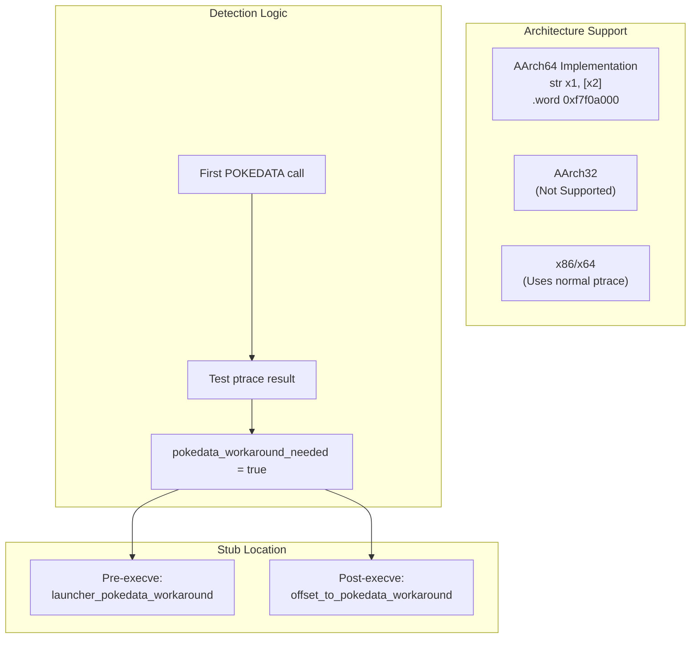
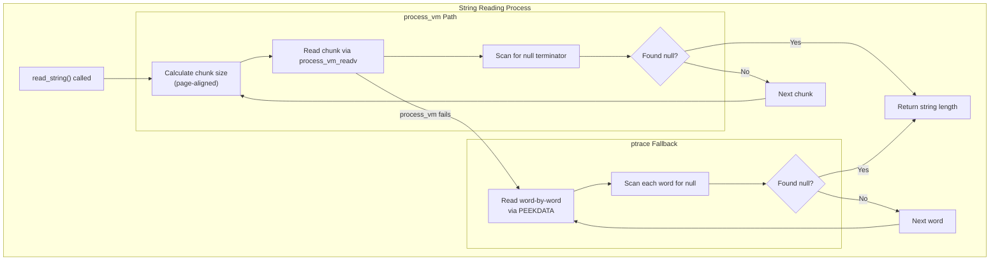
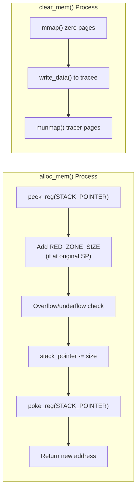
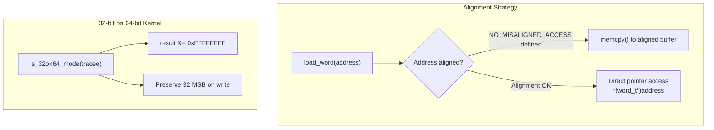

<!-- source: DeepWiki mcp.deepwiki.com · repo termux/proot · page 3.3 Memory Management · fetched 2026-10-26 -->

# Memory Management

Relevant source files

The following files were used as context for generating this wiki page:

- [src/loader/assembly.S](src/loader/assembly.S)
- [src/loader/loader-info.awk](src/loader/loader-info.awk)
- [src/tracee/mem.c](src/tracee/mem.c)
- [src/tracee/mem.h](src/tracee/mem.h)

## Purpose and Scope

The Memory Management system in PRoot handles all interactions with the memory space of traced processes (tracees). This includes reading data from tracee memory, writing data to tracee memory, and managing memory allocations within the tracee's address space. The system provides a unified interface that abstracts away platform-specific details and works around various kernel limitations.

This page covers the core memory access mechanisms and utilities. For information about process lifecycle and state management, see [Process Management](#3.1). For details about system call argument manipulation that relies on memory operations, see [System Call Interception](#3.2).

## Memory Access Mechanisms

PRoot employs two primary mechanisms for accessing tracee memory, with automatic fallback behavior to ensure compatibility across different kernel versions and configurations.

### Primary Access Methods

The system prioritizes the modern `process_vm_readv`/`process_vm_writev` system calls when available, as they provide better performance and reliability than traditional ptrace operations. When these calls fail or are unavailable, PRoot falls back to ptrace-based memory access with additional workarounds for broken implementations.

Sources: [src/tracee/mem.c:231-246](), [src/tracee/mem.c:350-366]()

## Core Memory Operations

### Data Transfer Functions

The memory management system provides several levels of abstraction for different types of memory operations:

### Key Function Responsibilities

| Function | Purpose | Return Value |
|----------|---------|--------------|
| `write_data()` | Copy bytes from tracer to tracee memory | 0 on success, -errno on failure |
| `read_data()` | Copy bytes from tracee to tracer memory | 0 on success, -errno on failure |
| `read_string()` | Read null-terminated string with length limit | String length including null terminator, or -errno |
| `peek_word()` | Read single word from tracee memory | Word value (caller must check errno) |
| `poke_word()` | Write single word to tracee memory | void (caller must check errno) |
| `alloc_mem()` | Allocate memory on tracee stack | Address in tracee space, or 0 on failure |

Sources: [src/tracee/mem.c:218-291](), [src/tracee/mem.c:338-403](), [src/tracee/mem.c:543-579](), [src/tracee/mem.c:637-673]()

## POKEDATA Workaround System

Some kernel configurations have broken `PTRACE_POKEDATA` implementations that fail to write data to tracee memory. PRoot implements a sophisticated workaround using assembly stubs executed within the tracee's address space.

### Workaround Architecture

### Stub Implementation Details

The workaround uses architecture-specific assembly stubs that perform the memory write and then trigger a recognizable signal:

The system dynamically detects broken POKEDATA implementations on first use and automatically enables the workaround for subsequent operations.

Sources: [src/tracee/mem.c:98-197](), [src/tracee/mem.c:199-211](), [src/loader/assembly.S:63-69](), [src/loader/loader-info.awk:1-8]()

## String and Path Handling

### String Reading Strategy

PRoot implements specialized string reading logic that handles memory page boundaries and unknown string lengths safely:

### Path-Specific Optimizations

The `read_path()` function provides path-specific optimizations and validation:

| Feature | Implementation | Purpose |
|---------|---------------|---------|
| Length Limit | `PATH_MAX` bytes maximum | Prevent buffer overflows |
| Error Translation | Returns `-ENAMETOOLONG` | Standard errno for path length |
| Inline Implementation | Header-only function | Reduce call overhead |

Sources: [src/tracee/mem.c:412-536](), [src/tracee/mem.h:53-64]()

## Memory Allocation and Management

### Stack-Based Allocation

PRoot allocates temporary memory within the tracee's address space by manipulating the stack pointer:

### Memory Safety Considerations

The allocation system includes several safety mechanisms:

- **Red Zone Protection**: Adds extra bytes when allocating at the original stack pointer to account for ABI-specified compiler optimization zones
- **Overflow Detection**: Validates that arithmetic operations don't cause integer overflow/underflow
- **Sysenter-Only**: Allocation is restricted to syscall entry phase to ensure stack pointer restoration works correctly

Sources: [src/tracee/mem.c:637-673](), [src/tracee/mem.c:680-692]()

## Platform-Specific Considerations

### Alignment Handling

PRoot handles memory alignment requirements across different architectures:

### Architecture-Specific Features

| Architecture | Special Handling | Implementation |
|--------------|------------------|----------------|
| AArch64 | POKEDATA workaround stub | Assembly stub with illegal instruction |
| AArch32 | Limited workaround support | Error returned for workaround attempts |
| x86/x64 | Standard ptrace | No special workarounds needed |
| 32-bit on 64-bit | Register masking | Preserve/mask high 32 bits |

Sources: [src/tracee/mem.c:67-96](), [src/tracee/mem.c:575-577](), [src/tracee/mem.c:611-618]()

---

