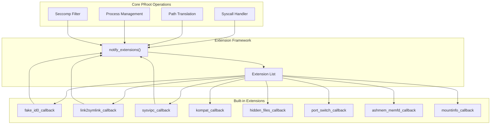
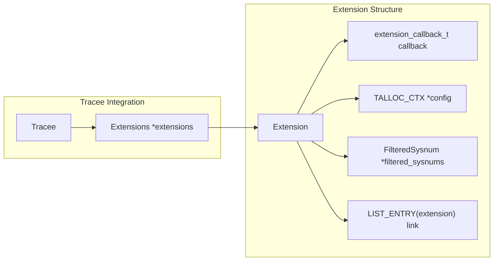
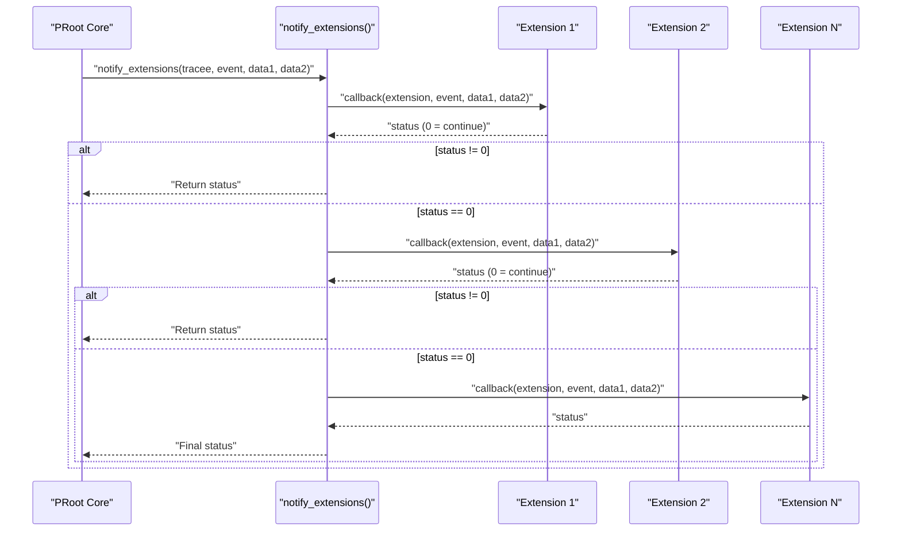
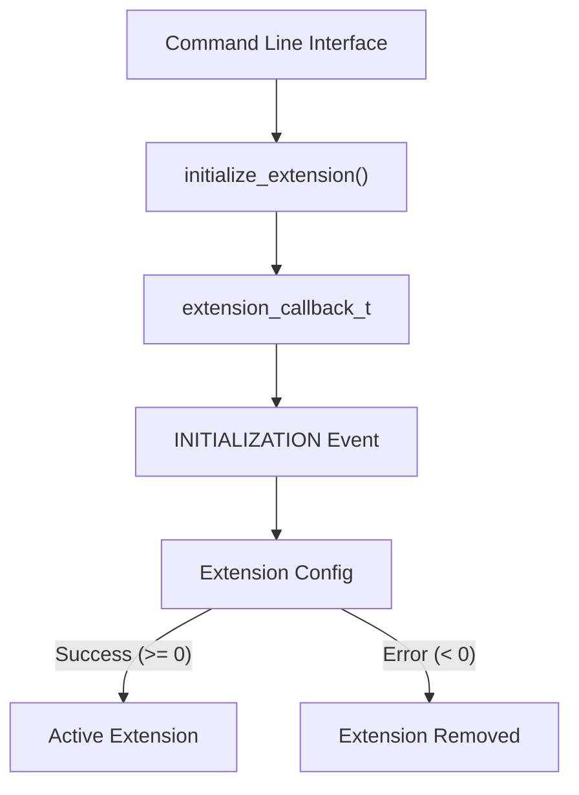
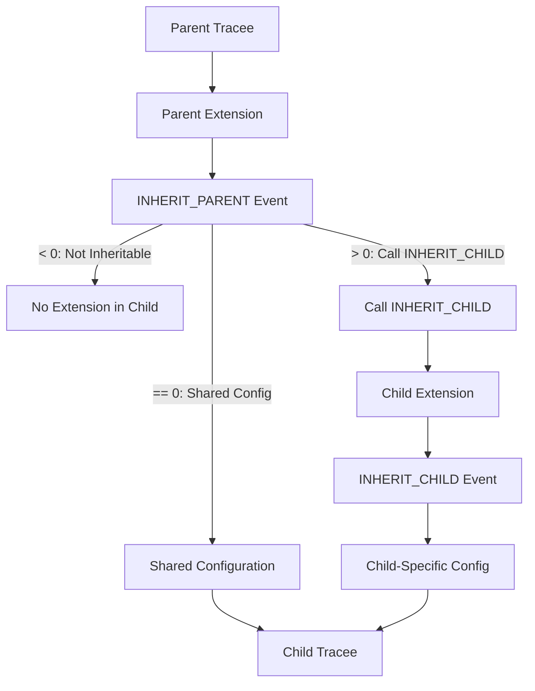
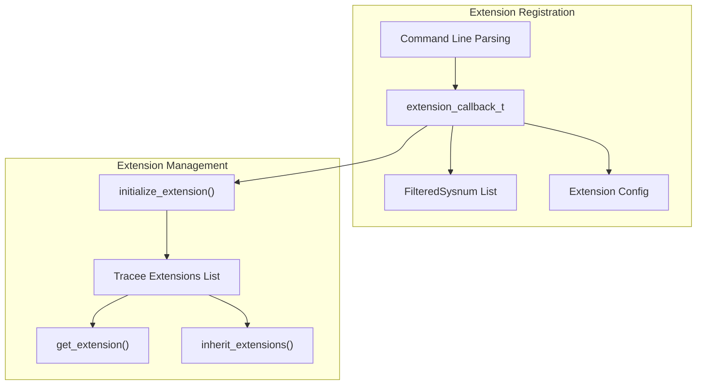

<!-- source: DeepWiki mcp.deepwiki.com · repo termux/proot · page 4 Extension System · fetched 2026-10-26 -->

# Extension System

Relevant source files

The following files were used as context for generating this wiki page:

- [src/extension/extension.h](src/extension/extension.h)

This document covers PRoot's modular extension architecture, which allows pluggable functionality to be added to PRoot's core system call interception and process management capabilities. The extension system provides a unified event-driven framework for extending PRoot's behavior across path translation, system call handling, and process lifecycle management.

For detailed information about specific extensions, see [System V IPC Extension](#4.1), [fake_id0 Extension](#4.2), [link2symlink Extension](#4.3), and [Other Extensions](#4.4). For information about system call interception mechanics, see [System Call Interception](#3.2).

## Architecture Overview

PRoot's extension system is built around an event-driven architecture where extensions register callback functions to respond to specific system events. The core system dispatches events to all registered extensions, allowing them to modify behavior, intercept operations, or perform additional processing.

### Extension Event Flow

Sources: [src/extension/extension.h:184-199]()

### Extension Data Structure

Sources: [src/extension/extension.h:158-172](), [src/extension/extension.h:174]()

## Event System

The extension system defines a comprehensive set of events that cover all major PRoot operations. Extensions can selectively respond to relevant events while ignoring others.

### Event Categories

| Event Category | Events | Purpose |
|---|---|---|
| Path Translation | `GUEST_PATH`, `HOST_PATH`, `TRANSLATED_PATH` | Handle path translation and manipulation |
| System Call Entry | `SYSCALL_ENTER_START`, `SYSCALL_ENTER_END` | Process syscall arguments before execution |
| System Call Exit | `SYSCALL_EXIT_START`, `SYSCALL_EXIT_END` | Process syscall results after execution |
| Process Lifecycle | `INHERIT_PARENT`, `INHERIT_CHILD`, `NEW_STATUS` | Manage extension inheritance and process state |
| Special Handling | `SIGSYS_OCC`, `SYSCALL_CHAINED_ENTER`, `SYSCALL_CHAINED_EXIT` | Handle seccomp events and chained syscalls |
| Extension Management | `INITIALIZATION`, `REMOVED`, `PRINT_CONFIG`, `PRINT_USAGE` | Extension lifecycle and configuration |

Sources: [src/extension/extension.h:33-150]()

### Event Processing Flow

Sources: [src/extension/extension.h:184-199]()

## Extension Lifecycle

Extensions follow a well-defined lifecycle from initialization through inheritance to cleanup.

### Initialization and Configuration

Extensions are initialized through the `INITIALIZATION` event, which provides command-line arguments for configuration. The extension can allocate configuration data using the `config` field, which is managed by the talloc memory management system.

Sources: [src/extension/extension.h:117-120](), [src/extension/extension.h:163-164](), [src/extension/extension.h:176]()

### Extension Inheritance

When a tracee creates child processes, extensions must decide how they should be inherited. The inheritance process involves two events:

- `INHERIT_PARENT`: Asked of the parent's extension to determine inheritance behavior
- `INHERIT_CHILD`: Called on the child's extension to set up child-specific configuration

Sources: [src/extension/extension.h:89-104](), [src/extension/extension.h:177]()

## Built-in Extensions

PRoot includes several built-in extensions that provide essential functionality:

### Extension Callback Functions

| Extension | Callback Function | Primary Purpose |
|---|---|---|
| Kernel Compatibility | `kompat_callback` | Handle kernel version compatibility issues |
| Fake Root | `fake_id0_callback` | Emulate root privileges and UID/GID manipulation |
| Hidden Files | `hidden_files_callback` | Hide specific files from directory listings |
| Port Switching | `port_switch_callback` | Network port redirection |
| Link to Symlink | `link2symlink_callback` | Convert hard links to symbolic links |
| Symlink Size Fix | `fix_symlink_size_callback` | Fix symbolic link size reporting |
| Android Shared Memory | `ashmem_memfd_callback` | Android ashmem to memfd translation |
| Mount Info | `mountinfo_callback` | Provide custom /proc/mounts information |

Sources: [src/extension/extension.h:202-210]()

### Extension Registration Architecture

Sources: [src/extension/extension.h:166-167](), [src/extension/extension.h:176-178]()

## Implementation Details

### Event Dispatch Mechanism

The central `notify_extensions()` function implements a simple but effective event dispatch mechanism. It iterates through all extensions registered with a tracee and calls their callback functions sequentially. If any extension returns a non-zero status, the dispatch stops and returns that status.

### Extension Configuration Management

Extensions use the talloc memory management system for configuration storage. The `config` field in the `Extension` structure serves as a talloc context, allowing extensions to allocate hierarchical configuration data that is automatically cleaned up when the extension is removed.

### System Call Filtering

Extensions can specify which system calls they're interested in through the `filtered_sysnums` field. This allows the core system to optimize event dispatch by only notifying relevant extensions for specific system calls.

Sources: [src/extension/extension.h:158-172]()

---

