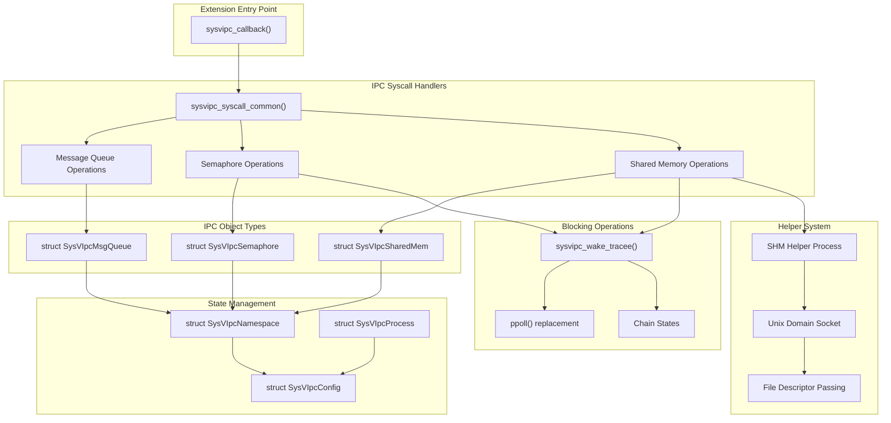
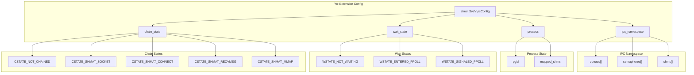
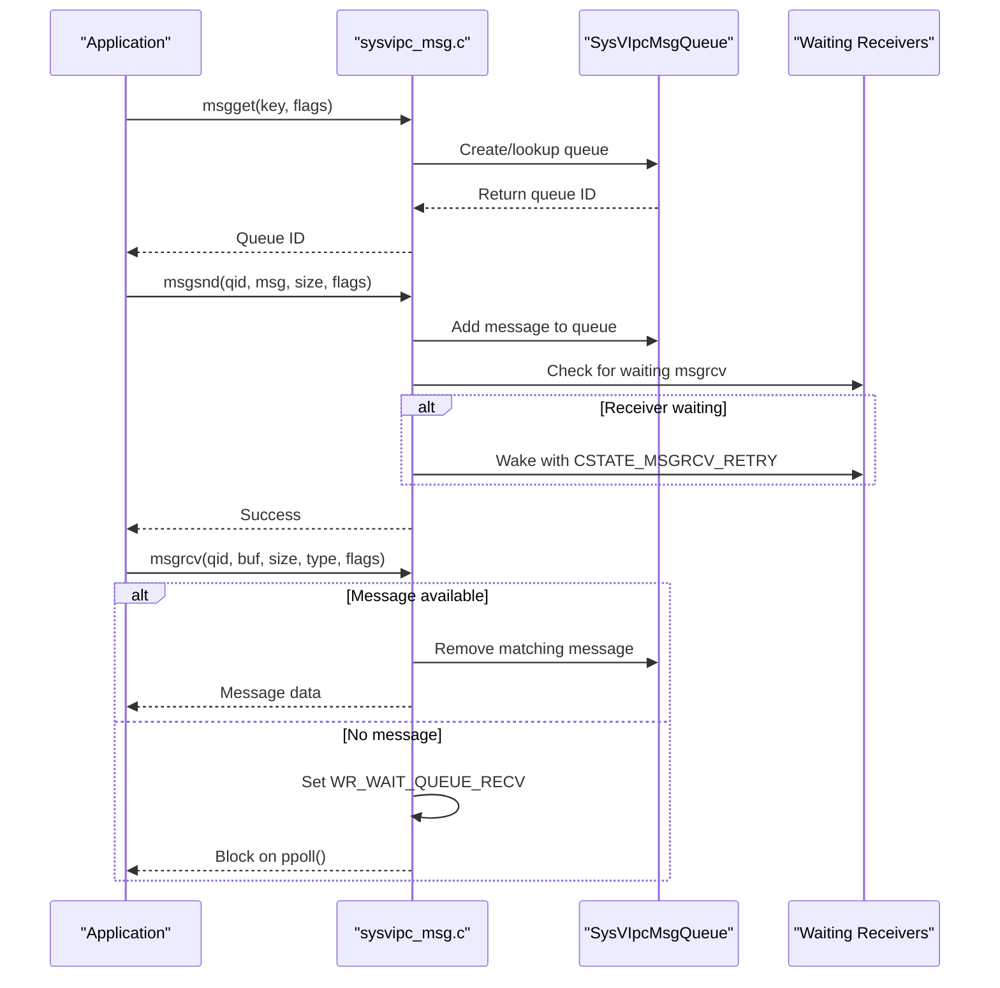
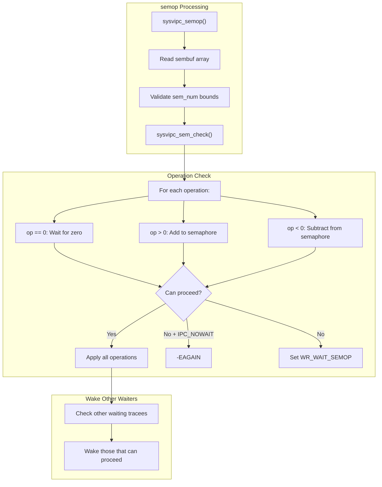
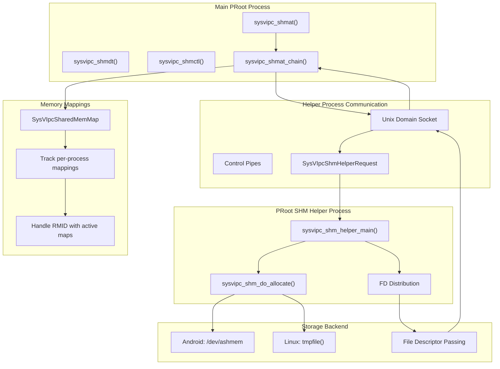
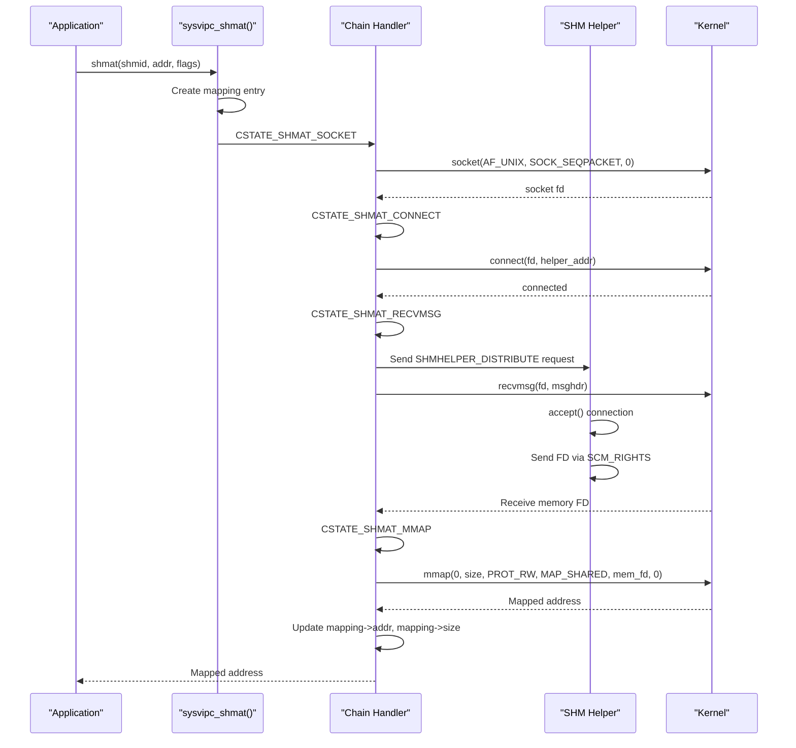
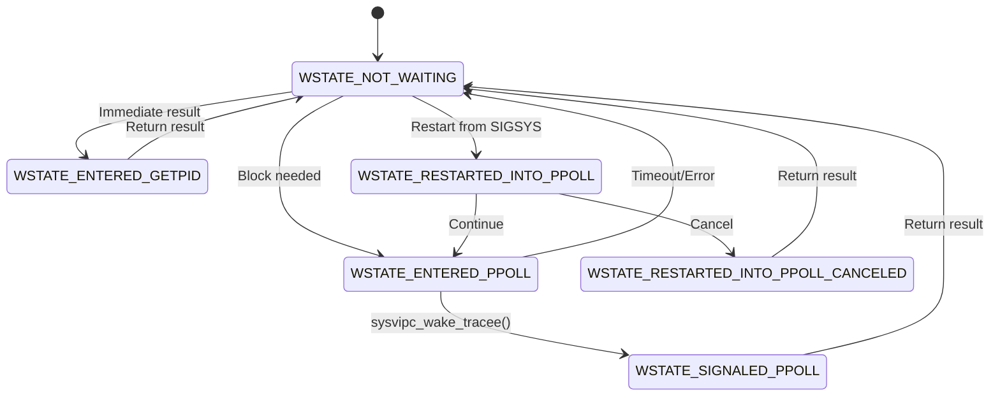
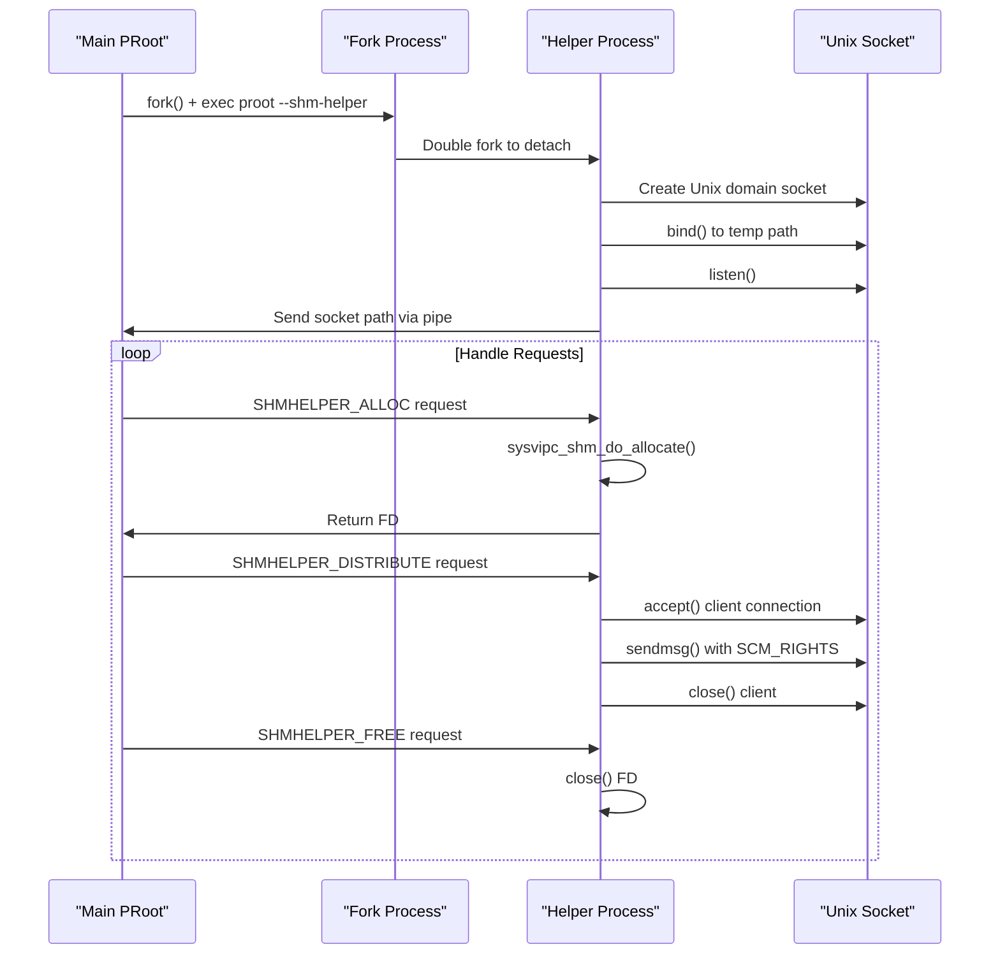

<!-- source: DeepWiki mcp.deepwiki.com · repo termux/proot · page 4.1 System V IPC Extension · fetched 2026-10-26 -->

# System V IPC Extension

Relevant source files

The following files were used as context for generating this wiki page:

- [src/extension/sysvipc/sysvipc.c](src/extension/sysvipc/sysvipc.c)
- [src/extension/sysvipc/sysvipc_internal.h](src/extension/sysvipc/sysvipc_internal.h)
- [src/extension/sysvipc/sysvipc_msg.c](src/extension/sysvipc/sysvipc_msg.c)
- [src/extension/sysvipc/sysvipc_sem.c](src/extension/sysvipc/sysvipc_sem.c)
- [src/extension/sysvipc/sysvipc_shm.c](src/extension/sysvipc/sysvipc_shm.c)

## Purpose and Scope

The System V IPC Extension provides comprehensive user-space emulation of System V Inter-Process Communication mechanisms within PRoot's virtualized environment. This extension implements message queues, semaphores, and shared memory segments, allowing applications that rely on System V IPC to function correctly under PRoot without requiring kernel-level IPC resources.

This extension handles the complete lifecycle of System V IPC objects including creation, access control, blocking operations, and cleanup. For information about PRoot's general extension architecture, see [Extension System](#4). For details about process execution and syscall interception that this extension relies upon, see [System Call Interception](#3.2).

## Architecture Overview

The System V IPC Extension operates as one of PRoot's most complex extensions, providing a complete IPC namespace simulation with sophisticated state management and inter-process coordination.

### System V IPC Extension Architecture

Sources: [src/extension/sysvipc/sysvipc.c:158-341](), [src/extension/sysvipc/sysvipc_internal.h:105-201]()

## Core Data Structures

The extension maintains a hierarchical set of data structures to manage IPC state across processes and threads.

### IPC Data Structure Hierarchy

Sources: [src/extension/sysvipc/sysvipc_internal.h:140-201](), [src/extension/sysvipc/sysvipc.c:164-169]()

The `SysVIpcConfig` structure serves as the per-tracee state container, referencing a shared `SysVIpcNamespace` for IPC objects and a per-process `SysVIpcProcess` structure for process-specific state like shared memory mappings.

## System Call Interception

The extension intercepts twelve System V IPC system calls through PRoot's seccomp filtering mechanism:

| System Call | Purpose |
|-------------|---------|
| `msgget` | Create/access message queue |
| `msgsnd` | Send message to queue |
| `msgrcv` | Receive message from queue |
| `msgctl` | Control message queue |
| `semget` | Create/access semaphore set |
| `semop`/`semtimedop` | Perform semaphore operations |
| `semctl` | Control semaphore set |
| `shmget` | Create/access shared memory segment |
| `shmat` | Attach shared memory segment |
| `shmdt` | Detach shared memory segment |
| `shmctl` | Control shared memory segment |

Sources: [src/extension/sysvipc/sysvipc.c:19-33](), [src/extension/sysvipc/sysvipc.c:42-82]()

The main dispatcher `sysvipc_syscall_common()` routes each intercepted syscall to its appropriate handler based on the system call number, managing wait states and syscall chaining as needed.

## Message Queues

Message queue implementation provides FIFO message passing between processes with support for message priorities and selective message retrieval.

### Message Queue Operations Flow

Sources: [src/extension/sysvipc/sysvipc_msg.c:17-314]()

Key features include:
- **Message matching**: Supports message type filtering with `MSG_EXCEPT` flag [src/extension/sysvipc/sysvipc_msg.c:66-78]()
- **Copy semantics**: `MSG_COPY` flag allows message inspection without removal [src/extension/sysvipc/sysvipc_msg.c:182-210]()
- **Blocking behavior**: Implements proper blocking with wake-up notifications [src/extension/sysvipc/sysvipc_msg.c:212-219]()

## Semaphores

Semaphore implementation provides atomic counting semaphores with support for complex multi-semaphore operations and blocking semantics.

### Semaphore Operation Processing

Sources: [src/extension/sysvipc/sysvipc_sem.c:84-183]()

The semaphore system implements:
- **Atomic operations**: All operations in a `sembuf` array succeed or fail together [src/extension/sysvipc/sysvipc_sem.c:84-120]()
- **Wait queues**: Tracees block until their operations can complete [src/extension/sysvipc/sysvipc_sem.c:155-178]()
- **Cascading wakeups**: Successful operations wake other waiting processes [src/extension/sysvipc/sysvipc_sem.c:160-173]()

## Shared Memory

Shared memory represents the most complex component of the System V IPC extension, requiring a separate helper process to manage actual memory allocations and file descriptor passing through Unix domain sockets.

### Shared Memory Architecture

Sources: [src/extension/sysvipc/sysvipc_shm.c:287-451](), [src/extension/sysvipc/sysvipc_shm.c:646-749]()

### Shared Memory Attachment Chain

The `shmat` operation requires a complex multi-step process implemented through PRoot's syscall chaining mechanism:

Sources: [src/extension/sysvipc/sysvipc_shm.c:333-451]()

## Waiting and Blocking Mechanism

The extension implements sophisticated blocking semantics for IPC operations that cannot complete immediately, using PRoot's syscall replacement mechanism to substitute blocking operations with `ppoll()` calls.

### Wait State Machine

Sources: [src/extension/sysvipc/sysvipc_internal.h:121-128](), [src/extension/sysvipc/sysvipc.c:351-365]()

The wait mechanism supports multiple wait reasons:
- `WR_WAIT_QUEUE_RECV`: Waiting for message arrival [src/extension/sysvipc/sysvipc_internal.h:116]()
- `WR_WAIT_SEMOP`: Waiting for semaphore availability [src/extension/sysvipc/sysvipc_internal.h:117]()
- `WR_WAIT_SHMAT_HELPER_BUSY`: Waiting for helper process availability [src/extension/sysvipc/sysvipc_internal.h:118]()

## Helper Process System

The shared memory helper process (`--shm-helper` mode) runs as a separate process to manage actual memory allocations and provide file descriptor distribution services.

### Helper Process Lifecycle

Sources: [src/extension/sysvipc/sysvipc_shm.c:106-176](), [src/extension/sysvipc/sysvipc_shm.c:646-749]()

The helper process provides three main operations:
1. **SHMHELPER_ALLOC**: Creates new shared memory segments using `ashmem` on Android or `tmpfile()` on Linux [src/extension/sysvipc/sysvipc_shm.c:614-644]()
2. **SHMHELPER_DISTRIBUTE**: Distributes existing file descriptors to client processes via Unix domain socket [src/extension/sysvipc/sysvipc_shm.c:709-740]()
3. **SHMHELPER_FREE**: Closes file descriptors when segments are freed [src/extension/sysvipc/sysvipc_shm.c:706-708]()

This architecture allows multiple processes to map the same physical memory while maintaining proper System V IPC semantics for reference counting and cleanup.

---

