<!-- source: DeepWiki mcp.deepwiki.com · repo termux/proot · page 4.2 fake_id0 Extension · fetched 2026-10-26 -->

# fake_id0 Extension

Relevant source files

The following files were used as context for generating this wiki page:

- [src/extension/fake_id0/chroot.c](src/extension/fake_id0/chroot.c)
- [src/extension/fake_id0/chroot.h](src/extension/fake_id0/chroot.h)
- [src/extension/fake_id0/fake_id0.c](src/extension/fake_id0/fake_id0.c)
- [src/extension/fake_id0/sendmsg.c](src/extension/fake_id0/sendmsg.c)
- [src/extension/fake_id0/sendmsg.h](src/extension/fake_id0/sendmsg.h)
- [src/extension/fake_id0/stat.c](src/extension/fake_id0/stat.c)
- [src/extension/fake_id0/stat.h](src/extension/fake_id0/stat.h)
- [src/tracee/statx.c](src/tracee/statx.c)
- [src/tracee/statx.h](src/tracee/statx.h)

## Purpose and Scope

The fake_id0 extension provides root privilege emulation and UID/GID translation functionality within PRoot. It allows unprivileged processes to simulate having root access by intercepting identity-related system calls and providing fake responses. This enables applications that expect to run as root to function correctly within PRoot's sandboxed environment.

This document covers the extension's architecture, syscall handling mechanisms, and configuration management. For information about the broader extension system architecture, see [Extension System](#4). For details about other privilege-related functionality like System V IPC emulation, see [System V IPC Extension](#4.1).

## Architecture Overview

The fake_id0 extension operates through a multi-layered architecture that intercepts system calls, maintains fake identity state, and manipulates file system permissions.

### Core Architecture

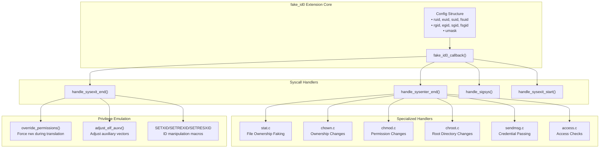

Sources: [src/extension/fake_id0/fake_id0.c:1080-1245](), [src/extension/fake_id0/fake_id0.c:262-353]()

### Extension Event Flow

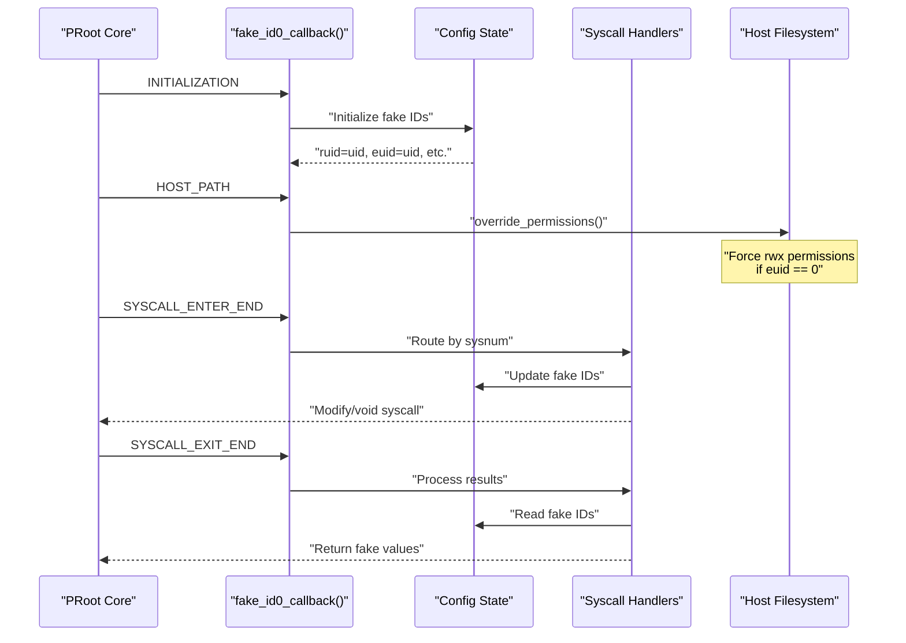

Sources: [src/extension/fake_id0/fake_id0.c:1080-1245](), [src/extension/fake_id0/fake_id0.c:548-737]()

## Core Configuration Management

The extension maintains identity state through a `Config` structure that tracks real, effective, saved, and filesystem UIDs and GIDs.

### Configuration Structure

| Field | Type | Purpose |
|-------|------|---------|
| `ruid`, `rgid` | `uid_t`, `gid_t` | Real user/group ID |
| `euid`, `egid` | `uid_t`, `gid_t` | Effective user/group ID |  
| `suid`, `sgid` | `uid_t`, `gid_t` | Saved user/group ID |
| `fsuid`, `fsgid` | `uid_t`, `gid_t` | Filesystem user/group ID |
| `umask` | `mode_t` | File creation mask |

### ID Manipulation Macros

The extension uses sophisticated macros to implement POSIX-compliant ID changing semantics:

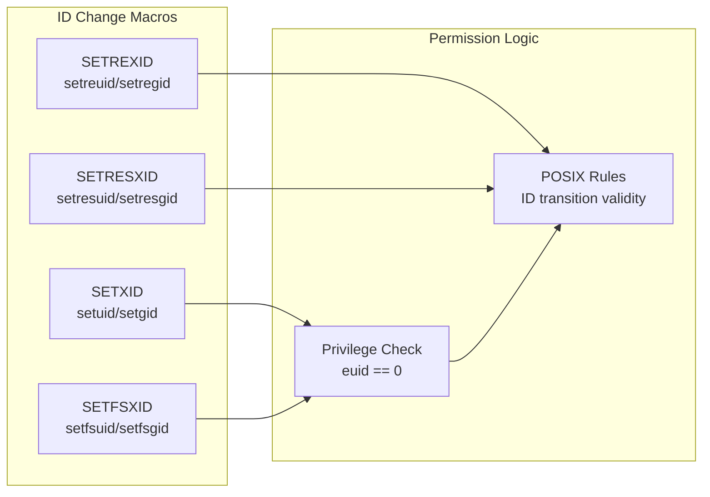

Sources: [src/extension/fake_id0/fake_id0.c:84-260]()

## System Call Handling

The extension intercepts numerous system calls across different categories: identity management, file operations, and privilege operations.

### Filtered System Calls

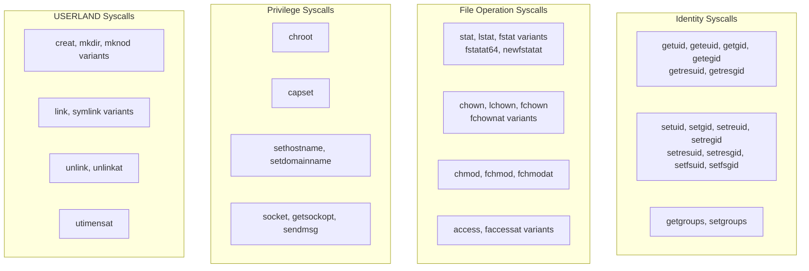

Sources: [src/extension/fake_id0/fake_id0.c:268-353]()

### Syscall Processing Pipeline

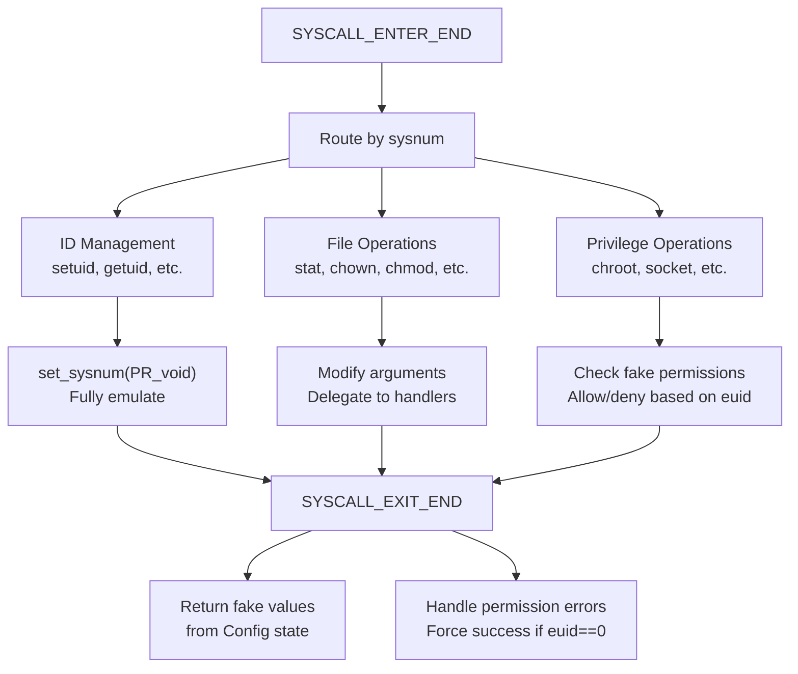

Sources: [src/extension/fake_id0/fake_id0.c:548-737](), [src/extension/fake_id0/fake_id0.c:743-1003]()

## Specialized System Call Handlers

### File Ownership and Permissions

The extension provides sophisticated handling for file system operations to maintain the illusion of root privileges.

#### stat() Family Handler

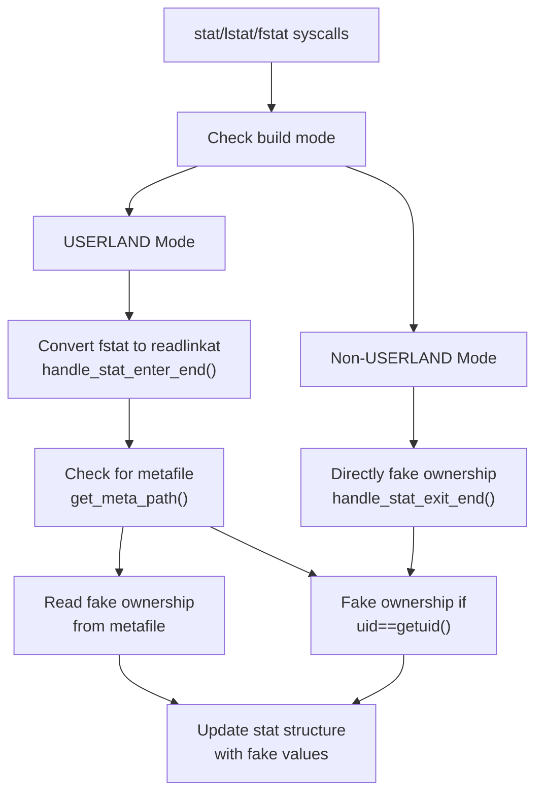

Sources: [src/extension/fake_id0/stat.c:53-158](), [src/extension/fake_id0/stat.c:14-50]()

#### chroot() Handler

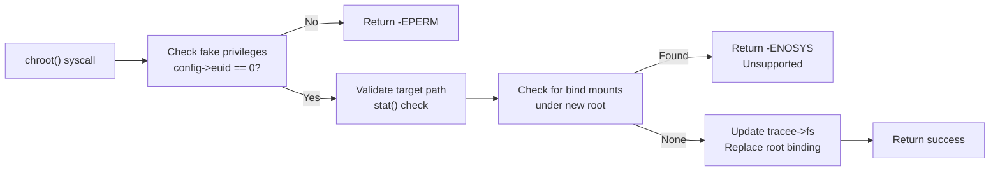

Sources: [src/extension/fake_id0/chroot.c:10-125]()

#### sendmsg() Credential Handler

The `sendmsg()` handler addresses credential passing through Unix domain sockets:

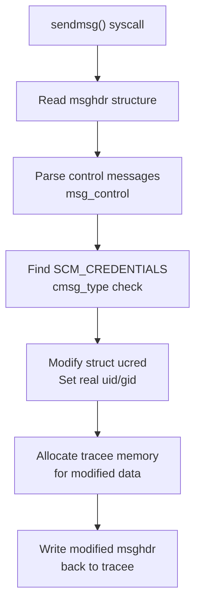

Sources: [src/extension/fake_id0/sendmsg.c:62-206]()

## Permission Override System

A critical component for maintaining root-like behavior is the permission override system that temporarily modifies file permissions during path resolution.

### Override Mechanism

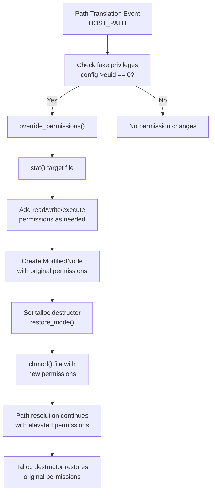

Sources: [src/extension/fake_id0/fake_id0.c:372-453](), [src/extension/fake_id0/fake_id0.c:360-364]()

## USERLAND vs Non-USERLAND Differences

The extension has two distinct modes of operation based on compile-time configuration:

### Feature Comparison

| Feature | USERLAND Mode | Non-USERLAND Mode |
|---------|---------------|-------------------|
| **Metafiles** | Uses metadata files for persistent ownership | Direct stat manipulation only |
| **stat() handling** | Converts fstat to readlinkat, manages metafiles | Direct ownership faking in stat results |
| **File operations** | Full emulation of create/delete/modify operations | Basic permission error override |
| **Syscall coverage** | Extended syscalls (access, unlink, chmod, etc.) | Core ID and stat syscalls only |

### USERLAND Architecture

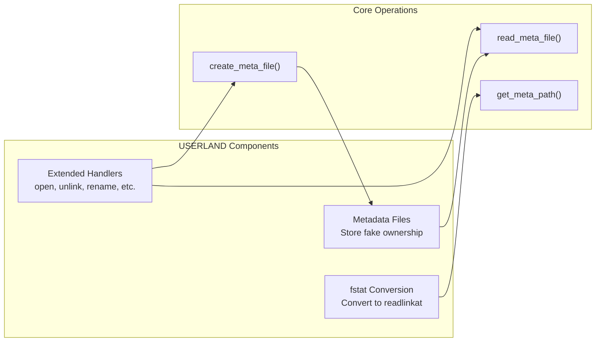

Sources: [src/extension/fake_id0/fake_id0.c:557-675](), [src/extension/fake_id0/stat.c:53-158]()

## Integration with Extension System

The fake_id0 extension integrates deeply with PRoot's extension framework and other system components:

### Extension Events Handled

| Event | Handler | Purpose |
|-------|---------|---------|
| `INITIALIZATION` | Initialize Config structure | Set up fake ID state |
| `INHERIT_CHILD` | Copy parent config | Maintain ID state across forks |
| `HOST_PATH` | Permission override | Elevate permissions during path translation |
| `SYSCALL_ENTER_END` | Route and modify syscalls | Intercept ID-related operations |
| `SYSCALL_EXIT_END` | Return fake results | Provide emulated responses |
| `SIGSYS_OCC` | Handle blocked syscalls | Process seccomp-filtered calls |

Sources: [src/extension/fake_id0/fake_id0.c:1080-1245]()

### Inter-Extension Communication

The extension participates in cross-extension communication for features like link2symlink integration:

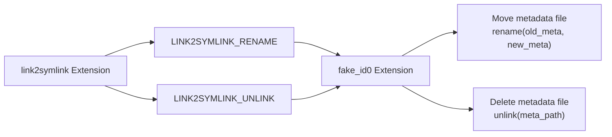

Sources: [src/extension/fake_id0/fake_id0.c:1168-1210]()

---

