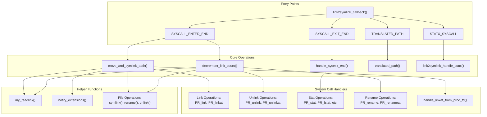
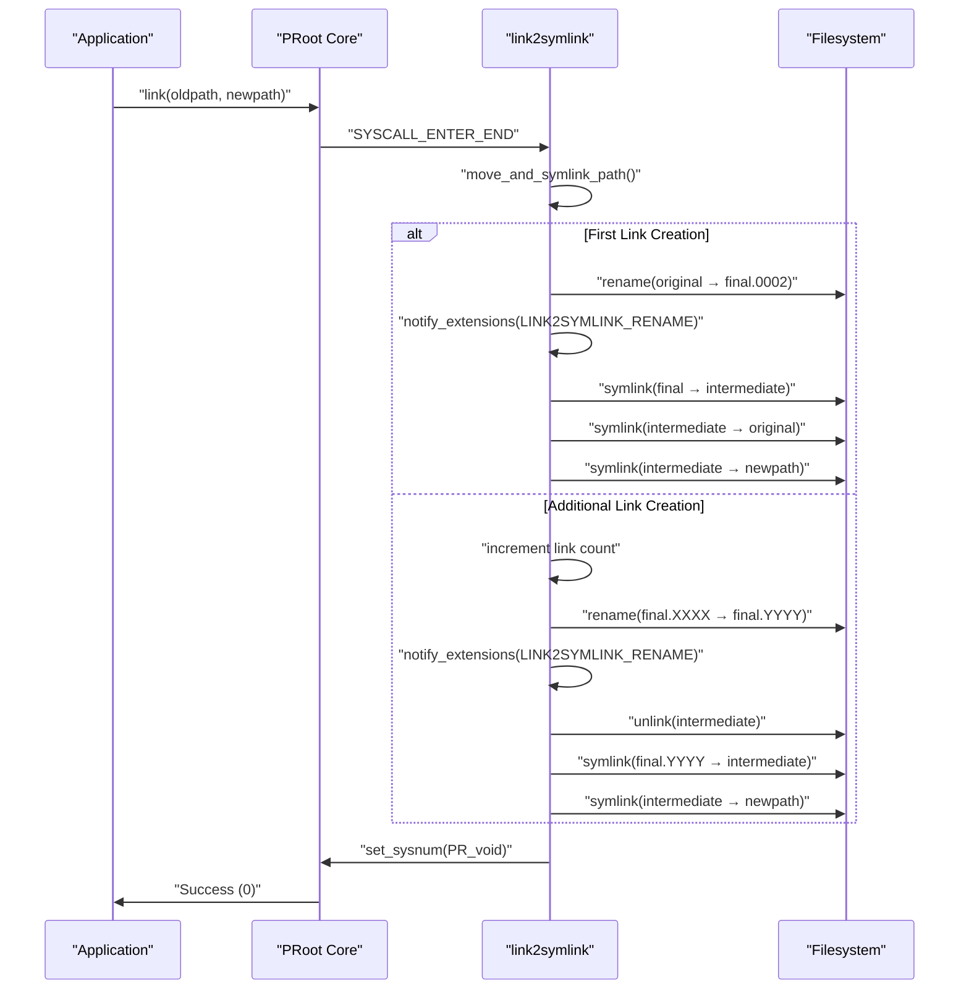
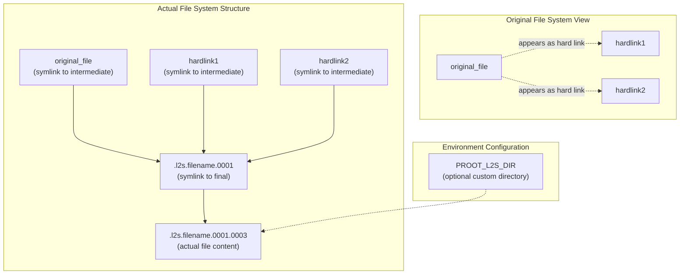
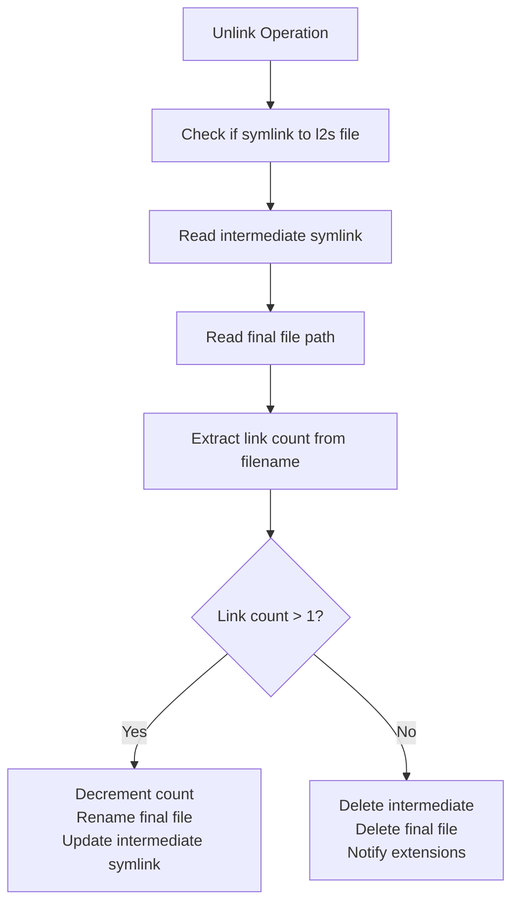
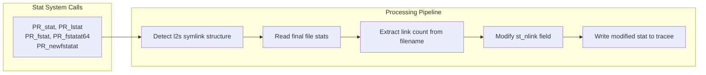
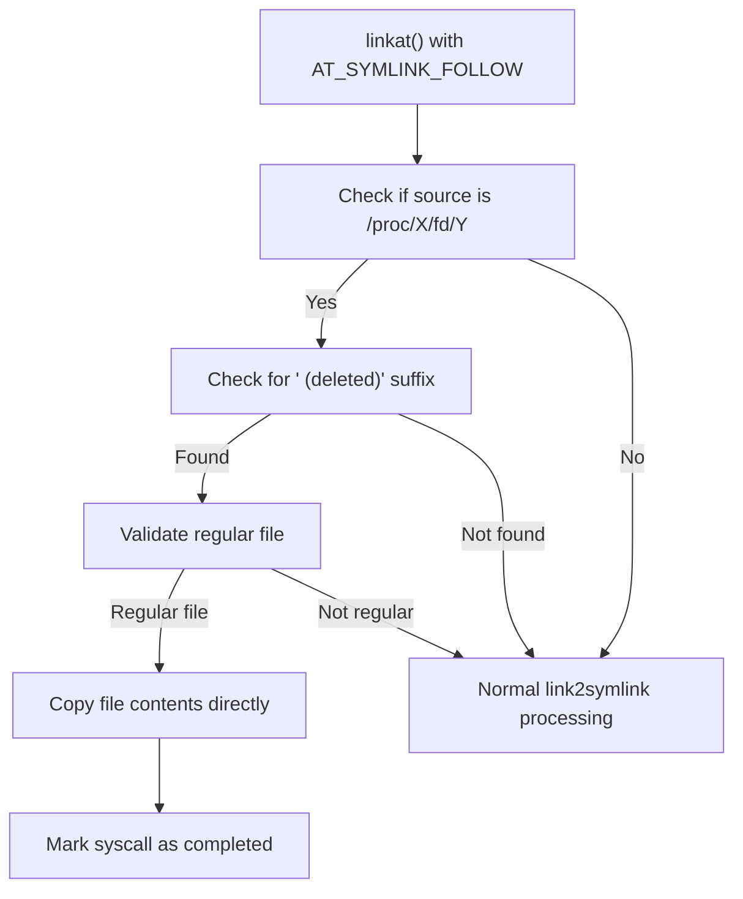

<!-- source: DeepWiki mcp.deepwiki.com · repo termux/proot · page 4.3 link2symlink Extension · fetched 2026-10-26 -->

# link2symlink Extension

<details>
<summary>Relevant source files</summary>

The following files were used as context for generating this wiki page:

- [src/arch.h](src/arch.h)
- [src/extension/link2symlink/link2symlink.c](src/extension/link2symlink/link2symlink.c)

</details>


## Purpose and Scope

The link2symlink extension converts hard link operations (`link()`, `linkat()`) into symbolic link operations to enable cross-filesystem compatibility. This is necessary because hard links cannot span different filesystems, but symbolic links can. The extension maintains the illusion of hard links by creating a structured symlink hierarchy and modifying stat results to show correct link counts.

For information about other filesystem-related extensions, see [Other Extensions](#4.4). For core system call interception mechanisms, see [System Call Interception](#3.2).

## Architecture Overview

The link2symlink extension intercepts link-related system calls and creates a two-level symlink structure to simulate hard links. It uses a naming convention with prefixes and numeric suffixes to track link counts and manage the symlink hierarchy.

### Core Components Architecture



Sources: [src/extension/link2symlink/link2symlink.c:652-816]()

## Hard Link Conversion Process

When a hard link operation is intercepted, the extension performs a complex transformation to create a symlink structure that maintains the appearance of hard links.

### Conversion Flow



Sources: [src/extension/link2symlink/link2symlink.c:57-199](), [src/extension/link2symlink/link2symlink.c:742-793]()

### File Structure Creation

The extension creates a structured hierarchy of symlinks to simulate hard links:



Sources: [src/extension/link2symlink/link2symlink.c:110-128](), [src/extension/link2symlink/link2symlink.c:132-182]()

## Link Management System

The extension tracks link counts using numeric suffixes in filenames and manages the lifecycle of the symlink structure.

### Link Count Management

| Component | Purpose | Format |
|-----------|---------|---------|
| PREFIX | Identifies l2s files | `.proot.l2s.` (userland) or `.l2s.` |
| Intermediate suffix | Avoids name collisions | `.0001`, `.0002`, etc. |
| Link count suffix | Tracks number of links | `.0002`, `.0003`, etc. |

### Unlink Operations



Sources: [src/extension/link2symlink/link2symlink.c:207-296]()

## Stat Result Modification

The extension intercepts stat-family system calls to modify their results, making the symlink structure appear as real hard links to applications.

### Stat Interception Flow



### Stat Structure Modification

The extension carefully modifies only the relevant fields of the stat structure:

```c
#define SIZEOF_RELEVANT_STRUCT_STAT 72
```

Fields modified:
- `st_nlink` - Set to link count from filename
- `st_mode`, `st_uid`, `st_gid` - Preserved from original symlink (userland only)

Sources: [src/extension/link2symlink/link2symlink.c:319-459](), [src/extension/link2symlink/link2symlink.c:313]()

## Special Cases and Handlers

### /proc/fd/ Link Handling

The extension includes special handling for `linkat()` operations involving `/proc/X/fd/Y` paths with `AT_SYMLINK_FOLLOW`:



Sources: [src/extension/link2symlink/link2symlink.c:555-646](), [src/extension/link2symlink/link2symlink.c:762-771]()

### Path Translation

The extension provides path translation for operations that should access the final file instead of the symlink:

| System Call | Behavior |
|-------------|----------|
| `unlink`, `unlinkat` | No translation (operate on symlinks) |
| `link`, `linkat` | No translation (operate on symlinks) |
| `rename`, `renameat*` | No translation (operate on symlinks) |
| Others | Translate to final file path |

Sources: [src/extension/link2symlink/link2symlink.c:492-542]()

## Configuration and Environment

### Environment Variables

| Variable | Purpose | Default |
|----------|---------|---------|
| `PROOT_L2S_DIR` | Custom directory for l2s files | Same directory as original |

### Filtered System Calls

The extension registers to handle these system calls:

```c
static FilteredSysnum filtered_sysnums[] = {
    { PR_link,      FILTER_SYSEXIT },
    { PR_linkat,    FILTER_SYSEXIT },
    { PR_unlink,    FILTER_SYSEXIT },
    { PR_unlinkat,  FILTER_SYSEXIT },
    // ... stat family calls
    { PR_rename,    FILTER_SYSEXIT },
    { PR_renameat,  FILTER_SYSEXIT },
    { PR_renameat2, FILTER_SYSEXIT },
};
```

### Extension Events Handled

| Event | Handler Function | Purpose |
|-------|-----------------|---------|
| `INITIALIZATION` | Setup filtered syscalls | Register syscall interests |
| `SYSCALL_ENTER_END` | Process link/unlink operations | Convert operations |
| `SYSCALL_EXIT_END` | `handle_sysexit_end()` | Modify stat results |
| `TRANSLATED_PATH` | `translated_path()` | Path resolution |
| `STATX_SYSCALL` | `link2symlink_handle_statx()` | Handle statx operations |

Sources: [src/extension/link2symlink/link2symlink.c:658-680](), [src/extension/link2symlink/link2symlink.c:652-815]()

---

