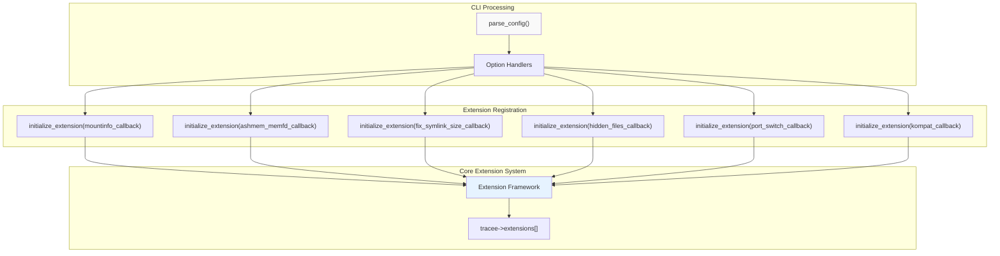
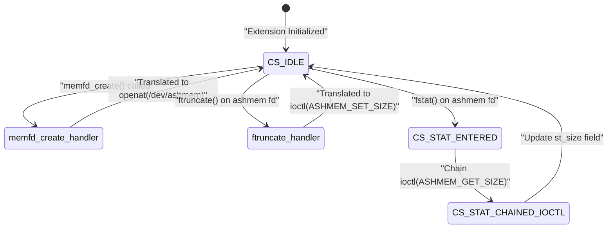
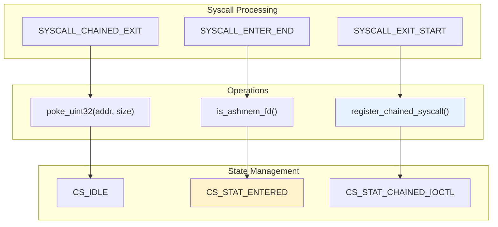
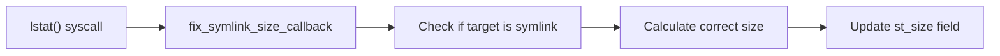
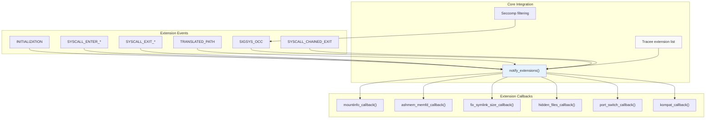

<!-- source: DeepWiki mcp.deepwiki.com · repo termux/proot · page 4.4 Other Extensions · fetched 2026-10-26 -->

# Other Extensions

Relevant source files

The following files were used as context for generating this wiki page:

- [src/cli/cli.c](src/cli/cli.c)
- [src/cli/proot.c](src/cli/proot.c)
- [src/cli/proot.h](src/cli/proot.h)
- [src/extension/ashmem_memfd/ashmem_memfd.c](src/extension/ashmem_memfd/ashmem_memfd.c)
- [src/extension/mountinfo/mountinfo.c](src/extension/mountinfo/mountinfo.c)

This document covers the remaining PRoot extensions beyond the three main ones documented elsewhere: mountinfo, ashmem_memfd, fix_symlink_size, hidden_files, port_switch, and kernel compatibility (kompat). These extensions provide specialized functionality for specific use cases and environment compatibility.

For information about the core extension architecture, see [Extension System](#4). For the three major extensions, see [System V IPC Extension](#4.1), [fake_id0 Extension](#4.2), and [link2symlink Extension](#4.3).

## Extension Overview

The remaining extensions in PRoot serve specialized purposes and are generally simpler than the major extensions. They fall into several categories:

| Extension | Purpose | Activation |
|-----------|---------|------------|
| mountinfo | Fix `/proc/*/mountinfo` on Android | Automatic (unless `PROOT_NO_MOUNTINFO` set) |
| ashmem_memfd | Emulate `memfd_create()` using Android's ashmem | `--ashmem-memfd` |
| fix_symlink_size | Correct symlink size in `lstat()` | `-L` |
| hidden_files | Hide `.proot.*` files | `-H` |
| port_switch | Redirect protected ports to higher ports | `-p` |
| kompat | Emulate newer kernel features | `-k <version>` |

## Extension Activation Architecture

Sources: [src/cli/cli.c:484-485](), [src/cli/proot.c:296-336]()

## mountinfo Extension

The mountinfo extension automatically fixes `/proc/*/mountinfo` files on Android systems to make the root filesystem appear as `/` instead of `/data`. This addresses Android's read-only root filesystem limitations.

### Implementation Details

```mermaid
graph LR
    subgraph "Path Translation Event"
        Path_Event["TRANSLATED_PATH event"]
        Check_Path["mountinfo_check_open_path()"]
    end
    
    subgraph "Path Analysis"
        Match_Pattern["Match /proc/<PID>/mountinfo"]
        Get_Target_Tracee["get_tracee(target_pid)"]
        Check_Root["Check if root under /data"]
    end
    
    subgraph "Mountinfo Processing"
        Open_Real["Open real mountinfo"]
        Create_Temp["create_temp_file()"]
        Process_Lines["Process mount entries"]
        Replace_Root["Replace /data with /"]
    end
    
    Path_Event --> Check_Path
    Check_Path --> Match_Pattern
    Match_Pattern --> Get_Target_Tracee
    Get_Target_Tracee --> Check_Root
    Check_Root --> Open_Real
    Open_Real --> Create_Temp
    Create_Temp --> Process_Lines
    Process_Lines --> Replace_Root
    
    style Check_Path fill:#f9f9f9
    style Create_Temp fill:#e6f3ff
```

The extension intercepts opens to `/proc/*/mountinfo` files and creates modified versions:

1. **Path Detection**: Uses pattern matching to identify mountinfo file access [src/extension/mountinfo/mountinfo.c:10-15]()
2. **Root Analysis**: Checks if the target process's root is under `/data` [src/extension/mountinfo/mountinfo.c:32-38]()  
3. **Content Modification**: Replaces `/data` mount entries with `/` entries [src/extension/mountinfo/mountinfo.c:71-77]()
4. **Additional Mounts**: Preserves standard mounts like `/dev`, `/proc`, `/sys`, `/tmp` [src/extension/mountinfo/mountinfo.c:98-108]()

Sources: [src/extension/mountinfo/mountinfo.c:8-144](), [src/cli/cli.c:484-485]()

## ashmem_memfd Extension

The ashmem_memfd extension provides `memfd_create()` compatibility on Android by translating memory file descriptor operations to use Android's ashmem (Anonymous Shared Memory) interface.

### Syscall Translation Architecture

### Key Operations

| Original Syscall | Translation | Purpose |
|------------------|-------------|---------|
| `memfd_create()` | `openat("/dev/ashmem")` | Create anonymous memory file |
| `ftruncate()` on ashmem | `ioctl(ASHMEM_SET_SIZE)` | Set memory region size |
| `fstat()` on ashmem | `ioctl(ASHMEM_GET_SIZE)` + modify `st_size` | Get correct file size |

The extension includes sophisticated chaining logic to handle multi-step operations:

Sources: [src/extension/ashmem_memfd/ashmem_memfd.c:1-239](), [src/cli/proot.c:296-306]()

## Simple Extensions

Several extensions provide straightforward functionality with minimal implementation complexity:

### fix_symlink_size Extension

Activated with the `-L` option, this extension corrects the size field returned by `lstat()` for symbolic links to match the actual link target length.

### hidden_files Extension  

Activated with the `-H` option, this extension hides files and directories that start with `.proot.` from directory listings and file access operations.

### port_switch Extension

Activated with the `-p` option, this extension redirects attempts to bind to protected ports (< 1024) to use higher, non-privileged port numbers instead.

### kompat Extension (Kernel Compatibility)

Activated with the `-k <version>` option, this extension emulates newer kernel features to allow programs compiled for newer kernels to run on older systems.

Sources: [src/cli/proot.c:320-336](), [src/cli/proot.h:279-286]()

## Integration with Core Systems

All extensions integrate with PRoot's core systems through the standard extension framework:

Extensions can register for specific system call filtering through the `filtered_sysnums` array, enabling efficient syscall interception only for relevant operations.

Sources: [src/extension/ashmem_memfd/ashmem_memfd.c:30-35](), [src/extension/mountinfo/mountinfo.c:126-143](), [src/cli/cli.c:101]()

---

