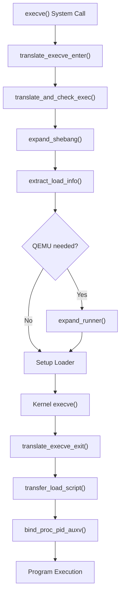
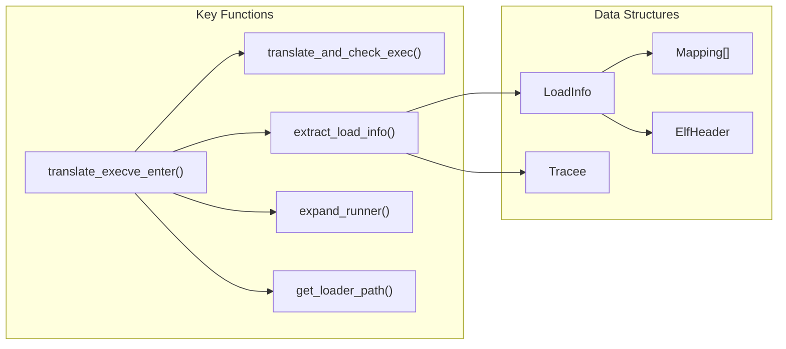
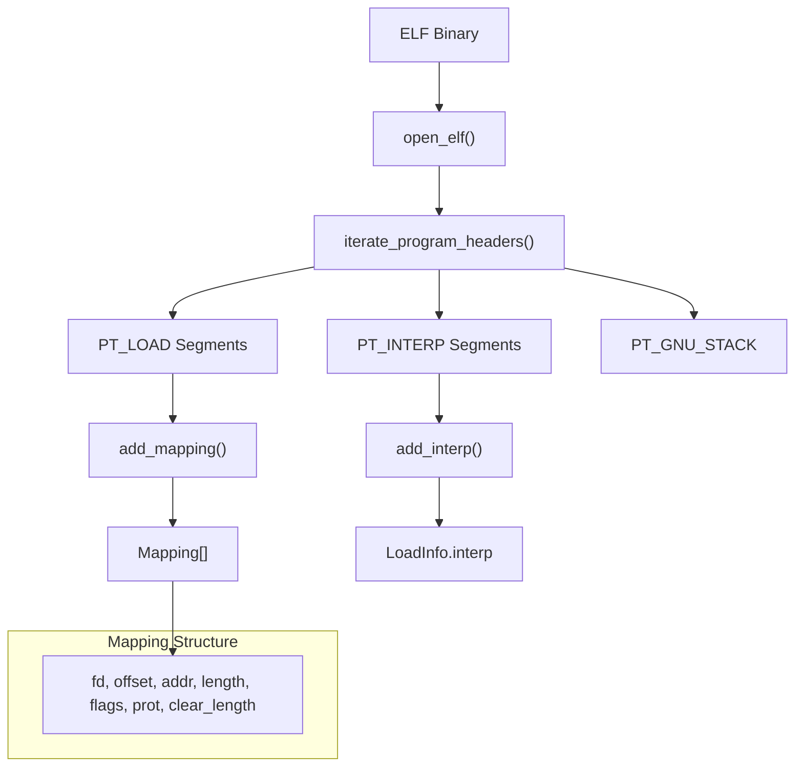
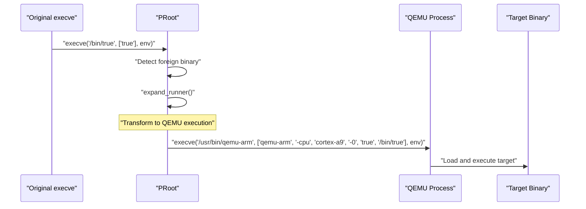
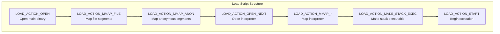
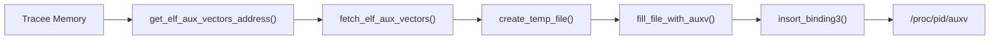

<!-- source: DeepWiki mcp.deepwiki.com · repo termux/proot · page 5 Process Execution · fetched 2026-10-26 -->

# Process Execution

Relevant source files

The following files were used as context for generating this wiki page:

- [src/execve/enter.c](src/execve/enter.c)
- [src/execve/exit.c](src/execve/exit.c)

This document covers how PRoot handles process execution, focusing on the interception and translation of `execve` system calls. This includes ELF binary analysis, cross-architecture execution through QEMU, and the loader system integration.

For detailed information about the loader system implementation, see [Loader System](#5.2). For information about execve-specific handling, see [execve Handling](#5.1). For general system call interception mechanisms, see [System Call Interception](#3.2).

## Overview

Process execution in PRoot involves intercepting `execve` system calls and performing several key transformations:

1. **Path Translation**: Converting guest paths to host paths while validating executability
2. **ELF Analysis**: Parsing executable and interpreter information to understand memory requirements  
3. **Cross-Architecture Support**: Injecting QEMU for foreign binary execution
4. **Loader Injection**: Replacing the target executable with PRoot's custom loader
5. **Load Script Transfer**: Providing the loader with instructions to properly load the original binary

Sources: [src/execve/enter.c:595-721](), [src/execve/exit.c:398-493]()

## execve System Call Interception

The core of process execution handling occurs in two phases during `execve` system call processing:

### Enter Phase Processing

The `translate_execve_enter()` function handles the syscall entry phase:

| Step | Function | Purpose |
|------|----------|---------|
| Path Resolution | `translate_and_check_exec()` | Convert guest path to host path and validate |
| Shebang Processing | `expand_shebang()` | Handle script interpreters and #! lines |
| ELF Analysis | `extract_load_info()` | Parse binary and interpreter information |
| QEMU Integration | `expand_runner()` | Inject QEMU for cross-architecture execution |
| Loader Setup | `get_loader_path()` | Replace target with PRoot loader |

Sources: [src/execve/enter.c:595-721](), [src/execve/enter.c:131-156](), [src/execve/enter.c:272-306]()

### Exit Phase Processing  

The `translate_execve_exit()` function handles post-execution setup:

- **Load Script Transfer**: Converts `LoadInfo` data into executable instructions for the loader
- **Auxiliary Vector Management**: Creates `/proc/pid/auxv` bindings with correct ELF metadata
- **Register State**: Sets up proper register values for program startup
- **Ptrace Coordination**: Handles interactions with external ptrace users (like GDB)

Sources: [src/execve/exit.c:398-493](), [src/execve/exit.c:174-390]()

## ELF Binary Analysis

PRoot performs comprehensive ELF analysis to understand how to load binaries and their interpreters:

### Load Information Extraction

The `extract_load_info()` function parses ELF headers and program headers to build memory mapping requirements:

Sources: [src/execve/enter.c:272-306](), [src/execve/enter.c:56-124](), [src/execve/enter.c:163-221]()

### Address Space Layout

The `compute_load_addresses()` function determines final load addresses for position-independent executables:

- **Executable Base**: Uses `EXEC_PIC_ADDRESS` (64-bit) or `EXEC_PIC_ADDRESS_32` (32-bit)
- **Interpreter Base**: Uses `INTERP_PIC_ADDRESS` (64-bit) or `INTERP_PIC_ADDRESS_32` (32-bit)  
- **Fixed Executables**: Load at addresses specified in ELF headers

Sources: [src/execve/enter.c:332-357]()

## Cross-Architecture Execution (QEMU)

When executing foreign binaries, PRoot integrates with QEMU to provide cross-architecture support:

### QEMU Runner Expansion

The `expand_runner()` function transforms the argument vector to inject QEMU:

### QEMU Integration Details

| Component | Purpose |
|-----------|---------|
| `tracee->qemu[]` | Array of QEMU command and arguments |
| `-0` option | Sets argv[0] for the emulated program |
| `LD_` passthrough | Prevents host linker variables from affecting QEMU |
| `HOST_ROOTFS` prefix | Provides access to host filesystem for QEMU |

Sources: [src/execve/enter.c:367-468](), [src/execve/enter.c:390-454]()

## Load Script Generation and Transfer

The loader system requires detailed instructions about how to load the original binary. This is accomplished through load scripts:

### Load Script Structure

Load scripts contain a sequence of statements that the loader executes:

### Script Transfer Process

The `transfer_load_script()` function:

1. **Calculates sizes** for script statements and string storage
2. **Generates statements** from `LoadInfo` mappings using `transcript_mappings()`
3. **Embeds metadata** including entry points and auxiliary vector data
4. **Transfers to tracee** memory below the stack pointer
5. **Updates registers** to point the loader to the script

Sources: [src/execve/exit.c:174-390](), [src/execve/exit.c:144-168]()

## Auxiliary Vector Management

PRoot maintains proper ELF auxiliary vectors for program startup:

### Auxiliary Vector Binding

The `bind_proc_pid_auxv()` function creates a temporary file containing proper auxiliary vectors and binds it to `/proc/pid/auxv`:

This ensures that programs reading their auxiliary vectors (like GDB or dynamic linkers) receive correct ELF metadata rather than information about PRoot's loader.

Sources: [src/execve/exit.c:89-138](), [src/execve/exit.c:50-83]()

## Process State Management

Process execution involves significant state transitions:

### Loader Coordination

- **`ignore_loader_syscalls`**: Masks loader syscalls from external ptracers during loading
- **`NOTIFICATION_PTRACED_LOAD_DONE`**: Special execve used by loader to signal completion  
- **Register restoration**: Proper startup state for the loaded program

### Memory Management

- **Heap reset**: New processes start with clean heap state  
- **Stack pointer adjustment**: Loader script placed below initial stack
- **Executable path tracking**: Updates `tracee->exe` and `tracee->new_exe`

Sources: [src/execve/exit.c:403-459](), [src/execve/enter.c:604-612](), [src/execve/exit.c:476-484]()

---

