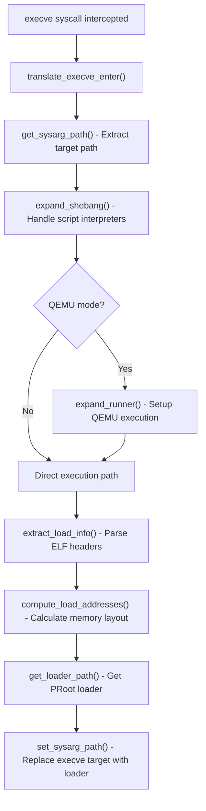
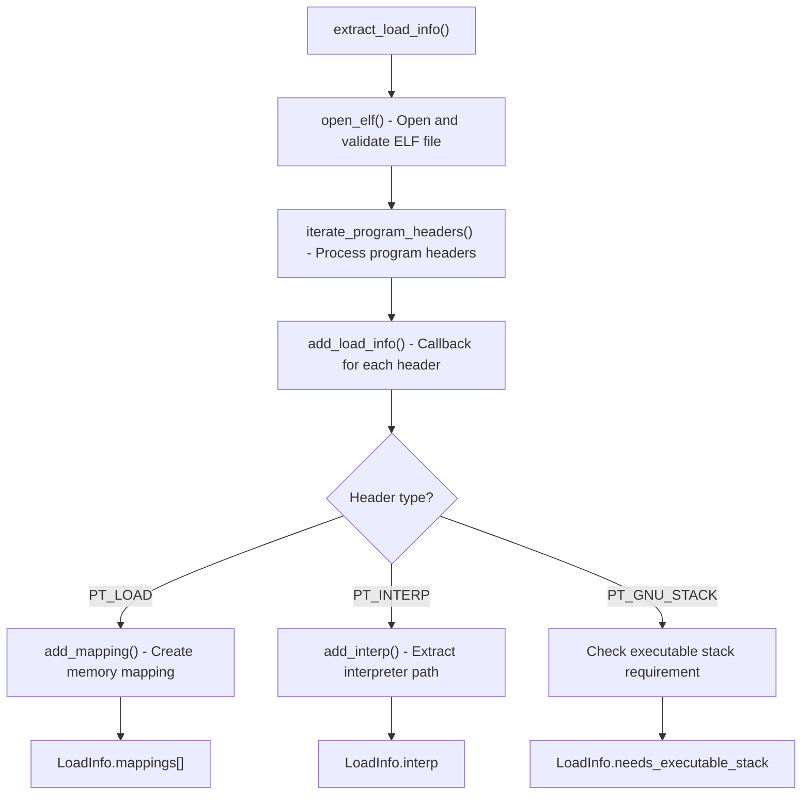
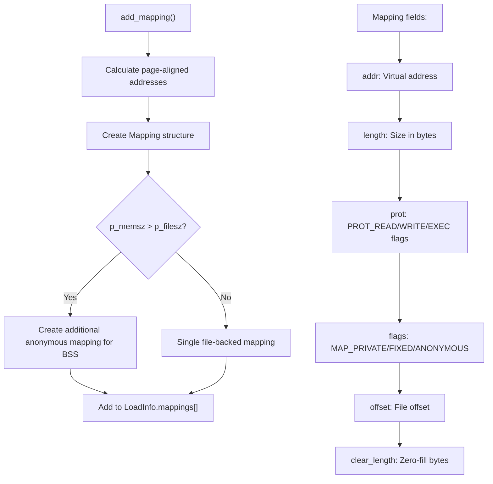
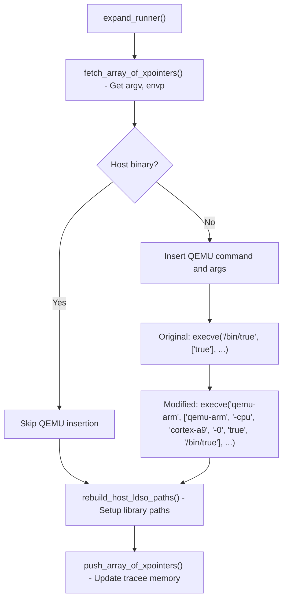
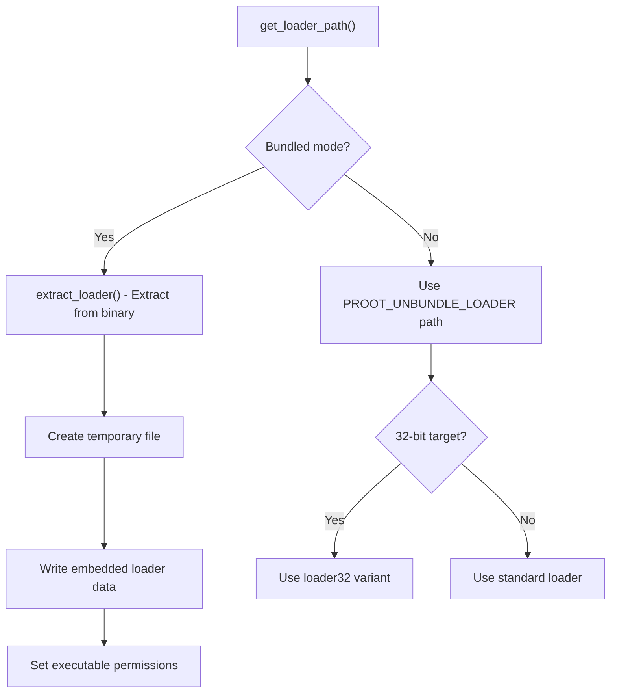
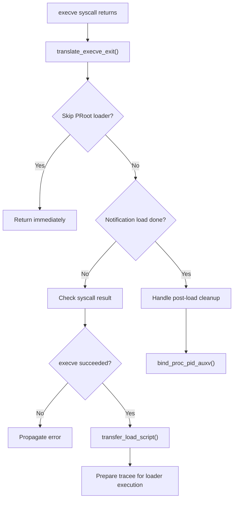
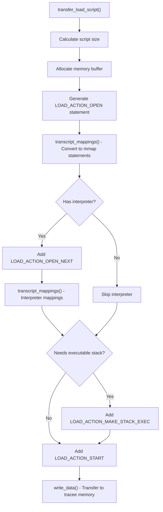
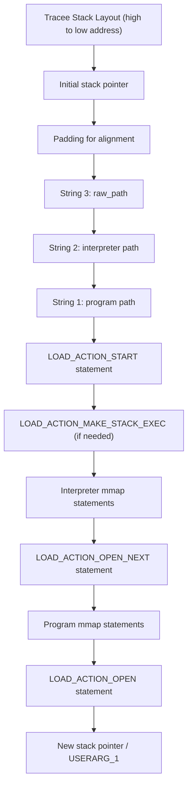
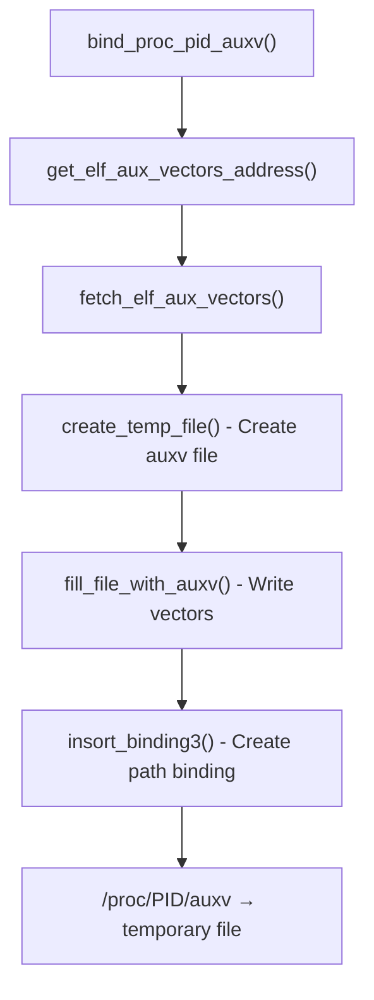

<!-- source: DeepWiki mcp.deepwiki.com · repo termux/proot · page 5.1 execve Handling · fetched 2026-10-26 -->

# execve Handling

<details>
<summary>Relevant source files</summary>

The following files were used as context for generating this wiki page:

- [src/execve/enter.c](src/execve/enter.c)
- [src/execve/exit.c](src/execve/exit.c)

</details>


This document covers PRoot's interception and processing of `execve` system calls, including ELF parsing, loader injection, and load script generation. The execve handling system is responsible for replacing the target executable with PRoot's custom loader while preserving the original program's execution semantics.

For information about the loader system that executes the generated load scripts, see [Loader System](#5.2). For broader context on process execution within PRoot, see [Process Execution](#5).

## Overview

PRoot intercepts `execve` system calls to implement its virtualization features. Instead of allowing the kernel to directly execute the requested program, PRoot:

1. Analyzes the target executable using ELF parsing
2. Generates memory mapping instructions (load script)  
3. Replaces the execve target with PRoot's custom loader
4. Transfers the load script to the tracee's memory
5. Allows the loader to properly map and execute the original program

This approach enables PRoot to control process loading, handle cross-architecture execution via QEMU, and maintain its virtualized environment.

## execve Entry Processing

### Main Entry Flow



Sources: [src/execve/enter.c:595-721]()

The `translate_execve_enter()` function coordinates the entire entry processing pipeline. It extracts the target executable path, handles script interpretation through shebang expansion, and ultimately replaces the original executable with PRoot's loader.

### ELF Analysis and Load Info Extraction



Sources: [src/execve/enter.c:272-306](), [src/execve/enter.c:237-266]()

The ELF analysis extracts critical information needed for loading:

| Program Header Type | Handler Function | Purpose |
|---------------------|------------------|---------|
| `PT_LOAD` | `add_mapping()` | Creates memory mapping entries |
| `PT_INTERP` | `add_interp()` | Extracts dynamic linker path |  
| `PT_GNU_STACK` | Stack flag processing | Determines if executable stack needed |

### Memory Mapping Generation



Sources: [src/execve/enter.c:56-124]()

The `add_mapping()` function converts ELF program headers into `Mapping` structures that describe how memory should be allocated and initialized. It handles the distinction between file-backed regions and zero-filled BSS sections.

### QEMU Runner Expansion

When QEMU is configured for cross-architecture execution, `expand_runner()` modifies the command line arguments:



Sources: [src/execve/enter.c:367-468]()

### Loader Path Resolution



Sources: [src/execve/enter.c:562-588](), [src/execve/enter.c:482-555]()

PRoot supports both bundled and unbundled loader modes. In bundled mode, the loader executable is embedded within the PRoot binary and extracted to a temporary file when needed.

## execve Exit Processing

### Exit Processing Flow



Sources: [src/execve/exit.c:398-493]()

### Load Script Generation and Transfer

The load script contains instructions for the PRoot loader to properly map and initialize the target executable:



Sources: [src/execve/exit.c:174-390]()

### Load Script Structure

The generated load script contains a sequence of statements that instruct the loader:

| Action Type | Purpose | Fields |
|-------------|---------|--------|
| `LOAD_ACTION_OPEN` | Open the main executable | `string_address` |
| `LOAD_ACTION_MMAP_FILE` | Map file section to memory | `addr`, `length`, `prot`, `offset` |
| `LOAD_ACTION_MMAP_ANON` | Create anonymous mapping | `addr`, `length`, `prot` |
| `LOAD_ACTION_OPEN_NEXT` | Open the interpreter | `string_address` |
| `LOAD_ACTION_MAKE_STACK_EXEC` | Make stack executable | `start` |
| `LOAD_ACTION_START` | Begin program execution | `stack_pointer`, `entry_point`, auxv fields |

### Memory Layout After Transfer



Sources: [src/execve/exit.c:357-382]()

### Auxiliary Vector Handling

PRoot creates a virtualized `/proc/PID/auxv` file to provide correct ELF auxiliary vectors to debuggers and other tools:



Sources: [src/execve/exit.c:89-138]()

## Integration Points

### Shebang and Script Handling

PRoot integrates with the shebang expansion system to handle script execution. When a script is detected, `expand_shebang()` modifies the execution path before ELF analysis begins.

### Cross-Architecture Execution

The execve handler coordinates with QEMU for cross-architecture execution by:
- Detecting non-native binaries using `is_host_elf()`
- Inserting QEMU commands into the argument vector
- Setting up appropriate environment variables via `ldso_env_passthru()`

### Path Translation

All executable paths undergo translation via `translate_and_check_exec()`, which:
- Applies PRoot's path translation rules
- Validates file accessibility and permissions  
- Ensures the target is a regular, executable file

## Data Structures

### LoadInfo Structure

The `LoadInfo` structure contains all information needed to load an executable:

```c
typedef struct {
    char *host_path;              // Host filesystem path
    char *user_path;              // Guest filesystem path  
    char *raw_path;               // Original path before shebang expansion
    ElfHeader elf_header;         // Parsed ELF header
    Mapping *mappings;            // Array of memory mappings
    LoadInfo *interp;             // Dynamic linker info (if present)
    bool needs_executable_stack;  // Stack execution requirement
} LoadInfo;
```

### Mapping Structure

Each `Mapping` describes a memory region to be created:

```c
typedef struct {
    int fd;                    // File descriptor (-1 for anonymous)
    word_t offset;             // File offset  
    word_t addr;               // Virtual address
    word_t length;             // Size in bytes
    word_t clear_length;       // Bytes to zero-fill
    int flags;                 // mmap() flags
    int prot;                  // Protection flags
} Mapping;
```

Sources: [src/execve/enter.c:56-124](), [src/execve/exit.c:144-168]()

---

