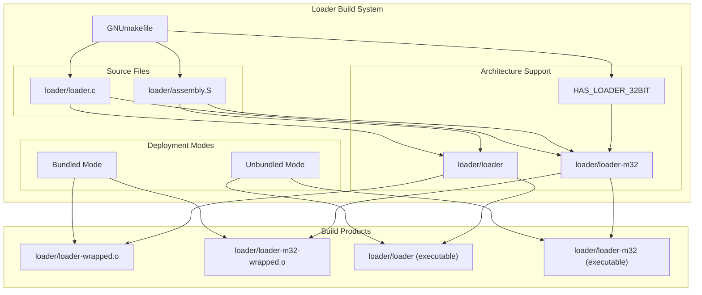
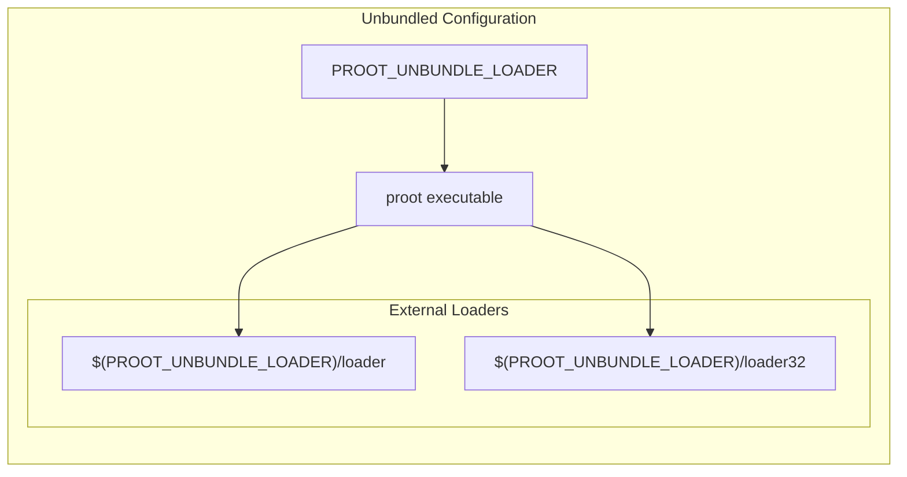
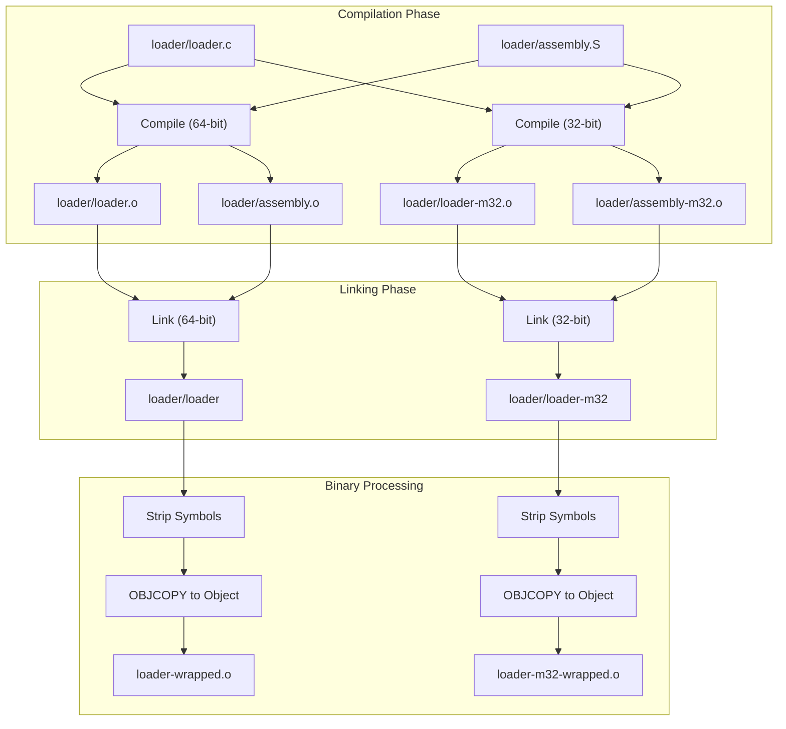
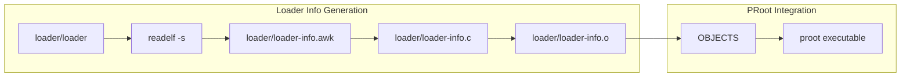

<!-- source: DeepWiki mcp.deepwiki.com · repo termux/proot · page 5.2 Loader System · fetched 2026-10-26 -->

# Loader System

<details>
<summary>Relevant source files</summary>

The following files were used as context for generating this wiki page:

- [.gitignore](.gitignore)
- [src/GNUmakefile](src/GNUmakefile)

</details>


## Purpose and Scope

The Loader System is PRoot's custom program loader infrastructure that enables process initialization within the traced environment. This system handles the injection and execution of a specialized loader program that sets up the memory layout and execution environment for new processes before transferring control to the target executable. 

For information about how the loader integrates with execve system call handling, see [execve Handling](#5.1). For broader context on process management, see [Process Management](#3.1).

## System Overview

The Loader System consists of two main operational modes: bundled and unbundled deployment. The system uses a custom position-independent loader executable that is either embedded directly into the PRoot binary or distributed as separate files.

### Loader Architecture



Sources: [src/GNUmakefile:95-106](), [src/GNUmakefile:202-235]()

## Bundled vs Unbundled Modes

The Loader System supports two deployment strategies controlled by the `PROOT_UNBUNDLE_LOADER` configuration variable.

### Bundled Mode (Default)

In bundled mode, loader binaries are embedded directly into the PRoot executable as object files. This approach eliminates the need for separate loader files but increases the PRoot binary size.

| Component | Object File | Purpose |
|-----------|-------------|---------|
| 64-bit loader | `loader/loader-wrapped.o` | Embedded 64-bit loader |
| 32-bit loader | `loader/loader-m32-wrapped.o` | Embedded 32-bit loader (if supported) |

### Unbundled Mode

When `PROOT_UNBUNDLE_LOADER` is defined, loaders are built as separate executable files that must be accessible at runtime.



Sources: [src/GNUmakefile:95-106](), [src/GNUmakefile:261-266]()

## Architecture Support

The Loader System provides multi-architecture support through the `HAS_LOADER_32BIT` feature detection mechanism.

### Architecture Detection

The build system uses compile-time feature detection to determine loader capabilities:

```makefile
$(eval $(call define_from_arch.h,,HAS_LOADER_32BIT))
```

### Loader Variants

| Loader Type | Build Target | Architecture | Flags |
|-------------|--------------|--------------|-------|
| Primary | `loader/loader` | Native (64-bit) | `LOADER_ARCH_CFLAGS` |
| 32-bit | `loader/loader-m32` | 32-bit compatibility | `LOADER_ARCH_CFLAGS-m32` |

### Build Configuration

Each loader variant uses specialized compilation flags:

- **Position Independence**: `-fPIC` enables position-independent code
- **Freestanding**: `-ffreestanding` removes standard library dependencies  
- **Static Linking**: `-static -nostdlib` creates self-contained binaries
- **Custom Load Address**: `-Ttext=$(LOADER_ADDRESS)` sets memory placement

Sources: [src/GNUmakefile:92-93](), [src/GNUmakefile:98-105](), [src/GNUmakefile:208-209]()

## Build Process Details

The Loader System uses a sophisticated build process that handles binary embedding and architecture-specific compilation.

### Loader Compilation Pipeline



### Binary Embedding Process

The `OBJIFY` macro transforms loader executables into linkable object files:

1. **Input Processing**: Takes stripped loader executable
2. **Target Detection**: Extracts object format from existing PRoot objects
3. **Architecture Detection**: Determines binary architecture automatically  
4. **Object Conversion**: Creates embeddable object file with binary data

Sources: [src/GNUmakefile:175-182](), [src/GNUmakefile:222-228]()

## Loader Information System

For systems requiring the `HAS_POKEDATA_WORKAROUND`, the build system generates loader symbol information.

### Symbol Extraction

The loader information system extracts runtime symbols from the compiled loader:

```bash
readelf -s loader/loader | awk -f loader/loader-info.awk > loader/loader-info.c
```

This generates a C source file containing symbol addresses and metadata required for memory manipulation workarounds on specific platforms.

### Integration Points



Sources: [src/GNUmakefile:108-110](), [src/GNUmakefile:237-238]()

## Load Script Transfer Mechanism

The Loader System implements a load script transfer protocol that coordinates between the PRoot tracer and the injected loader. This mechanism handles the transfer of initialization instructions and memory setup commands.

### Transfer Protocol Components

| Component | Role | Implementation |
|-----------|------|----------------|
| Load Script | Memory setup instructions | Generated by PRoot |
| Transfer Buffer | Communication medium | Tracee memory region |
| Loader Handler | Script processor | Embedded loader logic |

The loader receives initialization parameters through a structured protocol that enables:

- Memory layout configuration
- Environment variable setup  
- Auxiliary vector modification
- Dynamic linker coordination

Sources: [src/GNUmakefile:25-31](), [src/GNUmakefile:202-235]()

## Integration with Process Execution

The Loader System integrates closely with PRoot's execve handling system to provide seamless process initialization. When a new process is launched, the loader system:

1. **Injection Phase**: Embeds loader into target process memory
2. **Configuration Phase**: Transfers initialization parameters
3. **Setup Phase**: Configures memory layout and environment
4. **Transfer Phase**: Hands control to the target executable

This integration enables PRoot to maintain full control over process initialization while preserving the illusion of native execution for traced processes.

Sources: [src/GNUmakefile:184-185](), [src/GNUmakefile:244-247]()

---

