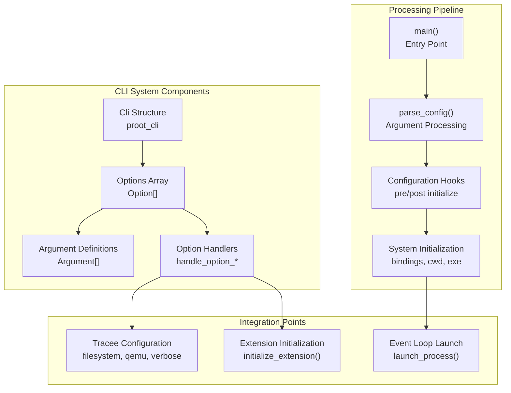
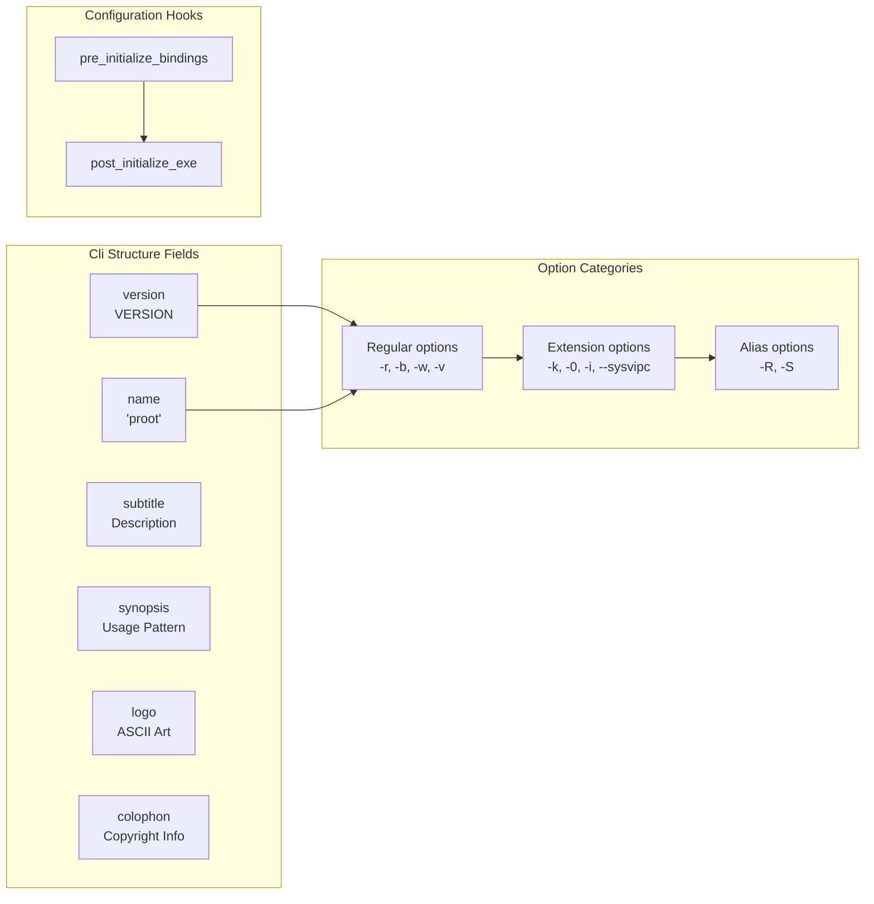
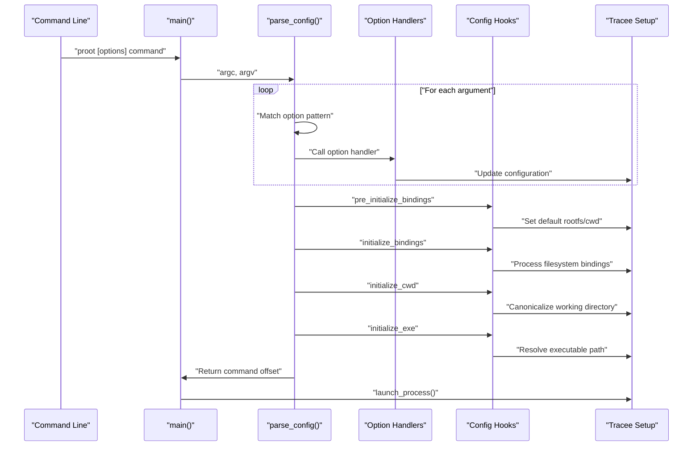
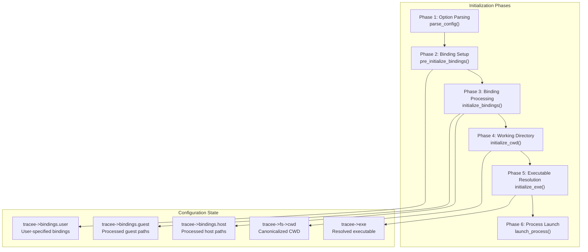
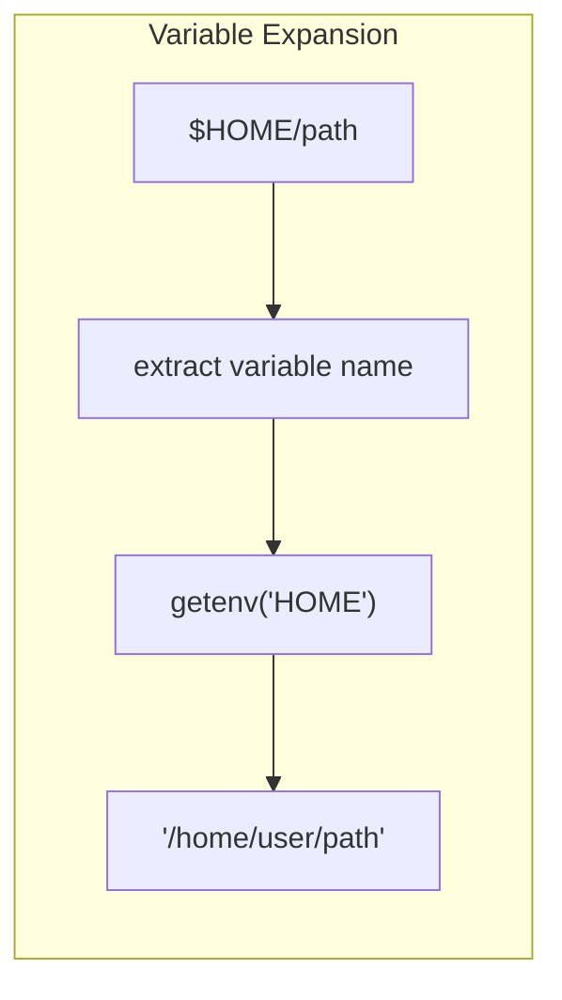
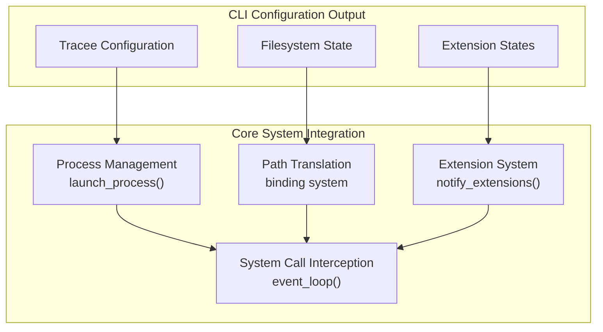

<!-- source: DeepWiki mcp.deepwiki.com · repo termux/proot · page 6 Command Line Interface · fetched 2026-10-26 -->

# Command Line Interface

Relevant source files

The following files were used as context for generating this wiki page:

- [src/cli/cli.c](src/cli/cli.c)
- [src/cli/proot.c](src/cli/proot.c)
- [src/cli/proot.h](src/cli/proot.h)
- [src/extension/ashmem_memfd/ashmem_memfd.c](src/extension/ashmem_memfd/ashmem_memfd.c)
- [src/extension/mountinfo/mountinfo.c](src/extension/mountinfo/mountinfo.c)

This document describes PRoot's command-line interface system, including option parsing, configuration processing, and integration with the core tracing engine. The CLI system provides the primary user interface for configuring PRoot's behavior, setting up filesystem bindings, and enabling extensions.

For information about the extension system that many CLI options activate, see [Extension System](#4). For details about the core tracing engine that the CLI configures, see [Process Management](#3.1).

## Architecture Overview

The CLI system in PRoot follows a structured approach with clear separation between option definitions, parsing logic, and handler execution. The system is designed to be extensible and supports multiple argument formats for each option.

Sources: [src/cli/cli.c:448-506](), [src/cli/proot.h:74-344](), [src/cli/proot.c:39-402]()

## CLI Structure Definition

The CLI system is built around the `Cli` structure which defines the complete command-line interface configuration:

Sources: [src/cli/proot.h:74-89](), [src/cli/proot.h:90-342]()

Each option in the CLI system is defined by an `Option` structure containing:
- **class**: Category name for grouping related options
- **arguments**: Array of `Argument` structures defining aliases and syntax
- **handler**: Function pointer to process the option
- **description**: Brief help text
- **detail**: Extended help information

Sources: [src/cli/proot.h:91-105](), [src/cli/cli.c:55-105]()

## Option Processing Pipeline

The command-line parsing follows a systematic pipeline that processes arguments, validates syntax, and configures the system:

Sources: [src/cli/cli.c:300-444](), [src/cli/proot.c:376-402]()

The parsing algorithm in `parse_config()` processes arguments sequentially:

1. **Argument Matching**: Compares each argument against option patterns [src/cli/cli.c:334-387]()
2. **Separator Validation**: Ensures proper syntax for value separators [src/cli/cli.c:354-358]()
3. **Handler Invocation**: Calls the appropriate option handler function [src/cli/cli.c:362-374]()
4. **Configuration Hooks**: Executes initialization phases in correct order [src/cli/cli.c:410-439]()

Sources: [src/cli/cli.c:319-444]()

## Option Categories and Handlers

### Regular Options

The core PRoot options handle fundamental configuration:

| Option | Aliases | Handler | Purpose |
|--------|---------|---------|----------|
| `-r` | `--rootfs` | `handle_option_r` | Set guest root filesystem |
| `-b` | `--bind`, `-m`, `--mount` | `handle_option_b` | Create filesystem bindings |
| `-q` | `--qemu` | `handle_option_q` | Configure QEMU emulation |
| `-w` | `--pwd`, `--cwd` | `handle_option_w` | Set working directory |
| `-v` | `--verbose` | `handle_option_v` | Set verbosity level |

Sources: [src/cli/proot.h:91-173](), [src/cli/proot.c:39-211]()

### Extension Options  

Extensions are activated through CLI options:

| Option | Handler | Extension |
|--------|---------|-----------|
| `-k` | `handle_option_k` | `kompat_callback` |
| `-0` | `handle_option_0` | `fake_id0_callback` |
| `-i` | `handle_option_i` | `fake_id0_callback` |
| `--sysvipc` | `handle_option_sysvipc` | `sysvipc_callback` |
| `--link2symlink` | `handle_option_link2symlink` | `link2symlink_callback` |

Sources: [src/cli/proot.h:194-286](), [src/cli/proot.c:156-336]()

### Alias Options

Convenience options that combine multiple features:

- **`-R`**: Combines `-r path` with recommended bindings for typical usage
- **`-S`**: Combines `-0 -r path` with minimal bindings for package installation

Sources: [src/cli/proot.h:287-341](), [src/cli/proot.c:254-282]()

## Configuration Processing Flow

The CLI system follows a specific initialization sequence to ensure proper system setup:

Sources: [src/cli/cli.c:410-444](), [src/cli/cli.c:219-293]()

The initialization sequence ensures dependencies are resolved correctly:

1. **Default Configuration**: Sets default rootfs ("/") and cwd (".") if not specified [src/cli/proot.c:376-396]()
2. **Binding Canonicalization**: Processes user bindings into guest/host path pairs [src/cli/cli.c:414-416]()
3. **Working Directory Resolution**: Canonicalizes the working directory within the guest filesystem [src/cli/cli.c:424-426]()
4. **Executable Path Resolution**: Resolves the command path and configures QEMU if needed [src/cli/cli.c:434-436]()

Sources: [src/cli/proot.c:376-402](), [src/cli/proot.c:341-370]()

## Environment Integration

The CLI system integrates with environment variables and provides debugging capabilities:

### Environment Variable Processing

The `expand_front_variable()` function handles environment variable expansion in option values:

Sources: [src/cli/cli.c:531-561]()

### Verbose Output and Debugging

The CLI system provides comprehensive debugging through the verbose system:

- **Configuration Display**: `print_config()` shows active configuration when verbose >= 1 [src/cli/cli.c:193-213]()
- **Argument Display**: `print_argv()` formats command arguments for display [src/cli/cli.c:164-191]()
- **Error Handling**: Detailed error messages with context information [src/cli/cli.c:127-153]()

Sources: [src/cli/cli.c:193-213](), [src/cli/cli.c:470-477]()

## Integration with Core Systems

The CLI system serves as the primary configuration interface for PRoot's core components:

Sources: [src/cli/cli.c:487-495](), [src/cli/cli.c:101](), [src/cli/cli.c:212]()

The CLI system's integration points include:

- **Tracee Creation**: Main function creates the initial tracee and configures it [src/cli/cli.c:464-482]()
- **Extension Initialization**: Option handlers call `initialize_extension()` to activate extensions [src/cli/proot.c:168-170]()
- **Process Launch**: After configuration, `launch_process()` starts the traced process [src/cli/cli.c:487-495]()
- **Event Loop**: The configured tracee enters the main event loop for system call interception [src/cli/cli.c:495]()

Sources: [src/cli/cli.c:464-506](), [src/cli/proot.c:284-317]()

---

