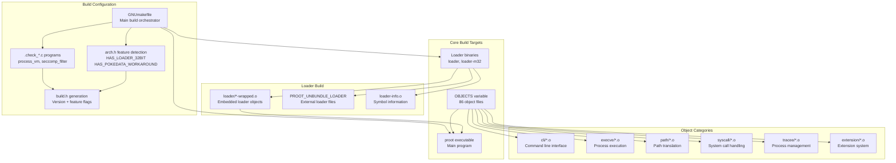
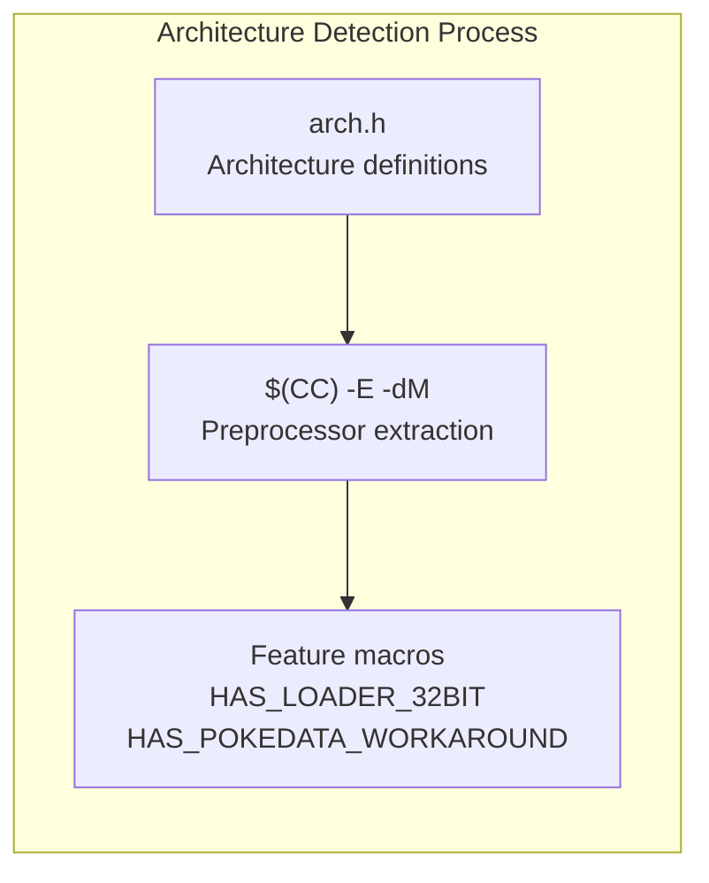
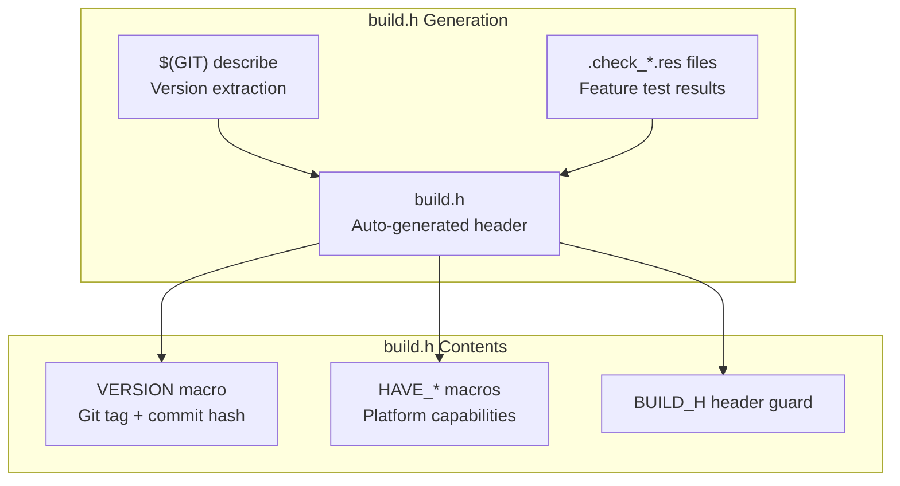
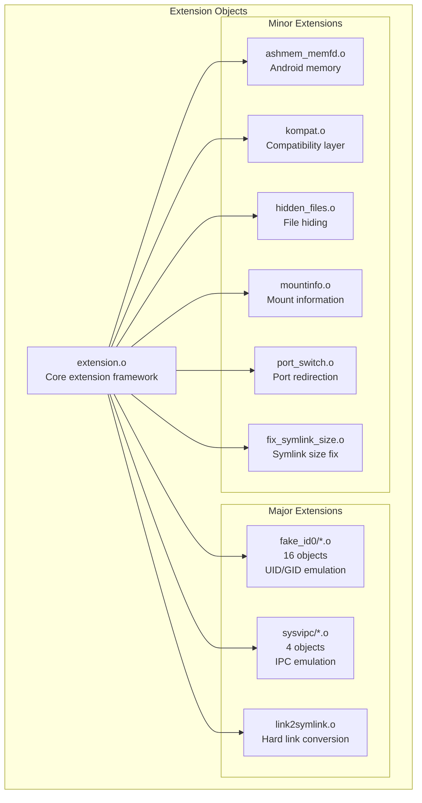
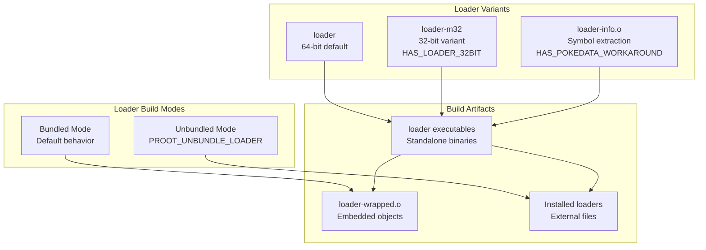

<!-- source: DeepWiki mcp.deepwiki.com · repo termux/proot · page 7 Build System · fetched 2026-10-26 -->

# Build System

Relevant source files

The following files were used as context for generating this wiki page:

- [.gitignore](.gitignore)
- [src/GNUmakefile](src/GNUmakefile)

This document covers PRoot's build system implementation, including the GNUmakefile structure, feature detection, cross-compilation support, and loader build process. For information about the actual loader system functionality, see [Loader System](#5.2).

## Build Architecture Overview

PRoot uses a single GNUmakefile that orchestrates the build of multiple components with sophisticated feature detection and cross-compilation support.

**Build Architecture Flow**

Sources: [src/GNUmakefile:1-276]()

## Feature Detection System

The build system includes an automated feature detection mechanism that tests for platform capabilities at compile time.

### Architecture Detection

Architecture-specific features are detected using the `define_from_arch.h` function:

The `define_from_arch.h` function at [src/GNUmakefile:88-90]() extracts preprocessor definitions using `$(CC) -E -dM -DNO_LIBC_HEADER $(SRC)/arch.h`.

### Runtime Feature Detection

Runtime capabilities are tested using small C programs:

| Feature | Test Program | Result Variable |
|---------|-------------|-----------------|
| `process_vm` | `.check_process_vm.c` | `HAVE_PROCESS_VM` |
| `seccomp_filter` | `.check_seccomp_filter.c` | `HAVE_SECCOMP_FILTER` |

The detection process at [src/GNUmakefile:149-156]() compiles test programs and generates `#define` statements in `.check_*.res` files.

Sources: [src/GNUmakefile:88-94](), [src/GNUmakefile:142-156]()

## Build Configuration Generation

The `build.h` file is auto-generated and contains version information and feature flags:

The version check at [src/GNUmakefile:137-140]() extracts git information using `$(GIT) describe --tags --dirty --abbrev=8 --always`.

Objects that include `build.h` are automatically tracked using pattern matching at [src/GNUmakefile:189-190]().

Sources: [src/GNUmakefile:137-165](), [src/GNUmakefile:189-190]()

## Main Build Targets

### Core Object Compilation

The `OBJECTS` variable at [src/GNUmakefile:21-86]() defines 86 object files across major subsystems:

| Subsystem | Object Count | Purpose |
|-----------|-------------|---------|
| `cli/` | 3 | Command line interface |
| `execve/` | 7 | Process execution handling |
| `path/` | 7 | Path translation system |
| `syscall/` | 8 | System call interception |
| `tracee/` | 6 | Process management |
| `ptrace/` | 3 | Ptrace operations |
| `extension/` | 52 | Extension system + extensions |

### Extension Object Organization

Extensions are organized by functionality:

Sources: [src/GNUmakefile:21-86]()

## Loader Build System

The loader build system supports multiple architectures and deployment modes:

### Loader Build Configuration

### Loader Build Process

The `build_loader` function template at [src/GNUmakefile:202-229]() defines the loader build process:

1. **Architecture Detection**: Extract `LOADER_ARCH_CFLAGS` and `LOADER_ADDRESS` from `arch.h`
2. **Special Flags**: Use `-fPIC -ffreestanding` for position-independent, freestanding code
3. **Linking**: Static link with custom text address using `-Ttext=$(LOADER_ADDRESS)`
4. **Object Wrapping**: Convert stripped binaries to `.o` files using `OBJCOPY`

The loader components are:
- `loader.c` - Main loader implementation
- `assembly.S` - Architecture-specific assembly code

Sources: [src/GNUmakefile:95-111](), [src/GNUmakefile:202-238]()

## Cross-Compilation Support

The build system supports cross-compilation through standard GNU toolchain variables:

### Toolchain Configuration

| Variable | Default | Purpose |
|----------|---------|---------|
| `CROSS_COMPILE` | - | Toolchain prefix |
| `CC` | `$(CROSS_COMPILE)gcc` | C compiler |
| `LD` | `$(CC)` | Linker (same as compiler) |
| `STRIP` | `$(CROSS_COMPILE)strip` | Binary stripper |
| `OBJCOPY` | `$(CROSS_COMPILE)objcopy` | Object file converter |
| `OBJDUMP` | `$(CROSS_COMPILE)objdump` | Object file analyzer |

### Build Flags

Standard build flags are configured at [src/GNUmakefile:17-19]():
- `CPPFLAGS`: Include `-D_FILE_OFFSET_BITS=64 -D_GNU_SOURCE` and include paths
- `CFLAGS`: Warning flags and optimization (`-Wall -Wextra -O2`)
- `LDFLAGS`: Link against talloc and disable executable stack

### Object File Format Detection

The `OBJIFY` function at [src/GNUmakefile:175-182]() automatically detects the target object file format and architecture using `OBJDUMP` to ensure cross-compilation compatibility.

Sources: [src/GNUmakefile:11-19](), [src/GNUmakefile:175-182]()

## Installation and Build Management

### Installation Targets

The installation system supports both bundled and unbundled loader deployments:

| Target | Action | Files |
|--------|--------|-------|
| `install` | Install to `$(DESTDIR)$(BINDIR)` | `proot` executable |
| `uninstall` | Remove installed files | `proot` executable |
| `clean` | Remove build artifacts | Objects, binaries, temp files |
| `distclean` | Full cleanup | Same as `clean` |

### Unbundled Loader Installation

When `PROOT_UNBUNDLE_LOADER` is defined, loaders are installed separately:
- `loader` → `$(PROOT_UNBUNDLE_LOADER)/loader`
- `loader-m32` → `$(PROOT_UNBUNDLE_LOADER)/loader32` (if `HAS_LOADER_32BIT`)

### Build Verbosity Control

The build system supports quiet/verbose modes controlled by the `V` variable:
- `V=0` (default): Quiet mode with beautified output
- `V=1`: Verbose mode showing full commands

Sources: [src/GNUmakefile:252-276](), [src/GNUmakefile:118-132]()

---

