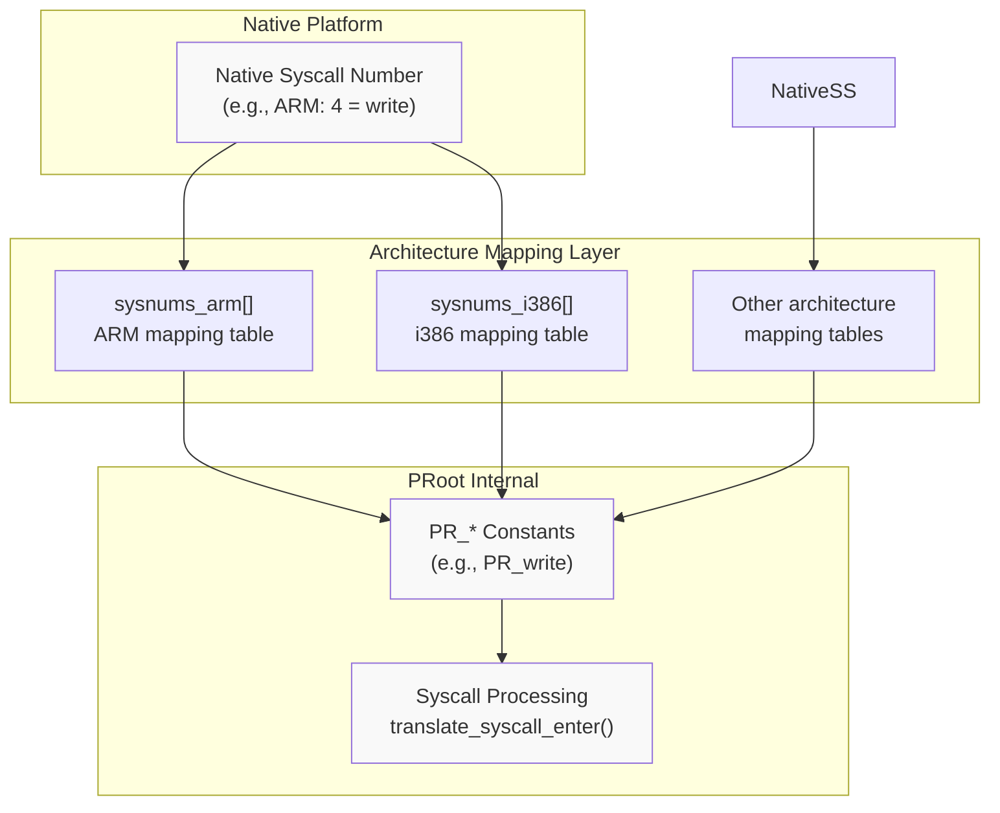
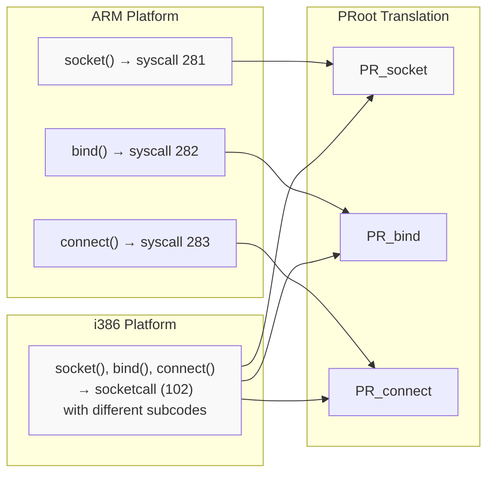
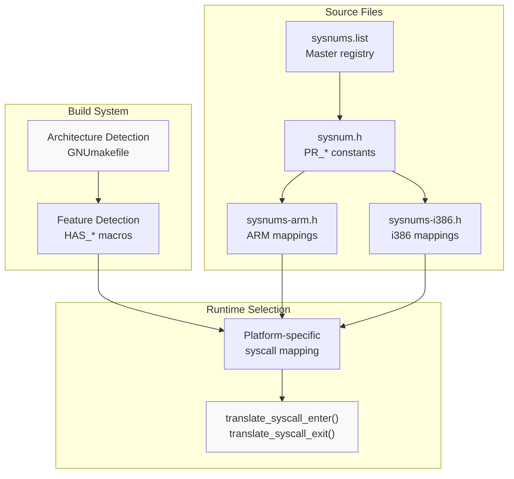
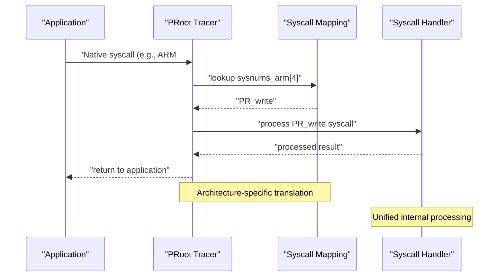

<!-- source: DeepWiki mcp.deepwiki.com · repo termux/proot · page 8 Platform Support · fetched 2026-10-26 -->

# Platform Support

<details>
<summary>Relevant source files</summary>

The following files were used as context for generating this wiki page:

- [src/syscall/sysnums-arm.h](src/syscall/sysnums-arm.h)
- [src/syscall/sysnums-i386.h](src/syscall/sysnums-i386.h)
- [src/syscall/sysnums.list](src/syscall/sysnums.list)

</details>


This document covers PRoot's platform support infrastructure, including architecture-specific system call number mappings, CPU architecture detection, and platform-specific code organization. This system enables PRoot to operate across multiple Linux architectures by translating between native system call numbers and PRoot's internal representation.

For information about the build system's architecture detection and feature compilation, see [Build System](#7). For details on how system calls are intercepted and processed, see [System Call Interception](#3.2).

## Architecture Support Overview

PRoot supports multiple CPU architectures through a system call number translation layer. Each supported architecture has its own mapping table that converts native system call numbers to PRoot's internal `PR_*` constants, enabling consistent syscall handling across platforms.

### Supported Architectures

PRoot includes explicit support for multiple architectures, with dedicated syscall mapping files:

| Architecture | Mapping File | Key Features |
|--------------|-------------|--------------|
| ARM | `src/syscall/sysnums-arm.h` | ARM-specific syscalls like `arm_fadvise64_64` |
| i386 (32-bit x86) | `src/syscall/sysnums-i386.h` | Legacy 32-bit syscalls, socket calls via `socketcall` |
| x86_64 | (implied) | Native 64-bit syscalls, direct socket syscalls |

**System Call Number Translation Flow**



Sources: [src/syscall/sysnums-arm.h:1-361](), [src/syscall/sysnums-i386.h:1-386]()

## System Call Number Mapping

### Mapping Table Structure

Each architecture uses a static array to map native syscall numbers to PRoot's internal constants. The arrays are sparse, with only supported syscalls having entries.

**ARM Architecture Mapping**
```c
// Example entries from sysnums_arm[]
[ 4 ] = PR_write,        // ARM syscall 4 maps to write
[ 11 ] = PR_execve,      // ARM syscall 11 maps to execve  
[ 270 ] = PR_arm_fadvise64_64,  // ARM-specific syscall
```

**i386 Architecture Mapping**
```c
// Example entries from sysnums_i386[] 
[ 4 ] = PR_write,        // i386 syscall 4 maps to write
[ 11 ] = PR_execve,      // i386 syscall 11 maps to execve
[ 102 ] = PR_socketcall, // i386 uses socketcall for socket operations
```

### Architecture-Specific Differences

Different architectures handle certain system calls differently:

| System Call Category | ARM | i386 | Notes |
|---------------------|-----|------|-------|
| Socket Operations | Direct syscalls (281-297) | `socketcall` (102) | i386 multiplexes through single syscall |
| File Operations | ARM-specific `arm_fadvise64_64` (270) | Standard `fadvise64_64` (272) | Different syscall numbers |
| Memory Management | Standard `mmap2` (192) | Standard `mmap2` (192) | Consistent across both |

**Platform Differences in Socket Handling**



Sources: [src/syscall/sysnums-arm.h:242-258](), [src/syscall/sysnums-i386.h:106](), [src/syscall/sysnums-i386.h:359-373]()

## Master System Call Registry

### Syscall Definition System

The `sysnums.list` file serves as the master registry of all system calls that PRoot recognizes. This file is used to generate the `PR_*` constants and ensure consistency across architectures.

**System Call Categories**

The registry includes several categories of system calls:

| Category | Examples | Count (approx) |
|----------|----------|----------------|
| File Operations | `open`, `read`, `write`, `close` | ~50 |
| Process Management | `fork`, `execve`, `clone`, `exit` | ~20 |
| Memory Management | `mmap`, `munmap`, `mprotect`, `brk` | ~15 |
| Signal Handling | `sigaction`, `sigprocmask`, `rt_sigaction` | ~15 |
| Network Operations | `socket`, `bind`, `connect`, `accept` | ~20 |
| System V IPC | `semget`, `msgget`, `shmget`, `semctl` | ~12 |

**Special Architecture Syscalls**

Some syscalls are architecture-specific:

```
ARM_BASE, ARM_breakpoint, ARM_cacheflush, ARM_set_tls
x32_execve, x32_ioctl, x32_ptrace  (x32 ABI variants)
```

Sources: [src/syscall/sysnums.list:1-448]()

## Platform Code Organization

### File Structure

Platform support is organized in a hierarchical structure:

```
src/syscall/
├── sysnum.h              # PR_* constant definitions
├── sysnums.list          # Master syscall registry  
├── sysnums-arm.h         # ARM syscall mappings
├── sysnums-i386.h        # i386 syscall mappings
└── sysnums-{arch}.h      # Other architecture mappings
```

**Architecture Integration Pattern**



### Architecture Detection Integration

The platform support system integrates with PRoot's build system for automatic architecture detection and feature compilation. This ensures the correct syscall mapping tables are included based on the target platform.

**Conditional Compilation Pattern**
```c
#ifdef __arm__
    #include "syscall/sysnums-arm.h"
    static const Sysnum *sysnums = sysnums_arm;
#elif defined(__i386__)
    #include "syscall/sysnums-i386.h" 
    static const Sysnum *sysnums = sysnums_i386;
#endif
```

Sources: [src/syscall/sysnums-arm.h:1](), [src/syscall/sysnums-i386.h:1]()

## System Call Translation Process

### Runtime Translation Flow

When PRoot intercepts a system call, it uses the architecture-specific mapping to translate between native syscall numbers and internal constants:

1. **Syscall Interception**: Native syscall number captured via ptrace/seccomp
2. **Architecture Lookup**: Consult appropriate `sysnums_{arch}[]` table  
3. **Internal Translation**: Convert to `PR_*` constant
4. **Processing**: Handle syscall using unified internal representation
5. **Result Translation**: Convert results back to native format

**Translation Lookup Process**



### Error Handling

When an architecture doesn't support a particular syscall, the mapping table contains no entry (implicitly zero), which PRoot can detect and handle appropriately:

```c
Sysnum sysnum = sysnums[native_syscall_number];
if (sysnum == 0) {
    // Unsupported syscall for this architecture
    return handle_unsupported_syscall();
}
```

Sources: [src/syscall/sysnums-arm.h:3-361](), [src/syscall/sysnums-i386.h:3-386]()