# Page: Overview

# Overview

<details>
<summary>Relevant source files</summary>

The following files were used as context for generating this wiki page:

- [src/GNUmakefile](src/GNUmakefile)
- [src/cli/cli.c](src/cli/cli.c)
- [src/extension/mountinfo/mountinfo.c](src/extension/mountinfo/mountinfo.c)
- [src/tracee/event.c](src/tracee/event.c)

</details>


This document provides a high-level overview of PRoot, a user-space implementation of `chroot`, `mount --bind`, and `binfmt_misc`. PRoot enables users to execute programs in a fake root environment without requiring administrator privileges, using Linux's `ptrace` system call to intercept and translate system calls from traced processes.

For detailed information about specific subsystems, see [Architecture](#2) for the overall system design, [Core Systems](#3) for fundamental components like process management and system call interception, and [Extension System](#4) for modular functionality.

## What is PRoot

PRoot is a ptrace-based process virtualization tool that creates an isolated execution environment by intercepting and translating system calls. It allows programs to run with a different view of the filesystem hierarchy, emulated root privileges, and modified system behavior without requiring kernel modifications or root access.

The core functionality includes:
- **Filesystem virtualization**: Redirecting file system paths through binding mechanisms
- **Process tracing**: Using `ptrace` to monitor and modify system call behavior  
- **Privilege emulation**: Simulating root user capabilities for compatibility
- **Binary execution**: Supporting cross-architecture execution through QEMU integration

Sources: [src/cli/cli.c:1-50](), [src/tracee/event.c:1-50]()

## System Architecture

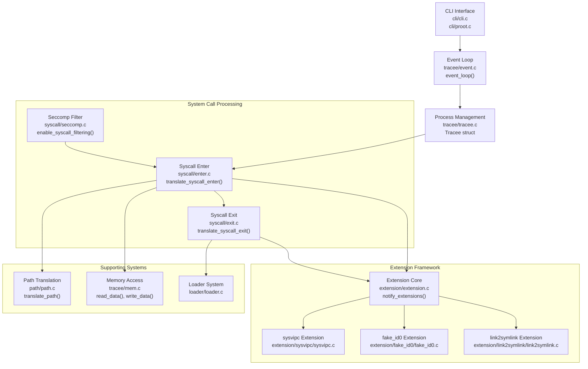

The architecture follows a tracer-tracee model where PRoot acts as the tracer, monitoring one or more child processes (tracees). The `event_loop()` function in `tracee/event.c` serves as the central dispatcher, handling ptrace events and coordinating between system call interception, extension processing, and tracee management.

Sources: [src/tracee/event.c:260-363](), [src/cli/cli.c:448-506](), [src/GNUmakefile:21-86]()

## Core Components

### Process Launching and Tracing

```mermaid
sequenceDiagram
    participant Main as "main()<br/>cli/cli.c"
    participant Launch as "launch_process()<br/>tracee/event.c"
    participant Child as "Child Process"
    participant Loop as "event_loop()<br/>tracee/event.c"
    
    Main->>Launch: "launch_process(tracee, argv)"
    Launch->>Child: "fork() + ptrace(PTRACE_TRACEME)"
    Child->>Child: "enable_syscall_filtering()"
    Child->>Child: "execvp(tracee->exe, argv)"
    Launch->>Loop: "Start event loop"
    Loop->>Loop: "waitpid() + handle_tracee_event()"
```

The process begins with `main()` parsing command-line arguments and calling `launch_process()` to create the first traced process. The child process enables seccomp filtering for performance and executes the target program, while the parent enters the main event loop.

Sources: [src/cli/cli.c:488-495](), [src/tracee/event.c:59-115](), [src/tracee/event.c:260-363]()

### System Call Interception Flow

PRoot intercepts system calls through multiple mechanisms depending on the available kernel features:

| Method | Performance | Completeness | Code Location |
|--------|-------------|--------------|---------------|
| seccomp + ptrace | High | Complete | [syscall/seccomp.c]() |
| ptrace only | Medium | Complete | [tracee/event.c:465-541]() |

The `handle_tracee_event()` function processes different types of ptrace stops, including `SIGTRAP \| 0x80` for system calls and `SIGTRAP \| PTRACE_EVENT_SECCOMP` for seccomp-filtered calls.

Sources: [src/tracee/event.c:370-689](), [src/syscall/seccomp.c]()

## Extension System

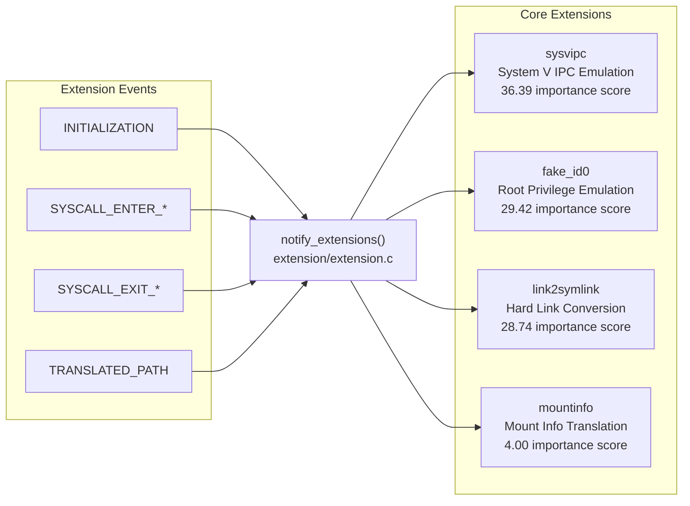

The extension system allows modular functionality through the `notify_extensions()` mechanism. Extensions register callback functions that are invoked at specific points during system call processing, path translation, and process lifecycle events.

Sources: [src/extension/extension.c](), [src/extension/mountinfo/mountinfo.c:126-143](), [src/GNUmakefile:57-86]()

## Build System Architecture

The build system supports multiple architectures and deployment modes through feature detection and conditional compilation:

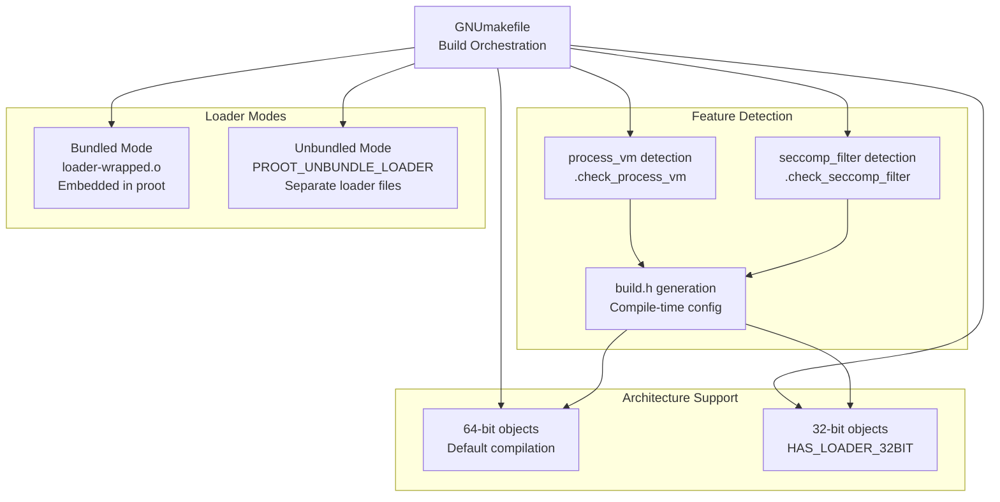

The build system automatically detects available kernel features like `process_vm_readv/writev` and seccomp filtering support, generating a `build.h` header with appropriate preprocessor definitions. It supports both bundled mode (loader embedded in the main executable) and unbundled mode (separate loader binaries).

Sources: [src/GNUmakefile:88-110](), [src/GNUmakefile:137-166](), [src/GNUmakefile:202-235]()

## Key Data Structures

| Structure | Purpose | Location | Key Fields |
|-----------|---------|----------|------------|
| `Tracee` | Process state management | [tracee/tracee.h]() | `pid`, `exe`, `fs`, `seccomp` |
| `Extension` | Extension instance | [extension/extension.h]() | `callback`, `config` |
| `Cli` | Command-line interface | [cli/cli.h]() | `options`, `handlers` |

The `Tracee` structure serves as the central data repository for each traced process, containing filesystem state, extension configurations, and execution context. Extensions maintain their state through the `Extension` structure and receive events through registered callback functions.

Sources: [src/tracee/event.c:342-344](), [src/cli/cli.c:300-444]()

---

# Page: Architecture

# Architecture

<details>
<summary>Relevant source files</summary>

The following files were used as context for generating this wiki page:

- [src/extension/extension.h](src/extension/extension.h)
- [src/tracee/event.c](src/tracee/event.c)
- [src/tracee/tracee.h](src/tracee/tracee.h)

</details>


This document explains PRoot's overall system architecture, including the tracer-tracee model, event-driven processing, and modular extension system. It covers the fundamental design patterns and core components that enable PRoot to provide user-space process virtualization.

For details on specific core systems like process management and syscall interception, see [Core Systems](#3). For information about individual extensions, see [Extension System](#4).

## Overview

PRoot implements a user-space process virtualization system using a tracer-tracee architecture where PRoot acts as the tracer and monitored processes are tracees. The system intercepts system calls using ptrace and optional seccomp filters, translates them as needed, and manages a hierarchy of traced processes through an event-driven main loop.

### Core Architecture Components

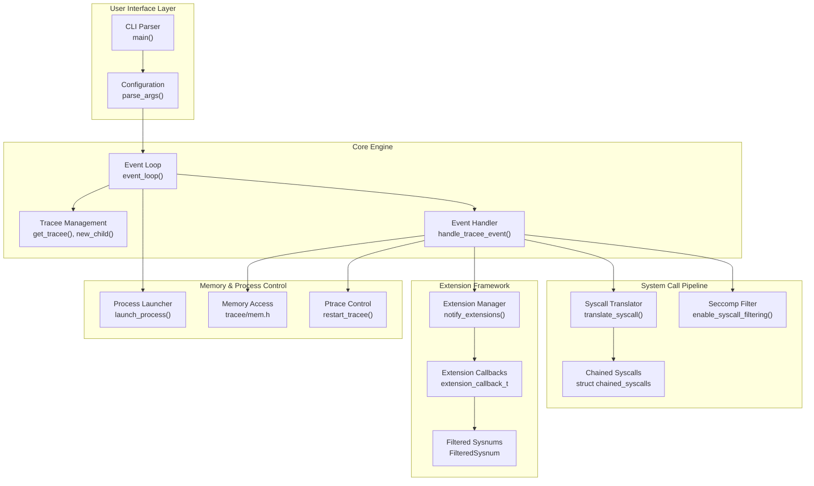

Sources: [src/tracee/event.c:260-363](), [src/tracee/tracee.h:74-296](), [src/extension/extension.h:154-174]()

## Tracer-Tracee Model

PRoot operates on a fundamental tracer-tracee relationship where PRoot serves as the tracer for all monitored processes (tracees). Each tracee is represented by the `Tracee` struct, which maintains comprehensive process state.

### Tracee Structure and Lifecycle

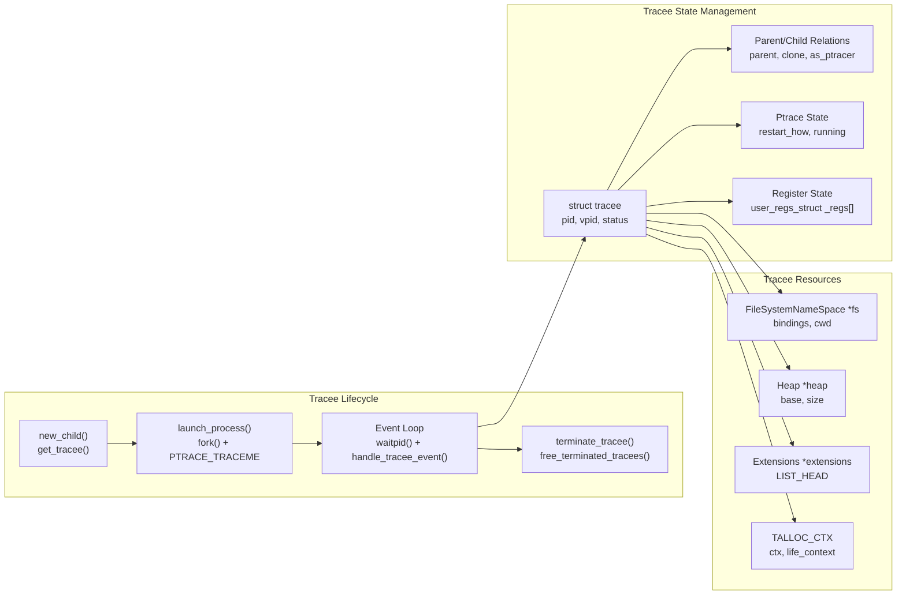

The `Tracee` struct contains several categories of resources:
- **Private resources**: `pid`, `vpid`, `running`, `terminated`
- **Inherited resources**: `verbose`, `seccomp` state
- **Shared resources**: `fs` (file system namespace), `heap` (virtual heap)
- **Process relations**: `parent`, `clone`, ptrace emulation support

Sources: [src/tracee/tracee.h:74-296](), [src/tracee/event.c:59-115]()

## Event-Driven Processing

The core of PRoot's operation is the `event_loop()` function, which continuously monitors all tracees and dispatches events to appropriate handlers.

### Event Loop Flow

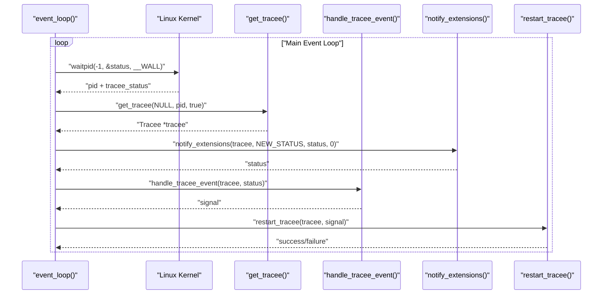

The event loop handles several types of events:
- **Process termination**: `WIFEXITED`, `WIFSIGNALED`
- **Signal stops**: `WIFSTOPPED` with various signals
- **Syscall traps**: `SIGTRAP | 0x80`, `PTRACE_EVENT_SECCOMP`
- **Process events**: `PTRACE_EVENT_FORK`, `PTRACE_EVENT_EXEC`, etc.

Sources: [src/tracee/event.c:260-363](), [src/tracee/event.c:370-689]()

## Extension Architecture

PRoot uses a modular extension system where extensions register callbacks for specific events and syscalls. Extensions can intercept and modify syscall processing at multiple stages.

### Extension System Structure

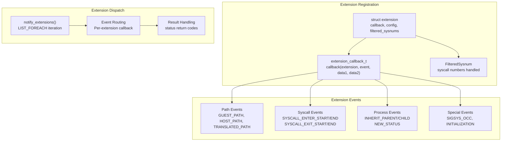

Extensions can return specific status codes to control PRoot's behavior:
- **< 0**: Report errno to tracee
- **== 0**: Continue normal processing  
- **> 0**: Skip PRoot's default handling

Key extension events include:
- `SYSCALL_ENTER_START`/`SYSCALL_ENTER_END`: Before/after syscall entry processing
- `SYSCALL_EXIT_START`/`SYSCALL_EXIT_END`: Before/after syscall exit processing
- `GUEST_PATH`/`HOST_PATH`/`TRANSLATED_PATH`: Path translation stages
- `SIGSYS_OCC`: Seccomp SIGSYS signal handling

Sources: [src/extension/extension.h:32-150](), [src/extension/extension.h:184-199]()

## System Call Interception

PRoot intercepts system calls using a combination of ptrace and seccomp filtering. The interception process varies depending on whether seccomp acceleration is enabled.

### Syscall Processing States

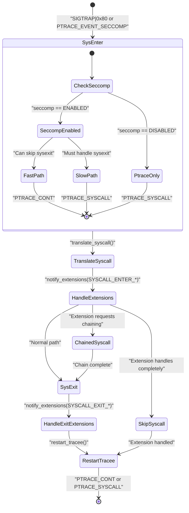

The syscall interception process involves:
1. **Entry detection**: Via `SIGTRAP | 0x80` or `PTRACE_EVENT_SECCOMP`
2. **Translation**: `translate_syscall()` modifies arguments if needed
3. **Extension notification**: Extensions can intercept and modify behavior
4. **Exit handling**: Process syscall results and notify extensions
5. **Restart**: Continue tracee with `PTRACE_CONT` or `PTRACE_SYSCALL`

Sources: [src/tracee/event.c:465-608](), [src/tracee/event.c:543-607]()

## Key Data Structures

The architecture relies on several key data structures that maintain system state:

| Structure | Purpose | Key Fields | Source File |
|-----------|---------|------------|-------------|
| `Tracee` | Process state | `pid`, `status`, `_regs[]`, `extensions` | [src/tracee/tracee.h:74-296]() |
| `Extension` | Extension definition | `callback`, `config`, `filtered_sysnums` | [src/extension/extension.h:158-172]() |
| `FileSystemNameSpace` | Path bindings | `bindings.{pending,guest,host}`, `cwd` | [src/tracee/tracee.h:50-65]() |
| `Heap` | Virtual heap | `base`, `size`, `disabled` | [src/tracee/tracee.h:67-72]() |

The `Tracee` struct uses a sophisticated resource management system with different sharing semantics:
- **Private resources**: Unique to each tracee
- **Inherited resources**: Copied from parent during fork/clone
- **Shared resources**: Shared between related tracees (CLONE_FS, CLONE_VM)
- **Read-only resources**: Immutable configuration data

Sources: [src/tracee/tracee.h:74-296](), [src/extension/extension.h:158-172]()

---

# Page: Core Systems

# Core Systems

<details>
<summary>Relevant source files</summary>

The following files were used as context for generating this wiki page:

- [src/syscall/chain.c](src/syscall/chain.c)
- [src/syscall/syscall.c](src/syscall/syscall.c)
- [src/syscall/syscall.h](src/syscall/syscall.h)
- [src/tracee/event.c](src/tracee/event.c)

</details>


This document provides an overview of the fundamental systems that make PRoot work: the event loop and process management, system call interception and translation, and memory management. These core systems work together to provide PRoot's user-space implementation of chroot, mount, and binfmt_misc functionality.

For detailed information about process lifecycle management, see [Process Management](#3.1). For comprehensive system call handling details, see [System Call Interception](#3.2). For memory access patterns and ptrace operations, see [Memory Management](#3.3). For the modular extension architecture, see [Extension System](#4).

## Architecture Overview

PRoot's core architecture centers around a tracer-tracee model where PRoot acts as the tracer monitoring and controlling one or more traced processes (tracees). The system operates through three primary interconnected systems:

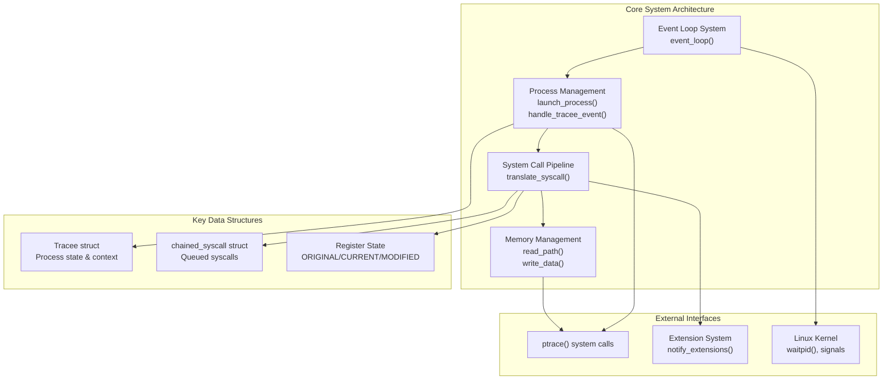

**Sources:** [src/tracee/event.c:260-363](), [src/syscall/syscall.c:103-274]()

## Event Loop System

The event loop system forms the heart of PRoot's operation, managing the lifecycle of traced processes and dispatching events. The system uses ptrace and waitpid to monitor tracee state changes and coordinates responses across all core systems.

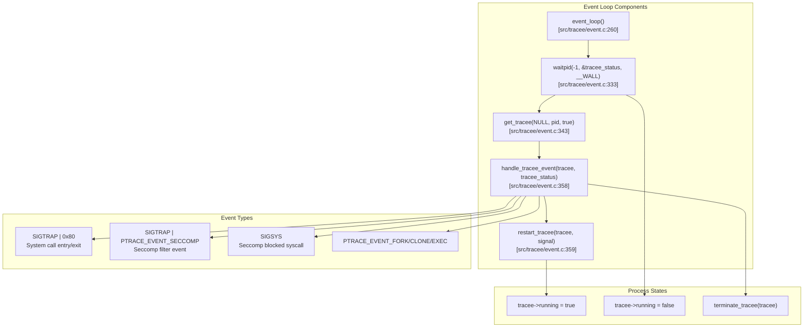

**Sources:** [src/tracee/event.c:323-362](), [src/tracee/event.c:370-689](), [src/tracee/event.c:706-726]()

The event loop manages signal handling, tracee termination cleanup, and coordinates with the extension system through `notify_extensions()` calls. It handles both normal ptrace stops and seccomp-accelerated events when available.

## System Call Processing Pipeline

The system call processing pipeline handles the interception, translation, and execution control of system calls made by traced processes. This pipeline supports both immediate translation and chained syscall execution for complex operations.

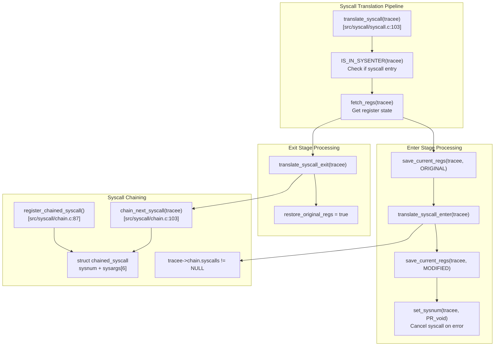

**Sources:** [src/syscall/syscall.c:103-274](), [src/syscall/chain.c:35-195]()

The pipeline maintains three register snapshots (ORIGINAL, CURRENT, MODIFIED) to support complex syscall transformations and rollback capabilities. The chaining mechanism allows single logical operations to be implemented as sequences of kernel syscalls.

## Memory Management Integration

Memory management provides the foundation for syscall argument translation by enabling PRoot to read from and write to tracee memory space. This system bridges the gap between PRoot's address space and the tracee's address space.

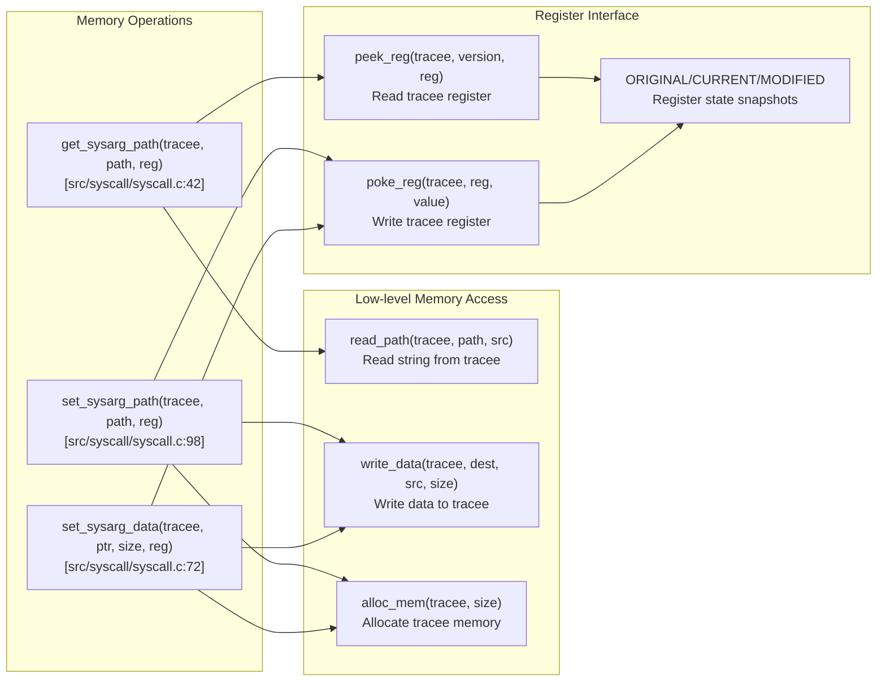

**Sources:** [src/syscall/syscall.c:42-101](), [src/tracee/reg.h](), [src/tracee/mem.h]()

## Inter-System Communication

The core systems communicate through well-defined interfaces and shared data structures. The `Tracee` structure serves as the central context object that maintains state across all systems.

| System | Primary Interface | Key Data Structures | Communication Pattern |
|--------|------------------|-------------------|---------------------|
| Event Loop | `handle_tracee_event()` | `tracee->status`, `tracee->restart_how` | Event-driven dispatch |
| Syscall Pipeline | `translate_syscall()` | `tracee->chain`, register snapshots | Synchronous processing |
| Memory Management | `get_sysarg_*()`, `set_sysarg_*()` | Memory allocation tracking | On-demand access |
| Extension System | `notify_extensions()` | Extension-specific data | Observer pattern |

The systems coordinate through the tracee's execution state, with the event loop orchestrating the overall flow while syscall processing and memory management handle the detailed transformations required for transparent process virtualization.

**Sources:** [src/tracee/event.c:370-689](), [src/syscall/syscall.c:103-274](), [src/extension/extension.h]()

---

# Page: Process Management

# Process Management

<details>
<summary>Relevant source files</summary>

The following files were used as context for generating this wiki page:

- [src/tracee/event.c](src/tracee/event.c)
- [src/tracee/tracee.h](src/tracee/tracee.h)

</details>


This document covers PRoot's process management system, which handles the lifecycle of all traced processes (tracees) in the system. Process management encompasses tracee creation, state tracking, event handling, and termination. For information about how processes are initially launched and executed, see [Process Execution](#5). For details about the syscall interception mechanisms, see [System Call Interception](#3.2).

## Overview

PRoot's process management is built around a tracer-tracee model where PRoot acts as the tracer and all user processes are tracees. The system maintains a registry of all active tracees and orchestrates their execution through a central event loop that handles ptrace events, syscall interceptions, and process state transitions.

The core data structure is the `Tracee` struct, which encapsulates all process-specific state including process identifiers, execution status, parent-child relationships, and ptrace configuration.

## Tracee Data Structure

The `Tracee` struct serves as the central repository for all process-related information. It contains multiple categories of data:

| Category | Key Fields | Purpose |
|----------|------------|---------|
| Process Identity | `pid`, `vpid` | Real and virtual process identifiers |
| Execution State | `running`, `terminated`, `status` | Current execution status and syscall position |
| Hierarchy | `parent`, `clone` | Parent-child relationships and process tree |
| Ptrace Control | `restart_how`, `_regs`, `seccomp` | Ptrace restart method and register state |
| Resource Management | `ctx`, `life_context` | Memory management contexts |

**Tracee Structure Diagram**
```mermaid
graph TB
    Tracee["Tracee Struct"]
    
    subgraph "Process Identity"
        PID["pid: Real Process ID"]
        VPID["vpid: Virtual Process ID"]
        Running["running: Execution State"]
    end
    
    subgraph "Hierarchy Management"
        Parent["parent: Parent Tracee*"]
        Clone["clone: Is Clone Flag"]
        Children["Child Tracees"]
    end
    
    subgraph "Ptrace State"
        RestartHow["restart_how: Ptrace Method"]
        Regs["_regs: Register Versions"]
        Status["status: Syscall Position"]
    end
    
    subgraph "Extension Support"
        Extensions["extensions: Extension List"]
        Chain["chain: Chained Syscalls"]
        LoadInfo["load_info: Execve Data"]
    end
    
    Tracee --> PID
    Tracee --> VPID  
    Tracee --> Running
    Tracee --> Parent
    Tracee --> Clone
    Tracee --> Children
    Tracee --> RestartHow
    Tracee --> Regs
    Tracee --> Status
    Tracee --> Extensions
    Tracee --> Chain
    Tracee --> LoadInfo
```

Sources: [src/tracee/tracee.h:74-296]()

## Tracee Lifecycle Management

### Process Creation

New tracees are created through two primary mechanisms:

1. **Initial Process Launch**: The `launch_process()` function creates the first tracee by forking and setting up ptrace relationships
2. **Child Process Creation**: The `new_child()` function handles fork/clone events to create child tracees

**Process Launch Sequence**
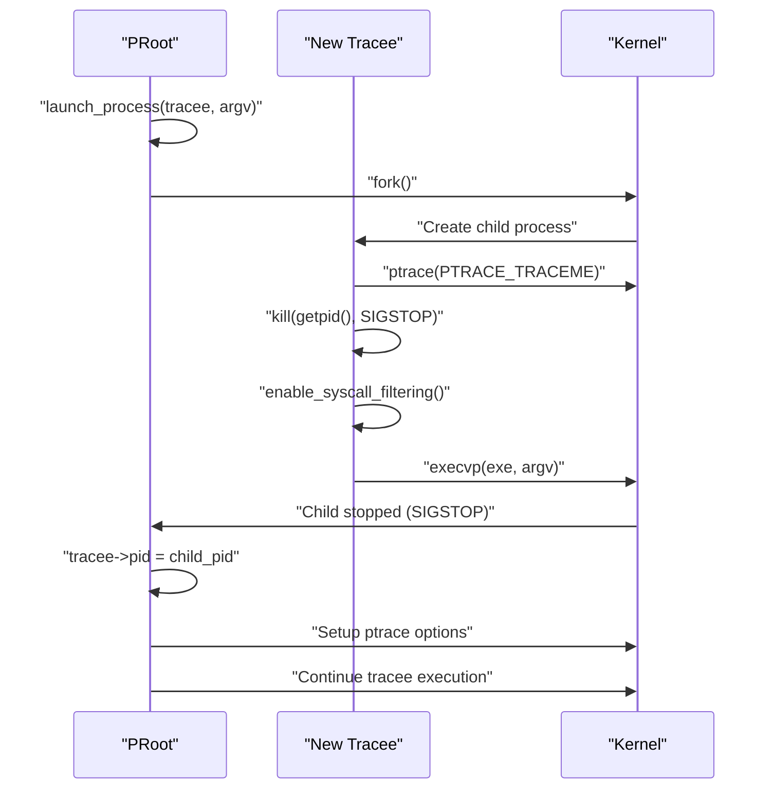

Sources: [src/tracee/event.c:59-115]()

### Tracee Registry

The system maintains a global registry of all active tracees using a linked list structure. Key management functions include:

- `get_tracee()`: Retrieves or creates tracee by PID
- `get_tracees_list_head()`: Returns the head of the tracee list
- `free_terminated_tracees()`: Cleans up terminated tracees

**Tracee Registry Architecture**
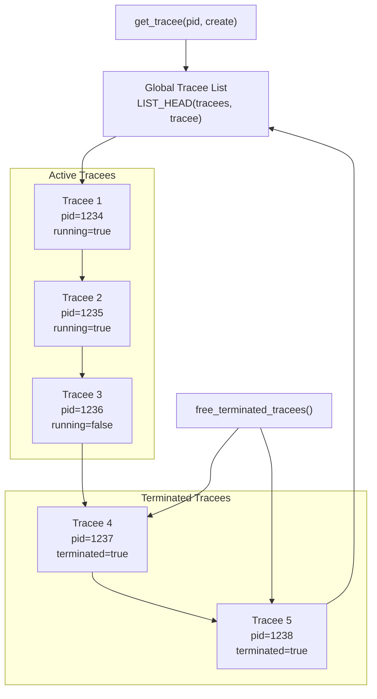

Sources: [src/tracee/tracee.h:302-314]()

## Event Loop Architecture

The central `event_loop()` function orchestrates all process management activities. It continuously waits for events from any tracee and dispatches appropriate handlers.

### Event Loop Flow

**Main Event Loop**
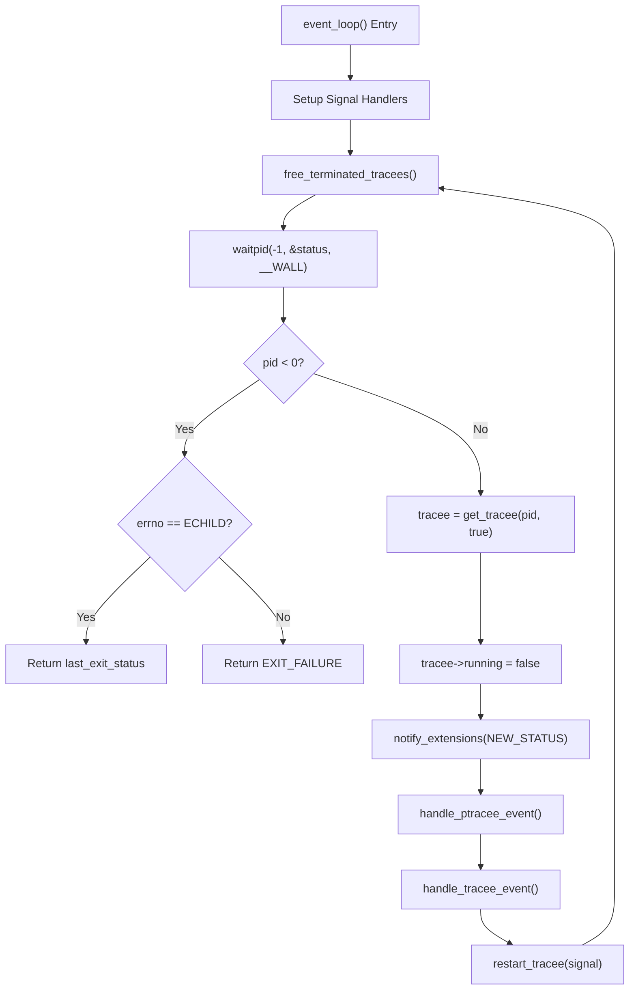

Sources: [src/tracee/event.c:260-363]()

### Event Types and Handling

The `handle_tracee_event()` function processes different types of ptrace events:

| Event Type | Signal | Handler Action |
|------------|--------|----------------|
| Process Exit | `WIFEXITED` | Set `last_exit_status`, call `terminate_tracee()` |
| Signal Death | `WIFSIGNALED` | Log termination, call `terminate_tracee()` |
| Syscall Entry/Exit | `SIGTRAP\|0x80` | Call `translate_syscall()` |
| Seccomp Event | `SIGTRAP\|PTRACE_EVENT_SECCOMP` | Handle seccomp filtering |
| Fork/Clone | `PTRACE_EVENT_FORK/CLONE` | Call `new_child()` |
| Other Signals | Various | Forward or suppress based on context |

Sources: [src/tracee/event.c:370-689]()

## Process State Management

### Syscall State Tracking

Each tracee maintains its position within syscall execution using the `status` field:

- `status == 0`: Syscall entry (sysenter)  
- `status == 1`: Syscall exit without error
- `status < 0`: Syscall exit with error (`-errno`)

The macros `IS_IN_SYSENTER()` and `IS_IN_SYSEXIT()` provide convenient state checking.

**Syscall State Machine**
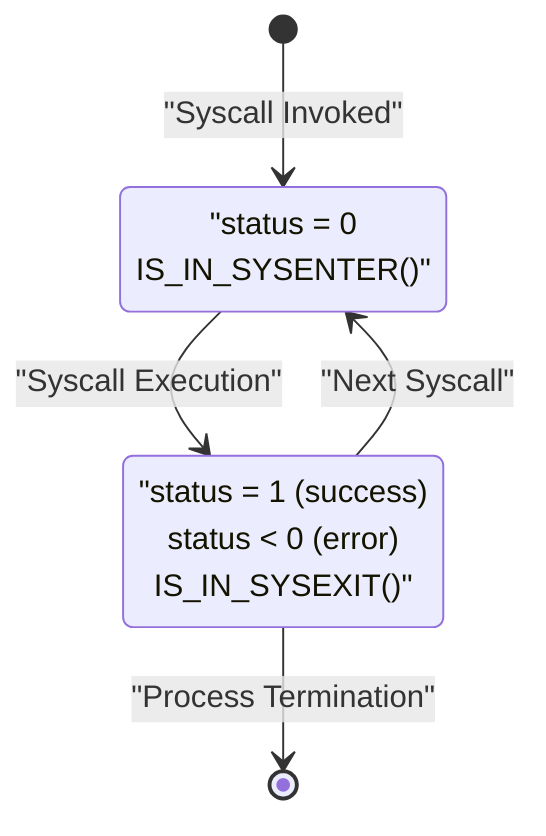

Sources: [src/tracee/tracee.h:139-148]()

### Restart Control

The `restart_how` field controls how each tracee is restarted after processing an event:

- `PTRACE_CONT`: Continue execution without stopping
- `PTRACE_SYSCALL`: Stop at next syscall entry/exit
- `PTRACE_SINGLESTEP`: Execute one instruction

The `restart_tracee()` function applies the restart method and updates tracee state.

Sources: [src/tracee/event.c:706-726]()

## Parent-Child Relationships

### Process Hierarchy

PRoot maintains a hierarchical tree of tracees reflecting the process relationships:

- Each tracee has a `parent` pointer to its creating process
- The `clone` flag indicates whether the process shares resources with its parent
- Child processes are created via `new_child()` during fork/clone events

**Process Tree Example**
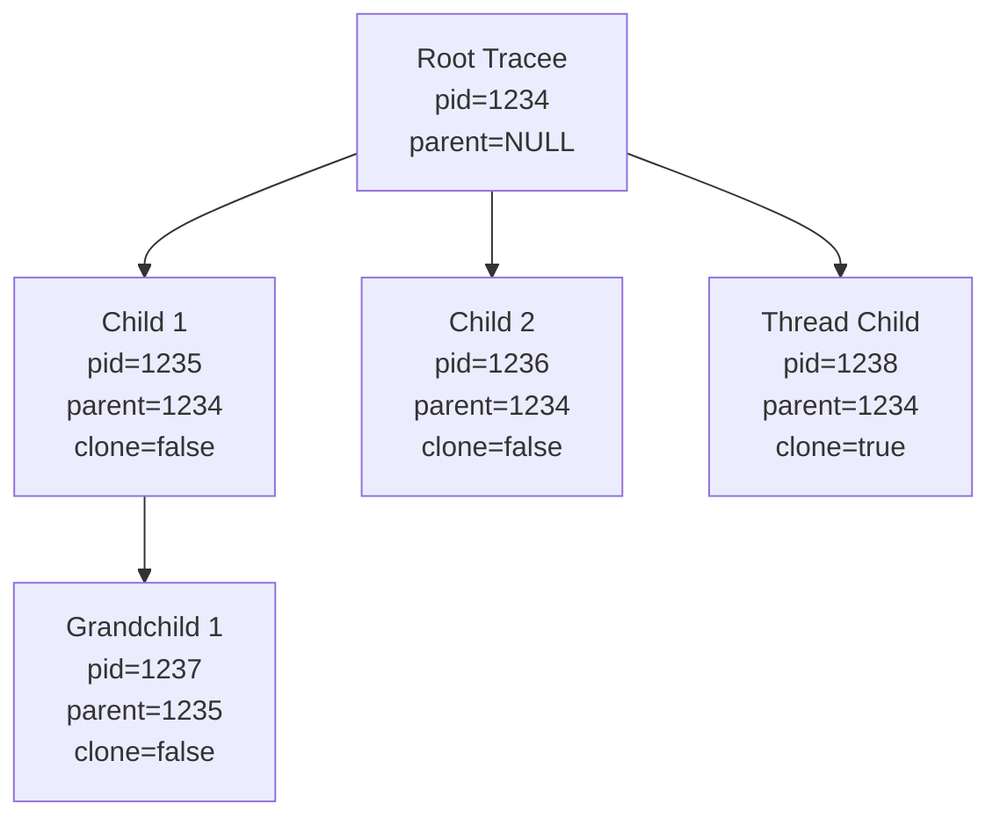

Sources: [src/tracee/tracee.h:100-104](), [src/tracee/event.c:610-619]()

### Resource Sharing

Child tracees inherit or share resources based on clone flags:

- **Private Resources**: Always copied (`pid`, `vpid`, `status`)
- **Inherited Resources**: Copied but can diverge (`verbose`, `seccomp`)
- **Shared Resources**: Depend on `CLONE_FS`/`CLONE_VM` (`fs`, `heap`)
- **Temporarily Shared**: Until execve() (`exe`, `host_exe`)

Sources: [src/tracee/tracee.h:229-284]()

## Process Termination

### Termination Process

Process termination follows a structured sequence:

1. **Detection**: Event loop detects `WIFEXITED` or `WIFSIGNALED`
2. **Cleanup**: `terminate_tracee()` marks tracee as terminated
3. **Deferred Cleanup**: `free_terminated_tracees()` releases resources
4. **Emergency Cleanup**: `kill_all_tracees()` for abnormal termination

**Termination Flow**
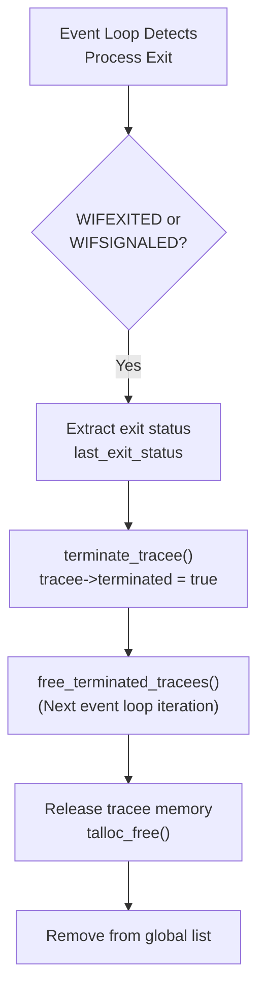

Sources: [src/tracee/event.c:406-418](), [src/tracee/tracee.h:308-311]()

### Emergency Termination

The `kill_all_tracees()` function provides emergency cleanup when PRoot receives fatal signals. It's registered as both an `atexit()` handler and a signal handler for abnormal termination signals (`SIGQUIT`, `SIGILL`, `SIGABRT`, `SIGFPE`, `SIGSEGV`).

Sources: [src/tracee/event.c:118-130](), [src/tracee/event.c:266-267](), [src/tracee/event.c:281-321]()

---

# Page: System Call Interception

# System Call Interception

<details>
<summary>Relevant source files</summary>

The following files were used as context for generating this wiki page:

- [src/ptrace/ptrace.c](src/ptrace/ptrace.c)
- [src/syscall/chain.c](src/syscall/chain.c)
- [src/syscall/enter.c](src/syscall/enter.c)
- [src/syscall/exit.c](src/syscall/exit.c)
- [src/syscall/rlimit.c](src/syscall/rlimit.c)
- [src/syscall/seccomp.c](src/syscall/seccomp.c)
- [src/syscall/syscall.c](src/syscall/syscall.c)
- [src/syscall/syscall.h](src/syscall/syscall.h)
- [src/tracee/seccomp.c](src/tracee/seccomp.c)
- [src/tracee/seccomp.h](src/tracee/seccomp.h)

</details>


This document covers how PRoot intercepts and translates system calls to implement its virtualization features. For information about process lifecycle management, see [Process Management](#3.1). For details about specific extension handling during syscall interception, see [Extension System](#4).

## Purpose and Architecture

The system call interception system is the core mechanism that enables PRoot to:
- Translate file paths between guest and host namespaces
- Emulate system calls without kernel modules
- Support cross-architecture execution
- Provide transparent virtualization to traced processes

PRoot uses a two-stage interception approach combining seccomp BPF filters with ptrace to efficiently filter and translate only the syscalls that require modification.

## High-Level Flow

```mermaid
sequenceDiagram
    participant Tracee as "Tracee Process"
    participant Seccomp as "Seccomp Filter" 
    participant PRoot as "PRoot Tracer"
    participant Extensions as "Extensions"
    participant Kernel as "Linux Kernel"
    
    Tracee->>Kernel: "System call"
    Kernel->>Seccomp: "BPF filter check"
    
    alt Filtered syscall
        Seccomp->>PRoot: "SIGSYS signal"
        PRoot->>PRoot: "handle_seccomp_event()"
        PRoot->>Extensions: "notify_extensions(SIGSYS_OCC)"
        Extensions->>PRoot: "Custom handling"
        PRoot->>Tracee: "Return result or restart"
    else Normal syscall  
        Kernel->>PRoot: "PTRACE_EVENT_SECCOMP"
        PRoot->>PRoot: "translate_syscall_enter()"
        PRoot->>Extensions: "notify_extensions(SYSCALL_ENTER_*)"
        Extensions->>PRoot: "Modify arguments"
        PRoot->>Kernel: "Continue with modified args"
        Kernel->>PRoot: "Syscall complete"
        PRoot->>PRoot: "translate_syscall_exit()"
        PRoot->>Extensions: "notify_extensions(SYSCALL_EXIT_*)"
        Extensions->>PRoot: "Modify results"
        PRoot->>Tracee: "Return final result"
    end
```

Sources: [src/syscall/syscall.c:103-274](), [src/tracee/seccomp.c:70-102]()

## Core Components

### Seccomp Filter Setup

The seccomp filtering system is established by `enable_syscall_filtering` which builds BPF programs that check architecture and syscall numbers before allowing or redirecting syscalls to PRoot.

```mermaid
graph TD
    subgraph "Seccomp Filter Architecture"
        FilterSetup["enable_syscall_filtering()"]
        
        subgraph "BPF Program Generation"
            NewProgram["new_program_filter()"]
            ArchCheck["start_arch_section()"]
            SyscallCheck["add_trace_syscall()"]
            Allow["end_arch_section()"] 
            Kill["finalize_program_filter()"]
        end
        
        subgraph "Filter Sources"
            ProotSysnums["proot_sysnums[]"]
            ExtSysnums["extension->filtered_sysnums"]
            MergedSysnums["merged FilteredSysnum list"]
        end
    end
    
    FilterSetup --> NewProgram
    NewProgram --> ArchCheck
    ArchCheck --> SyscallCheck
    SyscallCheck --> Allow
    Allow --> Kill
    
    FilterSetup --> ProotSysnums
    FilterSetup --> ExtSysnums
    ProotSysnums --> MergedSysnums
    ExtSysnums --> MergedSysnums
    MergedSysnums --> SyscallCheck
```

Sources: [src/syscall/seccomp.c:479-512](), [src/syscall/seccomp.c:253-328](), [src/syscall/seccomp.c:431-471]()

### Main Translation Pipeline

The `translate_syscall` function orchestrates the complete interception process, handling both enter and exit stages while managing register states and syscall chaining.

```mermaid
graph TD
    subgraph "Translation Pipeline"
        FetchRegs["fetch_regs()"]
        IsEnter{"IS_IN_SYSENTER()"}
        
        subgraph "Enter Stage"
            SaveOrig["save_current_regs(ORIGINAL)"]
            TransEnter["translate_syscall_enter()"]
            SaveMod["save_current_regs(MODIFIED)"]
            SetVoid["set_sysnum(PR_void) if error"]
        end
        
        subgraph "Exit Stage"
            TransExit["translate_syscall_exit()"]
            ChainNext["chain_next_syscall()"]
            RestoreRegs["restore_original_regs"]
        end
        
        PushRegs["push_specific_regs()"]
    end
    
    FetchRegs --> IsEnter
    IsEnter -->|"Yes"| SaveOrig
    IsEnter -->|"No"| TransExit
    
    SaveOrig --> TransEnter
    TransEnter --> SaveMod
    SaveMod --> SetVoid
    
    TransExit --> ChainNext
    ChainNext --> RestoreRegs
    
    SetVoid --> PushRegs
    RestoreRegs --> PushRegs
```

Sources: [src/syscall/syscall.c:103-274]()

## Enter Stage Translation

The `translate_syscall_enter` function handles argument translation for filesystem, network, and process management syscalls.

### Enter Stage Flow

```mermaid
graph TD
    subgraph "Enter Translation Process"
        NotifyStart["notify_extensions(SYSCALL_ENTER_START)"]
        SysSwitch["switch(syscall_number)"]
        
        subgraph "Syscall Categories"
            Execve["PR_execve: translate_execve_enter()"]
            Paths["Path syscalls: translate_sysarg()"]
            Sockets["Socket syscalls: translate_socketcall_enter()"]
            Special["getcwd, chdir: virtual cwd handling"]
            Ptrace["PR_ptrace: translate_ptrace_enter()"]
        end
        
        NotifyEnd["notify_extensions(SYSCALL_ENTER_END)"]
        SetStatus["Set tracee->status"]
    end
    
    NotifyStart --> SysSwitch
    SysSwitch --> Execve
    SysSwitch --> Paths
    SysSwitch --> Sockets
    SysSwitch --> Special
    SysSwitch --> Ptrace
    
    Execve --> NotifyEnd
    Paths --> NotifyEnd
    Sockets --> NotifyEnd
    Special --> NotifyEnd
    Ptrace --> NotifyEnd
    
    NotifyEnd --> SetStatus
```

### Path Translation Patterns

| Syscall Type | Translation Function | Link Type |
|---|---|---|
| `PR_open`, `PR_stat`, `PR_chmod` | `translate_sysarg(SYSARG_1, REGULAR)` | Follow symlinks |
| `PR_lstat`, `PR_readlink`, `PR_unlink` | `translate_sysarg(SYSARG_1, SYMLINK)` | Don't follow symlinks |
| `PR_openat`, `PR_fstatat64` | `translate_path2(dirfd, path, reg, type)` | Directory-relative |

Sources: [src/syscall/enter.c:96-653](), [src/syscall/enter.c:57-88]()

## Exit Stage Translation

The `translate_syscall_exit` function handles result translation and path detranslation for syscalls that return filesystem paths.

```mermaid
graph TD
    subgraph "Exit Translation Process"
        NotifyStart["notify_extensions(SYSCALL_EXIT_START)"]
        CheckStatus["Check tracee->status < 0"]
        SysSwitch["switch(syscall_number)"]
        
        subgraph "Result Translation"
            Readlink["readlink: detranslate_path()"]
            Getcwd["getcwd: return tracee->fs->cwd"]
            Sockets["Socket results: translate_socketcall_exit()"]
            Rename["rename: update virtual cwd"]
            Brk["brk: translate_brk_exit()"]
        end
        
        PokeResult["poke_reg(SYSARG_RESULT, status)"]
        NotifyEnd["notify_extensions(SYSCALL_EXIT_END)"]
    end
    
    NotifyStart --> CheckStatus
    CheckStatus --> SysSwitch
    SysSwitch --> Readlink
    SysSwitch --> Getcwd
    SysSwitch --> Sockets
    SysSwitch --> Rename
    SysSwitch --> Brk
    
    Readlink --> PokeResult
    Getcwd --> PokeResult
    Sockets --> NotifyEnd
    Rename --> PokeResult
    Brk --> NotifyEnd
    
    PokeResult --> NotifyEnd
```

Sources: [src/syscall/exit.c:55-564]()

## Seccomp Event Handling

When the seccomp filter blocks a syscall, it generates a `SIGSYS` signal processed by `handle_seccomp_event`.

### SIGSYS Processing Flow

```mermaid
graph TD
    subgraph "SIGSYS Event Handling"
        HandleEvent["handle_seccomp_event()"]
        FetchRegs["fetch_regs()"]
        SaveRegs["save_current_regs(ORIGINAL_SECCOMP_REWRITE)"]
        Common["handle_seccomp_event_common()"]
        
        subgraph "Extension Processing"
            NotifyExt["notify_extensions(SIGSYS_OCC)"]
            ExtResult{"Extension handled?"}
            SetResult["set_result_after_seccomp()"]
        end
        
        subgraph "Built-in Conversion"
            LegacyConvert["Convert legacy to modern syscalls"]
            RestartSyscall["restart_syscall_after_seccomp()"]
            SetEnosys["set_result_after_seccomp(-ENOSYS)"]
        end
    end
    
    HandleEvent --> FetchRegs
    FetchRegs --> SaveRegs
    SaveRegs --> Common
    Common --> NotifyExt
    NotifyExt --> ExtResult
    
    ExtResult -->|"Yes"| SetResult
    ExtResult -->|"No"| LegacyConvert
    LegacyConvert --> RestartSyscall
    LegacyConvert --> SetEnosys
```

### Legacy Syscall Conversion

The seccomp handler automatically converts deprecated syscalls to their modern equivalents:

| Legacy Syscall | Converted To | Conversion Logic |
|---|---|---|
| `PR_open` | `PR_openat` | Add `AT_FDCWD` as first argument |
| `PR_stat`/`PR_lstat` | `PR_newfstatat` | Add dirfd and flags arguments |
| `PR_symlink` | `PR_symlinkat` | Add `AT_FDCWD` for target directory |
| `PR_accept` | `PR_accept4` | Add flags argument (0) |
| `PR_pipe` | `PR_pipe2` | Add flags argument (0) |

Sources: [src/tracee/seccomp.c:70-102](), [src/tracee/seccomp.c:118-568]()

## Syscall Chaining

Complex operations may require multiple syscalls to be executed sequentially. The chaining system queues syscalls for deferred execution.

```mermaid
graph TD
    subgraph "Syscall Chaining System"
        RegisterChain["register_chained_syscall()"]
        
        subgraph "Chain Data Structure"
            ChainedSyscall["struct chained_syscall"]
            SysNum["sysnum: Sysnum"]
            SysArgs["sysargs[6]: word_t"]
            Link["link: STAILQ_ENTRY"]
        end
        
        subgraph "Chain Execution"
            ChainNext["chain_next_syscall()"]
            SetRegs["Set syscall registers"]
            BackupIP["Reset instruction pointer"]
            SetRestart["restart_how = PTRACE_SYSCALL"]
        end
        
        ForceResult["force_chain_final_result()"]
    end
    
    RegisterChain --> ChainedSyscall
    ChainedSyscall --> SysNum
    ChainedSyscall --> SysArgs
    ChainedSyscall --> Link
    
    ChainNext --> SetRegs
    SetRegs --> BackupIP
    BackupIP --> SetRestart
    
    ForceResult --> ChainNext
```

### Chain Operations

- **register_chained_syscall()**: Add syscall to end of chain
- **chain_next_syscall()**: Execute next syscall in chain  
- **force_chain_final_result()**: Override final result
- **restart_original_syscall()**: Re-execute original syscall

Sources: [src/syscall/chain.c:35-196]()

## Filter Configuration

### Core Filtered Syscalls

PRoot defines base syscalls requiring interception in the `proot_sysnums` array:

```mermaid
graph LR
    subgraph "Syscall Categories"
        Filesystem["Filesystem<br/>PR_open, PR_stat, PR_chmod<br/>PR_readlink, PR_getcwd"]
        Network["Network<br/>PR_bind, PR_connect<br/>PR_accept, PR_socketcall"]
        Process["Process<br/>PR_execve, PR_ptrace<br/>PR_wait4, PR_brk"]
        System["System<br/>PR_uname, PR_statfs<br/>PR_setrlimit"]
    end
    
    subgraph "Filter Flags"
        EnterOnly["Enter Only<br/>(flags = 0)"]
        ExitToo["Enter + Exit<br/>(FILTER_SYSEXIT)"]
    end
    
    Filesystem --> EnterOnly
    Filesystem --> ExitToo
    Network --> EnterOnly
    Network --> ExitToo
    Process --> ExitToo
    System --> ExitToo
```

### Extension Integration

Extensions contribute their own filtered syscalls through the `FilteredSysnum` structure:

```c
typedef struct {
    Sysnum value;      // Syscall number
    int flags;         // FILTER_SYSEXIT or 0
} FilteredSysnum;
```

The `merge_filtered_sysnums` function combines:
1. Core PRoot syscalls (`proot_sysnums`)
2. Extension syscalls (`extension->filtered_sysnums`)
3. Handles flag merging for overlapping syscalls

Sources: [src/syscall/seccomp.c:331-424](), [src/syscall/seccomp.c:431-471]()

## Architecture Support

The seccomp system handles multiple architectures through the `SECCOMP_ARCHS` definition:

```mermaid
graph TD
    subgraph "Multi-Architecture Support"
        ArchLoop["For each architecture in SECCOMP_ARCHS"]
        
        subgraph "BPF Generation Per Arch"
            StartArch["start_arch_section():<br/>Check seccomp_data.arch"]
            ABILoop["For each ABI in architecture"]
            DetranslateSysnum["detranslate_sysnum():<br/>Get arch-specific syscall number"]
            AddTrace["add_trace_syscall():<br/>Add BPF trace instruction"]
            EndArch["end_arch_section():<br/>Allow unfiltered syscalls"]
        end
    end
    
    ArchLoop --> StartArch
    StartArch --> ABILoop
    ABILoop --> DetranslateSysnum
    DetranslateSysnum --> AddTrace
    AddTrace --> EndArch
    EndArch --> ArchLoop
```

The BPF filter structure:
1. Load `seccomp_data.arch` into accumulator
2. Compare with expected architecture
3. If match: load `seccomp_data.nr` (syscall number)
4. Compare against filtered syscalls for this architecture
5. Either trace (send to PRoot) or allow (continue normally)

Sources: [src/syscall/seccomp.c:159-204](), [src/syscall/seccomp.c:267-305]()

## Register Management

System call interception relies on precise register state management through multiple register snapshots:

### Register States

| State | Purpose | When Saved |
|---|---|---|
| `ORIGINAL` | Initial syscall registers | `save_current_regs()` in enter stage |
| `CURRENT` | Working registers | Updated during translation |
| `MODIFIED` | Final translated registers | `save_current_regs()` after enter translation |
| `ORIGINAL_SECCOMP_REWRITE` | Seccomp event backup | `save_current_regs()` in `handle_seccomp_event` |

### Key Register Operations

```mermaid
graph TD
    subgraph "Register API"
        PeekReg["peek_reg(tracee, state, reg)"]
        PokeReg["poke_reg(tracee, reg, value)"]
        GetSysnum["get_sysnum(tracee, state)"]
        SetSysnum["set_sysnum(tracee, sysnum)"]
        
        subgraph "Register Names"
            SysargNum["SYSARG_NUM"]
            Sysarg1["SYSARG_1 through SYSARG_6"]
            SysargResult["SYSARG_RESULT"]
            InstrPointer["INSTR_POINTER"]
        end
        
        FetchRegs["fetch_regs()"]
        PushRegs["push_specific_regs()"]
    end
    
    PeekReg --> Sysarg1
    PokeReg --> Sysarg1
    GetSysnum --> SysargNum
    SetSysnum --> SysargNum
    
    FetchRegs --> PeekReg
    PushRegs --> PokeReg
```

Sources: [src/tracee/reg.h](), [src/syscall/syscall.c:110-274]()

## Error Handling

### Syscall Number Modification

Some kernels prevent syscall number changes after ptrace interception. PRoot handles this via syscall chaining:

1. `push_specific_regs()` fails when changing syscall number
2. Call `restart_current_syscall_as_chained()` to queue the modified syscall  
3. Set invalid arguments to make original syscall fail
4. Process the real operation in the chained syscall

### ENOSYS Recovery

When syscalls return `ENOSYS`, PRoot can retry via seccomp:

- `fix_and_restart_enosys_syscall()` restores original registers
- Calls `handle_seccomp_event_common()` for reprocessing
- Used for syscalls like `PR_utime` that may not be available

Sources: [src/syscall/syscall.c:228-268](), [src/tracee/seccomp.c:105-116](), [src/syscall/chain.c:182-195]()

---

# Page: Memory Management

# Memory Management

<details>
<summary>Relevant source files</summary>

The following files were used as context for generating this wiki page:

- [src/loader/assembly.S](src/loader/assembly.S)
- [src/loader/loader-info.awk](src/loader/loader-info.awk)
- [src/tracee/mem.c](src/tracee/mem.c)
- [src/tracee/mem.h](src/tracee/mem.h)

</details>


## Purpose and Scope

The Memory Management system in PRoot handles all interactions with the memory space of traced processes (tracees). This includes reading data from tracee memory, writing data to tracee memory, and managing memory allocations within the tracee's address space. The system provides a unified interface that abstracts away platform-specific details and works around various kernel limitations.

This page covers the core memory access mechanisms and utilities. For information about process lifecycle and state management, see [Process Management](#3.1). For details about system call argument manipulation that relies on memory operations, see [System Call Interception](#3.2).

## Memory Access Mechanisms

PRoot employs two primary mechanisms for accessing tracee memory, with automatic fallback behavior to ensure compatibility across different kernel versions and configurations.

### Primary Access Methods

```mermaid
graph TB
    subgraph "Memory Access Strategy"
        MemOp["Memory Operation Request"]
        
        subgraph "Modern Kernel Path"
            ProcessVM["process_vm_readv/writev<br/>(Linux 3.2+)"]
            ProcessVMCheck["Status Check"]
        end
        
        subgraph "Fallback Path"  
            PTrace["ptrace PEEKDATA/POKEDATA"]
            PokeWorkaround["ptrace_pokedata_or_via_stub"]
            AssemblyStub["Assembly Stub<br/>pokedata_workaround"]
        end
        
        MemOp --> ProcessVM
        ProcessVM --> ProcessVMCheck
        ProcessVMCheck -->|"Success"| Return["Return Success"]
        ProcessVMCheck -->|"Failure"| PTrace
        PTrace --> PokeWorkaround
        PokeWorkaround --> AssemblyStub
        AssemblyStub --> Return
    end
```

The system prioritizes the modern `process_vm_readv`/`process_vm_writev` system calls when available, as they provide better performance and reliability than traditional ptrace operations. When these calls fail or are unavailable, PRoot falls back to ptrace-based memory access with additional workarounds for broken implementations.

Sources: [src/tracee/mem.c:231-246](), [src/tracee/mem.c:350-366]()

## Core Memory Operations

### Data Transfer Functions

The memory management system provides several levels of abstraction for different types of memory operations:

```mermaid
graph LR
    subgraph "High-Level Operations"
        ReadString["read_string()"]
        ReadPath["read_path()"]
        WriteData["write_data()"]
        WritevData["writev_data()"]
        ReadData["read_data()"]
    end
    
    subgraph "Word-Level Operations"
        PeekWord["peek_word()"]
        PokeWord["poke_word()"]
        PeekTyped["peek_uint32()<br/>peek_int64()<br/>etc."]
        PokeTyped["poke_uint32()<br/>poke_int64()<br/>etc."]
    end
    
    subgraph "Memory Management"
        AllocMem["alloc_mem()"]
        ClearMem["clear_mem()"]
    end
    
    subgraph "Low-Level Access"
        ProcessVMOps["process_vm_*"]
        PtraceOps["ptrace PEEK/POKE"]
        StubWorkaround["Assembly Stub"]
    end
    
    ReadString --> ReadData
    ReadPath --> ReadString
    WriteData --> ProcessVMOps
    WritevData --> WriteData
    ReadData --> ProcessVMOps
    
    PeekWord --> ProcessVMOps
    PokeWord --> ProcessVMOps
    PeekTyped --> ReadData
    PokeTyped --> WriteData
    
    AllocMem --> PeekWord
    ClearMem --> WriteData
    
    ProcessVMOps --> PtraceOps
    PtraceOps --> StubWorkaround
```

### Key Function Responsibilities

| Function | Purpose | Return Value |
|----------|---------|--------------|
| `write_data()` | Copy bytes from tracer to tracee memory | 0 on success, -errno on failure |
| `read_data()` | Copy bytes from tracee to tracer memory | 0 on success, -errno on failure |
| `read_string()` | Read null-terminated string with length limit | String length including null terminator, or -errno |
| `peek_word()` | Read single word from tracee memory | Word value (caller must check errno) |
| `poke_word()` | Write single word to tracee memory | void (caller must check errno) |
| `alloc_mem()` | Allocate memory on tracee stack | Address in tracee space, or 0 on failure |

Sources: [src/tracee/mem.c:218-291](), [src/tracee/mem.c:338-403](), [src/tracee/mem.c:543-579](), [src/tracee/mem.c:637-673]()

## POKEDATA Workaround System

Some kernel configurations have broken `PTRACE_POKEDATA` implementations that fail to write data to tracee memory. PRoot implements a sophisticated workaround using assembly stubs executed within the tracee's address space.

### Workaround Architecture

```mermaid
sequenceDiagram
    participant Tracer as "PRoot Tracer"
    participant Tracee as "Tracee Process" 
    participant Stub as "Assembly Stub"
    participant Kernel as "Kernel"
    
    Tracer->>Tracer: "ptrace(POKEDATA) fails"
    Tracer->>Tracer: "Enable workaround mode"
    
    Note over Tracer,Kernel: "Setup Phase"
    Tracer->>Tracee: "Save original registers"
    Tracer->>Tracee: "Block signals except SIGILL/SIGTRAP/etc"
    Tracer->>Tracee: "Set PC to stub address"
    Tracer->>Tracee: "Set registers: x1=value, x2=address"
    
    Note over Tracer,Kernel: "Execution Phase"  
    Tracer->>Kernel: "ptrace(CONT)"
    Kernel->>Stub: "Execute: str x1, [x2]"
    Stub->>Stub: "Write value to address"
    Stub->>Stub: "Illegal instruction trigger"
    Stub->>Kernel: "SIGILL signal"
    Kernel->>Tracer: "waitpid() returns"
    
    Note over Tracer,Kernel: "Cleanup Phase"
    Tracer->>Tracee: "Restore original registers"
    Tracer->>Tracee: "Restore signal mask"
```

### Stub Implementation Details

The workaround uses architecture-specific assembly stubs that perform the memory write and then trigger a recognizable signal:

```mermaid
graph TB
    subgraph "Architecture Support"
        AArch64["AArch64 Implementation<br/>str x1, [x2]<br/>.word 0xf7f0a000"]
        AArch32["AArch32<br/>(Not Supported)"]
        x86["x86/x64<br/>(Uses normal ptrace)"]
    end
    
    subgraph "Stub Location"
        PreExec["Pre-execve:<br/>launcher_pokedata_workaround"]
        PostExec["Post-execve:<br/>offset_to_pokedata_workaround"]
    end
    
    subgraph "Detection Logic"
        FirstCall["First POKEDATA call"]
        TestResult["Test ptrace result"]
        EnableWorkaround["pokedata_workaround_needed = true"]
    end
    
    FirstCall --> TestResult
    TestResult --> EnableWorkaround
    EnableWorkaround --> PreExec
    EnableWorkaround --> PostExec
```

The system dynamically detects broken POKEDATA implementations on first use and automatically enables the workaround for subsequent operations.

Sources: [src/tracee/mem.c:98-197](), [src/tracee/mem.c:199-211](), [src/loader/assembly.S:63-69](), [src/loader/loader-info.awk:1-8]()

## String and Path Handling

### String Reading Strategy

PRoot implements specialized string reading logic that handles memory page boundaries and unknown string lengths safely:

```mermaid
graph TB
    subgraph "String Reading Process"
        Start["read_string() called"]
        
        subgraph "process_vm Path"
            ChunkCalc["Calculate chunk size<br/>(page-aligned)"]
            ChunkRead["Read chunk via process_vm_readv"]
            ChunkScan["Scan for null terminator"]
            ChunkCheck{"Found null?"}
        end
        
        subgraph "ptrace Fallback"
            WordRead["Read word-by-word<br/>via PEEKDATA"]  
            WordScan["Scan each word for null"]
            WordCheck{"Found null?"}
        end
        
        Start --> ChunkCalc
        ChunkCalc --> ChunkRead
        ChunkRead --> ChunkScan
        ChunkScan --> ChunkCheck
        ChunkCheck -->|"Yes"| Success["Return string length"]
        ChunkCheck -->|"No"| NextChunk["Next chunk"]
        NextChunk --> ChunkCalc
        
        ChunkRead -->|"process_vm fails"| WordRead
        WordRead --> WordScan
        WordScan --> WordCheck
        WordCheck -->|"Yes"| Success
        WordCheck -->|"No"| NextWord["Next word"]
        NextWord --> WordRead
    end
```

### Path-Specific Optimizations

The `read_path()` function provides path-specific optimizations and validation:

| Feature | Implementation | Purpose |
|---------|---------------|---------|
| Length Limit | `PATH_MAX` bytes maximum | Prevent buffer overflows |
| Error Translation | Returns `-ENAMETOOLONG` | Standard errno for path length |
| Inline Implementation | Header-only function | Reduce call overhead |

Sources: [src/tracee/mem.c:412-536](), [src/tracee/mem.h:53-64]()

## Memory Allocation and Management

### Stack-Based Allocation

PRoot allocates temporary memory within the tracee's address space by manipulating the stack pointer:

```mermaid
graph LR
    subgraph "alloc_mem() Process"
        GetSP["peek_reg(STACK_POINTER)"]
        RedZone["Add RED_ZONE_SIZE<br/>(if at original SP)"]
        Sanity["Overflow/underflow check"]
        Adjust["stack_pointer -= size"]
        SetSP["poke_reg(STACK_POINTER)"]
        Return["Return new address"]
        
        GetSP --> RedZone
        RedZone --> Sanity
        Sanity --> Adjust
        Adjust --> SetSP
        SetSP --> Return
    end
    
    subgraph "clear_mem() Process"
        MMap["mmap() zero pages"]
        WriteMem["write_data() to tracee"]
        Unmap["munmap() tracer pages"]
        
        MMap --> WriteMem
        WriteMem --> Unmap
    end
```

### Memory Safety Considerations

The allocation system includes several safety mechanisms:

- **Red Zone Protection**: Adds extra bytes when allocating at the original stack pointer to account for ABI-specified compiler optimization zones
- **Overflow Detection**: Validates that arithmetic operations don't cause integer overflow/underflow
- **Sysenter-Only**: Allocation is restricted to syscall entry phase to ensure stack pointer restoration works correctly

Sources: [src/tracee/mem.c:637-673](), [src/tracee/mem.c:680-692]()

## Platform-Specific Considerations

### Alignment Handling

PRoot handles memory alignment requirements across different architectures:

```mermaid
graph TB
    subgraph "Alignment Strategy"
        LoadWord["load_word(address)"]
        CheckAlign{"Address aligned?"}
        DirectAccess["Direct pointer access<br/>*(word_t*)address"]
        MemcpyAccess["memcpy() to aligned buffer"]
        
        LoadWord --> CheckAlign
        CheckAlign -->|"NO_MISALIGNED_ACCESS defined"| MemcpyAccess
        CheckAlign -->|"Alignment OK"| DirectAccess
    end
    
    subgraph "32-bit on 64-bit Kernel"
        Mode32on64["is_32on64_mode(tracee)"]
        MaskResult["result &= 0xFFFFFFFF"]
        PreserveHigh["Preserve 32 MSB on write"]
        
        Mode32on64 --> MaskResult
        Mode32on64 --> PreserveHigh
    end
```

### Architecture-Specific Features

| Architecture | Special Handling | Implementation |
|--------------|------------------|----------------|
| AArch64 | POKEDATA workaround stub | Assembly stub with illegal instruction |
| AArch32 | Limited workaround support | Error returned for workaround attempts |
| x86/x64 | Standard ptrace | No special workarounds needed |
| 32-bit on 64-bit | Register masking | Preserve/mask high 32 bits |

Sources: [src/tracee/mem.c:67-96](), [src/tracee/mem.c:575-577](), [src/tracee/mem.c:611-618]()

---

# Page: Extension System

# Extension System

<details>
<summary>Relevant source files</summary>

The following files were used as context for generating this wiki page:

- [src/extension/extension.h](src/extension/extension.h)

</details>


This document covers PRoot's modular extension architecture, which allows pluggable functionality to be added to PRoot's core system call interception and process management capabilities. The extension system provides a unified event-driven framework for extending PRoot's behavior across path translation, system call handling, and process lifecycle management.

For detailed information about specific extensions, see [System V IPC Extension](#4.1), [fake_id0 Extension](#4.2), [link2symlink Extension](#4.3), and [Other Extensions](#4.4). For information about system call interception mechanics, see [System Call Interception](#3.2).

## Architecture Overview

PRoot's extension system is built around an event-driven architecture where extensions register callback functions to respond to specific system events. The core system dispatches events to all registered extensions, allowing them to modify behavior, intercept operations, or perform additional processing.

### Extension Event Flow

```mermaid
graph TD
    subgraph "Core PRoot Operations"
        SyscallHandler["Syscall Handler"]
        PathTranslator["Path Translation"]
        ProcessManager["Process Management"]
        SeccompFilter["Seccomp Filter"]
    end
    
    subgraph "Extension Framework"
        EventDispatcher["notify_extensions()"]
        ExtensionList["Extension List"]
    end
    
    subgraph "Built-in Extensions"
        FakeID["fake_id0_callback"]
        Link2Sym["link2symlink_callback"]
        SysVIPC["sysvipc_callback"]
        Kompat["kompat_callback"]
        HiddenFiles["hidden_files_callback"]
        PortSwitch["port_switch_callback"]
        AshmemMemfd["ashmem_memfd_callback"]
        Mountinfo["mountinfo_callback"]
    end
    
    SyscallHandler --> EventDispatcher
    PathTranslator --> EventDispatcher
    ProcessManager --> EventDispatcher
    SeccompFilter --> EventDispatcher
    
    EventDispatcher --> ExtensionList
    ExtensionList --> FakeID
    ExtensionList --> Link2Sym
    ExtensionList --> SysVIPC
    ExtensionList --> Kompat
    ExtensionList --> HiddenFiles
    ExtensionList --> PortSwitch
    ExtensionList --> AshmemMemfd
    ExtensionList --> Mountinfo
    
    FakeID --> EventDispatcher
    Link2Sym --> EventDispatcher
    SysVIPC --> EventDispatcher
```

Sources: [src/extension/extension.h:184-199]()

### Extension Data Structure

```mermaid
graph LR
    subgraph "Extension Structure"
        ExtStruct["Extension"]
        Callback["extension_callback_t callback"]
        Config["TALLOC_CTX *config"]
        FilteredSys["FilteredSysnum *filtered_sysnums"]
        ListLink["LIST_ENTRY(extension) link"]
    end
    
    subgraph "Tracee Integration"
        Tracee["Tracee"]
        ExtList["Extensions *extensions"]
    end
    
    ExtStruct --> Callback
    ExtStruct --> Config
    ExtStruct --> FilteredSys
    ExtStruct --> ListLink
    
    Tracee --> ExtList
    ExtList --> ExtStruct
```

Sources: [src/extension/extension.h:158-172](), [src/extension/extension.h:174]()

## Event System

The extension system defines a comprehensive set of events that cover all major PRoot operations. Extensions can selectively respond to relevant events while ignoring others.

### Event Categories

| Event Category | Events | Purpose |
|---|---|---|
| Path Translation | `GUEST_PATH`, `HOST_PATH`, `TRANSLATED_PATH` | Handle path translation and manipulation |
| System Call Entry | `SYSCALL_ENTER_START`, `SYSCALL_ENTER_END` | Process syscall arguments before execution |
| System Call Exit | `SYSCALL_EXIT_START`, `SYSCALL_EXIT_END` | Process syscall results after execution |
| Process Lifecycle | `INHERIT_PARENT`, `INHERIT_CHILD`, `NEW_STATUS` | Manage extension inheritance and process state |
| Special Handling | `SIGSYS_OCC`, `SYSCALL_CHAINED_ENTER`, `SYSCALL_CHAINED_EXIT` | Handle seccomp events and chained syscalls |
| Extension Management | `INITIALIZATION`, `REMOVED`, `PRINT_CONFIG`, `PRINT_USAGE` | Extension lifecycle and configuration |

Sources: [src/extension/extension.h:33-150]()

### Event Processing Flow

```mermaid
sequenceDiagram
    participant Core as "PRoot Core"
    participant Dispatcher as "notify_extensions()"
    participant Ext1 as "Extension 1"
    participant Ext2 as "Extension 2"
    participant ExtN as "Extension N"
    
    Core->>Dispatcher: "notify_extensions(tracee, event, data1, data2)"
    
    Dispatcher->>Ext1: "callback(extension, event, data1, data2)"
    Ext1-->>Dispatcher: "status (0 = continue)"
    
    alt status != 0
        Dispatcher-->>Core: "Return status"
    else status == 0
        Dispatcher->>Ext2: "callback(extension, event, data1, data2)"
        Ext2-->>Dispatcher: "status (0 = continue)"
        
        alt status != 0
            Dispatcher-->>Core: "Return status"
        else status == 0
            Dispatcher->>ExtN: "callback(extension, event, data1, data2)"
            ExtN-->>Dispatcher: "status"
            Dispatcher-->>Core: "Final status"
        end
    end
```

Sources: [src/extension/extension.h:184-199]()

## Extension Lifecycle

Extensions follow a well-defined lifecycle from initialization through inheritance to cleanup.

### Initialization and Configuration

Extensions are initialized through the `INITIALIZATION` event, which provides command-line arguments for configuration. The extension can allocate configuration data using the `config` field, which is managed by the talloc memory management system.

```mermaid
graph TD
    CLI["Command Line Interface"]
    InitExt["initialize_extension()"]
    Callback["extension_callback_t"]
    InitEvent["INITIALIZATION Event"]
    Config["Extension Config"]
    
    CLI --> InitExt
    InitExt --> Callback
    Callback --> InitEvent
    InitEvent --> Config
    
    Config --> |"Success (>= 0)"| Active["Active Extension"]
    Config --> |"Error (< 0)"| Removed["Extension Removed"]
```

Sources: [src/extension/extension.h:117-120](), [src/extension/extension.h:163-164](), [src/extension/extension.h:176]()

### Extension Inheritance

When a tracee creates child processes, extensions must decide how they should be inherited. The inheritance process involves two events:

- `INHERIT_PARENT`: Asked of the parent's extension to determine inheritance behavior
- `INHERIT_CHILD`: Called on the child's extension to set up child-specific configuration

```mermaid
graph TD
    ParentTracee["Parent Tracee"]
    ChildTracee["Child Tracee"]
    
    ParentExt["Parent Extension"]
    ChildExt["Child Extension"]
    
    InheritParent["INHERIT_PARENT Event"]
    InheritChild["INHERIT_CHILD Event"]
    
    ParentTracee --> ParentExt
    ParentExt --> InheritParent
    
    InheritParent --> |"< 0: Not Inheritable"| NoInherit["No Extension in Child"]
    InheritParent --> |"== 0: Shared Config"| SharedConfig["Shared Configuration"]
    InheritParent --> |"> 0: Call INHERIT_CHILD"| CallChildEvent["Call INHERIT_CHILD"]
    
    CallChildEvent --> ChildExt
    ChildExt --> InheritChild
    InheritChild --> ChildConfig["Child-Specific Config"]
    
    SharedConfig --> ChildTracee
    ChildConfig --> ChildTracee
```

Sources: [src/extension/extension.h:89-104](), [src/extension/extension.h:177]()

## Built-in Extensions

PRoot includes several built-in extensions that provide essential functionality:

### Extension Callback Functions

| Extension | Callback Function | Primary Purpose |
|---|---|---|
| Kernel Compatibility | `kompat_callback` | Handle kernel version compatibility issues |
| Fake Root | `fake_id0_callback` | Emulate root privileges and UID/GID manipulation |
| Hidden Files | `hidden_files_callback` | Hide specific files from directory listings |
| Port Switching | `port_switch_callback` | Network port redirection |
| Link to Symlink | `link2symlink_callback` | Convert hard links to symbolic links |
| Symlink Size Fix | `fix_symlink_size_callback` | Fix symbolic link size reporting |
| Android Shared Memory | `ashmem_memfd_callback` | Android ashmem to memfd translation |
| Mount Info | `mountinfo_callback` | Provide custom /proc/mounts information |

Sources: [src/extension/extension.h:202-210]()

### Extension Registration Architecture

```mermaid
graph TD
    subgraph "Extension Registration"
        CLI["Command Line Parsing"]
        ExtCallback["extension_callback_t"]
        FilteredSys["FilteredSysnum List"]
        ExtConfig["Extension Config"]
    end
    
    subgraph "Extension Management"
        TraceeExt["Tracee Extensions List"]
        InitExt["initialize_extension()"]
        GetExt["get_extension()"]
        InheritExt["inherit_extensions()"]
    end
    
    CLI --> ExtCallback
    ExtCallback --> FilteredSys
    ExtCallback --> ExtConfig
    
    ExtCallback --> InitExt
    InitExt --> TraceeExt
    
    TraceeExt --> GetExt
    TraceeExt --> InheritExt
```

Sources: [src/extension/extension.h:166-167](), [src/extension/extension.h:176-178]()

## Implementation Details

### Event Dispatch Mechanism

The central `notify_extensions()` function implements a simple but effective event dispatch mechanism. It iterates through all extensions registered with a tracee and calls their callback functions sequentially. If any extension returns a non-zero status, the dispatch stops and returns that status.

### Extension Configuration Management

Extensions use the talloc memory management system for configuration storage. The `config` field in the `Extension` structure serves as a talloc context, allowing extensions to allocate hierarchical configuration data that is automatically cleaned up when the extension is removed.

### System Call Filtering

Extensions can specify which system calls they're interested in through the `filtered_sysnums` field. This allows the core system to optimize event dispatch by only notifying relevant extensions for specific system calls.

Sources: [src/extension/extension.h:158-172]()

---

# Page: System V IPC Extension

# System V IPC Extension

<details>
<summary>Relevant source files</summary>

The following files were used as context for generating this wiki page:

- [src/extension/sysvipc/sysvipc.c](src/extension/sysvipc/sysvipc.c)
- [src/extension/sysvipc/sysvipc_internal.h](src/extension/sysvipc/sysvipc_internal.h)
- [src/extension/sysvipc/sysvipc_msg.c](src/extension/sysvipc/sysvipc_msg.c)
- [src/extension/sysvipc/sysvipc_sem.c](src/extension/sysvipc/sysvipc_sem.c)
- [src/extension/sysvipc/sysvipc_shm.c](src/extension/sysvipc/sysvipc_shm.c)

</details>


## Purpose and Scope

The System V IPC Extension provides comprehensive user-space emulation of System V Inter-Process Communication mechanisms within PRoot's virtualized environment. This extension implements message queues, semaphores, and shared memory segments, allowing applications that rely on System V IPC to function correctly under PRoot without requiring kernel-level IPC resources.

This extension handles the complete lifecycle of System V IPC objects including creation, access control, blocking operations, and cleanup. For information about PRoot's general extension architecture, see [Extension System](#4). For details about process execution and syscall interception that this extension relies upon, see [System Call Interception](#3.2).

## Architecture Overview

The System V IPC Extension operates as one of PRoot's most complex extensions, providing a complete IPC namespace simulation with sophisticated state management and inter-process coordination.

### System V IPC Extension Architecture

```mermaid
graph TB
    subgraph "Extension Entry Point"
        Callback["sysvipc_callback()"]
    end
    
    subgraph "IPC Syscall Handlers"
        Common["sysvipc_syscall_common()"]
        MsgOps["Message Queue Operations"]
        SemOps["Semaphore Operations"] 
        ShmOps["Shared Memory Operations"]
    end
    
    subgraph "IPC Object Types"
        MsgQueue["struct SysVIpcMsgQueue"]
        Semaphore["struct SysVIpcSemaphore"]
        SharedMem["struct SysVIpcSharedMem"]
    end
    
    subgraph "State Management"
        Namespace["struct SysVIpcNamespace"]
        Process["struct SysVIpcProcess"]
        Config["struct SysVIpcConfig"]
    end
    
    subgraph "Blocking Operations"
        WaitMech["sysvipc_wake_tracee()"]
        PPoll["ppoll() replacement"]
        ChainState["Chain States"]
    end
    
    subgraph "Helper System"
        ShmHelper["SHM Helper Process"]
        Socket["Unix Domain Socket"]
        FDPassing["File Descriptor Passing"]
    end
    
    Callback --> Common
    Common --> MsgOps
    Common --> SemOps
    Common --> ShmOps
    
    MsgOps --> MsgQueue
    SemOps --> Semaphore
    ShmOps --> SharedMem
    
    MsgQueue --> Namespace
    Semaphore --> Namespace
    SharedMem --> Namespace
    
    Namespace --> Config
    Process --> Config
    
    ShmOps --> WaitMech
    SemOps --> WaitMech
    WaitMech --> PPoll
    WaitMech --> ChainState
    
    ShmOps --> ShmHelper
    ShmHelper --> Socket
    Socket --> FDPassing
```

Sources: [src/extension/sysvipc/sysvipc.c:158-341](), [src/extension/sysvipc/sysvipc_internal.h:105-201]()

## Core Data Structures

The extension maintains a hierarchical set of data structures to manage IPC state across processes and threads.

### IPC Data Structure Hierarchy

```mermaid
graph TB
    subgraph "Per-Extension Config"
        Config["struct SysVIpcConfig"]
        Config --> Namespace["ipc_namespace"]
        Config --> Process["process"]
        Config --> WaitState["wait_state"]
        Config --> ChainState["chain_state"]
    end
    
    subgraph "IPC Namespace"
        Namespace --> Queues["queues[]"]
        Namespace --> Semaphores["semaphores[]"]
        Namespace --> Shms["shms[]"]
    end
    
    subgraph "Process State"
        Process --> PGID["pgid"]
        Process --> MappedShms["mapped_shms"]
    end
    
    subgraph "Wait States"
        WaitState --> WSTATE_NOT_WAITING
        WaitState --> WSTATE_ENTERED_PPOLL
        WaitState --> WSTATE_SIGNALED_PPOLL
    end
    
    subgraph "Chain States"
        ChainState --> CSTATE_NOT_CHAINED
        ChainState --> CSTATE_SHMAT_SOCKET
        ChainState --> CSTATE_SHMAT_CONNECT
        ChainState --> CSTATE_SHMAT_RECVMSG
        ChainState --> CSTATE_SHMAT_MMAP
    end
```

Sources: [src/extension/sysvipc/sysvipc_internal.h:140-201](), [src/extension/sysvipc/sysvipc.c:164-169]()

The `SysVIpcConfig` structure serves as the per-tracee state container, referencing a shared `SysVIpcNamespace` for IPC objects and a per-process `SysVIpcProcess` structure for process-specific state like shared memory mappings.

## System Call Interception

The extension intercepts twelve System V IPC system calls through PRoot's seccomp filtering mechanism:

| System Call | Purpose |
|-------------|---------|
| `msgget` | Create/access message queue |
| `msgsnd` | Send message to queue |
| `msgrcv` | Receive message from queue |
| `msgctl` | Control message queue |
| `semget` | Create/access semaphore set |
| `semop`/`semtimedop` | Perform semaphore operations |
| `semctl` | Control semaphore set |
| `shmget` | Create/access shared memory segment |
| `shmat` | Attach shared memory segment |
| `shmdt` | Detach shared memory segment |
| `shmctl` | Control shared memory segment |

Sources: [src/extension/sysvipc/sysvipc.c:19-33](), [src/extension/sysvipc/sysvipc.c:42-82]()

The main dispatcher `sysvipc_syscall_common()` routes each intercepted syscall to its appropriate handler based on the system call number, managing wait states and syscall chaining as needed.

## Message Queues

Message queue implementation provides FIFO message passing between processes with support for message priorities and selective message retrieval.

### Message Queue Operations Flow

```mermaid
sequenceDiagram
    participant App as "Application"
    participant Handler as "sysvipc_msg.c"
    participant Queue as "SysVIpcMsgQueue"
    participant Waiting as "Waiting Receivers"
    
    App->>Handler: msgget(key, flags)
    Handler->>Queue: Create/lookup queue
    Queue-->>Handler: Return queue ID
    Handler-->>App: Queue ID
    
    App->>Handler: msgsnd(qid, msg, size, flags)
    Handler->>Queue: Add message to queue
    Handler->>Waiting: Check for waiting msgrcv
    alt Receiver waiting
        Handler->>Waiting: Wake with CSTATE_MSGRCV_RETRY
    end
    Handler-->>App: Success
    
    App->>Handler: msgrcv(qid, buf, size, type, flags)
    alt Message available
        Handler->>Queue: Remove matching message
        Handler-->>App: Message data
    else No message
        Handler->>Handler: Set WR_WAIT_QUEUE_RECV
        Handler-->>App: Block on ppoll()
    end
```

Sources: [src/extension/sysvipc/sysvipc_msg.c:17-314]()

Key features include:
- **Message matching**: Supports message type filtering with `MSG_EXCEPT` flag [src/extension/sysvipc/sysvipc_msg.c:66-78]()
- **Copy semantics**: `MSG_COPY` flag allows message inspection without removal [src/extension/sysvipc/sysvipc_msg.c:182-210]()
- **Blocking behavior**: Implements proper blocking with wake-up notifications [src/extension/sysvipc/sysvipc_msg.c:212-219]()

## Semaphores

Semaphore implementation provides atomic counting semaphores with support for complex multi-semaphore operations and blocking semantics.

### Semaphore Operation Processing

```mermaid
graph TB
    subgraph "semop Processing"
        SemOp["sysvipc_semop()"]
        SemOp --> ReadOps["Read sembuf array"]
        ReadOps --> Validate["Validate sem_num bounds"]
        Validate --> Check["sysvipc_sem_check()"]
    end
    
    subgraph "Operation Check"
        Check --> CheckOps["For each operation:"]
        CheckOps --> ZeroCheck["op == 0: Wait for zero"]
        CheckOps --> PosCheck["op > 0: Add to semaphore"]
        CheckOps --> NegCheck["op < 0: Subtract from semaphore"]
        
        ZeroCheck --> CanProceed{"Can proceed?"}
        PosCheck --> CanProceed
        NegCheck --> CanProceed
        
        CanProceed -->|Yes| ApplyOps["Apply all operations"]
        CanProceed -->|No + IPC_NOWAIT| ReturnEAGAIN["-EAGAIN"]
        CanProceed -->|No| Block["Set WR_WAIT_SEMOP"]
    end
    
    subgraph "Wake Other Waiters"
        ApplyOps --> WakeOthers["Check other waiting tracees"]
        WakeOthers --> WakeReady["Wake those that can proceed"]
    end
```

Sources: [src/extension/sysvipc/sysvipc_sem.c:84-183]()

The semaphore system implements:
- **Atomic operations**: All operations in a `sembuf` array succeed or fail together [src/extension/sysvipc/sysvipc_sem.c:84-120]()
- **Wait queues**: Tracees block until their operations can complete [src/extension/sysvipc/sysvipc_sem.c:155-178]()
- **Cascading wakeups**: Successful operations wake other waiting processes [src/extension/sysvipc/sysvipc_sem.c:160-173]()

## Shared Memory

Shared memory represents the most complex component of the System V IPC extension, requiring a separate helper process to manage actual memory allocations and file descriptor passing through Unix domain sockets.

### Shared Memory Architecture

```mermaid
graph TB
    subgraph "Main PRoot Process"
        ShmAt["sysvipc_shmat()"]
        ShmDt["sysvipc_shmdt()"]
        ShmCtl["sysvipc_shmctl()"]
        Chain["sysvipc_shmat_chain()"]
    end
    
    subgraph "Helper Process Communication"
        Socket["Unix Domain Socket"]
        Pipe["Control Pipes"]
        Request["SysVIpcShmHelperRequest"]
    end
    
    subgraph "PRoot SHM Helper Process"
        HelperMain["sysvipc_shm_helper_main()"]
        Allocate["sysvipc_shm_do_allocate()"]
        Distribute["FD Distribution"]
    end
    
    subgraph "Storage Backend"
        AndroidAshmem["Android: /dev/ashmem"]
        LinuxTmpfile["Linux: tmpfile()"]
        FDPassing["File Descriptor Passing"]
    end
    
    subgraph "Memory Mappings"
        ProcessMaps["SysVIpcSharedMemMap"]
        TrackMaps["Track per-process mappings"]
        RmidPending["Handle RMID with active maps"]
    end
    
    ShmAt --> Chain
    Chain --> Socket
    Socket --> Request
    Request --> HelperMain
    
    HelperMain --> Allocate
    Allocate --> AndroidAshmem
    Allocate --> LinuxTmpfile
    
    HelperMain --> Distribute
    Distribute --> FDPassing
    FDPassing --> Socket
    Socket --> Chain
    
    Chain --> ProcessMaps
    ProcessMaps --> TrackMaps
    TrackMaps --> RmidPending
```

Sources: [src/extension/sysvipc/sysvipc_shm.c:287-451](), [src/extension/sysvipc/sysvipc_shm.c:646-749]()

### Shared Memory Attachment Chain

The `shmat` operation requires a complex multi-step process implemented through PRoot's syscall chaining mechanism:

```mermaid
sequenceDiagram
    participant App as "Application"
    participant Handler as "sysvipc_shmat()"
    participant Chain as "Chain Handler"
    participant Helper as "SHM Helper"
    participant Kernel as "Kernel"
    
    App->>Handler: shmat(shmid, addr, flags)
    Handler->>Handler: Create mapping entry
    Handler->>Chain: CSTATE_SHMAT_SOCKET
    Chain->>Kernel: socket(AF_UNIX, SOCK_SEQPACKET, 0)
    
    Kernel-->>Chain: socket fd
    Chain->>Chain: CSTATE_SHMAT_CONNECT
    Chain->>Kernel: connect(fd, helper_addr)
    
    Kernel-->>Chain: connected
    Chain->>Chain: CSTATE_SHMAT_RECVMSG
    Chain->>Helper: Send SHMHELPER_DISTRIBUTE request
    Chain->>Kernel: recvmsg(fd, msghdr)
    
    Helper->>Helper: accept() connection
    Helper->>Helper: Send FD via SCM_RIGHTS
    Kernel-->>Chain: Receive memory FD
    
    Chain->>Chain: CSTATE_SHMAT_MMAP
    Chain->>Kernel: mmap(0, size, PROT_RW, MAP_SHARED, mem_fd, 0)
    
    Kernel-->>Chain: Mapped address
    Chain->>Chain: Update mapping->addr, mapping->size
    Chain-->>App: Mapped address
```

Sources: [src/extension/sysvipc/sysvipc_shm.c:333-451]()

## Waiting and Blocking Mechanism

The extension implements sophisticated blocking semantics for IPC operations that cannot complete immediately, using PRoot's syscall replacement mechanism to substitute blocking operations with `ppoll()` calls.

### Wait State Machine

```mermaid
stateDiagram-v2
    [*] --> WSTATE_NOT_WAITING
    
    WSTATE_NOT_WAITING --> WSTATE_ENTERED_PPOLL : Block needed
    WSTATE_NOT_WAITING --> WSTATE_ENTERED_GETPID : Immediate result
    
    WSTATE_ENTERED_PPOLL --> WSTATE_SIGNALED_PPOLL : sysvipc_wake_tracee()
    WSTATE_ENTERED_PPOLL --> WSTATE_NOT_WAITING : Timeout/Error
    
    WSTATE_SIGNALED_PPOLL --> WSTATE_NOT_WAITING : Return result
    WSTATE_ENTERED_GETPID --> WSTATE_NOT_WAITING : Return result
    
    WSTATE_NOT_WAITING --> WSTATE_RESTARTED_INTO_PPOLL : Restart from SIGSYS
    WSTATE_RESTARTED_INTO_PPOLL --> WSTATE_ENTERED_PPOLL : Continue
    WSTATE_RESTARTED_INTO_PPOLL --> WSTATE_RESTARTED_INTO_PPOLL_CANCELED : Cancel
    WSTATE_RESTARTED_INTO_PPOLL_CANCELED --> WSTATE_NOT_WAITING : Return result
```

Sources: [src/extension/sysvipc/sysvipc_internal.h:121-128](), [src/extension/sysvipc/sysvipc.c:351-365]()

The wait mechanism supports multiple wait reasons:
- `WR_WAIT_QUEUE_RECV`: Waiting for message arrival [src/extension/sysvipc/sysvipc_internal.h:116]()
- `WR_WAIT_SEMOP`: Waiting for semaphore availability [src/extension/sysvipc/sysvipc_internal.h:117]()
- `WR_WAIT_SHMAT_HELPER_BUSY`: Waiting for helper process availability [src/extension/sysvipc/sysvipc_internal.h:118]()

## Helper Process System

The shared memory helper process (`--shm-helper` mode) runs as a separate process to manage actual memory allocations and provide file descriptor distribution services.

### Helper Process Lifecycle

```mermaid
sequenceDiagram
    participant Main as "Main PRoot"
    participant Fork as "Fork Process" 
    participant Helper as "Helper Process"
    participant Socket as "Unix Socket"
    
    Main->>Fork: fork() + exec proot --shm-helper
    Fork->>Helper: Double fork to detach
    Helper->>Socket: Create Unix domain socket
    Helper->>Socket: bind() to temp path
    Helper->>Socket: listen()
    Helper->>Main: Send socket path via pipe
    
    loop Handle Requests
        Main->>Helper: SHMHELPER_ALLOC request
        Helper->>Helper: sysvipc_shm_do_allocate()
        Helper->>Main: Return FD
        
        Main->>Helper: SHMHELPER_DISTRIBUTE request
        Helper->>Socket: accept() client connection
        Helper->>Socket: sendmsg() with SCM_RIGHTS
        Helper->>Socket: close() client
        
        Main->>Helper: SHMHELPER_FREE request
        Helper->>Helper: close() FD
    end
```

Sources: [src/extension/sysvipc/sysvipc_shm.c:106-176](), [src/extension/sysvipc/sysvipc_shm.c:646-749]()

The helper process provides three main operations:
1. **SHMHELPER_ALLOC**: Creates new shared memory segments using `ashmem` on Android or `tmpfile()` on Linux [src/extension/sysvipc/sysvipc_shm.c:614-644]()
2. **SHMHELPER_DISTRIBUTE**: Distributes existing file descriptors to client processes via Unix domain socket [src/extension/sysvipc/sysvipc_shm.c:709-740]()
3. **SHMHELPER_FREE**: Closes file descriptors when segments are freed [src/extension/sysvipc/sysvipc_shm.c:706-708]()

This architecture allows multiple processes to map the same physical memory while maintaining proper System V IPC semantics for reference counting and cleanup.

---

# Page: fake_id0 Extension

# fake_id0 Extension

<details>
<summary>Relevant source files</summary>

The following files were used as context for generating this wiki page:

- [src/extension/fake_id0/chroot.c](src/extension/fake_id0/chroot.c)
- [src/extension/fake_id0/chroot.h](src/extension/fake_id0/chroot.h)
- [src/extension/fake_id0/fake_id0.c](src/extension/fake_id0/fake_id0.c)
- [src/extension/fake_id0/sendmsg.c](src/extension/fake_id0/sendmsg.c)
- [src/extension/fake_id0/sendmsg.h](src/extension/fake_id0/sendmsg.h)
- [src/extension/fake_id0/stat.c](src/extension/fake_id0/stat.c)
- [src/extension/fake_id0/stat.h](src/extension/fake_id0/stat.h)
- [src/tracee/statx.c](src/tracee/statx.c)
- [src/tracee/statx.h](src/tracee/statx.h)

</details>


## Purpose and Scope

The fake_id0 extension provides root privilege emulation and UID/GID translation functionality within PRoot. It allows unprivileged processes to simulate having root access by intercepting identity-related system calls and providing fake responses. This enables applications that expect to run as root to function correctly within PRoot's sandboxed environment.

This document covers the extension's architecture, syscall handling mechanisms, and configuration management. For information about the broader extension system architecture, see [Extension System](#4). For details about other privilege-related functionality like System V IPC emulation, see [System V IPC Extension](#4.1).

## Architecture Overview

The fake_id0 extension operates through a multi-layered architecture that intercepts system calls, maintains fake identity state, and manipulates file system permissions.

### Core Architecture

```mermaid
graph TB
    subgraph "fake_id0 Extension Core"
        MainHandler["fake_id0_callback()"]
        Config["Config Structure<br/>• ruid, euid, suid, fsuid<br/>• rgid, egid, sgid, fsgid<br/>• umask"]
    end
    
    subgraph "Syscall Handlers"
        SysEnter["handle_sysenter_end()"]
        SysExit["handle_sysexit_end()"]
        SigSys["handle_sigsys()"]
        ExitStart["handle_sysexit_start()"]
    end
    
    subgraph "Specialized Handlers"
        StatHandler["stat.c<br/>File Ownership Faking"]
        ChownHandler["chown.c<br/>Ownership Changes"] 
        ChmodHandler["chmod.c<br/>Permission Changes"]
        ChrootHandler["chroot.c<br/>Root Directory Changes"]
        SendmsgHandler["sendmsg.c<br/>Credential Passing"]
        AccessHandler["access.c<br/>Access Checks"]
    end
    
    subgraph "Privilege Emulation"
        PermOverride["override_permissions()<br/>Force rwx during translation"]
        ElfAuxv["adjust_elf_auxv()<br/>Adjust auxiliary vectors"]
        IdMacros["SETXID/SETREXID/SETRESXID<br/>ID manipulation macros"]
    end
    
    MainHandler --> SysEnter
    MainHandler --> SysExit  
    MainHandler --> SigSys
    MainHandler --> ExitStart
    
    SysEnter --> StatHandler
    SysEnter --> ChownHandler
    SysEnter --> ChmodHandler
    SysEnter --> ChrootHandler
    SysEnter --> SendmsgHandler
    SysEnter --> AccessHandler
    
    SysExit --> IdMacros
    SysExit --> PermOverride
    SysExit --> ElfAuxv
    
    Config --> MainHandler
```

Sources: [src/extension/fake_id0/fake_id0.c:1080-1245](), [src/extension/fake_id0/fake_id0.c:262-353]()

### Extension Event Flow

```mermaid
sequenceDiagram
    participant Core as "PRoot Core"
    participant Extension as "fake_id0_callback()"
    participant Config as "Config State"
    participant Handlers as "Syscall Handlers"
    participant Filesystem as "Host Filesystem"
    
    Core->>Extension: INITIALIZATION
    Extension->>Config: "Initialize fake IDs"
    Config-->>Extension: "ruid=uid, euid=uid, etc."
    
    Core->>Extension: HOST_PATH
    Extension->>Filesystem: "override_permissions()"
    Note over Filesystem: "Force rwx permissions<br/>if euid == 0"
    
    Core->>Extension: SYSCALL_ENTER_END  
    Extension->>Handlers: "Route by sysnum"
    Handlers->>Config: "Update fake IDs"
    Handlers-->>Core: "Modify/void syscall"
    
    Core->>Extension: SYSCALL_EXIT_END
    Extension->>Handlers: "Process results"
    Handlers->>Config: "Read fake IDs"
    Handlers-->>Core: "Return fake values"
```

Sources: [src/extension/fake_id0/fake_id0.c:1080-1245](), [src/extension/fake_id0/fake_id0.c:548-737]()

## Core Configuration Management

The extension maintains identity state through a `Config` structure that tracks real, effective, saved, and filesystem UIDs and GIDs.

### Configuration Structure

| Field | Type | Purpose |
|-------|------|---------|
| `ruid`, `rgid` | `uid_t`, `gid_t` | Real user/group ID |
| `euid`, `egid` | `uid_t`, `gid_t` | Effective user/group ID |  
| `suid`, `sgid` | `uid_t`, `gid_t` | Saved user/group ID |
| `fsuid`, `fsgid` | `uid_t`, `gid_t` | Filesystem user/group ID |
| `umask` | `mode_t` | File creation mask |

### ID Manipulation Macros

The extension uses sophisticated macros to implement POSIX-compliant ID changing semantics:

```mermaid
graph LR
    subgraph "ID Change Macros"
        SETXID["SETXID<br/>setuid/setgid"]
        SETREXID["SETREXID<br/>setreuid/setregid"] 
        SETRESXID["SETRESXID<br/>setresuid/setresgid"]
        SETFSXID["SETFSXID<br/>setfsuid/setfsgid"]
    end
    
    subgraph "Permission Logic"
        PrivCheck["Privilege Check<br/>euid == 0"]
        PosixRules["POSIX Rules<br/>ID transition validity"]
    end
    
    SETXID --> PrivCheck
    SETREXID --> PosixRules
    SETRESXID --> PosixRules
    SETFSXID --> PrivCheck
    
    PrivCheck --> PosixRules
```

Sources: [src/extension/fake_id0/fake_id0.c:84-260]()

## System Call Handling

The extension intercepts numerous system calls across different categories: identity management, file operations, and privilege operations.

### Filtered System Calls

```mermaid
graph TB
    subgraph "Identity Syscalls"
        GetID["getuid, geteuid, getgid, getegid<br/>getresuid, getresgid"]
        SetID["setuid, setgid, setreuid, setregid<br/>setresuid, setresgid, setfsuid, setfsgid"]
        Groups["getgroups, setgroups"]
    end
    
    subgraph "File Operation Syscalls" 
        Stat["stat, lstat, fstat variants<br/>fstatat64, newfstatat"]
        Chown["chown, lchown, fchown<br/>fchownat variants"]
        Chmod["chmod, fchmod, fchmodat"]
        Access["access, faccessat variants"]
    end
    
    subgraph "Privilege Syscalls"
        Chroot["chroot"]
        Capset["capset"]
        Hostname["sethostname, setdomainname"]
        Socket["socket, getsockopt, sendmsg"]
    end
    
    subgraph "USERLAND Syscalls"
        Create["creat, mkdir, mknod variants"]
        Link["link, symlink variants"]
        Remove["unlink, unlinkat"]
        Time["utimensat"]
    end
```

Sources: [src/extension/fake_id0/fake_id0.c:268-353]()

### Syscall Processing Pipeline

```mermaid
graph TD
    SyscallEnter["SYSCALL_ENTER_END"] --> Route["Route by sysnum"]
    
    Route --> IDCalls["ID Management<br/>setuid, getuid, etc."]
    Route --> FileCalls["File Operations<br/>stat, chown, chmod, etc."]  
    Route --> PrivCalls["Privilege Operations<br/>chroot, socket, etc."]
    
    IDCalls --> VoidCall["set_sysnum(PR_void)<br/>Fully emulate"]
    FileCalls --> ModifyArgs["Modify arguments<br/>Delegate to handlers"]
    PrivCalls --> CheckPerm["Check fake permissions<br/>Allow/deny based on euid"]
    
    VoidCall --> SyscallExit["SYSCALL_EXIT_END"]
    ModifyArgs --> SyscallExit
    CheckPerm --> SyscallExit
    
    SyscallExit --> ReturnFake["Return fake values<br/>from Config state"]
    SyscallExit --> HandlePerm["Handle permission errors<br/>Force success if euid==0"]
```

Sources: [src/extension/fake_id0/fake_id0.c:548-737](), [src/extension/fake_id0/fake_id0.c:743-1003]()

## Specialized System Call Handlers

### File Ownership and Permissions

The extension provides sophisticated handling for file system operations to maintain the illusion of root privileges.

#### stat() Family Handler

```mermaid
graph TB
    StatCall["stat/lstat/fstat syscalls"] --> CheckMode["Check build mode"]
    
    CheckMode --> Userland["USERLAND Mode"]
    CheckMode --> NonUserland["Non-USERLAND Mode"]
    
    Userland --> ConvertFstat["Convert fstat to readlinkat<br/>handle_stat_enter_end()"]
    ConvertFstat --> CheckMeta["Check for metafile<br/>get_meta_path()"]
    CheckMeta --> ReadMeta["Read fake ownership<br/>from metafile"]
    CheckMeta --> FakeOwnership["Fake ownership if<br/>uid==getuid()"]
    
    NonUserland --> DirectFake["Directly fake ownership<br/>handle_stat_exit_end()"]
    DirectFake --> FakeOwnership
    
    ReadMeta --> UpdateStat["Update stat structure<br/>with fake values"]
    FakeOwnership --> UpdateStat
```

Sources: [src/extension/fake_id0/stat.c:53-158](), [src/extension/fake_id0/stat.c:14-50]()

#### chroot() Handler

```mermaid
graph LR
    ChrootCall["chroot() syscall"] --> CheckPriv["Check fake privileges<br/>config->euid == 0?"]
    
    CheckPriv -->|No| ReturnEPERM["Return -EPERM"]
    CheckPriv -->|Yes| ValidatePath["Validate target path<br/>stat() check"]
    
    ValidatePath --> CheckBindings["Check for bind mounts<br/>under new root"]
    CheckBindings -->|Found| Unsupported["Return -ENOSYS<br/>Unsupported"]
    CheckBindings -->|None| UpdateFS["Update tracee->fs<br/>Replace root binding"]
    
    UpdateFS --> Success["Return success"]
```

Sources: [src/extension/fake_id0/chroot.c:10-125]()

#### sendmsg() Credential Handler

The `sendmsg()` handler addresses credential passing through Unix domain sockets:

```mermaid
graph TB
    SendmsgCall["sendmsg() syscall"] --> ReadHeader["Read msghdr structure"]
    ReadHeader --> ParseControl["Parse control messages<br/>msg_control"]
    
    ParseControl --> FindCreds["Find SCM_CREDENTIALS<br/>cmsg_type check"]
    FindCreds --> ModifyUcred["Modify struct ucred<br/>Set real uid/gid"]
    
    ModifyUcred --> AllocMem["Allocate tracee memory<br/>for modified data"]
    AllocMem --> WriteBack["Write modified msghdr<br/>back to tracee"]
```

Sources: [src/extension/fake_id0/sendmsg.c:62-206]()

## Permission Override System

A critical component for maintaining root-like behavior is the permission override system that temporarily modifies file permissions during path resolution.

### Override Mechanism

```mermaid
graph TB
    PathTranslation["Path Translation Event<br/>HOST_PATH"] --> CheckPriv["Check fake privileges<br/>config->euid == 0?"]
    
    CheckPriv -->|Yes| OverridePerms["override_permissions()"]
    CheckPriv -->|No| NoOverride["No permission changes"]
    
    OverridePerms --> StatFile["stat() target file"]
    StatFile --> ModifyMode["Add read/write/execute<br/>permissions as needed"]
    
    ModifyMode --> CreateNode["Create ModifiedNode<br/>with original permissions"]
    CreateNode --> SetDestructor["Set talloc destructor<br/>restore_mode()"]
    
    SetDestructor --> ChmodFile["chmod() file with<br/>new permissions"]
    
    ChmodFile --> PathResolved["Path resolution continues<br/>with elevated permissions"]
    PathResolved --> Cleanup["Talloc destructor restores<br/>original permissions"]
```

Sources: [src/extension/fake_id0/fake_id0.c:372-453](), [src/extension/fake_id0/fake_id0.c:360-364]()

## USERLAND vs Non-USERLAND Differences

The extension has two distinct modes of operation based on compile-time configuration:

### Feature Comparison

| Feature | USERLAND Mode | Non-USERLAND Mode |
|---------|---------------|-------------------|
| **Metafiles** | Uses metadata files for persistent ownership | Direct stat manipulation only |
| **stat() handling** | Converts fstat to readlinkat, manages metafiles | Direct ownership faking in stat results |
| **File operations** | Full emulation of create/delete/modify operations | Basic permission error override |
| **Syscall coverage** | Extended syscalls (access, unlink, chmod, etc.) | Core ID and stat syscalls only |

### USERLAND Architecture

```mermaid
graph LR
    subgraph "USERLAND Components"
        MetaFiles["Metadata Files<br/>Store fake ownership"]
        ExtendedHandlers["Extended Handlers<br/>open, unlink, rename, etc."]
        FstatConvert["fstat Conversion<br/>Convert to readlinkat"]
    end
    
    subgraph "Core Operations"
        CreateMeta["create_meta_file()"]
        ReadMeta["read_meta_file()"]
        GetMetaPath["get_meta_path()"]
    end
    
    ExtendedHandlers --> CreateMeta
    ExtendedHandlers --> ReadMeta
    FstatConvert --> GetMetaPath
    MetaFiles --> ReadMeta
    CreateMeta --> MetaFiles
```

Sources: [src/extension/fake_id0/fake_id0.c:557-675](), [src/extension/fake_id0/stat.c:53-158]()

## Integration with Extension System

The fake_id0 extension integrates deeply with PRoot's extension framework and other system components:

### Extension Events Handled

| Event | Handler | Purpose |
|-------|---------|---------|
| `INITIALIZATION` | Initialize Config structure | Set up fake ID state |
| `INHERIT_CHILD` | Copy parent config | Maintain ID state across forks |
| `HOST_PATH` | Permission override | Elevate permissions during path translation |
| `SYSCALL_ENTER_END` | Route and modify syscalls | Intercept ID-related operations |
| `SYSCALL_EXIT_END` | Return fake results | Provide emulated responses |
| `SIGSYS_OCC` | Handle blocked syscalls | Process seccomp-filtered calls |

Sources: [src/extension/fake_id0/fake_id0.c:1080-1245]()

### Inter-Extension Communication

The extension participates in cross-extension communication for features like link2symlink integration:

```mermaid
graph LR
    Link2Symlink["link2symlink Extension"] --> RenameEvent["LINK2SYMLINK_RENAME"]
    Link2Symlink --> UnlinkEvent["LINK2SYMLINK_UNLINK"]
    
    RenameEvent --> FakeId0["fake_id0 Extension"]
    UnlinkEvent --> FakeId0
    
    FakeId0 --> MoveMeta["Move metadata file<br/>rename(old_meta, new_meta)"]
    FakeId0 --> DeleteMeta["Delete metadata file<br/>unlink(meta_path)"]
```

Sources: [src/extension/fake_id0/fake_id0.c:1168-1210]()

---

# Page: link2symlink Extension

# link2symlink Extension

<details>
<summary>Relevant source files</summary>

The following files were used as context for generating this wiki page:

- [src/arch.h](src/arch.h)
- [src/extension/link2symlink/link2symlink.c](src/extension/link2symlink/link2symlink.c)

</details>


## Purpose and Scope

The link2symlink extension converts hard link operations (`link()`, `linkat()`) into symbolic link operations to enable cross-filesystem compatibility. This is necessary because hard links cannot span different filesystems, but symbolic links can. The extension maintains the illusion of hard links by creating a structured symlink hierarchy and modifying stat results to show correct link counts.

For information about other filesystem-related extensions, see [Other Extensions](#4.4). For core system call interception mechanisms, see [System Call Interception](#3.2).

## Architecture Overview

The link2symlink extension intercepts link-related system calls and creates a two-level symlink structure to simulate hard links. It uses a naming convention with prefixes and numeric suffixes to track link counts and manage the symlink hierarchy.

### Core Components Architecture

```mermaid
graph TB
    subgraph "Entry Points"
        link_callback["link2symlink_callback()"]
        syscall_enter["SYSCALL_ENTER_END"]
        syscall_exit["SYSCALL_EXIT_END"]
        path_trans["TRANSLATED_PATH"]
        statx_event["STATX_SYSCALL"]
    end
    
    subgraph "Core Operations"
        move_and_symlink["move_and_symlink_path()"]
        decrement_count["decrement_link_count()"]
        handle_exit["handle_sysexit_end()"]
        translate_path["translated_path()"]
        handle_statx["link2symlink_handle_statx()"]
    end
    
    subgraph "System Call Handlers"
        link_handler["Link Operations:<br/>PR_link, PR_linkat"]
        unlink_handler["Unlink Operations:<br/>PR_unlink, PR_unlinkat"]
        stat_handler["Stat Operations:<br/>PR_stat, PR_fstat, etc."]
        rename_handler["Rename Operations:<br/>PR_rename, PR_renameat"]
        proc_fd_handler["handle_linkat_from_proc_fd()"]
    end
    
    subgraph "Helper Functions"
        my_readlink["my_readlink()"]
        notify_ext["notify_extensions()"]
        file_ops["File Operations:<br/>symlink(), rename(), unlink()"]
    end
    
    link_callback --> syscall_enter
    link_callback --> syscall_exit
    link_callback --> path_trans
    link_callback --> statx_event
    
    syscall_enter --> move_and_symlink
    syscall_enter --> decrement_count
    syscall_exit --> handle_exit
    path_trans --> translate_path
    statx_event --> handle_statx
    
    move_and_symlink --> link_handler
    decrement_count --> unlink_handler
    decrement_count --> rename_handler
    handle_exit --> stat_handler
    move_and_symlink --> proc_fd_handler
    
    move_and_symlink --> my_readlink
    move_and_symlink --> notify_ext
    move_and_symlink --> file_ops
    decrement_count --> my_readlink
    decrement_count --> file_ops
```

Sources: [src/extension/link2symlink/link2symlink.c:652-816]()

## Hard Link Conversion Process

When a hard link operation is intercepted, the extension performs a complex transformation to create a symlink structure that maintains the appearance of hard links.

### Conversion Flow

```mermaid
sequenceDiagram
    participant App as "Application"
    participant PRoot as "PRoot Core"
    participant L2S as "link2symlink"
    participant FS as "Filesystem"
    
    App->>PRoot: "link(oldpath, newpath)"
    PRoot->>L2S: "SYSCALL_ENTER_END"
    L2S->>L2S: "move_and_symlink_path()"
    
    alt First Link Creation
        L2S->>FS: "rename(original → final.0002)"
        L2S->>L2S: "notify_extensions(LINK2SYMLINK_RENAME)"
        L2S->>FS: "symlink(final → intermediate)"
        L2S->>FS: "symlink(intermediate → original)"
        L2S->>FS: "symlink(intermediate → newpath)"
    else Additional Link Creation
        L2S->>L2S: "increment link count"
        L2S->>FS: "rename(final.XXXX → final.YYYY)"
        L2S->>L2S: "notify_extensions(LINK2SYMLINK_RENAME)"
        L2S->>FS: "unlink(intermediate)"
        L2S->>FS: "symlink(final.YYYY → intermediate)"
        L2S->>FS: "symlink(intermediate → newpath)"
    end
    
    L2S->>PRoot: "set_sysnum(PR_void)"
    PRoot->>App: "Success (0)"
```

Sources: [src/extension/link2symlink/link2symlink.c:57-199](), [src/extension/link2symlink/link2symlink.c:742-793]()

### File Structure Creation

The extension creates a structured hierarchy of symlinks to simulate hard links:

```mermaid
graph TD
    subgraph "Original File System View"
        orig_file["original_file"]
        link1["hardlink1"]
        link2["hardlink2"]
        
        orig_file -.->|"appears as hard link"| link1
        orig_file -.->|"appears as hard link"| link2
    end
    
    subgraph "Actual File System Structure"
        final_file[".l2s.filename.0001.0003<br/>(actual file content)"]
        intermediate[".l2s.filename.0001<br/>(symlink to final)"]
        
        orig_symlink["original_file<br/>(symlink to intermediate)"]
        link1_symlink["hardlink1<br/>(symlink to intermediate)"]
        link2_symlink["hardlink2<br/>(symlink to intermediate)"]
        
        orig_symlink --> intermediate
        link1_symlink --> intermediate
        link2_symlink --> intermediate
        intermediate --> final_file
    end
    
    subgraph "Environment Configuration"
        l2s_dir["PROOT_L2S_DIR<br/>(optional custom directory)"]
        l2s_dir -.-> final_file
    end
```

Sources: [src/extension/link2symlink/link2symlink.c:110-128](), [src/extension/link2symlink/link2symlink.c:132-182]()

## Link Management System

The extension tracks link counts using numeric suffixes in filenames and manages the lifecycle of the symlink structure.

### Link Count Management

| Component | Purpose | Format |
|-----------|---------|---------|
| PREFIX | Identifies l2s files | `.proot.l2s.` (userland) or `.l2s.` |
| Intermediate suffix | Avoids name collisions | `.0001`, `.0002`, etc. |
| Link count suffix | Tracks number of links | `.0002`, `.0003`, etc. |

### Unlink Operations

```mermaid
graph TD
    unlink_start["Unlink Operation"]
    check_symlink["Check if symlink to l2s file"]
    read_intermediate["Read intermediate symlink"]
    read_final["Read final file path"]
    get_count["Extract link count from filename"]
    
    decision{"Link count > 1?"}
    
    decrement["Decrement count<br/>Rename final file<br/>Update intermediate symlink"]
    cleanup["Delete intermediate<br/>Delete final file<br/>Notify extensions"]
    
    unlink_start --> check_symlink
    check_symlink --> read_intermediate
    read_intermediate --> read_final
    read_final --> get_count
    get_count --> decision
    
    decision -->|"Yes"| decrement
    decision -->|"No"| cleanup
```

Sources: [src/extension/link2symlink/link2symlink.c:207-296]()

## Stat Result Modification

The extension intercepts stat-family system calls to modify their results, making the symlink structure appear as real hard links to applications.

### Stat Interception Flow

```mermaid
graph LR
    subgraph "Stat System Calls"
        stat_calls["PR_stat, PR_lstat<br/>PR_fstat, PR_fstatat64<br/>PR_newfstatat"]
    end
    
    subgraph "Processing Pipeline"
        detect_l2s["Detect l2s symlink structure"]
        read_final["Read final file stats"]
        extract_count["Extract link count from filename"]
        modify_stat["Modify st_nlink field"]
        write_back["Write modified stat to tracee"]
    end
    
    stat_calls --> detect_l2s
    detect_l2s --> read_final
    read_final --> extract_count
    extract_count --> modify_stat
    modify_stat --> write_back
```

### Stat Structure Modification

The extension carefully modifies only the relevant fields of the stat structure:

```c
#define SIZEOF_RELEVANT_STRUCT_STAT 72
```

Fields modified:
- `st_nlink` - Set to link count from filename
- `st_mode`, `st_uid`, `st_gid` - Preserved from original symlink (userland only)

Sources: [src/extension/link2symlink/link2symlink.c:319-459](), [src/extension/link2symlink/link2symlink.c:313]()

## Special Cases and Handlers

### /proc/fd/ Link Handling

The extension includes special handling for `linkat()` operations involving `/proc/X/fd/Y` paths with `AT_SYMLINK_FOLLOW`:

```mermaid
graph TD
    linkat_call["linkat() with AT_SYMLINK_FOLLOW"]
    check_proc["Check if source is /proc/X/fd/Y"]
    check_deleted["Check for ' (deleted)' suffix"]
    validate_file["Validate regular file"]
    copy_content["Copy file contents directly"]
    
    linkat_call --> check_proc
    check_proc -->|"Yes"| check_deleted
    check_proc -->|"No"| normal_l2s["Normal link2symlink processing"]
    
    check_deleted -->|"Found"| validate_file
    check_deleted -->|"Not found"| normal_l2s
    
    validate_file -->|"Regular file"| copy_content
    validate_file -->|"Not regular"| normal_l2s
    
    copy_content --> success["Mark syscall as completed"]
```

Sources: [src/extension/link2symlink/link2symlink.c:555-646](), [src/extension/link2symlink/link2symlink.c:762-771]()

### Path Translation

The extension provides path translation for operations that should access the final file instead of the symlink:

| System Call | Behavior |
|-------------|----------|
| `unlink`, `unlinkat` | No translation (operate on symlinks) |
| `link`, `linkat` | No translation (operate on symlinks) |
| `rename`, `renameat*` | No translation (operate on symlinks) |
| Others | Translate to final file path |

Sources: [src/extension/link2symlink/link2symlink.c:492-542]()

## Configuration and Environment

### Environment Variables

| Variable | Purpose | Default |
|----------|---------|---------|
| `PROOT_L2S_DIR` | Custom directory for l2s files | Same directory as original |

### Filtered System Calls

The extension registers to handle these system calls:

```c
static FilteredSysnum filtered_sysnums[] = {
    { PR_link,      FILTER_SYSEXIT },
    { PR_linkat,    FILTER_SYSEXIT },
    { PR_unlink,    FILTER_SYSEXIT },
    { PR_unlinkat,  FILTER_SYSEXIT },
    // ... stat family calls
    { PR_rename,    FILTER_SYSEXIT },
    { PR_renameat,  FILTER_SYSEXIT },
    { PR_renameat2, FILTER_SYSEXIT },
};
```

### Extension Events Handled

| Event | Handler Function | Purpose |
|-------|-----------------|---------|
| `INITIALIZATION` | Setup filtered syscalls | Register syscall interests |
| `SYSCALL_ENTER_END` | Process link/unlink operations | Convert operations |
| `SYSCALL_EXIT_END` | `handle_sysexit_end()` | Modify stat results |
| `TRANSLATED_PATH` | `translated_path()` | Path resolution |
| `STATX_SYSCALL` | `link2symlink_handle_statx()` | Handle statx operations |

Sources: [src/extension/link2symlink/link2symlink.c:658-680](), [src/extension/link2symlink/link2symlink.c:652-815]()

---

# Page: Other Extensions

# Other Extensions

<details>
<summary>Relevant source files</summary>

The following files were used as context for generating this wiki page:

- [src/cli/cli.c](src/cli/cli.c)
- [src/cli/proot.c](src/cli/proot.c)
- [src/cli/proot.h](src/cli/proot.h)
- [src/extension/ashmem_memfd/ashmem_memfd.c](src/extension/ashmem_memfd/ashmem_memfd.c)
- [src/extension/mountinfo/mountinfo.c](src/extension/mountinfo/mountinfo.c)

</details>


This document covers the remaining PRoot extensions beyond the three main ones documented elsewhere: mountinfo, ashmem_memfd, fix_symlink_size, hidden_files, port_switch, and kernel compatibility (kompat). These extensions provide specialized functionality for specific use cases and environment compatibility.

For information about the core extension architecture, see [Extension System](#4). For the three major extensions, see [System V IPC Extension](#4.1), [fake_id0 Extension](#4.2), and [link2symlink Extension](#4.3).

## Extension Overview

The remaining extensions in PRoot serve specialized purposes and are generally simpler than the major extensions. They fall into several categories:

| Extension | Purpose | Activation |
|-----------|---------|------------|
| mountinfo | Fix `/proc/*/mountinfo` on Android | Automatic (unless `PROOT_NO_MOUNTINFO` set) |
| ashmem_memfd | Emulate `memfd_create()` using Android's ashmem | `--ashmem-memfd` |
| fix_symlink_size | Correct symlink size in `lstat()` | `-L` |
| hidden_files | Hide `.proot.*` files | `-H` |
| port_switch | Redirect protected ports to higher ports | `-p` |
| kompat | Emulate newer kernel features | `-k <version>` |

## Extension Activation Architecture

```mermaid
graph TD
    subgraph "CLI Processing"
        CLI_Parse["parse_config()"]
        Handle_Options["Option Handlers"]
    end
    
    subgraph "Extension Registration"
        Init_Mountinfo["initialize_extension(mountinfo_callback)"]
        Init_Ashmem["initialize_extension(ashmem_memfd_callback)"]
        Init_FixSymlink["initialize_extension(fix_symlink_size_callback)"]
        Init_Hidden["initialize_extension(hidden_files_callback)"]
        Init_Port["initialize_extension(port_switch_callback)"]
        Init_Kompat["initialize_extension(kompat_callback)"]
    end
    
    subgraph "Core Extension System"
        Extension_Framework["Extension Framework"]
        Extension_List["tracee->extensions[]"]
    end
    
    CLI_Parse --> Handle_Options
    Handle_Options --> Init_Mountinfo
    Handle_Options --> Init_Ashmem
    Handle_Options --> Init_FixSymlink
    Handle_Options --> Init_Hidden
    Handle_Options --> Init_Port
    Handle_Options --> Init_Kompat
    
    Init_Mountinfo --> Extension_Framework
    Init_Ashmem --> Extension_Framework
    Init_FixSymlink --> Extension_Framework
    Init_Hidden --> Extension_Framework
    Init_Port --> Extension_Framework
    Init_Kompat --> Extension_Framework
    
    Extension_Framework --> Extension_List
    
    style CLI_Parse fill:#f9f9f9
    style Extension_Framework fill:#e6f3ff
```

Sources: [src/cli/cli.c:484-485](), [src/cli/proot.c:296-336]()

## mountinfo Extension

The mountinfo extension automatically fixes `/proc/*/mountinfo` files on Android systems to make the root filesystem appear as `/` instead of `/data`. This addresses Android's read-only root filesystem limitations.

### Implementation Details

```mermaid
graph LR
    subgraph "Path Translation Event"
        Path_Event["TRANSLATED_PATH event"]
        Check_Path["mountinfo_check_open_path()"]
    end
    
    subgraph "Path Analysis"
        Match_Pattern["Match /proc/<PID>/mountinfo"]
        Get_Target_Tracee["get_tracee(target_pid)"]
        Check_Root["Check if root under /data"]
    end
    
    subgraph "Mountinfo Processing"
        Open_Real["Open real mountinfo"]
        Create_Temp["create_temp_file()"]
        Process_Lines["Process mount entries"]
        Replace_Root["Replace /data with /"]
    end
    
    Path_Event --> Check_Path
    Check_Path --> Match_Pattern
    Match_Pattern --> Get_Target_Tracee
    Get_Target_Tracee --> Check_Root
    Check_Root --> Open_Real
    Open_Real --> Create_Temp
    Create_Temp --> Process_Lines
    Process_Lines --> Replace_Root
    
    style Check_Path fill:#f9f9f9
    style Create_Temp fill:#e6f3ff
```

The extension intercepts opens to `/proc/*/mountinfo` files and creates modified versions:

1. **Path Detection**: Uses pattern matching to identify mountinfo file access [src/extension/mountinfo/mountinfo.c:10-15]()
2. **Root Analysis**: Checks if the target process's root is under `/data` [src/extension/mountinfo/mountinfo.c:32-38]()  
3. **Content Modification**: Replaces `/data` mount entries with `/` entries [src/extension/mountinfo/mountinfo.c:71-77]()
4. **Additional Mounts**: Preserves standard mounts like `/dev`, `/proc`, `/sys`, `/tmp` [src/extension/mountinfo/mountinfo.c:98-108]()

Sources: [src/extension/mountinfo/mountinfo.c:8-144](), [src/cli/cli.c:484-485]()

## ashmem_memfd Extension

The ashmem_memfd extension provides `memfd_create()` compatibility on Android by translating memory file descriptor operations to use Android's ashmem (Anonymous Shared Memory) interface.

### Syscall Translation Architecture

```mermaid
stateDiagram-v2
    [*] --> CS_IDLE: "Extension Initialized"
    
    CS_IDLE --> memfd_create_handler: "memfd_create() called"
    memfd_create_handler --> CS_IDLE: "Translated to openat(/dev/ashmem)"
    
    CS_IDLE --> ftruncate_handler: "ftruncate() on ashmem fd"
    ftruncate_handler --> CS_IDLE: "Translated to ioctl(ASHMEM_SET_SIZE)"
    
    CS_IDLE --> CS_STAT_ENTERED: "fstat() on ashmem fd"
    CS_STAT_ENTERED --> CS_STAT_CHAINED_IOCTL: "Chain ioctl(ASHMEM_GET_SIZE)"
    CS_STAT_CHAINED_IOCTL --> CS_IDLE: "Update st_size field"
```

### Key Operations

| Original Syscall | Translation | Purpose |
|------------------|-------------|---------|
| `memfd_create()` | `openat("/dev/ashmem")` | Create anonymous memory file |
| `ftruncate()` on ashmem | `ioctl(ASHMEM_SET_SIZE)` | Set memory region size |
| `fstat()` on ashmem | `ioctl(ASHMEM_GET_SIZE)` + modify `st_size` | Get correct file size |

The extension includes sophisticated chaining logic to handle multi-step operations:

```mermaid
graph TD
    subgraph "Syscall Processing"
        Enter_Handler["SYSCALL_ENTER_END"]
        Exit_Handler["SYSCALL_EXIT_START"]
        Chain_Handler["SYSCALL_CHAINED_EXIT"]
    end
    
    subgraph "State Management"
        State_Idle["CS_IDLE"]
        State_Stat_Entered["CS_STAT_ENTERED"]
        State_Stat_Chained["CS_STAT_CHAINED_IOCTL"]
    end
    
    subgraph "Operations"
        Detect_Ashmem["is_ashmem_fd()"]
        Register_Chain["register_chained_syscall()"]
        Update_Stat["poke_uint32(addr, size)"]
    end
    
    Enter_Handler --> Detect_Ashmem
    Detect_Ashmem --> State_Stat_Entered
    Exit_Handler --> Register_Chain
    Register_Chain --> State_Stat_Chained
    Chain_Handler --> Update_Stat
    Update_Stat --> State_Idle
    
    style State_Stat_Entered fill:#fff2cc
    style Register_Chain fill:#e6f3ff
```

Sources: [src/extension/ashmem_memfd/ashmem_memfd.c:1-239](), [src/cli/proot.c:296-306]()

## Simple Extensions

Several extensions provide straightforward functionality with minimal implementation complexity:

### fix_symlink_size Extension

Activated with the `-L` option, this extension corrects the size field returned by `lstat()` for symbolic links to match the actual link target length.

```mermaid
graph LR
    Lstat_Call["lstat() syscall"] --> Extension_Handler["fix_symlink_size_callback"]
    Extension_Handler --> Check_Symlink["Check if target is symlink"]
    Check_Symlink --> Calculate_Size["Calculate correct size"]
    Calculate_Size --> Update_Result["Update st_size field"]
```

### hidden_files Extension  

Activated with the `-H` option, this extension hides files and directories that start with `.proot.` from directory listings and file access operations.

### port_switch Extension

Activated with the `-p` option, this extension redirects attempts to bind to protected ports (< 1024) to use higher, non-privileged port numbers instead.

### kompat Extension (Kernel Compatibility)

Activated with the `-k <version>` option, this extension emulates newer kernel features to allow programs compiled for newer kernels to run on older systems.

Sources: [src/cli/proot.c:320-336](), [src/cli/proot.h:279-286]()

## Integration with Core Systems

All extensions integrate with PRoot's core systems through the standard extension framework:

```mermaid
graph TD
    subgraph "Extension Events"
        Init_Event["INITIALIZATION"]
        Syscall_Enter["SYSCALL_ENTER_*"]
        Syscall_Exit["SYSCALL_EXIT_*"]
        Path_Event["TRANSLATED_PATH"]
        Sigsys_Event["SIGSYS_OCC"]
        Chain_Event["SYSCALL_CHAINED_EXIT"]
    end
    
    subgraph "Extension Callbacks"
        Mountinfo_CB["mountinfo_callback()"]
        Ashmem_CB["ashmem_memfd_callback()"]
        FixSymlink_CB["fix_symlink_size_callback()"]
        Hidden_CB["hidden_files_callback()"]
        Port_CB["port_switch_callback()"]
        Kompat_CB["kompat_callback()"]
    end
    
    subgraph "Core Integration"
        Event_Dispatch["notify_extensions()"]
        Extension_List["Tracee extension list"]
        Filtered_Sysnums["Seccomp filtering"]
    end
    
    Init_Event --> Event_Dispatch
    Syscall_Enter --> Event_Dispatch
    Syscall_Exit --> Event_Dispatch
    Path_Event --> Event_Dispatch
    Sigsys_Event --> Event_Dispatch
    Chain_Event --> Event_Dispatch
    
    Event_Dispatch --> Mountinfo_CB
    Event_Dispatch --> Ashmem_CB
    Event_Dispatch --> FixSymlink_CB
    Event_Dispatch --> Hidden_CB
    Event_Dispatch --> Port_CB
    Event_Dispatch --> Kompat_CB
    
    Extension_List --> Event_Dispatch
    Filtered_Sysnums --> Sigsys_Event
    
    style Event_Dispatch fill:#e6f3ff
    style Extension_List fill:#f9f9f9
```

Extensions can register for specific system call filtering through the `filtered_sysnums` array, enabling efficient syscall interception only for relevant operations.

Sources: [src/extension/ashmem_memfd/ashmem_memfd.c:30-35](), [src/extension/mountinfo/mountinfo.c:126-143](), [src/cli/cli.c:101]()

---

# Page: Process Execution

# Process Execution

<details>
<summary>Relevant source files</summary>

The following files were used as context for generating this wiki page:

- [src/execve/enter.c](src/execve/enter.c)
- [src/execve/exit.c](src/execve/exit.c)

</details>


This document covers how PRoot handles process execution, focusing on the interception and translation of `execve` system calls. This includes ELF binary analysis, cross-architecture execution through QEMU, and the loader system integration.

For detailed information about the loader system implementation, see [Loader System](#5.2). For information about execve-specific handling, see [execve Handling](#5.1). For general system call interception mechanisms, see [System Call Interception](#3.2).

## Overview

Process execution in PRoot involves intercepting `execve` system calls and performing several key transformations:

1. **Path Translation**: Converting guest paths to host paths while validating executability
2. **ELF Analysis**: Parsing executable and interpreter information to understand memory requirements  
3. **Cross-Architecture Support**: Injecting QEMU for foreign binary execution
4. **Loader Injection**: Replacing the target executable with PRoot's custom loader
5. **Load Script Transfer**: Providing the loader with instructions to properly load the original binary

```mermaid
flowchart TD
    ExecveCall["execve() System Call"] --> EnterPhase["translate_execve_enter()"]
    EnterPhase --> PathCheck["translate_and_check_exec()"]
    PathCheck --> ShebangExpand["expand_shebang()"]
    ShebangExpand --> ELFExtract["extract_load_info()"]
    ELFExtract --> QEMUCheck{"QEMU needed?"}
    
    QEMUCheck -->|Yes| ExpandRunner["expand_runner()"]
    QEMUCheck -->|No| LoaderSetup["Setup Loader"]
    ExpandRunner --> LoaderSetup
    
    LoaderSetup --> ExecveExit["Kernel execve()"]
    ExecveExit --> ExitPhase["translate_execve_exit()"]
    ExitPhase --> LoadScript["transfer_load_script()"]
    LoadScript --> AuxVectors["bind_proc_pid_auxv()"]
    AuxVectors --> ProgramStart["Program Execution"]
```

Sources: [src/execve/enter.c:595-721](), [src/execve/exit.c:398-493]()

## execve System Call Interception

The core of process execution handling occurs in two phases during `execve` system call processing:

### Enter Phase Processing

The `translate_execve_enter()` function handles the syscall entry phase:

| Step | Function | Purpose |
|------|----------|---------|
| Path Resolution | `translate_and_check_exec()` | Convert guest path to host path and validate |
| Shebang Processing | `expand_shebang()` | Handle script interpreters and #! lines |
| ELF Analysis | `extract_load_info()` | Parse binary and interpreter information |
| QEMU Integration | `expand_runner()` | Inject QEMU for cross-architecture execution |
| Loader Setup | `get_loader_path()` | Replace target with PRoot loader |

```mermaid
graph LR
    subgraph "Key Functions"
        TranslateExecve["translate_execve_enter()"]
        TranslateCheck["translate_and_check_exec()"]
        ExtractInfo["extract_load_info()"]
        ExpandRunner["expand_runner()"]
        GetLoader["get_loader_path()"]
    end
    
    subgraph "Data Structures"
        LoadInfo["LoadInfo"]
        Tracee["Tracee"]
        Mapping["Mapping[]"]
        ElfHeader["ElfHeader"]
    end
    
    TranslateExecve --> TranslateCheck
    TranslateExecve --> ExtractInfo
    TranslateExecve --> ExpandRunner
    TranslateExecve --> GetLoader
    
    ExtractInfo --> LoadInfo
    LoadInfo --> Mapping
    LoadInfo --> ElfHeader
    ExtractInfo --> Tracee
```

Sources: [src/execve/enter.c:595-721](), [src/execve/enter.c:131-156](), [src/execve/enter.c:272-306]()

### Exit Phase Processing  

The `translate_execve_exit()` function handles post-execution setup:

- **Load Script Transfer**: Converts `LoadInfo` data into executable instructions for the loader
- **Auxiliary Vector Management**: Creates `/proc/pid/auxv` bindings with correct ELF metadata
- **Register State**: Sets up proper register values for program startup
- **Ptrace Coordination**: Handles interactions with external ptrace users (like GDB)

Sources: [src/execve/exit.c:398-493](), [src/execve/exit.c:174-390]()

## ELF Binary Analysis

PRoot performs comprehensive ELF analysis to understand how to load binaries and their interpreters:

### Load Information Extraction

The `extract_load_info()` function parses ELF headers and program headers to build memory mapping requirements:

```mermaid
graph TD
    ELFFile["ELF Binary"] --> OpenELF["open_elf()"]
    OpenELF --> IterateHeaders["iterate_program_headers()"]
    IterateHeaders --> PTLoad["PT_LOAD Segments"]
    IterateHeaders --> PTInterp["PT_INTERP Segments"]
    IterateHeaders --> PTStack["PT_GNU_STACK"]
    
    PTLoad --> AddMapping["add_mapping()"]
    PTInterp --> AddInterp["add_interp()"]
    
    AddMapping --> MappingArray["Mapping[]"]
    AddInterp --> InterpLoadInfo["LoadInfo.interp"]
    
    subgraph "Mapping Structure"
        MappingStruct["fd, offset, addr, length, flags, prot, clear_length"]
    end
    
    MappingArray --> MappingStruct
```

Sources: [src/execve/enter.c:272-306](), [src/execve/enter.c:56-124](), [src/execve/enter.c:163-221]()

### Address Space Layout

The `compute_load_addresses()` function determines final load addresses for position-independent executables:

- **Executable Base**: Uses `EXEC_PIC_ADDRESS` (64-bit) or `EXEC_PIC_ADDRESS_32` (32-bit)
- **Interpreter Base**: Uses `INTERP_PIC_ADDRESS` (64-bit) or `INTERP_PIC_ADDRESS_32` (32-bit)  
- **Fixed Executables**: Load at addresses specified in ELF headers

Sources: [src/execve/enter.c:332-357]()

## Cross-Architecture Execution (QEMU)

When executing foreign binaries, PRoot integrates with QEMU to provide cross-architecture support:

### QEMU Runner Expansion

The `expand_runner()` function transforms the argument vector to inject QEMU:

```mermaid
sequenceDiagram
    participant Original as "Original execve"
    participant PRoot as "PRoot"
    participant QEMU as "QEMU Process"
    participant Target as "Target Binary"
    
    Original->>PRoot: "execve('/bin/true', ['true'], env)"
    PRoot->>PRoot: "Detect foreign binary"
    PRoot->>PRoot: "expand_runner()"
    Note over PRoot: "Transform to QEMU execution"
    PRoot->>QEMU: "execve('/usr/bin/qemu-arm', ['qemu-arm', '-cpu', 'cortex-a9', '-0', 'true', '/bin/true'], env)"
    QEMU->>Target: "Load and execute target"
```

### QEMU Integration Details

| Component | Purpose |
|-----------|---------|
| `tracee->qemu[]` | Array of QEMU command and arguments |
| `-0` option | Sets argv[0] for the emulated program |
| `LD_` passthrough | Prevents host linker variables from affecting QEMU |
| `HOST_ROOTFS` prefix | Provides access to host filesystem for QEMU |

Sources: [src/execve/enter.c:367-468](), [src/execve/enter.c:390-454]()

## Load Script Generation and Transfer

The loader system requires detailed instructions about how to load the original binary. This is accomplished through load scripts:

### Load Script Structure

Load scripts contain a sequence of statements that the loader executes:

```mermaid
graph TD
    subgraph "Load Script Structure"
        OpenStmt["LOAD_ACTION_OPEN<br/>Open main binary"]
        MmapFile["LOAD_ACTION_MMAP_FILE<br/>Map file segments"]
        MmapAnon["LOAD_ACTION_MMAP_ANON<br/>Map anonymous segments"]
        OpenNext["LOAD_ACTION_OPEN_NEXT<br/>Open interpreter"]
        MmapInterp["LOAD_ACTION_MMAP_*<br/>Map interpreter"]
        StackExec["LOAD_ACTION_MAKE_STACK_EXEC<br/>Make stack executable"]
        Start["LOAD_ACTION_START<br/>Begin execution"]
    end
    
    OpenStmt --> MmapFile
    MmapFile --> MmapAnon
    MmapAnon --> OpenNext
    OpenNext --> MmapInterp
    MmapInterp --> StackExec
    StackExec --> Start
```

### Script Transfer Process

The `transfer_load_script()` function:

1. **Calculates sizes** for script statements and string storage
2. **Generates statements** from `LoadInfo` mappings using `transcript_mappings()`
3. **Embeds metadata** including entry points and auxiliary vector data
4. **Transfers to tracee** memory below the stack pointer
5. **Updates registers** to point the loader to the script

Sources: [src/execve/exit.c:174-390](), [src/execve/exit.c:144-168]()

## Auxiliary Vector Management

PRoot maintains proper ELF auxiliary vectors for program startup:

### Auxiliary Vector Binding

The `bind_proc_pid_auxv()` function creates a temporary file containing proper auxiliary vectors and binds it to `/proc/pid/auxv`:

```mermaid
graph LR
    TraceeMemory["Tracee Memory"] --> GetVectors["get_elf_aux_vectors_address()"]
    GetVectors --> FetchVectors["fetch_elf_aux_vectors()"]
    FetchVectors --> TempFile["create_temp_file()"]
    TempFile --> FillFile["fill_file_with_auxv()"]
    FillFile --> CreateBinding["insort_binding3()"]
    CreateBinding --> ProcAuxv["/proc/pid/auxv"]
```

This ensures that programs reading their auxiliary vectors (like GDB or dynamic linkers) receive correct ELF metadata rather than information about PRoot's loader.

Sources: [src/execve/exit.c:89-138](), [src/execve/exit.c:50-83]()

## Process State Management

Process execution involves significant state transitions:

### Loader Coordination

- **`ignore_loader_syscalls`**: Masks loader syscalls from external ptracers during loading
- **`NOTIFICATION_PTRACED_LOAD_DONE`**: Special execve used by loader to signal completion  
- **Register restoration**: Proper startup state for the loaded program

### Memory Management

- **Heap reset**: New processes start with clean heap state  
- **Stack pointer adjustment**: Loader script placed below initial stack
- **Executable path tracking**: Updates `tracee->exe` and `tracee->new_exe`

Sources: [src/execve/exit.c:403-459](), [src/execve/enter.c:604-612](), [src/execve/exit.c:476-484]()

---

# Page: execve Handling

# execve Handling

<details>
<summary>Relevant source files</summary>

The following files were used as context for generating this wiki page:

- [src/execve/enter.c](src/execve/enter.c)
- [src/execve/exit.c](src/execve/exit.c)

</details>


This document covers PRoot's interception and processing of `execve` system calls, including ELF parsing, loader injection, and load script generation. The execve handling system is responsible for replacing the target executable with PRoot's custom loader while preserving the original program's execution semantics.

For information about the loader system that executes the generated load scripts, see [Loader System](#5.2). For broader context on process execution within PRoot, see [Process Execution](#5).

## Overview

PRoot intercepts `execve` system calls to implement its virtualization features. Instead of allowing the kernel to directly execute the requested program, PRoot:

1. Analyzes the target executable using ELF parsing
2. Generates memory mapping instructions (load script)  
3. Replaces the execve target with PRoot's custom loader
4. Transfers the load script to the tracee's memory
5. Allows the loader to properly map and execute the original program

This approach enables PRoot to control process loading, handle cross-architecture execution via QEMU, and maintain its virtualized environment.

## execve Entry Processing

### Main Entry Flow

```mermaid
flowchart TD
    A["execve syscall intercepted"] --> B["translate_execve_enter()"]
    B --> C["get_sysarg_path() - Extract target path"]
    C --> D["expand_shebang() - Handle script interpreters"]
    D --> E{"QEMU mode?"}
    E -->|Yes| F["expand_runner() - Setup QEMU execution"]
    E -->|No| G["Direct execution path"]
    F --> G
    G --> H["extract_load_info() - Parse ELF headers"]
    H --> I["compute_load_addresses() - Calculate memory layout"]
    I --> J["get_loader_path() - Get PRoot loader"]
    J --> K["set_sysarg_path() - Replace execve target with loader"]
```

Sources: [src/execve/enter.c:595-721]()

The `translate_execve_enter()` function coordinates the entire entry processing pipeline. It extracts the target executable path, handles script interpretation through shebang expansion, and ultimately replaces the original executable with PRoot's loader.

### ELF Analysis and Load Info Extraction

```mermaid
flowchart TD
    A["extract_load_info()"] --> B["open_elf() - Open and validate ELF file"]
    B --> C["iterate_program_headers() - Process program headers"]
    C --> D["add_load_info() - Callback for each header"]
    D --> E{"Header type?"}
    E -->|PT_LOAD| F["add_mapping() - Create memory mapping"]
    E -->|PT_INTERP| G["add_interp() - Extract interpreter path"]
    E -->|PT_GNU_STACK| H["Check executable stack requirement"]
    F --> I["LoadInfo.mappings[]"]
    G --> J["LoadInfo.interp"]
    H --> K["LoadInfo.needs_executable_stack"]
```

Sources: [src/execve/enter.c:272-306](), [src/execve/enter.c:237-266]()

The ELF analysis extracts critical information needed for loading:

| Program Header Type | Handler Function | Purpose |
|---------------------|------------------|---------|
| `PT_LOAD` | `add_mapping()` | Creates memory mapping entries |
| `PT_INTERP` | `add_interp()` | Extracts dynamic linker path |  
| `PT_GNU_STACK` | Stack flag processing | Determines if executable stack needed |

### Memory Mapping Generation

```mermaid
flowchart TD
    A["add_mapping()"] --> B["Calculate page-aligned addresses"]
    B --> C["Create Mapping structure"]
    C --> D{"p_memsz > p_filesz?"}
    D -->|Yes| E["Create additional anonymous mapping for BSS"]
    D -->|No| F["Single file-backed mapping"]
    E --> G["Add to LoadInfo.mappings[]"]
    F --> G
    
    H["Mapping fields:"] --> I["addr: Virtual address"]
    I --> J["length: Size in bytes"]
    J --> K["prot: PROT_READ/WRITE/EXEC flags"]
    K --> L["flags: MAP_PRIVATE/FIXED/ANONYMOUS"]
    L --> M["offset: File offset"]
    M --> N["clear_length: Zero-fill bytes"]
```

Sources: [src/execve/enter.c:56-124]()

The `add_mapping()` function converts ELF program headers into `Mapping` structures that describe how memory should be allocated and initialized. It handles the distinction between file-backed regions and zero-filled BSS sections.

### QEMU Runner Expansion

When QEMU is configured for cross-architecture execution, `expand_runner()` modifies the command line arguments:

```mermaid
flowchart TD
    A["expand_runner()"] --> B["fetch_array_of_xpointers() - Get argv, envp"]
    B --> C{"Host binary?"}
    C -->|No| D["Insert QEMU command and args"]
    C -->|Yes| E["Skip QEMU insertion"]
    D --> F["Original: execve('/bin/true', ['true'], ...)"]
    F --> G["Modified: execve('qemu-arm', ['qemu-arm', '-cpu', 'cortex-a9', '-0', 'true', '/bin/true'], ...)"]
    E --> H["rebuild_host_ldso_paths() - Setup library paths"]
    G --> H
    H --> I["push_array_of_xpointers() - Update tracee memory"]
```

Sources: [src/execve/enter.c:367-468]()

### Loader Path Resolution

```mermaid
flowchart TD
    A["get_loader_path()"] --> B{"Bundled mode?"}
    B -->|No| C["Use PROOT_UNBUNDLE_LOADER path"]
    B -->|Yes| D["extract_loader() - Extract from binary"]
    C --> E{"32-bit target?"}
    D --> F["Create temporary file"]
    F --> G["Write embedded loader data"]
    G --> H["Set executable permissions"]
    E -->|Yes| I["Use loader32 variant"]
    E -->|No| J["Use standard loader"]
```

Sources: [src/execve/enter.c:562-588](), [src/execve/enter.c:482-555]()

PRoot supports both bundled and unbundled loader modes. In bundled mode, the loader executable is embedded within the PRoot binary and extracted to a temporary file when needed.

## execve Exit Processing

### Exit Processing Flow

```mermaid
flowchart TD
    A["execve syscall returns"] --> B["translate_execve_exit()"]
    B --> C{"Skip PRoot loader?"}
    C -->|Yes| D["Return immediately"]
    C -->|No| E{"Notification load done?"}
    E -->|Yes| F["Handle post-load cleanup"]
    E -->|No| G["Check syscall result"]
    G --> H{"execve succeeded?"}
    H -->|No| I["Propagate error"]
    H -->|Yes| J["transfer_load_script()"]
    F --> K["bind_proc_pid_auxv()"]
    J --> L["Prepare tracee for loader execution"]
```

Sources: [src/execve/exit.c:398-493]()

### Load Script Generation and Transfer

The load script contains instructions for the PRoot loader to properly map and initialize the target executable:

```mermaid
flowchart TD
    A["transfer_load_script()"] --> B["Calculate script size"]
    B --> C["Allocate memory buffer"]
    C --> D["Generate LOAD_ACTION_OPEN statement"]
    D --> E["transcript_mappings() - Convert to mmap statements"]
    E --> F{"Has interpreter?"}
    F -->|Yes| G["Add LOAD_ACTION_OPEN_NEXT"]
    F -->|No| H["Skip interpreter"]
    G --> I["transcript_mappings() - Interpreter mappings"]
    I --> J{"Needs executable stack?"}
    H --> J
    J -->|Yes| K["Add LOAD_ACTION_MAKE_STACK_EXEC"]
    J -->|No| L["Add LOAD_ACTION_START"]
    K --> L
    L --> M["write_data() - Transfer to tracee memory"]
```

Sources: [src/execve/exit.c:174-390]()

### Load Script Structure

The generated load script contains a sequence of statements that instruct the loader:

| Action Type | Purpose | Fields |
|-------------|---------|--------|
| `LOAD_ACTION_OPEN` | Open the main executable | `string_address` |
| `LOAD_ACTION_MMAP_FILE` | Map file section to memory | `addr`, `length`, `prot`, `offset` |
| `LOAD_ACTION_MMAP_ANON` | Create anonymous mapping | `addr`, `length`, `prot` |
| `LOAD_ACTION_OPEN_NEXT` | Open the interpreter | `string_address` |
| `LOAD_ACTION_MAKE_STACK_EXEC` | Make stack executable | `start` |
| `LOAD_ACTION_START` | Begin program execution | `stack_pointer`, `entry_point`, auxv fields |

### Memory Layout After Transfer

```mermaid
flowchart TD
    A["Tracee Stack Layout (high to low address)"] --> B["Initial stack pointer"]
    B --> C["Padding for alignment"]
    C --> D["String 3: raw_path"]
    D --> E["String 2: interpreter path"]
    E --> F["String 1: program path"]
    F --> G["LOAD_ACTION_START statement"]
    G --> H["LOAD_ACTION_MAKE_STACK_EXEC (if needed)"]
    H --> I["Interpreter mmap statements"]
    I --> J["LOAD_ACTION_OPEN_NEXT statement"]
    J --> K["Program mmap statements"]
    K --> L["LOAD_ACTION_OPEN statement"]
    L --> M["New stack pointer / USERARG_1"]
```

Sources: [src/execve/exit.c:357-382]()

### Auxiliary Vector Handling

PRoot creates a virtualized `/proc/PID/auxv` file to provide correct ELF auxiliary vectors to debuggers and other tools:

```mermaid
flowchart TD
    A["bind_proc_pid_auxv()"] --> B["get_elf_aux_vectors_address()"]
    B --> C["fetch_elf_aux_vectors()"]
    C --> D["create_temp_file() - Create auxv file"]
    D --> E["fill_file_with_auxv() - Write vectors"]
    E --> F["insort_binding3() - Create path binding"]
    F --> G["/proc/PID/auxv → temporary file"]
```

Sources: [src/execve/exit.c:89-138]()

## Integration Points

### Shebang and Script Handling

PRoot integrates with the shebang expansion system to handle script execution. When a script is detected, `expand_shebang()` modifies the execution path before ELF analysis begins.

### Cross-Architecture Execution

The execve handler coordinates with QEMU for cross-architecture execution by:
- Detecting non-native binaries using `is_host_elf()`
- Inserting QEMU commands into the argument vector
- Setting up appropriate environment variables via `ldso_env_passthru()`

### Path Translation

All executable paths undergo translation via `translate_and_check_exec()`, which:
- Applies PRoot's path translation rules
- Validates file accessibility and permissions  
- Ensures the target is a regular, executable file

## Data Structures

### LoadInfo Structure

The `LoadInfo` structure contains all information needed to load an executable:

```c
typedef struct {
    char *host_path;              // Host filesystem path
    char *user_path;              // Guest filesystem path  
    char *raw_path;               // Original path before shebang expansion
    ElfHeader elf_header;         // Parsed ELF header
    Mapping *mappings;            // Array of memory mappings
    LoadInfo *interp;             // Dynamic linker info (if present)
    bool needs_executable_stack;  // Stack execution requirement
} LoadInfo;
```

### Mapping Structure

Each `Mapping` describes a memory region to be created:

```c
typedef struct {
    int fd;                    // File descriptor (-1 for anonymous)
    word_t offset;             // File offset  
    word_t addr;               // Virtual address
    word_t length;             // Size in bytes
    word_t clear_length;       // Bytes to zero-fill
    int flags;                 // mmap() flags
    int prot;                  // Protection flags
} Mapping;
```

Sources: [src/execve/enter.c:56-124](), [src/execve/exit.c:144-168]()

---

# Page: Loader System

# Loader System

<details>
<summary>Relevant source files</summary>

The following files were used as context for generating this wiki page:

- [.gitignore](.gitignore)
- [src/GNUmakefile](src/GNUmakefile)

</details>


## Purpose and Scope

The Loader System is PRoot's custom program loader infrastructure that enables process initialization within the traced environment. This system handles the injection and execution of a specialized loader program that sets up the memory layout and execution environment for new processes before transferring control to the target executable. 

For information about how the loader integrates with execve system call handling, see [execve Handling](#5.1). For broader context on process management, see [Process Management](#3.1).

## System Overview

The Loader System consists of two main operational modes: bundled and unbundled deployment. The system uses a custom position-independent loader executable that is either embedded directly into the PRoot binary or distributed as separate files.

### Loader Architecture

```mermaid
graph TB
    subgraph "Loader Build System"
        makefile["GNUmakefile"]
        
        subgraph "Source Files"
            loader_c["loader/loader.c"]
            assembly_s["loader/assembly.S"]
        end
        
        subgraph "Architecture Support"
            arch_detection["HAS_LOADER_32BIT"]
            loader_64["loader/loader"]
            loader_32["loader/loader-m32"]
        end
        
        subgraph "Deployment Modes"
            bundled["Bundled Mode"]
            unbundled["Unbundled Mode"]
        end
    end
    
    subgraph "Build Products"
        wrapped_64["loader/loader-wrapped.o"]
        wrapped_32["loader/loader-m32-wrapped.o"]
        standalone_64["loader/loader (executable)"]
        standalone_32["loader/loader-m32 (executable)"]
    end
    
    makefile --> loader_c
    makefile --> assembly_s
    makefile --> arch_detection
    
    loader_c --> loader_64
    assembly_s --> loader_64
    loader_c --> loader_32
    assembly_s --> loader_32
    
    arch_detection --> loader_32
    
    bundled --> wrapped_64
    bundled --> wrapped_32
    unbundled --> standalone_64
    unbundled --> standalone_32
    
    loader_64 --> wrapped_64
    loader_64 --> standalone_64
    loader_32 --> wrapped_32
    loader_32 --> standalone_32
```

Sources: [src/GNUmakefile:95-106](), [src/GNUmakefile:202-235]()

## Bundled vs Unbundled Modes

The Loader System supports two deployment strategies controlled by the `PROOT_UNBUNDLE_LOADER` configuration variable.

### Bundled Mode (Default)

In bundled mode, loader binaries are embedded directly into the PRoot executable as object files. This approach eliminates the need for separate loader files but increases the PRoot binary size.

| Component | Object File | Purpose |
|-----------|-------------|---------|
| 64-bit loader | `loader/loader-wrapped.o` | Embedded 64-bit loader |
| 32-bit loader | `loader/loader-m32-wrapped.o` | Embedded 32-bit loader (if supported) |

### Unbundled Mode

When `PROOT_UNBUNDLE_LOADER` is defined, loaders are built as separate executable files that must be accessible at runtime.

```mermaid
graph LR
    subgraph "Unbundled Configuration"
        env_var["PROOT_UNBUNDLE_LOADER"]
        proot_exe["proot executable"]
        
        subgraph "External Loaders"
            loader_path["$(PROOT_UNBUNDLE_LOADER)/loader"]
            loader32_path["$(PROOT_UNBUNDLE_LOADER)/loader32"]
        end
    end
    
    env_var --> proot_exe
    proot_exe --> loader_path
    proot_exe --> loader32_path
```

Sources: [src/GNUmakefile:95-106](), [src/GNUmakefile:261-266]()

## Architecture Support

The Loader System provides multi-architecture support through the `HAS_LOADER_32BIT` feature detection mechanism.

### Architecture Detection

The build system uses compile-time feature detection to determine loader capabilities:

```makefile
$(eval $(call define_from_arch.h,,HAS_LOADER_32BIT))
```

### Loader Variants

| Loader Type | Build Target | Architecture | Flags |
|-------------|--------------|--------------|-------|
| Primary | `loader/loader` | Native (64-bit) | `LOADER_ARCH_CFLAGS` |
| 32-bit | `loader/loader-m32` | 32-bit compatibility | `LOADER_ARCH_CFLAGS-m32` |

### Build Configuration

Each loader variant uses specialized compilation flags:

- **Position Independence**: `-fPIC` enables position-independent code
- **Freestanding**: `-ffreestanding` removes standard library dependencies  
- **Static Linking**: `-static -nostdlib` creates self-contained binaries
- **Custom Load Address**: `-Ttext=$(LOADER_ADDRESS)` sets memory placement

Sources: [src/GNUmakefile:92-93](), [src/GNUmakefile:98-105](), [src/GNUmakefile:208-209]()

## Build Process Details

The Loader System uses a sophisticated build process that handles binary embedding and architecture-specific compilation.

### Loader Compilation Pipeline

```mermaid
graph TD
    subgraph "Compilation Phase"
        source_c["loader/loader.c"]
        source_s["loader/assembly.S"]
        
        compile_64["Compile (64-bit)"]
        compile_32["Compile (32-bit)"]
        
        obj_64["loader/loader.o"]
        obj_32["loader/loader-m32.o"]
        asm_64["loader/assembly.o"]
        asm_32["loader/assembly-m32.o"]
    end
    
    subgraph "Linking Phase"
        link_64["Link (64-bit)"]
        link_32["Link (32-bit)"]
        
        loader_exe["loader/loader"]
        loader_m32_exe["loader/loader-m32"]
    end
    
    subgraph "Binary Processing"
        strip_64["Strip Symbols"]
        strip_32["Strip Symbols"]
        
        objcopy_64["OBJCOPY to Object"]
        objcopy_32["OBJCOPY to Object"]
        
        wrapped_64["loader-wrapped.o"]
        wrapped_32["loader-m32-wrapped.o"]
    end
    
    source_c --> compile_64
    source_c --> compile_32
    source_s --> compile_64
    source_s --> compile_32
    
    compile_64 --> obj_64
    compile_64 --> asm_64
    compile_32 --> obj_32
    compile_32 --> asm_32
    
    obj_64 --> link_64
    asm_64 --> link_64
    obj_32 --> link_32
    asm_32 --> link_32
    
    link_64 --> loader_exe
    link_32 --> loader_m32_exe
    
    loader_exe --> strip_64
    loader_m32_exe --> strip_32
    
    strip_64 --> objcopy_64
    strip_32 --> objcopy_32
    
    objcopy_64 --> wrapped_64
    objcopy_32 --> wrapped_32
```

### Binary Embedding Process

The `OBJIFY` macro transforms loader executables into linkable object files:

1. **Input Processing**: Takes stripped loader executable
2. **Target Detection**: Extracts object format from existing PRoot objects
3. **Architecture Detection**: Determines binary architecture automatically  
4. **Object Conversion**: Creates embeddable object file with binary data

Sources: [src/GNUmakefile:175-182](), [src/GNUmakefile:222-228]()

## Loader Information System

For systems requiring the `HAS_POKEDATA_WORKAROUND`, the build system generates loader symbol information.

### Symbol Extraction

The loader information system extracts runtime symbols from the compiled loader:

```bash
readelf -s loader/loader | awk -f loader/loader-info.awk > loader/loader-info.c
```

This generates a C source file containing symbol addresses and metadata required for memory manipulation workarounds on specific platforms.

### Integration Points

```mermaid
graph LR
    subgraph "Loader Info Generation"
        loader_exe["loader/loader"]
        readelf["readelf -s"]
        awk_script["loader/loader-info.awk"]
        loader_info_c["loader/loader-info.c"]
        loader_info_o["loader/loader-info.o"]
    end
    
    subgraph "PRoot Integration"
        proot_objects["OBJECTS"]
        proot_exe["proot executable"]
    end
    
    loader_exe --> readelf
    readelf --> awk_script
    awk_script --> loader_info_c
    loader_info_c --> loader_info_o
    
    loader_info_o --> proot_objects
    proot_objects --> proot_exe
```

Sources: [src/GNUmakefile:108-110](), [src/GNUmakefile:237-238]()

## Load Script Transfer Mechanism

The Loader System implements a load script transfer protocol that coordinates between the PRoot tracer and the injected loader. This mechanism handles the transfer of initialization instructions and memory setup commands.

### Transfer Protocol Components

| Component | Role | Implementation |
|-----------|------|----------------|
| Load Script | Memory setup instructions | Generated by PRoot |
| Transfer Buffer | Communication medium | Tracee memory region |
| Loader Handler | Script processor | Embedded loader logic |

The loader receives initialization parameters through a structured protocol that enables:

- Memory layout configuration
- Environment variable setup  
- Auxiliary vector modification
- Dynamic linker coordination

Sources: [src/GNUmakefile:25-31](), [src/GNUmakefile:202-235]()

## Integration with Process Execution

The Loader System integrates closely with PRoot's execve handling system to provide seamless process initialization. When a new process is launched, the loader system:

1. **Injection Phase**: Embeds loader into target process memory
2. **Configuration Phase**: Transfers initialization parameters
3. **Setup Phase**: Configures memory layout and environment
4. **Transfer Phase**: Hands control to the target executable

This integration enables PRoot to maintain full control over process initialization while preserving the illusion of native execution for traced processes.

Sources: [src/GNUmakefile:184-185](), [src/GNUmakefile:244-247]()

---

# Page: Command Line Interface

# Command Line Interface

<details>
<summary>Relevant source files</summary>

The following files were used as context for generating this wiki page:

- [src/cli/cli.c](src/cli/cli.c)
- [src/cli/proot.c](src/cli/proot.c)
- [src/cli/proot.h](src/cli/proot.h)
- [src/extension/ashmem_memfd/ashmem_memfd.c](src/extension/ashmem_memfd/ashmem_memfd.c)
- [src/extension/mountinfo/mountinfo.c](src/extension/mountinfo/mountinfo.c)

</details>


This document describes PRoot's command-line interface system, including option parsing, configuration processing, and integration with the core tracing engine. The CLI system provides the primary user interface for configuring PRoot's behavior, setting up filesystem bindings, and enabling extensions.

For information about the extension system that many CLI options activate, see [Extension System](#4). For details about the core tracing engine that the CLI configures, see [Process Management](#3.1).

## Architecture Overview

The CLI system in PRoot follows a structured approach with clear separation between option definitions, parsing logic, and handler execution. The system is designed to be extensible and supports multiple argument formats for each option.

```mermaid
graph TB
    subgraph "CLI System Components"
        CliStruct["Cli Structure<br/>proot_cli"]
        Options["Options Array<br/>Option[]"]
        Arguments["Argument Definitions<br/>Argument[]"]
        Handlers["Option Handlers<br/>handle_option_*"]
    end
    
    subgraph "Processing Pipeline"
        Main["main()<br/>Entry Point"]
        ParseConfig["parse_config()<br/>Argument Processing"]
        ConfigHooks["Configuration Hooks<br/>pre/post initialize"]
        InitSystems["System Initialization<br/>bindings, cwd, exe"]
    end
    
    subgraph "Integration Points"
        Tracee["Tracee Configuration<br/>filesystem, qemu, verbose"]
        Extensions["Extension Initialization<br/>initialize_extension()"]
        EventLoop["Event Loop Launch<br/>launch_process()"]
    end
    
    CliStruct --> Options
    Options --> Arguments
    Options --> Handlers
    
    Main --> ParseConfig
    ParseConfig --> ConfigHooks
    ConfigHooks --> InitSystems
    
    Handlers --> Tracee
    Handlers --> Extensions
    InitSystems --> EventLoop
```

Sources: [src/cli/cli.c:448-506](), [src/cli/proot.h:74-344](), [src/cli/proot.c:39-402]()

## CLI Structure Definition

The CLI system is built around the `Cli` structure which defines the complete command-line interface configuration:

```mermaid
graph LR
    subgraph "Cli Structure Fields"
        Version["version<br/>VERSION"]
        Name["name<br/>'proot'"]
        Subtitle["subtitle<br/>Description"]
        Synopsis["synopsis<br/>Usage Pattern"]
        Logo["logo<br/>ASCII Art"]
        Colophon["colophon<br/>Copyright Info"]
    end
    
    subgraph "Option Categories"
        RegularOpts["Regular options<br/>-r, -b, -w, -v"]
        ExtensionOpts["Extension options<br/>-k, -0, -i, --sysvipc"]
        AliasOpts["Alias options<br/>-R, -S"]
    end
    
    subgraph "Configuration Hooks"
        PreBindings["pre_initialize_bindings"]
        PostExe["post_initialize_exe"]
    end
    
    Version --> RegularOpts
    Name --> RegularOpts
    RegularOpts --> ExtensionOpts
    ExtensionOpts --> AliasOpts
    
    PreBindings --> PostExe
```

Sources: [src/cli/proot.h:74-89](), [src/cli/proot.h:90-342]()

Each option in the CLI system is defined by an `Option` structure containing:
- **class**: Category name for grouping related options
- **arguments**: Array of `Argument` structures defining aliases and syntax
- **handler**: Function pointer to process the option
- **description**: Brief help text
- **detail**: Extended help information

Sources: [src/cli/proot.h:91-105](), [src/cli/cli.c:55-105]()

## Option Processing Pipeline

The command-line parsing follows a systematic pipeline that processes arguments, validates syntax, and configures the system:

```mermaid
sequenceDiagram
    participant User as "Command Line"
    participant main as "main()"
    participant parse_config as "parse_config()"
    participant handlers as "Option Handlers"
    participant hooks as "Config Hooks"
    participant tracee as "Tracee Setup"
    
    User->>main: "proot [options] command"
    main->>parse_config: "argc, argv"
    
    loop "For each argument"
        parse_config->>parse_config: "Match option pattern"
        parse_config->>handlers: "Call option handler"
        handlers->>tracee: "Update configuration"
    end
    
    parse_config->>hooks: "pre_initialize_bindings"
    hooks->>tracee: "Set default rootfs/cwd"
    
    parse_config->>hooks: "initialize_bindings"
    hooks->>tracee: "Process filesystem bindings"
    
    parse_config->>hooks: "initialize_cwd"
    hooks->>tracee: "Canonicalize working directory"
    
    parse_config->>hooks: "initialize_exe"
    hooks->>tracee: "Resolve executable path"
    
    parse_config->>main: "Return command offset"
    main->>tracee: "launch_process()"
```

Sources: [src/cli/cli.c:300-444](), [src/cli/proot.c:376-402]()

The parsing algorithm in `parse_config()` processes arguments sequentially:

1. **Argument Matching**: Compares each argument against option patterns [src/cli/cli.c:334-387]()
2. **Separator Validation**: Ensures proper syntax for value separators [src/cli/cli.c:354-358]()
3. **Handler Invocation**: Calls the appropriate option handler function [src/cli/cli.c:362-374]()
4. **Configuration Hooks**: Executes initialization phases in correct order [src/cli/cli.c:410-439]()

Sources: [src/cli/cli.c:319-444]()

## Option Categories and Handlers

### Regular Options

The core PRoot options handle fundamental configuration:

| Option | Aliases | Handler | Purpose |
|--------|---------|---------|----------|
| `-r` | `--rootfs` | `handle_option_r` | Set guest root filesystem |
| `-b` | `--bind`, `-m`, `--mount` | `handle_option_b` | Create filesystem bindings |
| `-q` | `--qemu` | `handle_option_q` | Configure QEMU emulation |
| `-w` | `--pwd`, `--cwd` | `handle_option_w` | Set working directory |
| `-v` | `--verbose` | `handle_option_v` | Set verbosity level |

Sources: [src/cli/proot.h:91-173](), [src/cli/proot.c:39-211]()

### Extension Options  

Extensions are activated through CLI options:

| Option | Handler | Extension |
|--------|---------|-----------|
| `-k` | `handle_option_k` | `kompat_callback` |
| `-0` | `handle_option_0` | `fake_id0_callback` |
| `-i` | `handle_option_i` | `fake_id0_callback` |
| `--sysvipc` | `handle_option_sysvipc` | `sysvipc_callback` |
| `--link2symlink` | `handle_option_link2symlink` | `link2symlink_callback` |

Sources: [src/cli/proot.h:194-286](), [src/cli/proot.c:156-336]()

### Alias Options

Convenience options that combine multiple features:

- **`-R`**: Combines `-r path` with recommended bindings for typical usage
- **`-S`**: Combines `-0 -r path` with minimal bindings for package installation

Sources: [src/cli/proot.h:287-341](), [src/cli/proot.c:254-282]()

## Configuration Processing Flow

The CLI system follows a specific initialization sequence to ensure proper system setup:

```mermaid
graph TD
    subgraph "Initialization Phases"
        Phase1["Phase 1: Option Parsing<br/>parse_config()"]
        Phase2["Phase 2: Binding Setup<br/>pre_initialize_bindings()"]
        Phase3["Phase 3: Binding Processing<br/>initialize_bindings()"]
        Phase4["Phase 4: Working Directory<br/>initialize_cwd()"]
        Phase5["Phase 5: Executable Resolution<br/>initialize_exe()"]
        Phase6["Phase 6: Process Launch<br/>launch_process()"]
    end
    
    subgraph "Configuration State"
        UserBindings["tracee->bindings.user<br/>User-specified bindings"]
        GuestBindings["tracee->bindings.guest<br/>Processed guest paths"]
        HostBindings["tracee->bindings.host<br/>Processed host paths"]
        WorkDir["tracee->fs->cwd<br/>Canonicalized CWD"]
        ExePath["tracee->exe<br/>Resolved executable"]
    end
    
    Phase1 --> Phase2
    Phase2 --> Phase3
    Phase3 --> Phase4
    Phase4 --> Phase5
    Phase5 --> Phase6
    
    Phase2 --> UserBindings
    Phase3 --> GuestBindings
    Phase3 --> HostBindings
    Phase4 --> WorkDir
    Phase5 --> ExePath
```

Sources: [src/cli/cli.c:410-444](), [src/cli/cli.c:219-293]()

The initialization sequence ensures dependencies are resolved correctly:

1. **Default Configuration**: Sets default rootfs ("/") and cwd (".") if not specified [src/cli/proot.c:376-396]()
2. **Binding Canonicalization**: Processes user bindings into guest/host path pairs [src/cli/cli.c:414-416]()
3. **Working Directory Resolution**: Canonicalizes the working directory within the guest filesystem [src/cli/cli.c:424-426]()
4. **Executable Path Resolution**: Resolves the command path and configures QEMU if needed [src/cli/cli.c:434-436]()

Sources: [src/cli/proot.c:376-402](), [src/cli/proot.c:341-370]()

## Environment Integration

The CLI system integrates with environment variables and provides debugging capabilities:

### Environment Variable Processing

The `expand_front_variable()` function handles environment variable expansion in option values:

```mermaid
graph LR
    subgraph "Variable Expansion"
        Input["$HOME/path"]
        Parse["extract variable name"]
        Lookup["getenv('HOME')"]
        Expand["'/home/user/path'"]
    end
    
    Input --> Parse
    Parse --> Lookup
    Lookup --> Expand
```

Sources: [src/cli/cli.c:531-561]()

### Verbose Output and Debugging

The CLI system provides comprehensive debugging through the verbose system:

- **Configuration Display**: `print_config()` shows active configuration when verbose >= 1 [src/cli/cli.c:193-213]()
- **Argument Display**: `print_argv()` formats command arguments for display [src/cli/cli.c:164-191]()
- **Error Handling**: Detailed error messages with context information [src/cli/cli.c:127-153]()

Sources: [src/cli/cli.c:193-213](), [src/cli/cli.c:470-477]()

## Integration with Core Systems

The CLI system serves as the primary configuration interface for PRoot's core components:

```mermaid
graph TB
    subgraph "CLI Configuration Output"
        TraceeConfig["Tracee Configuration"]
        FSConfig["Filesystem State"]
        ExtensionConfig["Extension States"]
    end
    
    subgraph "Core System Integration"
        ProcessMgmt["Process Management<br/>launch_process()"]
        SyscallIntercept["System Call Interception<br/>event_loop()"]
        PathTranslation["Path Translation<br/>binding system"]
        ExtensionSystem["Extension System<br/>notify_extensions()"]
    end
    
    TraceeConfig --> ProcessMgmt
    FSConfig --> PathTranslation
    ExtensionConfig --> ExtensionSystem
    
    ProcessMgmt --> SyscallIntercept
    PathTranslation --> SyscallIntercept
    ExtensionSystem --> SyscallIntercept
```

Sources: [src/cli/cli.c:487-495](), [src/cli/cli.c:101](), [src/cli/cli.c:212]()

The CLI system's integration points include:

- **Tracee Creation**: Main function creates the initial tracee and configures it [src/cli/cli.c:464-482]()
- **Extension Initialization**: Option handlers call `initialize_extension()` to activate extensions [src/cli/proot.c:168-170]()
- **Process Launch**: After configuration, `launch_process()` starts the traced process [src/cli/cli.c:487-495]()
- **Event Loop**: The configured tracee enters the main event loop for system call interception [src/cli/cli.c:495]()

Sources: [src/cli/cli.c:464-506](), [src/cli/proot.c:284-317]()

---

# Page: Build System

# Build System

<details>
<summary>Relevant source files</summary>

The following files were used as context for generating this wiki page:

- [.gitignore](.gitignore)
- [src/GNUmakefile](src/GNUmakefile)

</details>


This document covers PRoot's build system implementation, including the GNUmakefile structure, feature detection, cross-compilation support, and loader build process. For information about the actual loader system functionality, see [Loader System](#5.2).

## Build Architecture Overview

PRoot uses a single GNUmakefile that orchestrates the build of multiple components with sophisticated feature detection and cross-compilation support.

**Build Architecture Flow**

```mermaid
graph TB
    subgraph "Build Configuration"
        GNUmakefile["GNUmakefile<br/>Main build orchestrator"]
        ArchDetection["arch.h feature detection<br/>HAS_LOADER_32BIT<br/>HAS_POKEDATA_WORKAROUND"]
        FeatureCheck[".check_*.c programs<br/>process_vm, seccomp_filter"]
        BuildH["build.h generation<br/>Version + feature flags"]
    end
    
    subgraph "Core Build Targets"
        ProotExe["proot executable<br/>Main program"]
        CoreObjects["OBJECTS variable<br/>86 object files"]
        LoaderSystem["Loader binaries<br/>loader, loader-m32"]
    end
    
    subgraph "Object Categories"
        CLI["cli/*.o<br/>Command line interface"]
        Execve["execve/*.o<br/>Process execution"]
        Path["path/*.o<br/>Path translation"]
        Syscall["syscall/*.o<br/>System call handling"]
        Tracee["tracee/*.o<br/>Process management"]
        Extensions["extension/*.o<br/>Extension system"]
    end
    
    subgraph "Loader Build"
        LoaderWrapped["loader/*-wrapped.o<br/>Embedded loader objects"]
        LoaderUnbundled["PROOT_UNBUNDLE_LOADER<br/>External loader files"]
        LoaderInfo["loader-info.o<br/>Symbol information"]
    end
    
    GNUmakefile --> ArchDetection
    GNUmakefile --> FeatureCheck
    FeatureCheck --> BuildH
    ArchDetection --> BuildH
    
    GNUmakefile --> ProotExe
    GNUmakefile --> LoaderSystem
    
    CoreObjects --> CLI
    CoreObjects --> Execve
    CoreObjects --> Path
    CoreObjects --> Syscall
    CoreObjects --> Tracee
    CoreObjects --> Extensions
    
    LoaderSystem --> LoaderWrapped
    LoaderSystem --> LoaderUnbundled
    LoaderSystem --> LoaderInfo
    
    CoreObjects --> ProotExe
    LoaderWrapped --> ProotExe
```

Sources: [src/GNUmakefile:1-276]()

## Feature Detection System

The build system includes an automated feature detection mechanism that tests for platform capabilities at compile time.

### Architecture Detection

Architecture-specific features are detected using the `define_from_arch.h` function:

```mermaid
graph LR
    subgraph "Architecture Detection Process"
        ArchH["arch.h<br/>Architecture definitions"]
        Compiler["$(CC) -E -dM<br/>Preprocessor extraction"]
        Features["Feature macros<br/>HAS_LOADER_32BIT<br/>HAS_POKEDATA_WORKAROUND"]
    end
    
    ArchH --> Compiler
    Compiler --> Features
```

The `define_from_arch.h` function at [src/GNUmakefile:88-90]() extracts preprocessor definitions using `$(CC) -E -dM -DNO_LIBC_HEADER $(SRC)/arch.h`.

### Runtime Feature Detection

Runtime capabilities are tested using small C programs:

| Feature | Test Program | Result Variable |
|---------|-------------|-----------------|
| `process_vm` | `.check_process_vm.c` | `HAVE_PROCESS_VM` |
| `seccomp_filter` | `.check_seccomp_filter.c` | `HAVE_SECCOMP_FILTER` |

The detection process at [src/GNUmakefile:149-156]() compiles test programs and generates `#define` statements in `.check_*.res` files.

Sources: [src/GNUmakefile:88-94](), [src/GNUmakefile:142-156]()

## Build Configuration Generation

The `build.h` file is auto-generated and contains version information and feature flags:

```mermaid
graph TB
    subgraph "build.h Generation"
        GitVersion["$(GIT) describe<br/>Version extraction"]
        CheckResults[".check_*.res files<br/>Feature test results"]
        BuildH["build.h<br/>Auto-generated header"]
    end
    
    subgraph "build.h Contents"
        VersionDefine["VERSION macro<br/>Git tag + commit hash"]
        FeatureDefines["HAVE_* macros<br/>Platform capabilities"]
        BuildGuard["BUILD_H header guard"]
    end
    
    GitVersion --> BuildH
    CheckResults --> BuildH
    BuildH --> VersionDefine
    BuildH --> FeatureDefines
    BuildH --> BuildGuard
```

The version check at [src/GNUmakefile:137-140]() extracts git information using `$(GIT) describe --tags --dirty --abbrev=8 --always`.

Objects that include `build.h` are automatically tracked using pattern matching at [src/GNUmakefile:189-190]().

Sources: [src/GNUmakefile:137-165](), [src/GNUmakefile:189-190]()

## Main Build Targets

### Core Object Compilation

The `OBJECTS` variable at [src/GNUmakefile:21-86]() defines 86 object files across major subsystems:

| Subsystem | Object Count | Purpose |
|-----------|-------------|---------|
| `cli/` | 3 | Command line interface |
| `execve/` | 7 | Process execution handling |
| `path/` | 7 | Path translation system |
| `syscall/` | 8 | System call interception |
| `tracee/` | 6 | Process management |
| `ptrace/` | 3 | Ptrace operations |
| `extension/` | 52 | Extension system + extensions |

### Extension Object Organization

Extensions are organized by functionality:

```mermaid
graph TB
    subgraph "Extension Objects"
        ExtCore["extension.o<br/>Core extension framework"]
        
        subgraph "Major Extensions"
            FakeId0["fake_id0/*.o<br/>16 objects<br/>UID/GID emulation"]
            SysVIPC["sysvipc/*.o<br/>4 objects<br/>IPC emulation"]
            Link2Sym["link2symlink.o<br/>Hard link conversion"]
        end
        
        subgraph "Minor Extensions"
            AshmemMemfd["ashmem_memfd.o<br/>Android memory"]
            Kompat["kompat.o<br/>Compatibility layer"]
            Hidden["hidden_files.o<br/>File hiding"]
            MountInfo["mountinfo.o<br/>Mount information"]
            PortSwitch["port_switch.o<br/>Port redirection"]
            FixSymlink["fix_symlink_size.o<br/>Symlink size fix"]
        end
    end
    
    ExtCore --> FakeId0
    ExtCore --> SysVIPC
    ExtCore --> Link2Sym
    ExtCore --> AshmemMemfd
    ExtCore --> Kompat
    ExtCore --> Hidden
    ExtCore --> MountInfo
    ExtCore --> PortSwitch
    ExtCore --> FixSymlink
```

Sources: [src/GNUmakefile:21-86]()

## Loader Build System

The loader build system supports multiple architectures and deployment modes:

### Loader Build Configuration

```mermaid
graph TB
    subgraph "Loader Build Modes"
        BundledMode["Bundled Mode<br/>Default behavior"]
        UnbundledMode["Unbundled Mode<br/>PROOT_UNBUNDLE_LOADER"]
    end
    
    subgraph "Loader Variants"
        Loader64["loader<br/>64-bit default"]
        Loader32["loader-m32<br/>32-bit variant<br/>HAS_LOADER_32BIT"]
        LoaderInfo["loader-info.o<br/>Symbol extraction<br/>HAS_POKEDATA_WORKAROUND"]
    end
    
    subgraph "Build Artifacts"
        LoaderExe["loader executables<br/>Standalone binaries"]
        LoaderWrapped["loader-wrapped.o<br/>Embedded objects"]
        LoaderInstalled["Installed loaders<br/>External files"]
    end
    
    BundledMode --> LoaderWrapped
    UnbundledMode --> LoaderInstalled
    
    Loader64 --> LoaderExe
    Loader32 --> LoaderExe
    LoaderInfo --> LoaderExe
    
    LoaderExe --> LoaderWrapped
    LoaderExe --> LoaderInstalled
```

### Loader Build Process

The `build_loader` function template at [src/GNUmakefile:202-229]() defines the loader build process:

1. **Architecture Detection**: Extract `LOADER_ARCH_CFLAGS` and `LOADER_ADDRESS` from `arch.h`
2. **Special Flags**: Use `-fPIC -ffreestanding` for position-independent, freestanding code
3. **Linking**: Static link with custom text address using `-Ttext=$(LOADER_ADDRESS)`
4. **Object Wrapping**: Convert stripped binaries to `.o` files using `OBJCOPY`

The loader components are:
- `loader.c` - Main loader implementation
- `assembly.S` - Architecture-specific assembly code

Sources: [src/GNUmakefile:95-111](), [src/GNUmakefile:202-238]()

## Cross-Compilation Support

The build system supports cross-compilation through standard GNU toolchain variables:

### Toolchain Configuration

| Variable | Default | Purpose |
|----------|---------|---------|
| `CROSS_COMPILE` | - | Toolchain prefix |
| `CC` | `$(CROSS_COMPILE)gcc` | C compiler |
| `LD` | `$(CC)` | Linker (same as compiler) |
| `STRIP` | `$(CROSS_COMPILE)strip` | Binary stripper |
| `OBJCOPY` | `$(CROSS_COMPILE)objcopy` | Object file converter |
| `OBJDUMP` | `$(CROSS_COMPILE)objdump` | Object file analyzer |

### Build Flags

Standard build flags are configured at [src/GNUmakefile:17-19]():
- `CPPFLAGS`: Include `-D_FILE_OFFSET_BITS=64 -D_GNU_SOURCE` and include paths
- `CFLAGS`: Warning flags and optimization (`-Wall -Wextra -O2`)
- `LDFLAGS`: Link against talloc and disable executable stack

### Object File Format Detection

The `OBJIFY` function at [src/GNUmakefile:175-182]() automatically detects the target object file format and architecture using `OBJDUMP` to ensure cross-compilation compatibility.

Sources: [src/GNUmakefile:11-19](), [src/GNUmakefile:175-182]()

## Installation and Build Management

### Installation Targets

The installation system supports both bundled and unbundled loader deployments:

| Target | Action | Files |
|--------|--------|-------|
| `install` | Install to `$(DESTDIR)$(BINDIR)` | `proot` executable |
| `uninstall` | Remove installed files | `proot` executable |
| `clean` | Remove build artifacts | Objects, binaries, temp files |
| `distclean` | Full cleanup | Same as `clean` |

### Unbundled Loader Installation

When `PROOT_UNBUNDLE_LOADER` is defined, loaders are installed separately:
- `loader` → `$(PROOT_UNBUNDLE_LOADER)/loader`
- `loader-m32` → `$(PROOT_UNBUNDLE_LOADER)/loader32` (if `HAS_LOADER_32BIT`)

### Build Verbosity Control

The build system supports quiet/verbose modes controlled by the `V` variable:
- `V=0` (default): Quiet mode with beautified output
- `V=1`: Verbose mode showing full commands

Sources: [src/GNUmakefile:252-276](), [src/GNUmakefile:118-132]()

---

# Page: Platform Support

# Platform Support

<details>
<summary>Relevant source files</summary>

The following files were used as context for generating this wiki page:

- [src/syscall/sysnums-arm.h](src/syscall/sysnums-arm.h)
- [src/syscall/sysnums-i386.h](src/syscall/sysnums-i386.h)
- [src/syscall/sysnums.list](src/syscall/sysnums.list)

</details>


This document covers PRoot's platform support infrastructure, including architecture-specific system call number mappings, CPU architecture detection, and platform-specific code organization. This system enables PRoot to operate across multiple Linux architectures by translating between native system call numbers and PRoot's internal representation.

For information about the build system's architecture detection and feature compilation, see [Build System](#7). For details on how system calls are intercepted and processed, see [System Call Interception](#3.2).

## Architecture Support Overview

PRoot supports multiple CPU architectures through a system call number translation layer. Each supported architecture has its own mapping table that converts native system call numbers to PRoot's internal `PR_*` constants, enabling consistent syscall handling across platforms.

### Supported Architectures

PRoot includes explicit support for multiple architectures, with dedicated syscall mapping files:

| Architecture | Mapping File | Key Features |
|--------------|-------------|--------------|
| ARM | `src/syscall/sysnums-arm.h` | ARM-specific syscalls like `arm_fadvise64_64` |
| i386 (32-bit x86) | `src/syscall/sysnums-i386.h` | Legacy 32-bit syscalls, socket calls via `socketcall` |
| x86_64 | (implied) | Native 64-bit syscalls, direct socket syscalls |

**System Call Number Translation Flow**

```mermaid
graph TD
    subgraph "Native Platform"
        NativeSC["Native Syscall Number<br/>(e.g., ARM: 4 = write)"]
    end
    
    subgraph "Architecture Mapping Layer"
        ARMMap["sysnums_arm[]<br/>ARM mapping table"]
        I386Map["sysnums_i386[]<br/>i386 mapping table"] 
        OtherMaps["Other architecture<br/>mapping tables"]
    end
    
    subgraph "PRoot Internal"
        PRConstants["PR_* Constants<br/>(e.g., PR_write)"]
        SyscallHandler["Syscall Processing<br/>translate_syscall_enter()"]
    end
    
    NativeSC --> ARMMap
    NativeSC --> I386Map  
    NativeSS --> OtherMaps
    
    ARMMap --> PRConstants
    I386Map --> PRConstants
    OtherMaps --> PRConstants
    
    PRConstants --> SyscallHandler
    
    style NativeSC fill:#f9f9f9
    style PRConstants fill:#f9f9f9
    style SyscallHandler fill:#f9f9f9
```

Sources: [src/syscall/sysnums-arm.h:1-361](), [src/syscall/sysnums-i386.h:1-386]()

## System Call Number Mapping

### Mapping Table Structure

Each architecture uses a static array to map native syscall numbers to PRoot's internal constants. The arrays are sparse, with only supported syscalls having entries.

**ARM Architecture Mapping**
```c
// Example entries from sysnums_arm[]
[ 4 ] = PR_write,        // ARM syscall 4 maps to write
[ 11 ] = PR_execve,      // ARM syscall 11 maps to execve  
[ 270 ] = PR_arm_fadvise64_64,  // ARM-specific syscall
```

**i386 Architecture Mapping**
```c
// Example entries from sysnums_i386[] 
[ 4 ] = PR_write,        // i386 syscall 4 maps to write
[ 11 ] = PR_execve,      // i386 syscall 11 maps to execve
[ 102 ] = PR_socketcall, // i386 uses socketcall for socket operations
```

### Architecture-Specific Differences

Different architectures handle certain system calls differently:

| System Call Category | ARM | i386 | Notes |
|---------------------|-----|------|-------|
| Socket Operations | Direct syscalls (281-297) | `socketcall` (102) | i386 multiplexes through single syscall |
| File Operations | ARM-specific `arm_fadvise64_64` (270) | Standard `fadvise64_64` (272) | Different syscall numbers |
| Memory Management | Standard `mmap2` (192) | Standard `mmap2` (192) | Consistent across both |

**Platform Differences in Socket Handling**

```mermaid
graph LR
    subgraph "ARM Platform"
        ARMSocket["socket() → syscall 281"]
        ARMBind["bind() → syscall 282"]  
        ARMConnect["connect() → syscall 283"]
    end
    
    subgraph "i386 Platform"
        I386All["socket(), bind(), connect()<br/>→ socketcall (102)<br/>with different subcodes"]
    end
    
    subgraph "PRoot Translation"
        PRSocket["PR_socket"]
        PRBind["PR_bind"]
        PRConnect["PR_connect"]
    end
    
    ARMSocket --> PRSocket
    ARMBind --> PRBind
    ARMConnect --> PRConnect
    
    I386All --> PRSocket
    I386All --> PRBind  
    I386All --> PRConnect
    
    style ARMSocket fill:#f9f9f9
    style I386All fill:#f9f9f9
    style PRSocket fill:#f9f9f9
```

Sources: [src/syscall/sysnums-arm.h:242-258](), [src/syscall/sysnums-i386.h:106](), [src/syscall/sysnums-i386.h:359-373]()

## Master System Call Registry

### Syscall Definition System

The `sysnums.list` file serves as the master registry of all system calls that PRoot recognizes. This file is used to generate the `PR_*` constants and ensure consistency across architectures.

**System Call Categories**

The registry includes several categories of system calls:

| Category | Examples | Count (approx) |
|----------|----------|----------------|
| File Operations | `open`, `read`, `write`, `close` | ~50 |
| Process Management | `fork`, `execve`, `clone`, `exit` | ~20 |
| Memory Management | `mmap`, `munmap`, `mprotect`, `brk` | ~15 |
| Signal Handling | `sigaction`, `sigprocmask`, `rt_sigaction` | ~15 |
| Network Operations | `socket`, `bind`, `connect`, `accept` | ~20 |
| System V IPC | `semget`, `msgget`, `shmget`, `semctl` | ~12 |

**Special Architecture Syscalls**

Some syscalls are architecture-specific:

```
ARM_BASE, ARM_breakpoint, ARM_cacheflush, ARM_set_tls
x32_execve, x32_ioctl, x32_ptrace  (x32 ABI variants)
```

Sources: [src/syscall/sysnums.list:1-448]()

## Platform Code Organization

### File Structure

Platform support is organized in a hierarchical structure:

```
src/syscall/
├── sysnum.h              # PR_* constant definitions
├── sysnums.list          # Master syscall registry  
├── sysnums-arm.h         # ARM syscall mappings
├── sysnums-i386.h        # i386 syscall mappings
└── sysnums-{arch}.h      # Other architecture mappings
```

**Architecture Integration Pattern**

```mermaid
graph TD
    subgraph "Build System"
        ArchDetect["Architecture Detection<br/>GNUmakefile"]
        FeatureDetect["Feature Detection<br/>HAS_* macros"]
    end
    
    subgraph "Source Files"
        SysNumList["sysnums.list<br/>Master registry"]
        SysNumH["sysnum.h<br/>PR_* constants"]  
        ARMSysNums["sysnums-arm.h<br/>ARM mappings"]
        I386SysNums["sysnums-i386.h<br/>i386 mappings"]
    end
    
    subgraph "Runtime Selection"
        PlatformSelect["Platform-specific<br/>syscall mapping"]
        TranslationLayer["translate_syscall_enter()<br/>translate_syscall_exit()"]
    end
    
    ArchDetect --> FeatureDetect
    FeatureDetect --> PlatformSelect
    
    SysNumList --> SysNumH
    SysNumH --> ARMSysNums
    SysNumH --> I386SysNums
    
    ARMSysNums --> PlatformSelect
    I386SysNums --> PlatformSelect
    
    PlatformSelect --> TranslationLayer
    
    style ArchDetect fill:#f9f9f9
    style TranslationLayer fill:#f9f9f9
```

### Architecture Detection Integration

The platform support system integrates with PRoot's build system for automatic architecture detection and feature compilation. This ensures the correct syscall mapping tables are included based on the target platform.

**Conditional Compilation Pattern**
```c
#ifdef __arm__
    #include "syscall/sysnums-arm.h"
    static const Sysnum *sysnums = sysnums_arm;
#elif defined(__i386__)
    #include "syscall/sysnums-i386.h" 
    static const Sysnum *sysnums = sysnums_i386;
#endif
```

Sources: [src/syscall/sysnums-arm.h:1](), [src/syscall/sysnums-i386.h:1]()

## System Call Translation Process

### Runtime Translation Flow

When PRoot intercepts a system call, it uses the architecture-specific mapping to translate between native syscall numbers and internal constants:

1. **Syscall Interception**: Native syscall number captured via ptrace/seccomp
2. **Architecture Lookup**: Consult appropriate `sysnums_{arch}[]` table  
3. **Internal Translation**: Convert to `PR_*` constant
4. **Processing**: Handle syscall using unified internal representation
5. **Result Translation**: Convert results back to native format

**Translation Lookup Process**

```mermaid
sequenceDiagram
    participant App as "Application"
    participant PRoot as "PRoot Tracer"
    participant Mapping as "Syscall Mapping"
    participant Handler as "Syscall Handler"
    
    App->>PRoot: "Native syscall (e.g., ARM #4)"
    PRoot->>Mapping: "lookup sysnums_arm[4]"
    Mapping-->>PRoot: "PR_write"
    PRoot->>Handler: "process PR_write syscall"
    Handler-->>PRoot: "processed result"
    PRoot-->>App: "return to application"
    
    Note over PRoot,Mapping: Architecture-specific translation
    Note over Handler: Unified internal processing
```

### Error Handling

When an architecture doesn't support a particular syscall, the mapping table contains no entry (implicitly zero), which PRoot can detect and handle appropriately:

```c
Sysnum sysnum = sysnums[native_syscall_number];
if (sysnum == 0) {
    // Unsupported syscall for this architecture
    return handle_unsupported_syscall();
}
```

Sources: [src/syscall/sysnums-arm.h:3-361](), [src/syscall/sysnums-i386.h:3-386]()