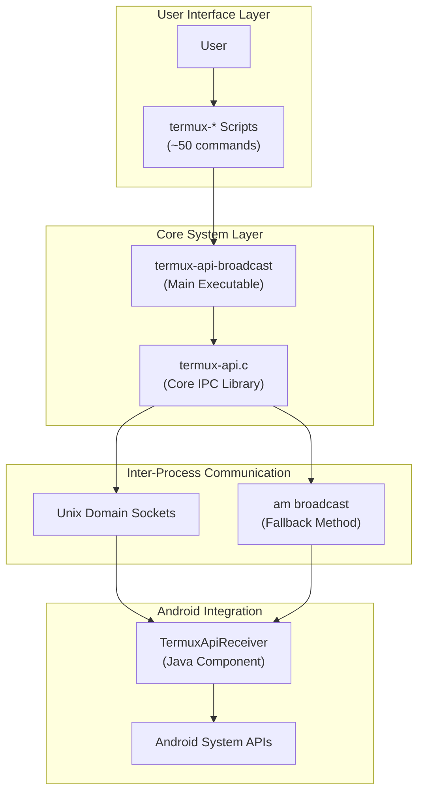
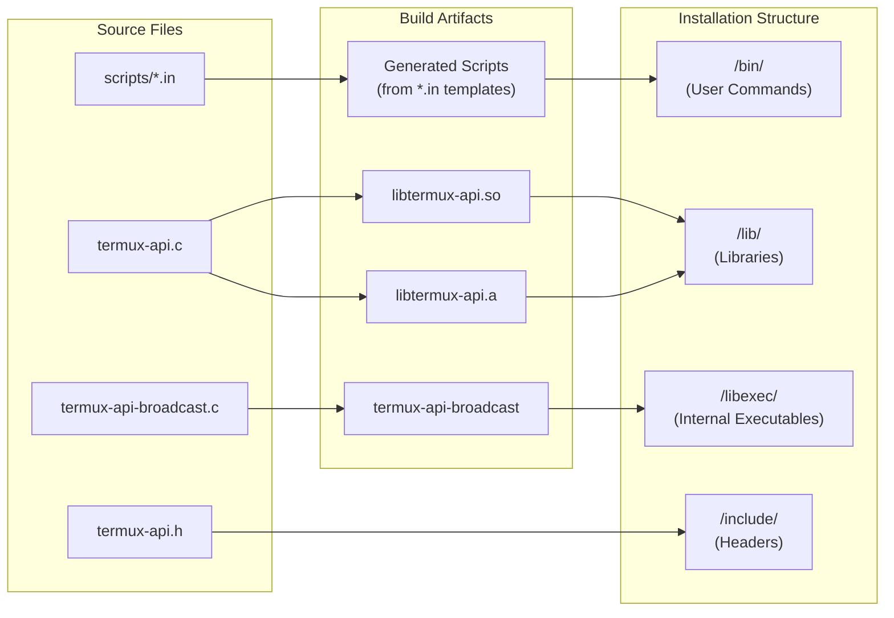

<!-- source: DeepWiki mcp.deepwiki.com · repo termux/termux-api-package · page 1 Introduction · fetched 2026-10-26 -->

# Introduction

Relevant source files

The following files were used as context for generating this wiki page:

- [CMakeLists.txt](CMakeLists.txt)
- [LICENSE](LICENSE)
- [README.md](README.md)
- [termux-callback.in](termux-callback.in)

## Purpose and Scope

This document provides technical documentation for the `termux-api-package` repository, which implements command-line access to Android APIs within the Termux terminal environment. The package serves as a bridge between shell scripts and Android system functionality, enabling users to interact with device hardware and services through standard Unix command-line interfaces.

This introduction covers the overall system architecture and key components. For detailed information about the build system, see [Build System](#3). For documentation of specific API commands, see [API Commands](#4). For the core inter-process communication mechanism, see [Core IPC Mechanism](#2.1).

## System Overview

The `termux-api-package` provides approximately 50 command-line utilities that expose Android APIs to shell environments. Each utility follows the pattern `termux-<functionality>` (e.g., `termux-battery-status`, `termux-camera-photo`) and communicates with Android system services through a sophisticated IPC mechanism.

### Core Components

| Component | File | Purpose |
|-----------|------|---------|
| C Library | `termux-api.c` | Core IPC engine handling communication with Android |
| Main Executable | `termux-api-broadcast` | Primary interface for API command execution |
| Header Interface | `termux-api.h` | C library API definitions |
| Script Templates | `scripts/*.in` | Template files for generating user commands |
| Build System | `CMakeLists.txt` | CMake configuration for compilation and installation |

## Architecture Overview

### System Components and Data Flow

Sources: [CMakeLists.txt:15-73](), architectural diagrams provided in context

### Code Entity Relationships

Sources: [CMakeLists.txt:7-12](), [CMakeLists.txt:88-131]()

## Key Functionality Categories

The package provides access to Android functionality across several domains:

### Communication APIs
- `termux-sms-list`, `termux-sms-send` - SMS management
- `termux-call-log`, `termux-telephony-call` - Telephony operations
- `termux-telephony-deviceinfo`, `termux-telephony-cellinfo` - Device information

### Hardware Access APIs  
- `termux-camera-photo`, `termux-camera-info` - Camera operations
- `termux-microphone-record`, `termux-audio-info` - Audio functionality
- `termux-sensor`, `termux-torch` - Hardware sensors and controls
- `termux-usb`, `termux-nfc` - Device connectivity

### System Integration APIs
- `termux-notification`, `termux-toast` - User interface elements
- `termux-battery-status`, `termux-volume` - System status
- `termux-clipboard-get`, `termux-clipboard-set` - System clipboard
- `termux-storage-get`, `termux-saf-*` - File system access

Sources: [CMakeLists.txt:15-73]()

## IPC Strategy

The system employs a dual-strategy approach for communicating with Android APIs:

1. **Primary Method**: Unix domain sockets for efficient bidirectional communication
2. **Fallback Method**: Android `am broadcast` commands for compatibility with newer API levels

This design ensures reliable operation across different Android versions while maintaining optimal performance where possible. The `run_api_command` function in `termux-api.c` orchestrates this communication strategy.

## Integration with Termux Ecosystem

The `termux-api-package` requires the companion **Termux:API** Android application, which contains the `TermuxApiReceiver` Java component that actually interfaces with Android system APIs. The package serves as the command-line frontend while the Android app provides the backend implementation.

The `termux-callback` mechanism enables bidirectional communication, allowing Android components to trigger shell script execution through the `TERMUX_CALLBACK` environment variable.

Sources: [termux-callback.in:1-4](), [README.md:1-3]()

---

