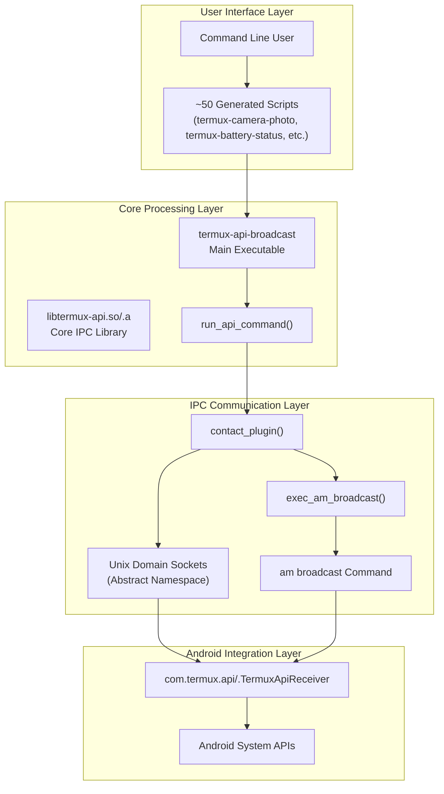
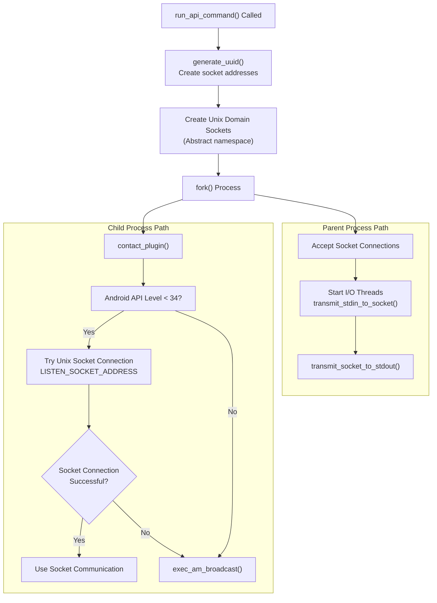
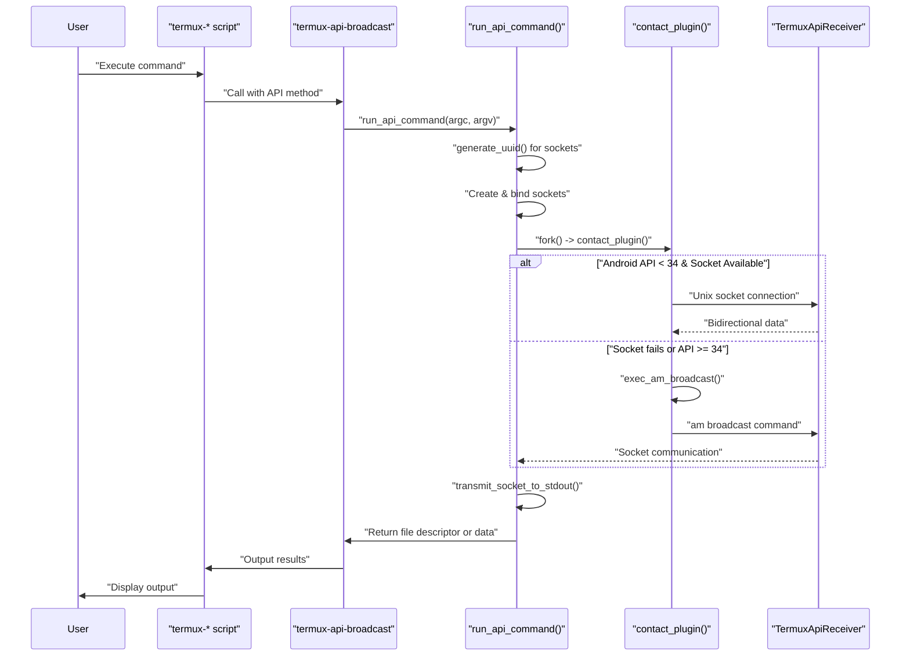
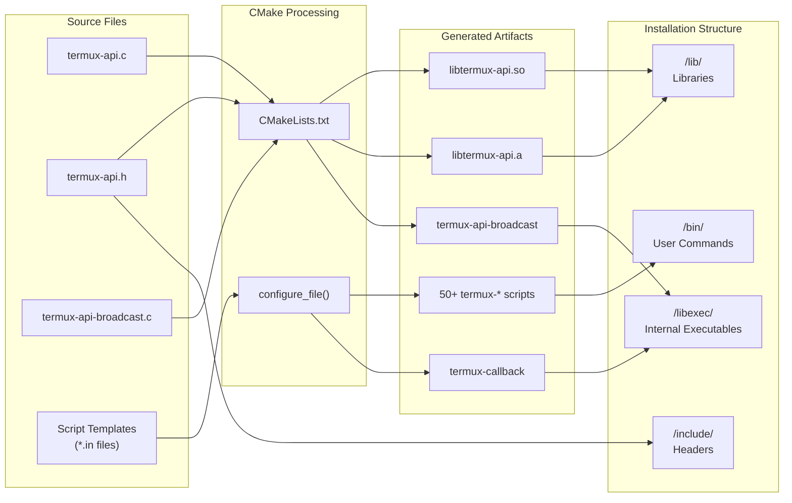

<!-- source: DeepWiki mcp.deepwiki.com · repo termux/termux-api-package · page 2 System Architecture · fetched 2026-10-26 -->

# System Architecture

Relevant source files

The following files were used as context for generating this wiki page:

- [CMakeLists.txt](CMakeLists.txt)
- [termux-api-broadcast.c](termux-api-broadcast.c)
- [termux-api.c](termux-api.c)
- [termux-api.h](termux-api.h)
- [termux-callback.in](termux-callback.in)

This document explains the high-level architecture of the termux-api-package, showing how shell scripts, C libraries, and Android components work together to provide command-line access to Android APIs within the Termux environment. The architecture implements a sophisticated inter-process communication (IPC) system that bridges the gap between C programs and Android's Java-based API layer.

For detailed information about the IPC mechanisms, see [Core IPC Mechanism](#2.1). For the C library interface documentation, see [C Library API](#2.2). For build system details, see [Build System](#3).

## System Overview

The termux-api-package implements a multi-layer architecture that transforms user commands into Android API calls through a series of well-defined components. The system consists of generated shell scripts, a core C library, and integration with Android's broadcast mechanism.

### High-Level Component Architecture

Sources: [termux-api.c:380-465](), [termux-api-broadcast.c:16-23](), [CMakeLists.txt:15-73]()

## Core Components

### Main Executable: termux-api-broadcast

The `termux-api-broadcast` executable serves as the primary entry point for all API operations. It implements a minimal wrapper around the core library functionality.

| Component | Purpose | Key Function |
|-----------|---------|--------------|
| `main()` | Entry point and file descriptor handling | [termux-api-broadcast.c:16-23]() |
| `run_api_command()` | Core orchestration logic | [termux-api.c:380-465]() |
| `exec_callback()` | Handle file descriptor callbacks | [termux-api.c:294-316]() |

### Core IPC Library: termux-api.c

The heart of the system is the IPC library that manages communication between C programs and Android components. This library implements a dual-strategy approach for maximum compatibility across Android versions.

### IPC Strategy Decision Flow

Sources: [termux-api.c:36-236](), [termux-api.c:238-292](), [termux-api.c:380-465]()

## Communication Architecture

### Socket Communication System

The system uses abstract Unix domain sockets for efficient bidirectional communication. Each API call generates unique socket addresses using UUIDs to prevent conflicts.

| Function | Purpose | Key Operations |
|----------|---------|----------------|
| `generate_uuid()` | Create unique socket addresses | [termux-api.c:318-330]() |
| `transmit_stdin_to_socket()` | Forward stdin to Android component | [termux-api.c:332-349]() |
| `transmit_socket_to_stdout()` | Forward Android output to stdout | [termux-api.c:351-378]() |

### Broadcast Fallback Mechanism

When socket communication fails (typically on Android API ≥ 34), the system automatically falls back to using Android's `am broadcast` command.

Sources: [termux-api.c:53-65](), [termux-api.c:238-292](), [termux-api.c:444-465]()

## Build System Integration

The build system generates all user-facing scripts from templates and creates the necessary library artifacts.

### Component Generation Process

### Script Generation Details

The build system processes 50+ script templates to create user-facing commands:

| Script Category | Examples | Template Processing |
|-----------------|----------|-------------------|
| Communication | `termux-sms-send`, `termux-call-log` | [CMakeLists.txt:54-59]() |
| Hardware | `termux-camera-photo`, `termux-sensor` | [CMakeLists.txt:22-23, 52]() |
| System | `termux-battery-status`, `termux-volume` | [CMakeLists.txt:19, 68]() |
| Storage | `termux-saf-*` family | [CMakeLists.txt:43-51]() |

Sources: [CMakeLists.txt:15-81](), [CMakeLists.txt:117-123]()

## Key Constants and Addresses

The system relies on several critical constants for proper operation:

| Constant | Value | Purpose |
|----------|-------|---------|
| `LISTEN_SOCKET_ADDRESS` | `"com.termux.api://listen"` | Primary socket address for Android communication |
| `TERMUX_API_PACKAGE_VERSION` | `"0.59.1"` | Version identification |
| Android Target | `"com.termux.api/.TermuxApiReceiver"` | Broadcast receiver component |

Sources: [termux-api.c:25](), [termux-api.c:31](), [termux-api.c:268]()

---

