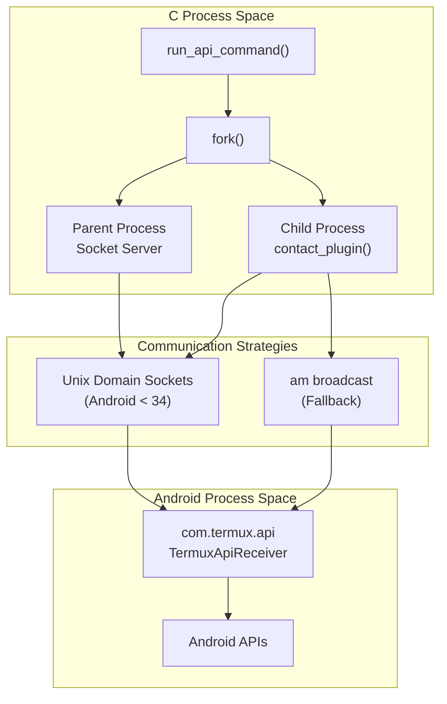
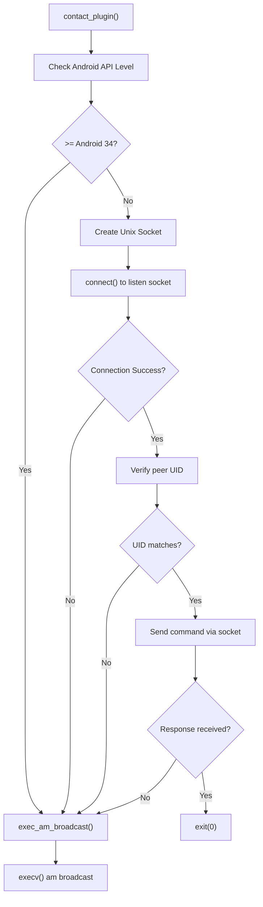
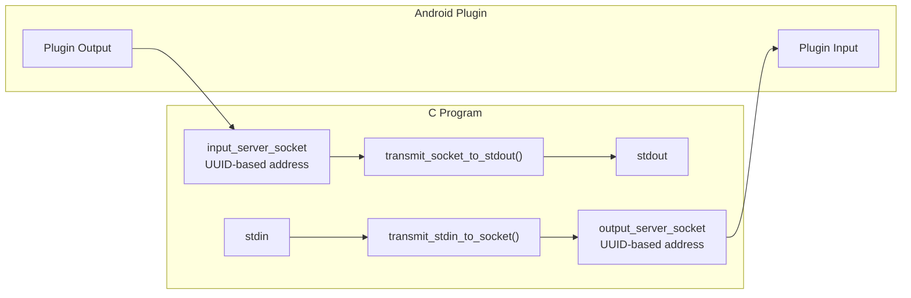
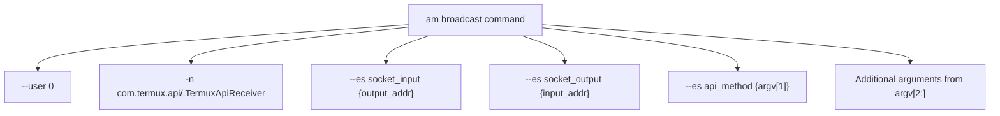
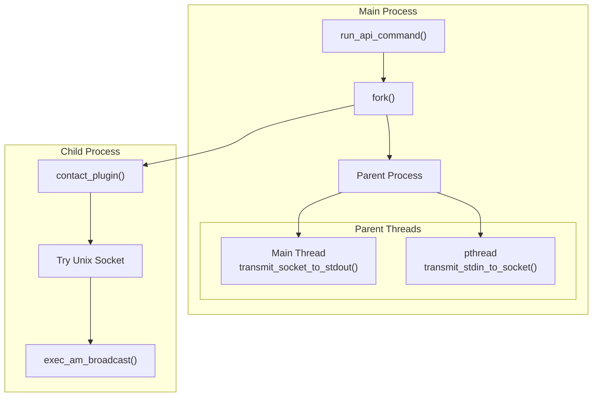
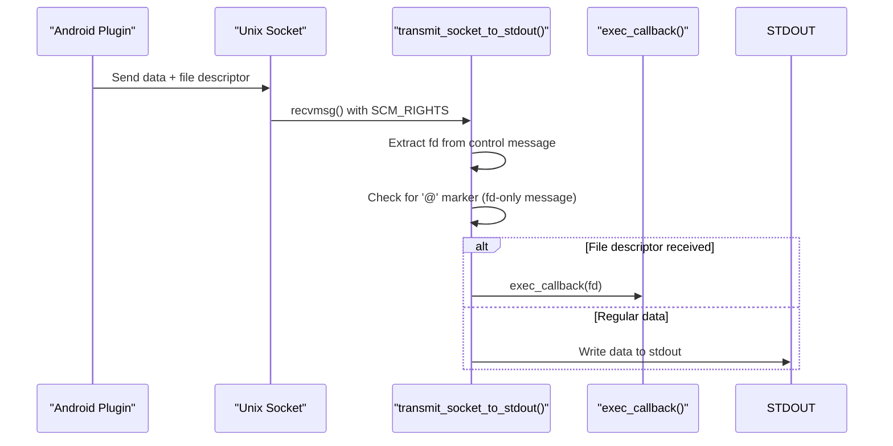
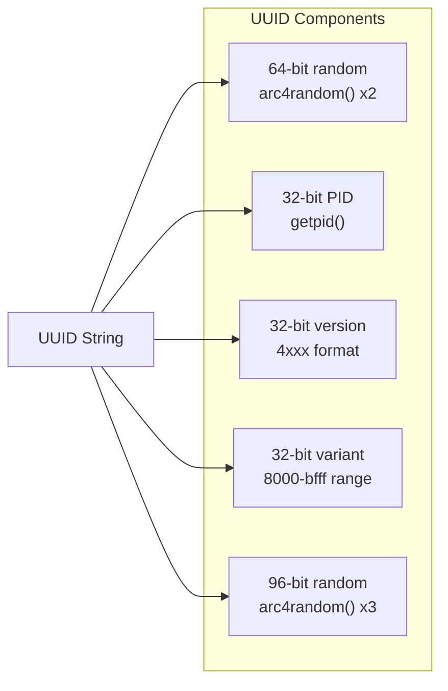

<!-- source: DeepWiki mcp.deepwiki.com · repo termux/termux-api-package · page 2.1 Core IPC Mechanism · fetched 2026-10-26 -->

# Core IPC Mechanism

<details>
<summary>Relevant source files</summary>

The following files were used as context for generating this wiki page:

- [termux-api.c](termux-api.c)

</details>


This document describes the inter-process communication (IPC) system that forms the backbone of the termux-api-package. The IPC mechanism handles all communication between C programs and Android APIs, implementing a sophisticated dual-strategy approach with Unix domain sockets as the primary method and Android broadcast intents as a fallback.

For information about the high-level system architecture, see [System Architecture](#2). For details about the C library interface that wraps this IPC mechanism, see [C Library API](#2.2).

## Overview

The core IPC mechanism is implemented in `termux-api.c` and provides the fundamental communication layer between the Termux environment and Android's Java-based API system. The system uses a dual-strategy approach to ensure reliable communication across different Android versions and system states.



**IPC Strategy Selection Flow**


Sources: [termux-api.c:36-236](), [termux-api.c:63-67](), [termux-api.c:238-292]()

## Socket-Based Communication

The primary IPC mechanism uses Unix domain sockets in the abstract namespace. The system creates two bidirectional sockets: one for input (plugin → C program) and one for output (C program → plugin).

### Socket Architecture



### Socket Creation and Binding

The system generates UUID-based addresses for abstract Unix domain sockets:

| Socket Type | Purpose | Function |
|-------------|---------|----------|
| `input_server_socket` | Receives data from Android | `transmit_socket_to_stdout()` |
| `output_server_socket` | Sends data to Android | `transmit_stdin_to_socket()` |

The socket addresses use abstract namespace (first byte is null) with UUID strings:
- Input address: Generated by `generate_uuid()` for `input_addr_str`
- Output address: Generated by `generate_uuid()` for `output_addr_str`

Sources: [termux-api.c:395-442](), [termux-api.c:318-330](), [termux-api.c:401-406]()

## Fallback Mechanism

When Unix domain sockets fail or are unavailable (Android API ≥ 34), the system falls back to Android's `am broadcast` command. This mechanism uses Android's Intent system to communicate with the `TermuxApiReceiver`.

### Broadcast Command Construction

The `exec_am_broadcast()` function constructs an `am broadcast` command with the following structure:



### Argument Processing

The broadcast mechanism handles argument escaping and string extra formatting:

| Argument Type | Processing | Example |
|---------------|------------|---------|
| `--es` string extras | Quoted and escaped | `--es "key" "value with \"quotes\""` |
| Regular arguments | Direct copy | `--ei count 5` |
| API method | First argument after executable | `battery-status` |

Sources: [termux-api.c:238-292](), [termux-api.c:249-283]()

## Process and Threading Model

The IPC system uses a fork-based process model with threading for bidirectional communication.



### Thread Responsibilities

| Thread | Function | Responsibility |
|--------|----------|---------------|
| Main | `transmit_socket_to_stdout()` | Read from input socket, write to stdout |
| Worker | `transmit_stdin_to_socket()` | Read from stdin, write to output socket |
| Child | `contact_plugin()` | Contact Android plugin via socket or broadcast |

### Socket Accept and Data Flow

The parent process accepts connections on both sockets:
1. Input socket accepts connection from Android plugin
2. Output socket accepts connection from worker thread
3. Data flows bidirectionally through established connections

Sources: [termux-api.c:444-464](), [termux-api.c:332-349](), [termux-api.c:351-378]()

## File Descriptor Handling

The IPC mechanism supports file descriptor passing using the `SCM_RIGHTS` mechanism for Unix domain sockets. This enables Android APIs to pass file descriptors (e.g., USB device handles) back to C programs.

### File Descriptor Reception



### File Descriptor Processing

The system uses `recvmsg()` with control message handling:

| Component | Purpose | Implementation |
|-----------|---------|----------------|
| `struct msghdr` | Message header for `recvmsg()` | Contains control buffer for ancillary data |
| `struct cmsghdr` | Control message header | Identifies `SCM_RIGHTS` type |
| `CMSG_DATA()` | Extract file descriptor | Returns pointer to the passed file descriptor |

Special handling for file descriptor messages:
- '@' character indicates file descriptor without output data
- `exec_callback()` handles file descriptor processing
- Environment variable `TERMUX_EXPORT_FD` controls export behavior

Sources: [termux-api.c:351-378](), [termux-api.c:294-316](), [termux-api.c:363-378]()

## UUID Generation Strategy

The system generates unique socket addresses using a custom UUID implementation based on `arc4random()` and process information.

### UUID Format

The `generate_uuid()` function creates addresses in the format:
```
{random64}-{pid}-{version}-{variant}-{random96}
```



### Address Uniqueness

The UUID generation ensures uniqueness through:
- Process ID inclusion prevents collision within same time window
- Multiple random components reduce collision probability
- UUID version 4 compliance for standardization

The generated UUIDs are used as abstract Unix domain socket addresses, ensuring each IPC session has unique socket endpoints.

Sources: [termux-api.c:318-330](), [termux-api.c:398-399]()

---

