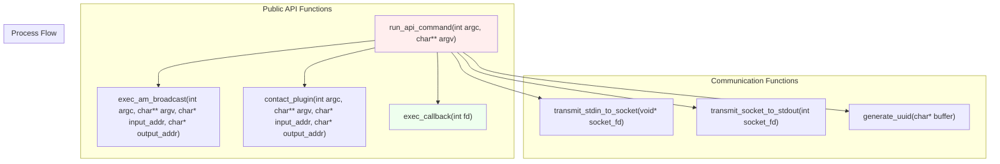
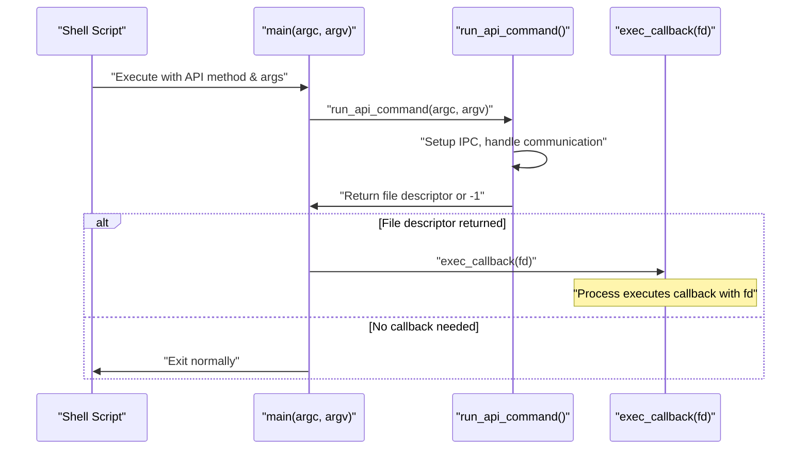
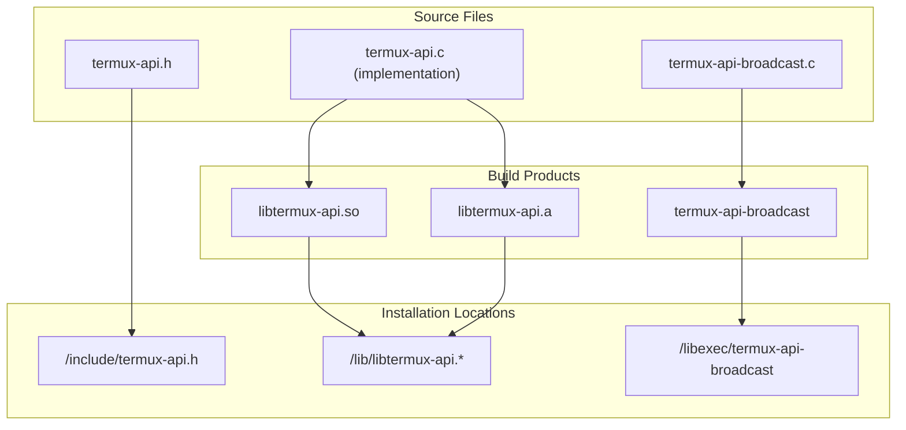

<!-- source: DeepWiki mcp.deepwiki.com · repo termux/termux-api-package · page 2.2 C Library API · fetched 2026-10-26 -->

# C Library API

<details>
<summary>Relevant source files</summary>

The following files were used as context for generating this wiki page:

- [termux-api-broadcast.c](termux-api-broadcast.c)
- [termux-api.h](termux-api.h)

</details>


This document covers the C library interface that provides the core functionality for the termux-api-package system. The C library API serves as the foundation for all termux-api commands, handling inter-process communication between user commands and Android APIs through a sophisticated dual-strategy IPC mechanism.

For information about the underlying IPC mechanisms and communication strategies, see [Core IPC Mechanism](#2.1). For details about the user-facing API commands that utilize this library, see [API Commands](#4).

## Overview

The C Library API consists of two primary components:

- **Header Interface** (`termux-api.h`): Defines the public C API functions used by all termux-api components
- **Main Executable** (`termux-api-broadcast`): Provides the primary entry point that shell scripts use to access the library functionality

The library handles the complex task of establishing bidirectional communication between C programs running in Termux and Android's Java-based API system, using Unix domain sockets as the preferred method with am broadcast as a fallback strategy.

## Header Interface

The public C API is defined in [termux-api.h:1-22](), which provides a clean interface for accessing the core IPC functionality.

### Function Categories

The API functions fall into several logical categories:

| Category | Functions | Purpose |
|----------|-----------|---------|
| **Process Execution** | `exec_am_broadcast`, `contact_plugin`, `exec_callback` | Handle different execution strategies and callback processing |
| **Socket Communication** | `transmit_stdin_to_socket`, `transmit_socket_to_stdout` | Manage bidirectional data flow between processes and sockets |
| **Utility Functions** | `generate_uuid` | Generate unique identifiers for socket addresses |
| **Main Entry Point** | `run_api_command` | Primary function that orchestrates the entire API call process |

### Core Function Interface

#### Core API Function Interface



Sources: [termux-api.h:10-16]()

The header file uses several important design patterns:

- **C++ Compatibility**: Wrapped in `extern "C"` blocks for C++ interoperability [termux-api.h:6-8](), [termux-api.h:18-20]()
- **No-return Functions**: Functions like `exec_am_broadcast`, `contact_plugin`, and `exec_callback` are marked with `_Noreturn` attribute [termux-api.h:10-12]()
- **Standard Library Integration**: Includes `<stdlib.h>` for standard library functionality [termux-api.h:4]()

## Main Executable

The `termux-api-broadcast` executable serves as the primary interface between shell scripts and the C library. Its implementation is deliberately minimal, focusing on delegation to the core library functions.

### Executable Architecture

#### termux-api-broadcast Execution Flow



Sources: [termux-api-broadcast.c:16-23]()

The main function's logic is straightforward:

1. **Delegate to Core**: Calls `run_api_command` with command-line arguments [termux-api-broadcast.c:18]()
2. **Handle Callbacks**: If a file descriptor is returned, executes the appropriate callback [termux-api-broadcast.c:20]()
3. **Clean Exit**: Returns 0 on successful completion [termux-api-broadcast.c:22]()

### Usage Pattern

The executable is designed to be called with a specific pattern as documented in the source comments [termux-api-broadcast.c:1-12]():

```
termux-api ${API_METHOD} ${ADDITIONAL_FLAGS}
```

This translates internally to Android broadcast commands with socket addresses for bidirectional communication.

## Integration with Build System

The C Library API integrates with the broader build system to provide both static and shared library variants:

### Library Build Products



Sources: Based on system architecture analysis

The library provides multiple integration options:
- **Header Installation**: Public interface available for external C/C++ programs
- **Shared Library**: Runtime linking for dynamic applications
- **Static Library**: Compile-time linking for standalone applications
- **Executable**: Ready-to-use command-line interface

## Function Responsibilities

The C Library API functions each have specific responsibilities within the larger IPC system:

| Function | Responsibility | Return Behavior |
|----------|----------------|-----------------|
| `run_api_command` | Orchestrates entire API call process, manages socket creation and communication | Returns file descriptor for callbacks or -1 |
| `exec_am_broadcast` | Executes Android am broadcast command as fallback IPC method | No return (`_Noreturn`) |
| `contact_plugin` | Attempts Unix socket connection to Android plugin | No return (`_Noreturn`) |
| `exec_callback` | Processes file descriptor-based callbacks from API responses | No return (`_Noreturn`) |
| `transmit_stdin_to_socket` | Handles stdin→socket data transmission in separate thread | Returns void pointer |
| `transmit_socket_to_stdout` | Handles socket→stdout data transmission in main thread | Returns integer status |
| `generate_uuid` | Creates unique socket addresses for IPC | Void function, modifies buffer |

Sources: [termux-api.h:10-16]()

This design ensures clean separation of concerns while providing a unified interface for the complex underlying IPC mechanisms that bridge the C environment with Android's Java-based APIs.

---

