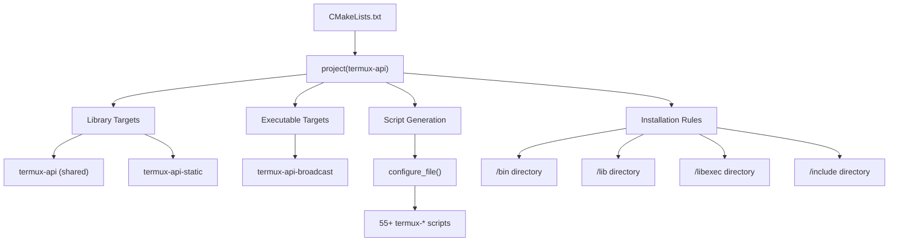
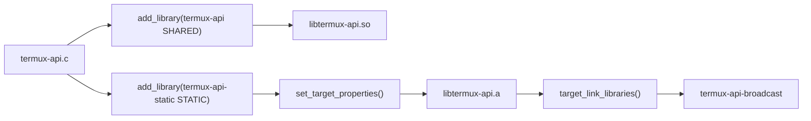
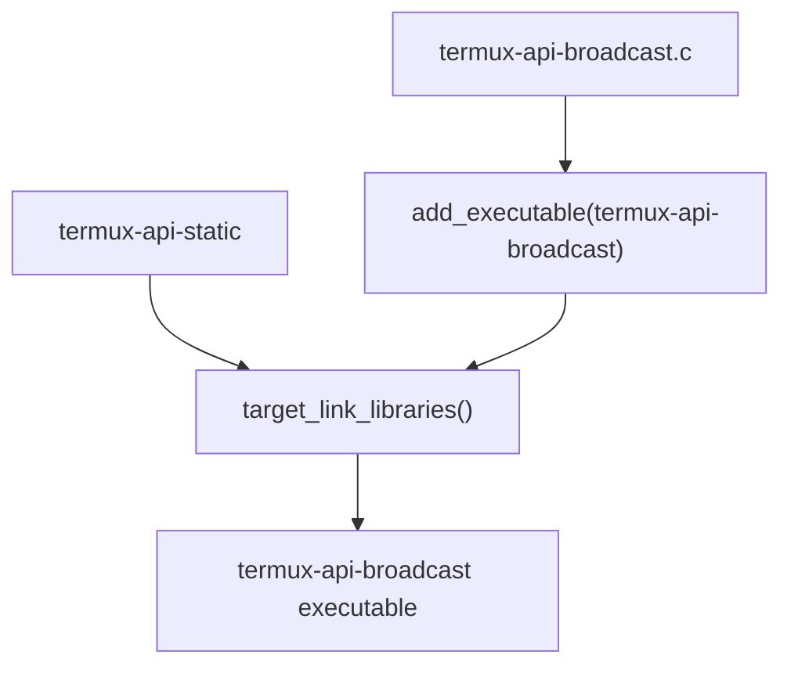
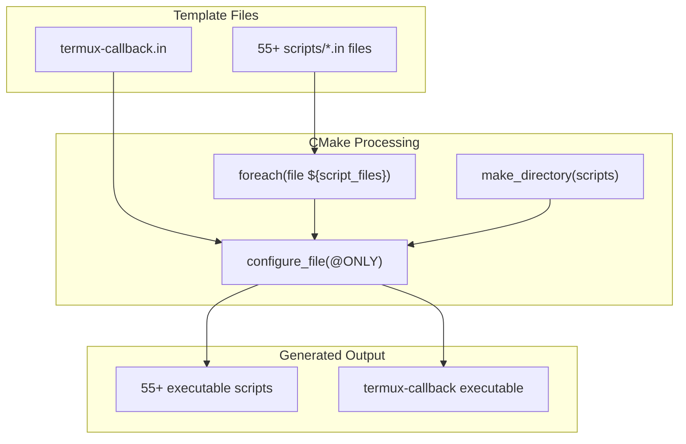
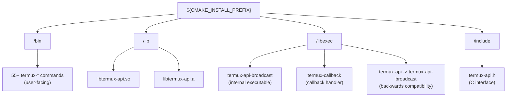
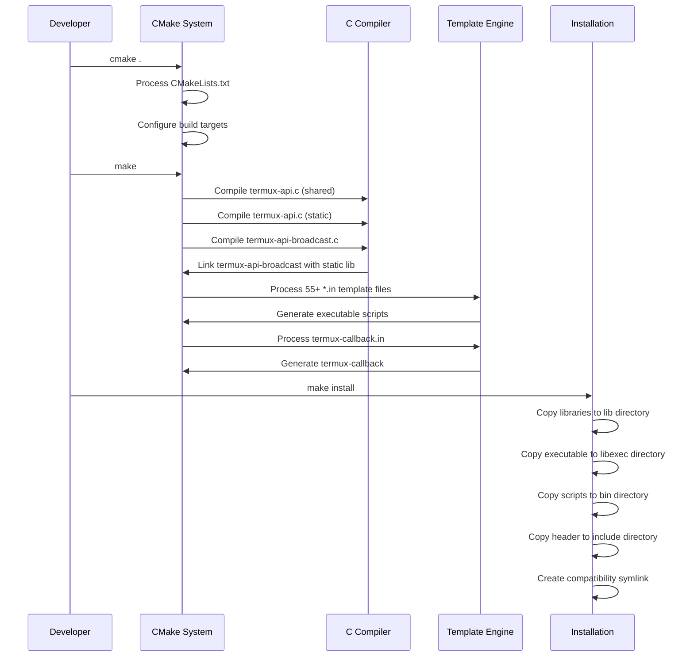

<!-- source: DeepWiki mcp.deepwiki.com · repo termux/termux-api-package · page 3 Build System · fetched 2026-10-26 -->

# Build System

Relevant source files

The following files were used as context for generating this wiki page:

- [CMakeLists.txt](CMakeLists.txt)
- [termux-callback.in](termux-callback.in)

This document explains the CMake-based build system used to compile the termux-api library, generate user-facing scripts, and manage installation across the Termux environment. The build system handles both C compilation and template processing to create the complete package of API access tools.

For information about the runtime behavior of the compiled components, see [Core IPC Mechanism](#2.1). For details about the generated C library interface, see [C Library API](#2.2).

## Overview

The build system is implemented using CMake and performs several key functions:

- Compiles the core `termux-api.c` source into both shared and static libraries
- Builds the `termux-api-broadcast` executable that serves as the main IPC coordinator
- Processes template files (`.in` files) to generate approximately 55 user-facing command scripts
- Manages installation layout across standard Unix directories (`bin`, `lib`, `libexec`, `include`)
- Handles backwards compatibility through symbolic linking

## Build Configuration

### CMake Structure

The primary build configuration is defined in a single `CMakeLists.txt` file that uses CMake 3.0.0 minimum requirements.

**Sources:** [CMakeLists.txt:1-3]()

### Build Variables

The build system establishes key variables that control compilation and installation paths:

| Variable | Purpose | Value |
|----------|---------|-------|
| `TERMUX_PREFIX` | Installation prefix for all components | `${CMAKE_INSTALL_PREFIX}` |
| `script_files` | List of all template scripts to process | Array of 55+ script paths |

**Sources:** [CMakeLists.txt:5](), [CMakeLists.txt:15-73]()

## Compilation Targets

### Library Compilation

The build system creates two library variants from the same source file:

**Library Target Configuration:**
- **Shared Library**: `termux-api` target produces `libtermux-api.so`
- **Static Library**: `termux-api-static` target produces `libtermux-api.a` 
- **Output Name Override**: Static library uses `OUTPUT_NAME termux-api` property to match naming convention

**Sources:** [CMakeLists.txt:7-9]()

### Executable Compilation  

The main executable is built with static linking to ensure portability:

**Sources:** [CMakeLists.txt:11-12]()

## Script Generation System

### Template Processing

The build system uses CMake's `configure_file()` function to process template files and generate executable scripts:

**Template Variable Substitution:**
- `@TERMUX_PREFIX@` is replaced with the installation prefix in all template files
- Templates use the `@ONLY` mode to prevent CMake from processing other variable formats

**Sources:** [CMakeLists.txt:75-81](), [CMakeLists.txt:83-86](), [termux-callback.in:1]()

### Script Categories

The build system processes scripts organized by functional categories:

| Category | Example Scripts | Count |
|----------|----------------|-------|
| **Service Control** | `termux-api-start`, `termux-api-stop` | 2 |
| **Hardware Access** | `termux-camera-photo`, `termux-microphone-record`, `termux-sensor` | 8 |
| **Communication** | `termux-sms-send`, `termux-call-log`, `termux-telephony-call` | 6 |
| **Storage/Files** | `termux-saf-*`, `termux-storage-get`, `termux-share` | 10 |
| **System Info** | `termux-battery-status`, `termux-wifi-connectioninfo` | 8 |
| **User Interface** | `termux-notification*`, `termux-dialog`, `termux-toast` | 6 |
| **Media** | `termux-media-player`, `termux-tts-speak` | 4 |
| **Other** | `termux-clipboard-*`, `termux-location`, etc. | 11+ |

**Sources:** [CMakeLists.txt:15-73]()

## Installation Structure

### Directory Layout

The installation system follows standard Unix directory conventions:

**Sources:** [CMakeLists.txt:88-94](), [CMakeLists.txt:105-115](), [CMakeLists.txt:117-123](), [CMakeLists.txt:125-131]()

### Installation Rules

The build system defines specific installation rules for each component type:

| Component | Destination | Permissions | Purpose |
|-----------|-------------|-------------|---------|
| **User Scripts** | `${CMAKE_INSTALL_PREFIX}/bin` | `755` (executable) | Direct user access |
| **Libraries** | Standard lib directory | Default | Linking and runtime |
| **Internal Executables** | `${CMAKE_INSTALL_PREFIX}/libexec` | `755` (executable) | System components |
| **Headers** | Standard include directory | Default | Development interface |

**Backwards Compatibility:**
The build system creates a symbolic link `termux-api -> termux-api-broadcast` in the `libexec` directory to maintain compatibility with older references.

**Sources:** [CMakeLists.txt:96-103]()

## Build Process Flow

### Complete Build Sequence  

**Sources:** [CMakeLists.txt:1-132]()

The build system ensures that all components are properly compiled, linked, and installed in their appropriate locations to create a fully functional termux-api package.

---

