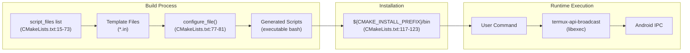
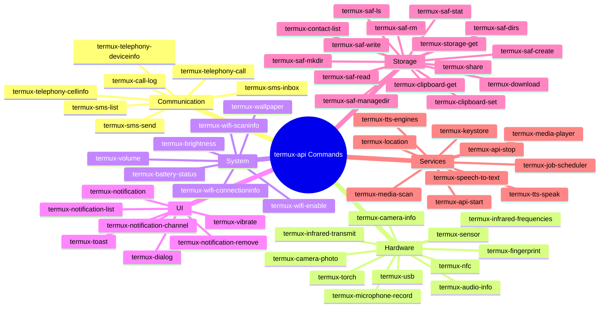
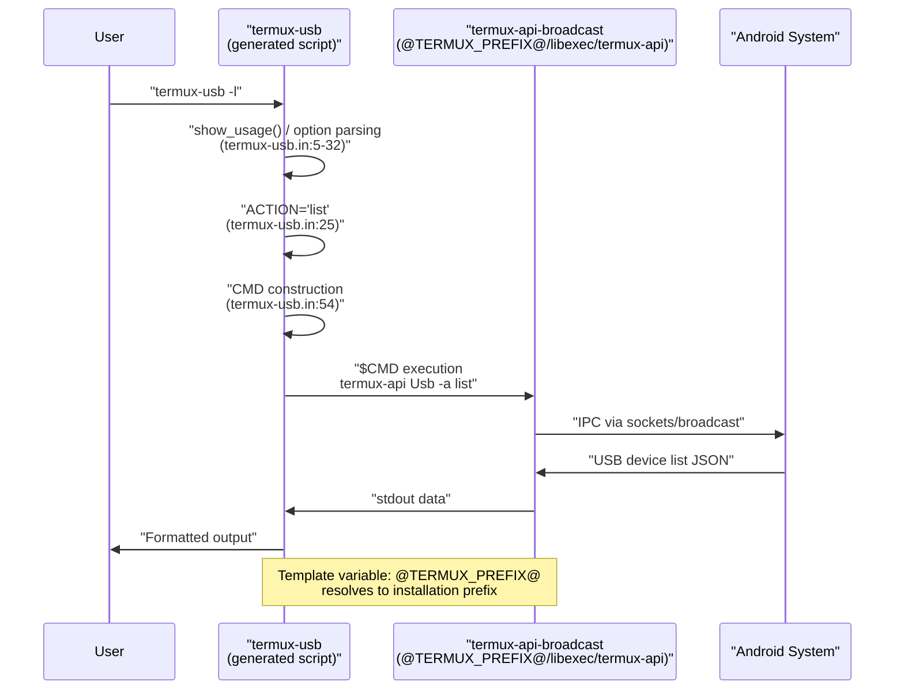
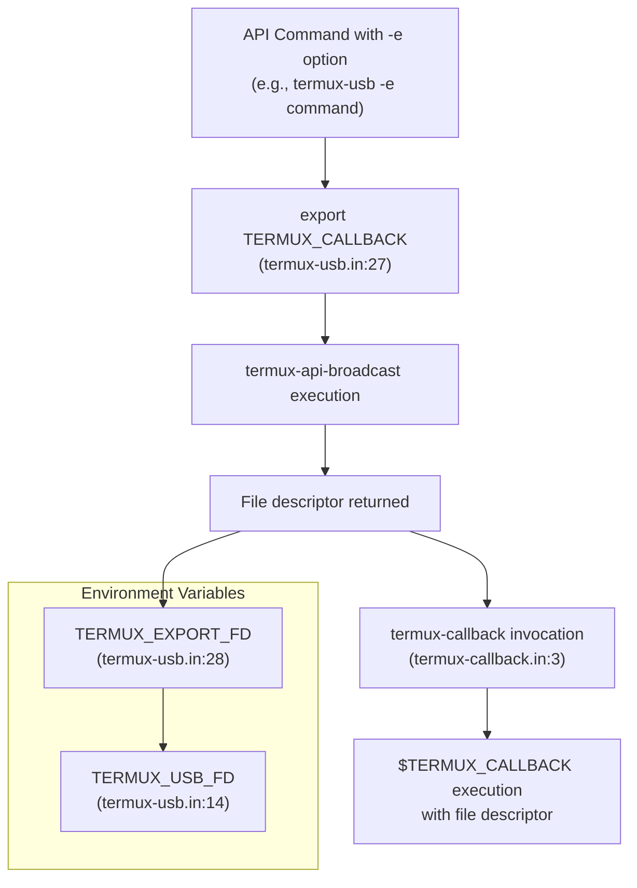

<!-- source: DeepWiki mcp.deepwiki.com · repo termux/termux-api-package · page 4 API Commands · fetched 2026-10-26 -->

# API Commands

Relevant source files

The following files were used as context for generating this wiki page:

- [CMakeLists.txt](CMakeLists.txt)
- [scripts/termux-usb.in](scripts/termux-usb.in)
- [termux-callback.in](termux-callback.in)

This document provides an overview of the user-facing command-line utilities in the termux-api-package that provide access to Android functionality. These are the primary interface through which users interact with Android APIs from the Termux terminal environment.

For detailed information about how these commands communicate with Android, see [Core IPC Mechanism](#2.1). For information about the build process that generates these commands, see [Build System](#3).

## Command Structure and Organization

The termux-api-package provides approximately 50 command-line utilities, all following the naming convention `termux-*`. These commands are generated from template files during the build process and installed to the system's binary directory for direct user execution.

### Generated Command Structure

All API commands are generated from template files using CMake's `configure_file()` function. The build system processes template files with the `.in` extension to create executable bash scripts.

Sources: [CMakeLists.txt:15-73](), [CMakeLists.txt:77-81](), [CMakeLists.txt:117-123]()

## Command Categories

The API commands are organized into functional categories that correspond to different Android subsystems:

| Category | Command Count | Purpose |
|----------|---------------|---------|
| Communication | 7 | SMS, telephony, call logs |
| Hardware Access | 8 | Sensors, camera, USB, NFC |
| System Information | 11 | Battery, WiFi, audio, volume |
| User Interface | 7 | Notifications, dialogs, toast |
| Storage & Files | 12 | SAF, clipboard, sharing |
| Services & Advanced | 9 | Location, TTS, job scheduling |

For detailed documentation of each category, see:
- [Communication APIs](#4.1)
- [Hardware APIs](#4.2) 
- [System APIs](#4.3)

### Complete Command List

The following diagram shows the complete mapping from CMakeLists.txt script definitions to functional categories:

Sources: [CMakeLists.txt:15-73]()

## Command Execution Pattern

All termux-api commands follow a consistent execution pattern. Using `termux-usb` as a representative example:

Sources: [scripts/termux-usb.in:5-32](), [scripts/termux-usb.in:25](), [scripts/termux-usb.in:54]()

## Callback Mechanism

Some commands support callback functionality for handling file descriptors or continuous data streams. This is implemented through the `TERMUX_CALLBACK` environment variable and the `termux-callback` utility:

Sources: [scripts/termux-usb.in:27](), [scripts/termux-usb.in:28](), [scripts/termux-usb.in:14](), [termux-callback.in:3]()

## Template System

The command generation system uses CMake template processing to create consistent command structures:

| Template Variable | Purpose | Example Value |
|------------------|---------|---------------|
| `@TERMUX_PREFIX@` | Installation prefix path | `/data/data/com.termux/files/usr` |
| Script-specific variables | Command customization | Action types, parameter formats |

The template system ensures all commands use the correct paths and maintain consistency across the API surface.

Sources: [CMakeLists.txt:5](), [CMakeLists.txt:77-81](), [scripts/termux-usb.in:1](), [scripts/termux-usb.in:54](), [termux-callback.in:1]()

---

