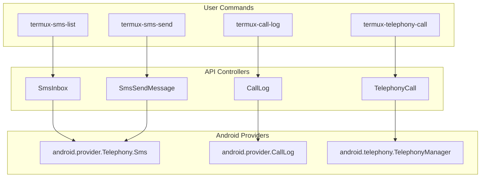
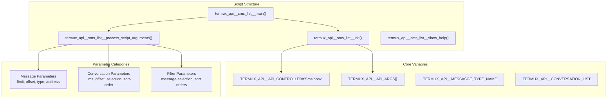
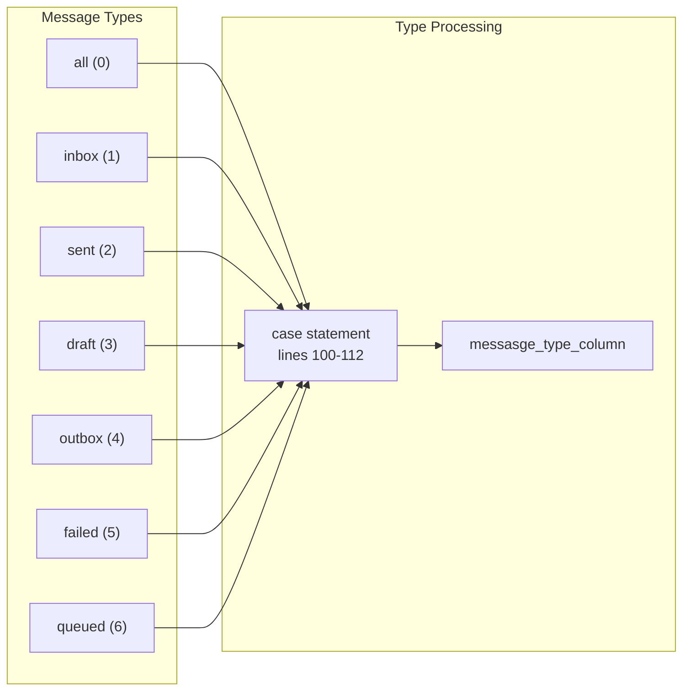
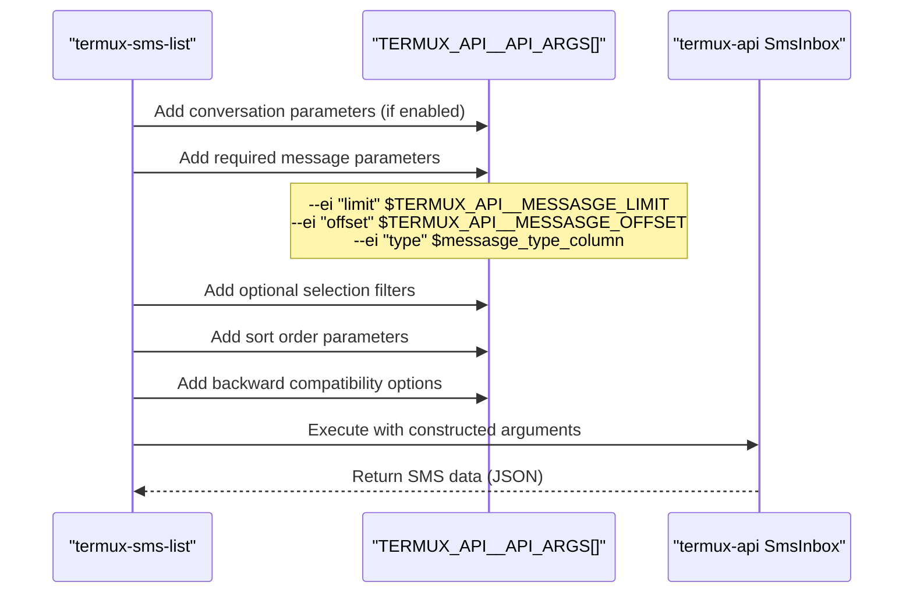
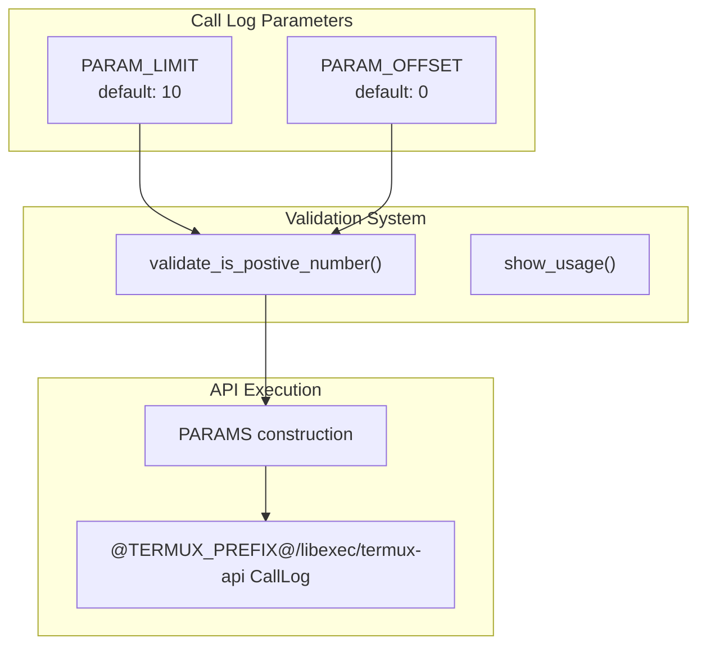
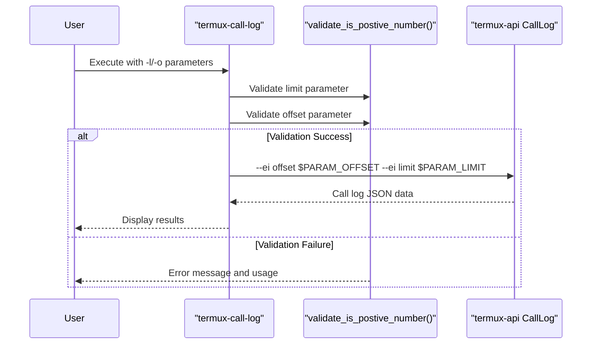
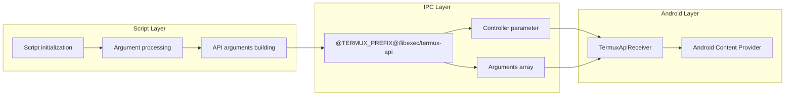
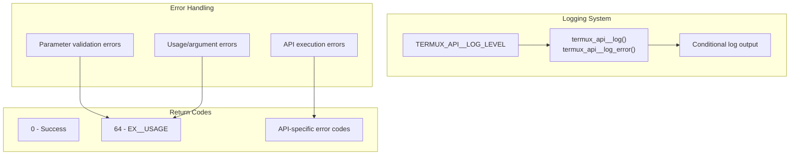

<!-- source: DeepWiki mcp.deepwiki.com · repo termux/termux-api-package · page 4.1 Communication APIs · fetched 2026-10-26 -->

# Communication APIs

Relevant source files

The following files were used as context for generating this wiki page:

- [scripts/termux-call-log.in](scripts/termux-call-log.in)
- [scripts/termux-sms-list.in](scripts/termux-sms-list.in)

## Purpose and Scope

The Communication APIs provide command-line access to Android's telephony and messaging systems within the Termux environment. This includes SMS message management, call log access, and telephony operations. These APIs enable users to programmatically interact with Android's communication infrastructure through shell scripts and command-line utilities.

For hardware-related communication features like microphone recording or camera access, see [Hardware APIs](#4.2). For system-level notification and service management, see [System APIs](#4.3).

## API Command Overview

The communication APIs are implemented as a collection of shell scripts that interface with Android's telephony providers through the core IPC mechanism. The primary commands include:

| Command | Controller | Purpose |
|---------|------------|---------|
| `termux-sms-list` | `SmsInbox` | List and query SMS messages and conversations |
| `termux-call-log` | `CallLog` | Access call history and log entries |
| `termux-sms-send` | `SmsSendMessage` | Send SMS messages |
| `termux-telephony-call` | `TelephonyCall` | Initiate phone calls |

Sources: [scripts/termux-sms-list.in:18-19](), [scripts/termux-call-log.in:46]()

## SMS Management System

### SMS List Command Architecture

The `termux-sms-list` command provides comprehensive SMS querying capabilities through a sophisticated parameter system. The script implements both message-level and conversation-level operations.

Sources: [scripts/termux-sms-list.in:85-202](), [scripts/termux-sms-list.in:18-19]()

### SMS Message Type System

The SMS system supports multiple message types through a numeric mapping system that corresponds to Android's telephony provider constants:

Sources: [scripts/termux-sms-list.in:99-112](), [scripts/termux-sms-list.in:41-43]()

### API Arguments Construction

The SMS list command builds its API arguments dynamically based on user parameters. The argument construction follows a structured pattern:

Sources: [scripts/termux-sms-list.in:150-180](), [scripts/termux-sms-list.in:194]()

## Call Log System

### Call Log Command Structure

The `termux-call-log` command provides a simpler interface for accessing Android's call history through basic pagination parameters.

Sources: [scripts/termux-call-log.in:4-8](), [scripts/termux-call-log.in:14-20](), [scripts/termux-call-log.in:45-46]()

### Call Log Data Flow

The call log system follows a streamlined execution pattern compared to the more complex SMS system:

Sources: [scripts/termux-call-log.in:29-46]()

## IPC Integration Pattern

All communication APIs follow a consistent pattern for integrating with the core IPC system:

### Command Execution Pattern

Sources: [scripts/termux-sms-list.in:194](), [scripts/termux-call-log.in:46]()

### Error Handling and Logging

The communication APIs implement consistent error handling and logging mechanisms:

Sources: [scripts/termux-sms-list.in:76-78](), [scripts/termux-sms-list.in:195-200](), [scripts/termux-call-log.in:14-20]()

---

