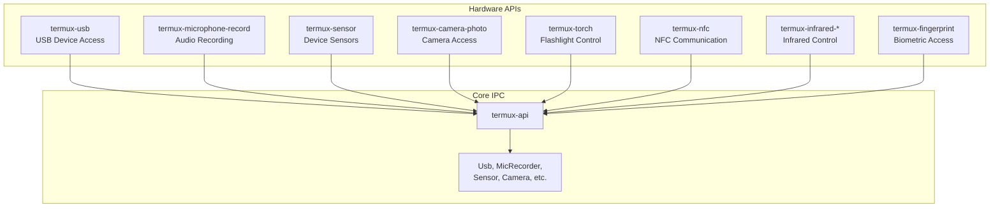
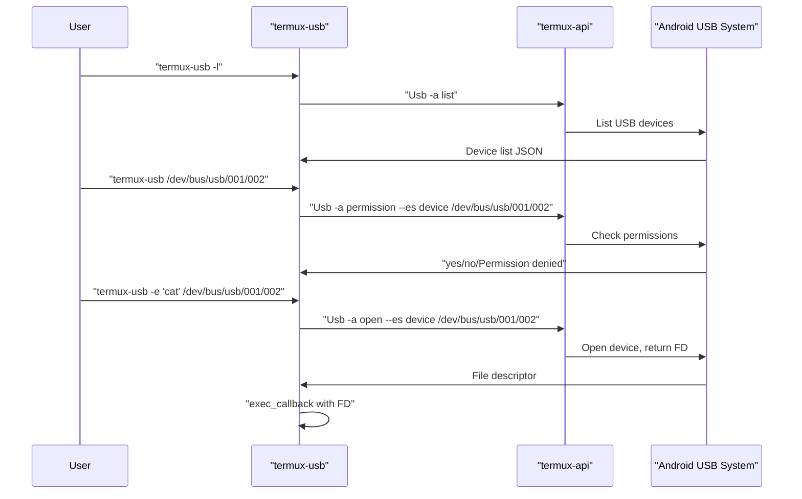
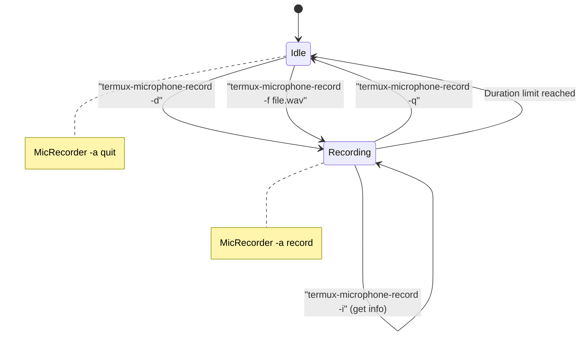
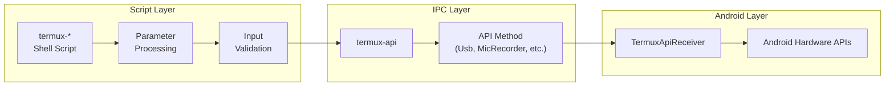

<!-- source: DeepWiki mcp.deepwiki.com · repo termux/termux-api-package · page 4.2 Hardware APIs · fetched 2026-10-26 -->

# Hardware APIs

<details>
<summary>Relevant source files</summary>

The following files were used as context for generating this wiki page:

- [scripts/termux-microphone-record.in](scripts/termux-microphone-record.in)
- [scripts/termux-usb.in](scripts/termux-usb.in)

</details>


This page documents the hardware interaction commands provided by termux-api-package. These commands enable direct access to Android device hardware including USB devices, microphone recording, sensors, and other physical components through command-line interfaces.

For system-level functionality like notifications and battery status, see [System APIs](#4.3). For communication-related hardware like telephony, see [Communication APIs](#4.1).

## Overview

The hardware APIs provide controlled access to Android device hardware through the termux-api IPC mechanism. Each hardware API follows the standard pattern of shell script wrappers that call `termux-api` with specific method names and parameters.

### Hardware API Categories



Sources: [scripts/termux-usb.in](), [scripts/termux-microphone-record.in]()

## USB Device Access

The `termux-usb` command provides controlled access to USB devices connected to Android devices. It implements a permission-based system that requires explicit user consent before device access.

### USB Command Structure

| Action | Purpose | Required Parameters |
|--------|---------|-------------------|
| `-l` | List available devices | None |
| Permission check | Check/request device permission | Device path or vendor/product ID |
| `-e command` | Execute command with device FD | Device identifier + command |

### USB Access Flow



Sources: [scripts/termux-usb.in:54](), [scripts/termux-usb.in:19-20](), [scripts/termux-usb.in:67-76]()

### USB Parameter Handling

The script accepts device identification in two formats:

1. **Device Path**: Direct usbfs path like `/dev/bus/usb/001/002`
2. **Vendor/Product ID**: Separate vendor ID and product ID parameters

```bash
# Device path format
termux-usb /dev/bus/usb/001/002

# Vendor/Product ID format  
termux-usb 1234 5678
```

The parameter processing logic handles these cases through conditional parameter building in [scripts/termux-usb.in:41-51]().

### USB Callback Mechanism

When using the `-e` option, `termux-usb` utilizes the callback system where:
- `TERMUX_CALLBACK` environment variable contains the command to execute
- Device file descriptor is passed as argument or via `TERMUX_USB_FD` environment variable (with `-E` flag)
- Error handling covers device access failures and permission denials

Sources: [scripts/termux-usb.in:27](), [scripts/termux-usb.in:28](), [scripts/termux-usb.in:67-75]()

## Audio Recording

The `termux-microphone-record` command provides comprehensive microphone recording functionality with configurable audio parameters and state management.

### Recording Parameters

| Parameter | Flag | Purpose | Units/Values |
|-----------|------|---------|--------------|
| File output | `-f` | Specify output file path | File path |
| Duration limit | `-l` | Recording time limit | Seconds (0 = unlimited) |
| Encoder | `-e` | Audio encoding format | aac, amr_wb, amr_nb, opus |
| Bitrate | `-b` | Audio bitrate | kbps |
| Sample rate | `-r` | Sampling frequency | Hz |
| Channels | `-c` | Channel count | 1, 2, ... |

### Recording State Management



Sources: [scripts/termux-microphone-record.in:45-84](), [scripts/termux-microphone-record.in:78-80]()

### Audio Parameter Processing

The script implements parameter validation and unit conversion:
- Time limits converted from seconds to milliseconds: [scripts/termux-microphone-record.in:57-59]()  
- Bitrates converted from kbps to bps: [scripts/termux-microphone-record.in:66-68]()
- File paths resolved to absolute paths: [scripts/termux-microphone-record.in:51-54]()

The `add_params` function builds the parameter array for the `termux-api MicRecorder` call: [scripts/termux-microphone-record.in:35-39]()

### Recording Actions

Three mutually exclusive actions are supported:

1. **Record**: Start recording with specified parameters
2. **Info**: Get current recording status (`-i` flag)
3. **Quit**: Stop current recording (`-q` flag)

The action determination logic ensures only one action is performed per invocation through the `sole()` validation function: [scripts/termux-microphone-record.in:28-33]()

Sources: [scripts/termux-microphone-record.in:75-80](), [scripts/termux-microphone-record.in:86-94]()

## Hardware API Integration Patterns

All hardware APIs follow consistent integration patterns with the core IPC system:

### Common Command Structure



Sources: [scripts/termux-usb.in:54](), [scripts/termux-microphone-record.in:42]()

### Error Handling Patterns

Hardware APIs implement standardized error handling for common failure modes:
- Device not found/available
- Permission denied
- Hardware access failures
- Timeout conditions

Both `termux-usb` and `termux-microphone-record` demonstrate case-based output processing that maps Android system responses to user-friendly error messages.

Sources: [scripts/termux-usb.in:60-66](), [scripts/termux-usb.in:69-75]()

---

