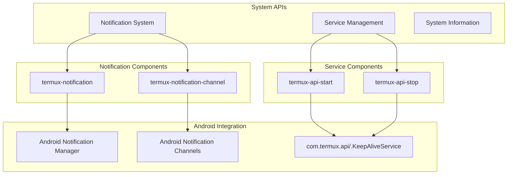
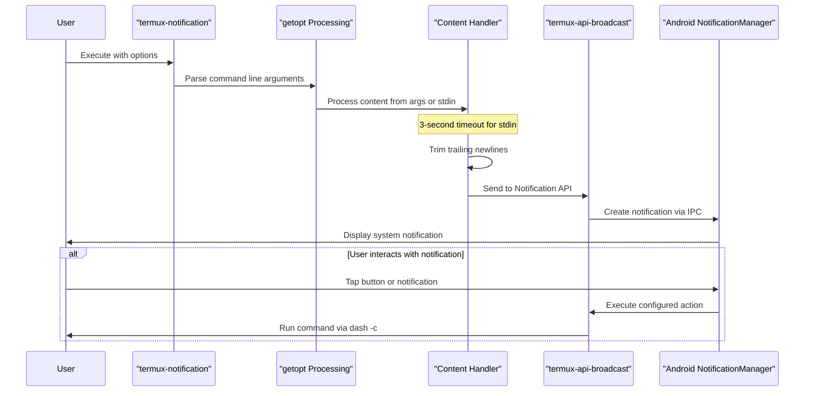
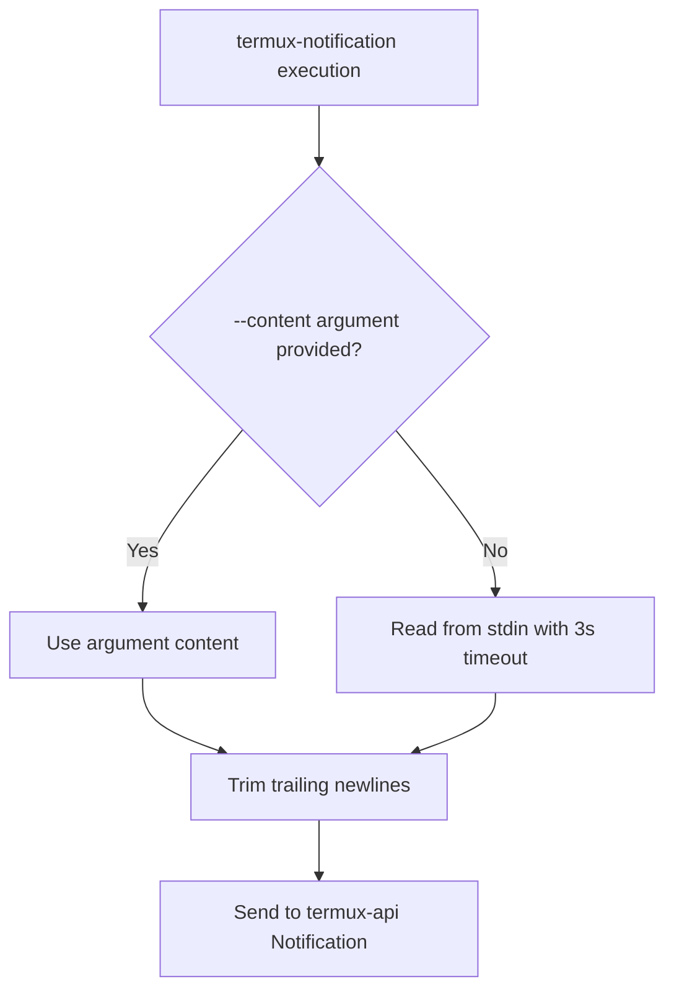
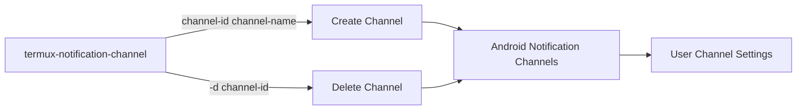
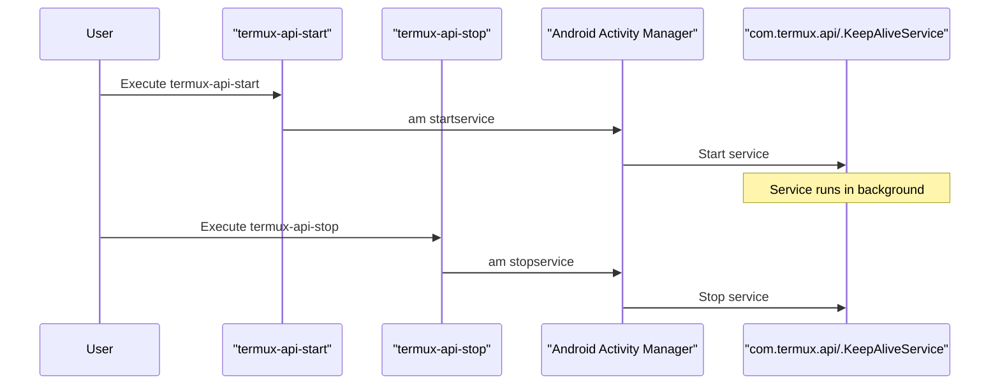
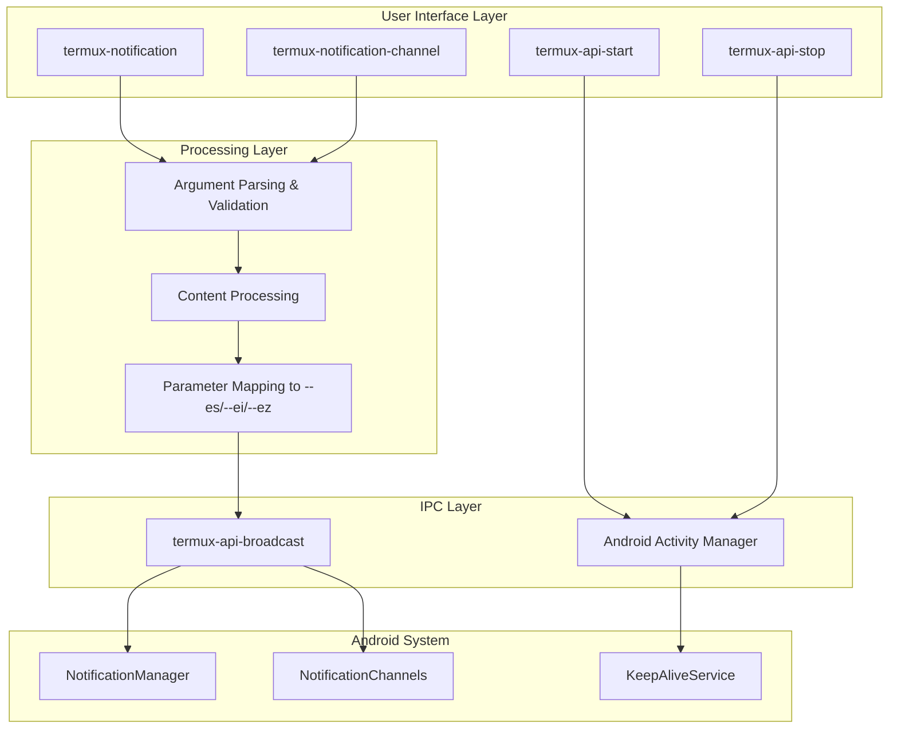

<!-- source: DeepWiki mcp.deepwiki.com · repo termux/termux-api-package · page 4.3 System APIs · fetched 2026-10-26 -->

# System APIs

Relevant source files

The following files were used as context for generating this wiki page:

- [scripts/termux-api-start.in](scripts/termux-api-start.in)
- [scripts/termux-api-stop.in](scripts/termux-api-stop.in)
- [scripts/termux-notification-channel.in](scripts/termux-notification-channel.in)
- [scripts/termux-notification.in](scripts/termux-notification.in)

This document covers the system-level APIs provided by termux-api-package, including notification management, service control, and system information commands. These APIs provide access to Android's system services and user interface components from the command line.

For communication-related APIs like SMS and telephony, see [Communication APIs](#4.1). For hardware-specific APIs like sensors and audio, see [Hardware APIs](#4.2).

## Overview

The system APIs in termux-api-package provide command-line access to Android's system-level functionality. These commands allow users to interact with the notification system, manage the API service lifecycle, and access various system information and control features.

### System API Categories

Sources: [scripts/termux-notification.in:1-216](), [scripts/termux-notification-channel.in:1-38](), [scripts/termux-api-start.in:1-3](), [scripts/termux-api-stop.in:1-3]()

## Notification System

The notification system provides comprehensive access to Android's notification framework through two main commands: `termux-notification` and `termux-notification-channel`.

### Notification Command Structure

The `termux-notification` command supports extensive customization options organized into several categories:

| Category | Options | Purpose |
|----------|---------|---------|
| Content | `--content`, `--title`, `--icon`, `--image-path` | Basic notification content |
| Interactivity | `--button1`, `--button1-action`, `--action`, `--on-delete` | User interaction handlers |
| Visual | `--led-color`, `--led-on`, `--led-off`, `--priority` | Visual appearance |
| Audio | `--sound`, `--vibrate` | Audio and haptic feedback |
| Management | `--id`, `--group`, `--channel`, `--ongoing` | Notification organization |
| Media | `--media-play`, `--media-pause`, `--media-next`, `--media-previous` | Media playback controls |

### Notification Processing Flow

Sources: [scripts/termux-notification.in:115-131](), [scripts/termux-notification.in:206-215]()

### Content Input Handling

The notification system supports flexible content input through multiple mechanisms:

The content handling logic prioritizes command-line arguments over stdin input, implementing a 3-second timeout for stdin reads to prevent blocking behavior.

Sources: [scripts/termux-notification.in:206-215]()

### Action System

The notification system includes a sophisticated action framework that allows notifications to execute shell commands when interacted with:

#### Action Types

- **Primary action**: Executed when notification is tapped
- **Button actions**: Up to 3 buttons with custom text and actions  
- **Media actions**: Play, pause, next, previous for media notifications
- **Delete action**: Executed when notification is dismissed

#### Action Environment

Actions execute in a minimal environment with important considerations:

- Actions run via `dash -c` command execution
- Environment variables (including `$PATH`) are not inherited
- `~/.profile` is not sourced
- Special `$REPLY` variable available for Direct Reply feature (Android N+)

Sources: [scripts/termux-notification.in:55-83]()

### Notification Channels

The `termux-notification-channel` command manages Android 8.0+ notification channels:

Channel operations support:
- Creating channels with custom IDs and names
- Deleting channels by ID
- Restoring user settings when recreating previously deleted channels

Sources: [scripts/termux-notification-channel.in:19-37]()

## Service Management

The API service lifecycle is controlled through two simple commands that interact with the `KeepAliveService` component:

### Service Control Commands

| Command | Function | Implementation |
|---------|----------|----------------|
| `termux-api-start` | Start the API service | `am startservice -n com.termux.api/.KeepAliveService` |
| `termux-api-stop` | Stop the API service | `am stopservice -n com.termux.api/.KeepAliveService` |

### Service Management Flow

The service management commands provide direct control over the Termux API service's lifecycle, allowing users to start or stop the background service that handles API requests.

Sources: [scripts/termux-api-start.in:1-3](), [scripts/termux-api-stop.in:1-3]()

## Implementation Architecture

The system APIs follow the standard termux-api-package architecture, with shell scripts serving as user-facing interfaces that communicate with the Android system through the core IPC mechanism.

### System API Data Flow

The system APIs demonstrate the package's consistent architecture where user-friendly shell scripts handle argument parsing and validation before passing structured data to the core IPC system for Android integration.

Sources: [scripts/termux-notification.in:177-204](), [scripts/termux-notification-channel.in:19-37](), [scripts/termux-api-start.in:2](), [scripts/termux-api-stop.in:2]()

---

