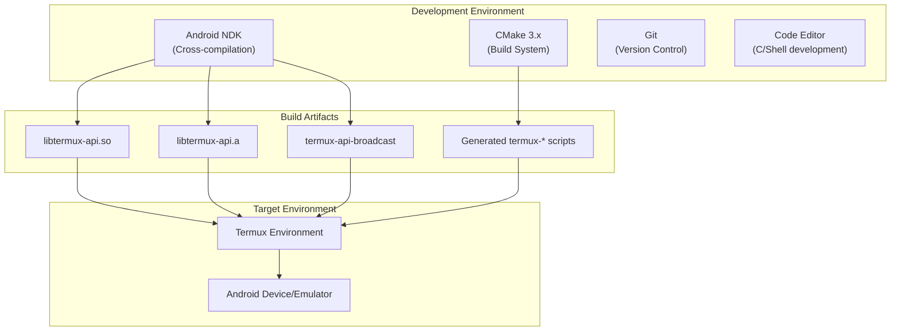
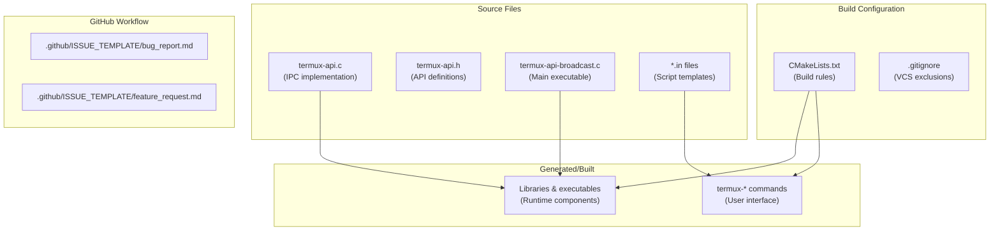
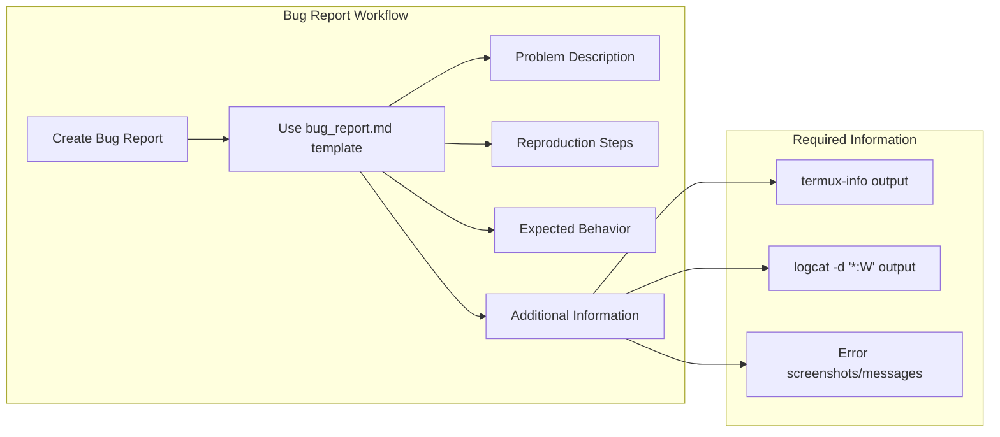
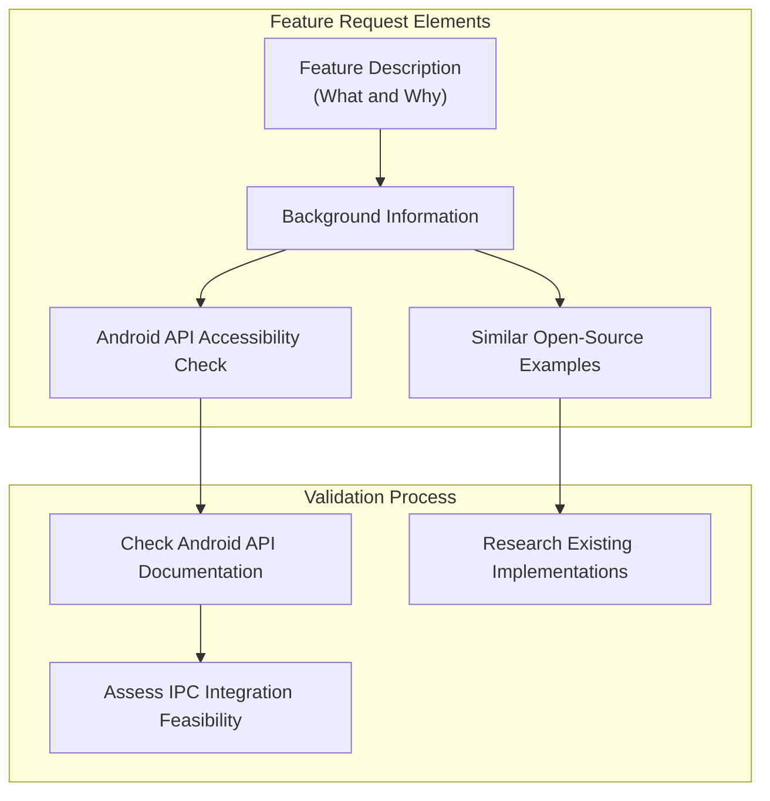
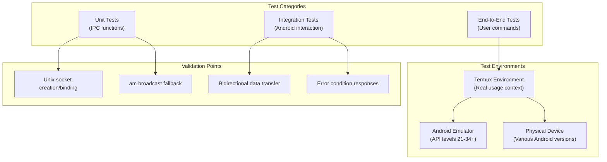
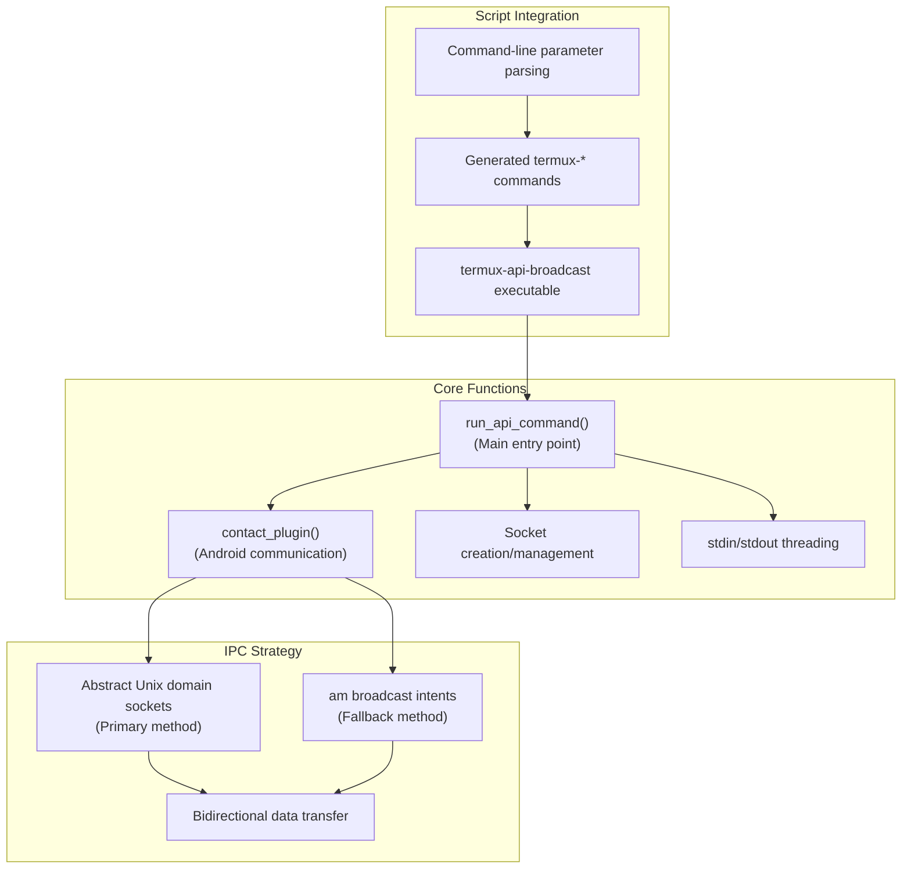
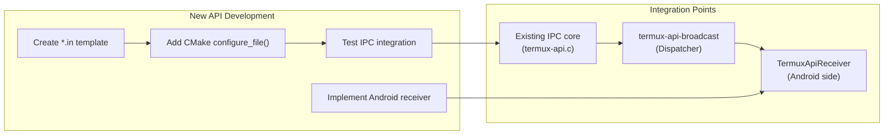
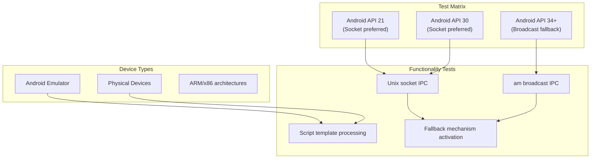

<!-- source: DeepWiki mcp.deepwiki.com · repo termux/termux-api-package · page 5 Development Guide · fetched 2026-10-26 -->

# Development Guide

<details>
<summary>Relevant source files</summary>

The following files were used as context for generating this wiki page:

- [.github/ISSUE_TEMPLATE/bug_report.md](.github/ISSUE_TEMPLATE/bug_report.md)
- [.github/ISSUE_TEMPLATE/feature_request.md](.github/ISSUE_TEMPLATE/feature_request.md)
- [.gitignore](.gitignore)

</details>


This document provides comprehensive guidance for developers contributing to the termux-api-package project. It covers development environment setup, build procedures, contribution workflows, and architectural considerations for extending the API functionality.

For information about the overall system architecture and how components interact, see [System Architecture](#2). For details about the build system configuration, see [Build System](#3).

## Development Environment Setup

Setting up a development environment for termux-api-package requires both Android development tools and a Unix-like build environment that can cross-compile for Android targets.

### Required Tools and Dependencies

The build process relies on CMake for compilation and requires the Android NDK for cross-compilation:



**Development Workflow Dependencies**
- Android NDK for cross-compilation to ARM/x86 Android targets
- CMake 3.x for build configuration and script generation
- Git for version control and patch submission
- Text editor with C syntax highlighting for core library development

Sources: [CMakeLists.txt:1-50]()

### Project Structure for Development

Understanding the codebase organization helps developers navigate and contribute effectively:



Sources: [.gitignore:1-3](), [.github/ISSUE_TEMPLATE/bug_report.md:1-24](), [.github/ISSUE_TEMPLATE/feature_request.md:1-16]()

## Build Process for Development

The development build process involves compiling C libraries and generating shell scripts from templates. Understanding this process is essential for testing changes and adding new functionality.

### CMake Build Configuration

The build system uses CMake to handle both compilation and script generation:

| Build Target | Source | Output | Purpose |
|--------------|--------|---------|---------|
| `libtermux-api.so` | `termux-api.c` | Shared library | Runtime IPC functionality |
| `libtermux-api.a` | `termux-api.c` | Static library | Development linking |
| `termux-api-broadcast` | `termux-api-broadcast.c` | Executable | Core API dispatcher |
| `termux-*` scripts | `*.in` templates | Shell scripts | User command interface |

### Development Build Commands

```bash
# Configure build with development flags
cmake -DCMAKE_BUILD_TYPE=Debug .

# Build all targets
make all

# Install to development prefix
make install DESTDIR=/path/to/test/environment
```

The build process generates approximately 50 command-line utilities from template files, each providing access to specific Android APIs.

Sources: [CMakeLists.txt]()

## Contributing Guidelines

The project uses GitHub issue templates to standardize bug reports and feature requests, ensuring contributors provide necessary information for effective collaboration.

### Bug Reporting Process

When reporting bugs, developers must follow the structured template to provide reproducible issue information:



**Required Bug Report Elements:**
- Clear problem description with error messages or screenshots
- Complete steps to reproduce the issue
- Expected vs actual behavior comparison
- Output from `termux-info` command
- Android logcat output when available (`logcat -d "*:W"`)

Sources: [.github/ISSUE_TEMPLATE/bug_report.md:10-24]()

### Feature Request Process

New feature proposals require validation against Android API availability and implementation feasibility:



**Feature Request Requirements:**
- Detailed feature description explaining the use case
- Verification that required Android APIs are accessible
- Links to similar implementations in other open-source projects
- Assessment of integration complexity with existing IPC mechanism

Sources: [.github/ISSUE_TEMPLATE/feature_request.md:10-16]()

## Testing and Validation

Development testing requires both unit-level validation of IPC functionality and integration testing with actual Android devices or emulators.

### Core IPC Testing Strategy

Testing the critical `run_api_command` function and IPC mechanisms requires careful validation of both Unix socket and broadcast fallback paths:



**Testing Considerations:**
- Test both socket-based and broadcast-based IPC paths
- Validate behavior across different Android API levels
- Verify script template generation produces functional commands
- Test error handling for unreachable Android services

Sources: [termux-api.c](), [termux-api-broadcast.c]()

## Architecture for Development

Understanding the modular architecture helps developers extend functionality and modify existing components without breaking the IPC communication layer.

### Core Function Architecture

The `termux-api.c` library provides the foundational IPC implementation that all API commands utilize:



**Key Development Interface Points:**
- `run_api_command(int argc, char** argv)` - Primary API entry point
- `contact_plugin()` - Android communication handler with dual IPC strategy
- Socket management functions for Unix domain socket creation and binding
- Threading system for bidirectional data transfer management

### Extension Architecture

Adding new API functionality follows a consistent pattern of template creation and CMake integration:



Sources: [termux-api.c](), [termux-api.h](), [termux-api-broadcast.c]()

## Release Process

The development workflow involves careful validation of cross-platform compatibility and integration with the broader Termux ecosystem.

### Version Management and Compatibility

Release preparation requires testing across multiple Android API levels and device configurations to ensure the dual IPC strategy functions correctly:

| Component | Compatibility Requirement | Testing Focus |
|-----------|---------------------------|---------------|
| Unix sockets | Android API < 34 | Socket creation and binding |
| am broadcast | All Android versions | Intent delivery and response |
| Generated scripts | All shell environments | Parameter parsing and execution |
| C libraries | ARM/x86 architectures | Cross-compilation validation |

### Integration Testing Matrix

Before release, comprehensive testing validates the IPC mechanism across different Android configurations:



Sources: [CMakeLists.txt](), [.github/ISSUE_TEMPLATE/]()