# Page: Introduction

# Introduction

<details>
<summary>Relevant source files</summary>

The following files were used as context for generating this wiki page:

- [CMakeLists.txt](CMakeLists.txt)
- [LICENSE](LICENSE)
- [README.md](README.md)
- [termux-callback.in](termux-callback.in)

</details>


## Purpose and Scope

This document provides technical documentation for the `termux-api-package` repository, which implements command-line access to Android APIs within the Termux terminal environment. The package serves as a bridge between shell scripts and Android system functionality, enabling users to interact with device hardware and services through standard Unix command-line interfaces.

This introduction covers the overall system architecture and key components. For detailed information about the build system, see [Build System](#3). For documentation of specific API commands, see [API Commands](#4). For the core inter-process communication mechanism, see [Core IPC Mechanism](#2.1).

## System Overview

The `termux-api-package` provides approximately 50 command-line utilities that expose Android APIs to shell environments. Each utility follows the pattern `termux-<functionality>` (e.g., `termux-battery-status`, `termux-camera-photo`) and communicates with Android system services through a sophisticated IPC mechanism.

### Core Components

| Component | File | Purpose |
|-----------|------|---------|
| C Library | `termux-api.c` | Core IPC engine handling communication with Android |
| Main Executable | `termux-api-broadcast` | Primary interface for API command execution |
| Header Interface | `termux-api.h` | C library API definitions |
| Script Templates | `scripts/*.in` | Template files for generating user commands |
| Build System | `CMakeLists.txt` | CMake configuration for compilation and installation |

## Architecture Overview

### System Components and Data Flow

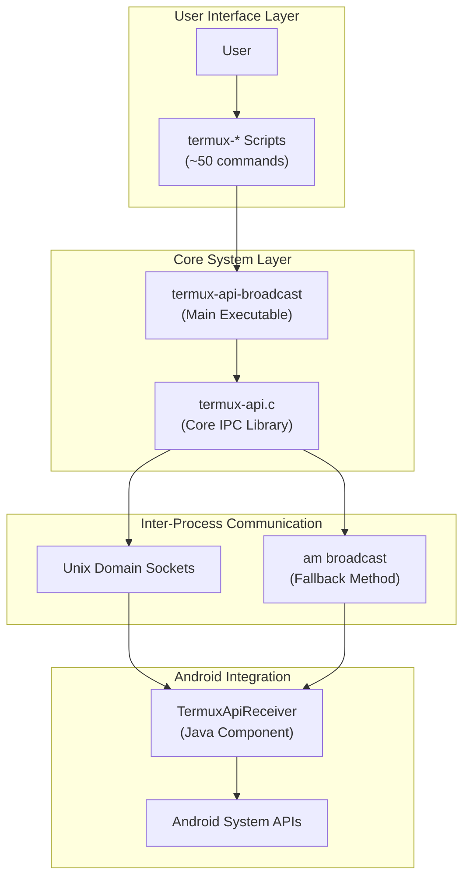

Sources: [CMakeLists.txt:15-73](), architectural diagrams provided in context

### Code Entity Relationships

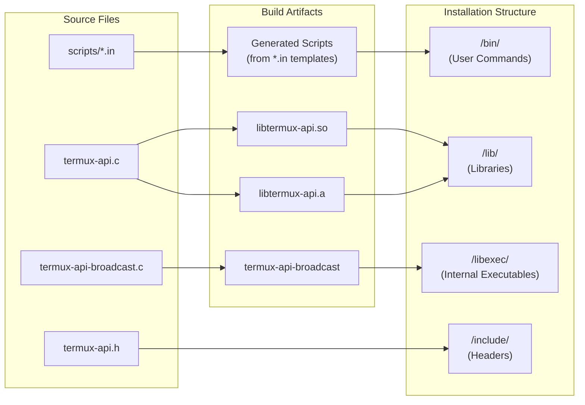

Sources: [CMakeLists.txt:7-12](), [CMakeLists.txt:88-131]()

## Key Functionality Categories

The package provides access to Android functionality across several domains:

### Communication APIs
- `termux-sms-list`, `termux-sms-send` - SMS management
- `termux-call-log`, `termux-telephony-call` - Telephony operations
- `termux-telephony-deviceinfo`, `termux-telephony-cellinfo` - Device information

### Hardware Access APIs  
- `termux-camera-photo`, `termux-camera-info` - Camera operations
- `termux-microphone-record`, `termux-audio-info` - Audio functionality
- `termux-sensor`, `termux-torch` - Hardware sensors and controls
- `termux-usb`, `termux-nfc` - Device connectivity

### System Integration APIs
- `termux-notification`, `termux-toast` - User interface elements
- `termux-battery-status`, `termux-volume` - System status
- `termux-clipboard-get`, `termux-clipboard-set` - System clipboard
- `termux-storage-get`, `termux-saf-*` - File system access

Sources: [CMakeLists.txt:15-73]()

## IPC Strategy

The system employs a dual-strategy approach for communicating with Android APIs:

1. **Primary Method**: Unix domain sockets for efficient bidirectional communication
2. **Fallback Method**: Android `am broadcast` commands for compatibility with newer API levels

This design ensures reliable operation across different Android versions while maintaining optimal performance where possible. The `run_api_command` function in `termux-api.c` orchestrates this communication strategy.

## Integration with Termux Ecosystem

The `termux-api-package` requires the companion **Termux:API** Android application, which contains the `TermuxApiReceiver` Java component that actually interfaces with Android system APIs. The package serves as the command-line frontend while the Android app provides the backend implementation.

The `termux-callback` mechanism enables bidirectional communication, allowing Android components to trigger shell script execution through the `TERMUX_CALLBACK` environment variable.

Sources: [termux-callback.in:1-4](), [README.md:1-3]()

---

# Page: System Architecture

# System Architecture

<details>
<summary>Relevant source files</summary>

The following files were used as context for generating this wiki page:

- [CMakeLists.txt](CMakeLists.txt)
- [termux-api-broadcast.c](termux-api-broadcast.c)
- [termux-api.c](termux-api.c)
- [termux-api.h](termux-api.h)
- [termux-callback.in](termux-callback.in)

</details>


This document explains the high-level architecture of the termux-api-package, showing how shell scripts, C libraries, and Android components work together to provide command-line access to Android APIs within the Termux environment. The architecture implements a sophisticated inter-process communication (IPC) system that bridges the gap between C programs and Android's Java-based API layer.

For detailed information about the IPC mechanisms, see [Core IPC Mechanism](#2.1). For the C library interface documentation, see [C Library API](#2.2). For build system details, see [Build System](#3).

## System Overview

The termux-api-package implements a multi-layer architecture that transforms user commands into Android API calls through a series of well-defined components. The system consists of generated shell scripts, a core C library, and integration with Android's broadcast mechanism.

### High-Level Component Architecture

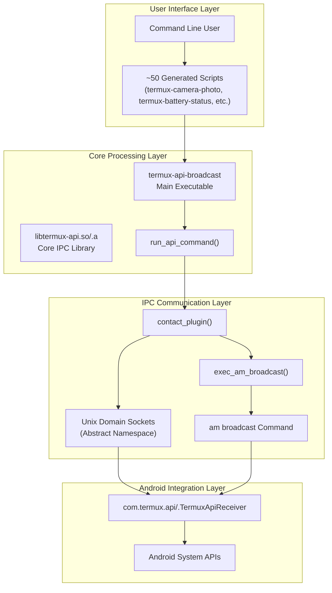

Sources: [termux-api.c:380-465](), [termux-api-broadcast.c:16-23](), [CMakeLists.txt:15-73]()

## Core Components

### Main Executable: termux-api-broadcast

The `termux-api-broadcast` executable serves as the primary entry point for all API operations. It implements a minimal wrapper around the core library functionality.

| Component | Purpose | Key Function |
|-----------|---------|--------------|
| `main()` | Entry point and file descriptor handling | [termux-api-broadcast.c:16-23]() |
| `run_api_command()` | Core orchestration logic | [termux-api.c:380-465]() |
| `exec_callback()` | Handle file descriptor callbacks | [termux-api.c:294-316]() |

### Core IPC Library: termux-api.c

The heart of the system is the IPC library that manages communication between C programs and Android components. This library implements a dual-strategy approach for maximum compatibility across Android versions.

### IPC Strategy Decision Flow

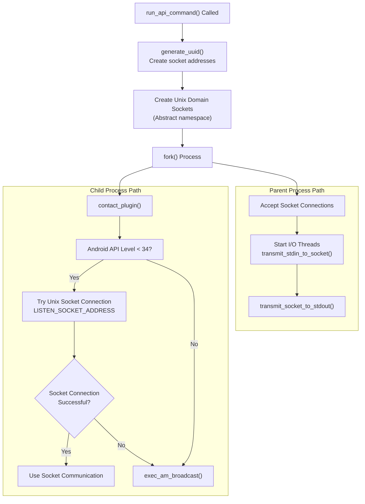

Sources: [termux-api.c:36-236](), [termux-api.c:238-292](), [termux-api.c:380-465]()

## Communication Architecture

### Socket Communication System

The system uses abstract Unix domain sockets for efficient bidirectional communication. Each API call generates unique socket addresses using UUIDs to prevent conflicts.

| Function | Purpose | Key Operations |
|----------|---------|----------------|
| `generate_uuid()` | Create unique socket addresses | [termux-api.c:318-330]() |
| `transmit_stdin_to_socket()` | Forward stdin to Android component | [termux-api.c:332-349]() |
| `transmit_socket_to_stdout()` | Forward Android output to stdout | [termux-api.c:351-378]() |

### Broadcast Fallback Mechanism

When socket communication fails (typically on Android API ≥ 34), the system automatically falls back to using Android's `am broadcast` command.

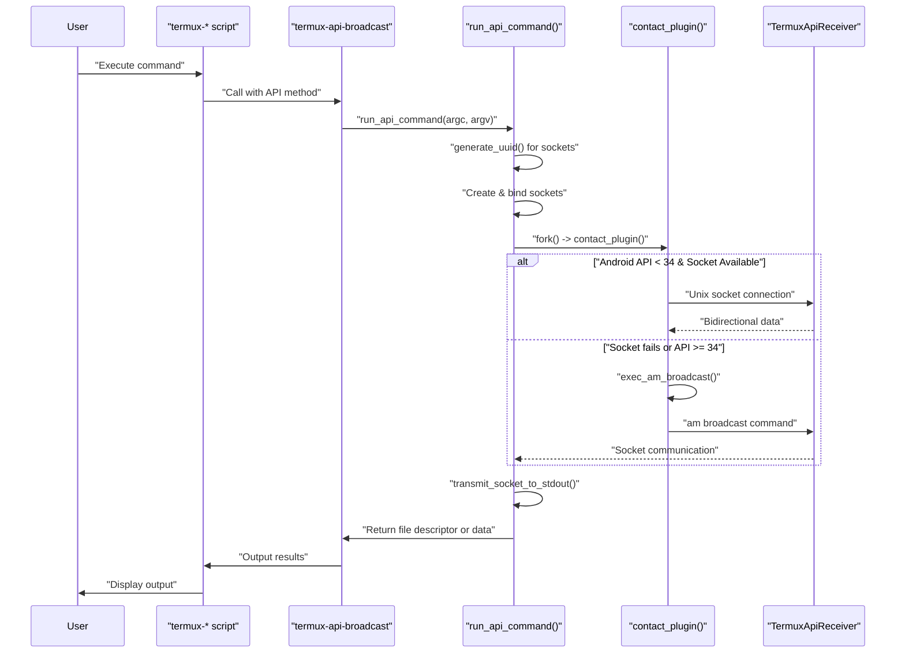

Sources: [termux-api.c:53-65](), [termux-api.c:238-292](), [termux-api.c:444-465]()

## Build System Integration

The build system generates all user-facing scripts from templates and creates the necessary library artifacts.

### Component Generation Process

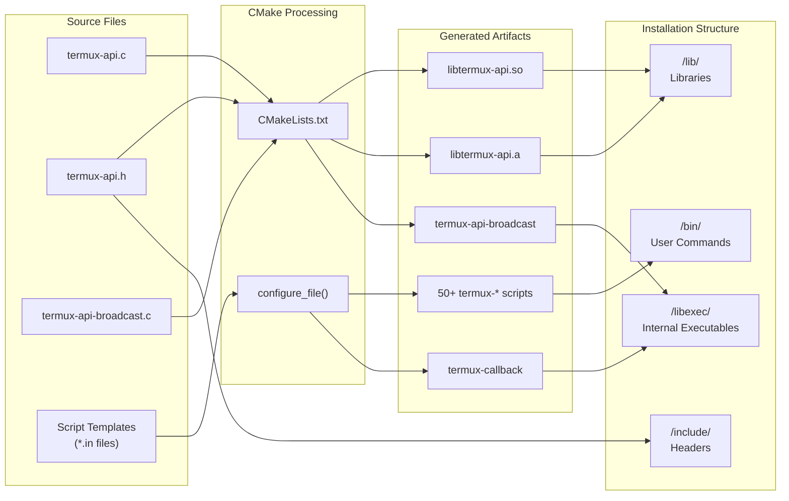

### Script Generation Details

The build system processes 50+ script templates to create user-facing commands:

| Script Category | Examples | Template Processing |
|-----------------|----------|-------------------|
| Communication | `termux-sms-send`, `termux-call-log` | [CMakeLists.txt:54-59]() |
| Hardware | `termux-camera-photo`, `termux-sensor` | [CMakeLists.txt:22-23, 52]() |
| System | `termux-battery-status`, `termux-volume` | [CMakeLists.txt:19, 68]() |
| Storage | `termux-saf-*` family | [CMakeLists.txt:43-51]() |

Sources: [CMakeLists.txt:15-81](), [CMakeLists.txt:117-123]()

## Key Constants and Addresses

The system relies on several critical constants for proper operation:

| Constant | Value | Purpose |
|----------|-------|---------|
| `LISTEN_SOCKET_ADDRESS` | `"com.termux.api://listen"` | Primary socket address for Android communication |
| `TERMUX_API_PACKAGE_VERSION` | `"0.59.1"` | Version identification |
| Android Target | `"com.termux.api/.TermuxApiReceiver"` | Broadcast receiver component |

Sources: [termux-api.c:25](), [termux-api.c:31](), [termux-api.c:268]()

---

# Page: Core IPC Mechanism

# Core IPC Mechanism

<details>
<summary>Relevant source files</summary>

The following files were used as context for generating this wiki page:

- [termux-api.c](termux-api.c)

</details>


This document describes the inter-process communication (IPC) system that forms the backbone of the termux-api-package. The IPC mechanism handles all communication between C programs and Android APIs, implementing a sophisticated dual-strategy approach with Unix domain sockets as the primary method and Android broadcast intents as a fallback.

For information about the high-level system architecture, see [System Architecture](#2). For details about the C library interface that wraps this IPC mechanism, see [C Library API](#2.2).

## Overview

The core IPC mechanism is implemented in `termux-api.c` and provides the fundamental communication layer between the Termux environment and Android's Java-based API system. The system uses a dual-strategy approach to ensure reliable communication across different Android versions and system states.

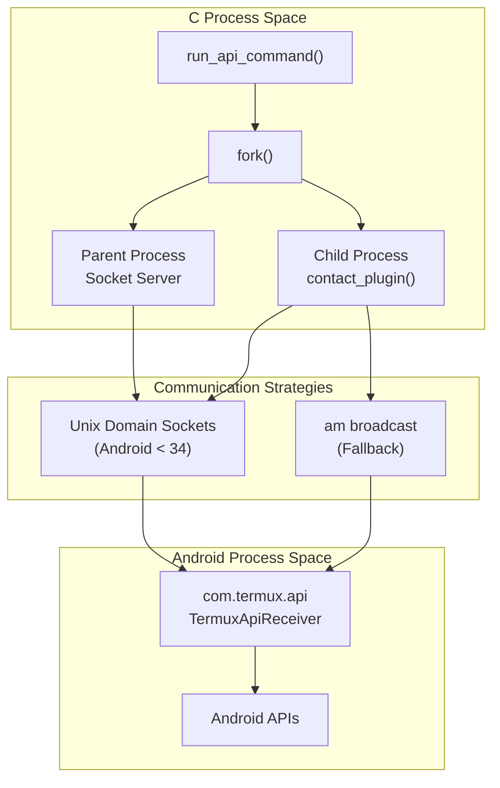

**IPC Strategy Selection Flow**
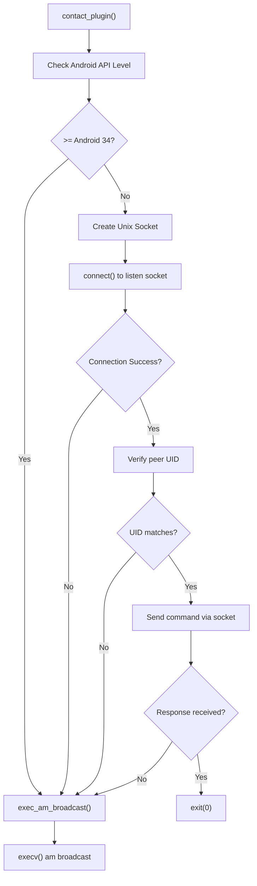

Sources: [termux-api.c:36-236](), [termux-api.c:63-67](), [termux-api.c:238-292]()

## Socket-Based Communication

The primary IPC mechanism uses Unix domain sockets in the abstract namespace. The system creates two bidirectional sockets: one for input (plugin → C program) and one for output (C program → plugin).

### Socket Architecture

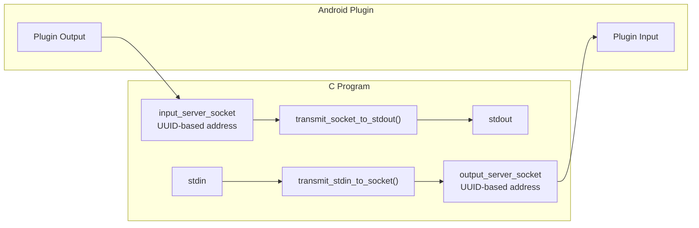

### Socket Creation and Binding

The system generates UUID-based addresses for abstract Unix domain sockets:

| Socket Type | Purpose | Function |
|-------------|---------|----------|
| `input_server_socket` | Receives data from Android | `transmit_socket_to_stdout()` |
| `output_server_socket` | Sends data to Android | `transmit_stdin_to_socket()` |

The socket addresses use abstract namespace (first byte is null) with UUID strings:
- Input address: Generated by `generate_uuid()` for `input_addr_str`
- Output address: Generated by `generate_uuid()` for `output_addr_str`

Sources: [termux-api.c:395-442](), [termux-api.c:318-330](), [termux-api.c:401-406]()

## Fallback Mechanism

When Unix domain sockets fail or are unavailable (Android API ≥ 34), the system falls back to Android's `am broadcast` command. This mechanism uses Android's Intent system to communicate with the `TermuxApiReceiver`.

### Broadcast Command Construction

The `exec_am_broadcast()` function constructs an `am broadcast` command with the following structure:

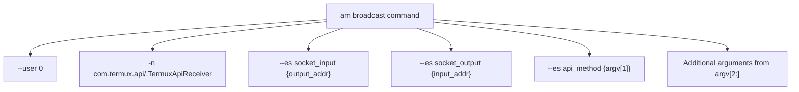

### Argument Processing

The broadcast mechanism handles argument escaping and string extra formatting:

| Argument Type | Processing | Example |
|---------------|------------|---------|
| `--es` string extras | Quoted and escaped | `--es "key" "value with \"quotes\""` |
| Regular arguments | Direct copy | `--ei count 5` |
| API method | First argument after executable | `battery-status` |

Sources: [termux-api.c:238-292](), [termux-api.c:249-283]()

## Process and Threading Model

The IPC system uses a fork-based process model with threading for bidirectional communication.

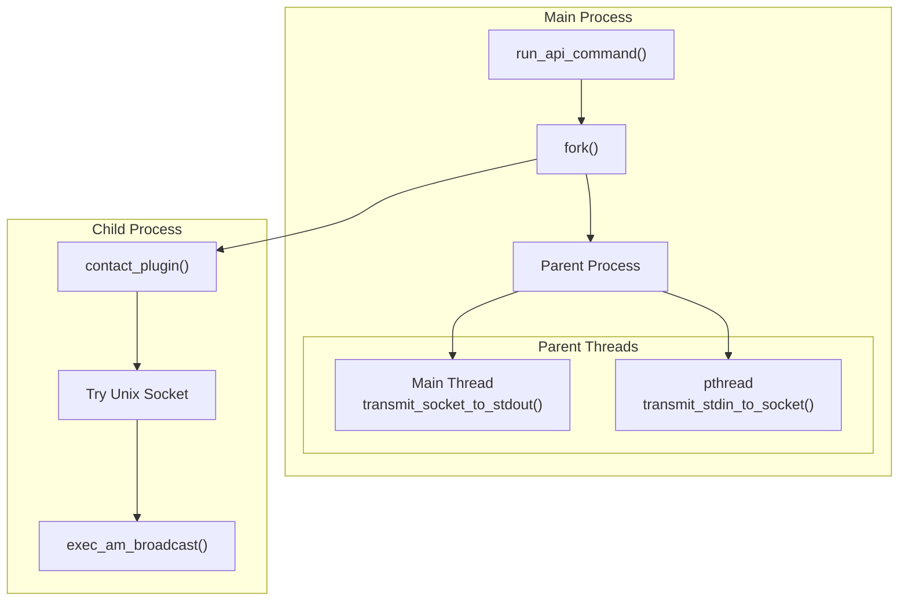

### Thread Responsibilities

| Thread | Function | Responsibility |
|--------|----------|---------------|
| Main | `transmit_socket_to_stdout()` | Read from input socket, write to stdout |
| Worker | `transmit_stdin_to_socket()` | Read from stdin, write to output socket |
| Child | `contact_plugin()` | Contact Android plugin via socket or broadcast |

### Socket Accept and Data Flow

The parent process accepts connections on both sockets:
1. Input socket accepts connection from Android plugin
2. Output socket accepts connection from worker thread
3. Data flows bidirectionally through established connections

Sources: [termux-api.c:444-464](), [termux-api.c:332-349](), [termux-api.c:351-378]()

## File Descriptor Handling

The IPC mechanism supports file descriptor passing using the `SCM_RIGHTS` mechanism for Unix domain sockets. This enables Android APIs to pass file descriptors (e.g., USB device handles) back to C programs.

### File Descriptor Reception

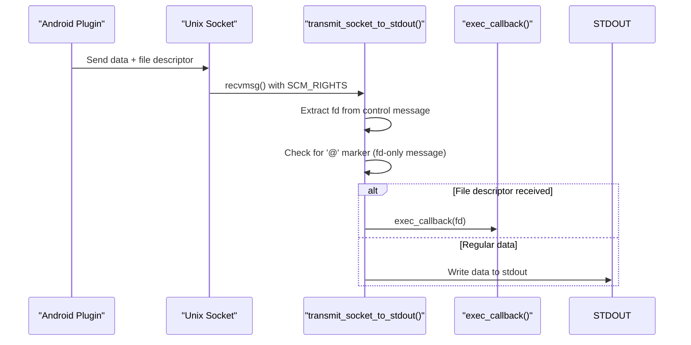

### File Descriptor Processing

The system uses `recvmsg()` with control message handling:

| Component | Purpose | Implementation |
|-----------|---------|----------------|
| `struct msghdr` | Message header for `recvmsg()` | Contains control buffer for ancillary data |
| `struct cmsghdr` | Control message header | Identifies `SCM_RIGHTS` type |
| `CMSG_DATA()` | Extract file descriptor | Returns pointer to the passed file descriptor |

Special handling for file descriptor messages:
- '@' character indicates file descriptor without output data
- `exec_callback()` handles file descriptor processing
- Environment variable `TERMUX_EXPORT_FD` controls export behavior

Sources: [termux-api.c:351-378](), [termux-api.c:294-316](), [termux-api.c:363-378]()

## UUID Generation Strategy

The system generates unique socket addresses using a custom UUID implementation based on `arc4random()` and process information.

### UUID Format

The `generate_uuid()` function creates addresses in the format:
```
{random64}-{pid}-{version}-{variant}-{random96}
```

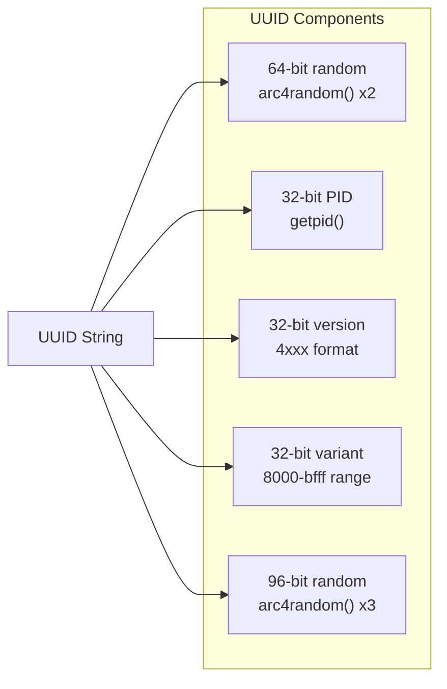

### Address Uniqueness

The UUID generation ensures uniqueness through:
- Process ID inclusion prevents collision within same time window
- Multiple random components reduce collision probability
- UUID version 4 compliance for standardization

The generated UUIDs are used as abstract Unix domain socket addresses, ensuring each IPC session has unique socket endpoints.

Sources: [termux-api.c:318-330](), [termux-api.c:398-399]()

---

# Page: C Library API

# C Library API

<details>
<summary>Relevant source files</summary>

The following files were used as context for generating this wiki page:

- [termux-api-broadcast.c](termux-api-broadcast.c)
- [termux-api.h](termux-api.h)

</details>


This document covers the C library interface that provides the core functionality for the termux-api-package system. The C library API serves as the foundation for all termux-api commands, handling inter-process communication between user commands and Android APIs through a sophisticated dual-strategy IPC mechanism.

For information about the underlying IPC mechanisms and communication strategies, see [Core IPC Mechanism](#2.1). For details about the user-facing API commands that utilize this library, see [API Commands](#4).

## Overview

The C Library API consists of two primary components:

- **Header Interface** (`termux-api.h`): Defines the public C API functions used by all termux-api components
- **Main Executable** (`termux-api-broadcast`): Provides the primary entry point that shell scripts use to access the library functionality

The library handles the complex task of establishing bidirectional communication between C programs running in Termux and Android's Java-based API system, using Unix domain sockets as the preferred method with am broadcast as a fallback strategy.

## Header Interface

The public C API is defined in [termux-api.h:1-22](), which provides a clean interface for accessing the core IPC functionality.

### Function Categories

The API functions fall into several logical categories:

| Category | Functions | Purpose |
|----------|-----------|---------|
| **Process Execution** | `exec_am_broadcast`, `contact_plugin`, `exec_callback` | Handle different execution strategies and callback processing |
| **Socket Communication** | `transmit_stdin_to_socket`, `transmit_socket_to_stdout` | Manage bidirectional data flow between processes and sockets |
| **Utility Functions** | `generate_uuid` | Generate unique identifiers for socket addresses |
| **Main Entry Point** | `run_api_command` | Primary function that orchestrates the entire API call process |

### Core Function Interface

#### Core API Function Interface

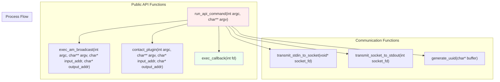

Sources: [termux-api.h:10-16]()

The header file uses several important design patterns:

- **C++ Compatibility**: Wrapped in `extern "C"` blocks for C++ interoperability [termux-api.h:6-8](), [termux-api.h:18-20]()
- **No-return Functions**: Functions like `exec_am_broadcast`, `contact_plugin`, and `exec_callback` are marked with `_Noreturn` attribute [termux-api.h:10-12]()
- **Standard Library Integration**: Includes `<stdlib.h>` for standard library functionality [termux-api.h:4]()

## Main Executable

The `termux-api-broadcast` executable serves as the primary interface between shell scripts and the C library. Its implementation is deliberately minimal, focusing on delegation to the core library functions.

### Executable Architecture

#### termux-api-broadcast Execution Flow

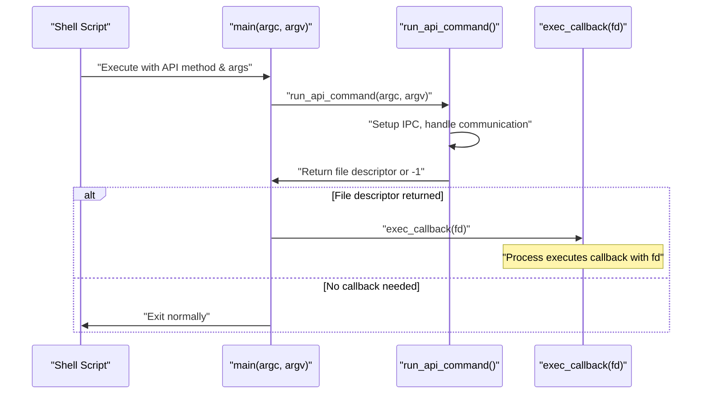

Sources: [termux-api-broadcast.c:16-23]()

The main function's logic is straightforward:

1. **Delegate to Core**: Calls `run_api_command` with command-line arguments [termux-api-broadcast.c:18]()
2. **Handle Callbacks**: If a file descriptor is returned, executes the appropriate callback [termux-api-broadcast.c:20]()
3. **Clean Exit**: Returns 0 on successful completion [termux-api-broadcast.c:22]()

### Usage Pattern

The executable is designed to be called with a specific pattern as documented in the source comments [termux-api-broadcast.c:1-12]():

```
termux-api ${API_METHOD} ${ADDITIONAL_FLAGS}
```

This translates internally to Android broadcast commands with socket addresses for bidirectional communication.

## Integration with Build System

The C Library API integrates with the broader build system to provide both static and shared library variants:

### Library Build Products

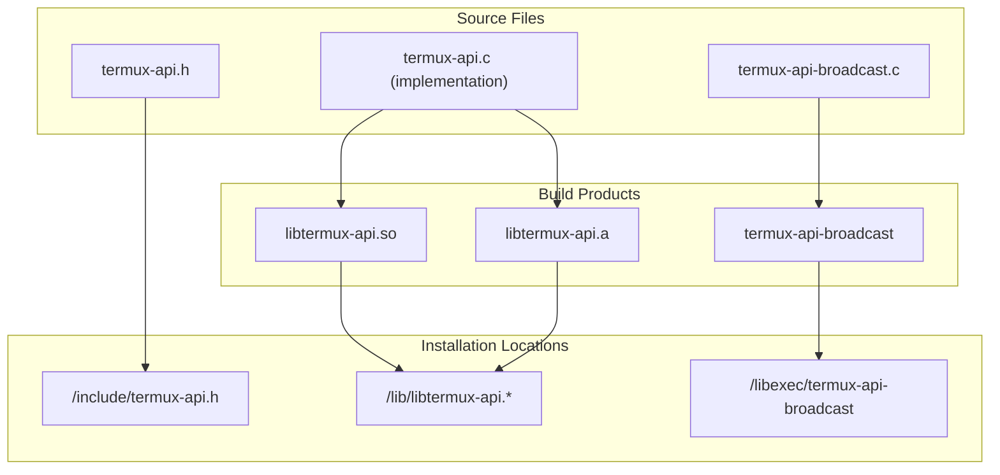

Sources: Based on system architecture analysis

The library provides multiple integration options:
- **Header Installation**: Public interface available for external C/C++ programs
- **Shared Library**: Runtime linking for dynamic applications
- **Static Library**: Compile-time linking for standalone applications
- **Executable**: Ready-to-use command-line interface

## Function Responsibilities

The C Library API functions each have specific responsibilities within the larger IPC system:

| Function | Responsibility | Return Behavior |
|----------|----------------|-----------------|
| `run_api_command` | Orchestrates entire API call process, manages socket creation and communication | Returns file descriptor for callbacks or -1 |
| `exec_am_broadcast` | Executes Android am broadcast command as fallback IPC method | No return (`_Noreturn`) |
| `contact_plugin` | Attempts Unix socket connection to Android plugin | No return (`_Noreturn`) |
| `exec_callback` | Processes file descriptor-based callbacks from API responses | No return (`_Noreturn`) |
| `transmit_stdin_to_socket` | Handles stdin→socket data transmission in separate thread | Returns void pointer |
| `transmit_socket_to_stdout` | Handles socket→stdout data transmission in main thread | Returns integer status |
| `generate_uuid` | Creates unique socket addresses for IPC | Void function, modifies buffer |

Sources: [termux-api.h:10-16]()

This design ensures clean separation of concerns while providing a unified interface for the complex underlying IPC mechanisms that bridge the C environment with Android's Java-based APIs.

---

# Page: Build System

# Build System

<details>
<summary>Relevant source files</summary>

The following files were used as context for generating this wiki page:

- [CMakeLists.txt](CMakeLists.txt)
- [termux-callback.in](termux-callback.in)

</details>


This document explains the CMake-based build system used to compile the termux-api library, generate user-facing scripts, and manage installation across the Termux environment. The build system handles both C compilation and template processing to create the complete package of API access tools.

For information about the runtime behavior of the compiled components, see [Core IPC Mechanism](#2.1). For details about the generated C library interface, see [C Library API](#2.2).

## Overview

The build system is implemented using CMake and performs several key functions:

- Compiles the core `termux-api.c` source into both shared and static libraries
- Builds the `termux-api-broadcast` executable that serves as the main IPC coordinator
- Processes template files (`.in` files) to generate approximately 55 user-facing command scripts
- Manages installation layout across standard Unix directories (`bin`, `lib`, `libexec`, `include`)
- Handles backwards compatibility through symbolic linking

## Build Configuration

### CMake Structure

The primary build configuration is defined in a single `CMakeLists.txt` file that uses CMake 3.0.0 minimum requirements.

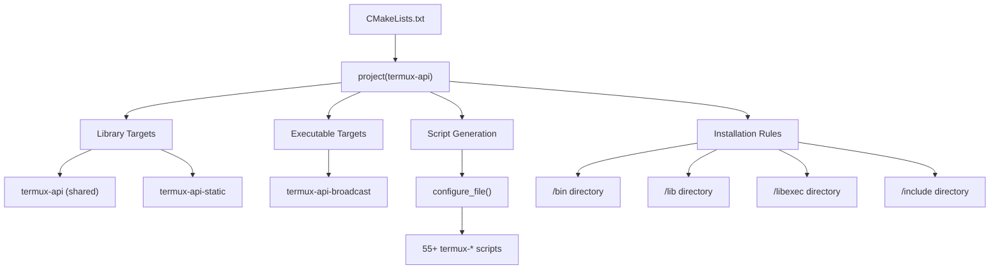

**Sources:** [CMakeLists.txt:1-3]()

### Build Variables

The build system establishes key variables that control compilation and installation paths:

| Variable | Purpose | Value |
|----------|---------|-------|
| `TERMUX_PREFIX` | Installation prefix for all components | `${CMAKE_INSTALL_PREFIX}` |
| `script_files` | List of all template scripts to process | Array of 55+ script paths |

**Sources:** [CMakeLists.txt:5](), [CMakeLists.txt:15-73]()

## Compilation Targets

### Library Compilation

The build system creates two library variants from the same source file:

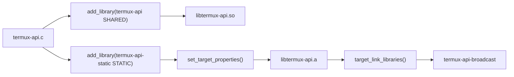

**Library Target Configuration:**
- **Shared Library**: `termux-api` target produces `libtermux-api.so`
- **Static Library**: `termux-api-static` target produces `libtermux-api.a` 
- **Output Name Override**: Static library uses `OUTPUT_NAME termux-api` property to match naming convention

**Sources:** [CMakeLists.txt:7-9]()

### Executable Compilation  

The main executable is built with static linking to ensure portability:

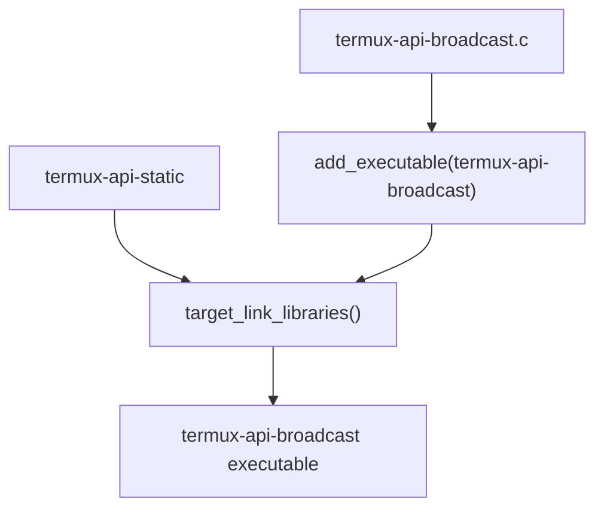

**Sources:** [CMakeLists.txt:11-12]()

## Script Generation System

### Template Processing

The build system uses CMake's `configure_file()` function to process template files and generate executable scripts:

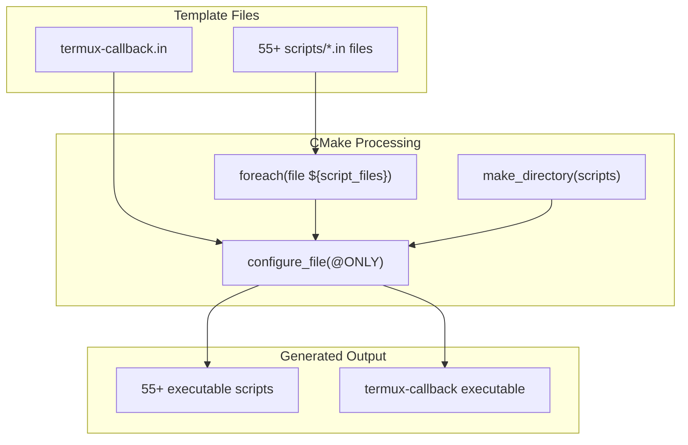

**Template Variable Substitution:**
- `@TERMUX_PREFIX@` is replaced with the installation prefix in all template files
- Templates use the `@ONLY` mode to prevent CMake from processing other variable formats

**Sources:** [CMakeLists.txt:75-81](), [CMakeLists.txt:83-86](), [termux-callback.in:1]()

### Script Categories

The build system processes scripts organized by functional categories:

| Category | Example Scripts | Count |
|----------|----------------|-------|
| **Service Control** | `termux-api-start`, `termux-api-stop` | 2 |
| **Hardware Access** | `termux-camera-photo`, `termux-microphone-record`, `termux-sensor` | 8 |
| **Communication** | `termux-sms-send`, `termux-call-log`, `termux-telephony-call` | 6 |
| **Storage/Files** | `termux-saf-*`, `termux-storage-get`, `termux-share` | 10 |
| **System Info** | `termux-battery-status`, `termux-wifi-connectioninfo` | 8 |
| **User Interface** | `termux-notification*`, `termux-dialog`, `termux-toast` | 6 |
| **Media** | `termux-media-player`, `termux-tts-speak` | 4 |
| **Other** | `termux-clipboard-*`, `termux-location`, etc. | 11+ |

**Sources:** [CMakeLists.txt:15-73]()

## Installation Structure

### Directory Layout

The installation system follows standard Unix directory conventions:

```mermaid
graph TD
    InstallPrefix["${CMAKE_INSTALL_PREFIX}"] --> BinDir["/bin"]
    InstallPrefix --> LibDir["/lib"] 
    InstallPrefix --> LibexecDir["/libexec"]
    InstallPrefix --> IncludeDir["/include"]
    
    BinDir --> UserScripts["55+ termux-* commands<br/>(user-facing)"]
    
    LibDir --> SharedLibrary["libtermux-api.so"]
    LibDir --> StaticLibrary["libtermux-api.a"]
    
    LibexecDir --> BroadcastExec["termux-api-broadcast<br/>(internal executable)"]
    LibexecDir --> CallbackExec["termux-callback<br/>(callback handler)"]
    LibexecDir --> CompatSymlink["termux-api -> termux-api-broadcast<br/>(backwards compatibility)"]
    
    IncludeDir --> HeaderFile["termux-api.h<br/>(C interface)"]
```

**Sources:** [CMakeLists.txt:88-94](), [CMakeLists.txt:105-115](), [CMakeLists.txt:117-123](), [CMakeLists.txt:125-131]()

### Installation Rules

The build system defines specific installation rules for each component type:

| Component | Destination | Permissions | Purpose |
|-----------|-------------|-------------|---------|
| **User Scripts** | `${CMAKE_INSTALL_PREFIX}/bin` | `755` (executable) | Direct user access |
| **Libraries** | Standard lib directory | Default | Linking and runtime |
| **Internal Executables** | `${CMAKE_INSTALL_PREFIX}/libexec` | `755` (executable) | System components |
| **Headers** | Standard include directory | Default | Development interface |

**Backwards Compatibility:**
The build system creates a symbolic link `termux-api -> termux-api-broadcast` in the `libexec` directory to maintain compatibility with older references.

**Sources:** [CMakeLists.txt:96-103]()

## Build Process Flow

### Complete Build Sequence  

```mermaid
sequenceDiagram
    participant Dev as Developer
    participant CMake as CMake System
    participant Compiler as C Compiler
    participant Templates as Template Engine
    participant Install as Installation
    
    Dev->>CMake: cmake .
    CMake->>CMake: Process CMakeLists.txt
    CMake->>CMake: Configure build targets
    
    Dev->>CMake: make
    CMake->>Compiler: Compile termux-api.c (shared)
    CMake->>Compiler: Compile termux-api.c (static) 
    CMake->>Compiler: Compile termux-api-broadcast.c
    Compiler->>CMake: Link termux-api-broadcast with static lib
    
    CMake->>Templates: Process 55+ *.in template files
    Templates->>CMake: Generate executable scripts
    CMake->>Templates: Process termux-callback.in
    Templates->>CMake: Generate termux-callback
    
    Dev->>Install: make install
    Install->>Install: Copy libraries to lib directory
    Install->>Install: Copy executable to libexec directory  
    Install->>Install: Copy scripts to bin directory
    Install->>Install: Copy header to include directory
    Install->>Install: Create compatibility symlink
```

**Sources:** [CMakeLists.txt:1-132]()

The build system ensures that all components are properly compiled, linked, and installed in their appropriate locations to create a fully functional termux-api package.

---

# Page: API Commands

# API Commands

<details>
<summary>Relevant source files</summary>

The following files were used as context for generating this wiki page:

- [CMakeLists.txt](CMakeLists.txt)
- [scripts/termux-usb.in](scripts/termux-usb.in)
- [termux-callback.in](termux-callback.in)

</details>


This document provides an overview of the user-facing command-line utilities in the termux-api-package that provide access to Android functionality. These are the primary interface through which users interact with Android APIs from the Termux terminal environment.

For detailed information about how these commands communicate with Android, see [Core IPC Mechanism](#2.1). For information about the build process that generates these commands, see [Build System](#3).

## Command Structure and Organization

The termux-api-package provides approximately 50 command-line utilities, all following the naming convention `termux-*`. These commands are generated from template files during the build process and installed to the system's binary directory for direct user execution.

### Generated Command Structure

All API commands are generated from template files using CMake's `configure_file()` function. The build system processes template files with the `.in` extension to create executable bash scripts.

```mermaid
graph LR
    subgraph "Build Process"
        A["script_files list<br/>(CMakeLists.txt:15-73)"] --> B["Template Files<br/>(*.in)"]
        B --> C["configure_file()<br/>(CMakeLists.txt:77-81)"]
        C --> D["Generated Scripts<br/>(executable bash)"]
    end
    
    subgraph "Installation"
        D --> E["${CMAKE_INSTALL_PREFIX}/bin<br/>(CMakeLists.txt:117-123)"]
    end
    
    subgraph "Runtime Execution"
        E --> F["User Command"]
        F --> G["termux-api-broadcast<br/>(libexec)"]
        G --> H["Android IPC"]
    end
```

Sources: [CMakeLists.txt:15-73](), [CMakeLists.txt:77-81](), [CMakeLists.txt:117-123]()

## Command Categories

The API commands are organized into functional categories that correspond to different Android subsystems:

| Category | Command Count | Purpose |
|----------|---------------|---------|
| Communication | 7 | SMS, telephony, call logs |
| Hardware Access | 8 | Sensors, camera, USB, NFC |
| System Information | 11 | Battery, WiFi, audio, volume |
| User Interface | 7 | Notifications, dialogs, toast |
| Storage & Files | 12 | SAF, clipboard, sharing |
| Services & Advanced | 9 | Location, TTS, job scheduling |

For detailed documentation of each category, see:
- [Communication APIs](#4.1)
- [Hardware APIs](#4.2) 
- [System APIs](#4.3)

### Complete Command List

The following diagram shows the complete mapping from CMakeLists.txt script definitions to functional categories:

```mermaid
mindmap
  root((termux-api Commands))
    Communication
      termux-call-log
      termux-sms-inbox
      termux-sms-list
      termux-sms-send
      termux-telephony-call
      termux-telephony-cellinfo
      termux-telephony-deviceinfo
    Hardware
      termux-audio-info
      termux-camera-info
      termux-camera-photo
      termux-fingerprint
      termux-infrared-frequencies
      termux-infrared-transmit
      termux-microphone-record
      termux-nfc
      termux-sensor
      termux-torch
      termux-usb
    System
      termux-battery-status
      termux-brightness
      termux-volume
      termux-wallpaper
      termux-wifi-connectioninfo
      termux-wifi-enable
      termux-wifi-scaninfo
    UI
      termux-dialog
      termux-notification
      termux-notification-channel
      termux-notification-list
      termux-notification-remove
      termux-toast
      termux-vibrate
    Storage
      termux-clipboard-get
      termux-clipboard-set
      termux-contact-list
      termux-download
      termux-saf-create
      termux-saf-dirs
      termux-saf-ls
      termux-saf-managedir
      termux-saf-mkdir
      termux-saf-read
      termux-saf-rm
      termux-saf-stat
      termux-saf-write
      termux-share
      termux-storage-get
    Services
      termux-api-start
      termux-api-stop
      termux-job-scheduler
      termux-keystore
      termux-location
      termux-media-player
      termux-media-scan
      termux-speech-to-text
      termux-tts-engines
      termux-tts-speak
```

Sources: [CMakeLists.txt:15-73]()

## Command Execution Pattern

All termux-api commands follow a consistent execution pattern. Using `termux-usb` as a representative example:

```mermaid
sequenceDiagram
    participant User
    participant Script as "termux-usb<br/>(generated script)"
    participant Broadcast as "termux-api-broadcast<br/>(@TERMUX_PREFIX@/libexec/termux-api)"
    participant Android as "Android System"
    
    User->>Script: "termux-usb -l"
    Script->>Script: "show_usage() / option parsing<br/>(termux-usb.in:5-32)"
    Script->>Script: "ACTION='list'<br/>(termux-usb.in:25)"
    Script->>Script: "CMD construction<br/>(termux-usb.in:54)"
    Script->>Broadcast: "$CMD execution<br/>termux-api Usb -a list"
    Broadcast->>Android: "IPC via sockets/broadcast"
    Android->>Broadcast: "USB device list JSON"
    Broadcast->>Script: "stdout data"
    Script->>User: "Formatted output"
    
    Note over Script,Broadcast: Template variable: @TERMUX_PREFIX@<br/>resolves to installation prefix
```

Sources: [scripts/termux-usb.in:5-32](), [scripts/termux-usb.in:25](), [scripts/termux-usb.in:54]()

## Callback Mechanism

Some commands support callback functionality for handling file descriptors or continuous data streams. This is implemented through the `TERMUX_CALLBACK` environment variable and the `termux-callback` utility:

```mermaid
graph TD
    A["API Command with -e option<br/>(e.g., termux-usb -e command)"] --> B["export TERMUX_CALLBACK<br/>(termux-usb.in:27)"]
    B --> C["termux-api-broadcast execution"]
    C --> D["File descriptor returned"]
    D --> E["termux-callback invocation<br/>(termux-callback.in:3)"]
    E --> F["$TERMUX_CALLBACK execution<br/>with file descriptor"]
    
    subgraph "Environment Variables"
        G["TERMUX_EXPORT_FD<br/>(termux-usb.in:28)"]
        H["TERMUX_USB_FD<br/>(termux-usb.in:14)"]
    end
    
    D --> G
    G --> H
```

Sources: [scripts/termux-usb.in:27](), [scripts/termux-usb.in:28](), [scripts/termux-usb.in:14](), [termux-callback.in:3]()

## Template System

The command generation system uses CMake template processing to create consistent command structures:

| Template Variable | Purpose | Example Value |
|------------------|---------|---------------|
| `@TERMUX_PREFIX@` | Installation prefix path | `/data/data/com.termux/files/usr` |
| Script-specific variables | Command customization | Action types, parameter formats |

The template system ensures all commands use the correct paths and maintain consistency across the API surface.

Sources: [CMakeLists.txt:5](), [CMakeLists.txt:77-81](), [scripts/termux-usb.in:1](), [scripts/termux-usb.in:54](), [termux-callback.in:1]()

---

# Page: Communication APIs

# Communication APIs

<details>
<summary>Relevant source files</summary>

The following files were used as context for generating this wiki page:

- [scripts/termux-call-log.in](scripts/termux-call-log.in)
- [scripts/termux-sms-list.in](scripts/termux-sms-list.in)

</details>


## Purpose and Scope

The Communication APIs provide command-line access to Android's telephony and messaging systems within the Termux environment. This includes SMS message management, call log access, and telephony operations. These APIs enable users to programmatically interact with Android's communication infrastructure through shell scripts and command-line utilities.

For hardware-related communication features like microphone recording or camera access, see [Hardware APIs](#4.2). For system-level notification and service management, see [System APIs](#4.3).

## API Command Overview

The communication APIs are implemented as a collection of shell scripts that interface with Android's telephony providers through the core IPC mechanism. The primary commands include:

| Command | Controller | Purpose |
|---------|------------|---------|
| `termux-sms-list` | `SmsInbox` | List and query SMS messages and conversations |
| `termux-call-log` | `CallLog` | Access call history and log entries |
| `termux-sms-send` | `SmsSendMessage` | Send SMS messages |
| `termux-telephony-call` | `TelephonyCall` | Initiate phone calls |

```mermaid
graph TB
    subgraph "User Commands"
        SmsListCmd["termux-sms-list"]
        CallLogCmd["termux-call-log"]
        SmsSendCmd["termux-sms-send"]
        TelephonyCmd["termux-telephony-call"]
    end
    
    subgraph "API Controllers"
        SmsInboxCtrl["SmsInbox"]
        CallLogCtrl["CallLog"]
        SmsSendCtrl["SmsSendMessage"]
        TelephonyCtrl["TelephonyCall"]
    end
    
    subgraph "Android Providers"
        SmsProvider["android.provider.Telephony.Sms"]
        CallLogProvider["android.provider.CallLog"]
        TelephonyManager["android.telephony.TelephonyManager"]
    end
    
    SmsListCmd --> SmsInboxCtrl
    CallLogCmd --> CallLogCtrl
    SmsSendCmd --> SmsSendCtrl
    TelephonyCmd --> TelephonyCtrl
    
    SmsInboxCtrl --> SmsProvider
    CallLogCtrl --> CallLogProvider
    SmsSendCtrl --> SmsProvider
    TelephonyCtrl --> TelephonyManager
```

Sources: [scripts/termux-sms-list.in:18-19](), [scripts/termux-call-log.in:46]()

## SMS Management System

### SMS List Command Architecture

The `termux-sms-list` command provides comprehensive SMS querying capabilities through a sophisticated parameter system. The script implements both message-level and conversation-level operations.

```mermaid
graph TD
    subgraph "Script Structure"
        MainFunc["termux_api__sms_list__main()"]
        InitFunc["termux_api__sms_list__init()"]
        ArgsFunc["termux_api__sms_list__process_script_arguments()"]
        HelpFunc["termux_api__sms_list__show_help()"]
    end
    
    subgraph "Core Variables"
        ApiController["TERMUX_API__API_CONTROLLER='SmsInbox'"]
        ApiArgs["TERMUX_API__API_ARGS[]"]
        MessageType["TERMUX_API__MESSASGE_TYPE_NAME"]
        ConversationList["TERMUX_API__CONVERSATION_LIST"]
    end
    
    subgraph "Parameter Categories"
        MessageParams["Message Parameters<br/>limit, offset, type, address"]
        ConversationParams["Conversation Parameters<br/>limit, offset, selection, sort-order"]
        FilterParams["Filter Parameters<br/>message-selection, sort orders"]
    end
    
    MainFunc --> InitFunc
    MainFunc --> ArgsFunc
    InitFunc --> ApiController
    InitFunc --> ApiArgs
    ArgsFunc --> MessageParams
    ArgsFunc --> ConversationParams
    ArgsFunc --> FilterParams
```

Sources: [scripts/termux-sms-list.in:85-202](), [scripts/termux-sms-list.in:18-19]()

### SMS Message Type System

The SMS system supports multiple message types through a numeric mapping system that corresponds to Android's telephony provider constants:

```mermaid
graph LR
    subgraph "Message Types"
        AllType["all (0)"]
        InboxType["inbox (1)"]
        SentType["sent (2)"]
        DraftType["draft (3)"]
        OutboxType["outbox (4)"]
        FailedType["failed (5)"]
        QueuedType["queued (6)"]
    end
    
    subgraph "Type Processing"
        TypeSwitch["case statement<br/>lines 100-112"]
        TypeColumn["messasge_type_column"]
    end
    
    AllType --> TypeSwitch
    InboxType --> TypeSwitch
    SentType --> TypeSwitch
    DraftType --> TypeSwitch
    OutboxType --> TypeSwitch
    FailedType --> TypeSwitch
    QueuedType --> TypeSwitch
    
    TypeSwitch --> TypeColumn
```

Sources: [scripts/termux-sms-list.in:99-112](), [scripts/termux-sms-list.in:41-43]()

### API Arguments Construction

The SMS list command builds its API arguments dynamically based on user parameters. The argument construction follows a structured pattern:

```mermaid
sequenceDiagram
    participant Script as "termux-sms-list"
    participant ArgsArray as "TERMUX_API__API_ARGS[]"
    participant ApiCall as "termux-api SmsInbox"
    
    Script->>ArgsArray: Add conversation parameters (if enabled)
    Script->>ArgsArray: Add required message parameters
    Note over ArgsArray: --ei "limit" $TERMUX_API__MESSASGE_LIMIT<br/>--ei "offset" $TERMUX_API__MESSASGE_OFFSET<br/>--ei "type" $messasge_type_column
    
    Script->>ArgsArray: Add optional selection filters
    Script->>ArgsArray: Add sort order parameters
    Script->>ArgsArray: Add backward compatibility options
    
    Script->>ApiCall: Execute with constructed arguments
    ApiCall-->>Script: Return SMS data (JSON)
```

Sources: [scripts/termux-sms-list.in:150-180](), [scripts/termux-sms-list.in:194]()

## Call Log System

### Call Log Command Structure

The `termux-call-log` command provides a simpler interface for accessing Android's call history through basic pagination parameters.

```mermaid
graph TB
    subgraph "Call Log Parameters"
        LimitParam["PARAM_LIMIT<br/>default: 10"]
        OffsetParam["PARAM_OFFSET<br/>default: 0"]
    end
    
    subgraph "Validation System"
        ValidationFunc["validate_is_postive_number()"]
        UsageFunc["show_usage()"]
    end
    
    subgraph "API Execution"
        ParamsConstruction["PARAMS construction"]
        ApiExecution["@TERMUX_PREFIX@/libexec/termux-api CallLog"]
    end
    
    LimitParam --> ValidationFunc
    OffsetParam --> ValidationFunc
    ValidationFunc --> ParamsConstruction
    ParamsConstruction --> ApiExecution
```

Sources: [scripts/termux-call-log.in:4-8](), [scripts/termux-call-log.in:14-20](), [scripts/termux-call-log.in:45-46]()

### Call Log Data Flow

The call log system follows a streamlined execution pattern compared to the more complex SMS system:

```mermaid
sequenceDiagram
    participant User
    participant CallLogScript as "termux-call-log"
    participant Validation as "validate_is_postive_number()"
    participant ApiCore as "termux-api CallLog"
    
    User->>CallLogScript: Execute with -l/-o parameters
    CallLogScript->>Validation: Validate limit parameter
    CallLogScript->>Validation: Validate offset parameter
    
    alt Validation Success
        CallLogScript->>ApiCore: --ei offset $PARAM_OFFSET --ei limit $PARAM_LIMIT
        ApiCore-->>CallLogScript: Call log JSON data
        CallLogScript-->>User: Display results
    else Validation Failure
        Validation-->>User: Error message and usage
    end
```

Sources: [scripts/termux-call-log.in:29-46]()

## IPC Integration Pattern

All communication APIs follow a consistent pattern for integrating with the core IPC system:

### Command Execution Pattern

```mermaid
graph LR
    subgraph "Script Layer"
        ScriptInit["Script initialization"]
        ArgProcessing["Argument processing"]
        ApiArgsBuilding["API arguments building"]
    end
    
    subgraph "IPC Layer"
        TermuxApiExec["@TERMUX_PREFIX@/libexec/termux-api"]
        ControllerParam["Controller parameter"]
        ArgumentsArray["Arguments array"]
    end
    
    subgraph "Android Layer"
        TermuxApiReceiver["TermuxApiReceiver"]
        AndroidProvider["Android Content Provider"]
    end
    
    ScriptInit --> ArgProcessing
    ArgProcessing --> ApiArgsBuilding
    ApiArgsBuilding --> TermuxApiExec
    TermuxApiExec --> ControllerParam
    TermuxApiExec --> ArgumentsArray
    ControllerParam --> TermuxApiReceiver
    ArgumentsArray --> TermuxApiReceiver
    TermuxApiReceiver --> AndroidProvider
```

Sources: [scripts/termux-sms-list.in:194](), [scripts/termux-call-log.in:46]()

### Error Handling and Logging

The communication APIs implement consistent error handling and logging mechanisms:

```mermaid
graph TB
    subgraph "Logging System"
        LogLevel["TERMUX_API__LOG_LEVEL"]
        LogFunctions["termux_api__log()<br/>termux_api__log_error()"]
        LogOutput["Conditional log output"]
    end
    
    subgraph "Error Handling"
        ValidationErrors["Parameter validation errors"]
        ApiErrors["API execution errors"]
        UsageErrors["Usage/argument errors"]
    end
    
    subgraph "Return Codes"
        Success["0 - Success"]
        Usage["64 - EX__USAGE"]
        ApiFailure["API-specific error codes"]
    end
    
    LogLevel --> LogFunctions
    LogFunctions --> LogOutput
    ValidationErrors --> Usage
    ApiErrors --> ApiFailure
    UsageErrors --> Usage
```

Sources: [scripts/termux-sms-list.in:76-78](), [scripts/termux-sms-list.in:195-200](), [scripts/termux-call-log.in:14-20]()

---

# Page: Hardware APIs

# Hardware APIs

<details>
<summary>Relevant source files</summary>

The following files were used as context for generating this wiki page:

- [scripts/termux-microphone-record.in](scripts/termux-microphone-record.in)
- [scripts/termux-usb.in](scripts/termux-usb.in)

</details>


This page documents the hardware interaction commands provided by termux-api-package. These commands enable direct access to Android device hardware including USB devices, microphone recording, sensors, and other physical components through command-line interfaces.

For system-level functionality like notifications and battery status, see [System APIs](#4.3). For communication-related hardware like telephony, see [Communication APIs](#4.1).

## Overview

The hardware APIs provide controlled access to Android device hardware through the termux-api IPC mechanism. Each hardware API follows the standard pattern of shell script wrappers that call `termux-api` with specific method names and parameters.

### Hardware API Categories

```mermaid
graph TB
    subgraph "Hardware APIs"
        USB["termux-usb<br/>USB Device Access"]
        Audio["termux-microphone-record<br/>Audio Recording"]
        Sensors["termux-sensor<br/>Device Sensors"]
        Camera["termux-camera-photo<br/>Camera Access"]
        Torch["termux-torch<br/>Flashlight Control"]
        NFC["termux-nfc<br/>NFC Communication"]
        IR["termux-infrared-*<br/>Infrared Control"]
        FP["termux-fingerprint<br/>Biometric Access"]
    end
    
    subgraph "Core IPC"
        API["termux-api"]
        Methods["Usb, MicRecorder,<br/>Sensor, Camera, etc."]
    end
    
    USB --> API
    Audio --> API
    Sensors --> API
    Camera --> API
    Torch --> API
    NFC --> API
    IR --> API
    FP --> API
    
    API --> Methods
```

Sources: [scripts/termux-usb.in](), [scripts/termux-microphone-record.in]()

## USB Device Access

The `termux-usb` command provides controlled access to USB devices connected to Android devices. It implements a permission-based system that requires explicit user consent before device access.

### USB Command Structure

| Action | Purpose | Required Parameters |
|--------|---------|-------------------|
| `-l` | List available devices | None |
| Permission check | Check/request device permission | Device path or vendor/product ID |
| `-e command` | Execute command with device FD | Device identifier + command |

### USB Access Flow

```mermaid
sequenceDiagram
    participant User
    participant termux_usb as "termux-usb"
    participant termux_api as "termux-api"
    participant Android as "Android USB System"
    
    User->>termux_usb: "termux-usb -l"
    termux_usb->>termux_api: "Usb -a list"
    termux_api->>Android: List USB devices
    Android->>termux_usb: Device list JSON
    
    User->>termux_usb: "termux-usb /dev/bus/usb/001/002"
    termux_usb->>termux_api: "Usb -a permission --es device /dev/bus/usb/001/002"
    termux_api->>Android: Check permissions
    Android->>termux_usb: "yes/no/Permission denied"
    
    User->>termux_usb: "termux-usb -e 'cat' /dev/bus/usb/001/002"
    termux_usb->>termux_api: "Usb -a open --es device /dev/bus/usb/001/002"
    termux_api->>Android: Open device, return FD
    Android->>termux_usb: File descriptor
    termux_usb->>termux_usb: "exec_callback with FD"
```

Sources: [scripts/termux-usb.in:54](), [scripts/termux-usb.in:19-20](), [scripts/termux-usb.in:67-76]()

### USB Parameter Handling

The script accepts device identification in two formats:

1. **Device Path**: Direct usbfs path like `/dev/bus/usb/001/002`
2. **Vendor/Product ID**: Separate vendor ID and product ID parameters

```bash
# Device path format
termux-usb /dev/bus/usb/001/002

# Vendor/Product ID format  
termux-usb 1234 5678
```

The parameter processing logic handles these cases through conditional parameter building in [scripts/termux-usb.in:41-51]().

### USB Callback Mechanism

When using the `-e` option, `termux-usb` utilizes the callback system where:
- `TERMUX_CALLBACK` environment variable contains the command to execute
- Device file descriptor is passed as argument or via `TERMUX_USB_FD` environment variable (with `-E` flag)
- Error handling covers device access failures and permission denials

Sources: [scripts/termux-usb.in:27](), [scripts/termux-usb.in:28](), [scripts/termux-usb.in:67-75]()

## Audio Recording

The `termux-microphone-record` command provides comprehensive microphone recording functionality with configurable audio parameters and state management.

### Recording Parameters

| Parameter | Flag | Purpose | Units/Values |
|-----------|------|---------|--------------|
| File output | `-f` | Specify output file path | File path |
| Duration limit | `-l` | Recording time limit | Seconds (0 = unlimited) |
| Encoder | `-e` | Audio encoding format | aac, amr_wb, amr_nb, opus |
| Bitrate | `-b` | Audio bitrate | kbps |
| Sample rate | `-r` | Sampling frequency | Hz |
| Channels | `-c` | Channel count | 1, 2, ... |

### Recording State Management

```mermaid
stateDiagram-v2
    [*] --> Idle
    Idle --> Recording : "termux-microphone-record -d"
    Idle --> Recording : "termux-microphone-record -f file.wav"
    Recording --> Recording : "termux-microphone-record -i" (get info)
    Recording --> Idle : "termux-microphone-record -q" 
    Recording --> Idle : Duration limit reached
    
    note right of Recording : MicRecorder -a record
    note right of Idle : MicRecorder -a quit
```

Sources: [scripts/termux-microphone-record.in:45-84](), [scripts/termux-microphone-record.in:78-80]()

### Audio Parameter Processing

The script implements parameter validation and unit conversion:
- Time limits converted from seconds to milliseconds: [scripts/termux-microphone-record.in:57-59]()  
- Bitrates converted from kbps to bps: [scripts/termux-microphone-record.in:66-68]()
- File paths resolved to absolute paths: [scripts/termux-microphone-record.in:51-54]()

The `add_params` function builds the parameter array for the `termux-api MicRecorder` call: [scripts/termux-microphone-record.in:35-39]()

### Recording Actions

Three mutually exclusive actions are supported:

1. **Record**: Start recording with specified parameters
2. **Info**: Get current recording status (`-i` flag)
3. **Quit**: Stop current recording (`-q` flag)

The action determination logic ensures only one action is performed per invocation through the `sole()` validation function: [scripts/termux-microphone-record.in:28-33]()

Sources: [scripts/termux-microphone-record.in:75-80](), [scripts/termux-microphone-record.in:86-94]()

## Hardware API Integration Patterns

All hardware APIs follow consistent integration patterns with the core IPC system:

### Common Command Structure

```mermaid
graph LR
    subgraph "Script Layer"
        Script["termux-*<br/>Shell Script"]
        Params["Parameter<br/>Processing"]
        Validation["Input<br/>Validation"]
    end
    
    subgraph "IPC Layer"
        TermuxAPI["termux-api"]
        Method["API Method<br/>(Usb, MicRecorder, etc.)"]
    end
    
    subgraph "Android Layer"
        Receiver["TermuxApiReceiver"]
        Hardware["Android Hardware APIs"]
    end
    
    Script --> Params
    Params --> Validation
    Validation --> TermuxAPI
    TermuxAPI --> Method
    Method --> Receiver
    Receiver --> Hardware
```

Sources: [scripts/termux-usb.in:54](), [scripts/termux-microphone-record.in:42]()

### Error Handling Patterns

Hardware APIs implement standardized error handling for common failure modes:
- Device not found/available
- Permission denied
- Hardware access failures
- Timeout conditions

Both `termux-usb` and `termux-microphone-record` demonstrate case-based output processing that maps Android system responses to user-friendly error messages.

Sources: [scripts/termux-usb.in:60-66](), [scripts/termux-usb.in:69-75]()

---

# Page: System APIs

# System APIs

<details>
<summary>Relevant source files</summary>

The following files were used as context for generating this wiki page:

- [scripts/termux-api-start.in](scripts/termux-api-start.in)
- [scripts/termux-api-stop.in](scripts/termux-api-stop.in)
- [scripts/termux-notification-channel.in](scripts/termux-notification-channel.in)
- [scripts/termux-notification.in](scripts/termux-notification.in)

</details>


This document covers the system-level APIs provided by termux-api-package, including notification management, service control, and system information commands. These APIs provide access to Android's system services and user interface components from the command line.

For communication-related APIs like SMS and telephony, see [Communication APIs](#4.1). For hardware-specific APIs like sensors and audio, see [Hardware APIs](#4.2).

## Overview

The system APIs in termux-api-package provide command-line access to Android's system-level functionality. These commands allow users to interact with the notification system, manage the API service lifecycle, and access various system information and control features.

### System API Categories

```mermaid
graph TB
    subgraph "System APIs"
        NotificationSys["Notification System"]
        ServiceMgmt["Service Management"]
        SystemInfo["System Information"]
    end
    
    subgraph "Notification Components"
        NotificationSys --> NotificationCmd["termux-notification"]
        NotificationSys --> ChannelCmd["termux-notification-channel"]
    end
    
    subgraph "Service Components"
        ServiceMgmt --> StartCmd["termux-api-start"]
        ServiceMgmt --> StopCmd["termux-api-stop"]
    end
    
    subgraph "Android Integration"
        NotificationCmd --> AndroidNotification["Android Notification Manager"]
        ChannelCmd --> AndroidChannels["Android Notification Channels"]
        StartCmd --> KeepAliveService["com.termux.api/.KeepAliveService"]
        StopCmd --> KeepAliveService
    end
```

Sources: [scripts/termux-notification.in:1-216](), [scripts/termux-notification-channel.in:1-38](), [scripts/termux-api-start.in:1-3](), [scripts/termux-api-stop.in:1-3]()

## Notification System

The notification system provides comprehensive access to Android's notification framework through two main commands: `termux-notification` and `termux-notification-channel`.

### Notification Command Structure

The `termux-notification` command supports extensive customization options organized into several categories:

| Category | Options | Purpose |
|----------|---------|---------|
| Content | `--content`, `--title`, `--icon`, `--image-path` | Basic notification content |
| Interactivity | `--button1`, `--button1-action`, `--action`, `--on-delete` | User interaction handlers |
| Visual | `--led-color`, `--led-on`, `--led-off`, `--priority` | Visual appearance |
| Audio | `--sound`, `--vibrate` | Audio and haptic feedback |
| Management | `--id`, `--group`, `--channel`, `--ongoing` | Notification organization |
| Media | `--media-play`, `--media-pause`, `--media-next`, `--media-previous` | Media playback controls |

### Notification Processing Flow

```mermaid
sequenceDiagram
    participant User
    participant NotificationScript as "termux-notification"
    participant ArgumentParser as "getopt Processing"
    participant ContentHandler as "Content Handler"
    participant TermuxAPI as "termux-api-broadcast"
    participant Android as "Android NotificationManager"
    
    User->>NotificationScript: Execute with options
    NotificationScript->>ArgumentParser: Parse command line arguments
    ArgumentParser->>ContentHandler: Process content from args or stdin
    
    Note over ContentHandler: 3-second timeout for stdin
    ContentHandler->>ContentHandler: Trim trailing newlines
    
    ContentHandler->>TermuxAPI: Send to Notification API
    TermuxAPI->>Android: Create notification via IPC
    Android->>User: Display system notification
    
    alt User interacts with notification
        User->>Android: Tap button or notification
        Android->>TermuxAPI: Execute configured action
        TermuxAPI->>User: Run command via dash -c
    end
```

Sources: [scripts/termux-notification.in:115-131](), [scripts/termux-notification.in:206-215]()

### Content Input Handling

The notification system supports flexible content input through multiple mechanisms:

```mermaid
flowchart TD
    Start["termux-notification execution"]
    CheckContentArg{"--content argument provided?"}
    UseArgContent["Use argument content"]
    ReadStdin["Read from stdin with 3s timeout"]
    TrimNewlines["Trim trailing newlines"]
    SendToAPI["Send to termux-api Notification"]
    
    Start --> CheckContentArg
    CheckContentArg -->|Yes| UseArgContent
    CheckContentArg -->|No| ReadStdin
    UseArgContent --> TrimNewlines
    ReadStdin --> TrimNewlines
    TrimNewlines --> SendToAPI
```

The content handling logic prioritizes command-line arguments over stdin input, implementing a 3-second timeout for stdin reads to prevent blocking behavior.

Sources: [scripts/termux-notification.in:206-215]()

### Action System

The notification system includes a sophisticated action framework that allows notifications to execute shell commands when interacted with:

#### Action Types

- **Primary action**: Executed when notification is tapped
- **Button actions**: Up to 3 buttons with custom text and actions  
- **Media actions**: Play, pause, next, previous for media notifications
- **Delete action**: Executed when notification is dismissed

#### Action Environment

Actions execute in a minimal environment with important considerations:

- Actions run via `dash -c` command execution
- Environment variables (including `$PATH`) are not inherited
- `~/.profile` is not sourced
- Special `$REPLY` variable available for Direct Reply feature (Android N+)

Sources: [scripts/termux-notification.in:55-83]()

### Notification Channels

The `termux-notification-channel` command manages Android 8.0+ notification channels:

```mermaid
graph LR
    ChannelCmd["termux-notification-channel"]
    CreateChannel["Create Channel"]
    DeleteChannel["Delete Channel"]
    AndroidChannels["Android Notification Channels"]
    
    ChannelCmd -->|"channel-id channel-name"| CreateChannel
    ChannelCmd -->|"-d channel-id"| DeleteChannel
    
    CreateChannel --> AndroidChannels
    DeleteChannel --> AndroidChannels
    
    AndroidChannels --> UserSettings["User Channel Settings"]
```

Channel operations support:
- Creating channels with custom IDs and names
- Deleting channels by ID
- Restoring user settings when recreating previously deleted channels

Sources: [scripts/termux-notification-channel.in:19-37]()

## Service Management

The API service lifecycle is controlled through two simple commands that interact with the `KeepAliveService` component:

### Service Control Commands

| Command | Function | Implementation |
|---------|----------|----------------|
| `termux-api-start` | Start the API service | `am startservice -n com.termux.api/.KeepAliveService` |
| `termux-api-stop` | Stop the API service | `am stopservice -n com.termux.api/.KeepAliveService` |

### Service Management Flow

```mermaid
sequenceDiagram
    participant User
    participant StartScript as "termux-api-start"
    participant StopScript as "termux-api-stop"
    participant ActivityManager as "Android Activity Manager"
    participant KeepAliveService as "com.termux.api/.KeepAliveService"
    
    User->>StartScript: Execute termux-api-start
    StartScript->>ActivityManager: am startservice
    ActivityManager->>KeepAliveService: Start service
    
    Note over KeepAliveService: Service runs in background
    
    User->>StopScript: Execute termux-api-stop
    StopScript->>ActivityManager: am stopservice
    ActivityManager->>KeepAliveService: Stop service
```

The service management commands provide direct control over the Termux API service's lifecycle, allowing users to start or stop the background service that handles API requests.

Sources: [scripts/termux-api-start.in:1-3](), [scripts/termux-api-stop.in:1-3]()

## Implementation Architecture

The system APIs follow the standard termux-api-package architecture, with shell scripts serving as user-facing interfaces that communicate with the Android system through the core IPC mechanism.

### System API Data Flow

```mermaid
flowchart TB
    subgraph "User Interface Layer"
        NotificationScript["termux-notification"]
        ChannelScript["termux-notification-channel"]
        StartScript["termux-api-start"]
        StopScript["termux-api-stop"]
    end
    
    subgraph "Processing Layer"
        ArgumentParsing["Argument Parsing & Validation"]
        ContentProcessing["Content Processing"]
        ParameterMapping["Parameter Mapping to --es/--ei/--ez"]
    end
    
    subgraph "IPC Layer"
        TermuxAPIBroadcast["termux-api-broadcast"]
        AndroidAM["Android Activity Manager"]
    end
    
    subgraph "Android System"
        NotificationManager["NotificationManager"]
        NotificationChannels["NotificationChannels"]
        KeepAliveService["KeepAliveService"]
    end
    
    NotificationScript --> ArgumentParsing
    ChannelScript --> ArgumentParsing
    ArgumentParsing --> ContentProcessing
    ContentProcessing --> ParameterMapping
    ParameterMapping --> TermuxAPIBroadcast
    
    StartScript --> AndroidAM
    StopScript --> AndroidAM
    
    TermuxAPIBroadcast --> NotificationManager
    TermuxAPIBroadcast --> NotificationChannels
    AndroidAM --> KeepAliveService
```

The system APIs demonstrate the package's consistent architecture where user-friendly shell scripts handle argument parsing and validation before passing structured data to the core IPC system for Android integration.

Sources: [scripts/termux-notification.in:177-204](), [scripts/termux-notification-channel.in:19-37](), [scripts/termux-api-start.in:2](), [scripts/termux-api-stop.in:2]()

---

# Page: Development Guide

# Development Guide

<details>
<summary>Relevant source files</summary>

The following files were used as context for generating this wiki page:

- [.github/ISSUE_TEMPLATE/bug_report.md](.github/ISSUE_TEMPLATE/bug_report.md)
- [.github/ISSUE_TEMPLATE/feature_request.md](.github/ISSUE_TEMPLATE/feature_request.md)
- [.gitignore](.gitignore)

</details>


This document provides comprehensive guidance for developers contributing to the termux-api-package project. It covers development environment setup, build procedures, contribution workflows, and architectural considerations for extending the API functionality.

For information about the overall system architecture and how components interact, see [System Architecture](#2). For details about the build system configuration, see [Build System](#3).

## Development Environment Setup

Setting up a development environment for termux-api-package requires both Android development tools and a Unix-like build environment that can cross-compile for Android targets.

### Required Tools and Dependencies

The build process relies on CMake for compilation and requires the Android NDK for cross-compilation:

```mermaid
graph TB
    subgraph "Development Environment"
        NDK["Android NDK<br/>(Cross-compilation)"]
        CMake["CMake 3.x<br/>(Build System)"]
        Git["Git<br/>(Version Control)"]
        Editor["Code Editor<br/>(C/Shell development)"]
    end
    
    subgraph "Build Artifacts"
        SharedLib["libtermux-api.so"]
        StaticLib["libtermux-api.a"] 
        Broadcast["termux-api-broadcast"]
        Scripts["Generated termux-* scripts"]
    end
    
    subgraph "Target Environment"
        Termux["Termux Environment"]
        Android["Android Device/Emulator"]
    end
    
    NDK --> SharedLib
    NDK --> StaticLib
    NDK --> Broadcast
    CMake --> Scripts
    
    SharedLib --> Termux
    StaticLib --> Termux
    Broadcast --> Termux
    Scripts --> Termux
    Termux --> Android
```

**Development Workflow Dependencies**
- Android NDK for cross-compilation to ARM/x86 Android targets
- CMake 3.x for build configuration and script generation
- Git for version control and patch submission
- Text editor with C syntax highlighting for core library development

Sources: [CMakeLists.txt:1-50]()

### Project Structure for Development

Understanding the codebase organization helps developers navigate and contribute effectively:

```mermaid
graph TD
    subgraph "Source Files"
        CoreC["termux-api.c<br/>(IPC implementation)"]
        CoreH["termux-api.h<br/>(API definitions)"]
        BroadcastC["termux-api-broadcast.c<br/>(Main executable)"]
        Templates["*.in files<br/>(Script templates)"]
    end
    
    subgraph "Build Configuration"
        CMakeFile["CMakeLists.txt<br/>(Build rules)"]
        GitIgnore[".gitignore<br/>(VCS exclusions)"]
    end
    
    subgraph "GitHub Workflow"
        BugTemplate[".github/ISSUE_TEMPLATE/bug_report.md"]
        FeatureTemplate[".github/ISSUE_TEMPLATE/feature_request.md"]
    end
    
    subgraph "Generated/Built"
        ApiScripts["termux-* commands<br/>(User interface)"]
        Libraries["Libraries & executables<br/>(Runtime components)"]
    end
    
    CoreC --> Libraries
    BroadcastC --> Libraries
    Templates --> ApiScripts
    CMakeFile --> Libraries
    CMakeFile --> ApiScripts
```

Sources: [.gitignore:1-3](), [.github/ISSUE_TEMPLATE/bug_report.md:1-24](), [.github/ISSUE_TEMPLATE/feature_request.md:1-16]()

## Build Process for Development

The development build process involves compiling C libraries and generating shell scripts from templates. Understanding this process is essential for testing changes and adding new functionality.

### CMake Build Configuration

The build system uses CMake to handle both compilation and script generation:

| Build Target | Source | Output | Purpose |
|--------------|--------|---------|---------|
| `libtermux-api.so` | `termux-api.c` | Shared library | Runtime IPC functionality |
| `libtermux-api.a` | `termux-api.c` | Static library | Development linking |
| `termux-api-broadcast` | `termux-api-broadcast.c` | Executable | Core API dispatcher |
| `termux-*` scripts | `*.in` templates | Shell scripts | User command interface |

### Development Build Commands

```bash
# Configure build with development flags
cmake -DCMAKE_BUILD_TYPE=Debug .

# Build all targets
make all

# Install to development prefix
make install DESTDIR=/path/to/test/environment
```

The build process generates approximately 50 command-line utilities from template files, each providing access to specific Android APIs.

Sources: [CMakeLists.txt]()

## Contributing Guidelines

The project uses GitHub issue templates to standardize bug reports and feature requests, ensuring contributors provide necessary information for effective collaboration.

### Bug Reporting Process

When reporting bugs, developers must follow the structured template to provide reproducible issue information:

```mermaid
graph LR
    subgraph "Bug Report Workflow"
        Issue["Create Bug Report"]
        Template["Use bug_report.md template"]
        Description["Problem Description"]
        Steps["Reproduction Steps"]
        Expected["Expected Behavior"]
        Info["Additional Information"]
    end
    
    subgraph "Required Information"
        TermuxInfo["termux-info output"]
        Logcat["logcat -d '*:W' output"]
        Screenshots["Error screenshots/messages"]
    end
    
    Issue --> Template
    Template --> Description
    Template --> Steps  
    Template --> Expected
    Template --> Info
    Info --> TermuxInfo
    Info --> Logcat
    Info --> Screenshots
```

**Required Bug Report Elements:**
- Clear problem description with error messages or screenshots
- Complete steps to reproduce the issue
- Expected vs actual behavior comparison
- Output from `termux-info` command
- Android logcat output when available (`logcat -d "*:W"`)

Sources: [.github/ISSUE_TEMPLATE/bug_report.md:10-24]()

### Feature Request Process

New feature proposals require validation against Android API availability and implementation feasibility:

```mermaid
graph TD
    subgraph "Feature Request Elements"
        Description["Feature Description<br/>(What and Why)"]
        Background["Background Information"]
        ApiCheck["Android API Accessibility Check"]
        Examples["Similar Open-Source Examples"]
    end
    
    subgraph "Validation Process"
        AndroidDocs["Check Android API Documentation"]
        Feasibility["Assess IPC Integration Feasibility"]
        Precedent["Research Existing Implementations"]
    end
    
    Description --> Background
    Background --> ApiCheck
    Background --> Examples
    ApiCheck --> AndroidDocs
    Examples --> Precedent
    AndroidDocs --> Feasibility
```

**Feature Request Requirements:**
- Detailed feature description explaining the use case
- Verification that required Android APIs are accessible
- Links to similar implementations in other open-source projects
- Assessment of integration complexity with existing IPC mechanism

Sources: [.github/ISSUE_TEMPLATE/feature_request.md:10-16]()

## Testing and Validation

Development testing requires both unit-level validation of IPC functionality and integration testing with actual Android devices or emulators.

### Core IPC Testing Strategy

Testing the critical `run_api_command` function and IPC mechanisms requires careful validation of both Unix socket and broadcast fallback paths:

```mermaid
graph TB
    subgraph "Test Categories"
        UnitTests["Unit Tests<br/>(IPC functions)"]
        Integration["Integration Tests<br/>(Android interaction)"]
        EndToEnd["End-to-End Tests<br/>(User commands)"]
    end
    
    subgraph "Test Environments"
        Emulator["Android Emulator<br/>(API levels 21-34+)"]
        Device["Physical Device<br/>(Various Android versions)"]
        Termux["Termux Environment<br/>(Real usage context)"]
    end
    
    subgraph "Validation Points"
        SocketPath["Unix socket creation/binding"]
        Broadcast["am broadcast fallback"]
        DataFlow["Bidirectional data transfer"]
        ErrorHandling["Error condition responses"]
    end
    
    UnitTests --> SocketPath
    UnitTests --> Broadcast
    Integration --> DataFlow
    Integration --> ErrorHandling
    EndToEnd --> Termux
    Termux --> Device
    Termux --> Emulator
```

**Testing Considerations:**
- Test both socket-based and broadcast-based IPC paths
- Validate behavior across different Android API levels
- Verify script template generation produces functional commands
- Test error handling for unreachable Android services

Sources: [termux-api.c](), [termux-api-broadcast.c]()

## Architecture for Development

Understanding the modular architecture helps developers extend functionality and modify existing components without breaking the IPC communication layer.

### Core Function Architecture

The `termux-api.c` library provides the foundational IPC implementation that all API commands utilize:

```mermaid
graph TD
    subgraph "Core Functions"
        RunApiCommand["run_api_command()<br/>(Main entry point)"]
        ContactPlugin["contact_plugin()<br/>(Android communication)"]
        SocketHandling["Socket creation/management"]
        ThreadManagement["stdin/stdout threading"]
    end
    
    subgraph "IPC Strategy"
        UnixSocket["Abstract Unix domain sockets<br/>(Primary method)"]
        AmBroadcast["am broadcast intents<br/>(Fallback method)"]
        BidirectionalData["Bidirectional data transfer"]
    end
    
    subgraph "Script Integration"
        BroadcastExec["termux-api-broadcast executable"]
        GeneratedScripts["Generated termux-* commands"]
        UserInterface["Command-line parameter parsing"]
    end
    
    RunApiCommand --> ContactPlugin
    RunApiCommand --> SocketHandling
    RunApiCommand --> ThreadManagement
    ContactPlugin --> UnixSocket
    ContactPlugin --> AmBroadcast
    UnixSocket --> BidirectionalData
    AmBroadcast --> BidirectionalData
    BroadcastExec --> RunApiCommand
    GeneratedScripts --> BroadcastExec
    UserInterface --> GeneratedScripts
```

**Key Development Interface Points:**
- `run_api_command(int argc, char** argv)` - Primary API entry point
- `contact_plugin()` - Android communication handler with dual IPC strategy
- Socket management functions for Unix domain socket creation and binding
- Threading system for bidirectional data transfer management

### Extension Architecture

Adding new API functionality follows a consistent pattern of template creation and CMake integration:

```mermaid
graph LR
    subgraph "New API Development"
        Template["Create *.in template"]
        CMakeEntry["Add CMake configure_file()"]
        AndroidHandler["Implement Android receiver"]
        Testing["Test IPC integration"]
    end
    
    subgraph "Integration Points"
        IpcCore["Existing IPC core<br/>(termux-api.c)"]
        Broadcast["termux-api-broadcast<br/>(Dispatcher)"]
        JavaReceiver["TermuxApiReceiver<br/>(Android side)"]
    end
    
    Template --> CMakeEntry
    CMakeEntry --> Testing
    Testing --> IpcCore
    IpcCore --> Broadcast
    Broadcast --> JavaReceiver
    AndroidHandler --> JavaReceiver
```

Sources: [termux-api.c](), [termux-api.h](), [termux-api-broadcast.c]()

## Release Process

The development workflow involves careful validation of cross-platform compatibility and integration with the broader Termux ecosystem.

### Version Management and Compatibility

Release preparation requires testing across multiple Android API levels and device configurations to ensure the dual IPC strategy functions correctly:

| Component | Compatibility Requirement | Testing Focus |
|-----------|---------------------------|---------------|
| Unix sockets | Android API < 34 | Socket creation and binding |
| am broadcast | All Android versions | Intent delivery and response |
| Generated scripts | All shell environments | Parameter parsing and execution |
| C libraries | ARM/x86 architectures | Cross-compilation validation |

### Integration Testing Matrix

Before release, comprehensive testing validates the IPC mechanism across different Android configurations:

```mermaid
graph TB
    subgraph "Test Matrix"
        Api21["Android API 21<br/>(Socket preferred)"]
        Api30["Android API 30<br/>(Socket preferred)"]
        Api34Plus["Android API 34+<br/>(Broadcast fallback)"]
    end
    
    subgraph "Device Types" 
        Emulator["Android Emulator"]
        Physical["Physical Devices"]
        VariousArch["ARM/x86 architectures"]
    end
    
    subgraph "Functionality Tests"
        SocketIpc["Unix socket IPC"]
        BroadcastIpc["am broadcast IPC"]
        ScriptGeneration["Script template processing"]
        ErrorRecovery["Fallback mechanism activation"]
    end
    
    Api21 --> SocketIpc
    Api30 --> SocketIpc
    Api34Plus --> BroadcastIpc
    SocketIpc --> ErrorRecovery
    BroadcastIpc --> ErrorRecovery
    Emulator --> ScriptGeneration
    Physical --> ScriptGeneration
```

Sources: [CMakeLists.txt](), [.github/ISSUE_TEMPLATE/]()