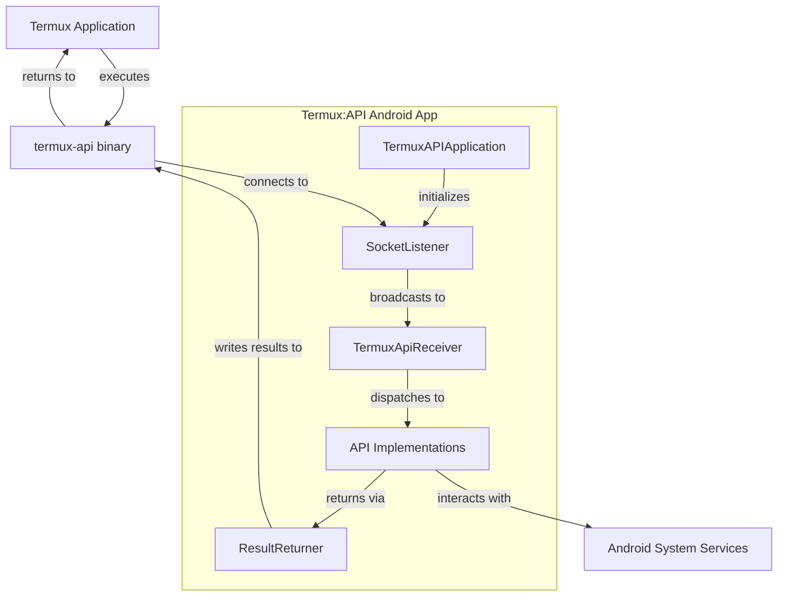
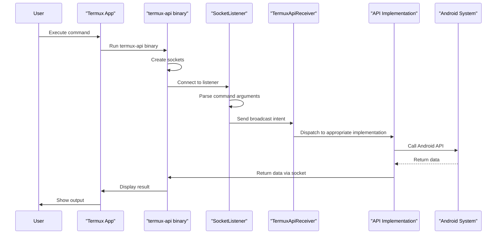
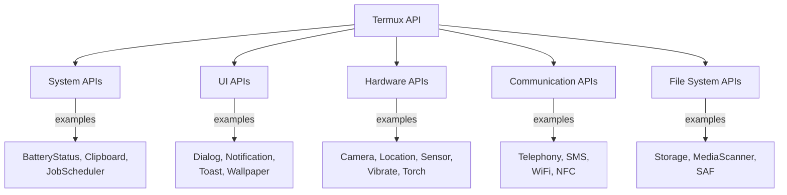

<!-- source: DeepWiki mcp.deepwiki.com · repo termux/termux-api · page 1 Overview · fetched 2026-10-26 -->

# Overview

Relevant source files

The following files were used as context for generating this wiki page:

- [.github/workflows/github_action_build.yml](.github/workflows/github_action_build.yml)
- [.github/workflows/github_release_build.yml](.github/workflows/github_release_build.yml)
- [README.md](README.md)
- [app/src/main/AndroidManifest.xml](app/src/main/AndroidManifest.xml)
- [app/src/main/java/com/termux/api/KeepAliveService.java](app/src/main/java/com/termux/api/KeepAliveService.java)
- [app/src/main/java/com/termux/api/SocketListener.java](app/src/main/java/com/termux/api/SocketListener.java)
- [app/src/main/java/com/termux/api/TermuxAPIApplication.java](app/src/main/java/com/termux/api/TermuxAPIApplication.java)

Termux API is an Android application that bridges the gap between the Termux command-line environment and Android system capabilities. It enables Termux users to access Android device features and system services through simple command-line interfaces.

## Purpose and Functionality

The Termux API application serves as an interface layer that exposes Android system APIs to the Termux command-line environment. It allows scripts and programs running in Termux to interact with device hardware, system services, and UI elements that would otherwise be inaccessible from a terminal environment.

Key functions of Termux API include:

- Accessing device hardware (camera, sensors, location, etc.)
- Controlling Android UI elements (notifications, dialogs, toasts)
- Interacting with system services (telephony, SMS, clipboard)
- Managing files and storage
- Scheduling tasks and monitoring system events

Sources: [README.md:6-6]()

## System Architecture

The following diagram shows the main components of the Termux API system and how they interact:

Sources: [app/src/main/java/com/termux/api/TermuxAPIApplication.java:33-33](), [app/src/main/java/com/termux/api/SocketListener.java:37-260]()

## Command Flow

When a user runs a Termux API command, the request flows through the system as follows:

Sources: [README.md:31-48](), [app/src/main/java/com/termux/api/SocketListener.java:42-248]()

## API Categories

Termux API provides access to a wide range of Android functionality through various API implementations. These can be categorized as follows:

Sources: [app/src/main/AndroidManifest.xml:101-213]()

## Permission Model

Termux API requires a comprehensive set of Android permissions to access various system features. These permissions are requested when needed and include access to:

| Permission Category | Examples |
|---------------------|----------|
| Location | Fine location, Background location |
| Hardware | Camera, Sensors, Microphone, NFC |
| Communication | Phone state, SMS, Contacts |
| Storage | External storage, Media |
| System | Battery optimization, Packages, Settings |

Sources: [app/src/main/AndroidManifest.xml:8-40]()

## Implementation Note

The Termux API application must be signed with the same key as the main Termux app for permissions to work correctly. This is because only the main Termux app is allowed to call the API methods provided by the Termux API application.

For more detailed information about the architecture and command flow of the Termux API system, see [Architecture](#2) and [Command Flow](#2.1). For information about specific API components and how they're implemented, see [API Components](#3).

Sources: [README.md:8-10]()

---

