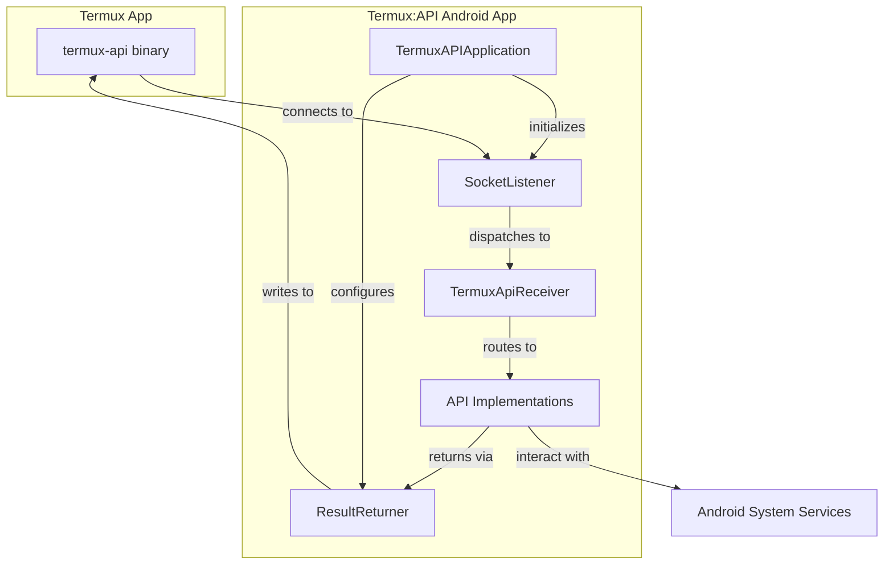
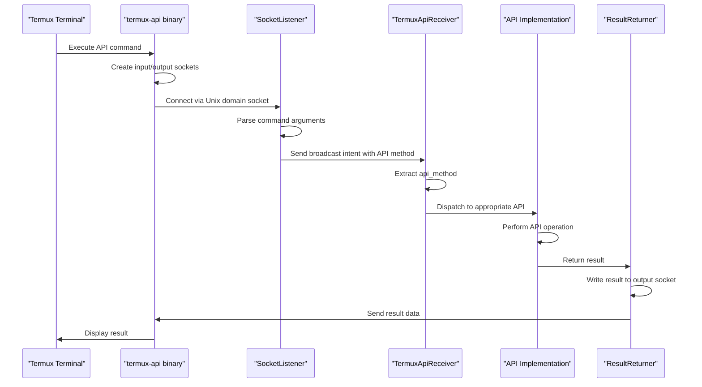
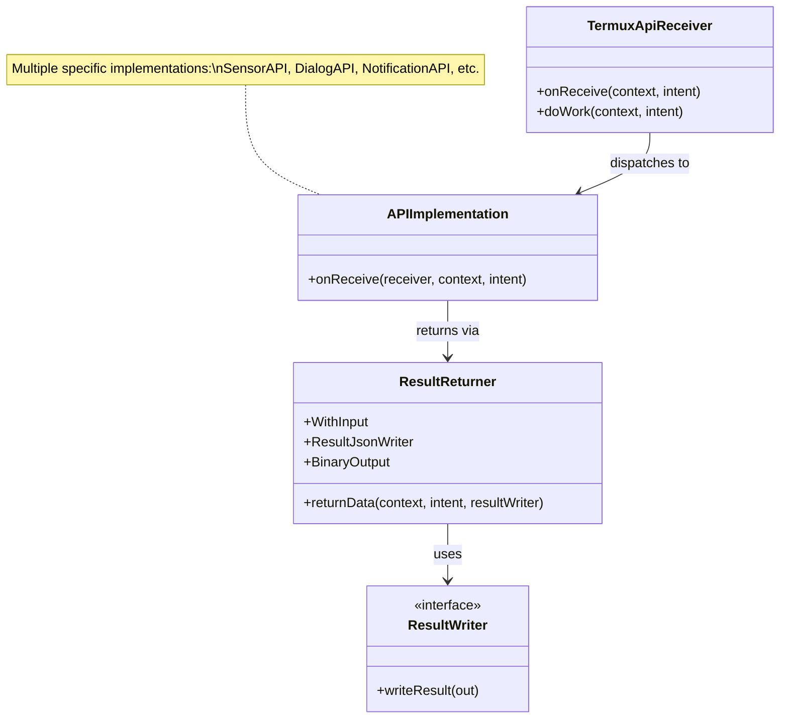
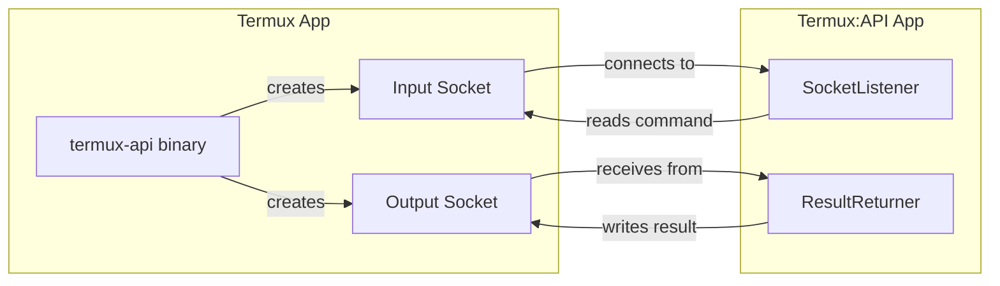
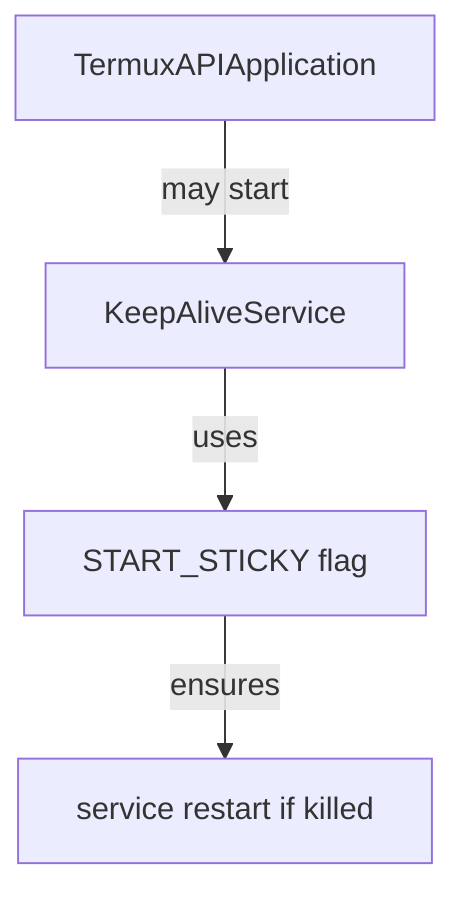

<!-- source: DeepWiki mcp.deepwiki.com · repo termux/termux-api · page 2 Architecture · fetched 2026-10-26 -->

# Architecture

Relevant source files

The following files were used as context for generating this wiki page:

- [.github/workflows/github_action_build.yml](.github/workflows/github_action_build.yml)
- [.github/workflows/github_release_build.yml](.github/workflows/github_release_build.yml)
- [README.md](README.md)
- [app/src/main/java/com/termux/api/KeepAliveService.java](app/src/main/java/com/termux/api/KeepAliveService.java)
- [app/src/main/java/com/termux/api/SocketListener.java](app/src/main/java/com/termux/api/SocketListener.java)
- [app/src/main/java/com/termux/api/TermuxAPIApplication.java](app/src/main/java/com/termux/api/TermuxAPIApplication.java)
- [app/src/main/java/com/termux/api/TermuxApiReceiver.java](app/src/main/java/com/termux/api/TermuxApiReceiver.java)
- [app/src/main/java/com/termux/api/apis/SensorAPI.java](app/src/main/java/com/termux/api/apis/SensorAPI.java)
- [app/src/main/java/com/termux/api/util/ResultReturner.java](app/src/main/java/com/termux/api/util/ResultReturner.java)

This document describes the high-level architecture of the Termux API system, outlining the main components and their interactions. The Termux API provides a bridge between the command-line environment of Termux and Android system capabilities, allowing shell scripts to access device features like sensors, notifications, and hardware.

For information about how commands flow from Termux to the API app, see [Command Flow](#2.1). For details on how permissions are handled, see [Permission System](#2.2).

## System Components Overview

The Termux API consists of the following main components:

Sources: 
- [app/src/main/java/com/termux/api/TermuxAPIApplication.java:18-34]()
- [app/src/main/java/com/termux/api/TermuxApiReceiver.java:55-79]()
- [app/src/main/java/com/termux/api/SocketListener.java:21-43]()
- [app/src/main/java/com/termux/api/util/ResultReturner.java:36-52]()
- [README.md:31-45]()

## Communication Architecture

The Termux API uses Unix domain sockets for bidirectional communication between the Termux app and the Termux:API app. This architecture allows efficient data transfer while maintaining security through Android's permission system.

Sources:
- [README.md:31-45]()
- [app/src/main/java/com/termux/api/SocketListener.java:36-260]()
- [app/src/main/java/com/termux/api/TermuxApiReceiver.java:79-269]()
- [app/src/main/java/com/termux/api/util/ResultReturner.java:229-316]()

## Core Components

### TermuxAPIApplication

The `TermuxAPIApplication` class serves as the entry point for the Termux API app. Its main responsibilities include:

1. Setting up the application context for `ResultReturner`
2. Initializing the `SocketListener` to receive commands
3. Configuring logging for the application

Sources:
- [app/src/main/java/com/termux/api/TermuxAPIApplication.java:14-45]()

### SocketListener

The `SocketListener` is responsible for:

1. Creating and managing a server socket that listens on the address `com.termux.api://listen`
2. Accepting connections from the Termux app (verifying they come from the proper UID)
3. Parsing command-line arguments into intent extras
4. Broadcasting intents to the `TermuxApiReceiver`

The `SocketListener` runs in a separate thread and continuously accepts connections from the Termux app.

Sources:
- [app/src/main/java/com/termux/api/SocketListener.java:21-262]()
- [README.md:31-45]()

### TermuxApiReceiver

The `TermuxApiReceiver` acts as the central hub for dispatching API requests. It:

1. Receives broadcast intents from the `SocketListener`
2. Extracts the "api_method" extra to determine which API to call
3. Checks for necessary Android permissions and requests them if needed
4. Delegates to the appropriate API implementation class

This component handles over 30 different API methods, each corresponding to a specific Android feature.

Sources:
- [app/src/main/java/com/termux/api/TermuxApiReceiver.java:55-272]()

### API Implementations

The API implementations are specialized classes that each handle a specific aspect of Android functionality. They:

1. Interact with Android system services
2. Process input data from the Termux command
3. Generate results to be returned to Termux
4. Use `ResultReturner` to send results back

Example implementations include:
- `SensorAPI` - Access device sensors
- `NotificationAPI` - Create and manage notifications
- `LocationAPI` - Access GPS and location services
- `DialogAPI` - Display UI dialogs to the user

Sources:
- [app/src/main/java/com/termux/api/apis/SensorAPI.java:31-470]()
- [app/src/main/java/com/termux/api/TermuxApiReceiver.java:11-47]()

### ResultReturner

The `ResultReturner` provides a standardized way for API implementations to return data to the Termux app. It:

1. Connects to the output socket created by the termux-api binary
2. Provides interfaces for different types of result data:
   - `ResultWriter` - For text output
   - `ResultJsonWriter` - For JSON-formatted output
   - `BinaryOutput` - For binary data
   - `WithInput` - For APIs that need to read input
3. Handles asynchronous result returning

The `ResultReturner` ensures that results are properly formatted and delivered back to the Termux terminal.

Sources:
- [app/src/main/java/com/termux/api/util/ResultReturner.java:36-322]()

## API Implementation Structure

The API implementations follow a common pattern to ensure consistency and maintainability:

Sources:
- [app/src/main/java/com/termux/api/TermuxApiReceiver.java:55-272]()
- [app/src/main/java/com/termux/api/util/ResultReturner.java:55-175]()
- [app/src/main/java/com/termux/api/apis/SensorAPI.java:31-470]()

## Socket Communication

The socket communication mechanism is a critical part of the architecture:

The termux-api binary creates two Unix domain sockets:
1. An input socket for sending commands to the Termux:API app
2. An output socket for receiving results back

The socket addresses are passed to the API app in the broadcast intent, allowing bi-directional communication.

Sources:
- [README.md:33-40]()
- [app/src/main/java/com/termux/api/util/ResultReturner.java:47-53]()
- [app/src/main/java/com/termux/api/util/ResultReturner.java:234-268]()

## Extensibility

The architecture is designed to be easily extensible. To add a new API:

1. Create a new class in the `com.termux.api.apis` package
2. Implement the API functionality
3. Add a case to the switch statement in `TermuxApiReceiver.doWork()`
4. Create a corresponding script in the termux-api package

This modular design allows for the continuous addition of new features without modifying the core architecture.

Sources:
- [app/src/main/java/com/termux/api/TermuxApiReceiver.java:86-269]()
- [README.md:50-54]()

## System Requirements

The Termux API app requires:

1. The same signing key as the main Termux app for permissions to work
2. Appropriate Android permissions for the features it exposes
3. Android version compatibility as defined in the app's build configuration

Sources:
- [README.md:8-10]()
- [.github/workflows/github_action_build.yml:13-66]()
- [.github/workflows/github_release_build.yml:8-64]()

## Keep-Alive Mechanism

To ensure the Termux API service remains available, a `KeepAliveService` is implemented:

This service helps maintain the availability of the API, particularly for long-running operations like sensor monitoring.

Sources:
- [app/src/main/java/com/termux/api/KeepAliveService.java:11-28]()

---

