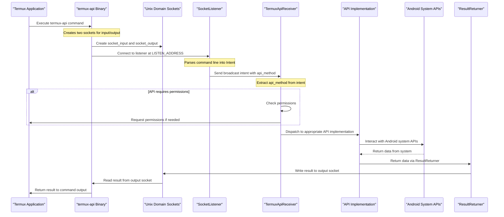
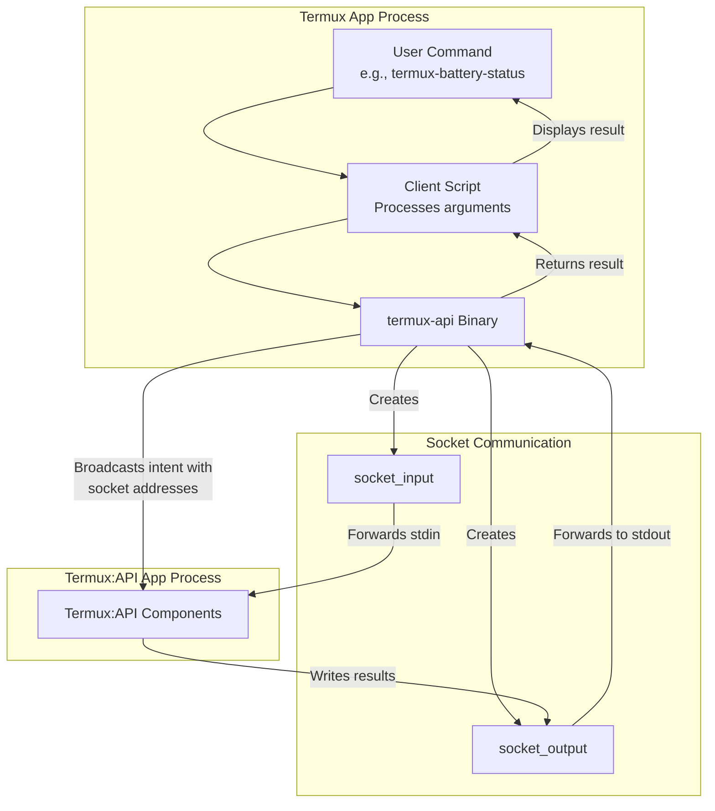
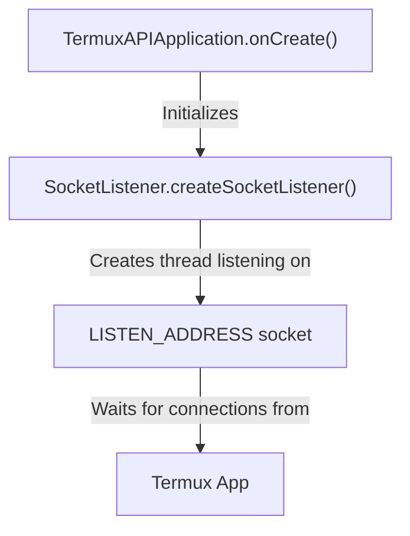
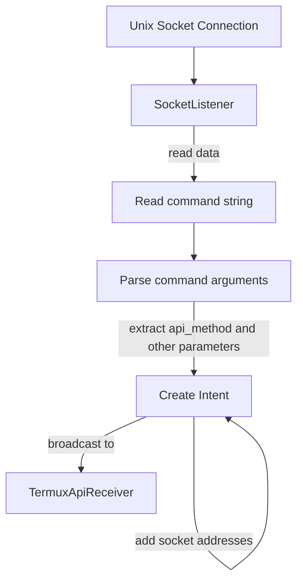
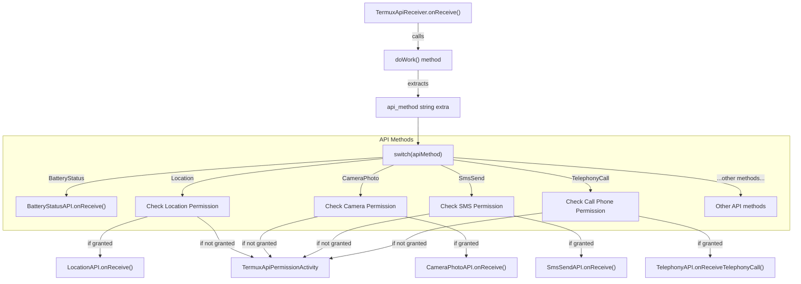
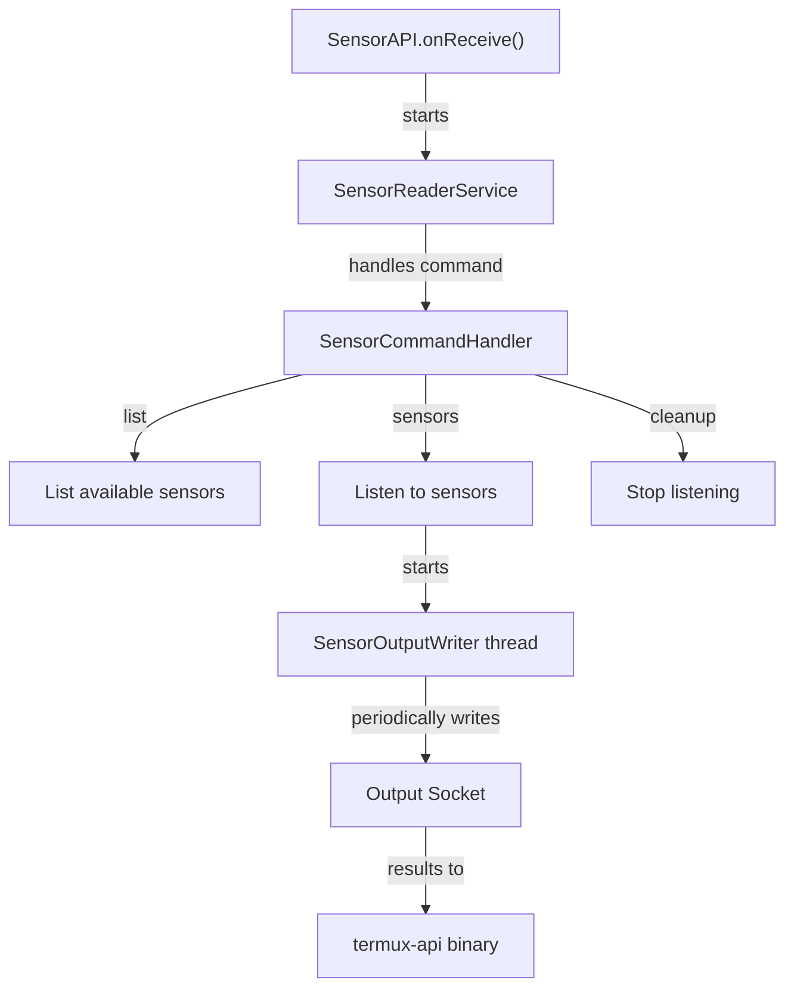
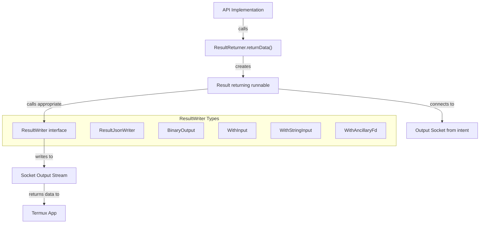

<!-- source: DeepWiki mcp.deepwiki.com · repo termux/termux-api · page 2.1 Command Flow · fetched 2026-10-26 -->

# Command Flow

Relevant source files

The following files were used as context for generating this wiki page:

- [.github/workflows/github_action_build.yml](.github/workflows/github_action_build.yml)
- [.github/workflows/github_release_build.yml](.github/workflows/github_release_build.yml)
- [README.md](README.md)
- [app/src/main/java/com/termux/api/KeepAliveService.java](app/src/main/java/com/termux/api/KeepAliveService.java)
- [app/src/main/java/com/termux/api/SocketListener.java](app/src/main/java/com/termux/api/SocketListener.java)
- [app/src/main/java/com/termux/api/TermuxAPIApplication.java](app/src/main/java/com/termux/api/TermuxAPIApplication.java)
- [app/src/main/java/com/termux/api/TermuxApiReceiver.java](app/src/main/java/com/termux/api/TermuxApiReceiver.java)
- [app/src/main/java/com/termux/api/apis/SensorAPI.java](app/src/main/java/com/termux/api/apis/SensorAPI.java)
- [app/src/main/java/com/termux/api/util/ResultReturner.java](app/src/main/java/com/termux/api/util/ResultReturner.java)

This page documents how commands flow from the Termux application through the Termux:API system to Android system APIs and back. It details the journey of a command from the moment it's executed by a user in Termux, through various components in the Termux:API app, to its execution and return of results.

## Overview

The command flow in Termux:API follows a well-defined path with several key components working together:

1. Command execution in Termux
2. Command processing by the termux-api binary
3. Command reception by the SocketListener
4. Command dispatching by the TermuxApiReceiver
5. Command execution by the specific API implementation
6. Result returning via ResultReturner

Each of these components plays a critical role in enabling command-line access to Android system capabilities.

Sources: [README.md:31-40]()

## Command Flow Diagram

Sources: [app/src/main/java/com/termux/api/TermuxApiReceiver.java:55-270](), [app/src/main/java/com/termux/api/util/ResultReturner.java:36-322](), [README.md:31-44]()

## Command Initiation

The flow begins when a user in the Termux application executes a command that uses Termux:API functionality (e.g., `termux-battery-status`). These commands are client scripts provided by the [termux-api package](https://github.com/termux/termux-api-package).

### The termux-api Binary

The heart of the command initiation is the `termux-api` helper binary. This binary:

1. Generates two Linux anonymous namespace sockets
2. Passes their addresses to the Termux:API app via intent extras
3. Uses these sockets to forward stdin to the API implementation and output from the API to stdout

Sources: [README.md:31-44]()

## Command Reception

### Socket Listener Initialization

The Termux:API app initializes the `SocketListener` when the application starts:

Sources: [app/src/main/java/com/termux/api/TermuxAPIApplication.java:18-34](), [app/src/main/java/com/termux/api/SocketListener.java:37-259]()

### Command Parsing Process

When the `termux-api` binary connects to the socket listener, the following process occurs:

1. `SocketListener` accepts the connection if it comes from the Termux app UID
2. Reads command line arguments from the socket
3. Parses the arguments into an Intent with various extras (string, boolean, int, etc.)
4. Broadcasts the Intent to `TermuxApiReceiver`

Sources: [app/src/main/java/com/termux/api/SocketListener.java:40-242]()

## Command Dispatching

The `TermuxApiReceiver` is a `BroadcastReceiver` that serves as the central hub for dispatching commands to the appropriate API implementation.

### TermuxApiReceiver.onReceive() Method

When the `TermuxApiReceiver` receives the Intent from the `SocketListener`, it:

1. Extracts the "api_method" extra from the Intent
2. Based on the api_method, dispatches to the appropriate API implementation class
3. Checks for required Android permissions before executing the API method

Sources: [app/src/main/java/com/termux/api/TermuxApiReceiver.java:59-270]()

## API Implementation Execution

Each API method has its own implementation class that handles the specific functionality. These classes:

1. Accept the Intent containing parameters for the API call
2. Process these parameters
3. Interact with Android system APIs
4. Return results back to the caller

For example, the `SensorAPI` creates a service that listens to device sensors and reports their values continuously:

Sources: [app/src/main/java/com/termux/api/apis/SensorAPI.java:31-468]()

## Result Returning

The `ResultReturner` class is responsible for sending results from the API implementation back to the Termux application through the output socket.

### ResultReturner Process

The `ResultReturner` system supports different types of result writers:

| ResultWriter Type | Purpose |
|-------------------|---------|
| ResultJsonWriter | Returns JSON-formatted results |
| BinaryOutput | Returns binary data instead of text |
| WithInput | Reads from input socket before returning results |
| WithStringInput | Reads string input from input socket |
| WithAncillaryFd | Sends file descriptors over Unix sockets |

Sources: [app/src/main/java/com/termux/api/util/ResultReturner.java:36-322]()

## Complete Command Flow Example

Let's examine a complete flow for the battery status command:

1. User executes `termux-battery-status` in Termux app
2. The script processes arguments and calls `termux-api` binary with the "BatteryStatus" API method
3. The binary creates input/output sockets and connects to the `SocketListener`
4. The `SocketListener` parses the command and creates an Intent with "api_method" set to "BatteryStatus"
5. The `SocketListener` broadcasts this Intent to `TermuxApiReceiver`
6. `TermuxApiReceiver` dispatches to `BatteryStatusAPI.onReceive()`
7. `BatteryStatusAPI` gets the battery information from Android and returns it using `ResultReturner`
8. `ResultReturner` writes the result to the output socket
9. The `termux-api` binary reads the result from the output socket and forwards it to stdout
10. The `termux-battery-status` script processes and displays the result to the user

Sources: [app/src/main/java/com/termux/api/TermuxApiReceiver.java:90-92](), [app/src/main/java/com/termux/api/util/ResultReturner.java:229-316](), [README.md:31-44]()

## Summary

The Termux:API command flow provides a bridge between the Termux command-line environment and Android's system APIs. Through a carefully designed sequence of:

1. Command processing
2. Socket-based inter-process communication
3. Intent-based command dispatching
4. Permission handling
5. Result returning

This architecture enables Termux users to access Android device capabilities through simple command-line interfaces, combining the power of Linux command-line tools with Android's rich API ecosystem.

Sources: [app/src/main/java/com/termux/api/TermuxApiReceiver.java:55-270](), [app/src/main/java/com/termux/api/util/ResultReturner.java:36-322](), [app/src/main/java/com/termux/api/SocketListener.java:22-262](), [README.md:31-44]()

---

