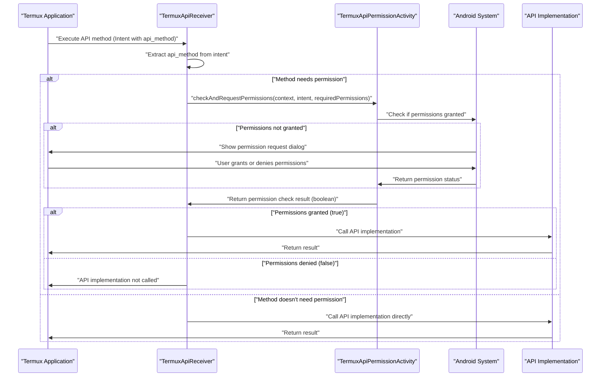
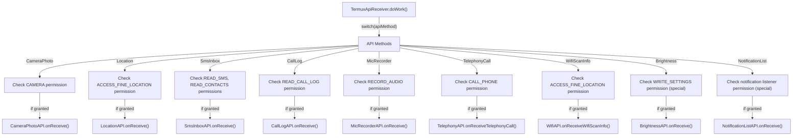
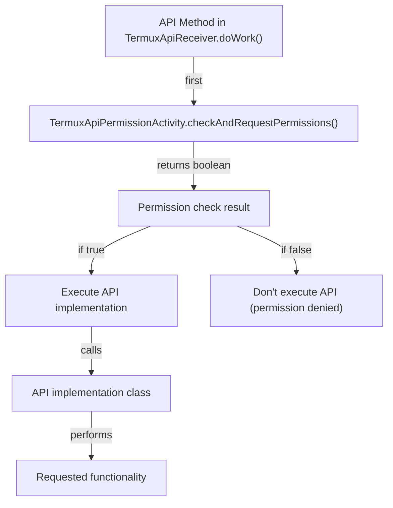
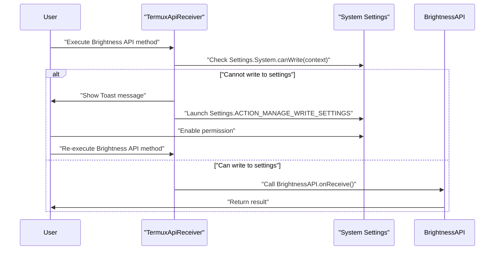
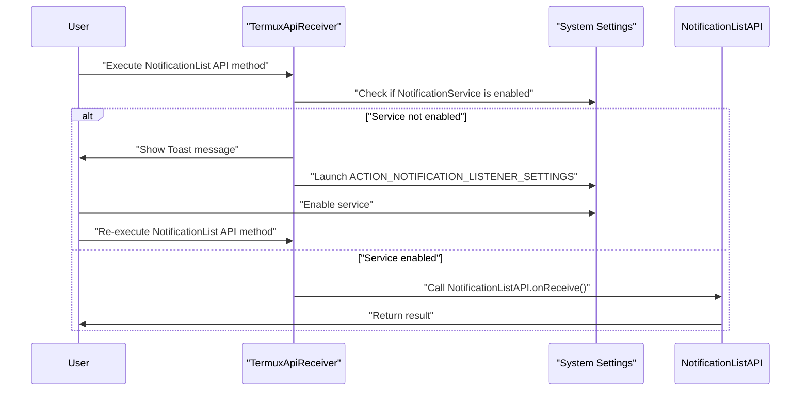
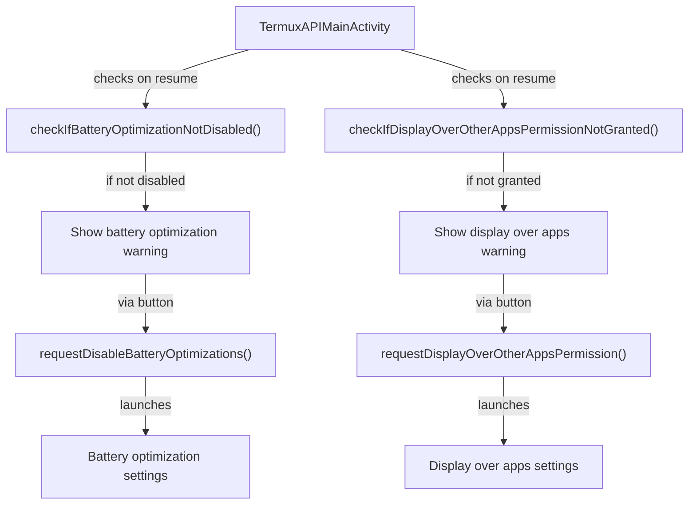
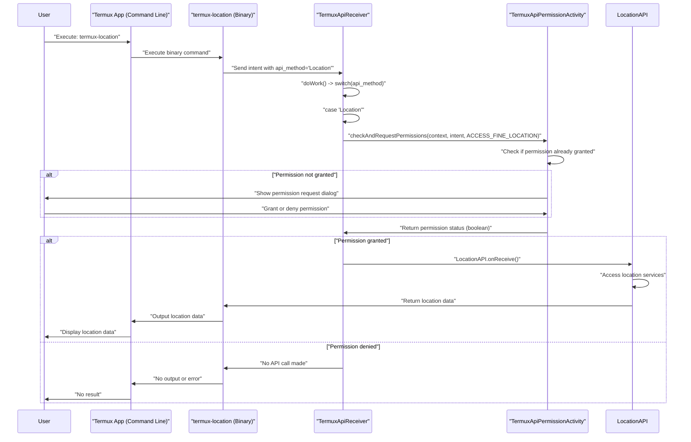

<!-- source: DeepWiki mcp.deepwiki.com · repo termux/termux-api · page 2.2 Permission System · fetched 2026-10-26 -->

# Permission System

Relevant source files

The following files were used as context for generating this wiki page:

- [app/src/main/AndroidManifest.xml](app/src/main/AndroidManifest.xml)
- [app/src/main/java/com/termux/api/TermuxApiReceiver.java](app/src/main/java/com/termux/api/TermuxApiReceiver.java)
- [app/src/main/java/com/termux/api/activities/TermuxAPIMainActivity.java](app/src/main/java/com/termux/api/activities/TermuxAPIMainActivity.java)
- [app/src/main/res/layout/activity_termux_api_main.xml](app/src/main/res/layout/activity_termux_api_main.xml)
- [app/src/main/res/menu/activity_termux_api_main.xml](app/src/main/res/menu/activity_termux_api_main.xml)

## Purpose and Scope
This document explains how the Termux API handles Android permissions. It covers permission declaration in the AndroidManifest.xml, runtime permission checking through `TermuxApiPermissionActivity`, and how API implementations are protected by permission checks. For information about the overall command flow, see [Command Flow](#2.1).

## Permission Declaration

The Termux API requires numerous Android permissions to access various device features and services. All required permissions are declared in the AndroidManifest.xml file.

```mermaid
graph TD
    AndroidManifest["AndroidManifest.xml"] -->|"declares"| Permissions["Required Permissions"]
    
    Permissions -->|"includes"| LocationPerms["Location Permissions"]
    Permissions -->|"includes"| CameraPerms["Camera Permissions"]
    Permissions -->|"includes"| PhonePerms["Phone State Permissions"]
    Permissions -->|"includes"| SmsPerms["SMS Permissions"]
    Permissions -->|"includes"| StoragePerms["Storage Permissions"]
    Permissions -->|"includes"| AudioPerms["Audio Permissions"]
    Permissions -->|"includes"| OtherPerms["Other Permissions"]
    
    LocationPerms -->|"e.g."| ACCESS_FINE_LOCATION["android.permission.ACCESS_FINE_LOCATION"]
    LocationPerms -->|"e.g."| ACCESS_COARSE_LOCATION["android.permission.ACCESS_COARSE_LOCATION"]
    
    CameraPerms -->|"e.g."| CAMERA["android.permission.CAMERA"]
    
    PhonePerms -->|"e.g."| READ_PHONE_STATE["android.permission.READ_PHONE_STATE"]
    PhonePerms -->|"e.g."| CALL_PHONE["android.permission.CALL_PHONE"]
    
    SmsPerms -->|"e.g."| READ_SMS["android.permission.READ_SMS"]
    SmsPerms -->|"e.g."| SEND_SMS["android.permission.SEND_SMS"]
    
    StoragePerms -->|"e.g."| READ_EXTERNAL_STORAGE["android.permission.READ_EXTERNAL_STORAGE"]
    StoragePerms -->|"e.g."| WRITE_EXTERNAL_STORAGE["android.permission.WRITE_EXTERNAL_STORAGE"]
    
    AudioPerms -->|"e.g."| RECORD_AUDIO["android.permission.RECORD_AUDIO"]
```

Sources: [app/src/main/AndroidManifest.xml:8-40]()

## Permission Check and Request Flow

When a Termux API command is received by `TermuxApiReceiver`, the system determines if the requested API method requires permissions. If needed, permissions are verified or requested before executing the API implementation.

Sources: [app/src/main/java/com/termux/api/TermuxApiReceiver.java:60-77](), [app/src/main/java/com/termux/api/TermuxApiReceiver.java:79-270]()

## Permission-Protected API Methods

The `TermuxApiReceiver.doWork()` method contains a large switch statement that handles different API methods and checks for required permissions before calling each API implementation.

Sources: [app/src/main/java/com/termux/api/TermuxApiReceiver.java:86-269]()

## Permission Check Implementation

The `TermuxApiReceiver` class uses `TermuxApiPermissionActivity.checkAndRequestPermissions()` to verify required permissions before executing API methods. This pattern is consistent throughout the API implementations:

Sources: [app/src/main/java/com/termux/api/TermuxApiReceiver.java:109-112](), [app/src/main/java/com/termux/api/TermuxApiReceiver.java:152-154](), [app/src/main/java/com/termux/api/TermuxApiReceiver.java:163-165]()

## Special Permission Handling

Some permissions require special handling because they cannot be granted through the standard runtime permission system.

### System Settings Permission (WRITE_SETTINGS)

The `BrightnessAPI` requires the `WRITE_SETTINGS` permission, which must be manually enabled by the user in system settings:

Sources: [app/src/main/java/com/termux/api/TermuxApiReceiver.java:94-103]()

### Notification Listener Permission

The `NotificationListAPI` requires special notification listener access, which must be enabled in system settings:

Sources: [app/src/main/java/com/termux/api/TermuxApiReceiver.java:170-179]()

## Main Activity Permission UI

The `TermuxAPIMainActivity` includes UI elements to help users manage permissions that are important for the application's functionality.

Sources: [app/src/main/java/com/termux/api/activities/TermuxAPIMainActivity.java:100-116](), [app/src/main/java/com/termux/api/activities/TermuxAPIMainActivity.java:120-136]()

## Permission-Required API Methods

The following table shows API methods that require runtime permissions and the specific permissions they need:

| API Method | Required Permissions | Implementation |
|------------|---------------------|----------------|
| CameraPhoto | `CAMERA` | [TermuxApiReceiver.java:109-112]() |
| CallLog | `READ_CALL_LOG` | [TermuxApiReceiver.java:114-116]() |
| ContactList | `READ_CONTACTS` | [TermuxApiReceiver.java:122-124]() |
| InfraredTransmit | `TRANSMIT_IR` | [TermuxApiReceiver.java:141-143]() |
| Location | `ACCESS_FINE_LOCATION` | [TermuxApiReceiver.java:152-154]() |
| MicRecorder | `RECORD_AUDIO` | [TermuxApiReceiver.java:163-165]() |
| SmsInbox | `READ_SMS`, `READ_CONTACTS` | [TermuxApiReceiver.java:203-205]() |
| SmsSend | `READ_PHONE_STATE`, `SEND_SMS` | [TermuxApiReceiver.java:208-210]() |
| SpeechToText | `RECORD_AUDIO` | [TermuxApiReceiver.java:216-218]() |
| TelephonyCall | `CALL_PHONE` | [TermuxApiReceiver.java:221-223]() |
| TelephonyCellInfo | `ACCESS_COARSE_LOCATION` | [TermuxApiReceiver.java:226-228]() |
| TelephonyDeviceInfo | `READ_PHONE_STATE` | [TermuxApiReceiver.java:231-233]() |
| WifiScanInfo | `ACCESS_FINE_LOCATION` | [TermuxApiReceiver.java:260-262]() |

Sources: [app/src/main/java/com/termux/api/TermuxApiReceiver.java:86-269]()

## Permission Flow Example: Location API

This sequence diagram shows a detailed example of how permissions are handled specifically for the Location API:

Sources: [app/src/main/java/com/termux/api/TermuxApiReceiver.java:152-154]()

## Conclusion

The permission system in the Termux API follows Android's standard runtime permission model, with a centralized permission check mechanism implemented in `TermuxApiPermissionActivity`. The system ensures that API implementations only execute when the required permissions are granted.

For special permissions that cannot be requested through the standard runtime permission dialog, the application guides users to the appropriate system settings screens. The main activity also provides UI elements to help users manage other important permissions like battery optimization and display over other apps.

This permission system effectively balances providing powerful functionality through the Termux command-line interface while respecting Android's permission model to maintain security and user privacy.

---

