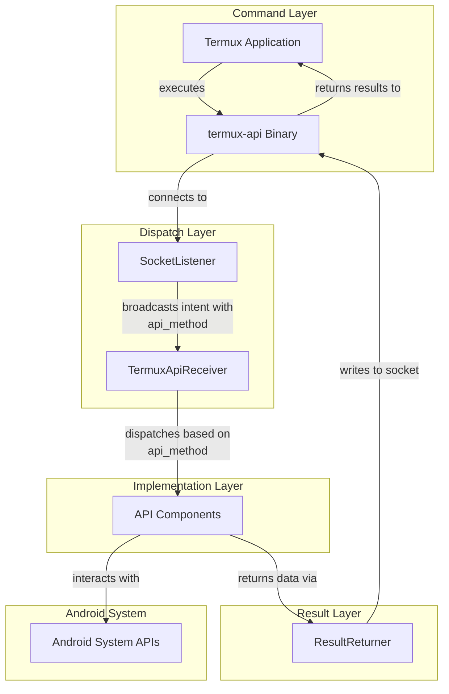
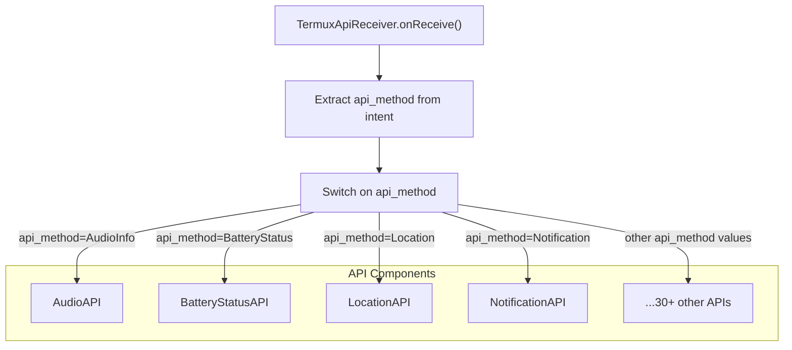
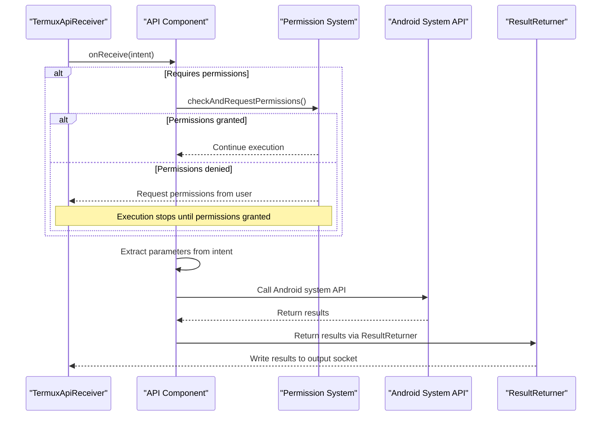

<!-- source: DeepWiki mcp.deepwiki.com · repo termux/termux-api · page 3 API Components · fetched 2026-10-26 -->

# API Components

Relevant source files

The following files were used as context for generating this wiki page:

- [app/src/main/AndroidManifest.xml](app/src/main/AndroidManifest.xml)
- [app/src/main/java/com/termux/api/TermuxApiReceiver.java](app/src/main/java/com/termux/api/TermuxApiReceiver.java)

## Purpose and Scope

This document provides an overview of the API components available in the Termux API system. API components are the individual modules that enable command-line access to specific Android system features, bridging the Termux command-line environment with Android's capabilities. Each component corresponds to a specific Android functionality, from hardware access to system services.

For information about how commands flow through the system, see [Command Flow](#2.1). For details on how permissions are managed, see [Permission System](#2.2).

## Component Architecture Overview

API components sit at the heart of the Termux API system, acting as intermediaries between Termux commands and Android system APIs. Each component is implemented as a Java class that handles specific functionality and is dispatched by the central `TermuxApiReceiver`.

### API Components in System Architecture

Sources: [app/src/main/java/com/termux/api/TermuxApiReceiver.java:55-272](), [app/src/main/AndroidManifest.xml:161-162]()

## Component Dispatch Mechanism

The `TermuxApiReceiver` class acts as the central hub for all API components. When a command is sent from Termux, it's received by the `TermuxApiReceiver` which extracts the `api_method` parameter and dispatches the request to the appropriate API component.

Sources: [app/src/main/java/com/termux/api/TermuxApiReceiver.java:80-269]()

## API Component Categories

The Termux API components can be organized into several functional categories based on the type of Android functionality they provide:

```mermaid
graph TD
    ApiComponents["API Components"] --> SystemApis["System APIs"]
    ApiComponents --> UIApis["UI APIs"]
    ApiComponents --> HardwareApis["Hardware APIs"]
    ApiComponents --> CommunicationApis["Communication APIs"]
    ApiComponents --> FileApis["File System APIs"]
    
    SystemApis --> BatteryStatusAPI["BatteryStatusAPI"]
    SystemApis --> ClipboardAPI["ClipboardAPI"]
    SystemApis --> JobSchedulerAPI["JobSchedulerAPI"]
    
    UIApis --> DialogAPI["DialogAPI"]
    UIApis --> NotificationAPI["NotificationAPI"]
    UIApis --> ToastAPI["ToastAPI"]
    
    HardwareApis --> CameraPhotoAPI["CameraPhotoAPI"]
    HardwareApis --> LocationAPI["LocationAPI"]
    HardwareApis --> SensorAPI["SensorAPI"]
    HardwareApis --> VibrateAPI["VibrateAPI"]
    HardwareApis --> TorchAPI["TorchAPI"]
    
    CommunicationApis --> TelephonyAPI["TelephonyAPI"]
    CommunicationApis --> SmsInboxAPI["SmsInboxAPI"]
    CommunicationApis --> SmsSendAPI["SmsSendAPI"]
    CommunicationApis --> WifiAPI["WifiAPI"]
    
    FileApis --> StorageGetAPI["StorageGetAPI"]
    FileApis --> SAFAPI["SAFAPI"]
    FileApis --> MediaScannerAPI["MediaScannerAPI"]
```

Sources: [app/src/main/java/com/termux/api/TermuxApiReceiver.java:11-47](), [app/src/main/AndroidManifest.xml:8-40]()

### System APIs
Components that provide access to Android system services and information:
- `BatteryStatusAPI` - Battery information
- `ClipboardAPI` - Access system clipboard
- `JobSchedulerAPI` - Schedule background tasks
- `VolumeAPI` - Control device volume
- `BrightnessAPI` - Control screen brightness

### UI APIs
Components that handle user interface interactions:
- `DialogAPI` - Display interactive dialogs
- `NotificationAPI` - Create and manage notifications
- `ToastAPI` - Display toast messages
- `WallpaperAPI` - Set device wallpaper

### Hardware APIs
Components that provide access to device hardware:
- `CameraPhotoAPI` - Take photos
- `LocationAPI` - Access location services
- `SensorAPI` - Read device sensors
- `VibrateAPI` - Control vibration
- `TorchAPI` - Control flashlight
- `InfraredAPI` - Control infrared transmitter
- `FingerprintAPI` - Fingerprint authentication

### Communication APIs
Components that handle communication features:
- `TelephonyAPI` - Phone-related functions
- `SmsInboxAPI` - Access SMS inbox
- `SmsSendAPI` - Send SMS messages
- `WifiAPI` - WiFi information and control
- `NfcAPI` - NFC operations

### File System APIs
Components that deal with file operations:
- `StorageGetAPI` - Access device storage
- `SAFAPI` - Storage Access Framework
- `MediaScannerAPI` - Scan media files
- `DownloadAPI` - Download files

Sources: [app/src/main/java/com/termux/api/TermuxApiReceiver.java:86-266]()

## Component Implementation Pattern

Most API components in Termux API follow a common implementation pattern:

Sources: [app/src/main/java/com/termux/api/TermuxApiReceiver.java:90-117](), [app/src/main/java/com/termux/api/util/ResultReturner.java]()

## Available API Components

The Termux API provides a comprehensive set of API components, each accessing specific Android features:

| API Component | Description | Required Permissions |
|---------------|-------------|---------------------|
| `AudioAPI` | Audio device information | - |
| `BatteryStatusAPI` | Battery status information | - |
| `BrightnessAPI` | Screen brightness control | `WRITE_SETTINGS` |
| `CallLogAPI` | Call log access | `READ_CALL_LOG` |
| `CameraInfoAPI` | Camera information | - |
| `CameraPhotoAPI` | Take photos | `CAMERA` |
| `ClipboardAPI` | Clipboard access | - |
| `ContactListAPI` | Contact list access | `READ_CONTACTS` |
| `DialogAPI` | Display dialogs | - |
| `DownloadAPI` | Download files | - |
| `FingerprintAPI` | Fingerprint authentication | `USE_BIOMETRIC` |
| `InfraredAPI` | Infrared transmitter | `TRANSMIT_IR` |
| `JobSchedulerAPI` | Job scheduling | - |
| `KeystoreAPI` | Android Keystore access | - |
| `LocationAPI` | Location services | `ACCESS_FINE_LOCATION` |
| `MediaPlayerAPI` | Media playback | - |
| `MediaScannerAPI` | Media scanning | - |
| `MicRecorderAPI` | Microphone recording | `RECORD_AUDIO` |
| `NfcAPI` | NFC operations | - |
| `NotificationAPI` | Notifications | - |
| `NotificationListAPI` | Access notifications | Notification Listener Service |
| `SAFAPI` | Storage Access Framework | - |
| `SensorAPI` | Device sensors | - |
| `ShareAPI` | Share content | - |
| `SmsInboxAPI` | SMS inbox access | `READ_SMS`, `READ_CONTACTS` |
| `SmsSendAPI` | Send SMS messages | `READ_PHONE_STATE`, `SEND_SMS` |
| `SpeechToTextAPI` | Speech recognition | `RECORD_AUDIO` |
| `StorageGetAPI` | Storage access | - |
| `TelephonyAPI` | Phone functions | Various (`CALL_PHONE`, etc.) |
| `TextToSpeechAPI` | Text-to-speech | - |
| `ToastAPI` | Toast messages | - |
| `TorchAPI` | Flashlight control | - |
| `UsbAPI` | USB device access | - |
| `VibrateAPI` | Vibration control | `VIBRATE` |
| `VolumeAPI` | Volume control | - |
| `WallpaperAPI` | Set wallpaper | `SET_WALLPAPER` |
| `WifiAPI` | WiFi control | Various permissions |

Sources: [app/src/main/java/com/termux/api/TermuxApiReceiver.java:86-266](), [app/src/main/AndroidManifest.xml:8-40]()

## Services and Activities

Many API components require dedicated services or activities to function properly. These are defined in the AndroidManifest.xml:

### Activities
- `DialogAPI$DialogActivity` - Activity for displaying dialogs
- `FingerprintAPI$FingerprintActivity` - Activity for fingerprint authentication
- `NfcAPI$NfcActivity` - Activity for NFC operations
- `SAFAPI$SAFActivity` - Activity for Storage Access Framework
- `StorageGetAPI$StorageActivity` - Activity for storage access

### Services
- `JobSchedulerAPI$JobSchedulerService` - Service for job scheduling
- `MediaPlayerAPI$MediaPlayerService` - Service for media playback
- `MicRecorderAPI$MicRecorderService` - Service for microphone recording
- `NotificationListAPI$NotificationService` - Service for notification access
- `SensorAPI$SensorReaderService` - Service for sensor reading
- `SpeechToTextAPI$SpeechToTextService` - Service for speech recognition
- `TextToSpeechAPI$TextToSpeechService` - Service for text-to-speech
- `WallpaperAPI$WallpaperService` - Service for setting wallpaper
- `UsbAPI$UsbService` - Service for USB access

Sources: [app/src/main/AndroidManifest.xml:101-213]()

For more detailed information about specific API components, refer to the following pages:
- [API Receiver](#3.1) - Details about the central API receiver
- [Result Returning System](#3.2) - How results are returned from API calls
- [User Interface APIs](#3.3) - UI-related API components
- [Hardware APIs](#3.4) - Hardware access API components
- [System Service APIs](#3.5) - System service API components

---

