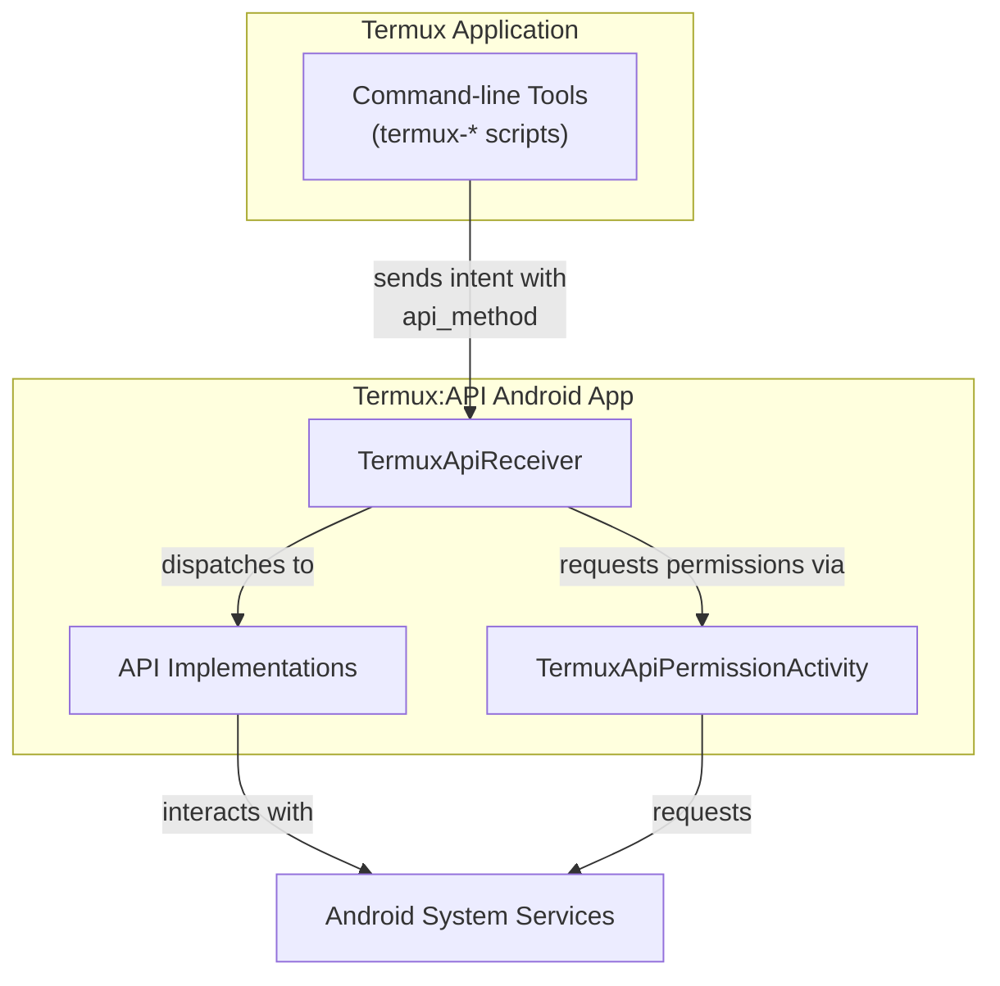
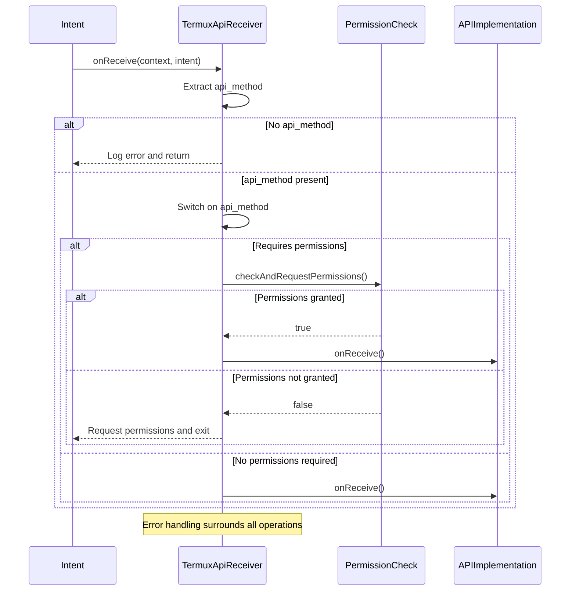
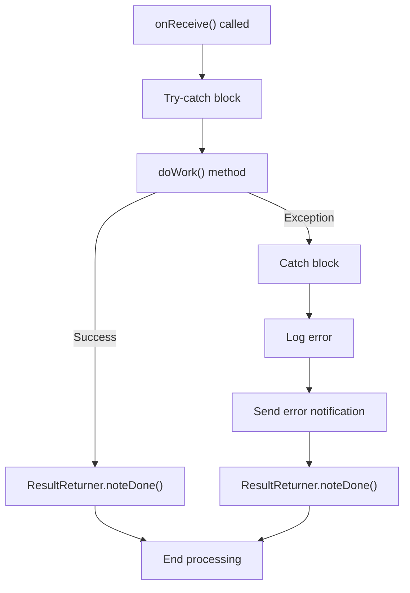

<!-- source: DeepWiki mcp.deepwiki.com · repo termux/termux-api · page 3.1 API Receiver · fetched 2026-10-26 -->

# API Receiver

Relevant source files

The following files were used as context for generating this wiki page:

- [app/src/main/AndroidManifest.xml](app/src/main/AndroidManifest.xml)
- [app/src/main/java/com/termux/api/TermuxApiReceiver.java](app/src/main/java/com/termux/api/TermuxApiReceiver.java)

## Purpose and Overview

The API Receiver is the central dispatching component within the Termux API system that receives commands from the Termux application and routes them to the appropriate API implementation. It serves as a critical bridge between command-line requests issued in Termux and the actual Android system API implementations.

This document covers the API Receiver's architecture, dispatch mechanism, and permission handling. For information about how results are returned from API calls, see [Result Returning System](#3.2).

Sources: [app/src/main/java/com/termux/api/TermuxApiReceiver.java:55-272]()

## Architecture

The API Receiver is implemented as an Android BroadcastReceiver that processes intent requests containing API method names and parameters. It is registered in the AndroidManifest.xml file and acts as the central hub that dispatches requests to specialized API implementation classes.

### System Integration Diagram

Sources: [app/src/main/java/com/termux/api/TermuxApiReceiver.java:55-60](), [app/src/main/AndroidManifest.xml:161-162]()

## Dispatch Mechanism

The API Receiver works by extracting an `api_method` parameter from incoming intents and using it to determine which API implementation to invoke. This design pattern centralizes the command routing logic in a single class while keeping the actual implementation details separate in specialized API classes.

### API Method Dispatch Flow

Sources: [app/src/main/java/com/termux/api/TermuxApiReceiver.java:59-270]()

## Permission Handling

Many Android APIs require specific permissions. The API Receiver works with `TermuxApiPermissionActivity` to check for required permissions and request them if necessary. This permission handling is integrated directly into the dispatch mechanism to ensure proper permissions are granted before API operations are performed.

### Permission Flow Table

| Step | Action | Code Reference |
|------|--------|----------------|
| 1 | Receive API request | `onReceive()` method |
| 2 | Determine required permissions based on API method | Switch statement in `doWork()` method |
| 3 | Check if permissions are already granted | `TermuxApiPermissionActivity.checkAndRequestPermissions()` |
| 4 | If permissions granted, proceed with API call | Direct call to API implementation |
| 5 | If permissions needed, launch permission request | Permission activity handles request flow |

Sources: [app/src/main/java/com/termux/api/TermuxApiReceiver.java:109-111](), [app/src/main/java/com/termux/api/TermuxApiReceiver.java:152-154]()

## Supported API Methods

The API Receiver supports a comprehensive set of API methods that provide access to various Android system features. These are grouped by general functionality below:

### API Method Categories

```mermaid
graph TD
    TARcvr["TermuxApiReceiver"]
    
    subgraph "UI Methods"
        UI["UI APIs"]
        UI_Dialog["Dialog"]
        UI_Toast["Toast"]
        UI_Notification["Notification"]
        
        UI --- UI_Dialog
        UI --- UI_Toast
        UI --- UI_Notification
    end
    
    subgraph "Hardware Methods"
        HW["Hardware APIs"]
        HW_Camera["CameraPhoto/CameraInfo"]
        HW_Sensor["Sensor"]
        HW_Location["Location"]
        HW_Torch["Torch"]
        HW_Vibrate["Vibrate"]
        HW_Audio["Audio/MicRecorder"]
        
        HW --- HW_Camera
        HW --- HW_Sensor
        HW --- HW_Location
        HW --- HW_Torch
        HW --- HW_Vibrate
        HW --- HW_Audio
    end
    
    subgraph "System Methods"
        SYS["System APIs"]
        SYS_Battery["BatteryStatus"]
        SYS_Clipboard["Clipboard"]
        SYS_Wifi["WifiConnectionInfo/WifiScanInfo"]
        SYS_Volume["Volume"]
        SYS_Brightness["Brightness"]
        
        SYS --- SYS_Battery
        SYS --- SYS_Clipboard
        SYS --- SYS_Wifi
        SYS --- SYS_Volume
        SYS --- SYS_Brightness
    end
    
    subgraph "Telephony Methods"
        TEL["Telephony APIs"]
        TEL_Device["TelephonyDeviceInfo"]
        TEL_Call["TelephonyCall"]
        TEL_SMS["SmsSend/SmsInbox"]
        
        TEL --- TEL_Device
        TEL --- TEL_Call
        TEL --- TEL_SMS
    end
    
    subgraph "Storage Methods"
        STR["Storage APIs"]
        STR_Get["StorageGet"]
        STR_SAF["SAF"]
        STR_Media["MediaScanner"]
        
        STR --- STR_Get
        STR --- STR_SAF
        STR --- STR_Media
    end
    
    TARcvr --> UI
    TARcvr --> HW
    TARcvr --> SYS
    TARcvr --> TEL
    TARcvr --> STR
```

Sources: [app/src/main/java/com/termux/api/TermuxApiReceiver.java:86-266]()

### API Method Table

| Category | API Method | Purpose | Permission Required |
|----------|------------|---------|---------------------|
| **Audio & Media** | AudioInfo | Get audio information | None |
| | MediaPlayer | Control media playback | None |
| | MicRecorder | Record audio | RECORD_AUDIO |
| | SpeechToText | Convert speech to text | RECORD_AUDIO |
| | TextToSpeech | Convert text to speech | None |
| **System Info** | BatteryStatus | Get battery information | None |
| | Brightness | Control screen brightness | WRITE_SETTINGS |
| | Volume | Control device volume | None |
| **Camera** | CameraInfo | Get camera device information | None |
| | CameraPhoto | Take photos | CAMERA |
| **Communication** | TelephonyCall | Make phone calls | CALL_PHONE |
| | TelephonyDeviceInfo | Get device information | READ_PHONE_STATE |
| | TelephonyCellInfo | Get cell tower information | ACCESS_COARSE_LOCATION |
| | SmsSend | Send SMS messages | SEND_SMS, READ_PHONE_STATE |
| | SmsInbox | Read SMS messages | READ_SMS, READ_CONTACTS |
| **Location & Sensors** | Location | Get device location | ACCESS_FINE_LOCATION |
| | Sensor | Access device sensors | None |
| **User Interface** | Dialog | Display interactive dialogs | None |
| | Notification | Display notifications | None |
| | Toast | Show toast messages | None |
| **Storage** | StorageGet | Access storage | None |
| | SAF | Storage Access Framework integration | None |
| | MediaScanner | Scan media files | None |
| **Connectivity** | WifiConnectionInfo | Get current WiFi information | None |
| | WifiScanInfo | Scan for WiFi networks | ACCESS_FINE_LOCATION |
| | WifiEnable | Enable/disable WiFi | None |

Sources: [app/src/main/java/com/termux/api/TermuxApiReceiver.java:86-266]()

## Error Handling

The API Receiver implements robust error handling to ensure that even if API implementations encounter exceptions, they don't cause the entire process to crash (which would trigger the "process is bad" behavior from the Android system for broadcast receivers).

Sources: [app/src/main/java/com/termux/api/TermuxApiReceiver.java:64-76]()

## Integration with Other Components

The API Receiver works closely with several other components in the Termux API system:

1. **Result Returner**: After processing an API request, results are returned to the calling application using the ResultReturner utility. This component handles the socket communication that returns data to the Termux application. For details, see [Result Returning System](#3.2).

2. **TermuxApiPermissionActivity**: This activity manages Android permission requests for API calls that require specific permissions.

3. **API Implementation Classes**: Each API method is implemented in a separate class that contains the actual functionality. These classes follow a pattern where they expose static `onReceive()` methods that the API Receiver calls.

Sources: [app/src/main/java/com/termux/api/TermuxApiReceiver.java:49](), [app/src/main/java/com/termux/api/TermuxApiReceiver.java:48]()

---

