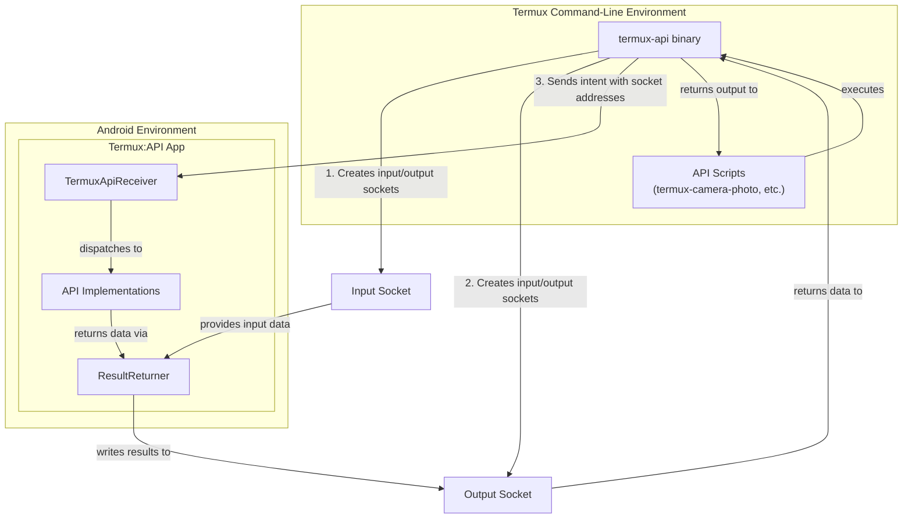
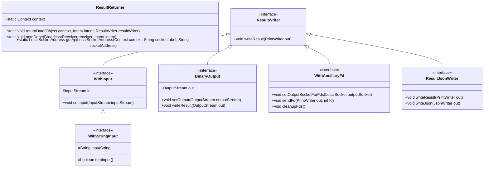
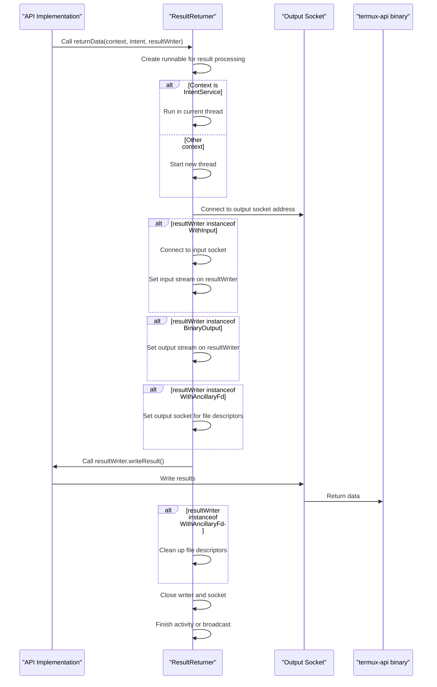
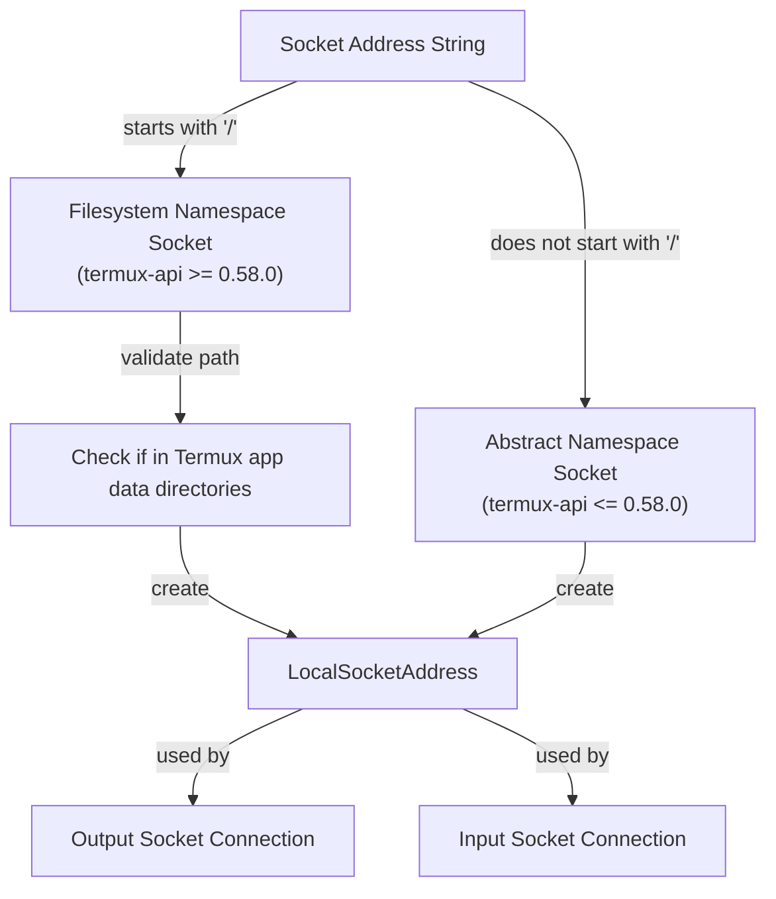
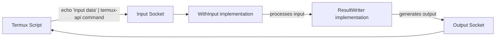
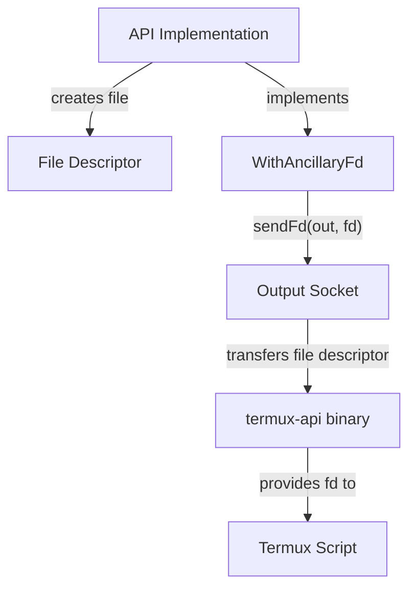
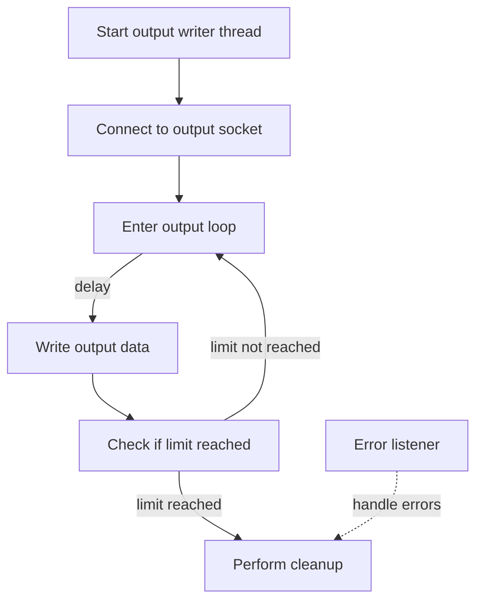

<!-- source: DeepWiki mcp.deepwiki.com · repo termux/termux-api · page 3.2 Result Returning System · fetched 2026-10-26 -->

# Result Returning System

<details>
<summary>Relevant source files</summary>

The following files were used as context for generating this wiki page:

- [.github/workflows/github_action_build.yml](.github/workflows/github_action_build.yml)
- [.github/workflows/github_release_build.yml](.github/workflows/github_release_build.yml)
- [README.md](README.md)
- [app/src/main/java/com/termux/api/apis/SensorAPI.java](app/src/main/java/com/termux/api/apis/SensorAPI.java)
- [app/src/main/java/com/termux/api/util/ResultReturner.java](app/src/main/java/com/termux/api/util/ResultReturner.java)

</details>


The Result Returning System is a critical component of the Termux API architecture that handles how data is returned from the Termux:API Android application back to the Termux command-line environment. It provides a standardized mechanism for API implementations to write their results to output sockets, supporting various output formats and special features.

For information about how commands are dispatched to specific API implementations, see [API Receiver](#3.1).

## System Overview

The Result Returning System acts as a bridge between the Java-based API implementations running within the Android environment and the Unix command-line environment of Termux. It solves the challenge of transferring data across these environments by using Unix domain sockets.



Sources: [README.md:32-43](), [app/src/main/java/com/termux/api/util/ResultReturner.java:36-54]()

## Core Components

The Result Returning System is implemented in the `ResultReturner` class which provides interfaces and methods for handling different types of result data.



Sources: [app/src/main/java/com/termux/api/util/ResultReturner.java:55-175]()

### ResultWriter Interface

The `ResultWriter` interface is the core abstraction of the system. It defines a method for writing result data to a `PrintWriter`:

```java
public interface ResultWriter {
    void writeResult(PrintWriter out) throws Exception;
}
```

API implementations create instances of classes implementing this interface to define how their specific results should be formatted and written.

Sources: [app/src/main/java/com/termux/api/util/ResultReturner.java:55-57]()

### Specialized Writer Interfaces

Several specialized interfaces extend `ResultWriter` to handle specific use cases:

| Interface | Purpose | Key Methods |
|-----------|---------|-------------|
| `WithInput` | For APIs that need to read input from the input socket | `setInput(InputStream)` |
| `BinaryOutput` | For APIs returning binary data instead of text | `writeResult(OutputStream)` |
| `WithStringInput` | For APIs that need to read string input | Automatically converts input stream to string |
| `WithAncillaryFd` | For APIs needing to send file descriptors | `sendFd(PrintWriter, int)` |
| `ResultJsonWriter` | For APIs returning JSON-formatted data | `writeJson(JsonWriter)` |

Sources: [app/src/main/java/com/termux/api/util/ResultReturner.java:62-175]()

## Result Returning Process

The result returning process follows a specific flow designed to handle the socket communication between Termux and the API.



Sources: [app/src/main/java/com/termux/api/util/ResultReturner.java:226-316]()

### The returnData Method

The central method of the Result Returning System is `returnData`, which:

1. Accepts the context (BroadcastReceiver, Activity, or IntentService), the intent, and a ResultWriter implementation
2. Creates a runnable that handles the socket connection and data writing
3. Executes this runnable either in the current thread (for IntentService) or in a new thread (for other contexts)
4. Handles error conditions and resource cleanup

Sources: [app/src/main/java/com/termux/api/util/ResultReturner.java:229-316]()

### Socket Communication

The system uses Unix domain sockets for communication, which can be in either the abstract namespace or the filesystem namespace:



Sources: [app/src/main/java/com/termux/api/util/ResultReturner.java:191-224]()

## Using the Result Returning System

API implementations use the Result Returning System by calling `ResultReturner.returnData()` and providing a custom implementation of one of the `ResultWriter` interfaces.

### Basic Text Output Example

For simple text output, APIs can implement the basic `ResultWriter` interface:

```java
ResultReturner.returnData(context, intent, new ResultReturner.ResultWriter() {
    @Override
    public void writeResult(PrintWriter out) throws Exception {
        out.println("Hello from Termux API!");
    }
});
```

### JSON Output Example

For structured JSON output, APIs can extend the `ResultJsonWriter` interface:

```java
ResultReturner.returnData(context, intent, new ResultReturner.ResultJsonWriter() {
    @Override
    public void writeJson(JsonWriter out) throws Exception {
        out.beginObject();
        out.name("success").value(true);
        out.name("message").value("Operation completed");
        out.endObject();
    }
});
```

Sources: [app/src/main/java/com/termux/api/apis/SensorAPI.java:173-180](), [app/src/main/java/com/termux/api/util/ResultReturner.java:165-175]()

## Advanced Features

### Processing Input from Termux

The `WithInput` and `WithStringInput` interfaces allow API implementations to read data passed from the Termux environment:



Sources: [app/src/main/java/com/termux/api/util/ResultReturner.java:62-112]()

### File Descriptor Transfer

The `WithAncillaryFd` interface allows API implementations to send file descriptors back to the Termux environment, which is particularly useful for APIs that need to provide direct access to resources:



Sources: [app/src/main/java/com/termux/api/util/ResultReturner.java:114-163]()

## Integration with API Implementations

The Result Returning System is used by all API implementations to return their results. A sample integration from the SensorAPI demonstrates this pattern:

```java
ResultReturner.returnData(context, intent, out -> {
    out.append(result.message).append("\n");
    if (result.error != null) {
        out.append(result.error).append("\n");
    }
    out.flush();
    out.close();
});
```

For continuous output (such as sensor data streaming), the system can be used within a thread to continuously write data:



Sources: [app/src/main/java/com/termux/api/apis/SensorAPI.java:173-180](), [app/src/main/java/com/termux/api/apis/SensorAPI.java:353-437]()

## Error Handling

The Result Returning System includes robust error handling to ensure that resources are properly cleaned up and that errors are reported appropriately:

1. Exceptions during result processing are caught and logged
2. Notifications are sent for errors that might affect the user experience
3. Resources (sockets, writers) are cleaned up in a finally block
4. Result codes are set appropriately on the BroadcastReceiver or Activity

Sources: [app/src/main/java/com/termux/api/util/ResultReturner.java:277-307]()

---

