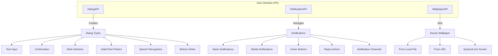
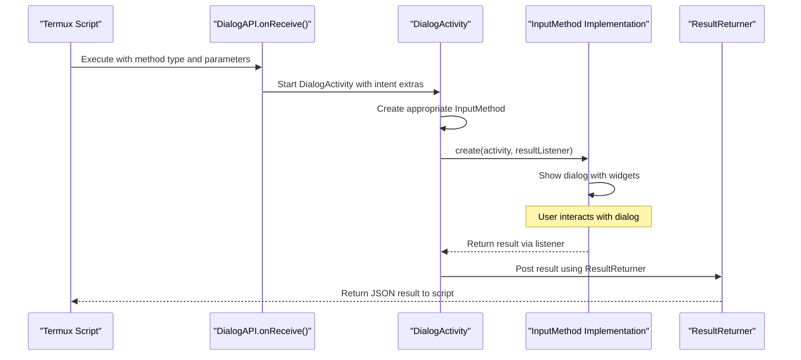
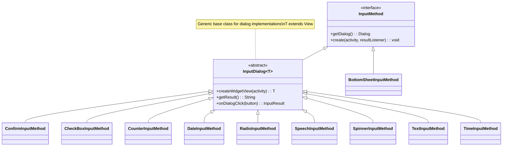
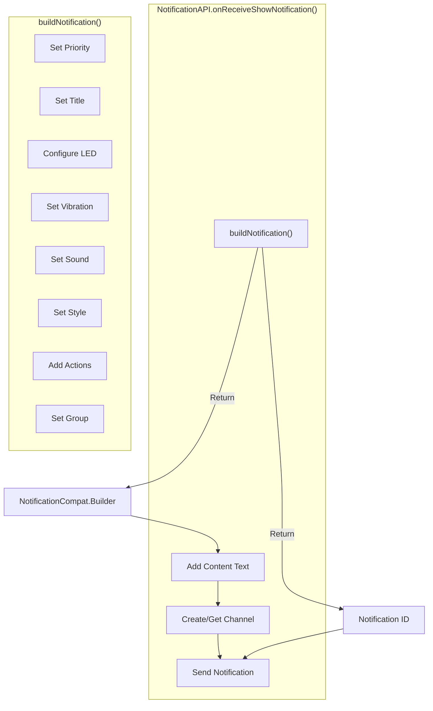
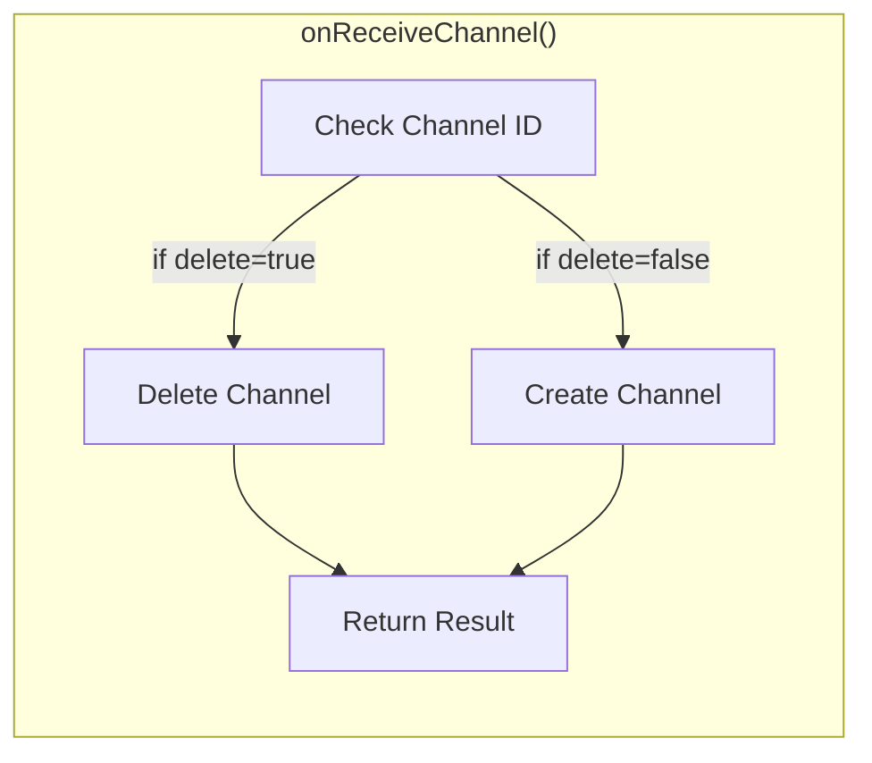
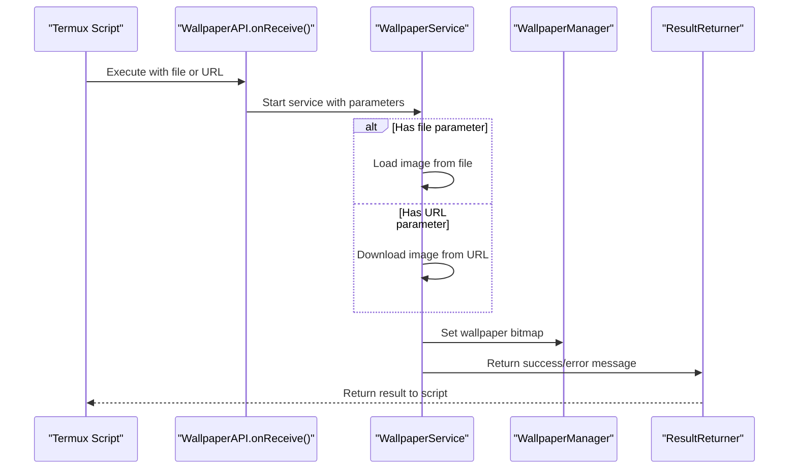
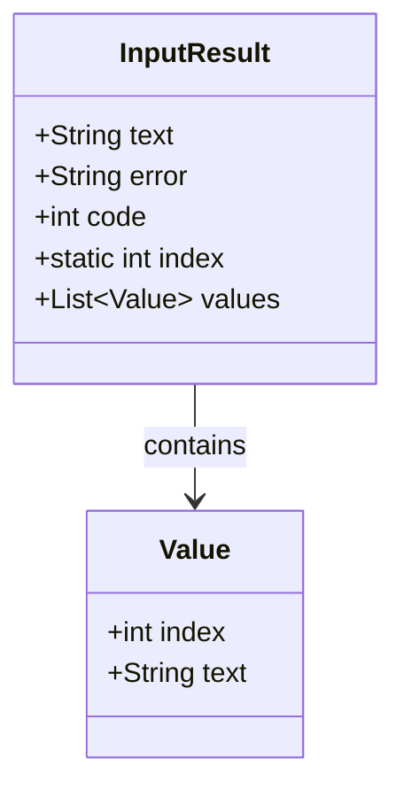

<!-- source: DeepWiki mcp.deepwiki.com · repo termux/termux-api · page 3.3 User Interface APIs · fetched 2026-10-26 -->

# User Interface APIs

<details>
<summary>Relevant source files</summary>

The following files were used as context for generating this wiki page:

- [app/src/main/java/com/termux/api/apis/DialogAPI.java](app/src/main/java/com/termux/api/apis/DialogAPI.java)
- [app/src/main/java/com/termux/api/apis/NotificationAPI.java](app/src/main/java/com/termux/api/apis/NotificationAPI.java)
- [app/src/main/java/com/termux/api/apis/WallpaperAPI.java](app/src/main/java/com/termux/api/apis/WallpaperAPI.java)
- [app/src/main/res/drawable/ic_event_note_black_24dp.xml](app/src/main/res/drawable/ic_event_note_black_24dp.xml)

</details>


## Purpose and Scope

This page documents the User Interface APIs provided by the Termux API application. These APIs allow command-line scripts to interact with Android's native UI components, enabling Termux users to create scripts that can display dialogs, show notifications, and set wallpapers. 

For information about hardware-related APIs like sensors or camera access, see [Hardware APIs](#3.4). For system service interactions, see [System Service APIs](#3.5).

## Overview

The User Interface APIs include:

1. **Dialog API** - Creates various interactive dialog boxes for user input
2. **Notification API** - Displays notifications in the Android notification tray
3. **Wallpaper API** - Sets device wallpapers from files or URLs



Sources: [app/src/main/java/com/termux/api/apis/DialogAPI.java](), [app/src/main/java/com/termux/api/apis/NotificationAPI.java](), [app/src/main/java/com/termux/api/apis/WallpaperAPI.java]()

## Dialog API

The Dialog API provides a variety of interactive dialog interfaces for collecting user input.

### Architecture and Flow



Sources: [app/src/main/java/com/termux/api/apis/DialogAPI.java:68-73](), [app/src/main/java/com/termux/api/apis/DialogAPI.java:103-106]()

### Input Method Types

The Dialog API supports multiple input method types, each providing a different way to collect user input:

| Input Method | Description | Return Values |
|--------------|-------------|---------------|
| `confirm` | Simple yes/no confirmation | `yes` or `no` |
| `checkbox` | Multiple checkbox selection | Array of selected values |
| `counter` | Numeric counter with increment/decrement | Numeric value |
| `date` | Date picker | Date string |
| `radio` | Radio button selection | Selected value and index |
| `sheet` | Bottom sheet selection | Selected value and index |
| `speech` | Speech recognition | Recognized text |
| `spinner` | Dropdown selection | Selected value and index |
| `text` | Text input field | Entered text |
| `time` | Time picker | Time in HH:MM format |

Sources: [app/src/main/java/com/termux/api/apis/DialogAPI.java:218-246]()

### Dialog Input Methods Implementation



Sources: [app/src/main/java/com/termux/api/apis/DialogAPI.java:253-257](), [app/src/main/java/com/termux/api/apis/DialogAPI.java:927-1075]()

### Input Result Format

All dialog inputs return results in a standardized JSON format:

```json
{
  "code": 0,         // Button code (-1 for negative, -2 for positive)
  "text": "result",  // Text result from the input
  "index": 2,        // Index of selection (when applicable)
  "values": [        // Multiple selections (when applicable)
    {
      "index": 0,
      "text": "option1"
    },
    {
      "index": 2,
      "text": "option3"
    }
  ],
  "error": ""        // Error message (if any)
}
```

Sources: [app/src/main/java/com/termux/api/apis/DialogAPI.java:175-211](), [app/src/main/java/com/termux/api/apis/DialogAPI.java:271-277]()

## Notification API

The Notification API allows scripts to create and manage Android notifications.

### Notification Creation Process



Sources: [app/src/main/java/com/termux/api/apis/NotificationAPI.java:49-78](), [app/src/main/java/com/termux/api/apis/NotificationAPI.java:138-310]()

### Notification Customization Options

| Feature | Description | Extra Name |
|---------|-------------|------------|
| Title | Sets notification title | `title` |
| Priority | Sets notification priority | `priority` |
| LED Color | Sets notification LED color | `led-color` |
| Vibration | Sets vibration pattern | `vibrate` |
| Sound | Enables notification sound | `sound` |
| Ongoing | Makes notification persistent | `ongoing` |
| Icon | Sets custom icon | `icon` |
| Image | Adds large image | `image-path` |
| Media Controls | Adds media control buttons | `type=media` |
| Action | Sets tap action | `action` |
| Buttons | Adds action buttons | `button_text_N`, `button_action_N` |
| Reply Action | Adds reply functionality | Action containing `$REPLY` |
| Delete Action | Sets action on dismiss | `on_delete_action` |
| Channel | Sets notification channel | `channel` |

Sources: [app/src/main/java/com/termux/api/apis/NotificationAPI.java:159-302]()

### Notification Channels

For Android 8.0+ (API level 26+), the API provides channel management:



Sources: [app/src/main/java/com/termux/api/apis/NotificationAPI.java:81-115]()

## Wallpaper API

The Wallpaper API allows scripts to set device wallpapers from files or URLs.

### Wallpaper Setting Process



Sources: [app/src/main/java/com/termux/api/apis/WallpaperAPI.java:28-34](), [app/src/main/java/com/termux/api/apis/WallpaperAPI.java:46-57]()

### Wallpaper API Options

| Parameter | Description |
|-----------|-------------|
| `file` | Path to local image file |
| `url` | URL to download image from |
| `lockscreen` | Set as lockscreen wallpaper (default is system wallpaper) |

The API returns a success message or error description through standard output.

Sources: [app/src/main/java/com/termux/api/apis/WallpaperAPI.java:119-133](), [app/src/main/java/com/termux/api/apis/WallpaperAPI.java:135-144]()

## Common Implementation Patterns

### Result Returning Mechanism

All UI APIs use the `ResultReturner` class to send results back to the calling script. The result data is typically formatted as JSON (for dialogs) or plain text (for notifications and wallpaper).

### Error Handling

Error messages are returned through the same channel as successful results:
- Dialog API includes error messages in the JSON response
- Notification API may return errors when creating channels
- Wallpaper API returns error messages when downloading or setting wallpapers fails

### InputResult Class

The Dialog API uses a standardized `InputResult` class to format the results of user interactions:



Sources: [app/src/main/java/com/termux/api/apis/DialogAPI.java:271-283]()

---

