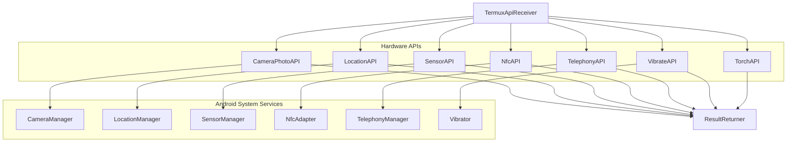
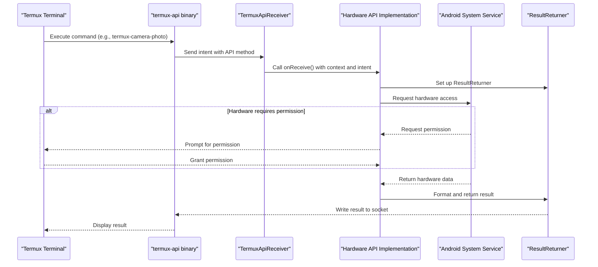
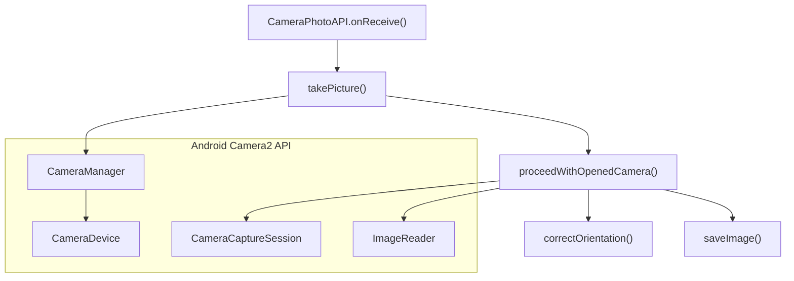
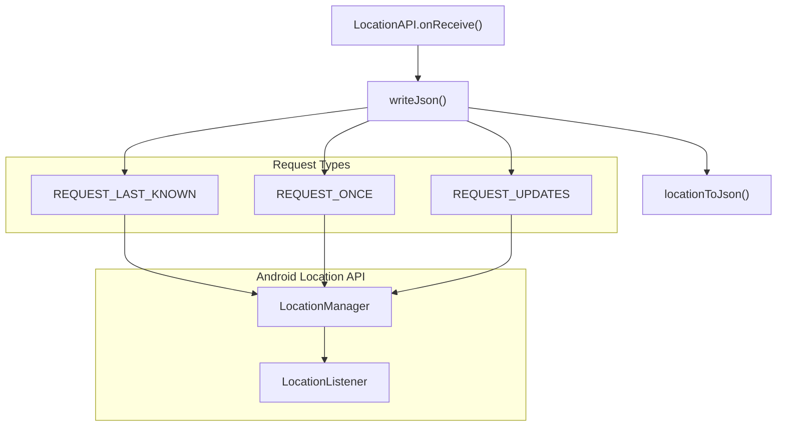
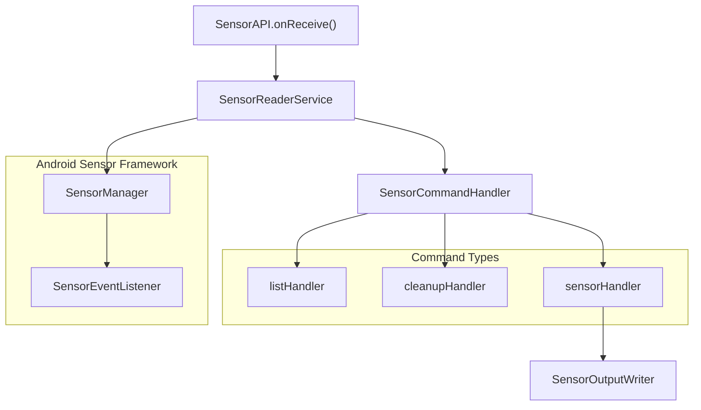
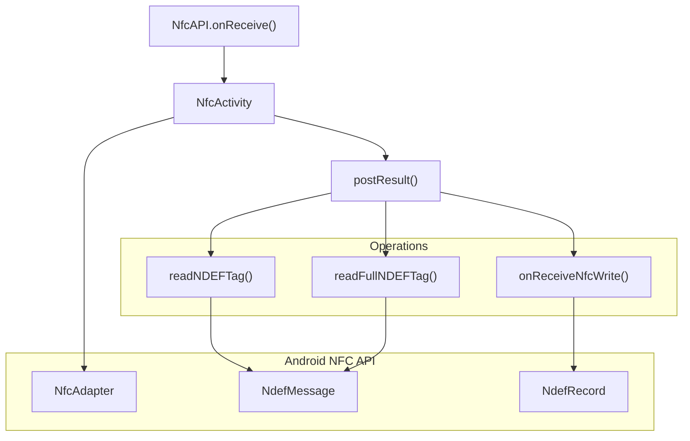
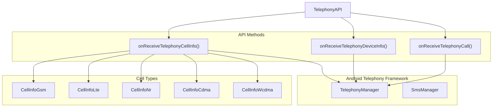
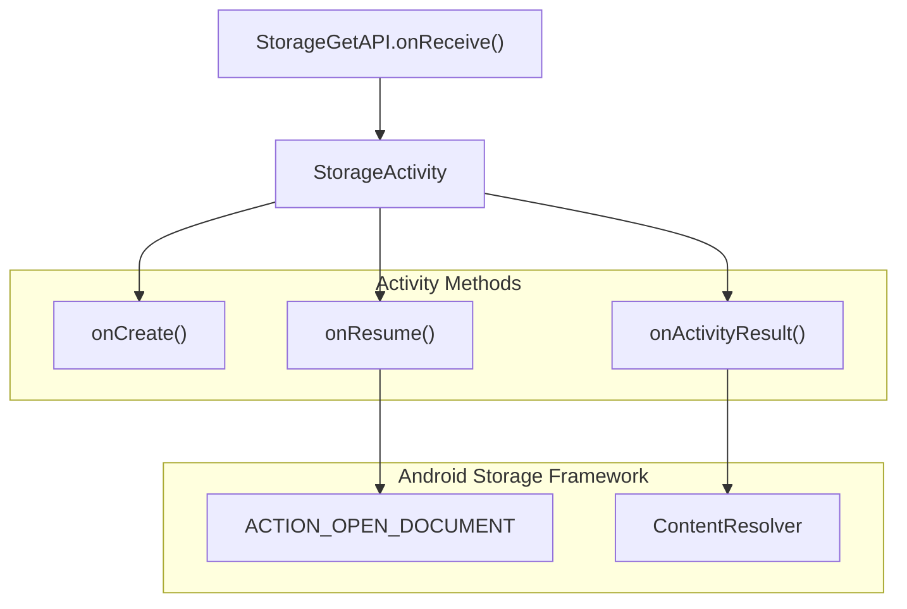
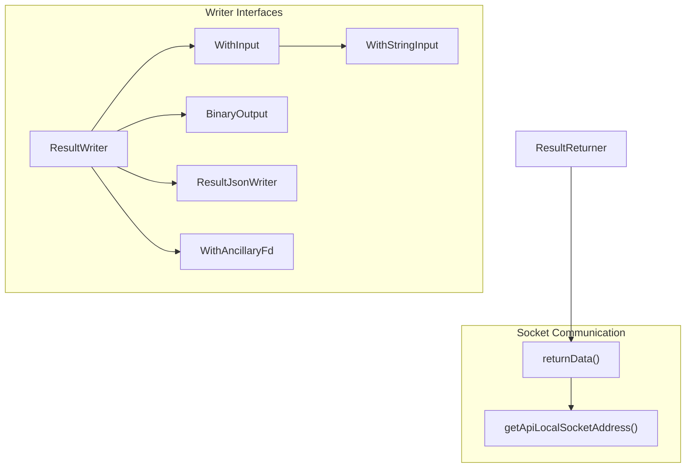

<!-- source: DeepWiki mcp.deepwiki.com · repo termux/termux-api · page 3.4 Hardware APIs · fetched 2026-10-26 -->

# Hardware APIs

Relevant source files

The following files were used as context for generating this wiki page:

- [app/src/main/java/com/termux/api/apis/CameraPhotoAPI.java](app/src/main/java/com/termux/api/apis/CameraPhotoAPI.java)
- [app/src/main/java/com/termux/api/apis/LocationAPI.java](app/src/main/java/com/termux/api/apis/LocationAPI.java)
- [app/src/main/java/com/termux/api/apis/NfcAPI.java](app/src/main/java/com/termux/api/apis/NfcAPI.java)
- [app/src/main/java/com/termux/api/apis/SensorAPI.java](app/src/main/java/com/termux/api/apis/SensorAPI.java)
- [app/src/main/java/com/termux/api/apis/SmsSendAPI.java](app/src/main/java/com/termux/api/apis/SmsSendAPI.java)
- [app/src/main/java/com/termux/api/apis/StorageGetAPI.java](app/src/main/java/com/termux/api/apis/StorageGetAPI.java)
- [app/src/main/java/com/termux/api/apis/TelephonyAPI.java](app/src/main/java/com/termux/api/apis/TelephonyAPI.java)
- [app/src/main/java/com/termux/api/util/ResultReturner.java](app/src/main/java/com/termux/api/util/ResultReturner.java)

## Purpose and Scope

The Hardware APIs in Termux provide command-line access to Android device hardware capabilities, including cameras, sensors, location services, NFC, and telephony functions. These APIs bridge the gap between Unix-like command-line utilities and Android's hardware features, allowing shell scripts to interact with physical device components.

For information about accessing Android system services (like clipboard and battery status) that are not directly hardware-related, see [System Service APIs](#3.5).

## Overview of Hardware APIs

Termux API includes several hardware-related APIs that provide access to different device capabilities:

Sources: [app/src/main/java/com/termux/api/apis/CameraPhotoAPI.java](), [app/src/main/java/com/termux/api/apis/LocationAPI.java](), [app/src/main/java/com/termux/api/apis/SensorAPI.java](), [app/src/main/java/com/termux/api/apis/NfcAPI.java](), [app/src/main/java/com/termux/api/apis/TelephonyAPI.java]()

## Common Implementation Pattern

Hardware APIs follow a common pattern for implementing hardware access:

Sources: [app/src/main/java/com/termux/api/util/ResultReturner.java:36-322]()

## Camera API

The Camera API allows capturing photos using the device's cameras.

### Key Features

- Access to front and rear cameras
- Automatic orientation correction
- Highest resolution image capture
- Saving to specified file path

### Implementation Details

The CameraPhotoAPI uses Android's Camera2 API to capture high-resolution photos. It handles the complexities of camera initialization, preview surface configuration, and image capture.

Sources: [app/src/main/java/com/termux/api/apis/CameraPhotoAPI.java:1-291]()

## Location API

The Location API provides access to the device's location services.

### Key Features

- Support for GPS, Network, and Passive providers
- Multiple request modes:
  - `last`: Returns last known location
  - `once`: Gets a single location update
  - `updates`: Provides continuous location monitoring
- Comprehensive location data including accuracy, altitude, and speed

### Implementation Details

LocationAPI uses Android's LocationManager service to access location data and provides it in JSON format.

Sources: [app/src/main/java/com/termux/api/apis/LocationAPI.java:1-166]()

## Sensor API

The Sensor API provides access to all device sensors.

### Key Features

- List all available sensors
- Monitor multiple sensors simultaneously
- Real-time sensor data streaming
- Configurable update frequency
- Cleanup mechanism for sensor resources

### Implementation Details

SensorAPI runs as a service that can continuously monitor sensors and stream data back to the terminal. The implementation handles sensor registration, data collection, and JSON formatting.

Sources: [app/src/main/java/com/termux/api/apis/SensorAPI.java:1-470]()

## NFC API

The NFC API provides capabilities to read from and write to NFC tags.

### Key Features

- Reading NFC tag data
- Writing text to NFC tags
- Tag metadata retrieval
- Support for NDEF format

### Implementation Details

NfcAPI uses an activity to interact with NFC tags, as Android requires an activity context for NFC operations. The implementation handles the intents that are triggered when an NFC tag is discovered.

Sources: [app/src/main/java/com/termux/api/apis/NfcAPI.java:1-326]()

## Telephony API

The Telephony API provides access to cellular network information and phone functionality.

### Key Features

- Cell tower information
- Signal strength data
- Network operator details
- SIM card information
- Initiating phone calls

### Implementation Details

TelephonyAPI uses Android's TelephonyManager to access detailed information about cellular networks and provides phone call capabilities.

Sources: [app/src/main/java/com/termux/api/apis/TelephonyAPI.java:1-428]()

## Storage Access API

While technically not hardware-focused, the Storage API provides access to the device's storage system through Android's Storage Access Framework, which is an important hardware-adjacent capability.

### Key Features

- Access to system file picker
- Import files to Termux storage
- Handles system file permissions

### Implementation Details

StorageGetAPI launches Android's file picker and copies selected files to a specified Termux path.

Sources: [app/src/main/java/com/termux/api/apis/StorageGetAPI.java:1-122]()

## Result Returning Mechanism

All hardware APIs use the `ResultReturner` utility class to send data back to the Termux terminal. This provides a consistent interface for returning data through socket connections.

### Key Components

| Interface/Class | Description |
|-----------------|-------------|
| `ResultWriter` | Base interface for writing results |
| `WithInput` | For APIs that need to read input data |
| `BinaryOutput` | For APIs that return binary data |
| `ResultJsonWriter` | For APIs that return JSON data |
| `WithAncillaryFd` | For APIs that need to send file descriptors |

### Implementation Details

Sources: [app/src/main/java/com/termux/api/util/ResultReturner.java:36-322]()

## Permissions

Hardware APIs often require specific Android permissions to function properly. Most hardware features are protected by the Android permission system.

| API | Required Permissions |
|-----|---------------------|
| Camera | `CAMERA` |
| Location | `ACCESS_FINE_LOCATION` |
| Telephony | `READ_PHONE_STATE`, `CALL_PHONE` |
| SMS | `SEND_SMS`, `READ_SMS` |
| Storage | `READ_EXTERNAL_STORAGE`, `WRITE_EXTERNAL_STORAGE` |

The permission system is handled by the Android platform, and users will be prompted to grant permissions when using these APIs for the first time.

Sources: [app/src/main/java/com/termux/api/apis/LocationAPI.java:36-37](), [app/src/main/java/com/termux/api/apis/TelephonyAPI.java:192-193](), [app/src/main/java/com/termux/api/apis/SmsSendAPI.java:27-27]()

---

