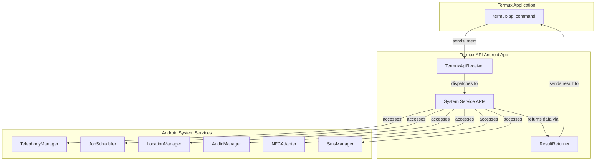
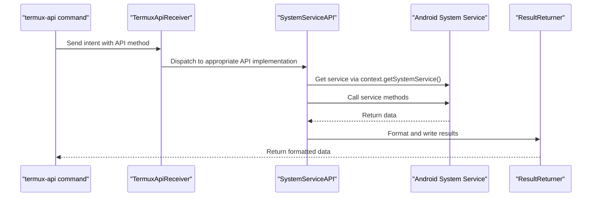
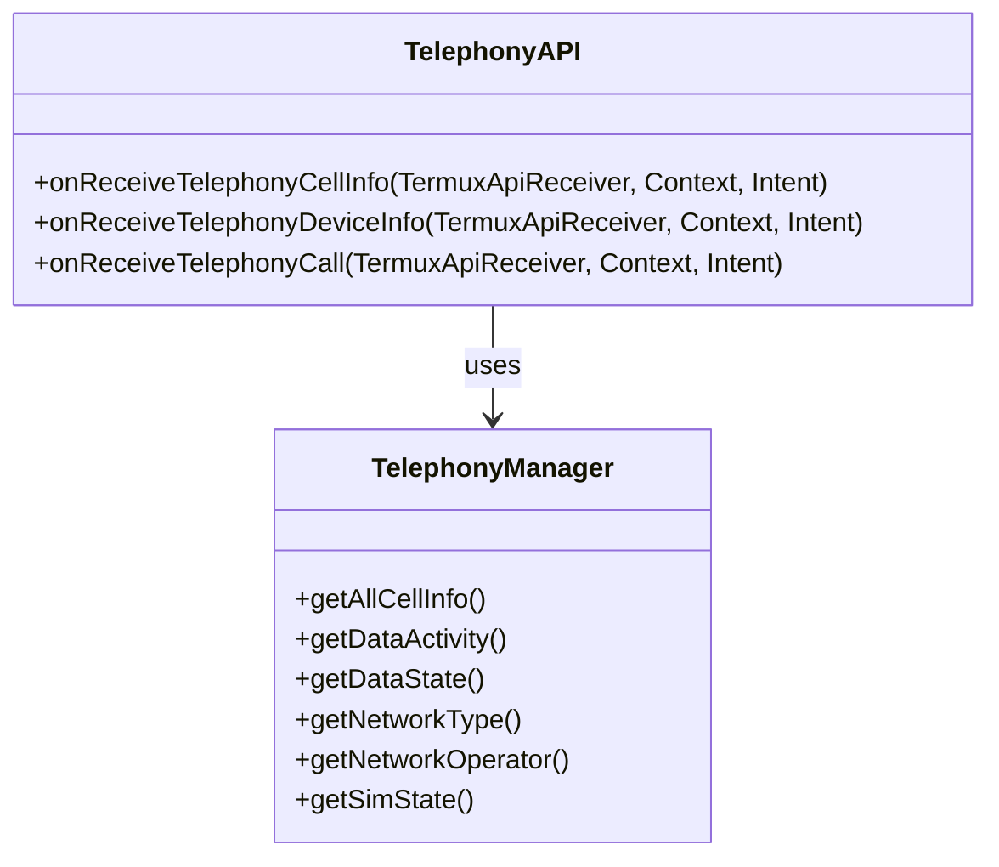
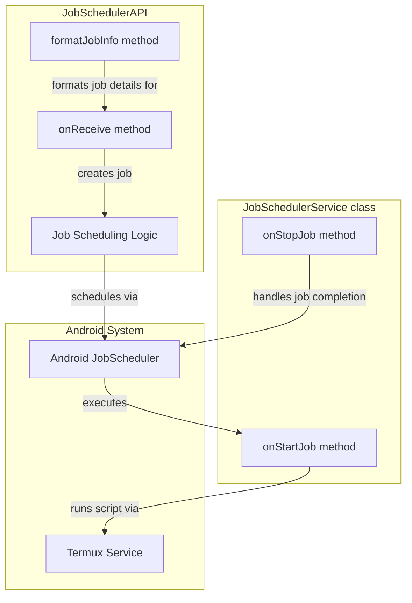
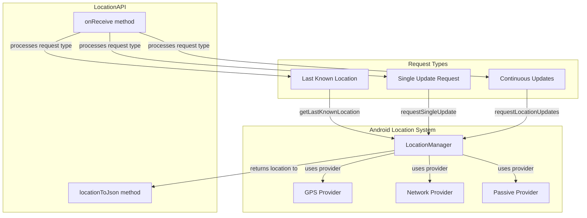
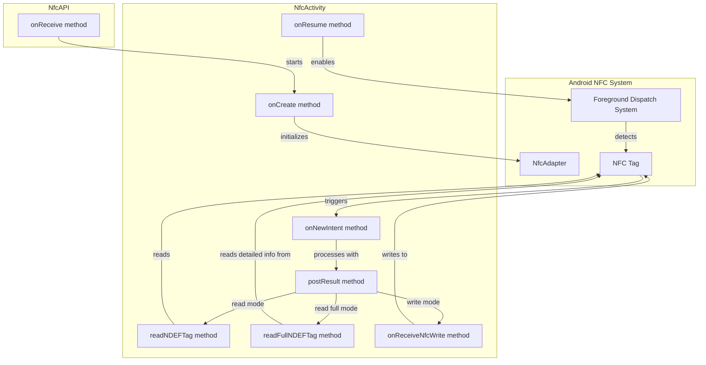
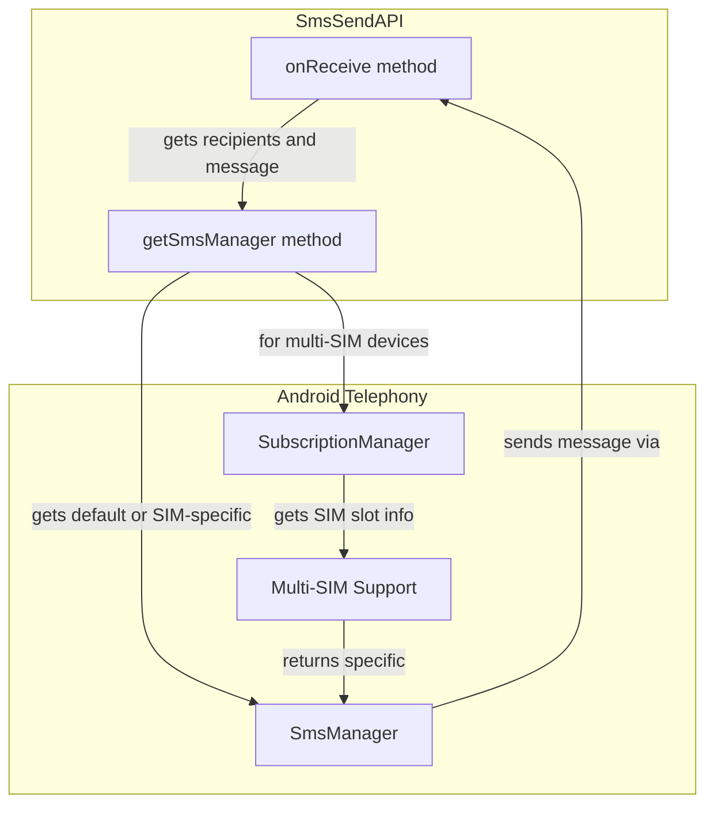

<!-- source: DeepWiki mcp.deepwiki.com · repo termux/termux-api · page 3.5 System Service APIs · fetched 2026-10-26 -->

# System Service APIs

<details>
<summary>Relevant source files</summary>

The following files were used as context for generating this wiki page:

- [app/src/main/java/com/termux/api/apis/AudioAPI.java](app/src/main/java/com/termux/api/apis/AudioAPI.java)
- [app/src/main/java/com/termux/api/apis/JobSchedulerAPI.java](app/src/main/java/com/termux/api/apis/JobSchedulerAPI.java)
- [app/src/main/java/com/termux/api/apis/LocationAPI.java](app/src/main/java/com/termux/api/apis/LocationAPI.java)
- [app/src/main/java/com/termux/api/apis/NfcAPI.java](app/src/main/java/com/termux/api/apis/NfcAPI.java)
- [app/src/main/java/com/termux/api/apis/SmsSendAPI.java](app/src/main/java/com/termux/api/apis/SmsSendAPI.java)
- [app/src/main/java/com/termux/api/apis/TelephonyAPI.java](app/src/main/java/com/termux/api/apis/TelephonyAPI.java)

</details>


The System Service APIs in the Termux API project provide command-line access to core Android system services. These APIs serve as a bridge between the Termux command-line environment and various Android system capabilities, allowing scripts to interact with device hardware and system features that would otherwise be inaccessible from a terminal environment.

For information about hardware-specific APIs (sensors, camera, etc.), see [Hardware APIs](#3.4).

## Overview of System Service APIs

The Termux API project implements several classes that interface with Android system services. These implementations follow a common pattern: they receive intents from the TermuxApiReceiver, interact with Android system services, and return results back to the Termux application.



Sources: [app/src/main/java/com/termux/api/apis/TelephonyAPI.java:58-185](), [app/src/main/java/com/termux/api/apis/JobSchedulerAPI.java:63-86]()

## Common System Service API Pattern

System Service APIs in Termux follow a consistent implementation pattern:

1. Receive an intent via `onReceive` method from TermuxApiReceiver
2. Access the corresponding Android system service via `context.getSystemService()`
3. Execute operations and collect data from the system service
4. Format results (usually as JSON) and return them via ResultReturner



Sources: [app/src/main/java/com/termux/api/apis/TelephonyAPI.java:54-186](), [app/src/main/java/com/termux/api/apis/AudioAPI.java:19-88]()

## Available System Service APIs

Below is a table of the primary System Service APIs available in Termux API:

| API Name | Android Service | Purpose | Permission Requirements |
|----------|----------------|---------|-------------------------|
| TelephonyAPI | TelephonyManager | Access phone state, network info, make calls | READ_PHONE_STATE, CALL_PHONE |
| JobSchedulerAPI | JobScheduler | Schedule background tasks | Various based on job type |
| LocationAPI | LocationManager | Access device location | ACCESS_FINE_LOCATION |
| AudioAPI | AudioManager | Get audio system information | None |
| NfcAPI | NfcAdapter | Read and write NFC tags | NFC |
| SmsSendAPI | SmsManager | Send SMS messages | SEND_SMS, READ_PHONE_STATE |

Sources: [app/src/main/java/com/termux/api/apis/TelephonyAPI.java:33-34](), [app/src/main/java/com/termux/api/apis/JobSchedulerAPI.java:28-31](), [app/src/main/java/com/termux/api/apis/LocationAPI.java:24-27](), [app/src/main/java/com/termux/api/apis/NfcAPI.java:22-25](), [app/src/main/java/com/termux/api/apis/AudioAPI.java:15-18](), [app/src/main/java/com/termux/api/apis/SmsSendAPI.java:19-22]()

## Telephony API

The TelephonyAPI provides access to device and network information through Android's TelephonyManager service.

### Functionality

The TelephonyAPI offers three primary functions:

1. **Cell Information** - Access detailed information about cellular network cells
2. **Device Information** - Retrieve device telephony details (network type, SIM information, etc.)
3. **Make Phone Calls** - Initiate phone calls from Termux



Sources: [app/src/main/java/com/termux/api/apis/TelephonyAPI.java:34-427]()

### Cell Information

The `onReceiveTelephonyCellInfo` method returns detailed information about cellular network cells. It supports various cell types:

- GSM cells (2G)
- LTE cells (4G)
- NR cells (5G, Android 10+)
- CDMA cells
- WCDMA cells (3G)

For each cell, it returns signal strength information (dBm, ASU level) and cell identification data (cell IDs, network codes).

Sources: [app/src/main/java/com/termux/api/apis/TelephonyAPI.java:54-186]()

### Device Information

The `onReceiveTelephonyDeviceInfo` method retrieves device telephony details including:

- Data connection state and activity
- Network operator and country information
- Network type (GSM, CDMA, LTE, etc.)
- SIM information (operator, country, state)
- Device identifiers (when permissions allow)

Sources: [app/src/main/java/com/termux/api/apis/TelephonyAPI.java:188-397]()

### Phone Calls

The `onReceiveTelephonyCall` method allows initiating phone calls by creating an intent with `ACTION_CALL` and the telephone number.

Sources: [app/src/main/java/com/termux/api/apis/TelephonyAPI.java:399-425]()

## Job Scheduler API

The JobSchedulerAPI provides access to Android's JobScheduler service, allowing Termux scripts to schedule background tasks that run based on specific conditions.

### JobScheduler Architecture



Sources: [app/src/main/java/com/termux/api/apis/JobSchedulerAPI.java:28-254]()

### Job Configuration Options

JobSchedulerAPI allows configuring jobs with various constraints:

| Parameter | Description | Default |
|-----------|-------------|---------|
| `job_id` | Unique identifier for the job | 0 |
| `period_ms` | Job execution interval in milliseconds | 0 (non-periodic) |
| `network` | Network requirements (any, unmetered, cellular, not_roaming, none) | 'any' |
| `battery_not_low` | Only run when battery isn't low | true |
| `charging` | Only run when device is charging | false |
| `persisted` | Job persists across device reboots | false |
| `idle` | Only run when device is idle | false |
| `storage_not_low` | Only run when storage isn't low | false |

Sources: [app/src/main/java/com/termux/api/apis/JobSchedulerAPI.java:67-81](), [app/src/main/java/com/termux/api/apis/JobSchedulerAPI.java:153-166]()

### Job Management

The JobSchedulerAPI provides methods for job management:

- **Schedule** - Create and schedule a new job (default operation)
- **Pending** - List all pending jobs that have been scheduled
- **Cancel** - Cancel a specific job by its ID
- **Cancel All** - Cancel all pending jobs

When a job runs, it executes the specified script file via the Termux Service.

Sources: [app/src/main/java/com/termux/api/apis/JobSchedulerAPI.java:113-179](), [app/src/main/java/com/termux/api/apis/JobSchedulerAPI.java:211-252]()

## Location API

The LocationAPI provides access to device location information using Android's LocationManager.

### Location Request Types

The API supports three types of location requests:

1. **Last Known** (`last`) - Returns the last known location from the specified provider
2. **Once** (`once`) - Requests a single location update and returns it
3. **Updates** (`updates`) - Provides continuous location updates for a fixed duration (30 seconds)



Sources: [app/src/main/java/com/termux/api/apis/LocationAPI.java:32-144]()

### Location Data

The API returns detailed location information in JSON format, including:

- Latitude and longitude
- Altitude
- Accuracy and vertical accuracy (Android 8.0+)
- Bearing and speed
- Time elapsed since fix
- Provider name (GPS, Network, or Passive)

Sources: [app/src/main/java/com/termux/api/apis/LocationAPI.java:146-166]()

## NFC API

The NfcAPI provides functionality to read and write to NFC tags. The implementation uses an activity-based approach since NFC interactions require foreground app presence.

### NFC Architecture



Sources: [app/src/main/java/com/termux/api/apis/NfcAPI.java:22-325]()

### NFC Operations

The NfcAPI supports the following operations:

1. **Read Mode** - Read basic NDEF tag data
   - `short` parameter: Basic tag content
   - `full` parameter: Detailed tag information including ID, type, and records
   
2. **Write Mode** - Write text data to NDEF tags
   - `text` parameter: Write plain text to the tag

Each operation returns the result as a JSON object.

Sources: [app/src/main/java/com/termux/api/apis/NfcAPI.java:141-198](), [app/src/main/java/com/termux/api/apis/NfcAPI.java:201-314]()

## Audio API

The AudioAPI provides information about the device's audio system by querying the AudioManager service.

### Audio Information

The API returns detailed audio configuration data:

- Sample rate information from AudioManager properties
- Buffer size information
- Performance mode data (low latency, power saving)
- Connection status (Bluetooth A2DP, wired headset)

The data is returned in JSON format, making it easy to parse in shell scripts.

Sources: [app/src/main/java/com/termux/api/apis/AudioAPI.java:19-88]()

## SMS API

The SmsSendAPI allows sending SMS messages via Android's SmsManager.

### SMS Sending Functionality



Sources: [app/src/main/java/com/termux/api/apis/SmsSendAPI.java:21-74]()

### Multi-SIM Support

The SmsSendAPI includes support for devices with multiple SIM cards. You can specify which SIM slot to use for sending messages:

- Default behavior: Uses the default SmsManager
- With `slot` parameter: Selects a specific SIM slot for sending the message

Sources: [app/src/main/java/com/termux/api/apis/SmsSendAPI.java:54-72]()

## Permission Requirements

System Service APIs often require specific Android permissions to function. These permissions must be granted to the Termux:API app for the commands to work properly.

| API | Required Permissions |
|-----|---------------------|
| TelephonyAPI | READ_PHONE_STATE, CALL_PHONE |
| LocationAPI | ACCESS_FINE_LOCATION |
| SmsSendAPI | SEND_SMS, READ_PHONE_STATE |
| NfcAPI | NFC |
| JobSchedulerAPI | Various based on job configuration |
| AudioAPI | None |

If a permission is missing, the API will typically return an error or limited functionality.

Sources: [app/src/main/java/com/termux/api/apis/TelephonyAPI.java:192-193](), [app/src/main/java/com/termux/api/apis/LocationAPI.java:36-37](), [app/src/main/java/com/termux/api/apis/SmsSendAPI.java:27]()

## API Result Format

Most System Service APIs return data in JSON format to ensure standardized parsing in shell scripts. The ResultReturner utility handles the formatting and delivery of results.

Example JSON structure from TelephonyAPI cell info:
```
[
  {
    "type": "lte",
    "registered": true,
    "asu": 15,
    "dbm": -95,
    "level": 3,
    "ci": 12345678,
    "pci": 123,
    "tac": 12345,
    "mcc": 310,
    "mnc": 410
  }
]
```

Sources: [app/src/main/java/com/termux/api/apis/TelephonyAPI.java:57-185]()

---

