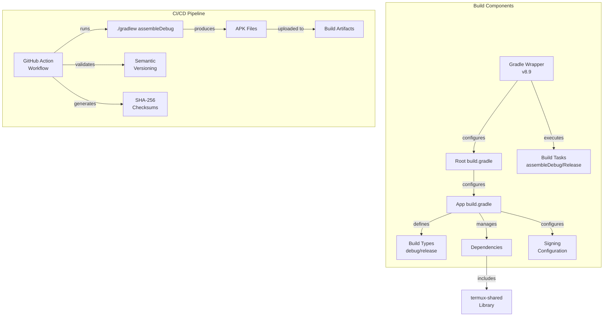
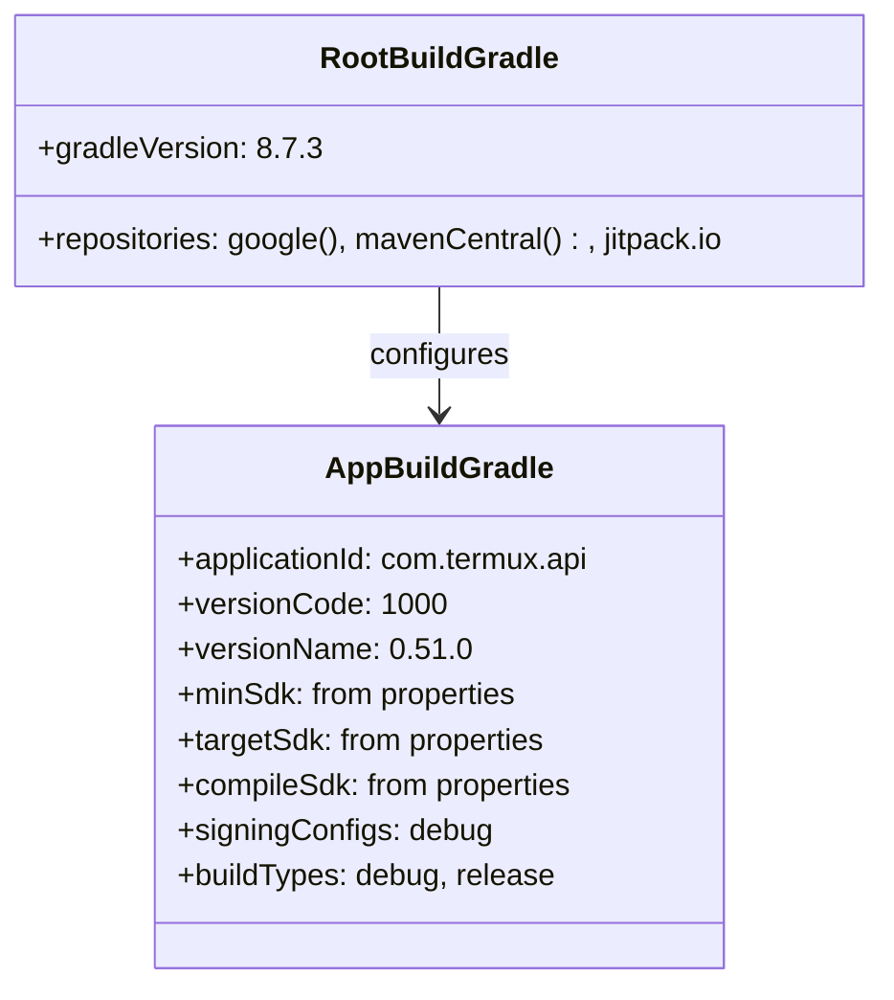
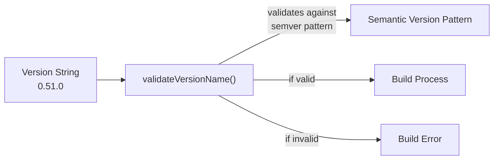
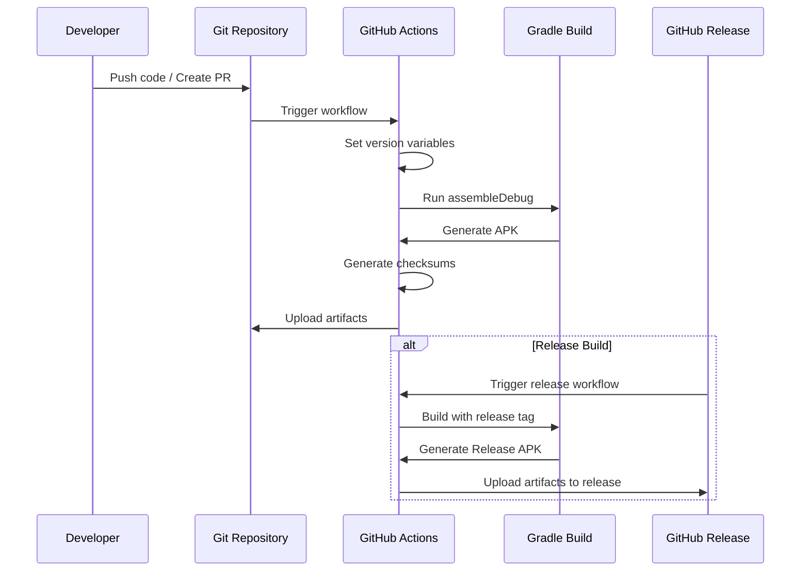
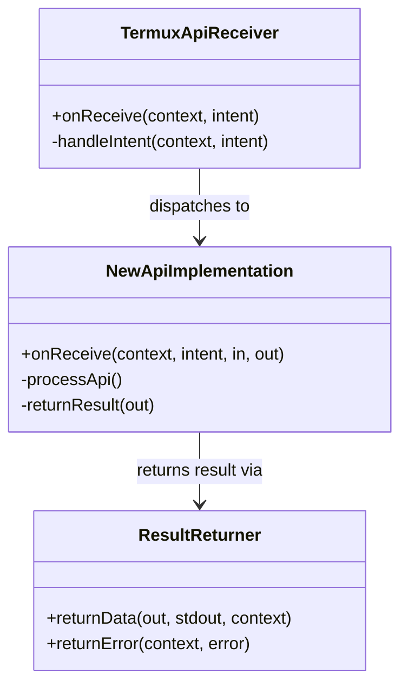
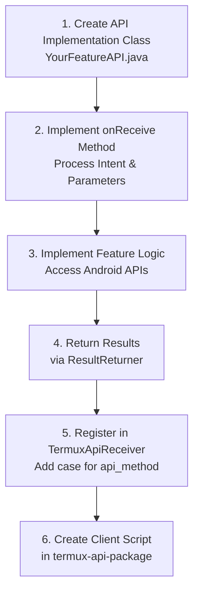

<!-- source: DeepWiki mcp.deepwiki.com · repo termux/termux-api · page 4 Building and Development · fetched 2026-10-26 -->

# Building and Development

<details>
<summary>Relevant source files</summary>

The following files were used as context for generating this wiki page:

- [.github/workflows/github_action_build.yml](.github/workflows/github_action_build.yml)
- [.github/workflows/github_release_build.yml](.github/workflows/github_release_build.yml)
- [.gitignore](.gitignore)
- [README.md](README.md)
- [app/build.gradle](app/build.gradle)
- [build.gradle](build.gradle)
- [gradle/wrapper/gradle-wrapper.jar](gradle/wrapper/gradle-wrapper.jar)
- [gradle/wrapper/gradle-wrapper.properties](gradle/wrapper/gradle-wrapper.properties)

</details>


This document provides comprehensive information about building, developing, and extending the Termux:API application. It covers the build system configuration, development environment setup, CI/CD workflows, and guidelines for implementing new API features.

For information about Termux:API architecture and components, see [Architecture](#2).

## Development Environment Setup

To set up a development environment for Termux:API, you'll need:

1. Android Studio or IntelliJ IDEA with Android plugin
2. JDK 11 or higher
3. Android SDK with API 29 or higher
4. Git

### Setting Up the Project

```
git clone https://github.com/termux/termux-api.git
cd termux-api
```

The project uses the Gradle build system with a wrapper, so you don't need to install Gradle separately.

Sources: [README.md:12-25]()

## Build System

Termux:API uses Gradle as its build system. The project follows a standard Android application structure with configuration in the root and app-level build.gradle files.

### Build System Architecture



Sources: [build.gradle:1-22](), [app/build.gradle:1-97](), [gradle/wrapper/gradle-wrapper.properties:1-6]()

### Gradle Configuration

The root `build.gradle` file configures repositories and the Gradle plugin version:



The app-level `build.gradle` defines application-specific configurations:

- Application ID: `com.termux.api`
- Version name: `0.51.0`
- Java compatibility: JDK 11
- ProGuard rules for release builds
- Signing configuration for debug builds

Sources: [app/build.gradle:3-66](), [build.gradle:1-22]()

### Dependencies

The project depends on several libraries:

- Android core libraries (Material, Biometric, Media, Preference)
- Termux shared library from `com.termux.termux-app:termux-shared:9ee1c9d5ad`
- JDK desugaring for backward compatibility

Sources: [app/build.gradle:68-82]()

## Building the Project

### Local Building

To build the project locally:

```bash
# Debug build
./gradlew assembleDebug

# Release build
./gradlew assembleRelease
```

The built APK files will be located in:
- Debug: `app/build/outputs/apk/debug/`
- Release: `app/build/outputs/apk/release/`

### Version Naming

The app follows semantic versioning (MAJOR.MINOR.PATCH). The build system validates that the version adheres to semantic versioning format.



Sources: [app/build.gradle:91-97]()

## CI/CD Pipeline

Termux:API uses GitHub Actions for continuous integration and delivery.

### Build Workflows

Two main workflows are defined:

1. **GitHub Action Build** (`github_action_build.yml`): Triggered by:
   - Pushes to master
   - Pull requests to master
   - Bi-monthly schedule
   - Manual triggers

2. **GitHub Release Build** (`github_release_build.yml`): Triggered when a release is published

### Build Process



The build process includes:
1. Setting version variables based on the current version in `app/build.gradle`
2. Building the APK with the appropriate version tag
3. Validating the built APK
4. Generating SHA-256 checksums
5. Uploading artifacts (for regular builds) or to GitHub releases (for release builds)

Sources: [.github/workflows/github_action_build.yml:1-76](), [.github/workflows/github_release_build.yml:1-65]()

## Version Management

The project follows semantic versioning (MAJOR.MINOR.PATCH) with optional prerelease and metadata components. Version validation is enforced in both:

1. Gradle build configuration
2. GitHub workflows

For development builds, the version is augmented with the commit hash:
- Format: `v0.51.0+abcdef1.github.debug`

For releases, the version is taken directly from the tag name:
- Format: `v0.51.0+github.debug`

Sources: [app/build.gradle:91-97](), [.github/workflows/github_action_build.yml:32-38](), [.github/workflows/github_release_build.yml:31-34]()

## Implementing New APIs

To extend Termux:API with new functionality, you'll need to understand how API implementations work.

### API Implementation Architecture



### Implementation Steps

1. **Create a new API implementation class**:
   - The class should handle a specific API feature
   - Follow the naming convention `YourFeatureAPI.java`
   - Place it in the `com.termux.api` package

2. **Implement the `onReceive` method**:
   - Process input parameters from the `Intent`
   - Implement the feature logic
   - Return results via `ResultReturner`

3. **Register the API in `TermuxApiReceiver`**:
   - Add a new case in the switch statement in the `handleIntent` method
   - Map your API method name to your implementation

4. **Add client script** (in the [termux-api-package](https://github.com/termux/termux-api-package) repository):
   - Create a shell script that processes arguments
   - Call the `termux-api` binary with appropriate parameters

### API Implementation Flow



### Example API Implementation Structure

When implementing a new API, follow this general structure:

```java
package com.termux.api;

public class YourFeatureAPI {
    public static void onReceive(Context context, Intent intent) {
        ResultReturner.returnData(intent, stdout -> {
            // Your implementation here
            stdout.println("API result");
        });
    }
}
```

Then register it in `TermuxApiReceiver`:

```java
switch (apiMethod) {
    // Existing cases...
    case "your_feature":
        YourFeatureAPI.onReceive(context, intent);
        break;
}
```

Sources: [README.md:45-48]()

## Signing Considerations

When developing or packaging Termux:API, the app must be signed with the same key as the main Termux app for permissions to work properly. This is because only the main Termux app is allowed to call the API methods in the Termux:API app.

The debug build configuration includes a test key for development, but for actual distribution, proper signing keys must be used.

Sources: [README.md:8-10](), [app/build.gradle:25-32]()

---

