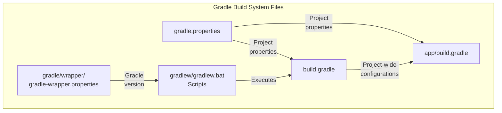
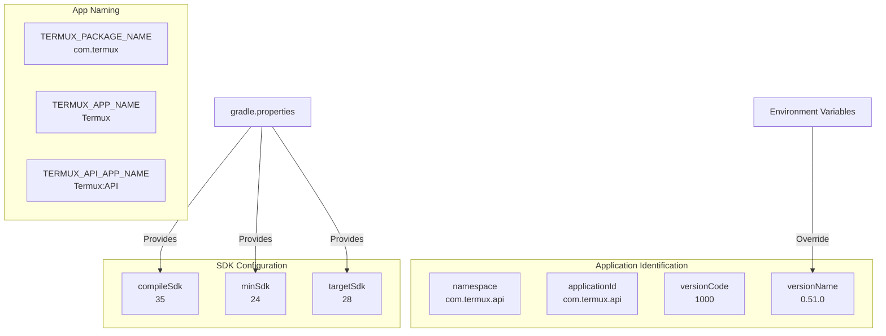
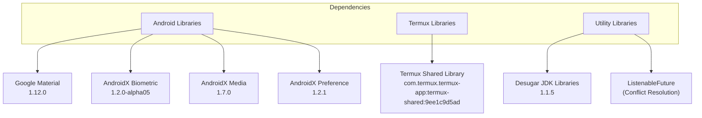
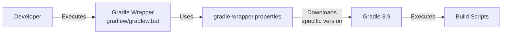
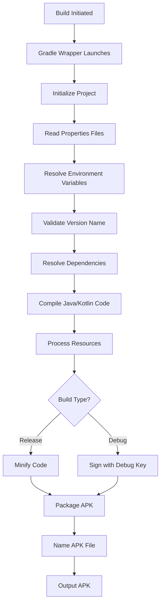

<!-- source: DeepWiki mcp.deepwiki.com · repo termux/termux-api · page 4.1 Build System · fetched 2026-10-26 -->

# Build System

<details>
<summary>Relevant source files</summary>

The following files were used as context for generating this wiki page:

- [app/build.gradle](app/build.gradle)
- [app/src/main/res/layout/dialog_counter.xml](app/src/main/res/layout/dialog_counter.xml)
- [app/src/main/res/layout/spinner_item.xml](app/src/main/res/layout/spinner_item.xml)
- [app/src/main/res/values/styles.xml](app/src/main/res/values/styles.xml)
- [build.gradle](build.gradle)
- [gradle.properties](gradle.properties)
- [gradle/wrapper/gradle-wrapper.jar](gradle/wrapper/gradle-wrapper.jar)
- [gradle/wrapper/gradle-wrapper.properties](gradle/wrapper/gradle-wrapper.properties)
- [gradlew](gradlew)
- [gradlew.bat](gradlew.bat)

</details>


The Termux API project uses Gradle as its build system to compile, test, and package the Android application. This document describes the Gradle configuration, project structure, dependencies, and customization options used in the Termux API. For information about extending the API with new functionality, see [Extending Termux API](#4.2).

## Gradle Configuration Overview

The build system uses a multi-file Gradle configuration that defines how the Termux API application is built, versioned, and packaged.



Sources: [build.gradle](), [app/build.gradle](), [gradle.properties](), [gradle/wrapper/gradle-wrapper.properties](), [gradlew](), [gradlew.bat]()

## Application Configuration

The app's core configuration is defined in the application's `build.gradle` file, which specifies the build parameters, SDK versions, application metadata, and dependencies.

### Package and Version Configuration



Sources: [app/build.gradle:3-23](), [gradle.properties:23-25]()

The build system supports dynamic version naming via environment variables, allowing CI/CD systems to specify version information:

- `TERMUX_API_APP__BUILD__APP_VERSION_NAME`: Overrides the application version name
- `TERMUX_API_APP__BUILD__APK_VERSION_TAG`: Customizes the APK filename

Sources: [app/build.gradle:7-8](), [app/build.gradle:54-58]()

### Build Types

The application defines two build types with specific configurations:

| Build Type | Minify | Shrink Resources | ProGuard | Signing |
|------------|--------|------------------|----------|---------|
| release    | Yes    | No               | Yes      | -       |
| debug      | No     | No               | No       | testkey_untrusted.jks |

Sources: [app/build.gradle:25-43]()

## Dependency Management

The Termux API relies on several dependencies to provide its functionality:



Sources: [app/build.gradle:68-82]()

### Java Compatibility

The project uses Java 11 features while ensuring backward compatibility through the Desugar JDK libraries:

```
compileOptions {
    coreLibraryDesugaringEnabled true
    sourceCompatibility JavaVersion.VERSION_11
    targetCompatibility JavaVersion.VERSION_11
}
```

Sources: [app/build.gradle:46-52](), [app/build.gradle:69]()

## APK Output Configuration

The build system customizes the output APK filenames to include version information:

```
applicationVariants.all { variant ->
    variant.outputs.all { output ->
        outputFileName = new File("termux-api-app_" +
                (apkVersionTag ? apkVersionTag : "v" + versionName + "+" + variant.buildType.name) + ".apk")
    }
}
```

Examples of generated filenames:
- `termux-api-app_v0.51.0+release.apk`
- `termux-api-app_v0.51.0+debug.apk`
- `termux-api-app_custom-tag.apk` (when `TERMUX_API_APP__BUILD__APK_VERSION_TAG` is set)

Sources: [app/build.gradle:54-59]()

## Gradle Wrapper

The project uses Gradle Wrapper to ensure consistent builds across different development environments and CI/CD systems:



Key wrapper configuration:
- Gradle version: 8.9
- Distribution type: all (includes sources, docs)
- Distribution URL: `https://services.gradle.org/distributions/gradle-8.9-all.zip`

Sources: [gradle/wrapper/gradle-wrapper.properties](), [gradlew](), [gradlew.bat]()

## Repository Configuration

The project accesses dependencies from multiple repositories:

```
allprojects {
    repositories {
        google()
        mavenCentral()
        //mavenLocal()
        maven { url "https://jitpack.io" }
    }
}
```

This configuration allows the project to:
- Access official Android libraries from Google's repository
- Access general open-source libraries from Maven Central
- Access GitHub-hosted libraries through JitPack
- Optionally use locally published libraries (commented out by default)

Sources: [build.gradle:11-18]()

## Custom Tasks and Version Validation

The build system includes custom tasks and validation logic:

### versionName Task

A custom task that outputs the version name:

```
task versionName {
    doLast {
        print android.defaultConfig.versionName
    }
}
```

Sources: [app/build.gradle:85-89]()

### Version Name Validation

The build enforces semantic versioning through regex validation:

```
static def validateVersionName(String versionName) {
    // Semantic version regex
    if (!java.util.regex.Pattern.matches("^(0|[1-9]\\d*)\\.(0|[1-9]\\d*)\\.(0|[1-9]\\d*)(?:-((?:0|[1-9]\\d*|\\d*[a-zA-Z-][0-9a-zA-Z-]*)(?:\\.(?:0|[1-9]\\d*|\\d*[a-zA-Z-][0-9a-zA-Z-]*))*))?(?:\\+([0-9a-zA-Z-]+(?:\\.[0-9a-zA-Z-]+)*))?\$", versionName))
        throw new GradleException("The versionName '" + versionName + "' is not a valid version as per semantic version '2.0.0' spec...")
}
```

Sources: [app/build.gradle:91-97]()

## Build Process Flow

The complete build process involves several steps from initialization to APK generation:



Sources: [app/build.gradle](), [build.gradle](), [gradle.properties]()

## Environment Setup

To use the build system effectively, developers need:

1. JDK 11 or newer
2. Android SDK with build tools and platform tools
3. Environment variables for custom builds:
   - `TERMUX_API_APP__BUILD__APP_VERSION_NAME`
   - `TERMUX_API_APP__BUILD__APK_VERSION_TAG`

Sources: [app/build.gradle:7-8](), [app/build.gradle:50-51]()

## Common Build Commands

| Command | Description |
|---------|-------------|
| `./gradlew assemble` | Build all variants |
| `./gradlew assembleDebug` | Build debug APK |
| `./gradlew assembleRelease` | Build release APK |
| `./gradlew versionName` | Display version name |
| `./gradlew clean` | Clean build outputs |
| `./gradlew installDebug` | Install debug APK |

Sources: [app/build.gradle:85-89](), [build.gradle:20-22](), [gradlew]()

## Packaging Optimization

The build system excludes unnecessary native libraries from the final APK:

```
packagingOptions {
    // Remove terminal-emulator and termux-shared JNI libs added via termux-shared dependency
    exclude "lib/*/libtermux.so"
    exclude "lib/*/liblocal-socket.so"
}
```

This optimization ensures the APK doesn't include native libraries that are already part of the main Termux application.

Sources: [app/build.gradle:61-65]()

---

