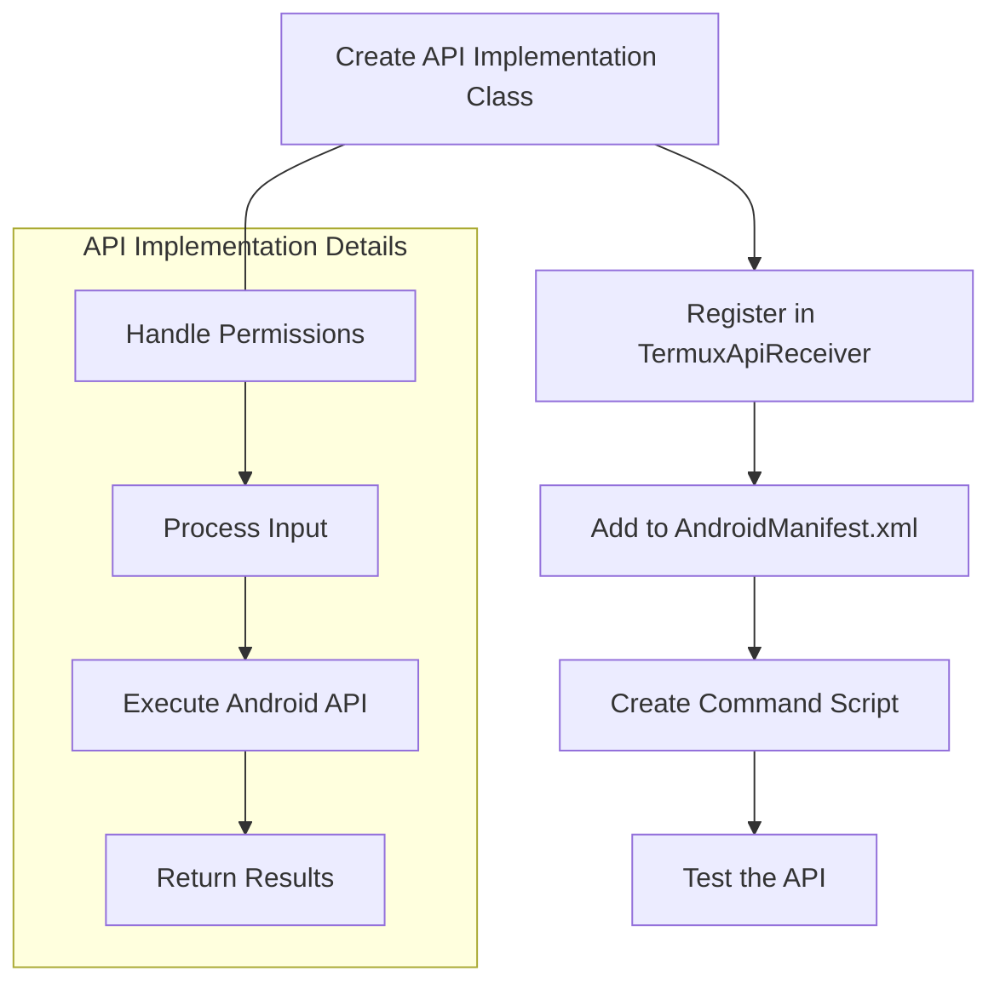
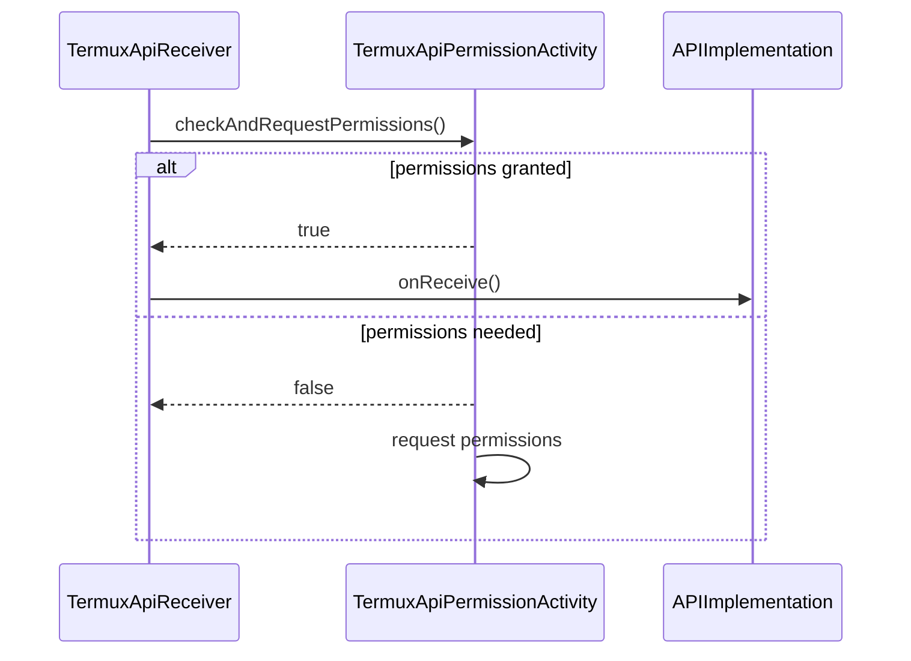
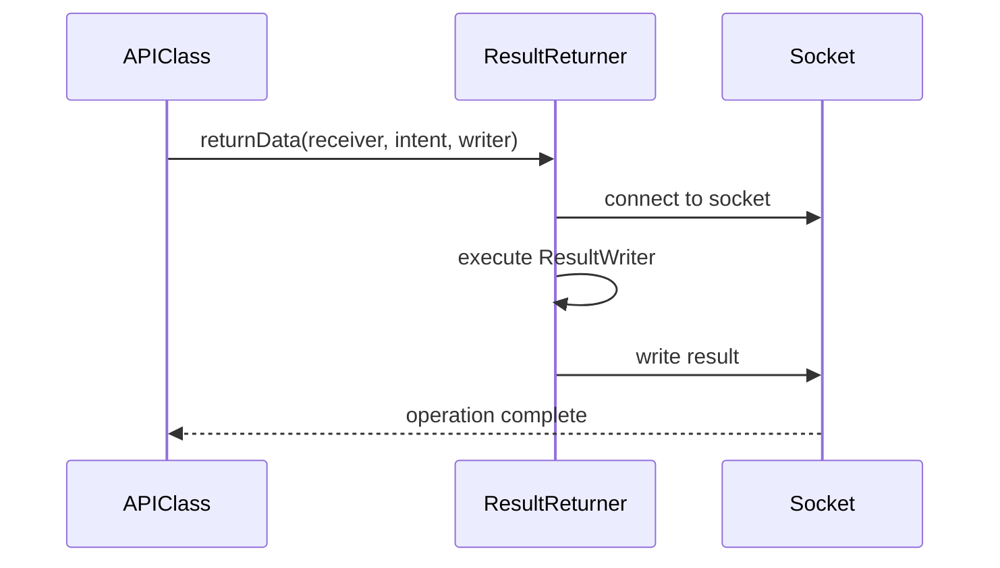
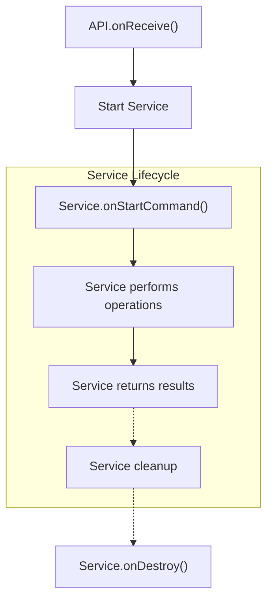
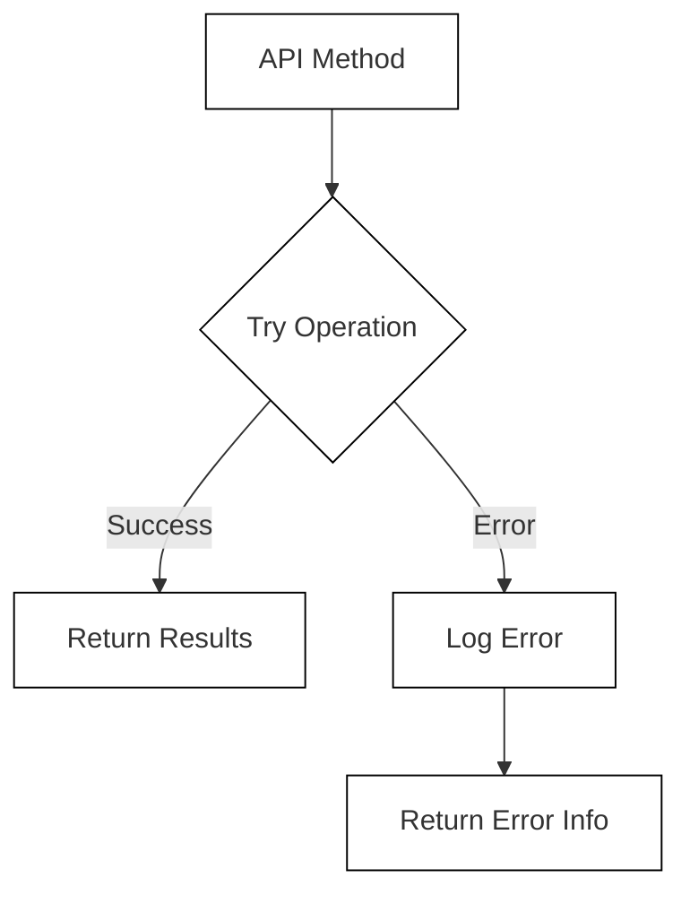

<!-- source: DeepWiki mcp.deepwiki.com · repo termux/termux-api · page 4.2 Extending Termux API · fetched 2026-10-26 -->

# Extending Termux API

<details>
<summary>Relevant source files</summary>

The following files were used as context for generating this wiki page:

- [app/src/main/AndroidManifest.xml](app/src/main/AndroidManifest.xml)
- [app/src/main/java/com/termux/api/TermuxApiReceiver.java](app/src/main/java/com/termux/api/TermuxApiReceiver.java)
- [app/src/main/java/com/termux/api/apis/SensorAPI.java](app/src/main/java/com/termux/api/apis/SensorAPI.java)
- [app/src/main/java/com/termux/api/util/ResultReturner.java](app/src/main/java/com/termux/api/util/ResultReturner.java)

</details>


This document explains how to develop and add new API implementations to the Termux:API application. It covers the process of creating new API classes, integrating them into the API receiver system, and registering them in the Android manifest. For information about the overall architecture of Termux API, see [Architecture](#2).

## Extension Process Overview

Extending the Termux API involves several key steps:

1. Creating a new API implementation class
2. Registering the API in the TermuxApiReceiver
3. Adding any required activities, services, or permissions to the AndroidManifest.xml
4. Implementing proper result returning using the ResultReturner utility



Sources: [app/src/main/java/com/termux/api/TermuxApiReceiver.java:79-269](), [app/src/main/AndroidManifest.xml:62-215]()

## Creating a New API Implementation

Each API implementation in Termux is typically created as a separate class in the `com.termux.api.apis` package. These classes provide static methods that handle the specific functionality required by the API.

### Basic API Structure

Most API implementations follow a common pattern:

```mermaid
classDiagram
    class "New API Implementation" {
        +static onReceive(BroadcastReceiver, Context, Intent)
        -static checkPermissions()
        -static processAPI()
        -static returnResults()
    }
    
    "New API Implementation" --> ResultReturner: uses
    "New API Implementation" --> "Android System APIs": calls
    TermuxApiReceiver --> "New API Implementation": invokes
```

At minimum, an API implementation should include an `onReceive` method that serves as the entry point. This method is called by the `TermuxApiReceiver` when it receives an intent for your API.

Sources: [app/src/main/java/com/termux/api/TermuxApiReceiver.java:60-77](), [app/src/main/java/com/termux/api/apis/SensorAPI.java:31-45]()

### Handling Permissions

Many APIs require specific Android permissions. There are two approaches to handling permissions:

1. **Direct handling in TermuxApiReceiver**: The receiver can check and request permissions before calling your API.
2. **Internal handling in your API**: Your API implementation can check permissions itself.

Example of permission checking in TermuxApiReceiver:



Sources: [app/src/main/java/com/termux/api/TermuxApiReceiver.java:109-111](), [app/src/main/java/com/termux/api/TermuxApiReceiver.java:152-154]()

## Implementing Result Returning

The `ResultReturner` class provides utilities for sending results back to the Termux application. It handles the socket connection and provides several interfaces for different types of results.

### Common Result Interfaces

1. **ResultWriter**: Basic interface for writing text results
2. **ResultJsonWriter**: For returning JSON data
3. **BinaryOutput**: For returning binary data
4. **WithInput**: For APIs that need to read input data
5. **WithStringInput**: For APIs that read string input data

Example implementation pattern:



Sources: [app/src/main/java/com/termux/api/util/ResultReturner.java:36-174](), [app/src/main/java/com/termux/api/util/ResultReturner.java:229-316]()

## Example: Creating a Simple API Implementation

Here's a step-by-step guide for creating a simple API implementation:

1. Create a new class in the `com.termux.api.apis` package
2. Implement the static `onReceive` method
3. Process the intent parameters
4. Perform the API operation
5. Return the results using ResultReturner

### Code Structure for a Simple API

```mermaid
classDiagram
    class "SimpleAPI" {
        +static onReceive(BroadcastReceiver, Context, Intent)
        -static processInputs(Intent)
        -static performOperation(Context, Parameters)
    }
    
    "SimpleAPI" ..> ResultReturner: uses
    "SimpleAPI" ..> "Android APIs": calls
```

The basic pattern should be similar to:

```
public static void onReceive(final BroadcastReceiver receiver, final Context context, final Intent intent) {
    // Process inputs from intent
    // ...
    
    // Perform operations
    // ...
    
    // Return results
    ResultReturner.returnData(receiver, intent, new ResultReturner.ResultWriter() {
        @Override
        public void writeResult(PrintWriter out) throws Exception {
            // Write your results
            out.println("Result data");
        }
    });
}
```

Sources: [app/src/main/java/com/termux/api/apis/SensorAPI.java:38-45]()

## Working with Long-Running Operations

For APIs that need to run for an extended period (like sensor monitoring or background services), you'll need to:

1. Create a Service class
2. Start the service from your API's `onReceive` method
3. Handle result returning from the service

Example structure:



Sources: [app/src/main/java/com/termux/api/apis/SensorAPI.java:51-437]()

## Registering Your API in the System

### Adding to TermuxApiReceiver

You need to add your API to the `doWork` method in `TermuxApiReceiver.java`:

1. Add a new case to the switch statement
2. Call your API's onReceive method

Example:

```
case "YourApiName":
    YourAPI.onReceive(this, context, intent);
    break;
```

Sources: [app/src/main/java/com/termux/api/TermuxApiReceiver.java:79-269]()

### Updating AndroidManifest.xml

Depending on your API, you may need to add:

1. New permissions required by your API
2. Activities for UI interactions
3. Services for background operations
4. Content providers for data sharing

Example for adding a service:

```xml
<service android:name=".apis.YourAPI$YourService"
    android:exported="false" />
```

Sources: [app/src/main/AndroidManifest.xml:8-40](), [app/src/main/AndroidManifest.xml:172-213]()

## Detailed Example: Anatomy of SensorAPI Implementation

The SensorAPI provides a good template for a complex API implementation that uses a background service:

```mermaid
classDiagram
    class "SensorAPI" {
        +static onReceive(Context, Intent)
    }
    
    class "SensorReaderService" {
        -static SensorManager sensorManager
        -static JSONObject sensorReadout
        +onCreate()
        +onStartCommand(Intent, int, int)
        +onDestroy()
    }
    
    class "SensorOutputWriter" {
        -String outputSocketAddress
        -boolean isRunning
        -int delay
        +run()
        +interrupt()
    }
    
    "SensorAPI" --> "SensorReaderService": starts
    "SensorReaderService" --> "SensorOutputWriter": creates
    "SensorReaderService" --> "SensorEventListener": uses
    "SensorOutputWriter" --> "LocalSocket": writes to
```

Key components:

1. **Main API class**: Simple entry point that starts the service
2. **Service class**: Handles the actual sensor monitoring
3. **Output writer**: Thread for continuously sending results
4. **Result handlers**: Different handlers for different commands

Sources: [app/src/main/java/com/termux/api/apis/SensorAPI.java:31-468]()

## Best Practices for API Extensions

### Code Organization
- Keep API implementations in the `com.termux.api.apis` package
- Use inner classes for services and activities
- Follow the naming convention of [FeatureName]API

### Error Handling
- Properly handle exceptions and return meaningful error messages
- Never throw exceptions from the BroadcastReceiver
- Use the ResultReturner to return error information



Sources: [app/src/main/java/com/termux/api/TermuxApiReceiver.java:64-76](), [app/src/main/java/com/termux/api/util/ResultReturner.java:277-288]()

### Permission Handling
- Request only the permissions you need
- Use the TermuxApiPermissionActivity for permission requests
- Check permissions before executing protected operations

### Thread Safety
- Use background threads for long-running operations
- Don't block the main thread
- Use proper synchronization for shared resources

Sources: [app/src/main/java/com/termux/api/apis/SensorAPI.java:125-151](), [app/src/main/java/com/termux/api/apis/SensorAPI.java:353-437]()

## Testing Your API Extension

1. Build and install the modified Termux API app
2. Create a command script in the Termux package
3. Test different inputs and edge cases
4. Verify proper permission handling

Remember that proper integration requires both the API implementation in the Termux:API app and a corresponding shell script in the termux-api package to call your API.

---

