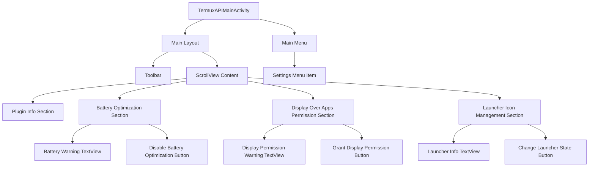
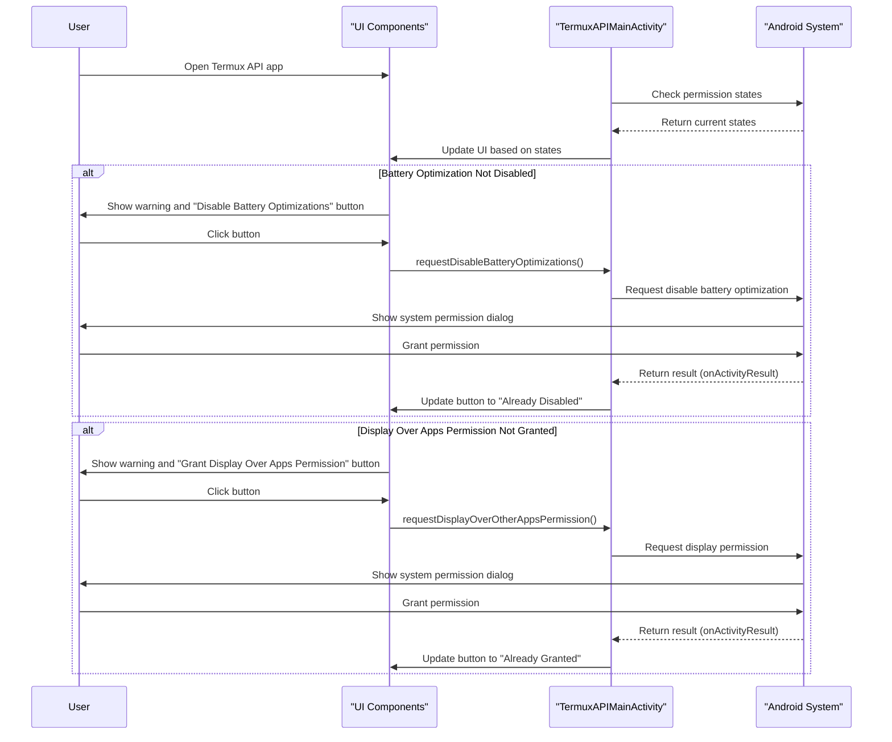
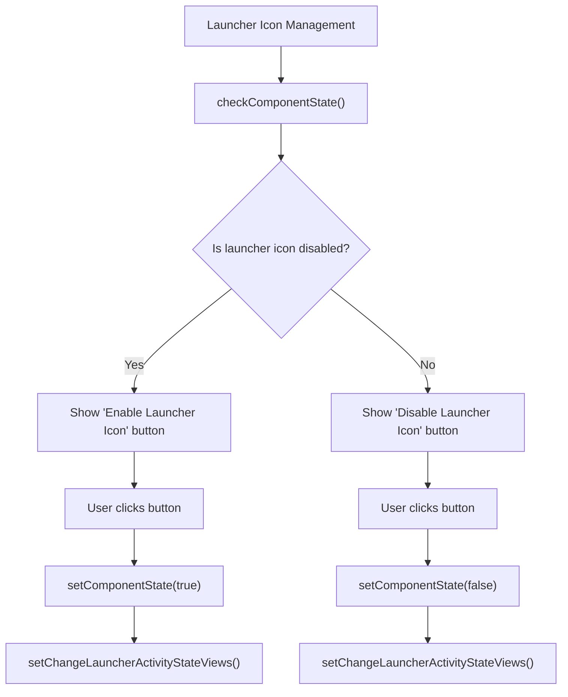
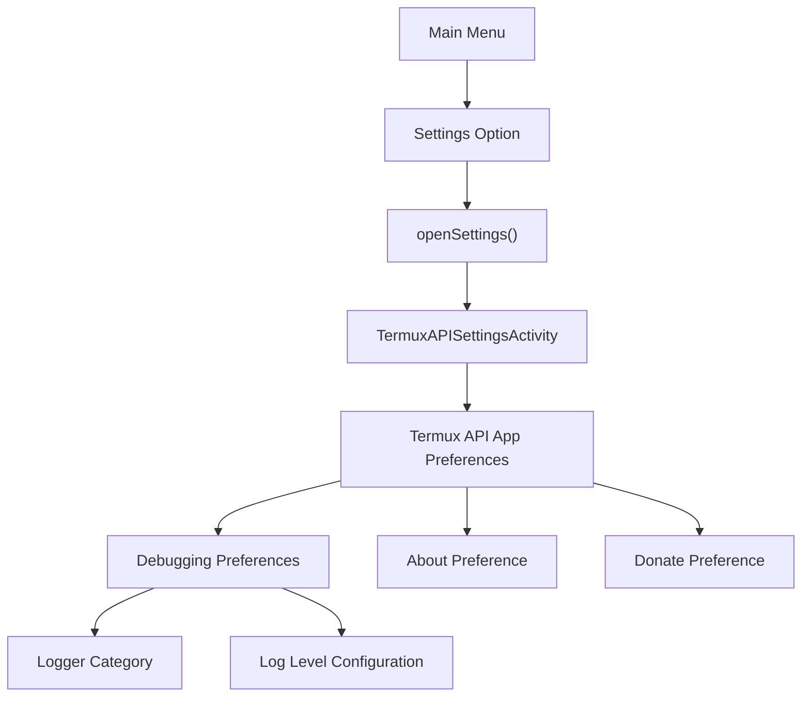
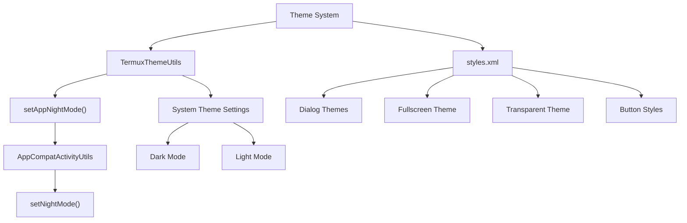

<!-- source: DeepWiki mcp.deepwiki.com · repo termux/termux-api · page 5 User Interface · fetched 2026-10-26 -->

# User Interface

<details>
<summary>Relevant source files</summary>

The following files were used as context for generating this wiki page:

- [app/src/main/java/com/termux/api/activities/TermuxAPIMainActivity.java](app/src/main/java/com/termux/api/activities/TermuxAPIMainActivity.java)
- [app/src/main/res/layout/activity_termux_api_main.xml](app/src/main/res/layout/activity_termux_api_main.xml)
- [app/src/main/res/layout/dialog_counter.xml](app/src/main/res/layout/dialog_counter.xml)
- [app/src/main/res/layout/spinner_item.xml](app/src/main/res/layout/spinner_item.xml)
- [app/src/main/res/menu/activity_termux_api_main.xml](app/src/main/res/menu/activity_termux_api_main.xml)
- [app/src/main/res/values/strings.xml](app/src/main/res/values/strings.xml)
- [app/src/main/res/values/styles.xml](app/src/main/res/values/styles.xml)
- [gradle.properties](gradle.properties)

</details>


The Termux API application provides a user interface that serves primarily as a management console rather than a feature-rich application. While most of the actual API functionality is accessed through command-line tools in the Termux terminal, this UI allows users to manage permissions, configure settings, and control the visibility of the application.

For information about the UI-related API implementations that can be used from the command line (like dialogs and notifications), see [User Interface APIs](#3.3).

## Main Interface Structure

The main interface of Termux API is implemented in `TermuxAPIMainActivity` and contains several key sections that help users manage the application's functionality.



Sources:
- [app/src/main/java/com/termux/api/activities/TermuxAPIMainActivity.java:27-62]()
- [app/src/main/res/layout/activity_termux_api_main.xml:1-135]()

### Plugin Information Section

The top section of the UI provides essential information about the Termux API plugin:
- Its role as a plugin for the Termux application
- The requirement for the `termux-api` package
- Links to GitHub repositories
- Troubleshooting guidance for potential issues

This informational text is defined in the strings resource file and displayed using a `MaterialTextView` component.

Sources:
- [app/src/main/res/layout/activity_termux_api_main.xml:27-39]()
- [app/src/main/res/values/strings.xml:17-29]()

## Permission Management

The Termux API application requires specific permissions to function properly when called from terminal commands. The UI provides interfaces to manage these permissions.



Sources:
- [app/src/main/java/com/termux/api/activities/TermuxAPIMainActivity.java:100-136]()
- [app/src/main/java/com/termux/api/activities/TermuxAPIMainActivity.java:188-208]()

### Battery Optimization

The battery optimization section explains why disabling Android battery optimizations for Termux API is essential:

- Ensures the app can be reliably started from the background by termux-api scripts
- Prevents the system from killing the app when it needs to run in the background
- Includes information about vendor-specific app killers

The section provides a clear warning message and a button to request disabling battery optimization. The button's text changes to "Already Disabled" once the permission is granted.

Sources:
- [app/src/main/java/com/termux/api/activities/TermuxAPIMainActivity.java:100-116]()
- [app/src/main/res/layout/activity_termux_api_main.xml:42-70]()
- [app/src/main/res/values/strings.xml:34-44]()

### Display Over Other Apps Permission

This section explains why the "display over other apps" permission is necessary:

- Allows Termux API to start foreground activities from background processes
- Required for certain API implementations that need to display UI elements
- Critical for functionality like dialogs and notifications when called from scripts

The section includes a warning message and a button to request the permission, with the button text updating to "Already Granted" when the permission is granted.

Sources:
- [app/src/main/java/com/termux/api/activities/TermuxAPIMainActivity.java:120-136]()
- [app/src/main/res/layout/activity_termux_api_main.xml:74-102]()
- [app/src/main/res/values/strings.xml:47-52]()

## Launcher Icon Management

The launcher icon management section allows users to control the visibility of the Termux API app icon in the device's launcher menu.



This feature is useful for users who prefer to interact with Termux API exclusively through terminal commands and want to reduce clutter in their app drawer. The section explains:

- What the launcher activity is and how it functions
- How to still access Termux API if the launcher icon is disabled
- Alternative methods to open the app (via Termux app settings or `am start` command)
- Potential device-specific issues that might occur if the launcher is disabled

Sources:
- [app/src/main/java/com/termux/api/activities/TermuxAPIMainActivity.java:140-184]()
- [app/src/main/res/layout/activity_termux_api_main.xml:106-131]()
- [app/src/main/res/values/strings.xml:54-63]()

## Settings Interface

The Termux API app includes a settings interface accessible through the toolbar menu. The settings option opens the `TermuxAPISettingsActivity`.



The settings interface allows users to configure various aspects of the application:
- Debugging options for troubleshooting issues
- Log level configuration (adjusting verbosity of logging)
- About section with information about the app
- Donation options to support development

Sources:
- [app/src/main/java/com/termux/api/activities/TermuxAPIMainActivity.java:80-96]()
- [app/src/main/java/com/termux/api/activities/TermuxAPIMainActivity.java:213-215]()
- [app/src/main/res/menu/activity_termux_api_main.xml:1-14]()
- [app/src/main/res/values/strings.xml:72-98]()

## Theme and Styling

The Termux API UI implements Material Design components and supports both light and dark themes.



The application uses:
- Material Design components for a modern, consistent look
- Theme adaptation based on system night mode settings
- Custom styles for dialogs in both light and dark variants
- Specialized transparent themes for certain UI components

Theme initialization happens early in the activity lifecycle:
```java
// Set NightMode.APP_NIGHT_MODE
TermuxThemeUtils.setAppNightMode(this);
AppCompatActivityUtils.setNightMode(this, NightMode.getAppNightMode().getName(), true);
```

Sources:
- [app/src/main/java/com/termux/api/activities/TermuxAPIMainActivity.java:44-46]()
- [app/src/main/res/values/styles.xml:1-46]()

## Dialog Components

While not part of the main UI, Termux API includes several specialized dialog layouts used by API implementations when called from terminal commands:

| Dialog Component | Purpose | Layout File |
|-----------------|---------|-------------|
| Counter Dialog | Provides increment/decrement interface for numeric input | dialog_counter.xml |
| Spinner Item | Customizes appearance of dropdown menu items | spinner_item.xml |

These dialog components support the UI-related API calls that can be made from Termux scripts, allowing command-line applications to display interactive UI elements when needed.

Sources:
- [app/src/main/res/layout/dialog_counter.xml:1-34]()
- [app/src/main/res/layout/spinner_item.xml:1-14]()

## Application Lifecycle Management

The Termux API main activity implements careful lifecycle management to ensure the UI always reflects the current state:

- `onCreate()`: Sets up the UI components, configures theme, and initializes click listeners
- `onResume()`: Refreshes permission states and updates UI elements accordingly
- `onActivityResult()`: Processes results from system permission requests
- `onCreateOptionsMenu()`: Creates the toolbar menu with the settings option
- `onOptionsItemSelected()`: Handles menu selections (primarily opening settings)

This lifecycle management ensures that permission indicators always show the current state, even if permissions are granted or revoked outside the app.

Sources:
- [app/src/main/java/com/termux/api/activities/TermuxAPIMainActivity.java:37-96]()
- [app/src/main/java/com/termux/api/activities/TermuxAPIMainActivity.java:188-215]()

---

