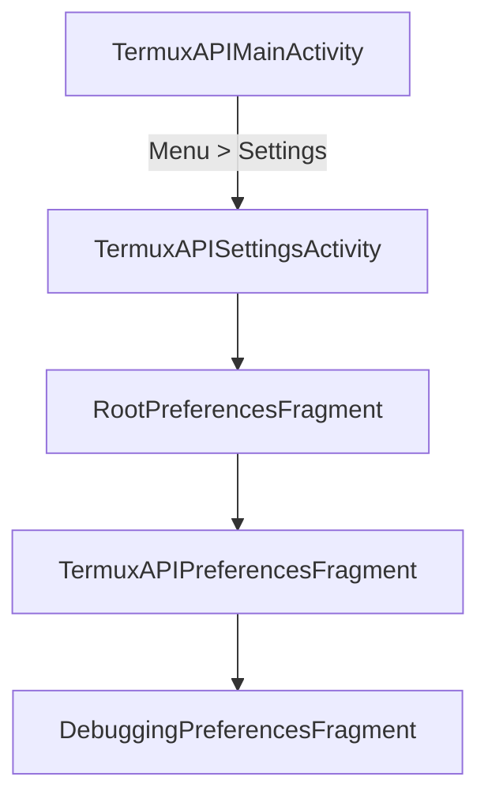
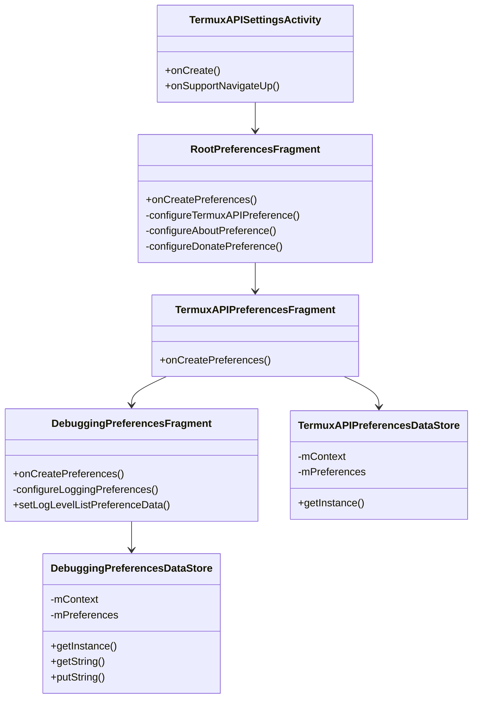
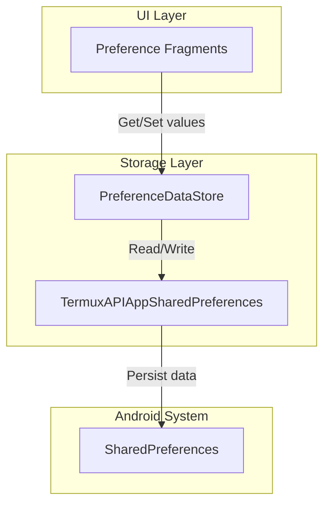
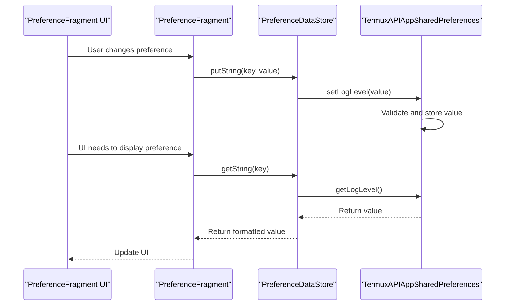
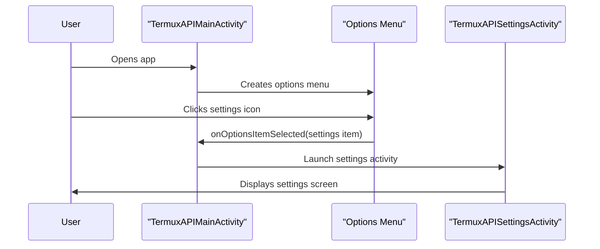
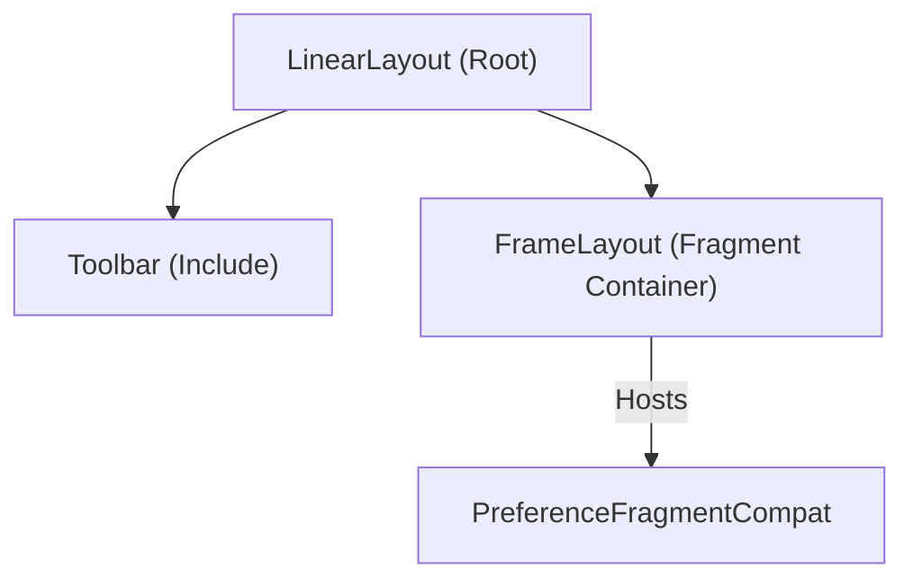
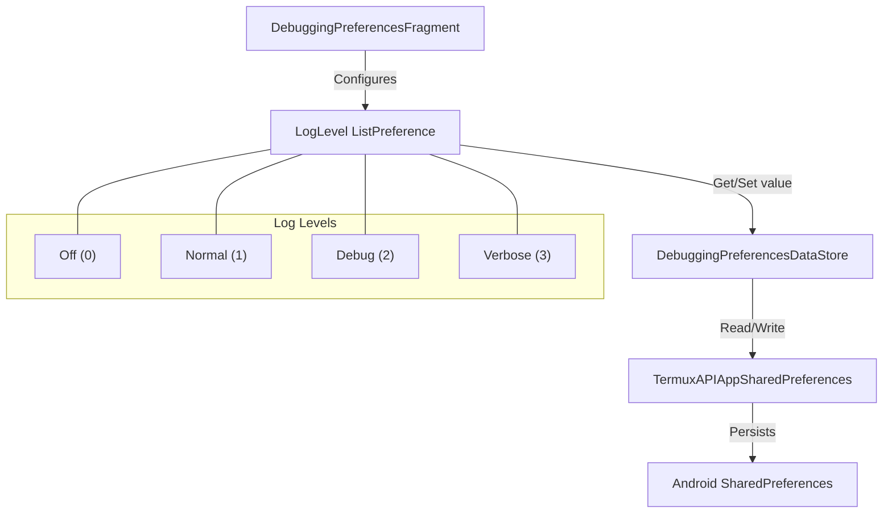

<!-- source: DeepWiki mcp.deepwiki.com · repo termux/termux-api · page 5.1 Settings · fetched 2026-10-26 -->

# Settings

Relevant source files

The following files were used as context for generating this wiki page:

- [app/src/main/java/com/termux/api/activities/TermuxAPIMainActivity.java](app/src/main/java/com/termux/api/activities/TermuxAPIMainActivity.java)
- [app/src/main/java/com/termux/api/settings/activities/TermuxAPISettingsActivity.java](app/src/main/java/com/termux/api/settings/activities/TermuxAPISettingsActivity.java)
- [app/src/main/java/com/termux/api/settings/fragments/termux_api_app/TermuxAPIPreferencesFragment.java](app/src/main/java/com/termux/api/settings/fragments/termux_api_app/TermuxAPIPreferencesFragment.java)
- [app/src/main/java/com/termux/api/settings/fragments/termux_api_app/debugging/DebuggingPreferencesFragment.java](app/src/main/java/com/termux/api/settings/fragments/termux_api_app/debugging/DebuggingPreferencesFragment.java)
- [app/src/main/res/layout/activity_termux_api_main.xml](app/src/main/res/layout/activity_termux_api_main.xml)
- [app/src/main/res/layout/activity_termux_api_settings.xml](app/src/main/res/layout/activity_termux_api_settings.xml)
- [app/src/main/res/menu/activity_termux_api_main.xml](app/src/main/res/menu/activity_termux_api_main.xml)
- [app/src/main/res/values/strings.xml](app/src/main/res/values/strings.xml)
- [app/src/main/res/xml/prefs__termux_api_app___prefs__app.xml](app/src/main/res/xml/prefs__termux_api_app___prefs__app.xml)
- [app/src/main/res/xml/prefs__termux_api_app___prefs__app___prefs__debugging.xml](app/src/main/res/xml/prefs__termux_api_app___prefs__app___prefs__debugging.xml)

This page documents the Settings functionality in the Termux:API application. The Settings system provides configuration options for the app, including debugging preferences, and includes access points to information about the application.

## Settings Access

Users can access the Termux:API settings screen through the main application interface by tapping the settings icon in the toolbar. The settings menu is implemented as a dedicated activity with preference fragments.

Sources: [app/src/main/java/com/termux/api/activities/TermuxAPIMainActivity.java:89-95](), [app/src/main/res/menu/activity_termux_api_main.xml:8-12](), [app/src/main/java/com/termux/api/settings/activities/TermuxAPISettingsActivity.java:34-39]()

## Settings Structure

The Termux:API settings system is organized hierarchically, with the main settings screen containing entries that lead to more specific settings categories. The core structure consists of preference fragments and preference data stores that handle the user interface and data persistence respectively.

Sources: [app/src/main/java/com/termux/api/settings/activities/TermuxAPISettingsActivity.java:25-134](), [app/src/main/java/com/termux/api/settings/fragments/termux_api_app/TermuxAPIPreferencesFragment.java:14-49](), [app/src/main/java/com/termux/api/settings/fragments/termux_api_app/debugging/DebuggingPreferencesFragment.java:20-117]()

## Preference Storage Architecture

The Termux:API settings system uses custom `PreferenceDataStore` implementations to handle how preferences are stored and retrieved. This abstraction layer provides a structured way to manage preference data separate from the UI components.

Sources: [app/src/main/java/com/termux/api/settings/fragments/termux_api_app/debugging/DebuggingPreferencesFragment.java:66-117](), [app/src/main/java/com/termux/api/settings/fragments/termux_api_app/TermuxAPIPreferencesFragment.java:30-49]()

## Available Settings

The Termux:API settings interface provides access to the following settings and options:

### 1. App Settings
The app settings category contains settings specific to the Termux:API application functionality.

### 2. Debugging Settings
Debugging settings allow users to configure logging levels for the application. This is particularly useful for troubleshooting and development purposes.

| Preference | Description | Default Value |
|------------|-------------|---------------|
| Log Level | Controls the verbosity of application logs | Normal (Level 1) |

### 3. About
The About option provides detailed information about the application, including:
- Termux and plugin package details
- Device information
- Important links related to Termux

### 4. Donate
For non-Google Play Store versions of the app, a Donate option is available to support the development of Termux.

Sources: [app/src/main/res/xml/prefs__termux_api_app___prefs__app.xml:1-8](), [app/src/main/res/xml/prefs__termux_api_app___prefs__app___prefs__debugging.xml:1-15](), [app/src/main/java/com/termux/api/settings/activities/TermuxAPISettingsActivity.java:77-130]()

## Settings Implementation Details

### Preference XML Structure

The preferences are defined in XML resources, which specify the hierarchy and properties of each preference item. The main preference resources are:

1. `sets__termux.xml` - Root preferences screen (referenced in `RootPreferencesFragment`)
2. `prefs__termux_api_app___prefs__app.xml` - Termux:API app preferences
3. `prefs__termux_api_app___prefs__app___prefs__debugging.xml` - Debugging preferences

### Preference Data Storage

Preferences are stored using custom `PreferenceDataStore` implementations that delegate to the `TermuxAPIAppSharedPreferences` class. This approach allows for centralized preference management and validation.

Sources: [app/src/main/java/com/termux/api/settings/fragments/termux_api_app/debugging/DebuggingPreferencesFragment.java:66-117](), [app/src/main/java/com/termux/api/settings/fragments/termux_api_app/TermuxAPIPreferencesFragment.java:30-49]()

## Main Activity Settings Integration

The main activity of Termux:API includes a settings button in its toolbar. When clicked, this button launches the `TermuxAPISettingsActivity` through an intent.

Sources: [app/src/main/java/com/termux/api/activities/TermuxAPIMainActivity.java:89-95](), [app/src/main/java/com/termux/api/activities/TermuxAPIMainActivity.java:213-215](), [app/src/main/res/menu/activity_termux_api_main.xml:8-12]()

## Settings UI Layout

The settings screens use standard Android preference layouts enhanced with Termux-specific styling. The main settings activity uses a container layout that hosts preference fragments.

Sources: [app/src/main/res/layout/activity_termux_api_settings.xml:1-16]()

## Debug Logging Configuration

The most significant configurable setting in the Termux:API app is the log level, which controls the verbosity of application logging. The log level preference is implemented as a `ListPreference` that displays human-readable labels for each log level.

Sources: [app/src/main/java/com/termux/api/settings/fragments/termux_api_app/debugging/DebuggingPreferencesFragment.java:35-63](), [app/src/main/res/xml/prefs__termux_api_app___prefs__app___prefs__debugging.xml:7-11]()

## Settings Visibility Control

The settings system includes logic to control the visibility of certain preference items based on various conditions:

1. The Termux:API app preference is only shown if the app preferences can be successfully loaded
2. The Donate preference is hidden for Google Play Store releases due to policy restrictions

This dynamic visibility control ensures that users only see relevant settings options.

Sources: [app/src/main/java/com/termux/api/settings/activities/TermuxAPISettingsActivity.java:69-130]()