# Page: Overview

# Overview

<details>
<summary>Relevant source files</summary>

The following files were used as context for generating this wiki page:

- [.github/workflows/github_action_build.yml](.github/workflows/github_action_build.yml)
- [.github/workflows/github_release_build.yml](.github/workflows/github_release_build.yml)
- [README.md](README.md)
- [app/src/main/AndroidManifest.xml](app/src/main/AndroidManifest.xml)
- [app/src/main/java/com/termux/api/KeepAliveService.java](app/src/main/java/com/termux/api/KeepAliveService.java)
- [app/src/main/java/com/termux/api/SocketListener.java](app/src/main/java/com/termux/api/SocketListener.java)
- [app/src/main/java/com/termux/api/TermuxAPIApplication.java](app/src/main/java/com/termux/api/TermuxAPIApplication.java)

</details>


Termux API is an Android application that bridges the gap between the Termux command-line environment and Android system capabilities. It enables Termux users to access Android device features and system services through simple command-line interfaces.

## Purpose and Functionality

The Termux API application serves as an interface layer that exposes Android system APIs to the Termux command-line environment. It allows scripts and programs running in Termux to interact with device hardware, system services, and UI elements that would otherwise be inaccessible from a terminal environment.

Key functions of Termux API include:

- Accessing device hardware (camera, sensors, location, etc.)
- Controlling Android UI elements (notifications, dialogs, toasts)
- Interacting with system services (telephony, SMS, clipboard)
- Managing files and storage
- Scheduling tasks and monitoring system events

Sources: [README.md:6-6]()

## System Architecture

The following diagram shows the main components of the Termux API system and how they interact:

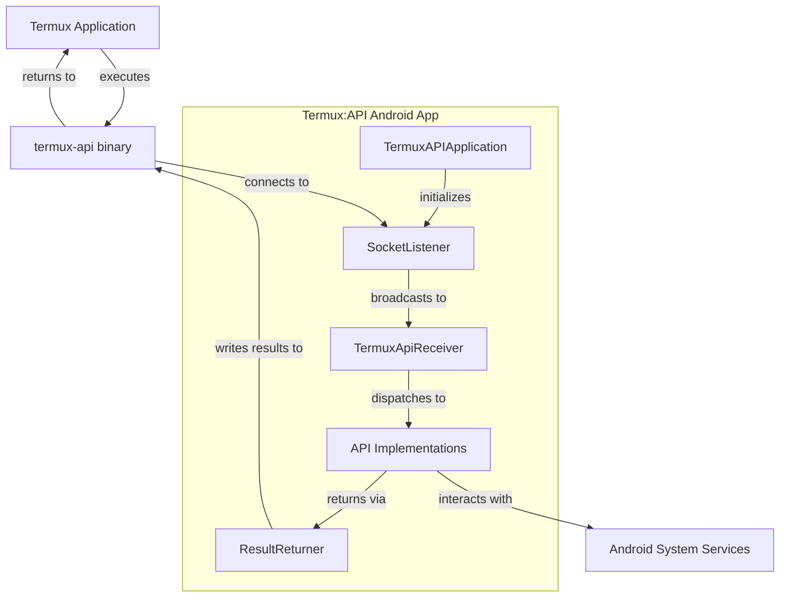

Sources: [app/src/main/java/com/termux/api/TermuxAPIApplication.java:33-33](), [app/src/main/java/com/termux/api/SocketListener.java:37-260]()

## Command Flow

When a user runs a Termux API command, the request flows through the system as follows:

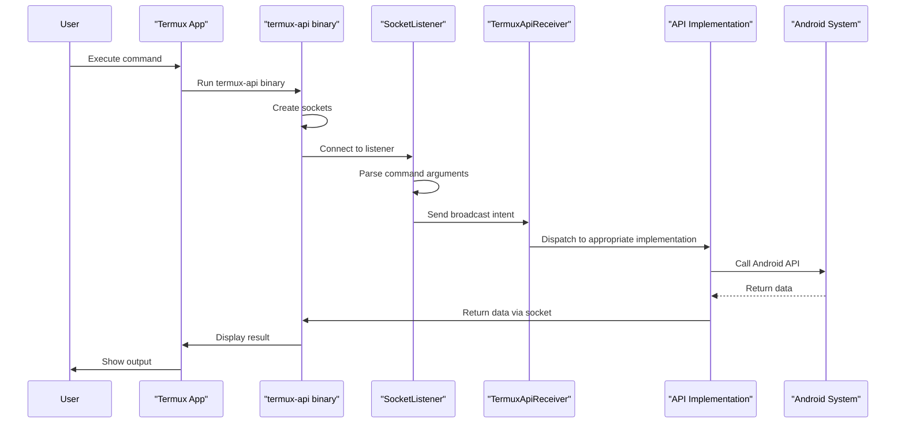

Sources: [README.md:31-48](), [app/src/main/java/com/termux/api/SocketListener.java:42-248]()

## API Categories

Termux API provides access to a wide range of Android functionality through various API implementations. These can be categorized as follows:

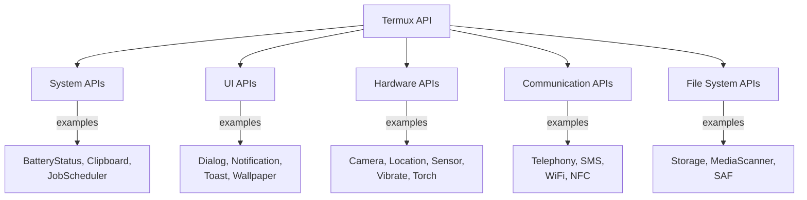

Sources: [app/src/main/AndroidManifest.xml:101-213]()

## Permission Model

Termux API requires a comprehensive set of Android permissions to access various system features. These permissions are requested when needed and include access to:

| Permission Category | Examples |
|---------------------|----------|
| Location | Fine location, Background location |
| Hardware | Camera, Sensors, Microphone, NFC |
| Communication | Phone state, SMS, Contacts |
| Storage | External storage, Media |
| System | Battery optimization, Packages, Settings |

Sources: [app/src/main/AndroidManifest.xml:8-40]()

## Implementation Note

The Termux API application must be signed with the same key as the main Termux app for permissions to work correctly. This is because only the main Termux app is allowed to call the API methods provided by the Termux API application.

For more detailed information about the architecture and command flow of the Termux API system, see [Architecture](#2) and [Command Flow](#2.1). For information about specific API components and how they're implemented, see [API Components](#3).

Sources: [README.md:8-10]()

---

# Page: Architecture

# Architecture

<details>
<summary>Relevant source files</summary>

The following files were used as context for generating this wiki page:

- [.github/workflows/github_action_build.yml](.github/workflows/github_action_build.yml)
- [.github/workflows/github_release_build.yml](.github/workflows/github_release_build.yml)
- [README.md](README.md)
- [app/src/main/java/com/termux/api/KeepAliveService.java](app/src/main/java/com/termux/api/KeepAliveService.java)
- [app/src/main/java/com/termux/api/SocketListener.java](app/src/main/java/com/termux/api/SocketListener.java)
- [app/src/main/java/com/termux/api/TermuxAPIApplication.java](app/src/main/java/com/termux/api/TermuxAPIApplication.java)
- [app/src/main/java/com/termux/api/TermuxApiReceiver.java](app/src/main/java/com/termux/api/TermuxApiReceiver.java)
- [app/src/main/java/com/termux/api/apis/SensorAPI.java](app/src/main/java/com/termux/api/apis/SensorAPI.java)
- [app/src/main/java/com/termux/api/util/ResultReturner.java](app/src/main/java/com/termux/api/util/ResultReturner.java)

</details>


This document describes the high-level architecture of the Termux API system, outlining the main components and their interactions. The Termux API provides a bridge between the command-line environment of Termux and Android system capabilities, allowing shell scripts to access device features like sensors, notifications, and hardware.

For information about how commands flow from Termux to the API app, see [Command Flow](#2.1). For details on how permissions are handled, see [Permission System](#2.2).

## System Components Overview

The Termux API consists of the following main components:

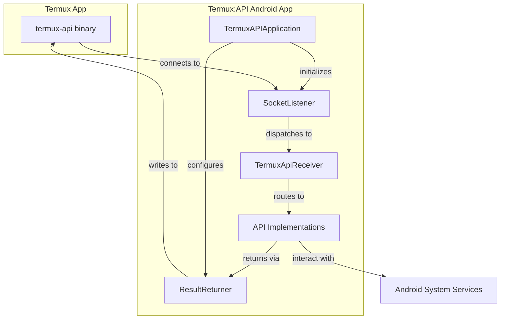

Sources: 
- [app/src/main/java/com/termux/api/TermuxAPIApplication.java:18-34]()
- [app/src/main/java/com/termux/api/TermuxApiReceiver.java:55-79]()
- [app/src/main/java/com/termux/api/SocketListener.java:21-43]()
- [app/src/main/java/com/termux/api/util/ResultReturner.java:36-52]()
- [README.md:31-45]()

## Communication Architecture

The Termux API uses Unix domain sockets for bidirectional communication between the Termux app and the Termux:API app. This architecture allows efficient data transfer while maintaining security through Android's permission system.

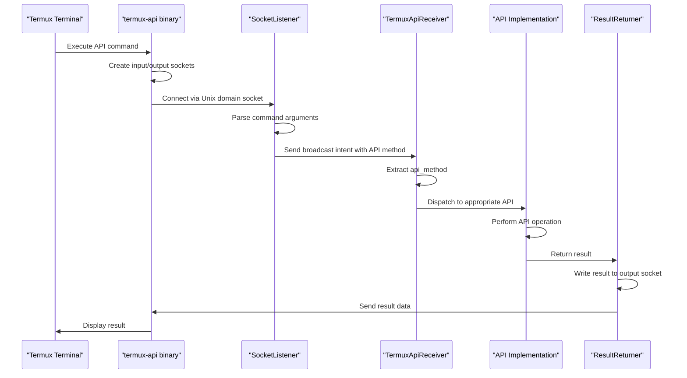

Sources:
- [README.md:31-45]()
- [app/src/main/java/com/termux/api/SocketListener.java:36-260]()
- [app/src/main/java/com/termux/api/TermuxApiReceiver.java:79-269]()
- [app/src/main/java/com/termux/api/util/ResultReturner.java:229-316]()

## Core Components

### TermuxAPIApplication

The `TermuxAPIApplication` class serves as the entry point for the Termux API app. Its main responsibilities include:

1. Setting up the application context for `ResultReturner`
2. Initializing the `SocketListener` to receive commands
3. Configuring logging for the application

Sources:
- [app/src/main/java/com/termux/api/TermuxAPIApplication.java:14-45]()

### SocketListener

The `SocketListener` is responsible for:

1. Creating and managing a server socket that listens on the address `com.termux.api://listen`
2. Accepting connections from the Termux app (verifying they come from the proper UID)
3. Parsing command-line arguments into intent extras
4. Broadcasting intents to the `TermuxApiReceiver`

The `SocketListener` runs in a separate thread and continuously accepts connections from the Termux app.

Sources:
- [app/src/main/java/com/termux/api/SocketListener.java:21-262]()
- [README.md:31-45]()

### TermuxApiReceiver

The `TermuxApiReceiver` acts as the central hub for dispatching API requests. It:

1. Receives broadcast intents from the `SocketListener`
2. Extracts the "api_method" extra to determine which API to call
3. Checks for necessary Android permissions and requests them if needed
4. Delegates to the appropriate API implementation class

This component handles over 30 different API methods, each corresponding to a specific Android feature.

Sources:
- [app/src/main/java/com/termux/api/TermuxApiReceiver.java:55-272]()

### API Implementations

The API implementations are specialized classes that each handle a specific aspect of Android functionality. They:

1. Interact with Android system services
2. Process input data from the Termux command
3. Generate results to be returned to Termux
4. Use `ResultReturner` to send results back

Example implementations include:
- `SensorAPI` - Access device sensors
- `NotificationAPI` - Create and manage notifications
- `LocationAPI` - Access GPS and location services
- `DialogAPI` - Display UI dialogs to the user

Sources:
- [app/src/main/java/com/termux/api/apis/SensorAPI.java:31-470]()
- [app/src/main/java/com/termux/api/TermuxApiReceiver.java:11-47]()

### ResultReturner

The `ResultReturner` provides a standardized way for API implementations to return data to the Termux app. It:

1. Connects to the output socket created by the termux-api binary
2. Provides interfaces for different types of result data:
   - `ResultWriter` - For text output
   - `ResultJsonWriter` - For JSON-formatted output
   - `BinaryOutput` - For binary data
   - `WithInput` - For APIs that need to read input
3. Handles asynchronous result returning

The `ResultReturner` ensures that results are properly formatted and delivered back to the Termux terminal.

Sources:
- [app/src/main/java/com/termux/api/util/ResultReturner.java:36-322]()

## API Implementation Structure

The API implementations follow a common pattern to ensure consistency and maintainability:

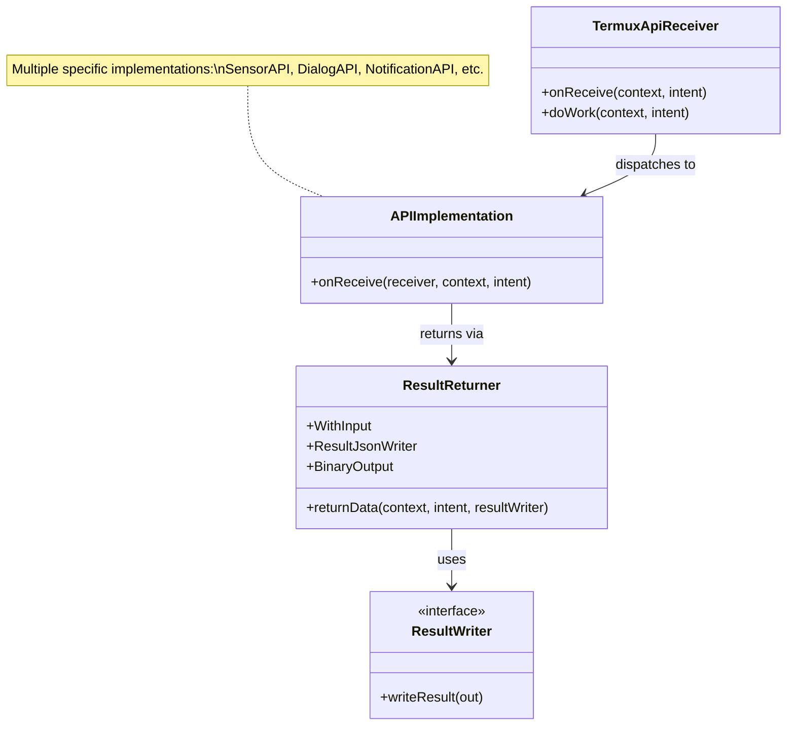

Sources:
- [app/src/main/java/com/termux/api/TermuxApiReceiver.java:55-272]()
- [app/src/main/java/com/termux/api/util/ResultReturner.java:55-175]()
- [app/src/main/java/com/termux/api/apis/SensorAPI.java:31-470]()

## Socket Communication

The socket communication mechanism is a critical part of the architecture:

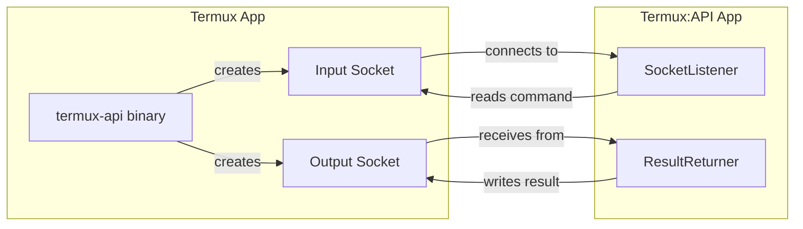

The termux-api binary creates two Unix domain sockets:
1. An input socket for sending commands to the Termux:API app
2. An output socket for receiving results back

The socket addresses are passed to the API app in the broadcast intent, allowing bi-directional communication.

Sources:
- [README.md:33-40]()
- [app/src/main/java/com/termux/api/util/ResultReturner.java:47-53]()
- [app/src/main/java/com/termux/api/util/ResultReturner.java:234-268]()

## Extensibility

The architecture is designed to be easily extensible. To add a new API:

1. Create a new class in the `com.termux.api.apis` package
2. Implement the API functionality
3. Add a case to the switch statement in `TermuxApiReceiver.doWork()`
4. Create a corresponding script in the termux-api package

This modular design allows for the continuous addition of new features without modifying the core architecture.

Sources:
- [app/src/main/java/com/termux/api/TermuxApiReceiver.java:86-269]()
- [README.md:50-54]()

## System Requirements

The Termux API app requires:

1. The same signing key as the main Termux app for permissions to work
2. Appropriate Android permissions for the features it exposes
3. Android version compatibility as defined in the app's build configuration

Sources:
- [README.md:8-10]()
- [.github/workflows/github_action_build.yml:13-66]()
- [.github/workflows/github_release_build.yml:8-64]()

## Keep-Alive Mechanism

To ensure the Termux API service remains available, a `KeepAliveService` is implemented:

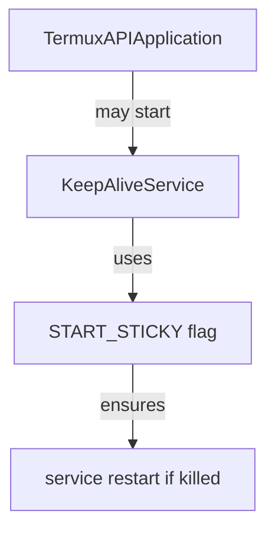

This service helps maintain the availability of the API, particularly for long-running operations like sensor monitoring.

Sources:
- [app/src/main/java/com/termux/api/KeepAliveService.java:11-28]()

---

# Page: Command Flow

# Command Flow

<details>
<summary>Relevant source files</summary>

The following files were used as context for generating this wiki page:

- [.github/workflows/github_action_build.yml](.github/workflows/github_action_build.yml)
- [.github/workflows/github_release_build.yml](.github/workflows/github_release_build.yml)
- [README.md](README.md)
- [app/src/main/java/com/termux/api/KeepAliveService.java](app/src/main/java/com/termux/api/KeepAliveService.java)
- [app/src/main/java/com/termux/api/SocketListener.java](app/src/main/java/com/termux/api/SocketListener.java)
- [app/src/main/java/com/termux/api/TermuxAPIApplication.java](app/src/main/java/com/termux/api/TermuxAPIApplication.java)
- [app/src/main/java/com/termux/api/TermuxApiReceiver.java](app/src/main/java/com/termux/api/TermuxApiReceiver.java)
- [app/src/main/java/com/termux/api/apis/SensorAPI.java](app/src/main/java/com/termux/api/apis/SensorAPI.java)
- [app/src/main/java/com/termux/api/util/ResultReturner.java](app/src/main/java/com/termux/api/util/ResultReturner.java)

</details>


This page documents how commands flow from the Termux application through the Termux:API system to Android system APIs and back. It details the journey of a command from the moment it's executed by a user in Termux, through various components in the Termux:API app, to its execution and return of results.

## Overview

The command flow in Termux:API follows a well-defined path with several key components working together:

1. Command execution in Termux
2. Command processing by the termux-api binary
3. Command reception by the SocketListener
4. Command dispatching by the TermuxApiReceiver
5. Command execution by the specific API implementation
6. Result returning via ResultReturner

Each of these components plays a critical role in enabling command-line access to Android system capabilities.

Sources: [README.md:31-40]()

## Command Flow Diagram

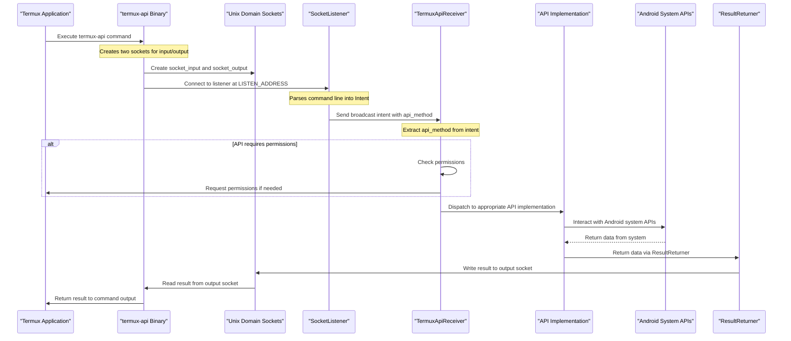

Sources: [app/src/main/java/com/termux/api/TermuxApiReceiver.java:55-270](), [app/src/main/java/com/termux/api/util/ResultReturner.java:36-322](), [README.md:31-44]()

## Command Initiation

The flow begins when a user in the Termux application executes a command that uses Termux:API functionality (e.g., `termux-battery-status`). These commands are client scripts provided by the [termux-api package](https://github.com/termux/termux-api-package).

### The termux-api Binary

The heart of the command initiation is the `termux-api` helper binary. This binary:

1. Generates two Linux anonymous namespace sockets
2. Passes their addresses to the Termux:API app via intent extras
3. Uses these sockets to forward stdin to the API implementation and output from the API to stdout

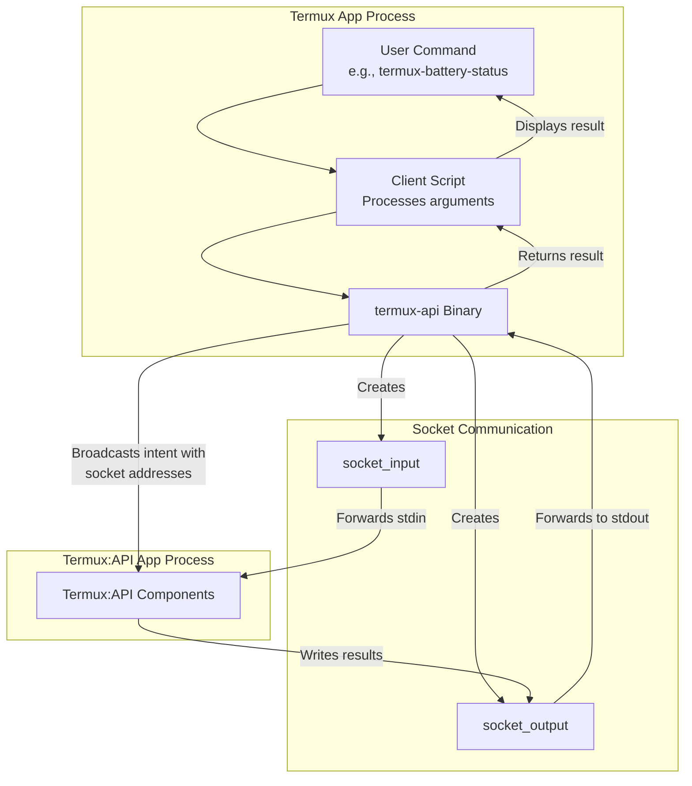

Sources: [README.md:31-44]()

## Command Reception

### Socket Listener Initialization

The Termux:API app initializes the `SocketListener` when the application starts:

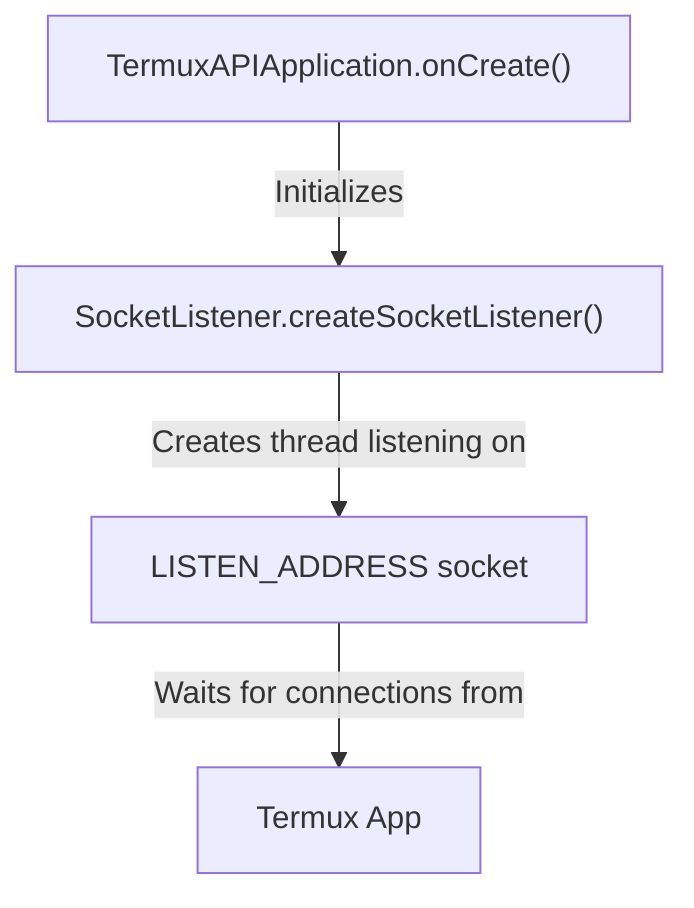

Sources: [app/src/main/java/com/termux/api/TermuxAPIApplication.java:18-34](), [app/src/main/java/com/termux/api/SocketListener.java:37-259]()

### Command Parsing Process

When the `termux-api` binary connects to the socket listener, the following process occurs:

1. `SocketListener` accepts the connection if it comes from the Termux app UID
2. Reads command line arguments from the socket
3. Parses the arguments into an Intent with various extras (string, boolean, int, etc.)
4. Broadcasts the Intent to `TermuxApiReceiver`

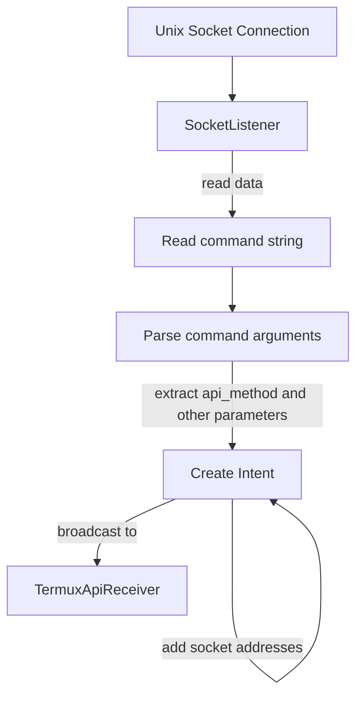

Sources: [app/src/main/java/com/termux/api/SocketListener.java:40-242]()

## Command Dispatching

The `TermuxApiReceiver` is a `BroadcastReceiver` that serves as the central hub for dispatching commands to the appropriate API implementation.

### TermuxApiReceiver.onReceive() Method

When the `TermuxApiReceiver` receives the Intent from the `SocketListener`, it:

1. Extracts the "api_method" extra from the Intent
2. Based on the api_method, dispatches to the appropriate API implementation class
3. Checks for required Android permissions before executing the API method

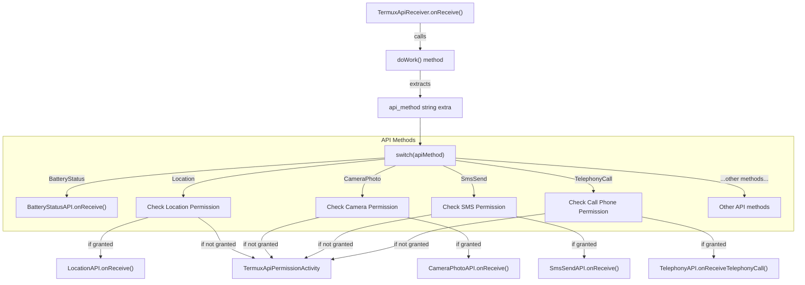

Sources: [app/src/main/java/com/termux/api/TermuxApiReceiver.java:59-270]()

## API Implementation Execution

Each API method has its own implementation class that handles the specific functionality. These classes:

1. Accept the Intent containing parameters for the API call
2. Process these parameters
3. Interact with Android system APIs
4. Return results back to the caller

For example, the `SensorAPI` creates a service that listens to device sensors and reports their values continuously:

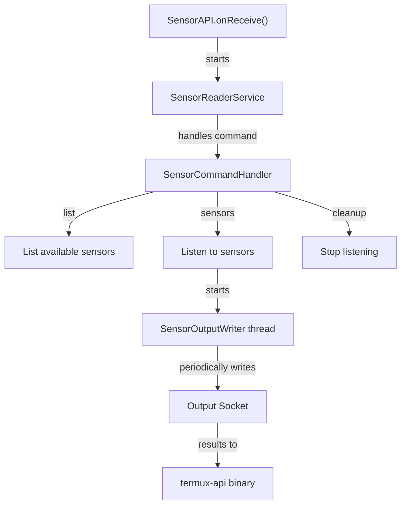

Sources: [app/src/main/java/com/termux/api/apis/SensorAPI.java:31-468]()

## Result Returning

The `ResultReturner` class is responsible for sending results from the API implementation back to the Termux application through the output socket.

### ResultReturner Process

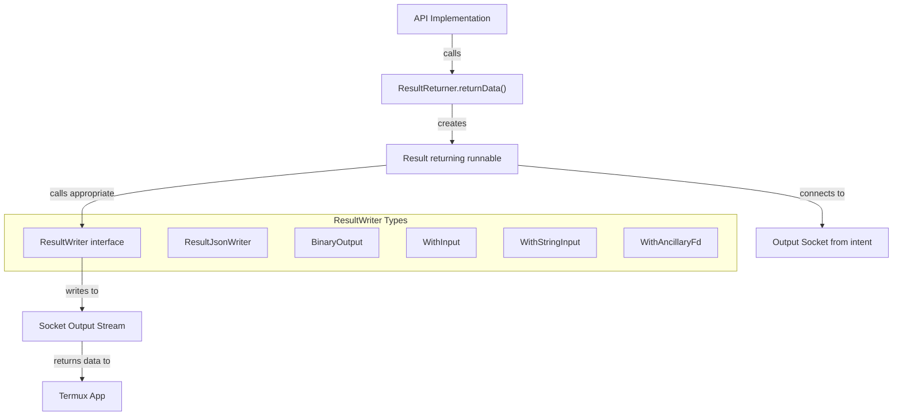

The `ResultReturner` system supports different types of result writers:

| ResultWriter Type | Purpose |
|-------------------|---------|
| ResultJsonWriter | Returns JSON-formatted results |
| BinaryOutput | Returns binary data instead of text |
| WithInput | Reads from input socket before returning results |
| WithStringInput | Reads string input from input socket |
| WithAncillaryFd | Sends file descriptors over Unix sockets |

Sources: [app/src/main/java/com/termux/api/util/ResultReturner.java:36-322]()

## Complete Command Flow Example

Let's examine a complete flow for the battery status command:

1. User executes `termux-battery-status` in Termux app
2. The script processes arguments and calls `termux-api` binary with the "BatteryStatus" API method
3. The binary creates input/output sockets and connects to the `SocketListener`
4. The `SocketListener` parses the command and creates an Intent with "api_method" set to "BatteryStatus"
5. The `SocketListener` broadcasts this Intent to `TermuxApiReceiver`
6. `TermuxApiReceiver` dispatches to `BatteryStatusAPI.onReceive()`
7. `BatteryStatusAPI` gets the battery information from Android and returns it using `ResultReturner`
8. `ResultReturner` writes the result to the output socket
9. The `termux-api` binary reads the result from the output socket and forwards it to stdout
10. The `termux-battery-status` script processes and displays the result to the user

Sources: [app/src/main/java/com/termux/api/TermuxApiReceiver.java:90-92](), [app/src/main/java/com/termux/api/util/ResultReturner.java:229-316](), [README.md:31-44]()

## Summary

The Termux:API command flow provides a bridge between the Termux command-line environment and Android's system APIs. Through a carefully designed sequence of:

1. Command processing
2. Socket-based inter-process communication
3. Intent-based command dispatching
4. Permission handling
5. Result returning

This architecture enables Termux users to access Android device capabilities through simple command-line interfaces, combining the power of Linux command-line tools with Android's rich API ecosystem.

Sources: [app/src/main/java/com/termux/api/TermuxApiReceiver.java:55-270](), [app/src/main/java/com/termux/api/util/ResultReturner.java:36-322](), [app/src/main/java/com/termux/api/SocketListener.java:22-262](), [README.md:31-44]()

---

# Page: Permission System

# Permission System

<details>
<summary>Relevant source files</summary>

The following files were used as context for generating this wiki page:

- [app/src/main/AndroidManifest.xml](app/src/main/AndroidManifest.xml)
- [app/src/main/java/com/termux/api/TermuxApiReceiver.java](app/src/main/java/com/termux/api/TermuxApiReceiver.java)
- [app/src/main/java/com/termux/api/activities/TermuxAPIMainActivity.java](app/src/main/java/com/termux/api/activities/TermuxAPIMainActivity.java)
- [app/src/main/res/layout/activity_termux_api_main.xml](app/src/main/res/layout/activity_termux_api_main.xml)
- [app/src/main/res/menu/activity_termux_api_main.xml](app/src/main/res/menu/activity_termux_api_main.xml)

</details>


## Purpose and Scope
This document explains how the Termux API handles Android permissions. It covers permission declaration in the AndroidManifest.xml, runtime permission checking through `TermuxApiPermissionActivity`, and how API implementations are protected by permission checks. For information about the overall command flow, see [Command Flow](#2.1).

## Permission Declaration

The Termux API requires numerous Android permissions to access various device features and services. All required permissions are declared in the AndroidManifest.xml file.

```mermaid
graph TD
    AndroidManifest["AndroidManifest.xml"] -->|"declares"| Permissions["Required Permissions"]
    
    Permissions -->|"includes"| LocationPerms["Location Permissions"]
    Permissions -->|"includes"| CameraPerms["Camera Permissions"]
    Permissions -->|"includes"| PhonePerms["Phone State Permissions"]
    Permissions -->|"includes"| SmsPerms["SMS Permissions"]
    Permissions -->|"includes"| StoragePerms["Storage Permissions"]
    Permissions -->|"includes"| AudioPerms["Audio Permissions"]
    Permissions -->|"includes"| OtherPerms["Other Permissions"]
    
    LocationPerms -->|"e.g."| ACCESS_FINE_LOCATION["android.permission.ACCESS_FINE_LOCATION"]
    LocationPerms -->|"e.g."| ACCESS_COARSE_LOCATION["android.permission.ACCESS_COARSE_LOCATION"]
    
    CameraPerms -->|"e.g."| CAMERA["android.permission.CAMERA"]
    
    PhonePerms -->|"e.g."| READ_PHONE_STATE["android.permission.READ_PHONE_STATE"]
    PhonePerms -->|"e.g."| CALL_PHONE["android.permission.CALL_PHONE"]
    
    SmsPerms -->|"e.g."| READ_SMS["android.permission.READ_SMS"]
    SmsPerms -->|"e.g."| SEND_SMS["android.permission.SEND_SMS"]
    
    StoragePerms -->|"e.g."| READ_EXTERNAL_STORAGE["android.permission.READ_EXTERNAL_STORAGE"]
    StoragePerms -->|"e.g."| WRITE_EXTERNAL_STORAGE["android.permission.WRITE_EXTERNAL_STORAGE"]
    
    AudioPerms -->|"e.g."| RECORD_AUDIO["android.permission.RECORD_AUDIO"]
```

Sources: [app/src/main/AndroidManifest.xml:8-40]()

## Permission Check and Request Flow

When a Termux API command is received by `TermuxApiReceiver`, the system determines if the requested API method requires permissions. If needed, permissions are verified or requested before executing the API implementation.

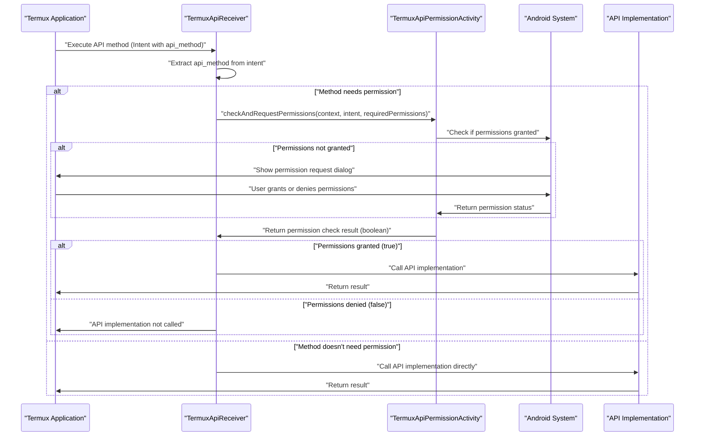

Sources: [app/src/main/java/com/termux/api/TermuxApiReceiver.java:60-77](), [app/src/main/java/com/termux/api/TermuxApiReceiver.java:79-270]()

## Permission-Protected API Methods

The `TermuxApiReceiver.doWork()` method contains a large switch statement that handles different API methods and checks for required permissions before calling each API implementation.

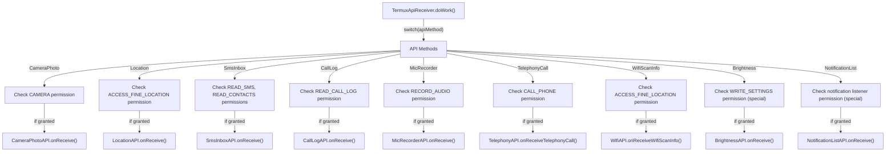

Sources: [app/src/main/java/com/termux/api/TermuxApiReceiver.java:86-269]()

## Permission Check Implementation

The `TermuxApiReceiver` class uses `TermuxApiPermissionActivity.checkAndRequestPermissions()` to verify required permissions before executing API methods. This pattern is consistent throughout the API implementations:

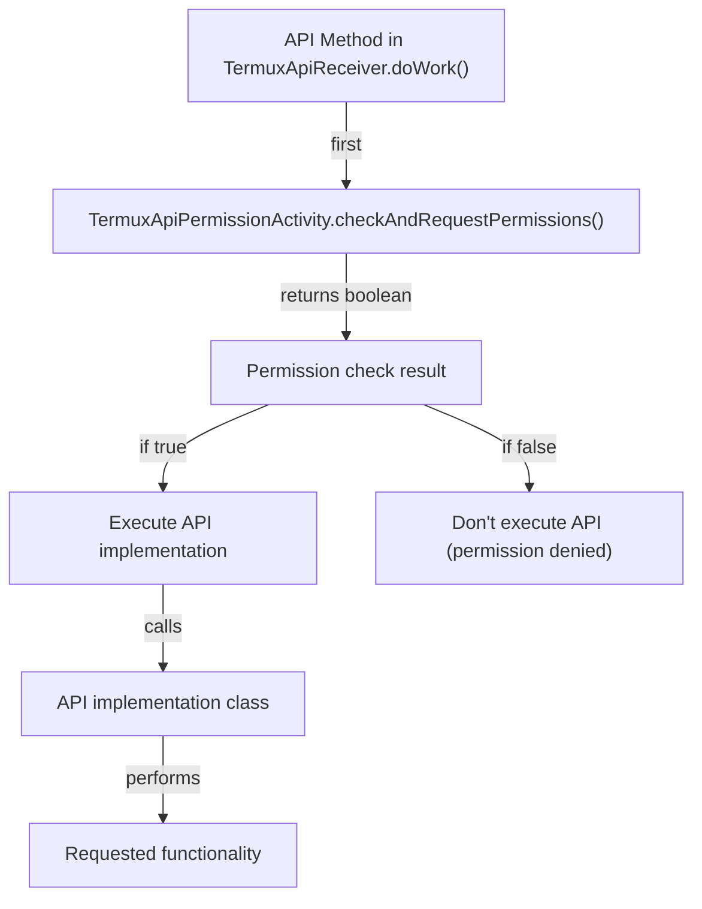

Sources: [app/src/main/java/com/termux/api/TermuxApiReceiver.java:109-112](), [app/src/main/java/com/termux/api/TermuxApiReceiver.java:152-154](), [app/src/main/java/com/termux/api/TermuxApiReceiver.java:163-165]()

## Special Permission Handling

Some permissions require special handling because they cannot be granted through the standard runtime permission system.

### System Settings Permission (WRITE_SETTINGS)

The `BrightnessAPI` requires the `WRITE_SETTINGS` permission, which must be manually enabled by the user in system settings:

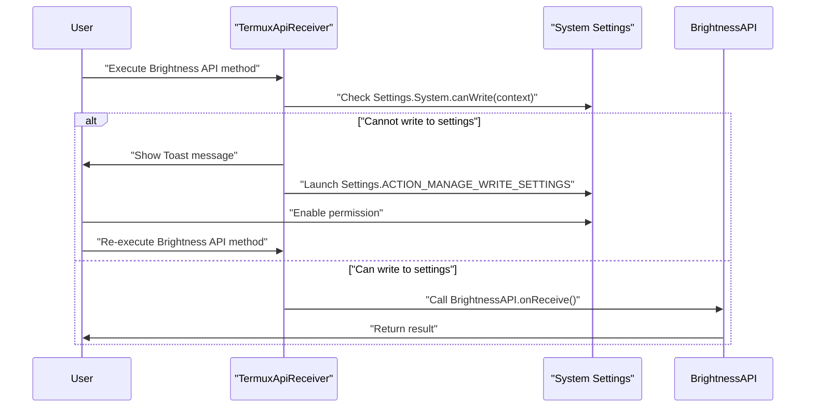

Sources: [app/src/main/java/com/termux/api/TermuxApiReceiver.java:94-103]()

### Notification Listener Permission

The `NotificationListAPI` requires special notification listener access, which must be enabled in system settings:

```mermaid
sequenceDiagram
    participant User
    participant ApiReceiver as "TermuxApiReceiver"
    participant Settings as "System Settings"
    participant NotificationListAPI
    
    User->>ApiReceiver: "Execute NotificationList API method"
    ApiReceiver->>Settings: "Check if NotificationService is enabled"
    
    alt "Service not enabled"
        ApiReceiver->>User: "Show Toast message"
        ApiReceiver->>Settings: "Launch ACTION_NOTIFICATION_LISTENER_SETTINGS"
        User->>Settings: "Enable service"
        User->>ApiReceiver: "Re-execute NotificationList API method"
    else "Service enabled"
        ApiReceiver->>NotificationListAPI: "Call NotificationListAPI.onReceive()"
        NotificationListAPI->>User: "Return result"
    end
```

Sources: [app/src/main/java/com/termux/api/TermuxApiReceiver.java:170-179]()

## Main Activity Permission UI

The `TermuxAPIMainActivity` includes UI elements to help users manage permissions that are important for the application's functionality.

```mermaid
graph TD
    MainActivity["TermuxAPIMainActivity"]
    
    MainActivity -->|"checks on resume"| CheckBattery["checkIfBatteryOptimizationNotDisabled()"]
    MainActivity -->|"checks on resume"| CheckDisplay["checkIfDisplayOverOtherAppsPermissionNotGranted()"]
    
    CheckBattery -->|"if not disabled"| ShowBatteryWarning["Show battery optimization warning"]
    ShowBatteryWarning -->|"via button"| RequestBattery["requestDisableBatteryOptimizations()"]
    RequestBattery -->|"launches"| BatterySettings["Battery optimization settings"]
    
    CheckDisplay -->|"if not granted"| ShowDisplayWarning["Show display over apps warning"]
    ShowDisplayWarning -->|"via button"| RequestDisplay["requestDisplayOverOtherAppsPermission()"]
    RequestDisplay -->|"launches"| DisplaySettings["Display over apps settings"]
```

Sources: [app/src/main/java/com/termux/api/activities/TermuxAPIMainActivity.java:100-116](), [app/src/main/java/com/termux/api/activities/TermuxAPIMainActivity.java:120-136]()

## Permission-Required API Methods

The following table shows API methods that require runtime permissions and the specific permissions they need:

| API Method | Required Permissions | Implementation |
|------------|---------------------|----------------|
| CameraPhoto | `CAMERA` | [TermuxApiReceiver.java:109-112]() |
| CallLog | `READ_CALL_LOG` | [TermuxApiReceiver.java:114-116]() |
| ContactList | `READ_CONTACTS` | [TermuxApiReceiver.java:122-124]() |
| InfraredTransmit | `TRANSMIT_IR` | [TermuxApiReceiver.java:141-143]() |
| Location | `ACCESS_FINE_LOCATION` | [TermuxApiReceiver.java:152-154]() |
| MicRecorder | `RECORD_AUDIO` | [TermuxApiReceiver.java:163-165]() |
| SmsInbox | `READ_SMS`, `READ_CONTACTS` | [TermuxApiReceiver.java:203-205]() |
| SmsSend | `READ_PHONE_STATE`, `SEND_SMS` | [TermuxApiReceiver.java:208-210]() |
| SpeechToText | `RECORD_AUDIO` | [TermuxApiReceiver.java:216-218]() |
| TelephonyCall | `CALL_PHONE` | [TermuxApiReceiver.java:221-223]() |
| TelephonyCellInfo | `ACCESS_COARSE_LOCATION` | [TermuxApiReceiver.java:226-228]() |
| TelephonyDeviceInfo | `READ_PHONE_STATE` | [TermuxApiReceiver.java:231-233]() |
| WifiScanInfo | `ACCESS_FINE_LOCATION` | [TermuxApiReceiver.java:260-262]() |

Sources: [app/src/main/java/com/termux/api/TermuxApiReceiver.java:86-269]()

## Permission Flow Example: Location API

This sequence diagram shows a detailed example of how permissions are handled specifically for the Location API:

```mermaid
sequenceDiagram
    participant User
    participant TermuxApp as "Termux App (Command Line)"
    participant BinaryCmd as "termux-location (Binary)"
    participant ApiReceiver as "TermuxApiReceiver"
    participant PermActivity as "TermuxApiPermissionActivity"
    participant LocationAPI
    
    User->>TermuxApp: "Execute: termux-location"
    TermuxApp->>BinaryCmd: "Execute binary command"
    BinaryCmd->>ApiReceiver: "Send intent with api_method='Location'"
    
    ApiReceiver->>ApiReceiver: "doWork() -> switch(api_method)"
    ApiReceiver->>ApiReceiver: "case 'Location'"
    
    ApiReceiver->>PermActivity: "checkAndRequestPermissions(context, intent, ACCESS_FINE_LOCATION)"
    PermActivity->>PermActivity: "Check if permission already granted"
    
    alt "Permission not granted"
        PermActivity->>User: "Show permission request dialog"
        User->>PermActivity: "Grant or deny permission"
    end
    
    PermActivity->>ApiReceiver: "Return permission status (boolean)"
    
    alt "Permission granted"
        ApiReceiver->>LocationAPI: "LocationAPI.onReceive()"
        LocationAPI->>LocationAPI: "Access location services"
        LocationAPI->>BinaryCmd: "Return location data"
        BinaryCmd->>TermuxApp: "Output location data"
        TermuxApp->>User: "Display location data"
    else "Permission denied"
        ApiReceiver->>BinaryCmd: "No API call made"
        BinaryCmd->>TermuxApp: "No output or error"
        TermuxApp->>User: "No result"
    end
```

Sources: [app/src/main/java/com/termux/api/TermuxApiReceiver.java:152-154]()

## Conclusion

The permission system in the Termux API follows Android's standard runtime permission model, with a centralized permission check mechanism implemented in `TermuxApiPermissionActivity`. The system ensures that API implementations only execute when the required permissions are granted.

For special permissions that cannot be requested through the standard runtime permission dialog, the application guides users to the appropriate system settings screens. The main activity also provides UI elements to help users manage other important permissions like battery optimization and display over other apps.

This permission system effectively balances providing powerful functionality through the Termux command-line interface while respecting Android's permission model to maintain security and user privacy.

---

# Page: API Components

# API Components

<details>
<summary>Relevant source files</summary>

The following files were used as context for generating this wiki page:

- [app/src/main/AndroidManifest.xml](app/src/main/AndroidManifest.xml)
- [app/src/main/java/com/termux/api/TermuxApiReceiver.java](app/src/main/java/com/termux/api/TermuxApiReceiver.java)

</details>


## Purpose and Scope

This document provides an overview of the API components available in the Termux API system. API components are the individual modules that enable command-line access to specific Android system features, bridging the Termux command-line environment with Android's capabilities. Each component corresponds to a specific Android functionality, from hardware access to system services.

For information about how commands flow through the system, see [Command Flow](#2.1). For details on how permissions are managed, see [Permission System](#2.2).

## Component Architecture Overview

API components sit at the heart of the Termux API system, acting as intermediaries between Termux commands and Android system APIs. Each component is implemented as a Java class that handles specific functionality and is dispatched by the central `TermuxApiReceiver`.

### API Components in System Architecture

```mermaid
graph TD
    subgraph "Command Layer"
        TermuxApp["Termux Application"]
        TermuxBinary["termux-api Binary"]
    end

    subgraph "Dispatch Layer"
        SocketListener["SocketListener"]
        ApiReceiver["TermuxApiReceiver"]
    end

    subgraph "Implementation Layer"
        ApiComponents["API Components"]
    end

    subgraph "Result Layer"
        ResultReturner["ResultReturner"]
    end

    subgraph "Android System"
        AndroidSystem["Android System APIs"]
    end
    
    TermuxApp -->|"executes"| TermuxBinary
    TermuxBinary -->|"connects to"| SocketListener
    SocketListener -->|"broadcasts intent with\napi_method"| ApiReceiver
    ApiReceiver -->|"dispatches based on\napi_method"| ApiComponents
    ApiComponents -->|"interacts with"| AndroidSystem
    ApiComponents -->|"returns data via"| ResultReturner
    ResultReturner -->|"writes to socket"| TermuxBinary
    TermuxBinary -->|"returns results to"| TermuxApp
```

Sources: [app/src/main/java/com/termux/api/TermuxApiReceiver.java:55-272](), [app/src/main/AndroidManifest.xml:161-162]()

## Component Dispatch Mechanism

The `TermuxApiReceiver` class acts as the central hub for all API components. When a command is sent from Termux, it's received by the `TermuxApiReceiver` which extracts the `api_method` parameter and dispatches the request to the appropriate API component.

```mermaid
flowchart TD
    A["TermuxApiReceiver.onReceive()"]
    B["Extract api_method from intent"]
    C["Switch on api_method"]

    subgraph "API Components"
        D1["AudioAPI"]
        D2["BatteryStatusAPI"]
        D3["LocationAPI"]
        D4["NotificationAPI"]
        Dn["...30+ other APIs"]
    end

    A --> B
    B --> C
    C -->|"api_method=AudioInfo"| D1
    C -->|"api_method=BatteryStatus"| D2
    C -->|"api_method=Location"| D3
    C -->|"api_method=Notification"| D4
    C -->|"other api_method values"| Dn
```

Sources: [app/src/main/java/com/termux/api/TermuxApiReceiver.java:80-269]()

## API Component Categories

The Termux API components can be organized into several functional categories based on the type of Android functionality they provide:

```mermaid
graph TD
    ApiComponents["API Components"] --> SystemApis["System APIs"]
    ApiComponents --> UIApis["UI APIs"]
    ApiComponents --> HardwareApis["Hardware APIs"]
    ApiComponents --> CommunicationApis["Communication APIs"]
    ApiComponents --> FileApis["File System APIs"]
    
    SystemApis --> BatteryStatusAPI["BatteryStatusAPI"]
    SystemApis --> ClipboardAPI["ClipboardAPI"]
    SystemApis --> JobSchedulerAPI["JobSchedulerAPI"]
    
    UIApis --> DialogAPI["DialogAPI"]
    UIApis --> NotificationAPI["NotificationAPI"]
    UIApis --> ToastAPI["ToastAPI"]
    
    HardwareApis --> CameraPhotoAPI["CameraPhotoAPI"]
    HardwareApis --> LocationAPI["LocationAPI"]
    HardwareApis --> SensorAPI["SensorAPI"]
    HardwareApis --> VibrateAPI["VibrateAPI"]
    HardwareApis --> TorchAPI["TorchAPI"]
    
    CommunicationApis --> TelephonyAPI["TelephonyAPI"]
    CommunicationApis --> SmsInboxAPI["SmsInboxAPI"]
    CommunicationApis --> SmsSendAPI["SmsSendAPI"]
    CommunicationApis --> WifiAPI["WifiAPI"]
    
    FileApis --> StorageGetAPI["StorageGetAPI"]
    FileApis --> SAFAPI["SAFAPI"]
    FileApis --> MediaScannerAPI["MediaScannerAPI"]
```

Sources: [app/src/main/java/com/termux/api/TermuxApiReceiver.java:11-47](), [app/src/main/AndroidManifest.xml:8-40]()

### System APIs
Components that provide access to Android system services and information:
- `BatteryStatusAPI` - Battery information
- `ClipboardAPI` - Access system clipboard
- `JobSchedulerAPI` - Schedule background tasks
- `VolumeAPI` - Control device volume
- `BrightnessAPI` - Control screen brightness

### UI APIs
Components that handle user interface interactions:
- `DialogAPI` - Display interactive dialogs
- `NotificationAPI` - Create and manage notifications
- `ToastAPI` - Display toast messages
- `WallpaperAPI` - Set device wallpaper

### Hardware APIs
Components that provide access to device hardware:
- `CameraPhotoAPI` - Take photos
- `LocationAPI` - Access location services
- `SensorAPI` - Read device sensors
- `VibrateAPI` - Control vibration
- `TorchAPI` - Control flashlight
- `InfraredAPI` - Control infrared transmitter
- `FingerprintAPI` - Fingerprint authentication

### Communication APIs
Components that handle communication features:
- `TelephonyAPI` - Phone-related functions
- `SmsInboxAPI` - Access SMS inbox
- `SmsSendAPI` - Send SMS messages
- `WifiAPI` - WiFi information and control
- `NfcAPI` - NFC operations

### File System APIs
Components that deal with file operations:
- `StorageGetAPI` - Access device storage
- `SAFAPI` - Storage Access Framework
- `MediaScannerAPI` - Scan media files
- `DownloadAPI` - Download files

Sources: [app/src/main/java/com/termux/api/TermuxApiReceiver.java:86-266]()

## Component Implementation Pattern

Most API components in Termux API follow a common implementation pattern:

```mermaid
sequenceDiagram
    participant TR as "TermuxApiReceiver"
    participant AC as "API Component"
    participant AP as "Permission System"
    participant AS as "Android System API"
    participant RR as "ResultReturner"
    
    TR->>AC: onReceive(intent)
    
    alt Requires permissions
        AC->>AP: checkAndRequestPermissions()
        alt Permissions granted
            AP-->>AC: Continue execution
        else Permissions denied
            AP-->>TR: Request permissions from user
            Note over TR,AP: Execution stops until permissions granted
        end
    end
    
    AC->>AC: Extract parameters from intent
    AC->>AS: Call Android system API
    AS-->>AC: Return results
    AC->>RR: Return results via ResultReturner
    RR-->>TR: Write results to output socket
```

Sources: [app/src/main/java/com/termux/api/TermuxApiReceiver.java:90-117](), [app/src/main/java/com/termux/api/util/ResultReturner.java]()

## Available API Components

The Termux API provides a comprehensive set of API components, each accessing specific Android features:

| API Component | Description | Required Permissions |
|---------------|-------------|---------------------|
| `AudioAPI` | Audio device information | - |
| `BatteryStatusAPI` | Battery status information | - |
| `BrightnessAPI` | Screen brightness control | `WRITE_SETTINGS` |
| `CallLogAPI` | Call log access | `READ_CALL_LOG` |
| `CameraInfoAPI` | Camera information | - |
| `CameraPhotoAPI` | Take photos | `CAMERA` |
| `ClipboardAPI` | Clipboard access | - |
| `ContactListAPI` | Contact list access | `READ_CONTACTS` |
| `DialogAPI` | Display dialogs | - |
| `DownloadAPI` | Download files | - |
| `FingerprintAPI` | Fingerprint authentication | `USE_BIOMETRIC` |
| `InfraredAPI` | Infrared transmitter | `TRANSMIT_IR` |
| `JobSchedulerAPI` | Job scheduling | - |
| `KeystoreAPI` | Android Keystore access | - |
| `LocationAPI` | Location services | `ACCESS_FINE_LOCATION` |
| `MediaPlayerAPI` | Media playback | - |
| `MediaScannerAPI` | Media scanning | - |
| `MicRecorderAPI` | Microphone recording | `RECORD_AUDIO` |
| `NfcAPI` | NFC operations | - |
| `NotificationAPI` | Notifications | - |
| `NotificationListAPI` | Access notifications | Notification Listener Service |
| `SAFAPI` | Storage Access Framework | - |
| `SensorAPI` | Device sensors | - |
| `ShareAPI` | Share content | - |
| `SmsInboxAPI` | SMS inbox access | `READ_SMS`, `READ_CONTACTS` |
| `SmsSendAPI` | Send SMS messages | `READ_PHONE_STATE`, `SEND_SMS` |
| `SpeechToTextAPI` | Speech recognition | `RECORD_AUDIO` |
| `StorageGetAPI` | Storage access | - |
| `TelephonyAPI` | Phone functions | Various (`CALL_PHONE`, etc.) |
| `TextToSpeechAPI` | Text-to-speech | - |
| `ToastAPI` | Toast messages | - |
| `TorchAPI` | Flashlight control | - |
| `UsbAPI` | USB device access | - |
| `VibrateAPI` | Vibration control | `VIBRATE` |
| `VolumeAPI` | Volume control | - |
| `WallpaperAPI` | Set wallpaper | `SET_WALLPAPER` |
| `WifiAPI` | WiFi control | Various permissions |

Sources: [app/src/main/java/com/termux/api/TermuxApiReceiver.java:86-266](), [app/src/main/AndroidManifest.xml:8-40]()

## Services and Activities

Many API components require dedicated services or activities to function properly. These are defined in the AndroidManifest.xml:

### Activities
- `DialogAPI$DialogActivity` - Activity for displaying dialogs
- `FingerprintAPI$FingerprintActivity` - Activity for fingerprint authentication
- `NfcAPI$NfcActivity` - Activity for NFC operations
- `SAFAPI$SAFActivity` - Activity for Storage Access Framework
- `StorageGetAPI$StorageActivity` - Activity for storage access

### Services
- `JobSchedulerAPI$JobSchedulerService` - Service for job scheduling
- `MediaPlayerAPI$MediaPlayerService` - Service for media playback
- `MicRecorderAPI$MicRecorderService` - Service for microphone recording
- `NotificationListAPI$NotificationService` - Service for notification access
- `SensorAPI$SensorReaderService` - Service for sensor reading
- `SpeechToTextAPI$SpeechToTextService` - Service for speech recognition
- `TextToSpeechAPI$TextToSpeechService` - Service for text-to-speech
- `WallpaperAPI$WallpaperService` - Service for setting wallpaper
- `UsbAPI$UsbService` - Service for USB access

Sources: [app/src/main/AndroidManifest.xml:101-213]()

For more detailed information about specific API components, refer to the following pages:
- [API Receiver](#3.1) - Details about the central API receiver
- [Result Returning System](#3.2) - How results are returned from API calls
- [User Interface APIs](#3.3) - UI-related API components
- [Hardware APIs](#3.4) - Hardware access API components
- [System Service APIs](#3.5) - System service API components

---

# Page: API Receiver

# API Receiver

<details>
<summary>Relevant source files</summary>

The following files were used as context for generating this wiki page:

- [app/src/main/AndroidManifest.xml](app/src/main/AndroidManifest.xml)
- [app/src/main/java/com/termux/api/TermuxApiReceiver.java](app/src/main/java/com/termux/api/TermuxApiReceiver.java)

</details>


## Purpose and Overview

The API Receiver is the central dispatching component within the Termux API system that receives commands from the Termux application and routes them to the appropriate API implementation. It serves as a critical bridge between command-line requests issued in Termux and the actual Android system API implementations.

This document covers the API Receiver's architecture, dispatch mechanism, and permission handling. For information about how results are returned from API calls, see [Result Returning System](#3.2).

Sources: [app/src/main/java/com/termux/api/TermuxApiReceiver.java:55-272]()

## Architecture

The API Receiver is implemented as an Android BroadcastReceiver that processes intent requests containing API method names and parameters. It is registered in the AndroidManifest.xml file and acts as the central hub that dispatches requests to specialized API implementation classes.

### System Integration Diagram

```mermaid
flowchart TD
    subgraph "Termux Application"
        TermuxCmd["Command-line Tools\n(termux-* scripts)"]
    end

    subgraph "Termux:API Android App"
        TARcvr["TermuxApiReceiver"]
        ApiImpl["API Implementations"]
        PrmActivity["TermuxApiPermissionActivity"]
        
        TARcvr -->|"dispatches to"| ApiImpl
        TARcvr -->|"requests permissions via"| PrmActivity
    end

    TermuxCmd -->|"sends intent with\napi_method"| TARcvr
    ApiImpl -->|"interacts with"| AndroidSystem["Android System Services"]
    PrmActivity -->|"requests"| AndroidSystem
```

Sources: [app/src/main/java/com/termux/api/TermuxApiReceiver.java:55-60](), [app/src/main/AndroidManifest.xml:161-162]()

## Dispatch Mechanism

The API Receiver works by extracting an `api_method` parameter from incoming intents and using it to determine which API implementation to invoke. This design pattern centralizes the command routing logic in a single class while keeping the actual implementation details separate in specialized API classes.

### API Method Dispatch Flow

```mermaid
sequenceDiagram
    participant Intent
    participant TermuxApiReceiver
    participant PermissionCheck
    participant APIImplementation
    
    Intent->>TermuxApiReceiver: onReceive(context, intent)
    TermuxApiReceiver->>TermuxApiReceiver: Extract api_method
    
    alt No api_method
        TermuxApiReceiver-->>Intent: Log error and return
    else api_method present
        TermuxApiReceiver->>TermuxApiReceiver: Switch on api_method
        
        alt Requires permissions
            TermuxApiReceiver->>PermissionCheck: checkAndRequestPermissions()
            
            alt Permissions granted
                PermissionCheck-->>TermuxApiReceiver: true
                TermuxApiReceiver->>APIImplementation: onReceive()
            else Permissions not granted
                PermissionCheck-->>TermuxApiReceiver: false
                TermuxApiReceiver-->>Intent: Request permissions and exit
            end
            
        else No permissions required
            TermuxApiReceiver->>APIImplementation: onReceive()
        end
    end
    
    Note over TermuxApiReceiver: Error handling surrounds all operations
```

Sources: [app/src/main/java/com/termux/api/TermuxApiReceiver.java:59-270]()

## Permission Handling

Many Android APIs require specific permissions. The API Receiver works with `TermuxApiPermissionActivity` to check for required permissions and request them if necessary. This permission handling is integrated directly into the dispatch mechanism to ensure proper permissions are granted before API operations are performed.

### Permission Flow Table

| Step | Action | Code Reference |
|------|--------|----------------|
| 1 | Receive API request | `onReceive()` method |
| 2 | Determine required permissions based on API method | Switch statement in `doWork()` method |
| 3 | Check if permissions are already granted | `TermuxApiPermissionActivity.checkAndRequestPermissions()` |
| 4 | If permissions granted, proceed with API call | Direct call to API implementation |
| 5 | If permissions needed, launch permission request | Permission activity handles request flow |

Sources: [app/src/main/java/com/termux/api/TermuxApiReceiver.java:109-111](), [app/src/main/java/com/termux/api/TermuxApiReceiver.java:152-154]()

## Supported API Methods

The API Receiver supports a comprehensive set of API methods that provide access to various Android system features. These are grouped by general functionality below:

### API Method Categories

```mermaid
graph TD
    TARcvr["TermuxApiReceiver"]
    
    subgraph "UI Methods"
        UI["UI APIs"]
        UI_Dialog["Dialog"]
        UI_Toast["Toast"]
        UI_Notification["Notification"]
        
        UI --- UI_Dialog
        UI --- UI_Toast
        UI --- UI_Notification
    end
    
    subgraph "Hardware Methods"
        HW["Hardware APIs"]
        HW_Camera["CameraPhoto/CameraInfo"]
        HW_Sensor["Sensor"]
        HW_Location["Location"]
        HW_Torch["Torch"]
        HW_Vibrate["Vibrate"]
        HW_Audio["Audio/MicRecorder"]
        
        HW --- HW_Camera
        HW --- HW_Sensor
        HW --- HW_Location
        HW --- HW_Torch
        HW --- HW_Vibrate
        HW --- HW_Audio
    end
    
    subgraph "System Methods"
        SYS["System APIs"]
        SYS_Battery["BatteryStatus"]
        SYS_Clipboard["Clipboard"]
        SYS_Wifi["WifiConnectionInfo/WifiScanInfo"]
        SYS_Volume["Volume"]
        SYS_Brightness["Brightness"]
        
        SYS --- SYS_Battery
        SYS --- SYS_Clipboard
        SYS --- SYS_Wifi
        SYS --- SYS_Volume
        SYS --- SYS_Brightness
    end
    
    subgraph "Telephony Methods"
        TEL["Telephony APIs"]
        TEL_Device["TelephonyDeviceInfo"]
        TEL_Call["TelephonyCall"]
        TEL_SMS["SmsSend/SmsInbox"]
        
        TEL --- TEL_Device
        TEL --- TEL_Call
        TEL --- TEL_SMS
    end
    
    subgraph "Storage Methods"
        STR["Storage APIs"]
        STR_Get["StorageGet"]
        STR_SAF["SAF"]
        STR_Media["MediaScanner"]
        
        STR --- STR_Get
        STR --- STR_SAF
        STR --- STR_Media
    end
    
    TARcvr --> UI
    TARcvr --> HW
    TARcvr --> SYS
    TARcvr --> TEL
    TARcvr --> STR
```

Sources: [app/src/main/java/com/termux/api/TermuxApiReceiver.java:86-266]()

### API Method Table

| Category | API Method | Purpose | Permission Required |
|----------|------------|---------|---------------------|
| **Audio & Media** | AudioInfo | Get audio information | None |
| | MediaPlayer | Control media playback | None |
| | MicRecorder | Record audio | RECORD_AUDIO |
| | SpeechToText | Convert speech to text | RECORD_AUDIO |
| | TextToSpeech | Convert text to speech | None |
| **System Info** | BatteryStatus | Get battery information | None |
| | Brightness | Control screen brightness | WRITE_SETTINGS |
| | Volume | Control device volume | None |
| **Camera** | CameraInfo | Get camera device information | None |
| | CameraPhoto | Take photos | CAMERA |
| **Communication** | TelephonyCall | Make phone calls | CALL_PHONE |
| | TelephonyDeviceInfo | Get device information | READ_PHONE_STATE |
| | TelephonyCellInfo | Get cell tower information | ACCESS_COARSE_LOCATION |
| | SmsSend | Send SMS messages | SEND_SMS, READ_PHONE_STATE |
| | SmsInbox | Read SMS messages | READ_SMS, READ_CONTACTS |
| **Location & Sensors** | Location | Get device location | ACCESS_FINE_LOCATION |
| | Sensor | Access device sensors | None |
| **User Interface** | Dialog | Display interactive dialogs | None |
| | Notification | Display notifications | None |
| | Toast | Show toast messages | None |
| **Storage** | StorageGet | Access storage | None |
| | SAF | Storage Access Framework integration | None |
| | MediaScanner | Scan media files | None |
| **Connectivity** | WifiConnectionInfo | Get current WiFi information | None |
| | WifiScanInfo | Scan for WiFi networks | ACCESS_FINE_LOCATION |
| | WifiEnable | Enable/disable WiFi | None |

Sources: [app/src/main/java/com/termux/api/TermuxApiReceiver.java:86-266]()

## Error Handling

The API Receiver implements robust error handling to ensure that even if API implementations encounter exceptions, they don't cause the entire process to crash (which would trigger the "process is bad" behavior from the Android system for broadcast receivers).

```mermaid
flowchart TD
    Start["onReceive() called"] --> TryCatch["Try-catch block"]
    TryCatch --> DoWork["doWork() method"]
    
    DoWork -->|"Success"| ResultR["ResultReturner.noteDone()"]
    
    DoWork -->|"Exception"| Catch["Catch block"]
    Catch --> LogError["Log error"]
    LogError --> SendNotification["Send error notification"]
    SendNotification --> ResultRE["ResultReturner.noteDone()"]
    
    ResultR --> End["End processing"]
    ResultRE --> End
```

Sources: [app/src/main/java/com/termux/api/TermuxApiReceiver.java:64-76]()

## Integration with Other Components

The API Receiver works closely with several other components in the Termux API system:

1. **Result Returner**: After processing an API request, results are returned to the calling application using the ResultReturner utility. This component handles the socket communication that returns data to the Termux application. For details, see [Result Returning System](#3.2).

2. **TermuxApiPermissionActivity**: This activity manages Android permission requests for API calls that require specific permissions.

3. **API Implementation Classes**: Each API method is implemented in a separate class that contains the actual functionality. These classes follow a pattern where they expose static `onReceive()` methods that the API Receiver calls.

Sources: [app/src/main/java/com/termux/api/TermuxApiReceiver.java:49](), [app/src/main/java/com/termux/api/TermuxApiReceiver.java:48]()

---

# Page: Result Returning System

# Result Returning System

<details>
<summary>Relevant source files</summary>

The following files were used as context for generating this wiki page:

- [.github/workflows/github_action_build.yml](.github/workflows/github_action_build.yml)
- [.github/workflows/github_release_build.yml](.github/workflows/github_release_build.yml)
- [README.md](README.md)
- [app/src/main/java/com/termux/api/apis/SensorAPI.java](app/src/main/java/com/termux/api/apis/SensorAPI.java)
- [app/src/main/java/com/termux/api/util/ResultReturner.java](app/src/main/java/com/termux/api/util/ResultReturner.java)

</details>


The Result Returning System is a critical component of the Termux API architecture that handles how data is returned from the Termux:API Android application back to the Termux command-line environment. It provides a standardized mechanism for API implementations to write their results to output sockets, supporting various output formats and special features.

For information about how commands are dispatched to specific API implementations, see [API Receiver](#3.1).

## System Overview

The Result Returning System acts as a bridge between the Java-based API implementations running within the Android environment and the Unix command-line environment of Termux. It solves the challenge of transferring data across these environments by using Unix domain sockets.

```mermaid
flowchart TB
    subgraph "Termux Command-Line Environment"
        TermuxAPI["termux-api binary"]
        Scripts["API Scripts<br>(termux-camera-photo, etc.)"]
        Scripts -->|"executes"| TermuxAPI
    end
    
    subgraph "Android Environment"
        subgraph "Termux:API App"
            Receiver["TermuxApiReceiver"]
            APIImpl["API Implementations"]
            ResultR["ResultReturner"]
            
            Receiver -->|"dispatches to"| APIImpl
            APIImpl -->|"returns data via"| ResultR
        end
    end
    
    TermuxAPI -->|"1. Creates input/output sockets"| InputSocket["Input Socket"]
    TermuxAPI -->|"2. Creates input/output sockets"| OutputSocket["Output Socket"]
    TermuxAPI -->|"3. Sends intent with socket addresses"| Receiver
    
    InputSocket -->|"provides input data"| ResultR
    ResultR -->|"writes results to"| OutputSocket
    OutputSocket -->|"returns data to"| TermuxAPI
    TermuxAPI -->|"returns output to"| Scripts
```

Sources: [README.md:32-43](), [app/src/main/java/com/termux/api/util/ResultReturner.java:36-54]()

## Core Components

The Result Returning System is implemented in the `ResultReturner` class which provides interfaces and methods for handling different types of result data.

```mermaid
classDiagram
    class ResultReturner {
        +static Context context
        +static void returnData(Object context, Intent intent, ResultWriter resultWriter)
        +static void noteDone(BroadcastReceiver receiver, Intent intent)
        +static LocalSocketAddress getApiLocalSocketAddress(Context context, String socketLabel, String socketAddress)
    }
    
    class ResultWriter {
        <<interface>>
        +void writeResult(PrintWriter out)
    }
    
    class WithInput {
        <<interface>>
        #InputStream in
        +void setInput(InputStream inputStream)
    }
    
    class BinaryOutput {
        <<interface>>
        -OutputStream out
        +void setOutput(OutputStream outputStream)
        +void writeResult(OutputStream out)
    }
    
    class WithStringInput {
        <<interface>>
        #String inputString
        #boolean trimInput()
    }
    
    class WithAncillaryFd {
        <<interface>>
        +void setOutputSocketForFds(LocalSocket outputSocket)
        +void sendFd(PrintWriter out, int fd)
        +void cleanupFds()
    }
    
    class ResultJsonWriter {
        <<interface>>
        +void writeResult(PrintWriter out)
        +void writeJson(JsonWriter out)
    }
    
    ResultWriter <|-- WithInput
    ResultWriter <|-- BinaryOutput
    ResultWriter <|-- ResultJsonWriter
    WithInput <|-- WithStringInput
    ResultWriter <|-- WithAncillaryFd
```

Sources: [app/src/main/java/com/termux/api/util/ResultReturner.java:55-175]()

### ResultWriter Interface

The `ResultWriter` interface is the core abstraction of the system. It defines a method for writing result data to a `PrintWriter`:

```java
public interface ResultWriter {
    void writeResult(PrintWriter out) throws Exception;
}
```

API implementations create instances of classes implementing this interface to define how their specific results should be formatted and written.

Sources: [app/src/main/java/com/termux/api/util/ResultReturner.java:55-57]()

### Specialized Writer Interfaces

Several specialized interfaces extend `ResultWriter` to handle specific use cases:

| Interface | Purpose | Key Methods |
|-----------|---------|-------------|
| `WithInput` | For APIs that need to read input from the input socket | `setInput(InputStream)` |
| `BinaryOutput` | For APIs returning binary data instead of text | `writeResult(OutputStream)` |
| `WithStringInput` | For APIs that need to read string input | Automatically converts input stream to string |
| `WithAncillaryFd` | For APIs needing to send file descriptors | `sendFd(PrintWriter, int)` |
| `ResultJsonWriter` | For APIs returning JSON-formatted data | `writeJson(JsonWriter)` |

Sources: [app/src/main/java/com/termux/api/util/ResultReturner.java:62-175]()

## Result Returning Process

The result returning process follows a specific flow designed to handle the socket communication between Termux and the API.

```mermaid
sequenceDiagram
    participant API as "API Implementation"
    participant RR as "ResultReturner"
    participant Socket as "Output Socket"
    participant Termux as "termux-api binary"
    
    API->>RR: Call returnData(context, intent, resultWriter)
    RR->>RR: Create runnable for result processing
    
    alt Context is IntentService
        RR->>RR: Run in current thread
    else Other context
        RR->>RR: Start new thread
    end
    
    RR->>Socket: Connect to output socket address
    
    alt resultWriter instanceof WithInput
        RR->>RR: Connect to input socket
        RR->>RR: Set input stream on resultWriter
    end
    
    alt resultWriter instanceof BinaryOutput
        RR->>RR: Set output stream on resultWriter
    end
    
    alt resultWriter instanceof WithAncillaryFd
        RR->>RR: Set output socket for file descriptors
    end
    
    RR->>API: Call resultWriter.writeResult()
    API->>Socket: Write results
    Socket->>Termux: Return data
    
    alt resultWriter instanceof WithAncillaryFd
        RR->>RR: Clean up file descriptors
    end
    
    RR->>RR: Close writer and socket
    RR->>RR: Finish activity or broadcast
```

Sources: [app/src/main/java/com/termux/api/util/ResultReturner.java:226-316]()

### The returnData Method

The central method of the Result Returning System is `returnData`, which:

1. Accepts the context (BroadcastReceiver, Activity, or IntentService), the intent, and a ResultWriter implementation
2. Creates a runnable that handles the socket connection and data writing
3. Executes this runnable either in the current thread (for IntentService) or in a new thread (for other contexts)
4. Handles error conditions and resource cleanup

Sources: [app/src/main/java/com/termux/api/util/ResultReturner.java:229-316]()

### Socket Communication

The system uses Unix domain sockets for communication, which can be in either the abstract namespace or the filesystem namespace:

```mermaid
flowchart TD
    SocketAddress["Socket Address String"] -->|"starts with '/'"| FilesystemSocket["Filesystem Namespace Socket<br>(termux-api >= 0.58.0)"]
    SocketAddress -->|"does not start with '/'"| AbstractSocket["Abstract Namespace Socket<br>(termux-api <= 0.58.0)"]
    
    FilesystemSocket -->|"validate path"| ValidatePath["Check if in Termux app data directories"]
    ValidatePath -->|"create"| LocalSocketAddress["LocalSocketAddress"]
    AbstractSocket -->|"create"| LocalSocketAddress
    
    LocalSocketAddress -->|"used by"| OutputConnection["Output Socket Connection"]
    LocalSocketAddress -->|"used by"| InputConnection["Input Socket Connection"]
```

Sources: [app/src/main/java/com/termux/api/util/ResultReturner.java:191-224]()

## Using the Result Returning System

API implementations use the Result Returning System by calling `ResultReturner.returnData()` and providing a custom implementation of one of the `ResultWriter` interfaces.

### Basic Text Output Example

For simple text output, APIs can implement the basic `ResultWriter` interface:

```java
ResultReturner.returnData(context, intent, new ResultReturner.ResultWriter() {
    @Override
    public void writeResult(PrintWriter out) throws Exception {
        out.println("Hello from Termux API!");
    }
});
```

### JSON Output Example

For structured JSON output, APIs can extend the `ResultJsonWriter` interface:

```java
ResultReturner.returnData(context, intent, new ResultReturner.ResultJsonWriter() {
    @Override
    public void writeJson(JsonWriter out) throws Exception {
        out.beginObject();
        out.name("success").value(true);
        out.name("message").value("Operation completed");
        out.endObject();
    }
});
```

Sources: [app/src/main/java/com/termux/api/apis/SensorAPI.java:173-180](), [app/src/main/java/com/termux/api/util/ResultReturner.java:165-175]()

## Advanced Features

### Processing Input from Termux

The `WithInput` and `WithStringInput` interfaces allow API implementations to read data passed from the Termux environment:

```mermaid
flowchart LR
    TermuxScript["Termux Script"] -->|"echo 'input data' | termux-api command"| InputSocket["Input Socket"]
    InputSocket --> WithInput["WithInput implementation"]
    WithInput -->|"processes input"| ResultWriter["ResultWriter implementation"]
    ResultWriter -->|"generates output"| OutputSocket["Output Socket"]
    OutputSocket --> TermuxScript
```

Sources: [app/src/main/java/com/termux/api/util/ResultReturner.java:62-112]()

### File Descriptor Transfer

The `WithAncillaryFd` interface allows API implementations to send file descriptors back to the Termux environment, which is particularly useful for APIs that need to provide direct access to resources:

```mermaid
flowchart TB
    API["API Implementation"] -->|"creates file"| FileDescriptor["File Descriptor"]
    API -->|"implements"| WithAncillaryFd["WithAncillaryFd"]
    WithAncillaryFd -->|"sendFd(out, fd)"| Socket["Output Socket"]
    Socket -->|"transfers file descriptor"| TermuxAPI["termux-api binary"]
    TermuxAPI -->|"provides fd to"| TermuxScript["Termux Script"]
```

Sources: [app/src/main/java/com/termux/api/util/ResultReturner.java:114-163]()

## Integration with API Implementations

The Result Returning System is used by all API implementations to return their results. A sample integration from the SensorAPI demonstrates this pattern:

```java
ResultReturner.returnData(context, intent, out -> {
    out.append(result.message).append("\n");
    if (result.error != null) {
        out.append(result.error).append("\n");
    }
    out.flush();
    out.close();
});
```

For continuous output (such as sensor data streaming), the system can be used within a thread to continuously write data:

```mermaid
flowchart TB
    StartThread["Start output writer thread"] --> Connect["Connect to output socket"]
    Connect --> Loop["Enter output loop"]
    Loop -->|"delay"| WriteOutput["Write output data"]
    WriteOutput --> CheckLimit["Check if limit reached"]
    CheckLimit -->|"limit not reached"| Loop
    CheckLimit -->|"limit reached"| Cleanup["Perform cleanup"]
    
    ErrorHandler["Error listener"] -.->|"handle errors"| Cleanup
```

Sources: [app/src/main/java/com/termux/api/apis/SensorAPI.java:173-180](), [app/src/main/java/com/termux/api/apis/SensorAPI.java:353-437]()

## Error Handling

The Result Returning System includes robust error handling to ensure that resources are properly cleaned up and that errors are reported appropriately:

1. Exceptions during result processing are caught and logged
2. Notifications are sent for errors that might affect the user experience
3. Resources (sockets, writers) are cleaned up in a finally block
4. Result codes are set appropriately on the BroadcastReceiver or Activity

Sources: [app/src/main/java/com/termux/api/util/ResultReturner.java:277-307]()

---

# Page: User Interface APIs

# User Interface APIs

<details>
<summary>Relevant source files</summary>

The following files were used as context for generating this wiki page:

- [app/src/main/java/com/termux/api/apis/DialogAPI.java](app/src/main/java/com/termux/api/apis/DialogAPI.java)
- [app/src/main/java/com/termux/api/apis/NotificationAPI.java](app/src/main/java/com/termux/api/apis/NotificationAPI.java)
- [app/src/main/java/com/termux/api/apis/WallpaperAPI.java](app/src/main/java/com/termux/api/apis/WallpaperAPI.java)
- [app/src/main/res/drawable/ic_event_note_black_24dp.xml](app/src/main/res/drawable/ic_event_note_black_24dp.xml)

</details>


## Purpose and Scope

This page documents the User Interface APIs provided by the Termux API application. These APIs allow command-line scripts to interact with Android's native UI components, enabling Termux users to create scripts that can display dialogs, show notifications, and set wallpapers. 

For information about hardware-related APIs like sensors or camera access, see [Hardware APIs](#3.4). For system service interactions, see [System Service APIs](#3.5).

## Overview

The User Interface APIs include:

1. **Dialog API** - Creates various interactive dialog boxes for user input
2. **Notification API** - Displays notifications in the Android notification tray
3. **Wallpaper API** - Sets device wallpapers from files or URLs

```mermaid
graph TD
    subgraph "User Interface APIs"
        DialogAPI["DialogAPI"]
        NotificationAPI["NotificationAPI"]
        WallpaperAPI["WallpaperAPI"]
    end

    DialogAPI --> |"Creates"| Dialogs["Dialog Types"]
    NotificationAPI --> |"Manages"| Notifications["Notifications"]
    WallpaperAPI --> |"Sets"| Wallpaper["Device Wallpaper"]

    Dialogs --> TextInput["Text Input"]
    Dialogs --> Confirmation["Confirmation"]
    Dialogs --> MultiSelect["Multi-Selection"]
    Dialogs --> DateTimePicker["Date/Time Pickers"]
    Dialogs --> SpeechInput["Speech Recognition"]
    Dialogs --> BottomSheet["Bottom Sheet"]

    Notifications --> BasicNotification["Basic Notifications"]
    Notifications --> MediaNotification["Media Notifications"]
    Notifications --> ActionNotification["Action Buttons"]
    Notifications --> ReplyNotification["Reply Actions"]
    Notifications --> Channels["Notification Channels"]

    Wallpaper --> FromFile["From Local File"]
    Wallpaper --> FromURL["From URL"]
    Wallpaper --> SetTarget["System/Lock Screen"]
```

Sources: [app/src/main/java/com/termux/api/apis/DialogAPI.java](), [app/src/main/java/com/termux/api/apis/NotificationAPI.java](), [app/src/main/java/com/termux/api/apis/WallpaperAPI.java]()

## Dialog API

The Dialog API provides a variety of interactive dialog interfaces for collecting user input.

### Architecture and Flow

```mermaid
sequenceDiagram
    participant Script as "Termux Script"
    participant DialogAPI as "DialogAPI.onReceive()"
    participant Activity as "DialogActivity"
    participant InputMethod as "InputMethod Implementation"
    participant Result as "ResultReturner"
    
    Script->>DialogAPI: Execute with method type and parameters
    DialogAPI->>Activity: Start DialogActivity with intent extras
    Activity->>Activity: Create appropriate InputMethod
    Activity->>InputMethod: create(activity, resultListener)
    InputMethod->>InputMethod: Show dialog with widgets
    Note over InputMethod: User interacts with dialog
    InputMethod-->>Activity: Return result via listener
    Activity->>Result: Post result using ResultReturner
    Result-->>Script: Return JSON result to script
```

Sources: [app/src/main/java/com/termux/api/apis/DialogAPI.java:68-73](), [app/src/main/java/com/termux/api/apis/DialogAPI.java:103-106]()

### Input Method Types

The Dialog API supports multiple input method types, each providing a different way to collect user input:

| Input Method | Description | Return Values |
|--------------|-------------|---------------|
| `confirm` | Simple yes/no confirmation | `yes` or `no` |
| `checkbox` | Multiple checkbox selection | Array of selected values |
| `counter` | Numeric counter with increment/decrement | Numeric value |
| `date` | Date picker | Date string |
| `radio` | Radio button selection | Selected value and index |
| `sheet` | Bottom sheet selection | Selected value and index |
| `speech` | Speech recognition | Recognized text |
| `spinner` | Dropdown selection | Selected value and index |
| `text` | Text input field | Entered text |
| `time` | Time picker | Time in HH:MM format |

Sources: [app/src/main/java/com/termux/api/apis/DialogAPI.java:218-246]()

### Dialog Input Methods Implementation

```mermaid
classDiagram
    class InputMethod {
        <<interface>>
        +getDialog(): Dialog
        +create(activity, resultListener): void
    }

    class InputDialog~T~ {
        <<abstract>>
        +createWidgetView(activity): T
        +getResult(): String
        +onDialogClick(button): InputResult
    }

    class ConfirmInputMethod
    class CheckBoxInputMethod
    class CounterInputMethod
    class DateInputMethod
    class RadioInputMethod
    class BottomSheetInputMethod
    class SpeechInputMethod
    class SpinnerInputMethod
    class TextInputMethod
    class TimeInputMethod

    InputMethod <|-- InputDialog
    InputDialog <|-- ConfirmInputMethod
    InputDialog <|-- CheckBoxInputMethod
    InputDialog <|-- CounterInputMethod
    InputDialog <|-- DateInputMethod
    InputDialog <|-- RadioInputMethod
    InputDialog <|-- SpeechInputMethod
    InputDialog <|-- SpinnerInputMethod
    InputDialog <|-- TextInputMethod
    InputDialog <|-- TimeInputMethod
    InputMethod <|-- BottomSheetInputMethod

    note for InputDialog "Generic base class for dialog implementations\nT extends View"
```

Sources: [app/src/main/java/com/termux/api/apis/DialogAPI.java:253-257](), [app/src/main/java/com/termux/api/apis/DialogAPI.java:927-1075]()

### Input Result Format

All dialog inputs return results in a standardized JSON format:

```json
{
  "code": 0,         // Button code (-1 for negative, -2 for positive)
  "text": "result",  // Text result from the input
  "index": 2,        // Index of selection (when applicable)
  "values": [        // Multiple selections (when applicable)
    {
      "index": 0,
      "text": "option1"
    },
    {
      "index": 2,
      "text": "option3"
    }
  ],
  "error": ""        // Error message (if any)
}
```

Sources: [app/src/main/java/com/termux/api/apis/DialogAPI.java:175-211](), [app/src/main/java/com/termux/api/apis/DialogAPI.java:271-277]()

## Notification API

The Notification API allows scripts to create and manage Android notifications.

### Notification Creation Process

```mermaid
graph TD
    subgraph "NotificationAPI.onReceiveShowNotification()"
        Build["buildNotification()"]
        Content["Add Content Text"]
        Channel["Create/Get Channel"]
        Notify["Send Notification"]
    end

    Build --> |"Return"| NotifyBuilder["NotificationCompat.Builder"]
    Build --> |"Return"| NotifyID["Notification ID"]
    
    NotifyBuilder --> Content
    Content --> Channel
    Channel --> Notify
    NotifyID --> Notify

    subgraph "buildNotification()"
        Priority["Set Priority"]
        Title["Set Title"]
        LEDColor["Configure LED"]
        Vibrate["Set Vibration"]
        Sound["Set Sound"]
        Style["Set Style"]
        Actions["Add Actions"]
        Group["Set Group"]
    end
```

Sources: [app/src/main/java/com/termux/api/apis/NotificationAPI.java:49-78](), [app/src/main/java/com/termux/api/apis/NotificationAPI.java:138-310]()

### Notification Customization Options

| Feature | Description | Extra Name |
|---------|-------------|------------|
| Title | Sets notification title | `title` |
| Priority | Sets notification priority | `priority` |
| LED Color | Sets notification LED color | `led-color` |
| Vibration | Sets vibration pattern | `vibrate` |
| Sound | Enables notification sound | `sound` |
| Ongoing | Makes notification persistent | `ongoing` |
| Icon | Sets custom icon | `icon` |
| Image | Adds large image | `image-path` |
| Media Controls | Adds media control buttons | `type=media` |
| Action | Sets tap action | `action` |
| Buttons | Adds action buttons | `button_text_N`, `button_action_N` |
| Reply Action | Adds reply functionality | Action containing `$REPLY` |
| Delete Action | Sets action on dismiss | `on_delete_action` |
| Channel | Sets notification channel | `channel` |

Sources: [app/src/main/java/com/termux/api/apis/NotificationAPI.java:159-302]()

### Notification Channels

For Android 8.0+ (API level 26+), the API provides channel management:

```mermaid
graph LR
    subgraph "onReceiveChannel()"
        CheckChannel["Check Channel ID"]
        CreateChannel["Create Channel"]
        DeleteChannel["Delete Channel"]
        Return["Return Result"]
    end

    CheckChannel --> |"if delete=true"| DeleteChannel
    CheckChannel --> |"if delete=false"| CreateChannel
    DeleteChannel --> Return
    CreateChannel --> Return
```

Sources: [app/src/main/java/com/termux/api/apis/NotificationAPI.java:81-115]()

## Wallpaper API

The Wallpaper API allows scripts to set device wallpapers from files or URLs.

### Wallpaper Setting Process

```mermaid
sequenceDiagram
    participant Script as "Termux Script"
    participant API as "WallpaperAPI.onReceive()"
    participant Service as "WallpaperService"
    participant Manager as "WallpaperManager"
    participant Result as "ResultReturner"
    
    Script->>API: Execute with file or URL
    API->>Service: Start service with parameters
    
    alt Has file parameter
        Service->>Service: Load image from file
    else Has URL parameter
        Service->>Service: Download image from URL
    end
    
    Service->>Manager: Set wallpaper bitmap
    Service->>Result: Return success/error message
    Result-->>Script: Return result to script
```

Sources: [app/src/main/java/com/termux/api/apis/WallpaperAPI.java:28-34](), [app/src/main/java/com/termux/api/apis/WallpaperAPI.java:46-57]()

### Wallpaper API Options

| Parameter | Description |
|-----------|-------------|
| `file` | Path to local image file |
| `url` | URL to download image from |
| `lockscreen` | Set as lockscreen wallpaper (default is system wallpaper) |

The API returns a success message or error description through standard output.

Sources: [app/src/main/java/com/termux/api/apis/WallpaperAPI.java:119-133](), [app/src/main/java/com/termux/api/apis/WallpaperAPI.java:135-144]()

## Common Implementation Patterns

### Result Returning Mechanism

All UI APIs use the `ResultReturner` class to send results back to the calling script. The result data is typically formatted as JSON (for dialogs) or plain text (for notifications and wallpaper).

### Error Handling

Error messages are returned through the same channel as successful results:
- Dialog API includes error messages in the JSON response
- Notification API may return errors when creating channels
- Wallpaper API returns error messages when downloading or setting wallpapers fails

### InputResult Class

The Dialog API uses a standardized `InputResult` class to format the results of user interactions:

```mermaid
classDiagram
    class InputResult {
        +String text
        +String error
        +int code
        +static int index
        +List~Value~ values
    }
    
    class Value {
        +int index
        +String text
    }
    
    InputResult --> Value: contains
```

Sources: [app/src/main/java/com/termux/api/apis/DialogAPI.java:271-283]()

---

# Page: Hardware APIs

# Hardware APIs

<details>
<summary>Relevant source files</summary>

The following files were used as context for generating this wiki page:

- [app/src/main/java/com/termux/api/apis/CameraPhotoAPI.java](app/src/main/java/com/termux/api/apis/CameraPhotoAPI.java)
- [app/src/main/java/com/termux/api/apis/LocationAPI.java](app/src/main/java/com/termux/api/apis/LocationAPI.java)
- [app/src/main/java/com/termux/api/apis/NfcAPI.java](app/src/main/java/com/termux/api/apis/NfcAPI.java)
- [app/src/main/java/com/termux/api/apis/SensorAPI.java](app/src/main/java/com/termux/api/apis/SensorAPI.java)
- [app/src/main/java/com/termux/api/apis/SmsSendAPI.java](app/src/main/java/com/termux/api/apis/SmsSendAPI.java)
- [app/src/main/java/com/termux/api/apis/StorageGetAPI.java](app/src/main/java/com/termux/api/apis/StorageGetAPI.java)
- [app/src/main/java/com/termux/api/apis/TelephonyAPI.java](app/src/main/java/com/termux/api/apis/TelephonyAPI.java)
- [app/src/main/java/com/termux/api/util/ResultReturner.java](app/src/main/java/com/termux/api/util/ResultReturner.java)

</details>


## Purpose and Scope

The Hardware APIs in Termux provide command-line access to Android device hardware capabilities, including cameras, sensors, location services, NFC, and telephony functions. These APIs bridge the gap between Unix-like command-line utilities and Android's hardware features, allowing shell scripts to interact with physical device components.

For information about accessing Android system services (like clipboard and battery status) that are not directly hardware-related, see [System Service APIs](#3.5).

## Overview of Hardware APIs

Termux API includes several hardware-related APIs that provide access to different device capabilities:

```mermaid
graph TD
    TermuxApiReceiver["TermuxApiReceiver"]
    ResultReturner["ResultReturner"]
    
    subgraph "Hardware APIs"
        CameraPhotoAPI["CameraPhotoAPI"]
        LocationAPI["LocationAPI"]
        SensorAPI["SensorAPI"]
        NfcAPI["NfcAPI"]
        TelephonyAPI["TelephonyAPI"]
        VibrateAPI["VibrateAPI"]
        TorchAPI["TorchAPI"]
    end
    
    subgraph "Android System Services"
        CameraManager["CameraManager"]
        LocationManager["LocationManager"]
        SensorManager["SensorManager"]
        NfcAdapter["NfcAdapter"]
        TelephonyManager["TelephonyManager"]
        Vibrator["Vibrator"]
    end
    
    TermuxApiReceiver --> CameraPhotoAPI
    TermuxApiReceiver --> LocationAPI
    TermuxApiReceiver --> SensorAPI
    TermuxApiReceiver --> NfcAPI
    TermuxApiReceiver --> TelephonyAPI
    TermuxApiReceiver --> VibrateAPI
    TermuxApiReceiver --> TorchAPI
    
    CameraPhotoAPI --> CameraManager
    LocationAPI --> LocationManager
    SensorAPI --> SensorManager
    NfcAPI --> NfcAdapter
    TelephonyAPI --> TelephonyManager
    VibrateAPI --> Vibrator
    
    CameraPhotoAPI --> ResultReturner
    LocationAPI --> ResultReturner
    SensorAPI --> ResultReturner
    NfcAPI --> ResultReturner
    TelephonyAPI --> ResultReturner
    VibrateAPI --> ResultReturner
    TorchAPI --> ResultReturner
```

Sources: [app/src/main/java/com/termux/api/apis/CameraPhotoAPI.java](), [app/src/main/java/com/termux/api/apis/LocationAPI.java](), [app/src/main/java/com/termux/api/apis/SensorAPI.java](), [app/src/main/java/com/termux/api/apis/NfcAPI.java](), [app/src/main/java/com/termux/api/apis/TelephonyAPI.java]()

## Common Implementation Pattern

Hardware APIs follow a common pattern for implementing hardware access:

```mermaid
sequenceDiagram
    participant Terminal as "Termux Terminal"
    participant Binary as "termux-api binary"
    participant Receiver as "TermuxApiReceiver"
    participant HardwareAPI as "Hardware API Implementation"
    participant AndroidService as "Android System Service"
    participant ResultReturner as "ResultReturner"

    Terminal->>Binary: Execute command (e.g., termux-camera-photo)
    Binary->>Receiver: Send intent with API method
    Receiver->>HardwareAPI: Call onReceive() with context and intent
    
    HardwareAPI->>ResultReturner: Set up ResultReturner
    HardwareAPI->>AndroidService: Request hardware access
    
    alt Hardware requires permission
        AndroidService-->>HardwareAPI: Request permission
        HardwareAPI-->>Terminal: Prompt for permission
        Terminal-->>HardwareAPI: Grant permission
    end
    
    AndroidService-->>HardwareAPI: Return hardware data
    HardwareAPI->>ResultReturner: Format and return result
    ResultReturner-->>Binary: Write result to socket
    Binary-->>Terminal: Display result
```

Sources: [app/src/main/java/com/termux/api/util/ResultReturner.java:36-322]()

## Camera API

The Camera API allows capturing photos using the device's cameras.

### Key Features

- Access to front and rear cameras
- Automatic orientation correction
- Highest resolution image capture
- Saving to specified file path

### Implementation Details

The CameraPhotoAPI uses Android's Camera2 API to capture high-resolution photos. It handles the complexities of camera initialization, preview surface configuration, and image capture.

```mermaid
graph TD
    CameraPhotoAPI["CameraPhotoAPI.onReceive()"]
    takePicture["takePicture()"]
    proceedWithCamera["proceedWithOpenedCamera()"]
    correctOrientation["correctOrientation()"]
    saveImage["saveImage()"]
    
    CameraPhotoAPI --> takePicture
    takePicture --> proceedWithCamera
    proceedWithCamera --> correctOrientation
    proceedWithCamera --> saveImage
    
    subgraph "Android Camera2 API"
        CameraManager["CameraManager"]
        CameraDevice["CameraDevice"]
        CameraCaptureSession["CameraCaptureSession"]
        ImageReader["ImageReader"]
    end
    
    takePicture --> CameraManager
    CameraManager --> CameraDevice
    proceedWithCamera --> CameraCaptureSession
    proceedWithCamera --> ImageReader
```

Sources: [app/src/main/java/com/termux/api/apis/CameraPhotoAPI.java:1-291]()

## Location API

The Location API provides access to the device's location services.

### Key Features

- Support for GPS, Network, and Passive providers
- Multiple request modes:
  - `last`: Returns last known location
  - `once`: Gets a single location update
  - `updates`: Provides continuous location monitoring
- Comprehensive location data including accuracy, altitude, and speed

### Implementation Details

LocationAPI uses Android's LocationManager service to access location data and provides it in JSON format.

```mermaid
graph TD
    LocationAPI["LocationAPI.onReceive()"]
    writeJson["writeJson()"]
    locationToJson["locationToJson()"]
    
    LocationAPI --> writeJson
    writeJson --> locationToJson
    
    subgraph "Request Types"
        lastKnown["REQUEST_LAST_KNOWN"]
        once["REQUEST_ONCE"]
        updates["REQUEST_UPDATES"]
    end
    
    writeJson --> lastKnown
    writeJson --> once
    writeJson --> updates
    
    subgraph "Android Location API"
        LocationManager["LocationManager"]
        LocationListener["LocationListener"]
    end
    
    lastKnown --> LocationManager
    once --> LocationManager
    updates --> LocationManager
    LocationManager --> LocationListener
```

Sources: [app/src/main/java/com/termux/api/apis/LocationAPI.java:1-166]()

## Sensor API

The Sensor API provides access to all device sensors.

### Key Features

- List all available sensors
- Monitor multiple sensors simultaneously
- Real-time sensor data streaming
- Configurable update frequency
- Cleanup mechanism for sensor resources

### Implementation Details

SensorAPI runs as a service that can continuously monitor sensors and stream data back to the terminal. The implementation handles sensor registration, data collection, and JSON formatting.

```mermaid
graph TD
    SensorAPI["SensorAPI.onReceive()"]
    SensorReaderService["SensorReaderService"]
    SensorCommandHandler["SensorCommandHandler"]
    SensorOutputWriter["SensorOutputWriter"]
    
    SensorAPI --> SensorReaderService
    SensorReaderService --> SensorCommandHandler
    
    subgraph "Command Types"
        listHandler["listHandler"]
        cleanupHandler["cleanupHandler"]
        sensorHandler["sensorHandler"]
    end
    
    SensorCommandHandler --> listHandler
    SensorCommandHandler --> cleanupHandler
    SensorCommandHandler --> sensorHandler
    
    sensorHandler --> SensorOutputWriter
    
    subgraph "Android Sensor Framework"
        SensorManager["SensorManager"]
        SensorEventListener["SensorEventListener"]
    end
    
    SensorReaderService --> SensorManager
    SensorManager --> SensorEventListener
```

Sources: [app/src/main/java/com/termux/api/apis/SensorAPI.java:1-470]()

## NFC API

The NFC API provides capabilities to read from and write to NFC tags.

### Key Features

- Reading NFC tag data
- Writing text to NFC tags
- Tag metadata retrieval
- Support for NDEF format

### Implementation Details

NfcAPI uses an activity to interact with NFC tags, as Android requires an activity context for NFC operations. The implementation handles the intents that are triggered when an NFC tag is discovered.

```mermaid
graph TD
    NfcAPI["NfcAPI.onReceive()"]
    NfcActivity["NfcActivity"]
    postResult["postResult()"]
    
    NfcAPI --> NfcActivity
    NfcActivity --> postResult
    
    subgraph "Operations"
        readNDEFTag["readNDEFTag()"]
        readFullNDEFTag["readFullNDEFTag()"]
        onReceiveNfcWrite["onReceiveNfcWrite()"]
    end
    
    postResult --> readNDEFTag
    postResult --> readFullNDEFTag
    postResult --> onReceiveNfcWrite
    
    subgraph "Android NFC API"
        NfcAdapter["NfcAdapter"]
        NdefMessage["NdefMessage"]
        NdefRecord["NdefRecord"]
    end
    
    NfcActivity --> NfcAdapter
    readNDEFTag --> NdefMessage
    readFullNDEFTag --> NdefMessage
    onReceiveNfcWrite --> NdefRecord
```

Sources: [app/src/main/java/com/termux/api/apis/NfcAPI.java:1-326]()

## Telephony API

The Telephony API provides access to cellular network information and phone functionality.

### Key Features

- Cell tower information
- Signal strength data
- Network operator details
- SIM card information
- Initiating phone calls

### Implementation Details

TelephonyAPI uses Android's TelephonyManager to access detailed information about cellular networks and provides phone call capabilities.

```mermaid
graph TD
    TelephonyAPI["TelephonyAPI"]
    
    subgraph "API Methods"
        onReceiveTelephonyCellInfo["onReceiveTelephonyCellInfo()"]
        onReceiveTelephonyDeviceInfo["onReceiveTelephonyDeviceInfo()"]
        onReceiveTelephonyCall["onReceiveTelephonyCall()"]
    end
    
    TelephonyAPI --> onReceiveTelephonyCellInfo
    TelephonyAPI --> onReceiveTelephonyDeviceInfo
    TelephonyAPI --> onReceiveTelephonyCall
    
    subgraph "Cell Types"
        CellInfoGsm["CellInfoGsm"]
        CellInfoLte["CellInfoLte"]
        CellInfoNr["CellInfoNr"]
        CellInfoCdma["CellInfoCdma"]
        CellInfoWcdma["CellInfoWcdma"]
    end
    
    onReceiveTelephonyCellInfo --> CellInfoGsm
    onReceiveTelephonyCellInfo --> CellInfoLte
    onReceiveTelephonyCellInfo --> CellInfoNr
    onReceiveTelephonyCellInfo --> CellInfoCdma
    onReceiveTelephonyCellInfo --> CellInfoWcdma
    
    subgraph "Android Telephony Framework"
        TelephonyManager["TelephonyManager"]
        SmsManager["SmsManager"]
    end
    
    onReceiveTelephonyCellInfo --> TelephonyManager
    onReceiveTelephonyDeviceInfo --> TelephonyManager
    onReceiveTelephonyCall --> TelephonyManager
```

Sources: [app/src/main/java/com/termux/api/apis/TelephonyAPI.java:1-428]()

## Storage Access API

While technically not hardware-focused, the Storage API provides access to the device's storage system through Android's Storage Access Framework, which is an important hardware-adjacent capability.

### Key Features

- Access to system file picker
- Import files to Termux storage
- Handles system file permissions

### Implementation Details

StorageGetAPI launches Android's file picker and copies selected files to a specified Termux path.

```mermaid
graph TD
    StorageGetAPI["StorageGetAPI.onReceive()"]
    StorageActivity["StorageActivity"]
    
    StorageGetAPI --> StorageActivity
    
    subgraph "Activity Methods"
        onCreate["onCreate()"]
        onResume["onResume()"]
        onActivityResult["onActivityResult()"]
    end
    
    StorageActivity --> onCreate
    StorageActivity --> onResume
    StorageActivity --> onActivityResult
    
    subgraph "Android Storage Framework"
        ACTION_OPEN_DOCUMENT["ACTION_OPEN_DOCUMENT"]
        ContentResolver["ContentResolver"]
    end
    
    onResume --> ACTION_OPEN_DOCUMENT
    onActivityResult --> ContentResolver
```

Sources: [app/src/main/java/com/termux/api/apis/StorageGetAPI.java:1-122]()

## Result Returning Mechanism

All hardware APIs use the `ResultReturner` utility class to send data back to the Termux terminal. This provides a consistent interface for returning data through socket connections.

### Key Components

| Interface/Class | Description |
|-----------------|-------------|
| `ResultWriter` | Base interface for writing results |
| `WithInput` | For APIs that need to read input data |
| `BinaryOutput` | For APIs that return binary data |
| `ResultJsonWriter` | For APIs that return JSON data |
| `WithAncillaryFd` | For APIs that need to send file descriptors |

### Implementation Details

```mermaid
graph TD
    ResultReturner["ResultReturner"]
    
    subgraph "Writer Interfaces"
        ResultWriter["ResultWriter"]
        WithInput["WithInput"]
        BinaryOutput["BinaryOutput"]
        WithStringInput["WithStringInput"]
        ResultJsonWriter["ResultJsonWriter"]
        WithAncillaryFd["WithAncillaryFd"]
    end
    
    ResultWriter --> WithInput
    ResultWriter --> BinaryOutput
    ResultWriter --> ResultJsonWriter
    ResultWriter --> WithAncillaryFd
    WithInput --> WithStringInput
    
    subgraph "Socket Communication"
        returnData["returnData()"]
        getApiLocalSocketAddress["getApiLocalSocketAddress()"]
    end
    
    ResultReturner --> returnData
    returnData --> getApiLocalSocketAddress
```

Sources: [app/src/main/java/com/termux/api/util/ResultReturner.java:36-322]()

## Permissions

Hardware APIs often require specific Android permissions to function properly. Most hardware features are protected by the Android permission system.

| API | Required Permissions |
|-----|---------------------|
| Camera | `CAMERA` |
| Location | `ACCESS_FINE_LOCATION` |
| Telephony | `READ_PHONE_STATE`, `CALL_PHONE` |
| SMS | `SEND_SMS`, `READ_SMS` |
| Storage | `READ_EXTERNAL_STORAGE`, `WRITE_EXTERNAL_STORAGE` |

The permission system is handled by the Android platform, and users will be prompted to grant permissions when using these APIs for the first time.

Sources: [app/src/main/java/com/termux/api/apis/LocationAPI.java:36-37](), [app/src/main/java/com/termux/api/apis/TelephonyAPI.java:192-193](), [app/src/main/java/com/termux/api/apis/SmsSendAPI.java:27-27]()

---

# Page: System Service APIs

# System Service APIs

<details>
<summary>Relevant source files</summary>

The following files were used as context for generating this wiki page:

- [app/src/main/java/com/termux/api/apis/AudioAPI.java](app/src/main/java/com/termux/api/apis/AudioAPI.java)
- [app/src/main/java/com/termux/api/apis/JobSchedulerAPI.java](app/src/main/java/com/termux/api/apis/JobSchedulerAPI.java)
- [app/src/main/java/com/termux/api/apis/LocationAPI.java](app/src/main/java/com/termux/api/apis/LocationAPI.java)
- [app/src/main/java/com/termux/api/apis/NfcAPI.java](app/src/main/java/com/termux/api/apis/NfcAPI.java)
- [app/src/main/java/com/termux/api/apis/SmsSendAPI.java](app/src/main/java/com/termux/api/apis/SmsSendAPI.java)
- [app/src/main/java/com/termux/api/apis/TelephonyAPI.java](app/src/main/java/com/termux/api/apis/TelephonyAPI.java)

</details>


The System Service APIs in the Termux API project provide command-line access to core Android system services. These APIs serve as a bridge between the Termux command-line environment and various Android system capabilities, allowing scripts to interact with device hardware and system features that would otherwise be inaccessible from a terminal environment.

For information about hardware-specific APIs (sensors, camera, etc.), see [Hardware APIs](#3.4).

## Overview of System Service APIs

The Termux API project implements several classes that interface with Android system services. These implementations follow a common pattern: they receive intents from the TermuxApiReceiver, interact with Android system services, and return results back to the Termux application.

```mermaid
flowchart TD
    subgraph "Termux Application"
        TermuxCommand["termux-api command"]
    end
    
    subgraph "Termux:API Android App"
        TermuxApiReceiver
        SystemServiceAPIs["System Service APIs"]
        ResultReturner
    end
    
    subgraph "Android System Services"
        TelephonyManager
        JobScheduler
        LocationManager
        AudioManager
        NFCAdapter
        SmsManager
    end
    
    TermuxCommand -->|"sends intent"| TermuxApiReceiver
    TermuxApiReceiver -->|"dispatches to"| SystemServiceAPIs
    SystemServiceAPIs -->|"accesses"| TelephonyManager
    SystemServiceAPIs -->|"accesses"| JobScheduler
    SystemServiceAPIs -->|"accesses"| LocationManager
    SystemServiceAPIs -->|"accesses"| AudioManager
    SystemServiceAPIs -->|"accesses"| NFCAdapter
    SystemServiceAPIs -->|"accesses"| SmsManager
    SystemServiceAPIs -->|"returns data via"| ResultReturner
    ResultReturner -->|"sends result to"| TermuxCommand
```

Sources: [app/src/main/java/com/termux/api/apis/TelephonyAPI.java:58-185](), [app/src/main/java/com/termux/api/apis/JobSchedulerAPI.java:63-86]()

## Common System Service API Pattern

System Service APIs in Termux follow a consistent implementation pattern:

1. Receive an intent via `onReceive` method from TermuxApiReceiver
2. Access the corresponding Android system service via `context.getSystemService()`
3. Execute operations and collect data from the system service
4. Format results (usually as JSON) and return them via ResultReturner

```mermaid
sequenceDiagram
    participant Command as "termux-api command"
    participant Receiver as "TermuxApiReceiver"
    participant API as "SystemServiceAPI"
    participant SystemService as "Android System Service"
    participant ResultR as "ResultReturner"
    
    Command->>Receiver: Send intent with API method
    Receiver->>API: Dispatch to appropriate API implementation
    API->>SystemService: Get service via context.getSystemService()
    API->>SystemService: Call service methods
    SystemService-->>API: Return data
    API->>ResultR: Format and write results
    ResultR-->>Command: Return formatted data
```

Sources: [app/src/main/java/com/termux/api/apis/TelephonyAPI.java:54-186](), [app/src/main/java/com/termux/api/apis/AudioAPI.java:19-88]()

## Available System Service APIs

Below is a table of the primary System Service APIs available in Termux API:

| API Name | Android Service | Purpose | Permission Requirements |
|----------|----------------|---------|-------------------------|
| TelephonyAPI | TelephonyManager | Access phone state, network info, make calls | READ_PHONE_STATE, CALL_PHONE |
| JobSchedulerAPI | JobScheduler | Schedule background tasks | Various based on job type |
| LocationAPI | LocationManager | Access device location | ACCESS_FINE_LOCATION |
| AudioAPI | AudioManager | Get audio system information | None |
| NfcAPI | NfcAdapter | Read and write NFC tags | NFC |
| SmsSendAPI | SmsManager | Send SMS messages | SEND_SMS, READ_PHONE_STATE |

Sources: [app/src/main/java/com/termux/api/apis/TelephonyAPI.java:33-34](), [app/src/main/java/com/termux/api/apis/JobSchedulerAPI.java:28-31](), [app/src/main/java/com/termux/api/apis/LocationAPI.java:24-27](), [app/src/main/java/com/termux/api/apis/NfcAPI.java:22-25](), [app/src/main/java/com/termux/api/apis/AudioAPI.java:15-18](), [app/src/main/java/com/termux/api/apis/SmsSendAPI.java:19-22]()

## Telephony API

The TelephonyAPI provides access to device and network information through Android's TelephonyManager service.

### Functionality

The TelephonyAPI offers three primary functions:

1. **Cell Information** - Access detailed information about cellular network cells
2. **Device Information** - Retrieve device telephony details (network type, SIM information, etc.)
3. **Make Phone Calls** - Initiate phone calls from Termux

```mermaid
classDiagram
    class TelephonyAPI {
        +onReceiveTelephonyCellInfo(TermuxApiReceiver, Context, Intent)
        +onReceiveTelephonyDeviceInfo(TermuxApiReceiver, Context, Intent)
        +onReceiveTelephonyCall(TermuxApiReceiver, Context, Intent)
    }
    
    class TelephonyManager {
        +getAllCellInfo()
        +getDataActivity()
        +getDataState()
        +getNetworkType()
        +getNetworkOperator()
        +getSimState()
    }
    
    TelephonyAPI --> TelephonyManager : uses
```

Sources: [app/src/main/java/com/termux/api/apis/TelephonyAPI.java:34-427]()

### Cell Information

The `onReceiveTelephonyCellInfo` method returns detailed information about cellular network cells. It supports various cell types:

- GSM cells (2G)
- LTE cells (4G)
- NR cells (5G, Android 10+)
- CDMA cells
- WCDMA cells (3G)

For each cell, it returns signal strength information (dBm, ASU level) and cell identification data (cell IDs, network codes).

Sources: [app/src/main/java/com/termux/api/apis/TelephonyAPI.java:54-186]()

### Device Information

The `onReceiveTelephonyDeviceInfo` method retrieves device telephony details including:

- Data connection state and activity
- Network operator and country information
- Network type (GSM, CDMA, LTE, etc.)
- SIM information (operator, country, state)
- Device identifiers (when permissions allow)

Sources: [app/src/main/java/com/termux/api/apis/TelephonyAPI.java:188-397]()

### Phone Calls

The `onReceiveTelephonyCall` method allows initiating phone calls by creating an intent with `ACTION_CALL` and the telephone number.

Sources: [app/src/main/java/com/termux/api/apis/TelephonyAPI.java:399-425]()

## Job Scheduler API

The JobSchedulerAPI provides access to Android's JobScheduler service, allowing Termux scripts to schedule background tasks that run based on specific conditions.

### JobScheduler Architecture

```mermaid
flowchart TD
    subgraph "JobSchedulerAPI"
        onReceive["onReceive method"]
        schedulingLogic["Job Scheduling Logic"]
        formatJobInfo["formatJobInfo method"]
    end
    
    subgraph "JobSchedulerService class"
        onStartJob["onStartJob method"]
        onStopJob["onStopJob method"]
    end
    
    subgraph "Android System"
        JobSchedulerSystem["Android JobScheduler"]
        TermuxService["Termux Service"]
    end
    
    onReceive -->|"creates job"| schedulingLogic
    schedulingLogic -->|"schedules via"| JobSchedulerSystem
    JobSchedulerSystem -->|"executes"| onStartJob
    onStartJob -->|"runs script via"| TermuxService
    onStopJob -->|"handles job completion"| JobSchedulerSystem
    formatJobInfo -->|"formats job details for"| onReceive
```

Sources: [app/src/main/java/com/termux/api/apis/JobSchedulerAPI.java:28-254]()

### Job Configuration Options

JobSchedulerAPI allows configuring jobs with various constraints:

| Parameter | Description | Default |
|-----------|-------------|---------|
| `job_id` | Unique identifier for the job | 0 |
| `period_ms` | Job execution interval in milliseconds | 0 (non-periodic) |
| `network` | Network requirements (any, unmetered, cellular, not_roaming, none) | 'any' |
| `battery_not_low` | Only run when battery isn't low | true |
| `charging` | Only run when device is charging | false |
| `persisted` | Job persists across device reboots | false |
| `idle` | Only run when device is idle | false |
| `storage_not_low` | Only run when storage isn't low | false |

Sources: [app/src/main/java/com/termux/api/apis/JobSchedulerAPI.java:67-81](), [app/src/main/java/com/termux/api/apis/JobSchedulerAPI.java:153-166]()

### Job Management

The JobSchedulerAPI provides methods for job management:

- **Schedule** - Create and schedule a new job (default operation)
- **Pending** - List all pending jobs that have been scheduled
- **Cancel** - Cancel a specific job by its ID
- **Cancel All** - Cancel all pending jobs

When a job runs, it executes the specified script file via the Termux Service.

Sources: [app/src/main/java/com/termux/api/apis/JobSchedulerAPI.java:113-179](), [app/src/main/java/com/termux/api/apis/JobSchedulerAPI.java:211-252]()

## Location API

The LocationAPI provides access to device location information using Android's LocationManager.

### Location Request Types

The API supports three types of location requests:

1. **Last Known** (`last`) - Returns the last known location from the specified provider
2. **Once** (`once`) - Requests a single location update and returns it
3. **Updates** (`updates`) - Provides continuous location updates for a fixed duration (30 seconds)

```mermaid
flowchart TD
    subgraph "LocationAPI"
        onReceive["onReceive method"]
        locationToJson["locationToJson method"]
    end
    
    subgraph "Request Types"
        lastKnown["Last Known Location"]
        singleUpdate["Single Update Request"]
        continuousUpdates["Continuous Updates"]
    end
    
    subgraph "Android Location System"
        LocationManager["LocationManager"]
        GPS["GPS Provider"]
        Network["Network Provider"]
        Passive["Passive Provider"]
    end
    
    onReceive -->|"processes request type"| lastKnown
    onReceive -->|"processes request type"| singleUpdate
    onReceive -->|"processes request type"| continuousUpdates
    
    lastKnown -->|"getLastKnownLocation"| LocationManager
    singleUpdate -->|"requestSingleUpdate"| LocationManager
    continuousUpdates -->|"requestLocationUpdates"| LocationManager
    
    LocationManager -->|"uses provider"| GPS
    LocationManager -->|"uses provider"| Network
    LocationManager -->|"uses provider"| Passive
    
    LocationManager -->|"returns location to"| locationToJson
```

Sources: [app/src/main/java/com/termux/api/apis/LocationAPI.java:32-144]()

### Location Data

The API returns detailed location information in JSON format, including:

- Latitude and longitude
- Altitude
- Accuracy and vertical accuracy (Android 8.0+)
- Bearing and speed
- Time elapsed since fix
- Provider name (GPS, Network, or Passive)

Sources: [app/src/main/java/com/termux/api/apis/LocationAPI.java:146-166]()

## NFC API

The NfcAPI provides functionality to read and write to NFC tags. The implementation uses an activity-based approach since NFC interactions require foreground app presence.

### NFC Architecture

```mermaid
flowchart TD
    subgraph "NfcAPI"
        onReceive["onReceive method"]
    end
    
    subgraph "NfcActivity"
        onCreate["onCreate method"]
        onResume["onResume method"]
        onNewIntent["onNewIntent method"]
        postResult["postResult method"]
        readNDEFTag["readNDEFTag method"]
        readFullNDEFTag["readFullNDEFTag method"]
        onReceiveNfcWrite["onReceiveNfcWrite method"]
    end
    
    subgraph "Android NFC System"
        NfcAdapter["NfcAdapter"]
        ForegroundDispatch["Foreground Dispatch System"]
        Tag["NFC Tag"]
    end
    
    onReceive -->|"starts"| onCreate
    onCreate -->|"initializes"| NfcAdapter
    onResume -->|"enables"| ForegroundDispatch
    ForegroundDispatch -->|"detects"| Tag
    Tag -->|"triggers"| onNewIntent
    onNewIntent -->|"processes with"| postResult
    
    postResult -->|"read mode"| readNDEFTag
    postResult -->|"read full mode"| readFullNDEFTag
    postResult -->|"write mode"| onReceiveNfcWrite
    
    readNDEFTag -->|"reads"| Tag
    readFullNDEFTag -->|"reads detailed info from"| Tag
    onReceiveNfcWrite -->|"writes to"| Tag
```

Sources: [app/src/main/java/com/termux/api/apis/NfcAPI.java:22-325]()

### NFC Operations

The NfcAPI supports the following operations:

1. **Read Mode** - Read basic NDEF tag data
   - `short` parameter: Basic tag content
   - `full` parameter: Detailed tag information including ID, type, and records
   
2. **Write Mode** - Write text data to NDEF tags
   - `text` parameter: Write plain text to the tag

Each operation returns the result as a JSON object.

Sources: [app/src/main/java/com/termux/api/apis/NfcAPI.java:141-198](), [app/src/main/java/com/termux/api/apis/NfcAPI.java:201-314]()

## Audio API

The AudioAPI provides information about the device's audio system by querying the AudioManager service.

### Audio Information

The API returns detailed audio configuration data:

- Sample rate information from AudioManager properties
- Buffer size information
- Performance mode data (low latency, power saving)
- Connection status (Bluetooth A2DP, wired headset)

The data is returned in JSON format, making it easy to parse in shell scripts.

Sources: [app/src/main/java/com/termux/api/apis/AudioAPI.java:19-88]()

## SMS API

The SmsSendAPI allows sending SMS messages via Android's SmsManager.

### SMS Sending Functionality

```mermaid
flowchart TD
    subgraph "SmsSendAPI"
        onReceive["onReceive method"]
        getSmsManager["getSmsManager method"]
    end
    
    subgraph "Android Telephony"
        SmsManager["SmsManager"]
        SubscriptionManager["SubscriptionManager"]
        MultiSIM["Multi-SIM Support"]
    end
    
    onReceive -->|"gets recipients and message"| getSmsManager
    getSmsManager -->|"gets default or SIM-specific"| SmsManager
    getSmsManager -->|"for multi-SIM devices"| SubscriptionManager
    SubscriptionManager -->|"gets SIM slot info"| MultiSIM
    MultiSIM -->|"returns specific"| SmsManager
    SmsManager -->|"sends message via"| onReceive
```

Sources: [app/src/main/java/com/termux/api/apis/SmsSendAPI.java:21-74]()

### Multi-SIM Support

The SmsSendAPI includes support for devices with multiple SIM cards. You can specify which SIM slot to use for sending messages:

- Default behavior: Uses the default SmsManager
- With `slot` parameter: Selects a specific SIM slot for sending the message

Sources: [app/src/main/java/com/termux/api/apis/SmsSendAPI.java:54-72]()

## Permission Requirements

System Service APIs often require specific Android permissions to function. These permissions must be granted to the Termux:API app for the commands to work properly.

| API | Required Permissions |
|-----|---------------------|
| TelephonyAPI | READ_PHONE_STATE, CALL_PHONE |
| LocationAPI | ACCESS_FINE_LOCATION |
| SmsSendAPI | SEND_SMS, READ_PHONE_STATE |
| NfcAPI | NFC |
| JobSchedulerAPI | Various based on job configuration |
| AudioAPI | None |

If a permission is missing, the API will typically return an error or limited functionality.

Sources: [app/src/main/java/com/termux/api/apis/TelephonyAPI.java:192-193](), [app/src/main/java/com/termux/api/apis/LocationAPI.java:36-37](), [app/src/main/java/com/termux/api/apis/SmsSendAPI.java:27]()

## API Result Format

Most System Service APIs return data in JSON format to ensure standardized parsing in shell scripts. The ResultReturner utility handles the formatting and delivery of results.

Example JSON structure from TelephonyAPI cell info:
```
[
  {
    "type": "lte",
    "registered": true,
    "asu": 15,
    "dbm": -95,
    "level": 3,
    "ci": 12345678,
    "pci": 123,
    "tac": 12345,
    "mcc": 310,
    "mnc": 410
  }
]
```

Sources: [app/src/main/java/com/termux/api/apis/TelephonyAPI.java:57-185]()

---

# Page: Building and Development

# Building and Development

<details>
<summary>Relevant source files</summary>

The following files were used as context for generating this wiki page:

- [.github/workflows/github_action_build.yml](.github/workflows/github_action_build.yml)
- [.github/workflows/github_release_build.yml](.github/workflows/github_release_build.yml)
- [.gitignore](.gitignore)
- [README.md](README.md)
- [app/build.gradle](app/build.gradle)
- [build.gradle](build.gradle)
- [gradle/wrapper/gradle-wrapper.jar](gradle/wrapper/gradle-wrapper.jar)
- [gradle/wrapper/gradle-wrapper.properties](gradle/wrapper/gradle-wrapper.properties)

</details>


This document provides comprehensive information about building, developing, and extending the Termux:API application. It covers the build system configuration, development environment setup, CI/CD workflows, and guidelines for implementing new API features.

For information about Termux:API architecture and components, see [Architecture](#2).

## Development Environment Setup

To set up a development environment for Termux:API, you'll need:

1. Android Studio or IntelliJ IDEA with Android plugin
2. JDK 11 or higher
3. Android SDK with API 29 or higher
4. Git

### Setting Up the Project

```
git clone https://github.com/termux/termux-api.git
cd termux-api
```

The project uses the Gradle build system with a wrapper, so you don't need to install Gradle separately.

Sources: [README.md:12-25]()

## Build System

Termux:API uses Gradle as its build system. The project follows a standard Android application structure with configuration in the root and app-level build.gradle files.

### Build System Architecture

```mermaid
flowchart TD
    subgraph "Build Components"
        gradle["Gradle Wrapper<br>v8.9"] --> |"configures"| rootConfig["Root build.gradle"]
        rootConfig --> |"configures"| appConfig["App build.gradle"]
        appConfig --> |"defines"| buildTypes["Build Types<br>debug/release"]
        appConfig --> |"manages"| deps["Dependencies"]
        appConfig --> |"configures"| signing["Signing<br>Configuration"]
        gradle --> |"executes"| tasks["Build Tasks<br>assembleDebug/Release"]
    end

    subgraph "CI/CD Pipeline"
        githubAction["GitHub Action<br>Workflow"] --> |"runs"| gradleCmd["./gradlew assembleDebug"]
        gradleCmd --> |"produces"| apk["APK Files"]
        githubAction --> |"validates"| semantic["Semantic<br>Versioning"]
        githubAction --> |"generates"| checksum["SHA-256<br>Checksums"]
        apk --> |"uploaded to"| artifacts["Build Artifacts"]
    end

    deps --> |"includes"| termuxShared["termux-shared<br>Library"]
```

Sources: [build.gradle:1-22](), [app/build.gradle:1-97](), [gradle/wrapper/gradle-wrapper.properties:1-6]()

### Gradle Configuration

The root `build.gradle` file configures repositories and the Gradle plugin version:

```mermaid
classDiagram
    class RootBuildGradle {
        +repositories: google(), mavenCentral(), jitpack.io
        +gradleVersion: 8.7.3
    }
    
    class AppBuildGradle {
        +applicationId: com.termux.api
        +versionCode: 1000
        +versionName: 0.51.0
        +minSdk: from properties
        +targetSdk: from properties
        +compileSdk: from properties
        +signingConfigs: debug
        +buildTypes: debug, release
    }
    
    RootBuildGradle --> AppBuildGradle: configures
```

The app-level `build.gradle` defines application-specific configurations:

- Application ID: `com.termux.api`
- Version name: `0.51.0`
- Java compatibility: JDK 11
- ProGuard rules for release builds
- Signing configuration for debug builds

Sources: [app/build.gradle:3-66](), [build.gradle:1-22]()

### Dependencies

The project depends on several libraries:

- Android core libraries (Material, Biometric, Media, Preference)
- Termux shared library from `com.termux.termux-app:termux-shared:9ee1c9d5ad`
- JDK desugaring for backward compatibility

Sources: [app/build.gradle:68-82]()

## Building the Project

### Local Building

To build the project locally:

```bash
# Debug build
./gradlew assembleDebug

# Release build
./gradlew assembleRelease
```

The built APK files will be located in:
- Debug: `app/build/outputs/apk/debug/`
- Release: `app/build/outputs/apk/release/`

### Version Naming

The app follows semantic versioning (MAJOR.MINOR.PATCH). The build system validates that the version adheres to semantic versioning format.

```mermaid
flowchart LR
    version["Version String<br>0.51.0"] --> validator["validateVersionName()"]
    validator --> |"validates against<br>semver pattern"| pattern["Semantic Version Pattern"]
    validator --> |"if valid"| buildProcess["Build Process"]
    validator --> |"if invalid"| error["Build Error"]
```

Sources: [app/build.gradle:91-97]()

## CI/CD Pipeline

Termux:API uses GitHub Actions for continuous integration and delivery.

### Build Workflows

Two main workflows are defined:

1. **GitHub Action Build** (`github_action_build.yml`): Triggered by:
   - Pushes to master
   - Pull requests to master
   - Bi-monthly schedule
   - Manual triggers

2. **GitHub Release Build** (`github_release_build.yml`): Triggered when a release is published

### Build Process

```mermaid
sequenceDiagram
    participant Dev as Developer
    participant Git as Git Repository
    participant GH as GitHub Actions
    participant Gradle as Gradle Build
    participant Release as GitHub Release

    Dev->>Git: Push code / Create PR
    Git->>GH: Trigger workflow
    GH->>GH: Set version variables
    GH->>Gradle: Run assembleDebug
    Gradle->>GH: Generate APK
    GH->>GH: Generate checksums
    GH->>Git: Upload artifacts
    
    alt Release Build
        Release->>GH: Trigger release workflow
        GH->>Gradle: Build with release tag
        Gradle->>GH: Generate Release APK
        GH->>Release: Upload artifacts to release
    end
```

The build process includes:
1. Setting version variables based on the current version in `app/build.gradle`
2. Building the APK with the appropriate version tag
3. Validating the built APK
4. Generating SHA-256 checksums
5. Uploading artifacts (for regular builds) or to GitHub releases (for release builds)

Sources: [.github/workflows/github_action_build.yml:1-76](), [.github/workflows/github_release_build.yml:1-65]()

## Version Management

The project follows semantic versioning (MAJOR.MINOR.PATCH) with optional prerelease and metadata components. Version validation is enforced in both:

1. Gradle build configuration
2. GitHub workflows

For development builds, the version is augmented with the commit hash:
- Format: `v0.51.0+abcdef1.github.debug`

For releases, the version is taken directly from the tag name:
- Format: `v0.51.0+github.debug`

Sources: [app/build.gradle:91-97](), [.github/workflows/github_action_build.yml:32-38](), [.github/workflows/github_release_build.yml:31-34]()

## Implementing New APIs

To extend Termux:API with new functionality, you'll need to understand how API implementations work.

### API Implementation Architecture

```mermaid
classDiagram
    class TermuxApiReceiver {
        +onReceive(context, intent)
        -handleIntent(context, intent)
    }
    
    class ResultReturner {
        +returnData(out, stdout, context)
        +returnError(context, error)
    }
    
    class NewApiImplementation {
        +onReceive(context, intent, in, out)
        -processApi()
        -returnResult(out)
    }
    
    TermuxApiReceiver --> NewApiImplementation: dispatches to
    NewApiImplementation --> ResultReturner: returns result via
```

### Implementation Steps

1. **Create a new API implementation class**:
   - The class should handle a specific API feature
   - Follow the naming convention `YourFeatureAPI.java`
   - Place it in the `com.termux.api` package

2. **Implement the `onReceive` method**:
   - Process input parameters from the `Intent`
   - Implement the feature logic
   - Return results via `ResultReturner`

3. **Register the API in `TermuxApiReceiver`**:
   - Add a new case in the switch statement in the `handleIntent` method
   - Map your API method name to your implementation

4. **Add client script** (in the [termux-api-package](https://github.com/termux/termux-api-package) repository):
   - Create a shell script that processes arguments
   - Call the `termux-api` binary with appropriate parameters

### API Implementation Flow

```mermaid
flowchart TD
    creation["1. Create API Implementation Class<br>YourFeatureAPI.java"] --> 
    onReceive["2. Implement onReceive Method<br>Process Intent & Parameters"] -->
    logic["3. Implement Feature Logic<br>Access Android APIs"] -->
    return["4. Return Results<br>via ResultReturner"] -->
    register["5. Register in TermuxApiReceiver<br>Add case for api_method"] -->
    client["6. Create Client Script<br>in termux-api-package"]
```

### Example API Implementation Structure

When implementing a new API, follow this general structure:

```java
package com.termux.api;

public class YourFeatureAPI {
    public static void onReceive(Context context, Intent intent) {
        ResultReturner.returnData(intent, stdout -> {
            // Your implementation here
            stdout.println("API result");
        });
    }
}
```

Then register it in `TermuxApiReceiver`:

```java
switch (apiMethod) {
    // Existing cases...
    case "your_feature":
        YourFeatureAPI.onReceive(context, intent);
        break;
}
```

Sources: [README.md:45-48]()

## Signing Considerations

When developing or packaging Termux:API, the app must be signed with the same key as the main Termux app for permissions to work properly. This is because only the main Termux app is allowed to call the API methods in the Termux:API app.

The debug build configuration includes a test key for development, but for actual distribution, proper signing keys must be used.

Sources: [README.md:8-10](), [app/build.gradle:25-32]()

---

# Page: Build System

# Build System

<details>
<summary>Relevant source files</summary>

The following files were used as context for generating this wiki page:

- [app/build.gradle](app/build.gradle)
- [app/src/main/res/layout/dialog_counter.xml](app/src/main/res/layout/dialog_counter.xml)
- [app/src/main/res/layout/spinner_item.xml](app/src/main/res/layout/spinner_item.xml)
- [app/src/main/res/values/styles.xml](app/src/main/res/values/styles.xml)
- [build.gradle](build.gradle)
- [gradle.properties](gradle.properties)
- [gradle/wrapper/gradle-wrapper.jar](gradle/wrapper/gradle-wrapper.jar)
- [gradle/wrapper/gradle-wrapper.properties](gradle/wrapper/gradle-wrapper.properties)
- [gradlew](gradlew)
- [gradlew.bat](gradlew.bat)

</details>


The Termux API project uses Gradle as its build system to compile, test, and package the Android application. This document describes the Gradle configuration, project structure, dependencies, and customization options used in the Termux API. For information about extending the API with new functionality, see [Extending Termux API](#4.2).

## Gradle Configuration Overview

The build system uses a multi-file Gradle configuration that defines how the Termux API application is built, versioned, and packaged.

```mermaid
graph TD
    subgraph "Gradle Build System Files"
        rootBuildGradle["build.gradle"]
        appBuildGradle["app/build.gradle"]
        gradleProperties["gradle.properties"]
        gradleWrapper["gradle/wrapper/\ngradle-wrapper.properties"]
        gradlewScripts["gradlew/gradlew.bat\nScripts"]
    end
    
    rootBuildGradle --> |"Project-wide\nconfigurations"| appBuildGradle
    gradleProperties --> |"Project\nproperties"| appBuildGradle
    gradleProperties --> |"Project\nproperties"| rootBuildGradle
    gradleWrapper --> |"Gradle\nversion"| gradlewScripts
    gradlewScripts --> |"Executes"| rootBuildGradle
```

Sources: [build.gradle](), [app/build.gradle](), [gradle.properties](), [gradle/wrapper/gradle-wrapper.properties](), [gradlew](), [gradlew.bat]()

## Application Configuration

The app's core configuration is defined in the application's `build.gradle` file, which specifies the build parameters, SDK versions, application metadata, and dependencies.

### Package and Version Configuration

```mermaid
graph TD
    subgraph "Application Identification"
        namespace["namespace\ncom.termux.api"]
        applicationId["applicationId\ncom.termux.api"]
        versionCode["versionCode\n1000"]
        versionName["versionName\n0.51.0"]
    end
    
    subgraph "SDK Configuration"
        compileSdk["compileSdk\n35"]
        minSdk["minSdk\n24"]
        targetSdk["targetSdk\n28"]
    end
    
    subgraph "App Naming"
        termuxPackageName["TERMUX_PACKAGE_NAME\ncom.termux"]
        termuxAppName["TERMUX_APP_NAME\nTermux"]
        termuxApiAppName["TERMUX_API_APP_NAME\nTermux:API"]
    end
    
    env["Environment Variables"] -->|"Override"| versionName
    props["gradle.properties"] -->|"Provides"| compileSdk
    props -->|"Provides"| minSdk
    props -->|"Provides"| targetSdk
```

Sources: [app/build.gradle:3-23](), [gradle.properties:23-25]()

The build system supports dynamic version naming via environment variables, allowing CI/CD systems to specify version information:

- `TERMUX_API_APP__BUILD__APP_VERSION_NAME`: Overrides the application version name
- `TERMUX_API_APP__BUILD__APK_VERSION_TAG`: Customizes the APK filename

Sources: [app/build.gradle:7-8](), [app/build.gradle:54-58]()

### Build Types

The application defines two build types with specific configurations:

| Build Type | Minify | Shrink Resources | ProGuard | Signing |
|------------|--------|------------------|----------|---------|
| release    | Yes    | No               | Yes      | -       |
| debug      | No     | No               | No       | testkey_untrusted.jks |

Sources: [app/build.gradle:25-43]()

## Dependency Management

The Termux API relies on several dependencies to provide its functionality:

```mermaid
graph TD
    subgraph "Dependencies"
        androidDeps["Android Libraries"]
        termuxDeps["Termux Libraries"]
        utilDeps["Utility Libraries"]
    end
    
    androidDeps --> material["Google Material\n1.12.0"]
    androidDeps --> biometric["AndroidX Biometric\n1.2.0-alpha05"]
    androidDeps --> media["AndroidX Media\n1.7.0"]
    androidDeps --> preference["AndroidX Preference\n1.2.1"]
    
    termuxDeps --> termuxShared["Termux Shared Library\ncom.termux.termux-app:termux-shared:9ee1c9d5ad"]
    
    utilDeps --> desugar["Desugar JDK Libraries\n1.1.5"]
    utilDeps --> listenableFuture["ListenableFuture\n(Conflict Resolution)"]
```

Sources: [app/build.gradle:68-82]()

### Java Compatibility

The project uses Java 11 features while ensuring backward compatibility through the Desugar JDK libraries:

```
compileOptions {
    coreLibraryDesugaringEnabled true
    sourceCompatibility JavaVersion.VERSION_11
    targetCompatibility JavaVersion.VERSION_11
}
```

Sources: [app/build.gradle:46-52](), [app/build.gradle:69]()

## APK Output Configuration

The build system customizes the output APK filenames to include version information:

```
applicationVariants.all { variant ->
    variant.outputs.all { output ->
        outputFileName = new File("termux-api-app_" +
                (apkVersionTag ? apkVersionTag : "v" + versionName + "+" + variant.buildType.name) + ".apk")
    }
}
```

Examples of generated filenames:
- `termux-api-app_v0.51.0+release.apk`
- `termux-api-app_v0.51.0+debug.apk`
- `termux-api-app_custom-tag.apk` (when `TERMUX_API_APP__BUILD__APK_VERSION_TAG` is set)

Sources: [app/build.gradle:54-59]()

## Gradle Wrapper

The project uses Gradle Wrapper to ensure consistent builds across different development environments and CI/CD systems:

```mermaid
graph LR
    dev["Developer"] -->|"Executes"| wrapper["Gradle Wrapper\ngradlew/gradlew.bat"]
    wrapper -->|"Uses"| properties["gradle-wrapper.properties"]
    properties -->|"Downloads\nspecific version"| gradle["Gradle 8.9"]
    gradle -->|"Executes"| buildScripts["Build Scripts"]
```

Key wrapper configuration:
- Gradle version: 8.9
- Distribution type: all (includes sources, docs)
- Distribution URL: `https://services.gradle.org/distributions/gradle-8.9-all.zip`

Sources: [gradle/wrapper/gradle-wrapper.properties](), [gradlew](), [gradlew.bat]()

## Repository Configuration

The project accesses dependencies from multiple repositories:

```
allprojects {
    repositories {
        google()
        mavenCentral()
        //mavenLocal()
        maven { url "https://jitpack.io" }
    }
}
```

This configuration allows the project to:
- Access official Android libraries from Google's repository
- Access general open-source libraries from Maven Central
- Access GitHub-hosted libraries through JitPack
- Optionally use locally published libraries (commented out by default)

Sources: [build.gradle:11-18]()

## Custom Tasks and Version Validation

The build system includes custom tasks and validation logic:

### versionName Task

A custom task that outputs the version name:

```
task versionName {
    doLast {
        print android.defaultConfig.versionName
    }
}
```

Sources: [app/build.gradle:85-89]()

### Version Name Validation

The build enforces semantic versioning through regex validation:

```
static def validateVersionName(String versionName) {
    // Semantic version regex
    if (!java.util.regex.Pattern.matches("^(0|[1-9]\\d*)\\.(0|[1-9]\\d*)\\.(0|[1-9]\\d*)(?:-((?:0|[1-9]\\d*|\\d*[a-zA-Z-][0-9a-zA-Z-]*)(?:\\.(?:0|[1-9]\\d*|\\d*[a-zA-Z-][0-9a-zA-Z-]*))*))?(?:\\+([0-9a-zA-Z-]+(?:\\.[0-9a-zA-Z-]+)*))?\$", versionName))
        throw new GradleException("The versionName '" + versionName + "' is not a valid version as per semantic version '2.0.0' spec...")
}
```

Sources: [app/build.gradle:91-97]()

## Build Process Flow

The complete build process involves several steps from initialization to APK generation:

```mermaid
flowchart TD
    start["Build Initiated"] --> wrapper["Gradle Wrapper Launches"]
    wrapper --> initProject["Initialize Project"]
    initProject --> readProps["Read Properties Files"]
    readProps --> resolveEnv["Resolve Environment Variables"]
    resolveEnv --> validateVersion["Validate Version Name"]
    validateVersion --> resolveDeps["Resolve Dependencies"]
    resolveDeps --> compileCode["Compile Java/Kotlin Code"]
    compileCode --> processRes["Process Resources"]
    processRes --> buildType{"Build Type?"}
    buildType -->|"Release"| minify["Minify Code"]
    buildType -->|"Debug"| sign["Sign with Debug Key"]
    minify --> package["Package APK"]
    sign --> package
    package --> named["Name APK File"]
    named --> output["Output APK"]
```

Sources: [app/build.gradle](), [build.gradle](), [gradle.properties]()

## Environment Setup

To use the build system effectively, developers need:

1. JDK 11 or newer
2. Android SDK with build tools and platform tools
3. Environment variables for custom builds:
   - `TERMUX_API_APP__BUILD__APP_VERSION_NAME`
   - `TERMUX_API_APP__BUILD__APK_VERSION_TAG`

Sources: [app/build.gradle:7-8](), [app/build.gradle:50-51]()

## Common Build Commands

| Command | Description |
|---------|-------------|
| `./gradlew assemble` | Build all variants |
| `./gradlew assembleDebug` | Build debug APK |
| `./gradlew assembleRelease` | Build release APK |
| `./gradlew versionName` | Display version name |
| `./gradlew clean` | Clean build outputs |
| `./gradlew installDebug` | Install debug APK |

Sources: [app/build.gradle:85-89](), [build.gradle:20-22](), [gradlew]()

## Packaging Optimization

The build system excludes unnecessary native libraries from the final APK:

```
packagingOptions {
    // Remove terminal-emulator and termux-shared JNI libs added via termux-shared dependency
    exclude "lib/*/libtermux.so"
    exclude "lib/*/liblocal-socket.so"
}
```

This optimization ensures the APK doesn't include native libraries that are already part of the main Termux application.

Sources: [app/build.gradle:61-65]()

---

# Page: Extending Termux API

# Extending Termux API

<details>
<summary>Relevant source files</summary>

The following files were used as context for generating this wiki page:

- [app/src/main/AndroidManifest.xml](app/src/main/AndroidManifest.xml)
- [app/src/main/java/com/termux/api/TermuxApiReceiver.java](app/src/main/java/com/termux/api/TermuxApiReceiver.java)
- [app/src/main/java/com/termux/api/apis/SensorAPI.java](app/src/main/java/com/termux/api/apis/SensorAPI.java)
- [app/src/main/java/com/termux/api/util/ResultReturner.java](app/src/main/java/com/termux/api/util/ResultReturner.java)

</details>


This document explains how to develop and add new API implementations to the Termux:API application. It covers the process of creating new API classes, integrating them into the API receiver system, and registering them in the Android manifest. For information about the overall architecture of Termux API, see [Architecture](#2).

## Extension Process Overview

Extending the Termux API involves several key steps:

1. Creating a new API implementation class
2. Registering the API in the TermuxApiReceiver
3. Adding any required activities, services, or permissions to the AndroidManifest.xml
4. Implementing proper result returning using the ResultReturner utility

```mermaid
flowchart TD
    A["Create API Implementation Class"] --> B["Register in TermuxApiReceiver"]
    B --> C["Add to AndroidManifest.xml"]
    C --> D["Create Command Script"]
    D --> E["Test the API"]
    
    subgraph "API Implementation Details"
        F["Handle Permissions"] --> G["Process Input"]
        G --> H["Execute Android API"]
        H --> I["Return Results"]
    end
    
    A --- F
```

Sources: [app/src/main/java/com/termux/api/TermuxApiReceiver.java:79-269](), [app/src/main/AndroidManifest.xml:62-215]()

## Creating a New API Implementation

Each API implementation in Termux is typically created as a separate class in the `com.termux.api.apis` package. These classes provide static methods that handle the specific functionality required by the API.

### Basic API Structure

Most API implementations follow a common pattern:

```mermaid
classDiagram
    class "New API Implementation" {
        +static onReceive(BroadcastReceiver, Context, Intent)
        -static checkPermissions()
        -static processAPI()
        -static returnResults()
    }
    
    "New API Implementation" --> ResultReturner: uses
    "New API Implementation" --> "Android System APIs": calls
    TermuxApiReceiver --> "New API Implementation": invokes
```

At minimum, an API implementation should include an `onReceive` method that serves as the entry point. This method is called by the `TermuxApiReceiver` when it receives an intent for your API.

Sources: [app/src/main/java/com/termux/api/TermuxApiReceiver.java:60-77](), [app/src/main/java/com/termux/api/apis/SensorAPI.java:31-45]()

### Handling Permissions

Many APIs require specific Android permissions. There are two approaches to handling permissions:

1. **Direct handling in TermuxApiReceiver**: The receiver can check and request permissions before calling your API.
2. **Internal handling in your API**: Your API implementation can check permissions itself.

Example of permission checking in TermuxApiReceiver:

```mermaid
sequenceDiagram
    participant TermuxApiReceiver
    participant PermissionActivity as TermuxApiPermissionActivity
    participant APIImplementation
    
    TermuxApiReceiver->>PermissionActivity: checkAndRequestPermissions()
    alt permissions granted
        PermissionActivity-->>TermuxApiReceiver: true
        TermuxApiReceiver->>APIImplementation: onReceive()
    else permissions needed
        PermissionActivity-->>TermuxApiReceiver: false
        PermissionActivity->>PermissionActivity: request permissions
    end
```

Sources: [app/src/main/java/com/termux/api/TermuxApiReceiver.java:109-111](), [app/src/main/java/com/termux/api/TermuxApiReceiver.java:152-154]()

## Implementing Result Returning

The `ResultReturner` class provides utilities for sending results back to the Termux application. It handles the socket connection and provides several interfaces for different types of results.

### Common Result Interfaces

1. **ResultWriter**: Basic interface for writing text results
2. **ResultJsonWriter**: For returning JSON data
3. **BinaryOutput**: For returning binary data
4. **WithInput**: For APIs that need to read input data
5. **WithStringInput**: For APIs that read string input data

Example implementation pattern:

```mermaid
sequenceDiagram
    participant APIClass
    participant ResultReturner
    participant Socket
    
    APIClass->>ResultReturner: returnData(receiver, intent, writer)
    ResultReturner->>Socket: connect to socket
    ResultReturner->>ResultReturner: execute ResultWriter
    ResultReturner->>Socket: write result
    Socket-->>APIClass: operation complete
```

Sources: [app/src/main/java/com/termux/api/util/ResultReturner.java:36-174](), [app/src/main/java/com/termux/api/util/ResultReturner.java:229-316]()

## Example: Creating a Simple API Implementation

Here's a step-by-step guide for creating a simple API implementation:

1. Create a new class in the `com.termux.api.apis` package
2. Implement the static `onReceive` method
3. Process the intent parameters
4. Perform the API operation
5. Return the results using ResultReturner

### Code Structure for a Simple API

```mermaid
classDiagram
    class "SimpleAPI" {
        +static onReceive(BroadcastReceiver, Context, Intent)
        -static processInputs(Intent)
        -static performOperation(Context, Parameters)
    }
    
    "SimpleAPI" ..> ResultReturner: uses
    "SimpleAPI" ..> "Android APIs": calls
```

The basic pattern should be similar to:

```
public static void onReceive(final BroadcastReceiver receiver, final Context context, final Intent intent) {
    // Process inputs from intent
    // ...
    
    // Perform operations
    // ...
    
    // Return results
    ResultReturner.returnData(receiver, intent, new ResultReturner.ResultWriter() {
        @Override
        public void writeResult(PrintWriter out) throws Exception {
            // Write your results
            out.println("Result data");
        }
    });
}
```

Sources: [app/src/main/java/com/termux/api/apis/SensorAPI.java:38-45]()

## Working with Long-Running Operations

For APIs that need to run for an extended period (like sensor monitoring or background services), you'll need to:

1. Create a Service class
2. Start the service from your API's `onReceive` method
3. Handle result returning from the service

Example structure:

```mermaid
flowchart TD
    A["API.onReceive()"] --> B["Start Service"]
    B --> C["Service.onStartCommand()"]
    C --> D["Service performs operations"]
    D --> E["Service returns results"]
    
    subgraph "Service Lifecycle"
        C
        D
        E
        F["Service cleanup"]
    end
    
    E -.-> F
    F -.-> G["Service.onDestroy()"]
```

Sources: [app/src/main/java/com/termux/api/apis/SensorAPI.java:51-437]()

## Registering Your API in the System

### Adding to TermuxApiReceiver

You need to add your API to the `doWork` method in `TermuxApiReceiver.java`:

1. Add a new case to the switch statement
2. Call your API's onReceive method

Example:

```
case "YourApiName":
    YourAPI.onReceive(this, context, intent);
    break;
```

Sources: [app/src/main/java/com/termux/api/TermuxApiReceiver.java:79-269]()

### Updating AndroidManifest.xml

Depending on your API, you may need to add:

1. New permissions required by your API
2. Activities for UI interactions
3. Services for background operations
4. Content providers for data sharing

Example for adding a service:

```xml
<service android:name=".apis.YourAPI$YourService"
    android:exported="false" />
```

Sources: [app/src/main/AndroidManifest.xml:8-40](), [app/src/main/AndroidManifest.xml:172-213]()

## Detailed Example: Anatomy of SensorAPI Implementation

The SensorAPI provides a good template for a complex API implementation that uses a background service:

```mermaid
classDiagram
    class "SensorAPI" {
        +static onReceive(Context, Intent)
    }
    
    class "SensorReaderService" {
        -static SensorManager sensorManager
        -static JSONObject sensorReadout
        +onCreate()
        +onStartCommand(Intent, int, int)
        +onDestroy()
    }
    
    class "SensorOutputWriter" {
        -String outputSocketAddress
        -boolean isRunning
        -int delay
        +run()
        +interrupt()
    }
    
    "SensorAPI" --> "SensorReaderService": starts
    "SensorReaderService" --> "SensorOutputWriter": creates
    "SensorReaderService" --> "SensorEventListener": uses
    "SensorOutputWriter" --> "LocalSocket": writes to
```

Key components:

1. **Main API class**: Simple entry point that starts the service
2. **Service class**: Handles the actual sensor monitoring
3. **Output writer**: Thread for continuously sending results
4. **Result handlers**: Different handlers for different commands

Sources: [app/src/main/java/com/termux/api/apis/SensorAPI.java:31-468]()

## Best Practices for API Extensions

### Code Organization
- Keep API implementations in the `com.termux.api.apis` package
- Use inner classes for services and activities
- Follow the naming convention of [FeatureName]API

### Error Handling
- Properly handle exceptions and return meaningful error messages
- Never throw exceptions from the BroadcastReceiver
- Use the ResultReturner to return error information

```mermaid
flowchart TD
    A["API Method"] --> B{"Try Operation"}
    B -->|Success| C["Return Results"]
    B -->|Error| D["Log Error"]
    D --> E["Return Error Info"]
    
    style A fill:none,stroke:black
    style B fill:none,stroke:black
    style C fill:none,stroke:black
    style D fill:none,stroke:black
    style E fill:none,stroke:black
```

Sources: [app/src/main/java/com/termux/api/TermuxApiReceiver.java:64-76](), [app/src/main/java/com/termux/api/util/ResultReturner.java:277-288]()

### Permission Handling
- Request only the permissions you need
- Use the TermuxApiPermissionActivity for permission requests
- Check permissions before executing protected operations

### Thread Safety
- Use background threads for long-running operations
- Don't block the main thread
- Use proper synchronization for shared resources

Sources: [app/src/main/java/com/termux/api/apis/SensorAPI.java:125-151](), [app/src/main/java/com/termux/api/apis/SensorAPI.java:353-437]()

## Testing Your API Extension

1. Build and install the modified Termux API app
2. Create a command script in the Termux package
3. Test different inputs and edge cases
4. Verify proper permission handling

Remember that proper integration requires both the API implementation in the Termux:API app and a corresponding shell script in the termux-api package to call your API.

---

# Page: User Interface

# User Interface

<details>
<summary>Relevant source files</summary>

The following files were used as context for generating this wiki page:

- [app/src/main/java/com/termux/api/activities/TermuxAPIMainActivity.java](app/src/main/java/com/termux/api/activities/TermuxAPIMainActivity.java)
- [app/src/main/res/layout/activity_termux_api_main.xml](app/src/main/res/layout/activity_termux_api_main.xml)
- [app/src/main/res/layout/dialog_counter.xml](app/src/main/res/layout/dialog_counter.xml)
- [app/src/main/res/layout/spinner_item.xml](app/src/main/res/layout/spinner_item.xml)
- [app/src/main/res/menu/activity_termux_api_main.xml](app/src/main/res/menu/activity_termux_api_main.xml)
- [app/src/main/res/values/strings.xml](app/src/main/res/values/strings.xml)
- [app/src/main/res/values/styles.xml](app/src/main/res/values/styles.xml)
- [gradle.properties](gradle.properties)

</details>


The Termux API application provides a user interface that serves primarily as a management console rather than a feature-rich application. While most of the actual API functionality is accessed through command-line tools in the Termux terminal, this UI allows users to manage permissions, configure settings, and control the visibility of the application.

For information about the UI-related API implementations that can be used from the command line (like dialogs and notifications), see [User Interface APIs](#3.3).

## Main Interface Structure

The main interface of Termux API is implemented in `TermuxAPIMainActivity` and contains several key sections that help users manage the application's functionality.

```mermaid
graph TD
    MainActivity["TermuxAPIMainActivity"] --> MainLayout["Main Layout"]
    MainLayout --> Toolbar["Toolbar"]
    MainLayout --> ScrollContent["ScrollView Content"]
    
    ScrollContent --> InfoSection["Plugin Info Section"]
    ScrollContent --> BatterySection["Battery Optimization Section"]
    ScrollContent --> DisplaySection["Display Over Apps Permission Section"]
    ScrollContent --> LauncherSection["Launcher Icon Management Section"]
    
    BatterySection --> BatteryWarning["Battery Warning TextView"]
    BatterySection --> BatteryButton["Disable Battery Optimization Button"]
    
    DisplaySection --> DisplayWarning["Display Permission Warning TextView"]
    DisplaySection --> DisplayButton["Grant Display Permission Button"]
    
    LauncherSection --> LauncherInfo["Launcher Info TextView"]
    LauncherSection --> LauncherButton["Change Launcher State Button"]
    
    MainActivity --> MainMenu["Main Menu"]
    MainMenu --> SettingsItem["Settings Menu Item"]
```

Sources:
- [app/src/main/java/com/termux/api/activities/TermuxAPIMainActivity.java:27-62]()
- [app/src/main/res/layout/activity_termux_api_main.xml:1-135]()

### Plugin Information Section

The top section of the UI provides essential information about the Termux API plugin:
- Its role as a plugin for the Termux application
- The requirement for the `termux-api` package
- Links to GitHub repositories
- Troubleshooting guidance for potential issues

This informational text is defined in the strings resource file and displayed using a `MaterialTextView` component.

Sources:
- [app/src/main/res/layout/activity_termux_api_main.xml:27-39]()
- [app/src/main/res/values/strings.xml:17-29]()

## Permission Management

The Termux API application requires specific permissions to function properly when called from terminal commands. The UI provides interfaces to manage these permissions.

```mermaid
sequenceDiagram
    participant User
    participant UI as "UI Components"
    participant Activity as "TermuxAPIMainActivity"
    participant System as "Android System"
    
    User->>UI: Open Termux API app
    Activity->>System: Check permission states
    System-->>Activity: Return current states
    Activity->>UI: Update UI based on states
    
    alt Battery Optimization Not Disabled
        UI->>User: Show warning and "Disable Battery Optimizations" button
        User->>UI: Click button
        UI->>Activity: requestDisableBatteryOptimizations()
        Activity->>System: Request disable battery optimization
        System->>User: Show system permission dialog
        User->>System: Grant permission
        System-->>Activity: Return result (onActivityResult)
        Activity->>UI: Update button to "Already Disabled"
    end
    
    alt Display Over Apps Permission Not Granted
        UI->>User: Show warning and "Grant Display Over Apps Permission" button
        User->>UI: Click button
        UI->>Activity: requestDisplayOverOtherAppsPermission()
        Activity->>System: Request display permission
        System->>User: Show system permission dialog
        User->>System: Grant permission
        System-->>Activity: Return result (onActivityResult)
        Activity->>UI: Update button to "Already Granted"
    end
```

Sources:
- [app/src/main/java/com/termux/api/activities/TermuxAPIMainActivity.java:100-136]()
- [app/src/main/java/com/termux/api/activities/TermuxAPIMainActivity.java:188-208]()

### Battery Optimization

The battery optimization section explains why disabling Android battery optimizations for Termux API is essential:

- Ensures the app can be reliably started from the background by termux-api scripts
- Prevents the system from killing the app when it needs to run in the background
- Includes information about vendor-specific app killers

The section provides a clear warning message and a button to request disabling battery optimization. The button's text changes to "Already Disabled" once the permission is granted.

Sources:
- [app/src/main/java/com/termux/api/activities/TermuxAPIMainActivity.java:100-116]()
- [app/src/main/res/layout/activity_termux_api_main.xml:42-70]()
- [app/src/main/res/values/strings.xml:34-44]()

### Display Over Other Apps Permission

This section explains why the "display over other apps" permission is necessary:

- Allows Termux API to start foreground activities from background processes
- Required for certain API implementations that need to display UI elements
- Critical for functionality like dialogs and notifications when called from scripts

The section includes a warning message and a button to request the permission, with the button text updating to "Already Granted" when the permission is granted.

Sources:
- [app/src/main/java/com/termux/api/activities/TermuxAPIMainActivity.java:120-136]()
- [app/src/main/res/layout/activity_termux_api_main.xml:74-102]()
- [app/src/main/res/values/strings.xml:47-52]()

## Launcher Icon Management

The launcher icon management section allows users to control the visibility of the Termux API app icon in the device's launcher menu.

```mermaid
graph TD
    IconManagement["Launcher Icon Management"] --> CheckState["checkComponentState()"]
    CheckState --> IsDisabled{"Is launcher icon disabled?"}
    
    IsDisabled -->|"Yes"| EnableButton["Show 'Enable Launcher Icon' button"]
    IsDisabled -->|"No"| DisableButton["Show 'Disable Launcher Icon' button"]
    
    EnableButton --> EnableClick["User clicks button"]
    DisableButton --> DisableClick["User clicks button"]
    
    EnableClick --> SetEnabled["setComponentState(true)"]
    DisableClick --> SetDisabled["setComponentState(false)"]
    
    SetEnabled --> ReloadUI1["setChangeLauncherActivityStateViews()"]
    SetDisabled --> ReloadUI2["setChangeLauncherActivityStateViews()"]
```

This feature is useful for users who prefer to interact with Termux API exclusively through terminal commands and want to reduce clutter in their app drawer. The section explains:

- What the launcher activity is and how it functions
- How to still access Termux API if the launcher icon is disabled
- Alternative methods to open the app (via Termux app settings or `am start` command)
- Potential device-specific issues that might occur if the launcher is disabled

Sources:
- [app/src/main/java/com/termux/api/activities/TermuxAPIMainActivity.java:140-184]()
- [app/src/main/res/layout/activity_termux_api_main.xml:106-131]()
- [app/src/main/res/values/strings.xml:54-63]()

## Settings Interface

The Termux API app includes a settings interface accessible through the toolbar menu. The settings option opens the `TermuxAPISettingsActivity`.

```mermaid
graph TD
    MainMenu["Main Menu"] --> SettingsOption["Settings Option"]
    SettingsOption --> OpenSettings["openSettings()"]
    OpenSettings --> SettingsActivity["TermuxAPISettingsActivity"]
    
    SettingsActivity --> AppPreferences["Termux API App Preferences"]
    AppPreferences --> DebuggingPrefs["Debugging Preferences"]
    DebuggingPrefs --> LoggerCat["Logger Category"]
    DebuggingPrefs --> LogLevel["Log Level Configuration"]
    
    AppPreferences --> AboutPrefs["About Preference"]
    AppPreferences --> DonatePrefs["Donate Preference"]
```

The settings interface allows users to configure various aspects of the application:
- Debugging options for troubleshooting issues
- Log level configuration (adjusting verbosity of logging)
- About section with information about the app
- Donation options to support development

Sources:
- [app/src/main/java/com/termux/api/activities/TermuxAPIMainActivity.java:80-96]()
- [app/src/main/java/com/termux/api/activities/TermuxAPIMainActivity.java:213-215]()
- [app/src/main/res/menu/activity_termux_api_main.xml:1-14]()
- [app/src/main/res/values/strings.xml:72-98]()

## Theme and Styling

The Termux API UI implements Material Design components and supports both light and dark themes.

```mermaid
graph TD
    ThemeSystem["Theme System"] --> ThemeUtils["TermuxThemeUtils"]
    ThemeUtils --> SetAppNightMode["setAppNightMode()"]
    SetAppNightMode --> AppCompatUtils["AppCompatActivityUtils"]
    AppCompatUtils --> SetNightMode["setNightMode()"]
    
    ThemeUtils --> SystemTheme["System Theme Settings"]
    SystemTheme --> DarkMode["Dark Mode"]
    SystemTheme --> LightMode["Light Mode"]
    
    ThemeSystem --> StylesFile["styles.xml"]
    StylesFile --> DialogThemes["Dialog Themes"]
    StylesFile --> FullscreenTheme["Fullscreen Theme"]
    StylesFile --> TransparentTheme["Transparent Theme"]
    StylesFile --> ButtonStyles["Button Styles"]
```

The application uses:
- Material Design components for a modern, consistent look
- Theme adaptation based on system night mode settings
- Custom styles for dialogs in both light and dark variants
- Specialized transparent themes for certain UI components

Theme initialization happens early in the activity lifecycle:
```java
// Set NightMode.APP_NIGHT_MODE
TermuxThemeUtils.setAppNightMode(this);
AppCompatActivityUtils.setNightMode(this, NightMode.getAppNightMode().getName(), true);
```

Sources:
- [app/src/main/java/com/termux/api/activities/TermuxAPIMainActivity.java:44-46]()
- [app/src/main/res/values/styles.xml:1-46]()

## Dialog Components

While not part of the main UI, Termux API includes several specialized dialog layouts used by API implementations when called from terminal commands:

| Dialog Component | Purpose | Layout File |
|-----------------|---------|-------------|
| Counter Dialog | Provides increment/decrement interface for numeric input | dialog_counter.xml |
| Spinner Item | Customizes appearance of dropdown menu items | spinner_item.xml |

These dialog components support the UI-related API calls that can be made from Termux scripts, allowing command-line applications to display interactive UI elements when needed.

Sources:
- [app/src/main/res/layout/dialog_counter.xml:1-34]()
- [app/src/main/res/layout/spinner_item.xml:1-14]()

## Application Lifecycle Management

The Termux API main activity implements careful lifecycle management to ensure the UI always reflects the current state:

- `onCreate()`: Sets up the UI components, configures theme, and initializes click listeners
- `onResume()`: Refreshes permission states and updates UI elements accordingly
- `onActivityResult()`: Processes results from system permission requests
- `onCreateOptionsMenu()`: Creates the toolbar menu with the settings option
- `onOptionsItemSelected()`: Handles menu selections (primarily opening settings)

This lifecycle management ensures that permission indicators always show the current state, even if permissions are granted or revoked outside the app.

Sources:
- [app/src/main/java/com/termux/api/activities/TermuxAPIMainActivity.java:37-96]()
- [app/src/main/java/com/termux/api/activities/TermuxAPIMainActivity.java:188-215]()

---

# Page: Settings

# Settings

<details>
<summary>Relevant source files</summary>

The following files were used as context for generating this wiki page:

- [app/src/main/java/com/termux/api/activities/TermuxAPIMainActivity.java](app/src/main/java/com/termux/api/activities/TermuxAPIMainActivity.java)
- [app/src/main/java/com/termux/api/settings/activities/TermuxAPISettingsActivity.java](app/src/main/java/com/termux/api/settings/activities/TermuxAPISettingsActivity.java)
- [app/src/main/java/com/termux/api/settings/fragments/termux_api_app/TermuxAPIPreferencesFragment.java](app/src/main/java/com/termux/api/settings/fragments/termux_api_app/TermuxAPIPreferencesFragment.java)
- [app/src/main/java/com/termux/api/settings/fragments/termux_api_app/debugging/DebuggingPreferencesFragment.java](app/src/main/java/com/termux/api/settings/fragments/termux_api_app/debugging/DebuggingPreferencesFragment.java)
- [app/src/main/res/layout/activity_termux_api_main.xml](app/src/main/res/layout/activity_termux_api_main.xml)
- [app/src/main/res/layout/activity_termux_api_settings.xml](app/src/main/res/layout/activity_termux_api_settings.xml)
- [app/src/main/res/menu/activity_termux_api_main.xml](app/src/main/res/menu/activity_termux_api_main.xml)
- [app/src/main/res/values/strings.xml](app/src/main/res/values/strings.xml)
- [app/src/main/res/xml/prefs__termux_api_app___prefs__app.xml](app/src/main/res/xml/prefs__termux_api_app___prefs__app.xml)
- [app/src/main/res/xml/prefs__termux_api_app___prefs__app___prefs__debugging.xml](app/src/main/res/xml/prefs__termux_api_app___prefs__app___prefs__debugging.xml)

</details>


This page documents the Settings functionality in the Termux:API application. The Settings system provides configuration options for the app, including debugging preferences, and includes access points to information about the application.

## Settings Access

Users can access the Termux:API settings screen through the main application interface by tapping the settings icon in the toolbar. The settings menu is implemented as a dedicated activity with preference fragments.

```mermaid
flowchart TD
    A["TermuxAPIMainActivity"] -->|"Menu > Settings"| B["TermuxAPISettingsActivity"]
    B --> C["RootPreferencesFragment"]
    C --> D["TermuxAPIPreferencesFragment"]
    D --> E["DebuggingPreferencesFragment"]
```

Sources: [app/src/main/java/com/termux/api/activities/TermuxAPIMainActivity.java:89-95](), [app/src/main/res/menu/activity_termux_api_main.xml:8-12](), [app/src/main/java/com/termux/api/settings/activities/TermuxAPISettingsActivity.java:34-39]()

## Settings Structure

The Termux:API settings system is organized hierarchically, with the main settings screen containing entries that lead to more specific settings categories. The core structure consists of preference fragments and preference data stores that handle the user interface and data persistence respectively.

```mermaid
classDiagram
    class TermuxAPISettingsActivity {
        +onCreate()
        +onSupportNavigateUp()
    }
    
    class RootPreferencesFragment {
        +onCreatePreferences()
        -configureTermuxAPIPreference()
        -configureAboutPreference()
        -configureDonatePreference()
    }
    
    class TermuxAPIPreferencesFragment {
        +onCreatePreferences()
    }
    
    class DebuggingPreferencesFragment {
        +onCreatePreferences()
        -configureLoggingPreferences()
        +setLogLevelListPreferenceData()
    }
    
    class TermuxAPIPreferencesDataStore {
        -mContext
        -mPreferences
        +getInstance()
    }
    
    class DebuggingPreferencesDataStore {
        -mContext
        -mPreferences
        +getInstance()
        +getString()
        +putString()
    }
    
    TermuxAPISettingsActivity --> RootPreferencesFragment
    RootPreferencesFragment --> TermuxAPIPreferencesFragment
    TermuxAPIPreferencesFragment --> DebuggingPreferencesFragment
    TermuxAPIPreferencesFragment --> TermuxAPIPreferencesDataStore
    DebuggingPreferencesFragment --> DebuggingPreferencesDataStore
```

Sources: [app/src/main/java/com/termux/api/settings/activities/TermuxAPISettingsActivity.java:25-134](), [app/src/main/java/com/termux/api/settings/fragments/termux_api_app/TermuxAPIPreferencesFragment.java:14-49](), [app/src/main/java/com/termux/api/settings/fragments/termux_api_app/debugging/DebuggingPreferencesFragment.java:20-117]()

## Preference Storage Architecture

The Termux:API settings system uses custom `PreferenceDataStore` implementations to handle how preferences are stored and retrieved. This abstraction layer provides a structured way to manage preference data separate from the UI components.

```mermaid
flowchart TD
    subgraph "UI Layer"
        A["Preference Fragments"]
    end
    
    subgraph "Storage Layer"
        B["PreferenceDataStore"]
        C["TermuxAPIAppSharedPreferences"]
    end
    
    subgraph "Android System"
        D["SharedPreferences"]
    end
    
    A -->|"Get/Set values"| B
    B -->|"Read/Write"| C
    C -->|"Persist data"| D
```

Sources: [app/src/main/java/com/termux/api/settings/fragments/termux_api_app/debugging/DebuggingPreferencesFragment.java:66-117](), [app/src/main/java/com/termux/api/settings/fragments/termux_api_app/TermuxAPIPreferencesFragment.java:30-49]()

## Available Settings

The Termux:API settings interface provides access to the following settings and options:

### 1. App Settings
The app settings category contains settings specific to the Termux:API application functionality.

### 2. Debugging Settings
Debugging settings allow users to configure logging levels for the application. This is particularly useful for troubleshooting and development purposes.

| Preference | Description | Default Value |
|------------|-------------|---------------|
| Log Level | Controls the verbosity of application logs | Normal (Level 1) |

### 3. About
The About option provides detailed information about the application, including:
- Termux and plugin package details
- Device information
- Important links related to Termux

### 4. Donate
For non-Google Play Store versions of the app, a Donate option is available to support the development of Termux.

Sources: [app/src/main/res/xml/prefs__termux_api_app___prefs__app.xml:1-8](), [app/src/main/res/xml/prefs__termux_api_app___prefs__app___prefs__debugging.xml:1-15](), [app/src/main/java/com/termux/api/settings/activities/TermuxAPISettingsActivity.java:77-130]()

## Settings Implementation Details

### Preference XML Structure

The preferences are defined in XML resources, which specify the hierarchy and properties of each preference item. The main preference resources are:

1. `sets__termux.xml` - Root preferences screen (referenced in `RootPreferencesFragment`)
2. `prefs__termux_api_app___prefs__app.xml` - Termux:API app preferences
3. `prefs__termux_api_app___prefs__app___prefs__debugging.xml` - Debugging preferences

### Preference Data Storage

Preferences are stored using custom `PreferenceDataStore` implementations that delegate to the `TermuxAPIAppSharedPreferences` class. This approach allows for centralized preference management and validation.

```mermaid
sequenceDiagram
    participant UI as "PreferenceFragment UI"
    participant Fragment as "PreferenceFragment"
    participant DataStore as "PreferenceDataStore"
    participant SharedPrefs as "TermuxAPIAppSharedPreferences"
    
    UI->>Fragment: User changes preference
    Fragment->>DataStore: putString(key, value)
    DataStore->>SharedPrefs: setLogLevel(value)
    SharedPrefs->>SharedPrefs: Validate and store value
    
    UI->>Fragment: UI needs to display preference
    Fragment->>DataStore: getString(key)
    DataStore->>SharedPrefs: getLogLevel()
    SharedPrefs-->>DataStore: Return value
    DataStore-->>Fragment: Return formatted value
    Fragment-->>UI: Update UI
```

Sources: [app/src/main/java/com/termux/api/settings/fragments/termux_api_app/debugging/DebuggingPreferencesFragment.java:66-117](), [app/src/main/java/com/termux/api/settings/fragments/termux_api_app/TermuxAPIPreferencesFragment.java:30-49]()

## Main Activity Settings Integration

The main activity of Termux:API includes a settings button in its toolbar. When clicked, this button launches the `TermuxAPISettingsActivity` through an intent.

```mermaid
sequenceDiagram
    participant User
    participant MainActivity as "TermuxAPIMainActivity"
    participant Menu as "Options Menu"
    participant Settings as "TermuxAPISettingsActivity"
    
    User->>MainActivity: Opens app
    MainActivity->>Menu: Creates options menu
    User->>Menu: Clicks settings icon
    Menu->>MainActivity: onOptionsItemSelected(settings item)
    MainActivity->>Settings: Launch settings activity
    Settings->>User: Displays settings screen
```

Sources: [app/src/main/java/com/termux/api/activities/TermuxAPIMainActivity.java:89-95](), [app/src/main/java/com/termux/api/activities/TermuxAPIMainActivity.java:213-215](), [app/src/main/res/menu/activity_termux_api_main.xml:8-12]()

## Settings UI Layout

The settings screens use standard Android preference layouts enhanced with Termux-specific styling. The main settings activity uses a container layout that hosts preference fragments.

```mermaid
flowchart TD
    A["LinearLayout (Root)"]
    B["Toolbar (Include)"]
    C["FrameLayout (Fragment Container)"]
    
    A --> B
    A --> C
    C -->|"Hosts"| D["PreferenceFragmentCompat"]
```

Sources: [app/src/main/res/layout/activity_termux_api_settings.xml:1-16]()

## Debug Logging Configuration

The most significant configurable setting in the Termux:API app is the log level, which controls the verbosity of application logging. The log level preference is implemented as a `ListPreference` that displays human-readable labels for each log level.

```mermaid
flowchart TD
    A["DebuggingPreferencesFragment"]
    B["LogLevel ListPreference"]
    C["DebuggingPreferencesDataStore"]
    D["TermuxAPIAppSharedPreferences"]
    E["Android SharedPreferences"]
    
    A -->|"Configures"| B
    B -->|"Get/Set value"| C
    C -->|"Read/Write"| D
    D -->|"Persists"| E
    
    subgraph "Log Levels"
        L0["Off (0)"]
        L1["Normal (1)"]
        L2["Debug (2)"]
        L3["Verbose (3)"]
    end
    
    B --- L0
    B --- L1
    B --- L2
    B --- L3
```

Sources: [app/src/main/java/com/termux/api/settings/fragments/termux_api_app/debugging/DebuggingPreferencesFragment.java:35-63](), [app/src/main/res/xml/prefs__termux_api_app___prefs__app___prefs__debugging.xml:7-11]()

## Settings Visibility Control

The settings system includes logic to control the visibility of certain preference items based on various conditions:

1. The Termux:API app preference is only shown if the app preferences can be successfully loaded
2. The Donate preference is hidden for Google Play Store releases due to policy restrictions

This dynamic visibility control ensures that users only see relevant settings options.

Sources: [app/src/main/java/com/termux/api/settings/activities/TermuxAPISettingsActivity.java:69-130]()