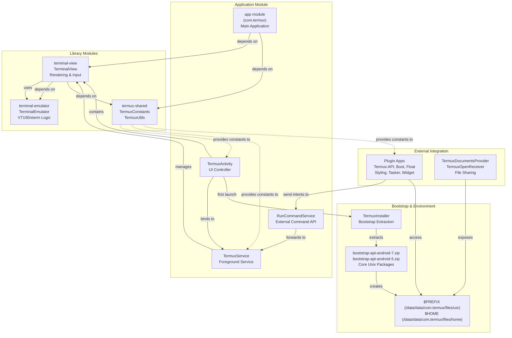
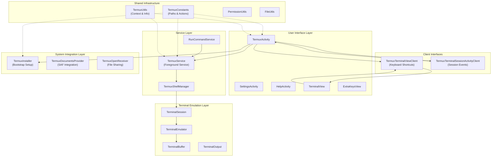

<!-- source: DeepWiki mcp.deepwiki.com · repo termux/termux-app · page 1 Overview · fetched 2026-10-26 -->

# Overview

<details>
<summary>Relevant source files</summary>

The following files were used as context for generating this wiki page:

- [.editorconfig](.editorconfig)
- [LICENSE.md](LICENSE.md)
- [README.md](README.md)
- [docs/en/index.md](docs/en/index.md)
- [site/assets/sponsors/cloudflare.png](site/assets/sponsors/cloudflare.png)
- [site/assets/sponsors/github.png](site/assets/sponsors/github.png)
- [site/assets/sponsors/nlnet-ngi-mobifree.png](site/assets/sponsors/nlnet-ngi-mobifree.png)
- [terminal-emulator/proguard-rules.pro](terminal-emulator/proguard-rules.pro)
- [terminal-emulator/src/main/java/com/termux/terminal/ByteQueue.java](terminal-emulator/src/main/java/com/termux/terminal/ByteQueue.java)
- [termux-shared/LICENSE.md](termux-shared/LICENSE.md)

</details>


## Purpose and Scope

This document provides a high-level architectural overview of the Termux application codebase located at `https://github.com/termux/termux-app`. Termux is an Android terminal emulator and Linux environment that allows users to run a full-featured command-line interface on Android devices without requiring root access.

This repository contains the **Termux application itself** (user interface and terminal emulation logic), not the packages installable inside the app. For package management information, see the `termux/termux-packages` repository [README.md:10-14]().

**Scope boundaries:**
- For installation and distribution details, see [Installation and Distribution](#1.1)
- For plugin applications, see [Plugin Ecosystem](#1.2)
- For build system specifics, see [Build System and Module Structure](#2)
- For application components, see [Application Components](#3)
- For security model, see [Security and Permissions](#8)

Sources: [README.md:1-14]()

## Repository Purpose

The `termux-app` repository implements:
- **Terminal Emulation**: VT100/xterm-compatible terminal emulator with escape sequence processing
- **Session Management**: Multiple terminal sessions, foreground service for process persistence
- **Bootstrap Installation**: Unix environment extraction and initialization
- **Android Integration**: Activities, services, content providers, and broadcast receivers
- **Plugin Communication**: Inter-app communication via intents and shared file system
- **External Command API**: Permission-gated command execution for automation

Sources: [README.md:10-12]()

## Core Architecture Overview

The following diagram shows the primary modules and their relationships:

### Diagram: Termux Module and Component Architecture


Sources: [README.md:37-47]()

## Architecture Layers

Termux follows a layered architecture with clear separation of concerns across UI, services, terminal emulation, and shared utilities:

### Diagram: Layered Architecture and Component Interactions


Sources: [README.md:1-79]()

## Module Structure

The repository consists of four Gradle modules with hierarchical dependencies:

| Module | Package | Purpose | Key Classes |
|--------|---------|---------|-------------|
| `app` | `com.termux` | Main application, activities, services | `TermuxActivity`, `TermuxService`, `RunCommandService`, `TermuxInstaller` |
| `terminal-view` | `com.termux.view` | Terminal rendering and input handling | `TerminalView`, `TerminalRenderer`, `TerminalViewClient` |
| `terminal-emulator` | `com.termux.terminal` | Terminal emulation logic | `TerminalEmulator`, `TerminalSession`, `TerminalBuffer`, `TerminalOutput` |
| `termux-shared` | `com.termux.shared` | Shared constants and utilities | `TermuxConstants`, `TermuxUtils`, `PermissionUtils`, `FileUtils` |

**Dependency Hierarchy:**
```
app → terminal-view → terminal-emulator
app → termux-shared
terminal-view → termux-shared
```

Sources: [README.md:1-79]()

## Build System and Distribution

For detailed information on distribution channels, APK signing requirements, `sharedUserId` constraints, installation compatibility issues, and store metadata, see [Installation and Distribution](#1.1).

Termux is distributed across multiple channels (F-Droid, GitHub, Google Play). Because all Termux applications and official plugins share the `com.termux` `sharedUserId`, they must be signed with the exact same signature key. Mixing installation sources will trigger package manager signature mismatch errors [README.md:61-64]().

Sources: [README.md:51-78]()

## Bootstrap and Environment

Termux requires a bootstrap package containing minimal Unix utilities to establish a working shell environment [README.md:65-66](). Upon first launch, `TermuxInstaller` extracts the bootstrap archive into `$PREFIX` (`/data/data/com.termux/files/usr`) and initializes the user `$HOME` directory [README.md:65-66]().

Sources: [README.md:65-66]()

## Plugin Ecosystem

For detailed information on official plugin applications (`Termux:API`, `Termux:Boot`, `Termux:Float`, `Termux:Styling`, `Termux:Tasker`, `Termux:Widget`), their shared package structures, preference classes, and IPC communication mechanisms, see [Plugin Ecosystem](#1.2).

Plugins extend Termux functionality by executing commands via `RunCommandService` and sharing file system access through the `com.termux` `sharedUserId` [README.md:37-47]().

Sources: [README.md:37-47]()

## Security Model

Termux implements a multi-layered security architecture including package signature verification, Android runtime permissions, custom `RUN_COMMAND` permission checks, and property-based access control (`allow-external-apps` in `termux.properties`). File system access is restricted via `TermuxDocumentsProvider` [README.md:55-64]().

Sources: [README.md:55-64]()

## Version and Compatibility

- **Current Version**: `v0.118.3` [README.md:53]()
- **Minimum Android**: Android 7.0 (API 24) for full support [README.md:57]()
- **Limited Support**: Android 5.0–6.0 (app-only support without package updates via GitHub) [README.md:59]()

**Android 12+ Notice**: May experience process killing issues due to background process limits. See [README.md:20-21]().

Sources: [README.md:20-21](), [README.md:53-59]()

## Related Pages

For detailed information on specific subsystems:
- [Installation and Distribution](#1.1) — Distribution channels, APK signing, and sharedUserId constraints
- [Plugin Ecosystem](#1.2) — Official plugin applications and communication mechanisms
- [Build System and Module Structure](#2) — Gradle configuration, bootstrap management, and modules
- [Application Components](#3) — Activities, services, and application lifecycle
- [Terminal Emulation System](#4) — Terminal rendering and emulation logic
- [Bootstrap and Environment](#5) — File system setup and environment configuration
- [File Sharing and Content Providers](#6) — SAF integration and file sharing
- [Constants and Shared Infrastructure](#7) — Shared utilities and constants
- [Security and Permissions](#8) — Security model and access control

---

