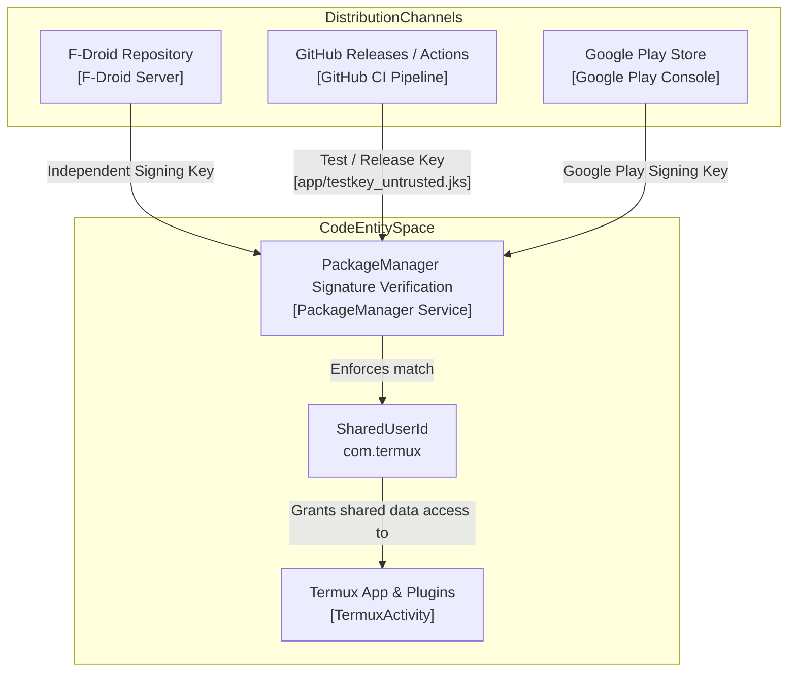
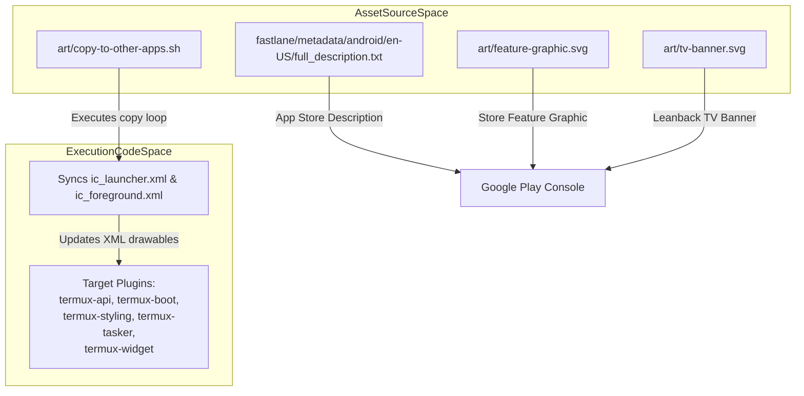
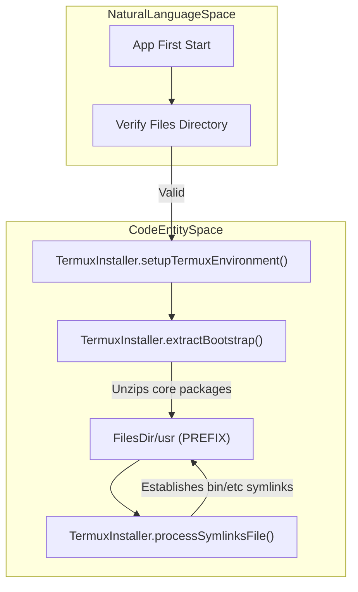

<!-- source: DeepWiki mcp.deepwiki.com · repo termux/termux-app · page 1.1 Installation and Distribution · fetched 2026-10-26 -->

# Installation and Distribution

Relevant source files

The following files were used as context for generating this wiki page:

- [.editorconfig](.editorconfig)
- [README.md](README.md)
- [app/src/main/res/drawable/banner.png](app/src/main/res/drawable/banner.png)
- [app/testkey_untrusted.jks](app/testkey_untrusted.jks)
- [art/copy-to-other-apps.sh](art/copy-to-other-apps.sh)
- [art/feature-graphic.svg](art/feature-graphic.svg)
- [art/generate-feature-graphic.sh](art/generate-feature-graphic.sh)
- [art/generate-launcher-images.sh](art/generate-launcher-images.sh)
- [art/generate-tv-banner.sh](art/generate-tv-banner.sh)
- [art/tv-banner.svg](art/tv-banner.svg)
- [fastlane/metadata/android/en-US/full_description.txt](fastlane/metadata/android/en-US/full_description.txt)
- [fastlane/metadata/android/en-US/images/icon.png](fastlane/metadata/android/en-US/images/icon.png)
- [fastlane/metadata/android/en-US/images/phoneScreenshots/1.jpg](fastlane/metadata/android/en-US/images/phoneScreenshots/1.jpg)
- [fastlane/metadata/android/en-US/images/phoneScreenshots/2.jpg](fastlane/metadata/android/en-US/images/phoneScreenshots/2.jpg)
- [fastlane/metadata/android/en-US/images/phoneScreenshots/3.jpg](fastlane/metadata/android/en-US/images/phoneScreenshots/3.jpg)
- [fastlane/metadata/android/en-US/images/phoneScreenshots/4.jpg](fastlane/metadata/android/en-US/images/phoneScreenshots/4.jpg)
- [fastlane/metadata/android/en-US/short_description.txt](fastlane/metadata/android/en-US/short_description.txt)
- [site/assets/sponsors/cloudflare.png](site/assets/sponsors/cloudflare.png)
- [site/assets/sponsors/github.png](site/assets/sponsors/github.png)
- [site/assets/sponsors/nlnet-ngi-mobifree.png](site/assets/sponsors/nlnet-ngi-mobifree.png)

This page explains the different distribution channels (F-Droid, GitHub, Google Play), APK signing requirements, `sharedUserId` constraints, installation compatibility issues, and store metadata assets located under `fastlane/` and `art/`. It also covers the bootstrap installation mechanics that set up the runtime Linux environment.

For information about the plugin ecosystem and external app interactions, see [Plugin Ecosystem](#1.2).

## Distribution Channels and Signature Constraints

Termux and its official plugin suite (`Termux:API`, `Termux:Boot`, `Termux:Float`, `Termux:Styling`, `Termux:Tasker`, `Termux:Widget`) are bound by Android's `sharedUserId` security constraint (`com.termux`). Because they share the same user ID and data directory context, **all APKs installed on a device must be signed with the exact same signature key** [README.md:61]().

Sources: [README.md:60-64](), [app/testkey_untrusted.jks:1-12]()

### Channel Characteristics
- **F-Droid**: Recommended for most users. Provides universal APKs (`~180MB`) working across all supported CPU architectures. Maintainers do not control signing keys, making F-Droid builds mutually exclusive with GitHub or Google Play builds [README.md:67-78]().
- **GitHub**: Offers both universal and architecture-specific APKs (`apt-android-7` vs `apt-android-5`). Signed using public debug keys (`app/testkey_untrusted.jks`) [README.md:79-92]().
- **Google Play Store**: Experimental release channel for Android 11+ subject to API policy modifications and distinct signature keys [README.md:117-124]().

Sources: [README.md:57-124](), [app/testkey_untrusted.jks:1-12]()

---

## Store Metadata and Graphic Assets (`fastlane/` and `art/`)

Termux maintains store publishing metadata and vector graphic design assets within the repository under `fastlane/` and `art/`:

- **Store Metadata**: Located in `fastlane/metadata/android/en-US/`, containing localized descriptions (`full_description.txt`, `short_description.txt`) and promotional screenshots [fastlane/metadata/android/en-US/full_description.txt:1-13]().
- **Graphic Assets**: Vector sources like `art/feature-graphic.svg` and `art/tv-banner.svg` provide store and TV banner templates [art/feature-graphic.svg:1-30](), [art/tv-banner.svg:1-23]().
- **Asset Synchronization**: The shell script `art/copy-to-other-apps.sh` automates the propagation of launcher icons and foreground drawables across repository directories for dependent plugin apps (`api`, `boot`, `styling`, `tasker`, `widget`) [art/copy-to-other-apps.sh:1-13]().

Sources: [art/copy-to-other-apps.sh:1-13](), [art/feature-graphic.svg:1-30](), [art/tv-banner.svg:1-23](), [fastlane/metadata/android/en-US/full_description.txt:1-13]()

---

## Installation Compatibility and Requirements

Termux enforces compatibility thresholds based on Android version runtime behaviors:
- **Android 7 or higher**: Full support for application execution and package management via `apt`/`pkg` [README.md:57]().
- **Android 5 and 6**: Support restricted to the base application shell; package updates are disabled [README.md:59]().

Sources: [README.md:57-60]()

---

## Bootstrap Installation Process and Code Entities

Upon initial launch, Termux runs bootstrap initialization routines managed by `TermuxInstaller` to establish the Linux environment prefix and extract minimal system binaries.

Sources: [README.md:64](), [app/src/main/java/com/termux/app/TermuxInstaller.java:42-240]()

---

## Storage Setup and File System Structure

After extracting the bootstrap, Termux configures internal storage symlinks inside the user home directory (`$HOME/storage/`) to bridge Android's scoped storage APIs with Unix filesystem conventions.

| Directory Path | Target / Purpose |
|----------------|------------------|
| `/data/data/com.termux/files` | Base application data files directory |
| `/data/data/com.termux/files/usr` | Main system prefix (`$PREFIX`) |
| `/data/data/com.termux/files/home` | User home directory (`$HOME`) |
| `$HOME/storage/shared` | External storage root |
| `$HOME/storage/downloads` | Shared Downloads directory |

Sources: [README.md:64]()

---

## Troubleshooting Installation and Uninstallation

### Common Installation Issues
- **Signature Mismatch Errors**: Installing APKs from mixed sources (e.g., F-Droid combined with GitHub) results in errors such as `INSTALL_FAILED_UPDATE_INCOMPATIBLE` or `INSTALL_FAILED_SHARED_USER_INCOMPATIBLE` [README.md:61]().
- **Android 12+ Signal 9 Killing**: Phantom process limits and aggressive CPU cgroups on Android 12+ can cause sudden shell termination with `[Process completed (signal 9)]` [README.md:20]().

### Uninstallation
To clear shared user data across applications, all packages sharing `com.termux` must be uninstalled concurrently [README.md:63]().

Sources: [README.md:20](), [README.md:61-64]()

---

