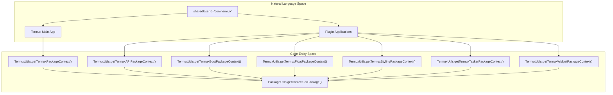
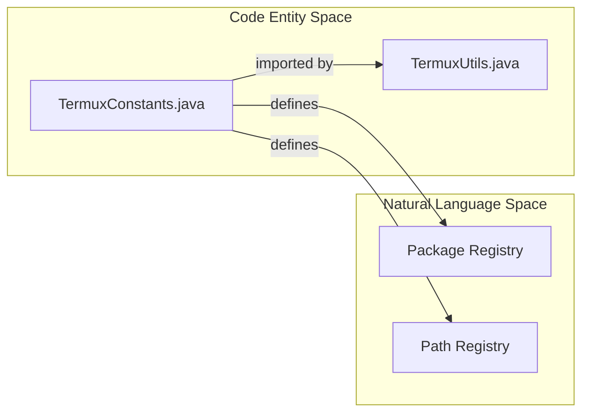
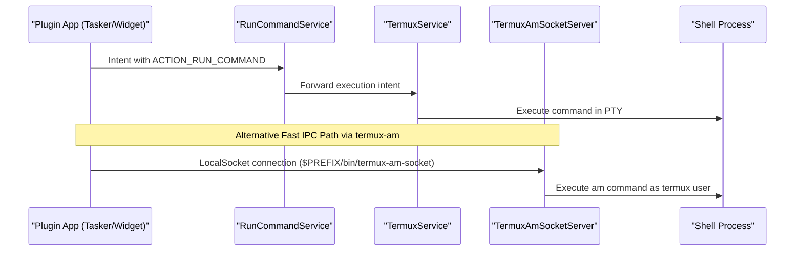

<!-- source: DeepWiki mcp.deepwiki.com · repo termux/termux-app · page 1.2 Plugin Ecosystem · fetched 2026-10-26 -->

# Plugin Ecosystem

Relevant source files

The following files were used as context for generating this wiki page:

- [termux-shared/src/main/java/com/termux/shared/net/socket/local/LocalSocketRunConfig.java](termux-shared/src/main/java/com/termux/shared/net/socket/local/LocalSocketRunConfig.java)
- [termux-shared/src/main/java/com/termux/shared/settings/preferences/AppSharedPreferences.java](termux-shared/src/main/java/com/termux/shared/settings/preferences/AppSharedPreferences.java)
- [termux-shared/src/main/java/com/termux/shared/shell/am/AmSocketServer.java](termux-shared/src/main/java/com/termux/shared/shell/am/AmSocketServer.java)
- [termux-shared/src/main/java/com/termux/shared/shell/am/AmSocketServerErrno.java](termux-shared/src/main/java/com/termux/shared/shell/am/AmSocketServerErrno.java)
- [termux-shared/src/main/java/com/termux/shared/shell/am/AmSocketServerRunConfig.java](termux-shared/src/main/java/com/termux/shared/shell/am/AmSocketServerRunConfig.java)
- [termux-shared/src/main/java/com/termux/shared/termux/TermuxConstants.java](termux-shared/src/main/java/com/termux/shared/termux/TermuxConstants.java)
- [termux-shared/src/main/java/com/termux/shared/termux/TermuxUtils.java](termux-shared/src/main/java/com/termux/shared/termux/TermuxUtils.java)
- [termux-shared/src/main/java/com/termux/shared/termux/settings/preferences/TermuxAPIAppSharedPreferences.java](termux-shared/src/main/java/com/termux/shared/termux/settings/preferences/TermuxAPIAppSharedPreferences.java)
- [termux-shared/src/main/java/com/termux/shared/termux/settings/preferences/TermuxAppSharedPreferences.java](termux-shared/src/main/java/com/termux/shared/termux/settings/preferences/TermuxAppSharedPreferences.java)
- [termux-shared/src/main/java/com/termux/shared/termux/settings/preferences/TermuxBootAppSharedPreferences.java](termux-shared/src/main/java/com/termux/shared/termux/settings/preferences/TermuxBootAppSharedPreferences.java)
- [termux-shared/src/main/java/com/termux/shared/termux/settings/preferences/TermuxFloatAppSharedPreferences.java](termux-shared/src/main/java/com/termux/shared/termux/settings/preferences/TermuxFloatAppSharedPreferences.java)
- [termux-shared/src/main/java/com/termux/shared/termux/settings/preferences/TermuxStylingAppSharedPreferences.java](termux-shared/src/main/java/com/termux/shared/termux/settings/preferences/TermuxStylingAppSharedPreferences.java)
- [termux-shared/src/main/java/com/termux/shared/termux/settings/preferences/TermuxTaskerAppSharedPreferences.java](termux-shared/src/main/java/com/termux/shared/termux/settings/preferences/TermuxTaskerAppSharedPreferences.java)
- [termux-shared/src/main/java/com/termux/shared/termux/settings/preferences/TermuxWidgetAppSharedPreferences.java](termux-shared/src/main/java/com/termux/shared/termux/settings/preferences/TermuxWidgetAppSharedPreferences.java)
- [termux-shared/src/main/java/com/termux/shared/termux/shell/am/TermuxAmSocketServer.java](termux-shared/src/main/java/com/termux/shared/termux/shell/am/TermuxAmSocketServer.java)
- [termux-shared/src/main/java/com/termux/shared/termux/shell/command/environment/TermuxAPIShellEnvironment.java](termux-shared/src/main/java/com/termux/shared/termux/shell/command/environment/TermuxAPIShellEnvironment.java)
- [termux-shared/src/main/java/com/termux/shared/termux/shell/command/environment/TermuxAppShellEnvironment.java](termux-shared/src/main/java/com/termux/shared/termux/shell/command/environment/TermuxAppShellEnvironment.java)
- [termux-shared/src/main/res/values/strings.xml](termux-shared/src/main/res/values/strings.xml)

This document describes the official Termux plugin applications and the shared infrastructure that enables inter-app communication, context sharing, preferences access, and IPC. It covers the six official plugins (API, Boot, Float, Styling, Tasker, Widget), their package structure, preference classes (`TermuxAppSharedPreferences`, `TermuxAPIAppSharedPreferences`, etc.), and communication mechanisms via intents, broadcasts, and local sockets.

For information about external app command execution, see [RunCommandService](#3.3). For security mechanisms controlling plugin access, see [Property-Based Access Control](#8.3). For installation compatibility requirements, see [Installation and Distribution](#1.1).

## Official Plugin Applications

Termux provides six official plugin applications that extend the core terminal functionality. All plugins are distributed through the same channels as the main app (F-Droid, GitHub, Google Play) and must match APK signatures.

| Plugin | Package Name | Primary Purpose |
|--------|-------------|-----------------|
| Termux:API | `com.termux.api` | Bridges Android APIs to shell commands for accessing device features |
| Termux:Boot | `com.termux.boot` | Executes scripts from `~/boot/` directory on device boot |
| Termux:Float | `com.termux.window` | Provides floating terminal window that can overlay other apps |
| Termux:Styling | `com.termux.styling` | Supplies color schemes and fonts for terminal customization |
| Termux:Tasker | `com.termux.tasker` | Integrates with Tasker automation app for executing scripts |
| Termux:Widget | `com.termux.widget` | Creates home screen widgets that execute scripts from `~/.shortcuts/` |

Sources: [termux-shared/src/main/java/com/termux/shared/termux/TermuxConstants.java:362-444]()

## Shared Infrastructure

### Package Structure, sharedUserId, and Context Resolution

All Termux plugins share the `sharedUserId` value `"com.termux"`, which enables them to access each other's package contexts and share file system access. This is defined at the Android manifest level and enforced by the Android Package Manager. The `TermuxUtils` class [termux-shared/src/main/java/com/termux/shared/termux/TermuxUtils.java:37-37]() provides static methods utilizing `PackageUtils` to acquire package contexts across the ecosystem.

Sources: [termux-shared/src/main/java/com/termux/shared/termux/TermuxConstants.java:350-468](), [termux-shared/src/main/java/com/termux/shared/termux/TermuxUtils.java:56-141]()

### TermuxConstants Shared Definitions

The `TermuxConstants` class serves as the single source of truth for all package names, file paths, intent actions, and URLs shared across the Termux ecosystem. This class is part of the `termux-shared` library module.

Key constant categories defined in `TermuxConstants`:
- **Organization URLs**: GitHub organization, F-Droid base URLs
- **Package Names**: All app and plugin package identifiers (`TERMUX_PACKAGE_NAME`, `TERMUX_API_PACKAGE_NAME`, etc.)
- **File Paths**: `TERMUX_PREFIX_DIR_PATH`, `TERMUX_HOME_DIR_PATH`, configuration directories
- **Intent Actions**: `BROADCAST_TERMUX_OPENED`, `ACTION_RUN_COMMAND`, `ACTION_SERVICE_EXECUTE`
- **Repository URLs**: GitHub repos, issue trackers, F-Droid package URLs for each app
- **APK Signing Certificates**: SHA-256 digests for F-Droid, GitHub, Play Store releases

Sources: [termux-shared/src/main/java/com/termux/shared/termux/TermuxConstants.java:1-131](), [termux-shared/src/main/java/com/termux/shared/termux/TermuxUtils.java:37-64]()

### Preference Classes Architecture

Each plugin, alongside the core Termux app, implements a dedicated `AppSharedPreferences` subclass located in `com.termux.shared.termux.settings.preferences`. These preference wrappers utilize `SharedPreferenceUtils` to access private or multi-process shared preferences files matching distinct basenames (e.g., `termux_preferences`, `termux_api_preferences`, `termux_boot_preferences`, etc.).

```mermaid
graph TB
    subgraph "Code Entity Space"
        Base["AppSharedPreferences"]
        SPO["SharedPreferenceUtils"]
        TAP["TermuxAppSharedPreferences"]
        TAPI["TermuxAPIAppSharedPreferences"]
        TBOOT["TermuxBootAppSharedPreferences"]
        TFLOAT["TermuxFloatAppSharedPreferences"]
        TSTYLING["TermuxStylingAppSharedPreferences"]
        TTASKER["TermuxTaskerAppSharedPreferences"]
        TWIDGET["TermuxWidgetAppSharedPreferences"]
    end

    TAP -->|extends| Base
    TAPI -->|extends| Base
    TBOOT -->|extends| Base
    TFLOAT -->|extends| Base
    TSTYLING -->|extends| Base
    TTASKER -->|extends| Base
    TWIDGET -->|extends| Base

    Base -->|calls| SPO
    TAP -->|reads basename| TermuxConst["TermuxConstants.TERMUX_DEFAULT_PREFERENCES_FILE_BASENAME_WITHOUT_EXTENSION"]
    TAPI -->|reads basename| TermuxConstAPI["TermuxConstants.TERMUX_API_DEFAULT_PREFERENCES_FILE_BASENAME_WITHOUT_EXTENSION"]
    TFLOAT -->|reads basename| TermuxConstFloat["TermuxConstants.TERMUX_FLOAT_DEFAULT_PREFERENCES_FILE_BASENAME_WITHOUT_EXTENSION"]
    TWIDGET -->|reads basename| TermuxConstWidget["TermuxConstants.TERMUX_WIDGET_DEFAULT_PREFERENCES_FILE_BASENAME_WITHOUT_EXTENSION"]
```

Key preference wrapper implementations:
- `TermuxAppSharedPreferences`: Manages core app properties such as terminal toolbar visibility, font size clamping, soft keyboard options, and screen wake locks via `TermuxAppSharedPreferences.build(Context)` [termux-shared/src/main/java/com/termux/shared/termux/settings/preferences/TermuxAppSharedPreferences.java:18-50]().
- `TermuxAPIAppSharedPreferences`: Manages logging levels and pending intent request codes for `com.termux.api` [termux-shared/src/main/java/com/termux/shared/termux/settings/preferences/TermuxAPIAppSharedPreferences.java:16-42]().
- `TermuxFloatAppSharedPreferences`: Controls floating window geometry (`window_x`, `window_y`, width, height) and font metrics for `com.termux.window` [termux-shared/src/main/java/com/termux/shared/termux/settings/preferences/TermuxFloatAppSharedPreferences.java:17-49]().
- `TermuxWidgetAppSharedPreferences`: Generates and retrieves security tokens (`KEY_TOKEN`) and log levels for `com.termux.widget` [termux-shared/src/main/java/com/termux/shared/termux/settings/preferences/TermuxWidgetAppSharedPreferences.java:18-44]().
- `TermuxStylingAppSharedPreferences` & `TermuxTaskerAppSharedPreferences` & `TermuxBootAppSharedPreferences`: Handle log levels and app-specific configuration state across respective plugin package contexts [termux-shared/src/main/java/com/termux/shared/termux/settings/preferences/TermuxStylingAppSharedPreferences.java:16-42](), [termux-shared/src/main/java/com/termux/shared/termux/settings/preferences/TermuxTaskerAppSharedPreferences.java:16-42](), [termux-shared/src/main/java/com/termux/shared/termux/settings/preferences/TermuxBootAppSharedPreferences.java:16-42]().

Sources: [termux-shared/src/main/java/com/termux/shared/termux/settings/preferences/TermuxAppSharedPreferences.java:18-67](), [termux-shared/src/main/java/com/termux/shared/termux/settings/preferences/TermuxAPIAppSharedPreferences.java:16-59](), [termux-shared/src/main/java/com/termux/shared/termux/settings/preferences/TermuxFloatAppSharedPreferences.java:17-66](), [termux-shared/src/main/java/com/termux/shared/termux/settings/preferences/TermuxWidgetAppSharedPreferences.java:18-61]()

## Communication Mechanisms

### Intent-Based Command Execution and Local Sockets

Plugins communicate with the Termux app primarily through the Android Intent system (`RunCommandService` forwarding to `TermuxService`), as well as high-performance local Unix domain sockets (`TermuxAmSocketServer`).

Key intent extras defined in `TERMUX_APP.TERMUX_SERVICE` and `TERMUX_APP.RUN_COMMAND_SERVICE`:
- `EXTRA_COMMAND_PATH`: Absolute path to executable
- `EXTRA_ARGUMENTS`: String array of command arguments
- `EXTRA_WORKDIR`: Working directory path
- `EXTRA_SESSION_ACTION`: Controls session switching behavior
- `EXTRA_PENDING_INTENT`: PendingIntent for result callback

Additionally, `TermuxAmSocketServer` manages a filesystem Unix domain socket server located at `TERMUX_AM_SOCKET_FILE_PATH`. Clients (`$PREFIX/bin/termux-am`) connect via `$PREFIX/bin/termux-am-socket` to run activity manager commands without starting a new Dalvik VM per command [termux-shared/src/main/java/com/termux/shared/termux/shell/am/TermuxAmSocketServer.java:25-58]().

Sources: [termux-shared/src/main/java/com/termux/shared/termux/TermuxConstants.java:750-1051](), [termux-shared/src/main/java/com/termux/shared/termux/shell/am/TermuxAmSocketServer.java:25-97]()

### Broadcast Receivers and Shared File System

The Termux app dispatches `BROADCAST_TERMUX_OPENED` broadcasts to initialize plugins on app startup, while plugins consume designated directories inside `TERMUX_HOME_DIR_PATH`.

| Directory | Path | Used By | Purpose |
|-----------|------|---------|---------|
| Boot scripts | `~/boot/` | Termux:Boot | Executed on device boot |
| Widget shortcuts | `~/.shortcuts/` | Termux:Widget | Home screen widget scripts |
| Tasker tasks | `~/.tasker/` | Termux:Tasker | Tasker automation scripts |
| Shortcut icons | `~/.shortcuts/icons/` | Termux:Widget | PNG icons for shortcuts |

Sources: [termux-shared/src/main/java/com/termux/shared/termux/TermuxConstants.java:679-716](), [termux-shared/src/main/java/com/termux/shared/termux/TermuxConstants.java:1141-1143]()

## Plugin-Specific Functionality

### Termux:API, Boot, Float, Styling, Tasker, and Widget
- **Termux:API**: Bridges Android system sensors, battery, location, and camera APIs via intents sent from the `termux-api` package binaries [termux-shared/src/main/java/com/termux/shared/termux/TermuxConstants.java:363-374]().
- **Termux:Boot**: Listens for `BOOT_COMPLETED` broadcasts and executes scripts found in `~/boot/` [termux-shared/src/main/java/com/termux/shared/termux/TermuxConstants.java:377-388]().
- **Termux:Float**: Runs a persistent floating window service (`com.termux.window`) utilizing independent window geometries configured in `TermuxFloatAppSharedPreferences` [termux-shared/src/main/java/com/termux/shared/termux/settings/preferences/TermuxFloatAppSharedPreferences.java:17-106]().
- **Termux:Styling**: Injects custom `colors.properties` and `font.ttf` files into Termux storage paths and triggers style reload broadcasts [termux-shared/src/main/java/com/termux/shared/termux/TermuxConstants.java:405-416]().
- **Termux:Tasker**: Interfaces with Tasker flows to execute shell scripts residing in `~/.tasker/` [termux-shared/src/main/java/com/termux/shared/termux/TermuxConstants.java:419-430]().
- **Termux:Widget**: Renders home screen shortcuts tied to scripts in `~/.shortcuts/`, tracking unique tokens via `TermuxWidgetAppSharedPreferences` [termux-shared/src/main/java/com/termux/shared/termux/settings/preferences/TermuxWidgetAppSharedPreferences.java:18-78]().

Sources: [termux-shared/src/main/java/com/termux/shared/termux/TermuxConstants.java:363-444](), [termux-shared/src/main/java/com/termux/shared/termux/settings/preferences/TermuxFloatAppSharedPreferences.java:17-161](), [termux-shared/src/main/java/com/termux/shared/termux/settings/preferences/TermuxWidgetAppSharedPreferences.java:18-94]()

## Access Control and Security

### Allow-External-Apps Property and Signature Checks

All plugin access to Termux command execution is gated by the `allow-external-apps` property in `termux.properties`. Furthermore, apps must share identical APK signing certificate SHA-256 digests (`APK_RELEASE_*_SIGNING_CERTIFICATE_SHA256_DIGEST`) to successfully leverage `sharedUserId` context sharing. If signatures mismatch, calls to `PackageUtils.getContextForPackage()` return `null` and throw security exceptions.

Sources: [termux-shared/src/main/res/values/strings.xml:49-51](), [termux-shared/src/main/java/com/termux/shared/termux/TermuxConstants.java:478-500]()

## App Information and Debugging

The `TermuxUtils` class provides diagnostic methods supporting `AppInfoMode` (e.g., `TERMUX_AND_PLUGIN_PACKAGES`) to compile markdown-formatted diagnostic reports detailing plugin installation states, version codes, package signatures, and file system accessibility.

Sources: [termux-shared/src/main/java/com/termux/shared/termux/TermuxUtils.java:39-51](), [termux-shared/src/main/java/com/termux/shared/termux/TermuxUtils.java:311-466]()

---

