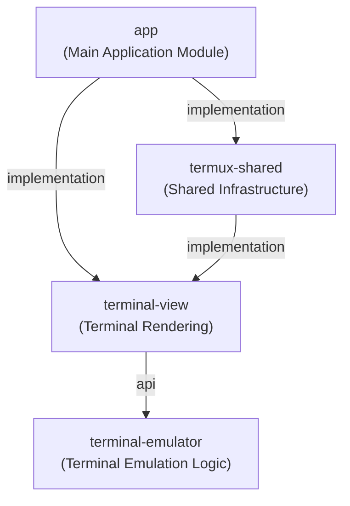

<!-- source: DeepWiki mcp.deepwiki.com · repo termux/termux-app · page 2 Build System and Module Structure · fetched 2026-10-26 -->

# Build System and Module Structure

Relevant source files

The following files were used as context for generating this wiki page:

- [app/build.gradle](app/build.gradle)
- [build.gradle](build.gradle)
- [gradle.properties](gradle.properties)
- [jitpack.yml](jitpack.yml)
- [settings.gradle](settings.gradle)
- [terminal-emulator/build.gradle](terminal-emulator/build.gradle)
- [terminal-view/build.gradle](terminal-view/build.gradle)
- [termux-shared/build.gradle](termux-shared/build.gradle)

This document describes the Gradle-based build system architecture for the Termux application, including the multi-module project structure, build configuration, bootstrap package management, native code compilation, and test automation. For runtime environment setup and bootstrap installation, see [Bootstrap and Environment](#5). 

Sources: [build.gradle:1-17](), [app/build.gradle:1-166](), [gradle.properties:1-23]()

## Overview

The Termux build system is implemented using Gradle with the Android Gradle Plugin. The project consists of four modules organized in a hierarchical dependency structure, with the `app` module serving as the main application that depends on three library modules. The build system handles module inter-dependencies, native code compilation via the NDK, bootstrap package downloading and verification, version management, and multi-variant APK generation.

For deep technical details on module organization, see [Module Dependencies](#2.1).

Sources: [build.gradle:1-17](), [app/build.gradle:1-41](), [gradle.properties:1-23]()

## 2.1. Module Dependencies

The project is organized into four Gradle modules with a clear dependency hierarchy:

The dependency chain ensures that `terminal-emulator` operates independently of Android UI frameworks, `terminal-view` provides rendering and touch interactions, `termux-shared` supplies cross-module utilities and constants, and `app` integrates everything into the final application package.

For full details on the four-module structure and dependency configuration, see [Module Dependencies](#2.1).

Sources: [app/build.gradle:39-41](), [termux-shared/build.gradle:29](), [terminal-view/build.gradle:10]()

## 2.2. Gradle Build Configuration

Build configuration flows from the root `build.gradle` and `gradle.properties` files down to individual module configurations. The build system handles target and compile SDK versions, desugaring configuration, manifest placeholders, and output APK naming conventions.

For details on `build.gradle` files, build variants (`apt-android-7` vs `apt-android-5`), version management, and APK output configuration, see [Gradle Build Configuration](#2.2).

Sources: [build.gradle:1-17](), [gradle.properties:1-23](), [app/build.gradle:15-146]()

## 2.3. Bootstrap Package Management

The build system automates the retrieval and validation of bootstrap archives for different CPU architectures (`aarch64`, `arm`, `i686`, `x86_64`). Bootstraps are downloaded from remote sources and cryptographically validated using SHA-256 checksums before being embedded into the application build artifacts.

For complete details on bootstrap package downloading, checksum validation, and embedding, see [Bootstrap Package Management](#2.3).

Sources: [app/build.gradle:5-13](), [app/build.gradle:167-243]()

## 2.4. Native Code and NDK Build

Native C/C++ compilation is integrated across modules using the Android NDK via `Android.mk` scripts. The build system configures compiler flags, target ABIs (`armeabi-v7a`, `arm64-v8a`, `x86`, `x86_64`), and JNI integration for terminal emulation and shared utilities.

For details on NDK configuration, compiler flags, ABI variants, and native library compilation, see [Native Code and NDK Build](#2.4).

Sources: [app/build.gradle:63-67](), [app/build.gradle:109-113](), [terminal-emulator/build.gradle:14-22](), [termux-shared/build.gradle:39-44]()

## 2.5. CI/CD Pipeline

Continuous integration and delivery are managed through automation pipelines (such as GitHub Actions and JitPack configurations) that handle automated building, testing, release attachment, and dependency maintenance.

For information on GitHub Actions workflows, APK building, release packaging, and JitPack integration, see [CI/CD Pipeline](#2.5).

Sources: [jitpack.yml:1-4]()

## 2.6. Gradle Wrapper

The project utilizes the Gradle wrapper to ensure consistent build execution environments across developer setups and CI agents, adhering to specified wrapper properties, distribution validations, and ProGuard minification rules.

For documentation on the Gradle wrapper system, version management, and distribution validation, see [Gradle Wrapper](#2.6).

Sources: [build.gradle:1-9](), [app/build.gradle:89-94]()

## 2.7. Testing Infrastructure

The testing architecture incorporates unit test suites for the terminal emulator, app-level components, and shared utilities, utilizing frameworks like JUnit and Robolectric both locally and within CI pipelines.

For details on the testing infrastructure, unit test suites, and CI execution, see [Testing Infrastructure](#2.7).

Sources: [app/build.gradle:119-123](), [app/build.gradle:149-150](), [terminal-emulator/build.gradle:43-45](), [termux-shared/build.gradle:38-44]()

---

