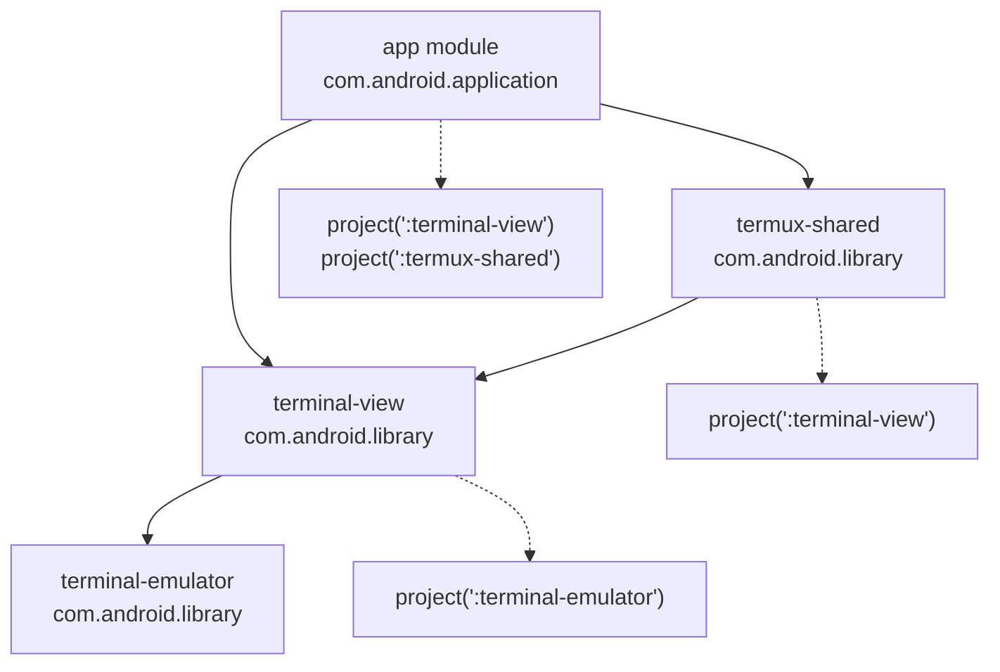
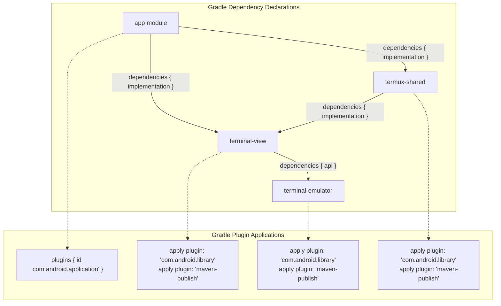
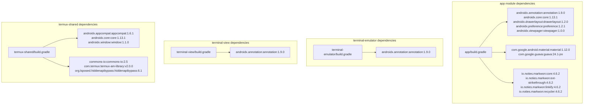
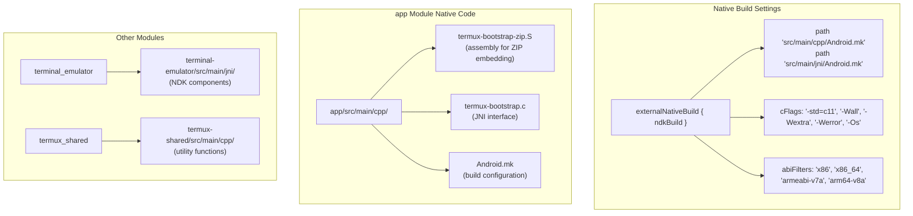
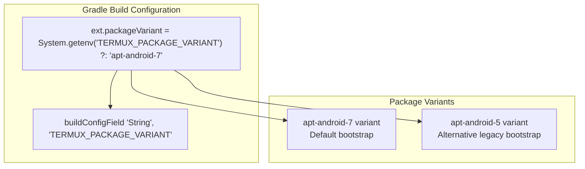

<!-- source: DeepWiki mcp.deepwiki.com · repo termux/termux-app · page 2.1 Module Dependencies · fetched 2026-10-26 -->

# Module Dependencies

Relevant source files

The following files were used as context for generating this wiki page:

- [app/build.gradle](app/build.gradle)
- [build.gradle](build.gradle)
- [gradle.properties](gradle.properties)
- [jitpack.yml](jitpack.yml)
- [settings.gradle](settings.gradle)
- [terminal-emulator/build.gradle](terminal-emulator/build.gradle)
- [terminal-emulator/src/main/AndroidManifest.xml](terminal-emulator/src/main/AndroidManifest.xml)
- [terminal-view/build.gradle](terminal-view/build.gradle)
- [terminal-view/src/main/AndroidManifest.xml](terminal-view/src/main/AndroidManifest.xml)
- [termux-shared/build.gradle](termux-shared/build.gradle)

The Termux application is structured as a multi-module Gradle project with four distinct modules. This document explains the dependency hierarchy between these modules, their respective responsibilities, and the external libraries they depend on.

## Module Overview

The Termux application is modularized into four primary components, each with distinct responsibilities:

### Gradle Module Dependency Graph

Sources: [app/build.gradle:39-40](), [terminal-view/build.gradle:10](), [termux-shared/build.gradle:29]()

## Module Responsibilities

### app Module

The `app` module serves as the main Android application module containing:

- User interface activities and fragments
- Terminal session management services
- Installation and bootstrap processes
- Integration with Android platform features
- Plugin interaction handling

This module integrates the functionality provided by other modules to create the complete Termux application.

Sources: [app/build.gradle]()

### terminal-emulator Module

The `terminal-emulator` module provides the core terminal emulation functionality:

- Terminal session implementation
- Terminal emulation logic
- Character encoding/decoding
- Terminal output processing
- Native code for terminal operations

As the most foundational module, it has no dependencies on other Termux modules.

Sources: [terminal-emulator/build.gradle]()

### terminal-view Module

The `terminal-view` module handles terminal display and user interaction:

- Terminal rendering on Android
- User input handling and processing
- Key mapping and special key handling
- Terminal-related UI components
- Text selection and clipboard operations

This module serves as a bridge between the UI and the core terminal emulation functionality.

Sources: [terminal-view/build.gradle]()

### termux-shared Module

The `termux-shared` module contains common utilities and constants shared across modules and potentially with plugin applications:

- Shared constants (file paths, intent actions, etc.)
- File and storage utilities
- Shell command utilities
- Execution command handling
- Environment variable management
- Crash handling and logging utilities

Sources: [termux-shared/build.gradle]()

## Dependency Structure Details

### Gradle Dependency Configuration Types

The module dependency structure uses specific Gradle dependency configurations:

- `implementation` dependencies are used for internal module consumption
- `api` dependency in `terminal-view` exposes `terminal-emulator` to consuming modules
- The circular dependency between `terminal-view` and `termux-shared` creates a bidirectional module relationship

Sources: [app/build.gradle:1-3](), [app/build.gradle:39-40](), [terminal-view/build.gradle:1-2](), [terminal-view/build.gradle:10](), [terminal-emulator/build.gradle:1-2](), [termux-shared/build.gradle:1-2](), [termux-shared/build.gradle:29]()

## Dependency Configuration Types

The module dependencies use specific Gradle dependency configurations that control visibility and transitive dependency propagation:

| Configuration | Usage | Transitive Exposure |
|--------------|-------|---------------------|
| `implementation` | Used by `app`, `terminal-view`, `termux-shared` | Dependencies are internal, not exposed to consumers |
| `api` | Used by `terminal-view` for `terminal-emulator` | Dependencies are exposed to all consuming modules |

The `api` configuration in `terminal-view` makes `terminal-emulator` available to both `app` and `termux-shared` without requiring them to declare explicit dependencies on `terminal-emulator`.

Sources: [app/build.gradle:39-40](), [terminal-view/build.gradle:10](), [termux-shared/build.gradle:29]()

## Circular Dependency

A notable aspect of the module structure is the circular dependency between `terminal-view` and `termux-shared`:

- `termux-shared` depends on `terminal-view` [termux-shared/build.gradle:29]()
- `terminal-view` depends on `terminal-emulator` [terminal-view/build.gradle:10]()
- `app` depends on both `terminal-view` and `termux-shared` [app/build.gradle:39-40]()

This bidirectional relationship allows `termux-shared` to access terminal view components while also providing shared utilities back to the view layer.

## External Dependencies

Each module has external dependencies that provide additional functionality:

### External Dependencies by Module

Sources: [app/build.gradle:26-37](), [terminal-emulator/build.gradle:63](), [terminal-view/build.gradle:9](), [termux-shared/build.gradle:11-31]()

## Native Code Components

Several modules in the Termux application include native C/C++ code compiled using the Android NDK:

### NDK Build Configuration

### app Module Native Code

The app module includes native code primarily for the bootstrap process:

- `termux-bootstrap-zip.S` - Assembly code for embedding bootstrap ZIP data
- `termux-bootstrap.c` - JNI interface for accessing bootstrap data
- Architecture-specific bootstrap files for arm, arm64, x86, and x86_64

### terminal-emulator and termux-shared Native Code

Both modules contain native code components with NDK build configurations for specialized terminal and utility functionality.

Sources: [app/build.gradle:63-67](), [app/build.gradle:109-113](), [terminal-emulator/build.gradle:14-22](), [terminal-emulator/build.gradle:32-36](), [termux-shared/build.gradle:39-43](), [termux-shared/build.gradle:61-65]()

## Package Variants and Bootstrap System

The Termux application supports different package variants that determine which bootstrap will be included in the app APK:

### Package Variant Configuration

The package variant determines which Linux environment will be installed. The package variant value is defined in the Gradle build configuration and baked into `BuildConfig`.

Sources: [app/build.gradle:5-13](), [app/build.gradle:52]()

## Publication Configuration

The library modules (`terminal-emulator`, `terminal-view`, and `termux-shared`) include Maven publication configurations, allowing them to be published as independent libraries and potentially used by other applications:

| Module | Group ID | Artifact ID | Version |
|--------|----------|-------------|---------|
| terminal-emulator | com.termux | terminal-emulator | 0.118.0 |
| terminal-view | com.termux | terminal-view | 0.118.0 |
| termux-shared | com.termux | termux-shared | 0.118.0 |

Sources: [terminal-emulator/build.gradle:76-83](), [terminal-view/build.gradle:52-59](), [termux-shared/build.gradle:91-98]()

---

