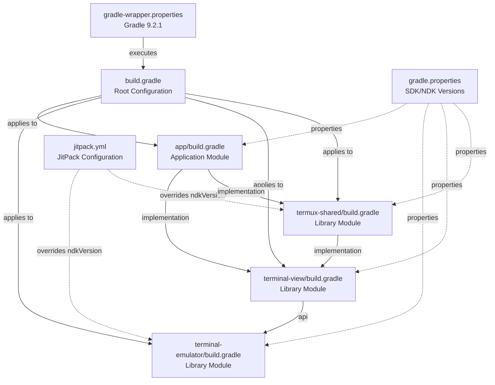
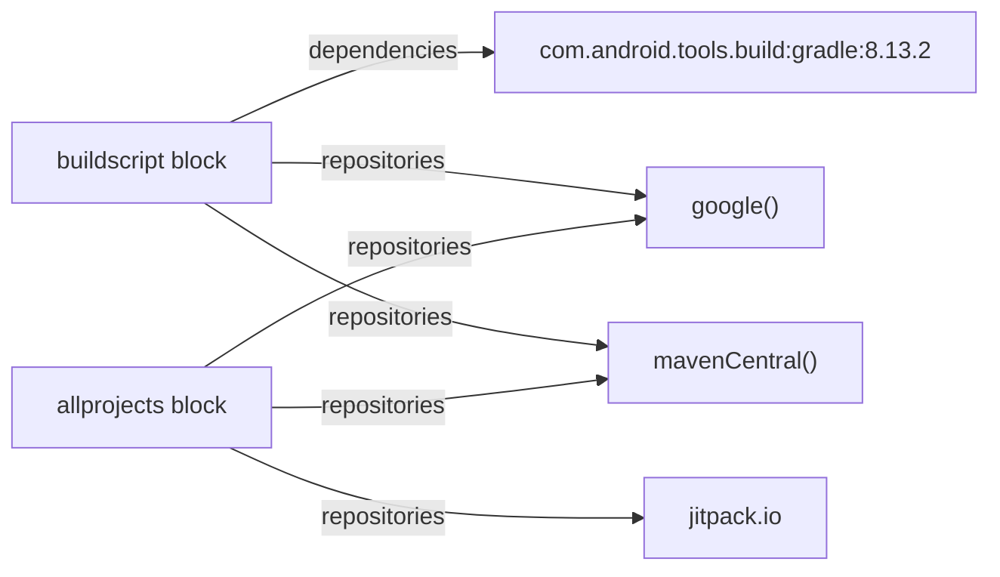
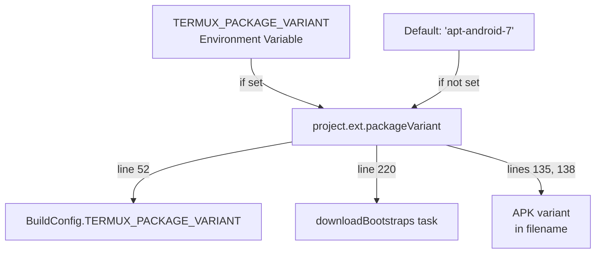

<!-- source: DeepWiki mcp.deepwiki.com · repo termux/termux-app · page 2.2 Gradle Build Configuration · fetched 2026-10-26 -->

# Gradle Build Configuration

Relevant source files

The following files were used as context for generating this wiki page:

- [app/build.gradle](app/build.gradle)
- [app/proguard-rules.pro](app/proguard-rules.pro)
- [build.gradle](build.gradle)
- [gradle.properties](gradle.properties)
- [gradle/wrapper/gradle-wrapper.jar](gradle/wrapper/gradle-wrapper.jar)
- [gradle/wrapper/gradle-wrapper.properties](gradle/wrapper/gradle-wrapper.properties)
- [gradlew](gradlew)
- [gradlew.bat](gradlew.bat)
- [jitpack.yml](jitpack.yml)
- [terminal-emulator/build.gradle](terminal-emulator/build.gradle)
- [terminal-view/build.gradle](terminal-view/build.gradle)
- [termux-shared/build.gradle](termux-shared/build.gradle)

This page details the Gradle build system configuration for the Termux application repository. It covers the root and module-level `build.gradle` files, build variant configurations (specifically `apt-android-7` versus `apt-android-5`), version management, SDK/NDK settings, build types, and APK output naming conventions.

For information about module dependencies and the four-module structure, see Module Dependencies. For details on bootstrap package download and validation, see [Bootstrap Package Management](#). For native code compilation specifics, see [Native Code and NDK Build](#).

## Build System Architecture

The Termux build system uses a multi-module Gradle configuration with a root `build.gradle` that defines the build environment and module-specific configurations that define compilation, dependencies, and publishing settings.

**Build Configuration Hierarchy**

Sources: [build.gradle:1-17](), [app/build.gradle:1-243](), [gradle.properties:1-23](), [jitpack.yml:1-4]()

## Root Build Configuration

The root [build.gradle:1-17]() file defines the build script dependencies and repository configuration for all modules. It specifies the Android Gradle Plugin version and repository locations.

**Key Configuration Elements:**

| Element | Value | Purpose |
|---------|-------|---------|
| Android Gradle Plugin | `8.13.2` | Build toolchain version |
| Repositories | `google()`, `mavenCentral()`, `jitpack.io` | Dependency sources |

Sources: [build.gradle:1-17]()

## Project-Wide Properties

The [gradle.properties:1-23]() file defines SDK/NDK versions and configuration settings used across all modules.

**Version Configuration:**

| Property | Value | Description |
|----------|-------|-------------|
| `minSdkVersion` | `21` | Android 5.0 Lollipop minimum |
| `targetSdkVersion` | `28` | Android 9.0 Pie target |
| `compileSdkVersion` | `36` | Latest Android SDK for compilation |
| `ndkVersion` | `29.0.14206865` | NDK version for native code |
| `markwonVersion` | `4.6.2` | Markdown rendering library version |

The `org.gradle.jvmargs=-Xmx2048M` setting [gradle.properties:15]() allocates 2GB heap memory for the Gradle daemon process.

Sources: [gradle.properties:15-23]()

## App Module Build Configuration

The [app/build.gradle:1-243]() file is the most complex build configuration, defining the application module structure, package variants, bootstrap management, and APK output naming.

### Package Variant Configuration (`apt-android-7` vs `apt-android-5`)

The `packageVariant` determines which bootstrap archive is embedded in the app APK. This controls whether the package targets newer Android runtimes (`apt-android-7`) or legacy environments (`apt-android-5`):

The package variant is set via `System.getenv("TERMUX_PACKAGE_VARIANT")` or falls back to `"apt-android-7"` [app/build.gradle:12](). Supported values are `[ "apt-android-7", "apt-android-5" ]` [app/build.gradle:11](). This value:
- Must be supported by `com.termux.shared.termux.TermuxBootstrap.PackageVariant` or the app will crash at startup [app/build.gradle:7-8]().
- Is embedded as `BuildConfig.TERMUX_PACKAGE_VARIANT` via `buildConfigField` [app/build.gradle:52]() for runtime identification by the `TermuxApplication` class [app/build.gradle:12]().
- Dictates which bootstrap assets are fetched and packed [app/build.gradle:220-236]().
- Appears directly in the output APK filenames [app/build.gradle:135-138]().

Sources: [app/build.gradle:5-13](), [app/build.gradle:52](), [app/build.gradle:218-236]()

### Android Configuration Block

The `android` configuration block [app/build.gradle:15-146]() defines compilation settings, dependencies, and build variants.

- `namespace` is configured as `"com.termux"` [app/build.gradle:16]().
- `compileSdkVersion` reads from `project.properties.compileSdkVersion.toInteger()` [app/build.gradle:18]().
- `ndkVersion` prioritizes the `JITPACK_NDK_VERSION` environment variable, falling back to `project.properties.ndkVersion` [app/build.gradle:19]().

Sources: [app/build.gradle:15-19]()

### Version Management

The app version is managed through `versionCode` and `versionName`:

- `versionCode` is statically set to `118` [app/build.gradle:46]().
- `versionName` defaults to `"0.118.0"` [app/build.gradle:47]() but can be overridden by the `TERMUX_APP_VERSION_NAME` environment variable [app/build.gradle:20](), [app/build.gradle:49]().
- The helper function `validateVersionName()` [app/build.gradle:160-165]() asserts that `versionName` complies strictly with the Semantic Versioning 2.0.0 specification regex [app/build.gradle:163]().

Sources: [app/build.gradle:20](), [app/build.gradle:43-50](), [app/build.gradle:160-165]()

### Build Types and Signing

The app defines two core build types: `release` and `debug` [app/build.gradle:89-99]().

- **Release Build Type**: Enables code minification (`minifyEnabled true`) [app/build.gradle:91]() and disables resource shrinking (`shrinkResources false`) to guarantee reproducible builds [app/build.gradle:92](). ProGuard rules are loaded via `getDefaultProguardFile('proguard-android.txt')` and `proguard-rules.pro` [app/build.gradle:93]().
- **Debug Build Type**: Uses a development signing config `signingConfigs.debug` [app/build.gradle:96-98]() referencing `testkey_untrusted.jks` [app/build.gradle:82]() with standard test alias and password credentials [app/build.gradle:83-85]().

Sources: [app/build.gradle:80-99]()

### ABI Splits Configuration

Split APKs can be generated per CPU architecture (`x86`, `x86_64`, `armeabi-v7a`, `arm64-v8a`) alongside a universal APK [app/build.gradle:69-77]().

- `splits.abi.enable` is dynamically evaluated based on Gradle start task names [app/build.gradle:71-72](): debug builds split by default if `TERMUX_SPLIT_APKS_FOR_DEBUG_BUILDS == "1"` [app/build.gradle:22](), whereas release builds default to monolithic packages (`TERMUX_SPLIT_APKS_FOR_RELEASE_BUILDS == "0"`), required by distribution channels like F-Droid [app/build.gradle:23]().

Sources: [app/build.gradle:22-23](), [app/build.gradle:69-77]()

### APK Output Naming

Outputs are renamed using `applicationVariants.all` to incorporate the build variant, ABI, and version tags [app/build.gradle:131-141]().

**Naming Pattern:**
- Debug: `termux-app_{apkVersionTag or packageVariant-debug}_{abi or universal}.apk` [app/build.gradle:135]()
- Release: `termux-app_{apkVersionTag or packageVariant-release}_{abi or universal}.apk` [app/build.gradle:138]()

Sources: [app/build.gradle:131-141]()

### Native Build Configuration

The app module integrates native compilation through an `externalNativeBuild` block targeting `src/main/cpp/Android.mk` [app/build.gradle:109-113](). Compiler options such as `-std=c11`, `-Wall`, `-Wextra`, `-Werror`, `-Os`, `-fno-stack-protector`, and `-Wl,--gc-sections` are injected via `defaultConfig.externalNativeBuild.ndkBuild.cFlags` [app/build.gradle:63-67]().

Sources: [app/build.gradle:63-67](), [app/build.gradle:109-113]()

### Core Library Desugaring & Manifest Placeholders

- **Desugaring**: Enabled via `coreLibraryDesugaringEnabled true` in `compileOptions` [app/build.gradle:103]() backed by `com.android.tools:desugar_jdk_libs:1.1.5` [app/build.gradle:151]() to support Java 8 APIs on older devices.
- **Manifest Placeholders**: `manifestPlaceholders` injects package and application display names for plugins (`TERMUX_PACKAGE_NAME`, `TERMUX_APP_NAME`, `TERMUX_API_APP_NAME`, `TERMUX_BOOT_APP_NAME`, `TERMUX_FLOAT_APP_NAME`, `TERMUX_STYLING_APP_NAME`, `TERMUX_TASKER_APP_NAME`, `TERMUX_WIDGET_APP_NAME`) [app/build.gradle:54-61]().

Sources: [app/build.gradle:54-61](), [app/build.gradle:103](), [app/build.gradle:151]()

## Library Module Build Configurations

Library modules (`terminal-emulator`, `terminal-view`, `termux-shared`) share common structure via Android Library plugins (`com.android.library`) and `maven-publish` [terminal-emulator/build.gradle:1-2](), [terminal-view/build.gradle:1-2](), [termux-shared/build.gradle:1-2]().

- **`terminal-emulator`**: Configures native JNI building via `src/main/jni/Android.mk` [terminal-emulator/build.gradle:32-36]() and publishes artifact `com.termux:terminal-emulator:0.118.0` [terminal-emulator/build.gradle:78-80]().
- **`terminal-view`**: Depends on `terminal-emulator` using `api project(":terminal-emulator")` [terminal-view/build.gradle:10]() and publishes `com.termux:terminal-view:0.118.0` [terminal-view/build.gradle:56-57]().
- **`termux-shared`**: Implements core infrastructure, requires `commons-io:commons-io:2.5` (pinned to version `2.5` to avoid runtime compatibility faults on Android < 8) [termux-shared/build.gradle:27](), `org.lsposed.hiddenapibypass:hiddenapibypass` [termux-shared/build.gradle:20](), and publishes `com.termux:termux-shared:0.118.0` [termux-shared/build.gradle:94-95]().

Sources: [terminal-emulator/build.gradle:1-85](), [terminal-view/build.gradle:1-63](), [termux-shared/build.gradle:1-100]()

## JitPack Configuration

The [jitpack.yml:1-4]() configuration file establishes the container build parameters for JitPack hosting:
- Uses `openjdk17` [jitpack.yml:2]().
- Defines the `JITPACK_NDK_VERSION` property (`"29.0.14206865"`) [jitpack.yml:4]() which overrides module-level NDK lookups.

Sources: [jitpack.yml:1-4]()

---

